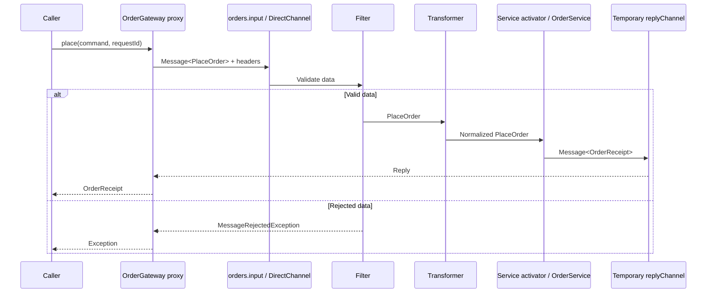

# Building a Flow from Gateway to Service Activator

## 1. Practice Objectives

In the **Comprehensive Practice** chapter of the **SPRING_INTEGRATION_CORE** module, you will build an order-intake flow using the Java DSL. The entry point is a Java interface; data flows through a `MessageChannel`, is validated and normalized, and then reaches a service activator to execute business logic. The result returns to the exact gateway call that sent the request.

After this lesson, you should be able to:

- Design a request/reply contract between a gateway and a service.
- Distinguish business payloads from headers used for message processing.
- Connect a `DirectChannel`, filter, transformer, and service activator into an `IntegrationFlow`.
- Explain the reply path via `replyChannel`, even when the flow does not declare a final output channel.
- Ensure invalid data and business errors terminate with clear exceptions.
- Write tests that go through a real gateway and the entire flow in a Spring context.

You should know how to create Spring beans, use constructor injection, Java records, JUnit 5, and `BigDecimal` arithmetic. The exercise uses in-process integration patterns to focus on the core components of Spring Integration.

## 2. Problem Statement and Processing Contract

A sales application needs to provide an order placement operation:

```java
OrderReceipt place(PlaceOrder command, String requestId);
```

Sample input:

```text
orderId  = " ORD-001 "
sku      = " book-01 "
quantity = 2
unitPrice = 125000.00
requestId = "REQ-001"
```

Expected output:

```text
orderId  = "ORD-001"
sku      = "BOOK-01"
quantity = 2
total    = 250000.00
status   = "ACCEPTED"
requestId = "REQ-001"
```

Lab rules:

| Component | Contract |
| --- | --- |
| `orderId`, `sku` | Must have a value and not contain only whitespace |
| `quantity` | Greater than 0 |
| `unitPrice` | Non-`null`, greater than 0; sample data uses the same currency |
| Normalization | Trim leading/trailing whitespace from the order ID; also convert SKU to uppercase |
| `requestId` | Required header, non-blank; echoed in the result for correlation |
| SKU `BLOCKED` | Simulates a blocked item; the service throws a business exception |
| Success | Returns an `OrderReceipt` with total equal to unit price multiplied by quantity |

`ACCEPTED` in this lesson only represents the sample service's decision. There is no database write, inventory reservation, or payment yet. If you add those operations, you must redefine the meaning of the result and transaction boundaries.

## 3. Designing the Message Path



Roles in the design:

| Component | Responsibility in the lab |
| --- | --- |
| `OrderGateway` | Contract that the caller uses to send requests and receive results |
| `Message<PlaceOrder>` | Carries the order data along with call metadata |
| `orders.input` | Stable connection point between the gateway and endpoints |
| Filter | Blocks invalid data before normalization and business processing |
| Transformer | Creates a new payload with normalized order ID and SKU |
| Service activator | Calls `OrderService.place(...)` when receiving a message |
| `OrderService` | Applies the blocked-SKU rule and calculates the total amount |

The lab chooses `DirectChannel`: the handler is invoked on the sending thread, without needing a poller. Multiple subscribers on this same channel do not form sequential processing steps; they act as competing consumers according to the dispatcher mechanism. Therefore, each stage of the pipeline has only one primary consumer. See [Message Channel Implementations](https://docs.spring.io/spring-integration/reference/6.5/channel/implementations.html).

## 4. Preparing the Project

The example uses Java 17, Maven, and Spring Boot 3.5.0 as a reproducible baseline. Spring Boot manages the dependency set, including the corresponding Spring Integration version; do not assign individual versions to each Spring Integration library. This is the lab baseline, not a claim about the latest release. Release details are at [Spring Boot 3.5.0](https://spring.io/blog/2025/05/22/spring-boot-3-5-0-available-now).

Create a learning project with the structure:

```text
order-flow-lab/
├── pom.xml
└── src/
    ├── main/java/com/example/orderflow/
    │   ├── OrderFlowApplication.java
    │   ├── PlaceOrder.java
    │   ├── OrderReceipt.java
    │   ├── OrderGateway.java
    │   ├── OrderService.java
    │   └── OrderFlowConfiguration.java
    └── test/java/com/example/orderflow/
        └── OrderFlowTest.java
```

Contents of `pom.xml`:

```xml
<?xml version="1.0" encoding="UTF-8"?>
<project xmlns="http://maven.apache.org/POM/4.0.0"
         xmlns:xsi="http://www.w3.org/2001/XMLSchema-instance"
         xsi:schemaLocation="http://maven.apache.org/POM/4.0.0 https://maven.apache.org/xsd/maven-4.0.0.xsd">
    <modelVersion>4.0.0</modelVersion>

    <parent>
        <groupId>org.springframework.boot</groupId>
        <artifactId>spring-boot-starter-parent</artifactId>
        <version>3.5.0</version>
        <relativePath/>
    </parent>

    <groupId>com.example</groupId>
    <artifactId>order-flow-lab</artifactId>
    <version>1.0.0-SNAPSHOT</version>

    <properties>
        <java.version>17</java.version>
        <project.build.sourceEncoding>UTF-8</project.build.sourceEncoding>
    </properties>

    <dependencies>
        <dependency>
            <groupId>org.springframework.boot</groupId>
            <artifactId>spring-boot-starter-integration</artifactId>
        </dependency>
        <dependency>
            <groupId>org.springframework.boot</groupId>
            <artifactId>spring-boot-starter-test</artifactId>
            <scope>test</scope>
        </dependency>
    </dependencies>

    <build>
        <plugins>
            <plugin>
                <groupId>org.springframework.boot</groupId>
                <artifactId>spring-boot-maven-plugin</artifactId>
            </plugin>
        </plugins>
    </build>
</project>
```

All classes below belong to package `com.example.orderflow`. Keep the exact file names matching each `public` type so you can copy the example into a complete project.

## 5. Step 1: Define the Payload and Result

Contents of `PlaceOrder.java`:

```java
package com.example.orderflow;

import java.math.BigDecimal;

public record PlaceOrder(
        String orderId,
        String sku,
        int quantity,
        BigDecimal unitPrice
) {
}
```

Contents of `OrderReceipt.java`:

```java
package com.example.orderflow;

import java.math.BigDecimal;

public record OrderReceipt(
        String orderId,
        String sku,
        int quantity,
        BigDecimal total,
        String status,
        String requestId
) {
}
```

The input payload holds the business fields of the order placement request. `requestId` is passed separately via a header; the service includes this value in the receipt so the caller can easily correlate it.

Use `BigDecimal` for unit price and total amount. In the example, initialize using a string such as `new BigDecimal("125000.00")`. Decimal precision limits, rounding, taxes, and multiple currencies are rules to add if extending the problem.

## 6. Step 2: Declare the Gateway

Contents of `OrderGateway.java`:

```java
package com.example.orderflow;

import org.springframework.integration.annotation.MessagingGateway;
import org.springframework.messaging.handler.annotation.Header;

@MessagingGateway(
        defaultRequestChannel = "orders.input",
        defaultRequestTimeout = "1000",
        defaultReplyTimeout = "3000",
        errorOnTimeout = true
)
public interface OrderGateway {

    OrderReceipt place(
            PlaceOrder command,
            @Header("requestId") String requestId
    );
}
```

Spring creates a proxy for the interface. When the caller invokes `place`, the `command` argument becomes the payload and the `@Header`-annotated argument becomes the `requestId` header. The caller receives an `OrderReceipt` instead of manually calling message send/receive APIs. See [Messaging Gateways](https://docs.spring.io/spring-integration/reference/6.5/gateway.html).

Do not write an `OrderGatewayImpl` class manually. At startup, use `@IntegrationComponentScan` to register the gateway interface. This scan annotation is dedicated to gateway interfaces; see [MessagingGateway API](https://docs.spring.io/spring-integration/api/org/springframework/integration/annotation/MessagingGateway.html).

The timeout numbers in the annotation are in milliseconds. `errorOnTimeout = true` instructs it to throw an error when waiting for a reply times out instead of returning `null`; this option is available since Spring Integration 6.2. This mechanism is described in [errorOnTimeout API](https://docs.spring.io/spring-integration/api/org/springframework/integration/annotation/MessagingGateway.html#errorOnTimeout()).

## 7. Step 3: Write the Business Service

Contents of `OrderService.java`:

```java
package com.example.orderflow;

import java.math.BigDecimal;

import org.springframework.messaging.handler.annotation.Header;
import org.springframework.stereotype.Service;

@Service
public class OrderService {

    public OrderReceipt place(
            PlaceOrder command,
            @Header("requestId") String requestId
    ) {
        if (requestId == null || requestId.isBlank()) {
            throw new IllegalArgumentException("requestId must not be blank");
        }

        if ("BLOCKED".equals(command.sku())) {
            throw new IllegalStateException("SKU_BLOCKED: " + command.sku());
        }

        BigDecimal total = command.unitPrice()
                .multiply(BigDecimal.valueOf(command.quantity()));

        return new OrderReceipt(
                command.orderId(),
                command.sku(),
                command.quantity(),
                total,
                "ACCEPTED",
                requestId
        );
    }
}
```

The service receives the payload as `PlaceOrder`; `@Header` on the remaining parameter instructs the endpoint to extract metadata from the message. This annotation is a dependency point on Spring Messaging's mapping mechanism. The total calculation can still be tested directly as a plain Java method.

The service activator is the endpoint connecting a message to a bean method call. In Java DSL, `.handle(orderService, "place")` configures that endpoint; `@Service` only registers the business bean. How payloads and headers are mapped is covered in [Service Activator](https://docs.spring.io/spring-integration/reference/6.5/service-activator.html).

Keep the method return type explicit. Do not change it to `void` while the gateway still requires an `OrderReceipt`.

## 8. Step 4: Assemble the Flow Using Java DSL

Contents of `OrderFlowConfiguration.java`:

```java
package com.example.orderflow;

import java.util.Locale;

import org.springframework.context.annotation.Bean;
import org.springframework.context.annotation.Configuration;
import org.springframework.integration.channel.DirectChannel;
import org.springframework.integration.dsl.IntegrationFlow;

@Configuration(proxyBeanMethods = false)
public class OrderFlowConfiguration {

    @Bean(name = "orders.input")
    DirectChannel ordersInput() {
        return new DirectChannel();
    }

    @Bean
    IntegrationFlow placeOrderFlow(OrderService orderService) {
        return IntegrationFlow.from("orders.input")
                .<PlaceOrder>filter(
                        OrderFlowConfiguration::valid,
                        endpoint -> endpoint
                                .id("orders.validate")
                                .throwExceptionOnRejection(true)
                )
                .<PlaceOrder, PlaceOrder>transform(
                        OrderFlowConfiguration::normalize,
                        endpoint -> endpoint.id("orders.normalize")
                )
                .handle(
                        orderService,
                        "place",
                        endpoint -> endpoint
                                .id("orders.place")
                                .requiresReply(true)
                )
                .get();
    }

    private static boolean valid(PlaceOrder command) {
        return command != null
                && command.orderId() != null
                && !command.orderId().isBlank()
                && command.sku() != null
                && !command.sku().isBlank()
                && command.quantity() > 0
                && command.unitPrice() != null
                && command.unitPrice().signum() > 0;
    }

    private static PlaceOrder normalize(PlaceOrder command) {
        return new PlaceOrder(
                command.orderId().trim(),
                command.sku().trim().toUpperCase(Locale.ROOT),
                command.quantity(),
                command.unitPrice()
        );
    }
}
```

### 8.1. Filter Guards Input Conditions

The filter stands before the transformer to reject cases that cannot be normalized, such as a `null` SKU. The lab enables `throwExceptionOnRejection(true)` so invalid requests terminate with `MessageRejectedException`. If the filter drops a message without producing a reply or error, a caller waiting for a result will block until timeout. See [MessageFilter](https://docs.spring.io/spring-integration/docs/6.5.0/api/org/springframework/integration/filter/MessageFilter.html).

The `command != null` check does not mean the gateway accepts a `null` payload: message construction itself may reject such input before the filter. The test cases below send a command with an invalid field to exercise the exact endpoint being studied.

### 8.2. Transformer Only Normalizes Data

The `normalize` method creates a new record while preserving quantity and unit price. For example, `" book-01 "` becomes `"BOOK-01"`; the original payload held by the caller keeps its initial value.

Java DSL registers the endpoints and connects consecutive stages with channels. The `filter`, `transform`, and `handle` operators correspond to different roles in the pipeline. Refer to [Java DSL Basics](https://docs.spring.io/spring-integration/reference/6.5/dsl/java-basics.html).

### 8.3. The Final Endpoint Must Produce a Reply

`.requiresReply(true)` turns a `null` return from the service into a `ReplyRequiredException`. This is an output contract check, separate from the filter's data validation. The final endpoint does not declare an output channel, so the result is sent to the request's `replyChannel`. See [Service Activator reply rules](https://docs.spring.io/spring-integration/reference/6.5/service-activator.html).

`orders.validate`, `orders.normalize`, and `orders.place` are endpoint IDs; `orders.input` is a channel name. Giving distinct names helps identify the exact location when inspecting errors or managing endpoint lifecycles.

## 9. Step 5: Boot and Test Run

Contents of `OrderFlowApplication.java`:

```java
package com.example.orderflow;

import java.math.BigDecimal;

import org.springframework.boot.ApplicationRunner;
import org.springframework.boot.SpringApplication;
import org.springframework.boot.autoconfigure.SpringBootApplication;
import org.springframework.boot.autoconfigure.condition.ConditionalOnProperty;
import org.springframework.context.annotation.Bean;
import org.springframework.integration.annotation.IntegrationComponentScan;

@SpringBootApplication
@IntegrationComponentScan(basePackageClasses = OrderGateway.class)
public class OrderFlowApplication {

    public static void main(String[] args) {
        SpringApplication.run(OrderFlowApplication.class, args);
    }

    @Bean
    @ConditionalOnProperty(name = "demo.run", havingValue = "true")
    ApplicationRunner sampleOrder(OrderGateway gateway) {
        return args -> {
            OrderReceipt receipt = gateway.place(
                    new PlaceOrder(
                            " ORD-001 ",
                            " book-01 ",
                            2,
                            new BigDecimal("125000.00")
                    ),
                    "REQ-001"
            );

            System.out.println(receipt);
        };
    }
}
```

The Spring Integration starter provides auto-configuration in a Spring Boot application. `@IntegrationComponentScan` specifies the package containing the gateway; standard component scanning finds configuration and service classes in the same package tree.

In the lab project directory, check Java/Maven and run:

```powershell
mvn -v
mvn test
mvn spring-boot:run "-Dspring-boot.run.arguments=--demo.run=true"
```

Expected output line, aside from startup logs:

```text
OrderReceipt[orderId=ORD-001, sku=BOOK-01, quantity=2, total=250000.00, status=ACCEPTED, requestId=REQ-001]
```

Replace the SKU with `" blocked "` to observe the business error after normalization. Run again with `quantity = 0` to observe the error from the filter. Do not conclude the flow succeeds just because the application starts: you must receive the expected receipt or the expected error according to the input.

## 10. Step 6: Test Through the Real Gateway

Tests go through `OrderGateway` to cover message construction, header binding, filter, transformer, service, and the reply path. Unit tests calling `OrderService.place` directly only verify business logic and do not prove the flow is wired properly.

Contents of `OrderFlowTest.java`:

```java
package com.example.orderflow;

import java.math.BigDecimal;

import org.junit.jupiter.api.Test;
import org.springframework.beans.factory.annotation.Autowired;
import org.springframework.boot.test.context.SpringBootTest;
import org.springframework.integration.MessageRejectedException;

import static org.assertj.core.api.Assertions.assertThat;
import static org.junit.jupiter.api.Assertions.assertThrows;

@SpringBootTest(
        classes = OrderFlowApplication.class,
        webEnvironment = SpringBootTest.WebEnvironment.NONE,
        properties = "demo.run=false"
)
class OrderFlowTest {

    @Autowired
    private OrderGateway gateway;

    @Test
    void shouldReturnNormalizedOrderAndCalculatedTotal() {
        PlaceOrder command = order(" ORD-001 ", " book-01 ", 2);

        OrderReceipt receipt = gateway.place(command, "REQ-001");

        assertThat(receipt.orderId()).isEqualTo("ORD-001");
        assertThat(receipt.sku()).isEqualTo("BOOK-01");
        assertThat(receipt.quantity()).isEqualTo(2);
        assertThat(receipt.total()).isEqualByComparingTo("250000.00");
        assertThat(receipt.status()).isEqualTo("ACCEPTED");
        assertThat(receipt.requestId()).isEqualTo("REQ-001");
        assertThat(command.sku()).isEqualTo(" book-01 ");
    }

    @Test
    void shouldRejectInvalidQuantityAtFilter() {
        RuntimeException error = assertThrows(
                RuntimeException.class,
                () -> gateway.place(order("ORD-002", "BOOK-01", 0), "REQ-002")
        );

        assertThat(rootCause(error))
                .isInstanceOf(MessageRejectedException.class);
    }

    @Test
    void shouldPropagateBusinessFailure() {
        RuntimeException error = assertThrows(
                RuntimeException.class,
                () -> gateway.place(order("ORD-003", " blocked ", 1), "REQ-003")
        );

        assertThat(rootCause(error))
                .isInstanceOf(IllegalStateException.class)
                .hasMessage("SKU_BLOCKED: BLOCKED");
    }

    @Test
    void shouldRejectBlankRequestId() {
        RuntimeException error = assertThrows(
                RuntimeException.class,
                () -> gateway.place(order("ORD-004", "BOOK-01", 1), " ")
        );

        assertThat(rootCause(error))
                .isInstanceOf(IllegalArgumentException.class)
                .hasMessage("requestId must not be blank");
    }

    @Test
    void shouldKeepRepliesAssociatedWithEachCall() {
        OrderReceipt first = gateway.place(
                order("ORD-A", "BOOK-01", 1), "REQ-A"
        );
        OrderReceipt second = gateway.place(
                order("ORD-B", "BOOK-02", 3), "REQ-B"
        );

        assertThat(first.orderId()).isEqualTo("ORD-A");
        assertThat(first.requestId()).isEqualTo("REQ-A");
        assertThat(first.total()).isEqualByComparingTo("125000.00");
        assertThat(second.orderId()).isEqualTo("ORD-B");
        assertThat(second.requestId()).isEqualTo("REQ-B");
        assertThat(second.total()).isEqualByComparingTo("375000.00");
    }

    private static PlaceOrder order(String id, String sku, int quantity) {
        return new PlaceOrder(id, sku, quantity, new BigDecimal("125000.00"));
    }

    private static Throwable rootCause(Throwable error) {
        Throwable current = error;
        while (current.getCause() != null && current.getCause() != current) {
            current = current.getCause();
        }
        return current;
    }
}
```

Assertions verify the result and the cause of failure rather than merely checking for any arbitrary exception. The `rootCause` helper lets you inspect the business exception despite messaging wrapper layers. In real diagnostics, keep the outer exception as well because it may contain message and endpoint details.

The final test checks two sequential calls, which is not proof of correctness under concurrent load. If extending to parallel processing, add concurrent call cases and verify each `orderId`/`requestId` pair.

Advanced exercises can add `spring-integration-test` and `MockIntegrationContext` to replace the handler of an endpoint by ID. The test suite here intentionally runs the real service to verify full-flow wiring. See [Testing Support](https://docs.spring.io/spring-integration/reference/6.5/testing.html).

## 11. Tracing Payloads, Headers, and Replies

For request `ORD-001`, set breakpoints at `valid`, `normalize`, and `OrderService.place`, then fill in an observation table:

| Location | Payload to observe | Metadata to track |
| --- | --- | --- |
| After gateway | `PlaceOrder` with SKU `" book-01 "` | `requestId = REQ-001` |
| After filter | Valid command, business content unchanged | `requestId` still present |
| After transformer | `PlaceOrder` with SKU `BOOK-01` | Necessary headers for replying remain intact |
| Inside service | Normalized command | `requestId` parameter is `REQ-001` |
| At caller | `OrderReceipt` with total `250000.00` | Receipt contains `requestId = REQ-001` |

The gateway creates a temporary reply channel and puts that address in the `replyChannel` header. The final endpoint uses this return address when it has no dedicated output channel. The lab's `requestId` field is only for business correlation; it does not route the reply back to the caller itself. See [Setting the Default Reply Channel](https://docs.spring.io/spring-integration/reference/6.5/gateway.html#gateway-default-reply-channel).

Do not assume the ID of every message in the flow stays the same. When normalizing payloads or creating replies, the framework may construct new messages. If you write a transformer manually using `MessageBuilder`, actively preserve required headers; creating a message with only a new payload can lose the reply address.

## 12. Error Handling and Understanding Timeouts Correctly

### 12.1. Separating Data Errors from Business Errors

In the current design, invalid data is rejected by the filter; a blocked SKU reaches the service and raises a business error. Both are failed endings of the order placement operation. Do not catch all exceptions and return a default `ACCEPTED` receipt.

With a synchronous flow and a gateway that does not configure a separate `errorChannel`, the exception is propagated back to the caller. Do not assume that every synchronous error is published to the global `errorChannel` bean. If switching to asynchronous channels, you must design message-based error routing. See [Error Handling](https://docs.spring.io/spring-integration/reference/6.5/error-handling.html).

If you want to convert an error into a business result such as `REJECTED`, first extend the result contract with appropriate error codes and statuses. Only then design an error flow that produces the proper response type; an error handler that only logs will not supply a reply to a waiting caller.

### 12.2. Two Timeouts Solve Two Different Problems

| Configuration in the lab | Meaning |
| --- | --- |
| `defaultRequestTimeout = "1000"` | Send wait limit when sending to a channel that may block |
| `defaultReplyTimeout = "3000"` | Wait limit for the reply phase |
| `errorOnTimeout = true` | Throw an error on reply timeout instead of returning `null` |
| `requiresReply(true)` | Endpoint must produce a result; returning `null` violates the contract |

When the entire flow runs synchronously over `DirectChannel`, `replyTimeout` does not interrupt an executing service. If the service takes 10 seconds, setting reply timeout to 3 seconds does not turn that call into a 3-second total timeout. Only when processing crosses onto another thread does the reply wait time limit how long the caller waits for a result; it still does not automatically cancel the background task. See [Gateway Behavior When No Response Arrives](https://docs.spring.io/spring-integration/reference/6.5/gateway.html#gateway-behavior-no-response).

If the service makes HTTP or database calls, configure timeouts on the respective clients and decide how to handle late results. This is an additional business decision, especially when a request may have already caused side effects before the caller received an error.

## 13. Variant: Registering the Service Activator via Annotation

The Java DSL in this lesson created the endpoint invoking the service. To understand the equivalent annotation configuration, you can try a minimal version with only a channel and a service activator:

```java
@Service
public class OrderService {

    @ServiceActivator(inputChannel = "orders.input", requiresReply = "true")
    public OrderReceipt place(
            PlaceOrder command,
            @Header("requestId") String requestId
    ) {
        // Reuse the OrderService processing logic above.
    }
}
```

This is an alternative snippet for illustration, not a complete file to copy verbatim: you must import `ServiceActivator` from `org.springframework.integration.annotation` and keep the full method body from step 3.

When trying this variant, **remove the `placeOrderFlow` bean**, keeping only the channel bean and the service. The filter and transformer from the DSL version will no longer exist, so you must provide valid, normalized data or configure equivalent steps.

Do not leave both this annotation and the DSL flow subscribed to `orders.input` simultaneously. You would create two competing consumers, one of which could bypass validation or normalization. To revert to the original lesson, remove `@ServiceActivator` and restore `placeOrderFlow`.

## 14. Diagnosing by Symptom

| Symptom | What to check | How to verify in the lab |
| --- | --- | --- |
| Cannot inject `OrderGateway` | `@IntegrationComponentScan` scope | Is the gateway in a scanned package? |
| Message sent but no subscriber | Channel name, flow bean, and endpoint lifecycle | Does `orders.input` match in both gateway and configuration? |
| Caller waits then times out | A branch produces no reply or error | Does a filter drop the message, the service return `void`, or the result go to another channel? |
| Service receives unnormalized SKU | Miswired processing path or competing consumer | Does a breakpoint hit `normalize` before `place`? |
| Cannot bind header parameter | Wrong header name or missing metadata | Compare both `@Header("requestId")` annotations |
| Error resolving handler method | Wrong name in `.handle(..., "place")` or mismatched signature | Is the method `public`, and do payload and header types match? |
| `ReplyRequiredException` error | Service returns `null` | Check all return paths in the service |
| Timeout set but call still slow | Service runs on the caller thread | Review thread boundaries and timeouts of resources used by the service |

When reading a stack trace, start from the endpoint ID closest to where the error occurred, check the payload and `requestId`, and then inspect the cause chain. If adding logs, prioritize order ID, request ID, and processing outcome; log only the data needed for diagnosis.

## 15. Extension Exercises and Completion Criteria

Complete the base version before adding other integration patterns:

1. Add tests for whitespace-only `orderId`, `null` SKU, `null` unit price, zero unit price, and negative quantity. Determine whether the error occurs at the filter or before the filter.
2. Put a discount rule into a separate transformer and update the total assertion. Keep the service activator as the place that decides order acceptance.
3. Add a router to classify orders by total amount; each branch must produce the same `OrderReceipt` type or throw a clear error.
4. If extending to multiple line items, describe how splitter and aggregator use correlation keys, completion conditions, and timeouts. Only implement after defining what an order missing a line item should return.
5. Try replacing a processing boundary with `ExecutorChannel` or `QueueChannel`; before running, predict the thread, poller requirement, error path, and timeout behavior. `QueueChannel` requires a consumer receiving/polling messages; changing the channel type does not create that consumer automatically.

The base version is considered complete when:

- The caller only calls the gateway to place an order and receives a receipt with accurate data.
- The order ID and SKU are normalized before the service runs.
- Invalid data terminates with an error from the filter; a blocked SKU terminates with a business error.
- `requestId` travels from the gateway to the service and is correlated in the result.
- All five sample tests pass in the constructed lab project.
- You can explain which channel receives the request, which endpoint calls the service, and which address the reply uses to return to the caller.

The code in this lesson is a guide for building the lab; test results must be verified in the learner's practice environment.