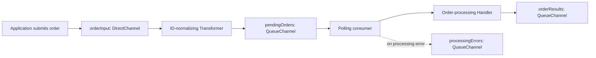

# Creating DirectChannel and QueueChannel

In the **Comprehensive Practice** chapter of the `SPRING_INTEGRATION_CORE` module, this lesson builds an order-intake flow to clarify two message-passing mechanisms: invoking a handler immediately on the sending thread and storing messages in a queue for a handler to retrieve later. From these two channels, you will connect `Message`, transformers, endpoints, and the Java DSL into an observable and testable hands-on exercise.

The focus is on determining **where the message is, who retrieves it, which thread the handler runs on, and what the send result means**. These conclusions form the foundation when adding gateways, routers, filters, or aggregators in larger integration flows.

## 1. Objectives and Practice Scenario

After this lesson, you will be able to:

- Create a `DirectChannel`, register a `MessageHandler`, and prove that the handler runs before the `send()` call finishes.
- Create a bounded `QueueChannel`; send, receive, and verify full-queue and empty-queue scenarios.
- Distinguish between `MessageChannel`, `SubscribableChannel`, and `PollableChannel`.
- Connect a synchronous processing segment with a poller-based processing segment using the Java DSL.
- Write tests for same-thread execution, FIFO ordering, capacity, and post-queue processing errors.

Suppose a system receives an order from a web UI. The order ID must be normalized immediately, while business processing is handed off through a queue:



Here, channels transport messages; transformers and handlers perform the logic. `orderResults` is where the test receives results, and `processingErrors` is where poller errors arrive. Bean names express roles, not channel types.

## 2. Reviewing the Required Contracts

A `Message<T>` contains a payload of type `T` and headers describing context. In the lab, the payload is a string or an `Order` record; the `source` header indicates where the order originated.

The interfaces divide responsibilities as follows:

| Interface | Key operations | How it is used in this lesson |
| --- | --- | --- |
| `MessageChannel` | `send(message)`, `send(message, timeout)` | The sender does not need to know how messages are consumed |
| `SubscribableChannel` | `subscribe(handler)`, `unsubscribe(handler)` | Attaches a handler to `DirectChannel` |
| `PollableChannel` | `receive()`, `receive(timeout)` | Retrieves messages from `QueueChannel` |

`send()` returns `boolean`; `receive(timeout)` returns a message or `null` when none arrives within the wait time. `DirectChannel` has no `receive()` method because it uses a handler subscription mechanism. See the contract at [The MessageChannel Interface](https://docs.spring.io/spring-integration/reference/channel/interfaces.html).

### 2.1. DirectChannel: Handing Off Directly to the Handler

With a registered handler, `DirectChannel` invokes the handler on the very thread performing the send. The sequence is `before send → handler → after send`. The channel does not create a buffer to wait for a consumer to appear. This same-thread behavior is described in the [DirectChannel API](https://docs.spring.io/spring-integration/api/org/springframework/integration/channel/DirectChannel.html).

In the order model, choose this segment for normalizing the ID before accepting the work into the queue. If normalization fails, the caller is still on the same call stack and can catch the exception.

### 2.2. QueueChannel: Buffering for Active Retrieval by the Receiver

`new QueueChannel(2)` creates a queue holding at most two waiting messages. When space is available, the sender can enqueue messages even without a receiver present. A successful `receive()` removes a message from the queue. Constructors and capacity inspection methods are in the [QueueChannel API](https://docs.spring.io/spring-integration/api/org/springframework/integration/channel/QueueChannel.html).

**QueueChannel does not create worker threads on its own.** In the plain Java example below, the `main` thread itself sends and then receives. In the Java DSL configuration, a polling endpoint is scheduled to receive and process messages. Only in the second case does processing run on a scheduler thread.

### 2.3. Comparison Table for Lab Design

| Question | DirectChannel | Default QueueChannel in this lesson |
| --- | --- | --- |
| Who triggers consumption? | The send call triggers the registered handler | A receiver or polling consumer calls receive |
| Does it store waiting messages? | No | Yes, in memory |
| Where does the handler run? | On the sending thread | On the thread performing retrieval and processing |
| What if no consumer exists yet? | Having no subscriber causes a send error | Can hold messages if space remains |
| What limits intake rate? | Synchronous processing duration | Free space and queue wait policy |
| Does it broadcast copies to every consumer? | No | No |

Both have point-to-point semantics. With multiple subscribers, `DirectChannel` selects a handler according to its dispatching strategy; failover can try another handler if the previous one throws an error. With multiple receivers on a queue, receivers compete for messages. If broadcasting is needed, you must design a separate multi-target dispatch step. Details on dispatching, failover, and storage limits are covered in [Message Channel Implementations](https://docs.spring.io/spring-integration/reference/channel/implementations.html).

## 3. Preparing the Environment

Use a Spring Boot project configured with a parent or BOM compatible with the project's JDK. The examples use `record` and can be placed in a project running Java 17 or higher, provided it meets the Java requirement of the chosen Spring Boot version.

Add the following dependencies to the practice project. You do not need to declare individual versions for each library when they are managed by Spring Boot:

```xml
<dependencies>
    <dependency>
        <groupId>org.springframework.boot</groupId>
        <artifactId>spring-boot-starter-integration</artifactId>
    </dependency>
    <dependency>
        <groupId>org.springframework.boot</groupId>
        <artifactId>spring-boot-starter-test</artifactId>
        <scope>test</scope>
    </dependency>
</dependencies>
```

If using Gradle, the corresponding dependency block is:

```groovy
dependencies {
    implementation 'org.springframework.boot:spring-boot-starter-integration'
    testImplementation 'org.springframework.boot:spring-boot-starter-test'
}

test {
    useJUnitPlatform()
}
```

These snippets assume the project already has Spring Boot's version management mechanism in place. Choose a build tool matching your project.

Organize the example classes as follows; all required source code is provided in this lesson:

```text
src/main/java/lab/channels/ChannelBasicsDemo.java
src/main/java/lab/channels/OrderChannelConfiguration.java
src/test/java/lab/channels/ChannelContractTest.java
src/test/java/lab/channels/OrderChannelFlowTest.java
```

The first two examples instantiate channels directly in Java. The Java DSL example uses `AnnotationConfigApplicationContext`, so a `@SpringBootApplication` class is not required to run these tests.

## 4. Step 1 — Observing Behavior with Plain Java

Create the `ChannelBasicsDemo` class:

```java
package lab.channels;

import org.springframework.integration.channel.DirectChannel;
import org.springframework.integration.channel.QueueChannel;
import org.springframework.messaging.Message;
import org.springframework.messaging.support.MessageBuilder;

public class ChannelBasicsDemo {

    public static void main(String[] args) {
        demonstrateDirectChannel();
        demonstrateQueueChannel();
    }

    private static void demonstrateDirectChannel() {
        DirectChannel direct = new DirectChannel();

        direct.subscribe(message -> System.out.printf(
                "DIRECT handler: payload=%s, source=%s, thread=%s%n",
                message.getPayload(),
                message.getHeaders().get("source"),
                Thread.currentThread().getName()));

        Message<String> order = order("ORDER-001");

        System.out.println("DIRECT before send");
        boolean accepted = direct.send(order);
        System.out.println("DIRECT after send: " + accepted);
    }

    private static void demonstrateQueueChannel() {
        QueueChannel queue = new QueueChannel(2);

        System.out.println("QUEUE send A: " + queue.send(order("A"), 0));
        System.out.println("QUEUE send B: " + queue.send(order("B"), 0));
        System.out.println("QUEUE send C: " + queue.send(order("C"), 0));
        System.out.println("QUEUE size: " + queue.getQueueSize());

        printReceived(queue.receive(0));
        System.out.println("QUEUE retry C: " + queue.send(order("C"), 0));
        printReceived(queue.receive(0));
        printReceived(queue.receive(0));
        printReceived(queue.receive(0));
    }

    private static Message<String> order(String id) {
        return MessageBuilder.withPayload(id)
                .setHeader("source", "web")
                .build();
    }

    private static void printReceived(Message<?> message) {
        if (message == null) {
            System.out.println("QUEUE receive: null");
            return;
        }

        System.out.printf("QUEUE receive: %s, thread=%s%n",
                message.getPayload(),
                Thread.currentThread().getName());
    }
}
```

Run `main()` from your IDE. If the program thread is named `main`, the output is:

```text
DIRECT before send
DIRECT handler: payload=ORDER-001, source=web, thread=main
DIRECT after send: true
QUEUE send A: true
QUEUE send B: true
QUEUE send C: false
QUEUE size: 2
QUEUE receive: A, thread=main
QUEUE retry C: true
QUEUE receive: B, thread=main
QUEUE receive: C, thread=main
QUEUE receive: null
```

Read the output by observation milestones:

1. The `DIRECT handler` line appears between the lines before and after `send()`: handler invocation happens inside the send call.
2. The queue accepted `A` and `B` even though there was no receiver yet.
3. `C` was rejected on the first attempt because the queue was full; using a timeout of `0` meant the program did not wait.
4. Receiving `A` freed one slot. Retrying `C` succeeded, and the remaining receive order was `B`, then `C`.
5. When the queue is empty, `receive(0)` returns `null`.
6. All receive operations ran on `main`: no scheduler or worker was created in this example.

`getQueueSize()` produces a deterministic result here because only one thread operates on it. In a flow with concurrent consumers, this value reflects only a single instant; you should not rely on it to assume the next send will succeed.

## 5. Step 2 — Choosing Timeouts and Handling Send Results

In calls taking a `long timeout` parameter in this lesson, the unit is milliseconds:

| QueueChannel operation | Behavior to observe |
| --- | --- |
| `send(message, 0)` | Attempts to enqueue immediately; returns `false` if the queue is full |
| `send(message, 500)` | Waits for space up to roughly 500 ms; returns `false` on timeout |
| `receive(0)` | Retrieves immediately if available; returns `null` if empty |
| `receive(500)` | Waits for a message up to roughly 500 ms |
| `send(message)` | Can wait indefinitely if the queue is full |
| `receive()` | Can wait indefinitely if the queue is empty |

Do not use unbounded wait calls in a test without another thread modifying queue state. For example, if `main` fills the queue and then calls `send(message)` before receiving, it cannot advance to the `receive()` line below.

Define a rule for the sender instead of ignoring the return value:

```java
boolean accepted = queue.send(message, 200);
if (!accepted) {
    throw new IllegalStateException("Order could not be accepted within 200 ms");
}
```

This is an illustrative application policy. A production system might return a busy status, route work to another destination, or retry according to a defined rule. Avoid tight retry loops while consumers have not drained the queue.

With `DirectChannel`, passing a timeout to `send()` does not turn it into a handler execution time limit. If the handler calls a slow service, you must configure a timeout on that service call or redesign the execution boundary.

## 6. Step 3 — Testing the Contracts of Both Channels

Create `ChannelContractTest` under the test directory:

```java
package lab.channels;

import java.util.concurrent.atomic.AtomicReference;

import org.junit.jupiter.api.Test;
import org.springframework.integration.channel.DirectChannel;
import org.springframework.integration.channel.QueueChannel;
import org.springframework.messaging.Message;
import org.springframework.messaging.MessagingException;
import org.springframework.messaging.support.GenericMessage;

import static org.junit.jupiter.api.Assertions.*;

class ChannelContractTest {

    @Test
    void directInvokesHandlerOnTheSendingThreadBeforeReturning() {
        DirectChannel channel = new DirectChannel();
        Thread sender = Thread.currentThread();
        AtomicReference<Thread> handlerThread = new AtomicReference<>();
        AtomicReference<Object> handledPayload = new AtomicReference<>();

        channel.subscribe(message -> {
            handlerThread.set(Thread.currentThread());
            handledPayload.set(message.getPayload());
        });

        boolean accepted = channel.send(new GenericMessage<>("ORDER-001"));

        assertTrue(accepted);
        assertSame(sender, handlerThread.get());
        assertEquals("ORDER-001", handledPayload.get());
    }

    @Test
    void directWithoutSubscriberFailsInsteadOfBuffering() {
        DirectChannel channel = new DirectChannel();

        assertThrows(MessagingException.class,
                () -> channel.send(new GenericMessage<>("ORDER-001")));
    }

    @Test
    void queueBuffersWithoutReceiverAndReturnsMessagesInFifoOrder() {
        QueueChannel channel = new QueueChannel(2);

        assertTrue(channel.send(new GenericMessage<>("A"), 0));
        assertTrue(channel.send(new GenericMessage<>("B"), 0));
        assertEquals(2, channel.getQueueSize());

        Message<?> first = channel.receive(0);
        Message<?> second = channel.receive(0);

        assertNotNull(first);
        assertNotNull(second);
        assertEquals("A", first.getPayload());
        assertEquals("B", second.getPayload());
        assertNull(channel.receive(0));
    }

    @Test
    void fullQueueRejectsNewMessageAndPreservesTheAcceptedOne() {
        QueueChannel channel = new QueueChannel(1);

        assertTrue(channel.send(new GenericMessage<>("A"), 0));
        assertFalse(channel.send(new GenericMessage<>("B"), 0));
        assertEquals(1, channel.getQueueSize());

        Message<?> received = channel.receive(0);
        assertNotNull(received);
        assertEquals("A", received.getPayload());
        assertNull(channel.receive(0));

        assertTrue(channel.send(new GenericMessage<>("B"), 0));
    }

    @Test
    void emptyQueueCanBeCheckedWithoutWaiting() {
        QueueChannel channel = new QueueChannel(1);

        assertNull(channel.receive(0));
    }
}
```

The first test checks the `Thread` reference, so it does not depend on thread names assigned by an IDE or build tool. The queue tests have no background consumers, so they can use `receive(0)` and verify FIFO deterministically.

FIFO here refers to the order messages are pulled from the default queue. If multiple workers later process in parallel, an order pulled earlier may still finish after another; preserving result ordering requires additional design.

## 7. Step 4 — Connecting Both Channels Using Java DSL

Java DSL describes flows as `IntegrationFlow` beans. Spring registers the channels and endpoints when initializing the application context; the builder chain itself is not a running worker. This style of declaration is introduced in [Java DSL](https://docs.spring.io/spring-integration/reference/dsl.html).

In the configuration below:

- `ingressFlow` receives from `DirectChannel`, normalizes the ID, and sends to `pendingOrders`.
- `processingFlow` pulls orders from `pendingOrders` with a poller, validates the amount, and produces a result.
- The two final queues hold results or errors for the tests to actively receive.

Create the `OrderChannelConfiguration` class:

```java
package lab.channels;

import java.math.BigDecimal;
import java.time.Duration;
import java.util.Locale;

import org.springframework.beans.factory.annotation.Qualifier;
import org.springframework.context.annotation.Bean;
import org.springframework.context.annotation.Configuration;
import org.springframework.integration.config.EnableIntegration;
import org.springframework.integration.channel.DirectChannel;
import org.springframework.integration.channel.QueueChannel;
import org.springframework.integration.dsl.IntegrationFlow;
import org.springframework.integration.dsl.Pollers;

@Configuration(proxyBeanMethods = false)
@EnableIntegration
public class OrderChannelConfiguration {

    public record Order(String id, BigDecimal total) {
    }

    @Bean
    public DirectChannel orderInput() {
        return new DirectChannel();
    }

    @Bean
    public QueueChannel pendingOrders() {
        return new QueueChannel(10);
    }

    @Bean
    public QueueChannel orderResults() {
        return new QueueChannel(10);
    }

    @Bean
    public QueueChannel processingErrors() {
        return new QueueChannel(10);
    }

    @Bean
    public IntegrationFlow ingressFlow(
            @Qualifier("orderInput") DirectChannel input,
            @Qualifier("pendingOrders") QueueChannel pending) {

        return IntegrationFlow.from(input)
                .<Order, Order>transform(order -> {
                    System.out.printf("normalize: thread=%s%n",
                            Thread.currentThread().getName());
                    return new Order(
                            order.id().trim().toUpperCase(Locale.ROOT),
                            order.total());
                })
                .channel(pending)
                .get();
    }

    @Bean
    public IntegrationFlow processingFlow(
            @Qualifier("pendingOrders") QueueChannel pending,
            @Qualifier("orderResults") QueueChannel results) {

        return IntegrationFlow.from(pending)
                .handle(Order.class, (order, headers) -> {
                    System.out.printf("process: thread=%s%n",
                            Thread.currentThread().getName());

                    if (order.total().signum() <= 0) {
                        throw new IllegalArgumentException(
                                "Order total must be greater than 0");
                    }

                    return "PROCESSED:" + order.id();
                }, endpoint -> endpoint.poller(
                        Pollers.fixedDelay(Duration.ofMillis(100))
                                .receiveTimeout(0)
                                .maxMessagesPerPoll(5)
                                .errorChannel("processingErrors")))
                .channel(results)
                .get();
    }
}
```

`@EnableIntegration` provides the infrastructure for a plain Java application context. Because this example has no gateway to scan, `@IntegrationComponentScan` is not needed.

### 7.1. Why Is the Poller Attached to the Endpoint?

An endpoint consuming a `SubscribableChannel` is triggered when a message arrives. An endpoint consuming a `PollableChannel` must actively retrieve messages. Because `processingFlow` starts from a queue, the poller is configured on the first handler to create a polling consumer. See [Polling Consumer](https://docs.spring.io/spring-integration/reference/polling-consumer.html).

In this lesson, there is no default poller. If you remove the poller configuration from the queue-consuming handler, the application context lacks sufficient configuration to initialize that endpoint. Conversely, `orderResults` and `processingErrors` are just output queues on which the tests call `receive()`, so they do not need dedicated polling endpoints.

### 7.2. Reading the Poller Configuration Parameter by Parameter

| Configuration | Meaning in the example |
| --- | --- |
| `fixedDelay(Duration.ofMillis(100))` | Waits roughly 100 ms from the end of one poll cycle to the start of the next |
| `receiveTimeout(0)` | Each receive attempt does not wait when the queue is empty |
| `maxMessagesPerPoll(5)` | One poll cycle processes at most five messages if available |
| `errorChannel("processingErrors")` | Default destination receiving poller errors in this configuration |

The five-message limit does not create five threads and does not guarantee five orders will be processed every 100 ms. Handler execution time also contributes to the duration of a poll cycle. Refer to schedule definitions in [Pollers API](https://docs.spring.io/spring-integration/api/org/springframework/integration/dsl/Pollers.html) and properties in [PollerSpec API](https://docs.spring.io/spring-integration/api/org/springframework/integration/dsl/PollerSpec.html).

### 7.3. Identifying the Execution Boundary

In the configured flow, the sender performs the normalization step and then puts the message into the queue. The scheduler performs retrieval and order processing. Specific thread names may vary across environments; observe the `normalize` and `process` lines to recognize the boundary.

There are three distinct completion milestones:

1. Order ID normalization finishes.
2. The normalized message is sent into `pendingOrders`.
3. Processing finishes and the result is emitted into `orderResults`.

`input.send(...)` succeeding in this flow means the synchronous segment ran and the message was accepted by the queue. To know the business outcome, the test must receive the message from `orderResults`.

The consumer may pick up the order very quickly, even before the sender finishes printing its next log line. Therefore, do not use log ordering between two threads or the value of `pendingOrders.getQueueSize()` right after sending to conclude whether work has or has not completed.

The timeout passed to `input.send(message, timeout)` also does not automatically set a timeout for every step downstream of the transformer. When you need to bound the time taken to send from an endpoint to the next queue, you must configure that endpoint's own send operation; the queues in this lab are not filled up by the two test cases below.

## 8. Step 5 — Testing the Success Flow and Error Flow

Create `OrderChannelFlowTest`. Each test opens its own context and closes it upon completion, so leftover messages are not shared across tests:

```java
package lab.channels;

import java.math.BigDecimal;

import org.junit.jupiter.api.Test;
import org.springframework.context.annotation.AnnotationConfigApplicationContext;
import org.springframework.integration.channel.DirectChannel;
import org.springframework.integration.channel.QueueChannel;
import org.springframework.messaging.Message;
import org.springframework.messaging.MessagingException;
import org.springframework.messaging.support.ErrorMessage;
import org.springframework.messaging.support.MessageBuilder;

import static lab.channels.OrderChannelConfiguration.Order;
import static org.junit.jupiter.api.Assertions.*;

class OrderChannelFlowTest {

    @Test
    void normalizesAnOrderThenProcessesItFromTheQueue() {
        try (var context = new AnnotationConfigApplicationContext(
                OrderChannelConfiguration.class)) {

            DirectChannel input = context.getBean(
                    "orderInput", DirectChannel.class);
            QueueChannel results = context.getBean(
                    "orderResults", QueueChannel.class);

            Message<Order> request = MessageBuilder
                    .withPayload(new Order("  od-001  ",
                            new BigDecimal("150000")))
                    .setHeader("source", "web")
                    .build();

            assertTrue(input.send(request));

            Message<?> result = results.receive(3000);
            assertNotNull(result);
            assertEquals("PROCESSED:OD-001", result.getPayload());
            assertEquals("web", result.getHeaders().get("source"));
        }
    }

    @Test
    void sendsProcessingFailureToThePollerErrorChannel() {
        try (var context = new AnnotationConfigApplicationContext(
                OrderChannelConfiguration.class)) {

            DirectChannel input = context.getBean(
                    "orderInput", DirectChannel.class);
            QueueChannel errors = context.getBean(
                    "processingErrors", QueueChannel.class);
            QueueChannel results = context.getBean(
                    "orderResults", QueueChannel.class);

            Message<Order> request = MessageBuilder
                    .withPayload(new Order("od-err", BigDecimal.ZERO))
                    .setHeader("source", "web")
                    .build();

            assertTrue(input.send(request));

            Message<?> received = errors.receive(3000);
            ErrorMessage error = assertInstanceOf(ErrorMessage.class, received);
            MessagingException failure = assertInstanceOf(
                    MessagingException.class, error.getPayload());

            assertNotNull(failure.getFailedMessage());
            assertNull(results.receive(0));
        }
    }
}
```

Run both test classes from your IDE or with the command matching your practice project:

```text
Maven:  mvn test -Dtest=ChannelContractTest,OrderChannelFlowTest
Gradle: ./gradlew test --tests lab.channels.ChannelContractTest --tests lab.channels.OrderChannelFlowTest
```

On Windows PowerShell, run the Gradle Wrapper from the project root directory with `.\gradlew.bat test --tests lab.channels.ChannelContractTest --tests lab.channels.OrderChannelFlowTest`.

The expected result is **seven passing tests**: five channel contract tests and two flow tests. The examples do not use `Thread.sleep()`; calling `receive(3000)` waits for a meaningful condition—the arrival of a result or error—with a three-second cap so tests do not hang indefinitely. In an overloaded CI environment, you can intentionally adjust the wait limit.

### 8.1. Understanding the Post-Queue Error Case Correctly

In the second test, the order was already normalized and placed in the queue, so `input.send()` can succeed. The amount error occurs in the polling task. With the default Spring Integration infrastructure used here, this error is wrapped in an `ErrorMessage` and sent to the configured error channel. It does not travel back as an exception to the call stack of the sender that already finished. This mechanism is described in [Error Handling](https://docs.spring.io/spring-integration/reference/error-handling.html).

The test case verifies two outputs: an error message is present and there is no success result for that order. It does not imply the failed order is automatically placed back into `pendingOrders`. If you need retries or storing failed work for reprocessing, you must add a dedicated policy.

If you write your own `receive()` loop and invoke a handler outside a Spring Integration polling endpoint, you must manage exceptions and the error destination of that loop yourself.

## 9. Controlled Modification Exercises

### Exercise A — Testing Capacity with a Standalone Queue

Create a `QueueChannel(1)` with no background consumer, then execute in order:

```text
send(A, 0) → send(B, 0) → receive(0) → send(B, 0) → receive(0)
```

Expected result:

```text
true → false → A → true → B
```

Explain why message `B` from the failed send does not appear later on its own. Only the successful retry put it into the queue. Using a standalone queue ensures no background consumer alters state while you inspect it.

### Exercise B — Distinguishing Pre-Queue and Post-Queue Errors

Keep the flow unchanged and try two inputs:

| Input | Where the error occurs in the example code | Evidence to verify |
| --- | --- | --- |
| `new Order(null, new BigDecimal("10"))` | Transformer calls `trim()` before the queue | `input.send()` throws a `MessagingException` |
| `new Order("od-err", BigDecimal.ZERO)` | Handler processes after the queue | Receives `ErrorMessage` from `processingErrors` |

The first row is purely an experiment to locate the error boundary; in a real application, validate the order ID and throw a meaningful error instead of letting a `NullPointerException` occur. When writing tests, check the outer exception type per the messaging contract and inspect the root cause when diagnosing.

### Exercise C — Observing Competing Consumption

With a standalone queue of sufficient capacity, send `A`, `B`, `C`, `D`. Have two consumers call `receive()` on the same queue and record which consumer receives which payload.

What needs to be demonstrated is that four messages in total are retrieved and each message is retrieved only once in this no-retry experiment. It is not required that consumer 1 always receives `A`, or that each consumer always receives exactly two messages; thread scheduling determines the actual distribution.

### Exercise D — Explaining the Impact of Input Rate

Suppose the queue is initially empty, receives an average of 100 orders/second, and the consumer processes 60 orders/second. If those rates remain steady, the backlog grows by roughly 40 orders/second. With a capacity of 100, the queue can fill up in about 2.5 seconds.

This is an estimate to analyze a hypothetical scenario. Increasing capacity only extends how long spikes can be absorbed; you must measure processing time and adjust consumer capacity or intake policy if the mismatch persists.

## 10. Common Errors When Completing the Lab

| Symptom | Possible cause | How to check or fix |
| --- | --- | --- |
| Sending to DirectChannel reports no subscribers | Handler not registered, endpoint not started, or stopped | In plain Java, check `subscribe()`; in DSL, check context and endpoint |
| IDE cannot find `receive()` on DirectChannel | Confusing subscribe mechanism with polling mechanism | Use a handler or switch design to a queue if the receiver needs to pull actively |
| Main or test hangs at `send()` | Queue is full and the call waits indefinitely | Use a finite timeout and check the return value |
| Queue has data but handler does not run | No consumer, poller not started, or endpoint failed to initialize | Check poller configuration on the queue-consuming endpoint |
| Context initialization fails due to missing poller | Handler consumes from a queue without a dedicated or default poller | Restore `endpoint.poller(...)` from the example |
| `receive()` hangs the test when no message exists | Receive call has no wait limit | Use `receive(0)` for synchronous state or a finite timeout for background work |
| Queue size is already 0 when checked | Poller already retrieved the message | Check the final outcome instead of inferring from queue size |
| Send returns `true` but no result appears | Post-queue processing failed or is still running | Receive from `orderResults` with a timeout and check `processingErrors` |
| Flow runs briefly then stops progressing | Result or error queue is full because no receiver is draining it | Consume all outputs; inspect where threads are waiting |
| Two handlers do not both receive every message | Using point-to-point semantics | Design a publish-subscribe step if message fan-out is needed |
| Queued data disappears after restart | Default queue stores only in memory | Choose a persistent message store or suitable messaging infrastructure if required by the business |

In the sample configuration, all three queues are bounded to 10 messages. When increasing the number of sent orders, keep receiving results and errors; leaving outputs unconsumed can block the polling task when sending to output queues.

Additionally, an in-process queue does not automatically become a distributed queue across multiple instances. Nor does a channel automatically provide an exactly-once business processing guarantee. Recovering from process crashes or controlling redelivery and duplicates requires corresponding storage and business design.

## 11. Completion Criteria

The lab is complete when you have all of the following evidence:

- [ ] Run the demo and explain why the DirectChannel handler output appears between the lines before and after `send()`.
- [ ] Prove that the direct handler runs on the exact same `Thread` object as the sender.
- [ ] Observe the queue accepting messages with no receiver and returning them in FIFO order in a single-consumer test.
- [ ] Verify that a full queue returns `false` without losing previously accepted messages.
- [ ] Initialize a Java DSL flow with a polling consumer after `pendingOrders`.
- [ ] Receive `PROCESSED:OD-001` with header `source=web` in the success case.
- [ ] Receive an `ErrorMessage` in the invalid-amount case and explain the error boundary.
- [ ] Distinguish the three milestones: normalized, enqueued, and processed.

From this flow, you can continue adding a filter to reject invalid orders, a router to split order groups, or a gateway to expose a business call interface. As you expand, mark every synchronous boundary, queue, and error destination again to preserve explainability and testability of the message flow.