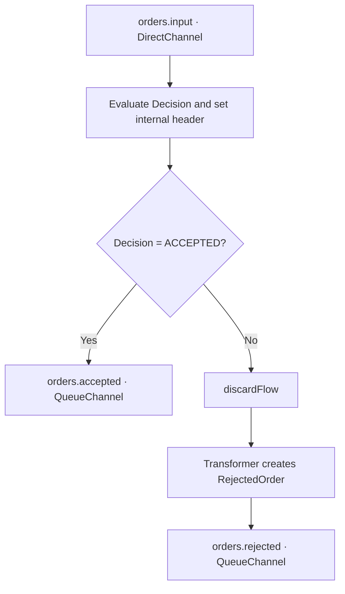

# Creating a Filter and Discard Flow

In the **Comprehensive Practice** chapter of the **SPRING_INTEGRATION_CORE** module, this lesson builds an order-intake flow: valid messages continue; messages failing the rules enter a rejection branch with a reason code. Through this, you combine `Message`, `MessageChannel`, endpoints, transformers, and the Java DSL, and then test outcomes on both branches.

## 1. Learning Outcomes and Problem Statement

After this practice, you will be able to:

- Write acceptance conditions based on both payload and headers.
- Use `filter` to guard the main processing flow.
- Configure `discardFlow` to record rejected messages.
- Distinguish a business rejection from a processing failure that raises an exception.
- Verify content, headers, and message counts at each output.

Suppose a retail system only accepts orders for tenant `retail-vn`. Every order must have an order ID, customer ID, and a minimum total of **100,000 VND**. The validation order is explicitly defined:

| Order | Failed condition | Result |
| --- | --- | --- |
| 1 | Payload is not an `Order` | `UNSUPPORTED_PAYLOAD` |
| 2 | `tenantId` header missing or not `retail-vn` | `UNSUPPORTED_TENANT` |
| 3 | `orderId` null, empty, or whitespace-only | `MISSING_ORDER_ID` |
| 4 | `customerId` null, empty, or whitespace-only | `MISSING_CUSTOMER_ID` |
| 5 | `total` null | `INVALID_AMOUNT` |
| 6 | `total < 100000` | `BELOW_MINIMUM` |
| 7 | Passes all conditions | `ACCEPTED` |

If an order violates multiple conditions, the lab records **the first failure according to the table**. A total equal to the exact threshold is accepted; negative numbers and zero fall under `BELOW_MINIMUM`. All monetary amounts in this lesson use the same VND unit.

This is the contract of the practice exercise. When real-world rules require returning all errors, replace the single decision with a structure holding a list of errors and update the tests accordingly.

## 2. What Does a Filter Decide?

A filter answers the question: **should this message continue past the current endpoint?** If the selector returns `true`, the message is forwarded; if it returns `false`, the rejection policy applies. A filter does not transform an order into a different payload type. [Spring Integration Filter Documentation](https://docs.spring.io/spring-integration/reference/filter.html).

| Component | Responsibility in this lesson |
| --- | --- |
| Header enricher | Evaluates the validation decision and adds it to a header |
| Filter | Allows or blocks the message based on that decision |
| Transformer in discard flow | Creates a rejection record containing the reason code |
| Accepted channel | Receives orders permitted for further processing |
| Rejected channel | Receives records for observation or storage |

`discard` means removing from the main path. We can still keep an audit trail or route the message elsewhere for handling.

`discardFlow(...)` declares the handling branch directly on the filter; `discardChannel(...)` points to a channel and lets you define that branch in a separate flow. Choose one approach for the same rejection branch. [FilterEndpointSpec API](https://docs.spring.io/spring-integration/api/org/springframework/integration/dsl/FilterEndpointSpec.html).

### Flow Diagram



In this lesson, the filter is the `eligibleOrderFilter` endpoint; the channels connect the processing steps. Do not combine the roles of "checking eligibility" and "executing payment" into the same selector.

## 3. Preparing the Practice Project

The sample code uses **Java 17**, Maven, and Spring Boot **3.5.0**, with Spring Integration **6.5.0** managed by Boot's dependency management. This is a fixed version baseline for reproducing the lab. [Spring Boot 3.5.0 Dependency Declarations](https://github.com/spring-projects/spring-boot/blob/v3.5.0/spring-boot-project/spring-boot-dependencies/build.gradle).

Create a practice project with this structure:

```text
order-filter-lab/
├── pom.xml
└── src/
    ├── main/java/com/example/integration/
    │   ├── Order.java
    │   ├── Decision.java
    │   ├── OrderPolicy.java
    │   ├── RejectedOrder.java
    │   ├── RejectedOrderMapper.java
    │   └── OrderFilterConfig.java
    └── test/java/com/example/integration/
        └── OrderFilterFlowTest.java
```

Contents of `pom.xml`:

```xml
<project xmlns="http://maven.apache.org/POM/4.0.0"
         xmlns:xsi="http://www.w3.org/2001/XMLSchema-instance"
         xsi:schemaLocation="http://maven.apache.org/POM/4.0.0 https://maven.apache.org/xsd/maven-4.0.0.xsd">
    <modelVersion>4.0.0</modelVersion>

    <parent>
        <groupId>org.springframework.boot</groupId>
        <artifactId>spring-boot-starter-parent</artifactId>
        <version>3.5.0</version>
        <relativePath/>
    </parent>

    <groupId>com.example</groupId>
    <artifactId>order-filter-lab</artifactId>
    <version>1.0.0-SNAPSHOT</version>

    <properties>
        <java.version>17</java.version>
        <project.build.sourceEncoding>UTF-8</project.build.sourceEncoding>
    </properties>

    <dependencies>
        <dependency>
            <groupId>org.springframework.boot</groupId>
            <artifactId>spring-boot-starter-integration</artifactId>
        </dependency>
        <dependency>
            <groupId>org.springframework.boot</groupId>
            <artifactId>spring-boot-starter-test</artifactId>
            <scope>test</scope>
        </dependency>
    </dependencies>
</project>
```

The lab initializes the Spring context from the configuration class in tests, so no `main` class or broker connection is needed. The two `QueueChannel` beans at the end of the flow store results in memory for inspection; in this configuration they do not have automatic consumers yet.

## 4. Data Model and Validation Decision

### 4.1. Order Payload

File `Order.java`:

```java
package com.example.integration;

import java.math.BigDecimal;

public record Order(
        String orderId,
        String customerId,
        BigDecimal total) {
}
```

Use `BigDecimal` to represent money and `compareTo` to check the threshold. For instance, `100000` and `100000.00` must produce the same acceptance result despite different scales.

This record lets you construct invalid data to simulate inputs that need validation. A `Message` payload cannot be null; the `total` field inside an `Order` can still be null and will be handled by the policy.

### 4.2. Decision Codes

File `Decision.java`:

```java
package com.example.integration;

public enum Decision {
    ACCEPTED,
    UNSUPPORTED_PAYLOAD,
    UNSUPPORTED_TENANT,
    MISSING_ORDER_ID,
    MISSING_CUSTOMER_ID,
    INVALID_AMOUNT,
    BELOW_MINIMUM
}
```

Decision codes enable testing and metrics without depending on message wording. If Vietnamese messages are needed for users, map from the enum in the presentation layer.

### 4.3. Policy Reading Both Payload and Headers

File `OrderPolicy.java`:

```java
package com.example.integration;

import java.math.BigDecimal;

import org.springframework.messaging.Message;

public final class OrderPolicy {

    public static final String TENANT_HEADER = "tenantId";
    public static final String REQUEST_HEADER = "requestId";
    public static final String DECISION_HEADER = "validationDecision";

    private static final BigDecimal MINIMUM_TOTAL =
            new BigDecimal("100000");

    public Decision evaluate(Message<?> message) {
        if (!(message.getPayload() instanceof Order order)) {
            return Decision.UNSUPPORTED_PAYLOAD;
        }

        Object tenant = message.getHeaders().get(TENANT_HEADER);
        if (!"retail-vn".equals(tenant)) {
            return Decision.UNSUPPORTED_TENANT;
        }

        if (isBlank(order.orderId())) {
            return Decision.MISSING_ORDER_ID;
        }

        if (isBlank(order.customerId())) {
            return Decision.MISSING_CUSTOMER_ID;
        }

        if (order.total() == null) {
            return Decision.INVALID_AMOUNT;
        }

        if (order.total().compareTo(MINIMUM_TOTAL) < 0) {
            return Decision.BELOW_MINIMUM;
        }

        return Decision.ACCEPTED;
    }

    private boolean isBlank(String value) {
        return value == null || value.isBlank();
    }
}
```

`evaluate` is a side-effect-free function: no HTTP calls, no database writes, no inventory deductions. An input failing a rule is converted into a `Decision`. Programming bugs or infrastructure failures must still be surfaced through appropriate exceptions.

The policy checks the payload type before accessing `Order` fields. Thus, a string input can enter the `UNSUPPORTED_PAYLOAD` branch without causing a `ClassCastException`. This lesson receives already-constructed Java objects; parsing JSON at an adapter is a separate step.

The `tenantId` header here is simulated input data. In an authenticated system, an adapter must set the tenant from a verified context before entering the flow.

## 5. Designing the Record for the Discard Flow

File `RejectedOrder.java`:

```java
package com.example.integration;

public record RejectedOrder(
        String requestId,
        String orderId,
        Decision reason) {
}
```

The record contains only the information needed to correlate the request and identify the reason. If the payload has the wrong type, the order ID cannot be extracted; the record's `orderId` may be null. If the original order ID is blank, the record preserves that blank value.

File `RejectedOrderMapper.java`:

```java
package com.example.integration;

import org.springframework.messaging.Message;

public final class RejectedOrderMapper {

    public RejectedOrder toRejection(Message<?> message) {
        Object decision =
                message.getHeaders().get(OrderPolicy.DECISION_HEADER);

        if (!(decision instanceof Decision reason)
                || reason == Decision.ACCEPTED) {
            throw new IllegalStateException(
                    "Discard flow requires a rejection decision");
        }

        String orderId = message.getPayload() instanceof Order order
                ? order.orderId()
                : null;

        Object rawRequestId =
                message.getHeaders().get(OrderPolicy.REQUEST_HEADER);
        String requestId = rawRequestId instanceof String value
                ? value
                : null;

        return new RejectedOrder(requestId, orderId, reason);
    }
}
```

The mapper uses the decision already computed in the header. This prevents a mismatch where the selector concludes one reason but the discard flow recomputes another against changed data or configuration.

The guard condition in the mapper catches misconfiguration: a message without a rejection decision must not produce a valid rejection record. When this guard throws an exception, it indicates a flow execution error.

## 6. Assembling the Flow with Java DSL

File `OrderFilterConfig.java`:

```java
package com.example.integration;

import org.springframework.beans.factory.annotation.Qualifier;
import org.springframework.context.annotation.Bean;
import org.springframework.context.annotation.Configuration;
import org.springframework.integration.channel.DirectChannel;
import org.springframework.integration.channel.QueueChannel;
import org.springframework.integration.config.EnableIntegration;
import org.springframework.integration.dsl.IntegrationFlow;
import org.springframework.messaging.Message;
import org.springframework.messaging.MessageChannel;

@Configuration
@EnableIntegration
public class OrderFilterConfig {

    @Bean(name = "orders.input")
    public MessageChannel orderInput() {
        return new DirectChannel();
    }

    @Bean(name = "orders.accepted")
    public QueueChannel acceptedOrders() {
        return new QueueChannel();
    }

    @Bean(name = "orders.rejected")
    public QueueChannel rejectedOrders() {
        return new QueueChannel();
    }

    @Bean
    public OrderPolicy orderPolicy() {
        return new OrderPolicy();
    }

    @Bean
    public RejectedOrderMapper rejectedOrderMapper() {
        return new RejectedOrderMapper();
    }

    @Bean
    public IntegrationFlow orderFilterFlow(
            @Qualifier("orders.input") MessageChannel input,
            @Qualifier("orders.accepted") QueueChannel accepted,
            @Qualifier("orders.rejected") QueueChannel rejected,
            OrderPolicy policy,
            RejectedOrderMapper rejectionMapper) {

        return IntegrationFlow.from(input)
                .enrichHeaders(headers -> headers.headerFunction(
                        OrderPolicy.DECISION_HEADER,
                        policy::evaluate,
                        true))
                .filter(Message.class,
                        message -> message.getHeaders().get(
                                OrderPolicy.DECISION_HEADER)
                                == Decision.ACCEPTED,
                        endpoint -> endpoint
                                .id("eligibleOrderFilter")
                                .throwExceptionOnRejection(false)
                                .discardFlow(discard -> discard
                                        .transform(rejectionMapper,
                                                "toRejection")
                                        .channel(rejected)))
                .channel(accepted)
                .get();
    }
}
```

### 6.1. Why Evaluate Decision Before the Filter?

A selector only yields a boolean result. The lab also needs to know why a message was blocked, so the header enricher evaluates `Decision` beforehand. The filter simply compares that value to `ACCEPTED`; the mapper reads the exact same result.

The `true` argument to `headerFunction` allows overwriting an existing `validationDecision` header. That prevents a sender from injecting `ACCEPTED` in this header to bypass the policy. [HeaderEnricherSpec 6.5.0 Source](https://github.com/spring-projects/spring-integration/blob/v6.5.0/spring-integration-core/src/main/java/org/springframework/integration/dsl/HeaderEnricherSpec.java).

This header is managed internally by the flow. Never trust a value supplied by an external source as the acceptance decision.

### 6.2. Why Include Message.class?

`filter(Message.class, ...)` gives the callback access to the full message, including both payload and headers. This is the appropriate overload when the condition needs `validationDecision`. [Java DSL 6.5.0 Source](https://github.com/spring-projects/spring-integration/blob/v6.5.0/spring-integration-core/src/main/java/org/springframework/integration/dsl/BaseIntegrationFlowDefinition.java).

A payload-only example could be written as:

```java
// Standalone illustrative snippet; assumes the input is already a structurally valid Order.
.filter(Order.class,
        order -> order.total().compareTo(
                new java.math.BigDecimal("100000")) >= 0)
```

Do not substitute this snippet directly into the main flow, as it skips the remaining rules and assumes `total` is non-null.

### 6.3. Where Does the Rejection Branch End?

`discardFlow` receives messages blocked by the filter; the transformer then creates a `RejectedOrder` and sends it to `orders.rejected`. That message does not continue into `orders.accepted` after the filter.

This branch has an explicit output. If it ended with a reply-producing transformer without a proper target destination, the flow might look for the request's `replyChannel` or hit a routing error. Always clearly define where the branch terminates.

Because the input is a `DirectChannel`, the policy, filter, and queue send steps execute on the sender's calling thread. Calling `receive` on the queues at the end of the lesson retrieves results; this lesson has not added pollers yet.

## 7. Rejection Policies and Exceptions

The following combinations apply when the selector returns `false` and sending to the discard channel, if present, succeeds:

| Has discard channel/flow? | `throwExceptionOnRejection` | Behavior |
| --- | --- | --- |
| No | `false` | Does not continue; no business output |
| Yes | `false` | Sends to the rejection branch; no exception raised due to rejection itself |
| No | `true` | Throws `MessageRejectedException` |
| Yes | `true` | Sends to the rejection branch and then throws `MessageRejectedException` |

This flag defaults to `false`. If you configure both a discard target and enable the flag, the exception is still thrown after the discard send succeeds. [FilterEndpointSpec API](https://docs.spring.io/spring-integration/api/org/springframework/integration/dsl/FilterEndpointSpec.html).

If there is no discard channel and the flag is `false`, the version used in this lesson logs a warning for dropped messages. Therefore, "no exception" should not be assumed to mean "no log output". [MessageFilter 6.5.0 Source](https://github.com/spring-projects/spring-integration/blob/v6.5.0/spring-integration-core/src/main/java/org/springframework/integration/filter/MessageFilter.java).

The lab uses a discard flow and `false` because an order below the threshold is an expected business outcome. However, if the transformer or the rejection sink throws an exception, that error can still propagate back to the caller. This flag does not suppress errors thrown by steps inside the rejection branch.

## 8. Testing the Behavior of Both Branches

The `OrderFilterFlowTest.java` file below uses Spring Test to initialize the real configuration and uses queues as observation points. Spring Test can test integration flows; `@SpringIntegrationTest` adds utilities such as `MockIntegrationContext` when you need to swap endpoints or prevent adapters from auto-starting. This lesson does not need those features yet. [Spring Integration Testing Support](https://docs.spring.io/spring-integration/reference/testing.html).

```java
package com.example.integration;

import java.math.BigDecimal;
import java.util.HashSet;
import java.util.Set;
import java.util.stream.Stream;

import org.junit.jupiter.api.BeforeEach;
import org.junit.jupiter.api.Test;
import org.junit.jupiter.api.parallel.Execution;
import org.junit.jupiter.api.parallel.ExecutionMode;
import org.junit.jupiter.params.ParameterizedTest;
import org.junit.jupiter.params.provider.Arguments;
import org.junit.jupiter.params.provider.MethodSource;
import org.junit.jupiter.params.provider.ValueSource;
import org.springframework.beans.factory.annotation.Autowired;
import org.springframework.beans.factory.annotation.Qualifier;
import org.springframework.integration.channel.QueueChannel;
import org.springframework.messaging.Message;
import org.springframework.messaging.MessageChannel;
import org.springframework.messaging.MessagingException;
import org.springframework.messaging.support.ChannelInterceptor;
import org.springframework.messaging.support.MessageBuilder;
import org.springframework.test.context.junit.jupiter.SpringJUnitConfig;

import static org.junit.jupiter.api.Assertions.*;

@SpringJUnitConfig(OrderFilterConfig.class)
@Execution(ExecutionMode.SAME_THREAD)
class OrderFilterFlowTest {

    @Autowired
    @Qualifier("orders.input")
    MessageChannel input;

    @Autowired
    @Qualifier("orders.accepted")
    QueueChannel accepted;

    @Autowired
    @Qualifier("orders.rejected")
    QueueChannel rejected;

    @BeforeEach
    void clearOutputQueues() {
        while (accepted.receive(0) != null) {
            // Drain remaining messages between tests.
        }
        while (rejected.receive(0) != null) {
            // Drain remaining messages between tests.
        }
    }

    @ParameterizedTest
    @ValueSource(strings = {"100000", "100000.00", "250000"})
    void acceptsEligibleOrder(String total) {
        Order order = order("O-100", "C-10", total);

        assertTrue(input.send(request(order, "retail-vn", "REQ-100")));

        Message<?> output = take(accepted);
        assertEquals(order, output.getPayload());
        assertEquals("REQ-100", output.getHeaders().get(
                OrderPolicy.REQUEST_HEADER));
        assertEquals("retail-vn", output.getHeaders().get(
                OrderPolicy.TENANT_HEADER));
        assertEquals(Decision.ACCEPTED, output.getHeaders().get(
                OrderPolicy.DECISION_HEADER));
        assertNoExtraOutput();
    }

    @ParameterizedTest
    @MethodSource("rejectedCases")
    void sendsRejectedOrderToDiscardFlow(
            Object payload, String tenant, Decision expected) {

        assertTrue(input.send(request(payload, tenant, "REQ-200")));

        Message<?> output = take(rejected);
        RejectedOrder event = assertInstanceOf(
                RejectedOrder.class, output.getPayload());

        assertEquals(expected, event.reason());
        assertEquals("REQ-200", event.requestId());
        assertEquals("REQ-200", output.getHeaders().get(
                OrderPolicy.REQUEST_HEADER));
        assertEquals(expected, output.getHeaders().get(
                OrderPolicy.DECISION_HEADER));

        String expectedOrderId = payload instanceof Order order
                ? order.orderId()
                : null;
        assertEquals(expectedOrderId, event.orderId());
        assertNoExtraOutput();
    }

    static Stream<Arguments> rejectedCases() {
        return Stream.of(
                Arguments.of("raw-json", "retail-vn",
                        Decision.UNSUPPORTED_PAYLOAD),
                Arguments.of(order("O-1", "C-1", "200000"), null,
                        Decision.UNSUPPORTED_TENANT),
                Arguments.of(order("O-1", "C-1", "200000"), "other",
                        Decision.UNSUPPORTED_TENANT),
                Arguments.of(order("   ", "C-1", "200000"), "retail-vn",
                        Decision.MISSING_ORDER_ID),
                Arguments.of(order(null, "C-1", "200000"), "retail-vn",
                        Decision.MISSING_ORDER_ID),
                Arguments.of(order("O-1", " ", "200000"), "retail-vn",
                        Decision.MISSING_CUSTOMER_ID),
                Arguments.of(order("O-1", "C-1", null), "retail-vn",
                        Decision.INVALID_AMOUNT),
                Arguments.of(order("O-1", "C-1", "99999.99"), "retail-vn",
                        Decision.BELOW_MINIMUM),
                Arguments.of(order("O-1", "C-1", "0"), "retail-vn",
                        Decision.BELOW_MINIMUM),
                Arguments.of(order("O-1", "C-1", "-1"), "retail-vn",
                        Decision.BELOW_MINIMUM));
    }

    @Test
    void overwritesDecisionSuppliedBySender() {
        Message<?> forged = MessageBuilder.withPayload(
                        order("O-300", "C-30", "50000"))
                .setHeader(OrderPolicy.TENANT_HEADER, "retail-vn")
                .setHeader(OrderPolicy.REQUEST_HEADER, "REQ-300")
                .setHeader(OrderPolicy.DECISION_HEADER, Decision.ACCEPTED)
                .build();

        assertTrue(input.send(forged));

        RejectedOrder event = assertInstanceOf(
                RejectedOrder.class, take(rejected).getPayload());
        assertEquals(Decision.BELOW_MINIMUM, event.reason());
        assertNoExtraOutput();
    }

    @Test
    void reportsFirstFailedRule() {
        Order order = order(" ", " ", "1");

        assertTrue(input.send(request(order, "other", "REQ-400")));

        RejectedOrder event = assertInstanceOf(
                RejectedOrder.class, take(rejected).getPayload());
        assertEquals(Decision.UNSUPPORTED_TENANT, event.reason());
        assertNoExtraOutput();
    }

    @Test
    void partitionsBatchWithoutUnexpectedOutput() {
        for (int i = 0; i < 5; i++) {
            String total = i < 2 ? "150000" : "50000";
            assertTrue(input.send(request(
                    order("B-" + i, "C-1", total),
                    "retail-vn",
                    "REQ-B-" + i)));
        }

        assertEquals(2, accepted.getQueueSize());
        assertEquals(3, rejected.getQueueSize());

        Set<String> acceptedIds = new HashSet<>();
        Set<String> rejectedIds = new HashSet<>();

        for (int i = 0; i < 2; i++) {
            Order order = assertInstanceOf(
                    Order.class, take(accepted).getPayload());
            assertTrue(acceptedIds.add(order.orderId()));
        }

        for (int i = 0; i < 3; i++) {
            RejectedOrder event = assertInstanceOf(
                    RejectedOrder.class, take(rejected).getPayload());
            assertEquals(Decision.BELOW_MINIMUM, event.reason());
            assertTrue(rejectedIds.add(event.orderId()));
        }

        assertEquals(Set.of("B-0", "B-1"), acceptedIds);
        assertEquals(Set.of("B-2", "B-3", "B-4"), rejectedIds);
        assertNoExtraOutput();
    }

    @Test
    void discardSinkFailurePropagatesToCaller() {
        ChannelInterceptor failingSink = new ChannelInterceptor() {
            @Override
            public Message<?> preSend(
                    Message<?> message, MessageChannel channel) {
                throw new IllegalStateException(
                        "rejection sink unavailable");
            }
        };

        rejected.addInterceptor(failingSink);
        try {
            MessagingException failure = assertThrows(
                    MessagingException.class,
                    () -> input.send(request(
                            order("O-500", "C-50", "50000"),
                            "retail-vn",
                            "REQ-500")));

            assertEquals("rejection sink unavailable",
                    failure.getMostSpecificCause().getMessage());
            assertNoExtraOutput();
        }
        finally {
            rejected.removeInterceptor(failingSink);
        }
    }

    private static Order order(
            String orderId, String customerId, String total) {
        return new Order(orderId, customerId,
                total == null ? null : new BigDecimal(total));
    }

    private static Message<?> request(
            Object payload, String tenant, String requestId) {
        return MessageBuilder.withPayload(payload)
                .setHeader(OrderPolicy.TENANT_HEADER, tenant)
                .setHeader(OrderPolicy.REQUEST_HEADER, requestId)
                .build();
    }

    private Message<?> take(QueueChannel channel) {
        Message<?> result = channel.receive(1_000);
        assertNotNull(result, "Expected an output message");
        return result;
    }

    private void assertNoExtraOutput() {
        assertNull(accepted.receive(0),
                "Unexpected message in accepted channel");
        assertNull(rejected.receive(0),
                "Unexpected message in rejected channel");
    }
}
```

Run in the lab project directory:

```shell
mvn test
```

This is the command learners execute with the code above. The results shown in this lesson are criteria to achieve, not a test run transcript from the current environment.

### Reading the Purpose of Each Test Group

| Group | Required evidence |
| --- | --- |
| At threshold, different scale, and above threshold | All reach accepted, preserving payload and business headers |
| Invalid data | Rejection record has the exact reason code |
| Decision header supplied by sender | Overwritten by the real policy evaluation |
| Multiple rules violated simultaneously | Records the first failure according to the contract |
| Batch of 5 orders | 2 valid orders, 3 rejected orders, with matching order IDs |
| Rejection sink fails | Exception returns to caller, with no output in either queue |

After retrieving the expected output, tests also confirm neither queue has leftover messages. Merely proving "a message was seen in discard" is not enough to rule out that the order also appeared on the main branch.

`receive(1_000)` has a wait timeout, avoiding hanging tests when the flow produces no output. `receive(0)` immediately checks for any remaining data. This immediate check works because the pre-queue steps in this lesson run synchronously; when adding an executor, wait for an appropriate completion signal before concluding no more output exists.

The interceptor in the final test simulates an unavailable rejection sink. The `finally` block removes the interceptor so subsequent tests are unaffected. Tests in this class run sequentially because they share queues and temporarily modify a channel.

## 9. Extracting the Discard Flow into a Separate Flow

When multiple places need the same rejection-recording mechanism, you can name the entry point of that branch. In `orderFilterFlow`, replace the endpoint customizer with:

```java
endpoint -> endpoint
        .id("eligibleOrderFilter")
        .throwExceptionOnRejection(false)
        .discardChannel("orders.discard")
```

Keep the header enrichment step, filter predicate, and accepted output identical to the original configuration. Then add these two beans to `OrderFilterConfig`:

```java
@Bean(name = "orders.discard")
public MessageChannel discardInput() {
    return new DirectChannel();
}

@Bean
public IntegrationFlow orderDiscardFlow(
        @Qualifier("orders.discard") MessageChannel discardInput,
        @Qualifier("orders.rejected") QueueChannel rejected,
        RejectedOrderMapper rejectionMapper) {

    return IntegrationFlow.from(discardInput)
            .transform(rejectionMapper, "toRejection")
            .channel(rejected)
            .get();
}
```

`discardFlow` and `discardChannel` are two ways to express a rejection branch in Java DSL. The DSL supports declaring subflows directly on the filter. [Subflow Support Documentation](https://docs.spring.io/spring-integration/reference/dsl/java-subflows.html).

With this variant, keep only one main flow receiving from `orders.input`. The new flow receives from `orders.discard`. The tests from the previous section still apply because the contract of both outputs has not changed.

A shared channel name is only useful when messages sent to it follow the same contract. The current mapper requires the `validationDecision` header to hold a rejection `Decision`; do not arbitrarily send messages missing this header to `orders.discard`.

## 10. Attaching a Gateway at the System Boundary

The current flow is one-way: results are pulled from the output channels. If you want the business layer to call an interface instead of interacting directly with a channel, you can add `OrderIngress.java`:

```java
package com.example.integration;

import org.springframework.integration.annotation.MessagingGateway;
import org.springframework.messaging.handler.annotation.Header;

@MessagingGateway(defaultRequestChannel = "orders.input")
public interface OrderIngress {

    void submit(
            Order order,
            @Header(OrderPolicy.TENANT_HEADER) String tenantId,
            @Header(OrderPolicy.REQUEST_HEADER) String requestId);
}
```

So Spring generates a proxy for the interface, add this import to the configuration class:

```java
import org.springframework.integration.annotation.IntegrationComponentScan;
```

And add the annotation on `OrderFilterConfig`:

```java
@IntegrationComponentScan(basePackageClasses = OrderIngress.class)
```

Then you can inject `OrderIngress` and call:

```java
ingress.submit(
        new Order("O-600", "C-60",
                new java.math.BigDecimal("150000")),
        "retail-vn",
        "REQ-600");
```

A `void` method matches this contract that does not return a result directly. It does not automatically make the flow asynchronous; with `DirectChannel`, the call still executes the steps synchronously before returning.

If an API needs to respond immediately with an "accepted" or "rejected" result, you must design replies for both branches. Merely changing the gateway's return type does not turn messages in `orders.accepted` or `orders.rejected` into replies sent back to the caller.

## 11. Runtime Errors and Operational Boundaries

### 11.1. Discard Channel and errorChannel

`orders.rejected` receives a `Message` with a `RejectedOrder` payload created intentionally by the application. The selector returning `false` does not automatically create an `ErrorMessage`.

With a synchronous path over `DirectChannel`, exceptions can propagate to the sender. When adding pollers or executors, you need an error-handling mechanism for the corresponding task; the standard mechanism can publish an `ErrorMessage` to the `errorChannel` header or the global error channel. [Error Handling Documentation](https://docs.spring.io/spring-integration/reference/error-handling.html).

Do not assume that adding an `errorChannel` header to a synchronous `input.send(...)` call automatically routes every exception to that channel.

| Situation | How to interpret in this lesson |
| --- | --- |
| Order total below threshold | Business rejection result |
| Wrong payload type identified by policy | Rejection result with explicit code |
| Mapper cannot find decision header | Configuration or execution error |
| Rejection sink unavailable | Infrastructure error requiring dedicated handling policy |
| Missing expected output in tests | Check flow, channels, and rejection policy |

### 11.2. send() Returning true Does Not Mean the Order Was Approved

In this lesson, `input.send(message)` can return `true` for both accepted orders and rejected orders routed to the discard flow. The boolean return value of a send operation does not replace the business validation result.

To know which branch an order entered, observe the outputs or design an explicit reply contract.

### 11.3. Be Careful with Retries Around Filters

An order below the threshold remains below the threshold when retried with the same data and rules. Retrying in this case creates no extra chance of success, yet may produce multiple rejection records.

If an advice with retry wraps the filter, the advice scope and discard action must be reviewed carefully. Spring Integration provides the `discardWithinAdvice` option to control this relationship. [FilterEndpointSpec API](https://docs.spring.io/spring-integration/api/org/springframework/integration/dsl/FilterEndpointSpec.html).

An example scenario to analyze: a rejection record was saved, then the flow threw an error; the upstream system redelivers the message. In that case, the rejection store needs a deduplication key matching the delivery contract, such as a stable request identifier supplied by the source. Never use a fresh UUID generated on each redelivery as the deduplication key.

### 11.4. The Queues in This Lesson Are Only for Practice

The two `QueueChannel` instances currently use in-memory storage. They do not automatically provide durability across process restarts. When replacing them with a database or broker, define:

- Capacity and policy when the sink is slow or full.
- Send timeouts and how send failures are handled.
- When acknowledgment is sent to the upstream system.
- How duplicate rejection writes are prevented on redelivery.
- Which fields must be stored for tracing and data retention limits.

Track acceptance and rejection counts by `Decision` code. Finite reason codes are suitable for aggregating metrics; `orderId` and `requestId` are suitable for per-request tracing.

In a test batch without errors, every input appears in exactly one branch, so `5 = 2 + 3` holds. That is a verification condition of the lab configuration. When redeliveries or mid-step errors occur, reconcile against the actual delivery contract before assuming a similar invariant.

## 12. Common Issues and Troubleshooting

| Symptom | Cause to check | How to fix |
| --- | --- | --- |
| Below-threshold order goes nowhere | Missing discard channel/flow | Configure an explicit rejection destination |
| Rejection recorded but caller still receives an error | `throwExceptionOnRejection` enabled or discard branch threw an exception | Identify the exact exception source |
| Invalid order still accepted | Trusted decision header from external source or missing rule | Recompute decision and overwrite internal header |
| Accessing payload fields causes cast error | Assumed every input is an `Order` | Check type before accessing fields |
| Monetary comparison wrong when scales differ | Used `BigDecimal.equals` for numeric threshold | Use `compareTo` |
| Flow produces no reply for gateway | Gateway awaits reply while branches end in separate queues | Design a reply path for both outcomes |
| Tests hang when output is missing | Receiving from queue with unbounded wait | Use finite timeout |
| Message appears in both branches | Multi-branch broadcast configured or duplicate sender | Inspect flow diagram and request identifiers |
| Queue grows continuously | No consumer or consumer cannot keep up | Add output processing and appropriate limits |

To practice further, replace the rejection sink with a repository backed by integration tests, add a new rule with boundary tests, and try placing an executor before the filter to observe changes in completion timing and error handling. Keep the contract clear: which messages continue, which are rejected, and where technical errors are routed.