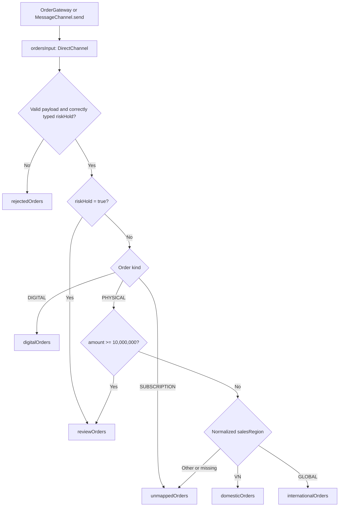

# Routing by Payload and Headers

## 1. Objectives and Practice Scenario

In **SPRING_INTEGRATION_CORE**, a message flow is formed from `Message`, `MessageChannel`, and endpoints. This lesson belongs to the **Comprehensive Practice** chapter and focuses on routers: reading payloads and headers to choose destinations using the Java DSL.

Scenario: the system receives order commands from multiple sources. Digital goods go to the entitlement/licensing team; physical goods go to domestic or international fulfillment; orders needing inspection enter a review branch. Invalid data and data without a specific routing rule must be distinguished.

After this lesson, you will be able to:

- Design a message contract and rule precedence order.
- Write a router that reads both payload and headers.
- Use a gateway as the entry point, a `DirectChannel` to invoke the router, and `QueueChannel` beans to observe outputs.
- Distinguish the default branch, business rejection branch, and technical errors.
- Test the real flow: right destination, no duplicate copies sent elsewhere, and correlation headers preserved.

The exercise uses in-memory Spring Integration Core without requiring a broker, database, or HTTP server. Transformers, filters, and aggregators are examined in the extension section to see their place in an integration flow.

## 2. Message Contract

### 2.1. Payload Carrying Business Data

The payload is `OrderCommand`:

| Field | Java Type | Convention |
| --- | --- | --- |
| `orderId` | `String` | Non-`null`, non-empty, and not whitespace-only |
| `kind` | `OrderCommand.Kind` | `DIGITAL`, `PHYSICAL`, or `SUBSCRIPTION`; non-`null` |
| `amount` | `BigDecimal` | Amount in VND, greater than 0 |

`SUBSCRIPTION` simulates an order kind that is structurally valid but has no dedicated processing branch yet. Any payload other than `OrderCommand` is invalid input.

Use `BigDecimal.compareTo()` when comparing monetary amounts. `equals()` also considers scale, which is unsuitable for expressing monetary threshold rules in this lesson.

### 2.2. Headers Providing Processing Context

| Header | Expected Type | Convention |
| --- | --- | --- |
| `salesRegion` | `String` | `VN` or `GLOBAL`; required for standard physical orders |
| `riskHold` | `Boolean` | `true` requires review; missing header is treated as `false` |
| `correlationId` | Defined by sender | Correlates messages; does not participate in branch selection |

For `salesRegion`, the router strips leading/trailing whitespace and converts to uppercase using `Locale.ROOT`. Missing values, non-string values, or values outside the allowed set are treated as an undetermined region.

For `riskHold`, the string `"true"` is not a Boolean `true`. A wrongly typed header goes to the rejection branch, avoiding accidentally skipping a review request when systems disagree on data types.

These are business decisions of the exercise. Spring Integration does not enforce these policies for an application automatically.

## 3. Finalizing the Decision Table Before Writing the Flow

Apply rules top-down. The first matching rule determines the destination.

| Priority | Condition | Routing key | Channel |
| --- | --- | --- | --- |
| 1 | Wrong payload type, missing required field, or `amount <= 0` | `REJECT` | `rejectedOrders` |
| 2 | `riskHold` is present but not a `Boolean` | `REJECT` | `rejectedOrders` |
| 3 | Valid payload and `riskHold == true` | `REVIEW` | `reviewOrders` |
| 4 | Kind `DIGITAL` | `DIGITAL` | `digitalOrders` |
| 5 | Kind other than `PHYSICAL` after the steps above | `UNMAPPED` | `unmappedOrders` |
| 6 | Kind `PHYSICAL`, amount from 10,000,000 VND | `REVIEW` | `reviewOrders` |
| 7 | Kind `PHYSICAL`, below threshold, region `VN` | `DOMESTIC` | `domesticOrders` |
| 8 | Kind `PHYSICAL`, below threshold, region `GLOBAL` | `INTERNATIONAL` | `internationalOrders` |
| 9 | Undetermined region for below-threshold physical order | `UNMAPPED` | `unmappedOrders` |

Predictable consequences:

- An invalid order with `riskHold=true` is still rejected.
- A digital order with `riskHold=true` is reviewed before evaluating the digital branch.
- Digital orders are not subject to the monetary threshold reserved for physical goods.
- A physical order equal to exactly 10,000,000 VND goes to review, even if region is missing.
- `SUBSCRIPTION` is structurally valid; unless held for review, it enters the unmapped branch.



Decision nodes describe logic inside a single policy called by the router; there is no requirement to create a separate endpoint per condition.

## 4. Preparing the Practice Project

The example pins APIs to **Spring Integration 6.5.0**, using **JDK 17** and **JUnit Jupiter 5.12.2** for a reproducible baseline. These are illustrative versions, not claims about the latest release. The Java DSL is already included in `spring-integration-core`.

Create a standalone Maven project:

```text
order-routing-lab/
├── pom.xml
└── src/
    ├── main/java/example/routing/
    │   ├── OrderCommand.java
    │   ├── RoutingPolicy.java
    │   ├── OrderGateway.java
    │   └── OrderRoutingConfiguration.java
    └── test/java/example/routing/
        └── OrderRoutingTest.java
```

The paths above are where to create the code in the learner's practice project.

Contents of `pom.xml`:

```xml
<project xmlns="http://maven.apache.org/POM/4.0.0"
         xmlns:xsi="http://www.w3.org/2001/XMLSchema-instance"
         xsi:schemaLocation="http://maven.apache.org/POM/4.0.0 https://maven.apache.org/xsd/maven-4.0.0.xsd">
    <modelVersion>4.0.0</modelVersion>
    <groupId>example</groupId>
    <artifactId>order-routing-lab</artifactId>
    <version>1.0-SNAPSHOT</version>

    <properties>
        <maven.compiler.release>17</maven.compiler.release>
        <project.build.sourceEncoding>UTF-8</project.build.sourceEncoding>
    </properties>

    <dependencies>
        <dependency>
            <groupId>org.springframework.integration</groupId>
            <artifactId>spring-integration-core</artifactId>
            <version>6.5.0</version>
        </dependency>
        <dependency>
            <groupId>org.junit.jupiter</groupId>
            <artifactId>junit-jupiter</artifactId>
            <version>5.12.2</version>
            <scope>test</scope>
        </dependency>
    </dependencies>

    <build>
        <plugins>
            <plugin>
                <groupId>org.apache.maven.plugins</groupId>
                <artifactId>maven-compiler-plugin</artifactId>
                <version>3.14.0</version>
            </plugin>
            <plugin>
                <groupId>org.apache.maven.plugins</groupId>
                <artifactId>maven-surefire-plugin</artifactId>
                <version>3.5.3</version>
            </plugin>
        </plugins>
    </build>
</project>
```

No Spring Boot or `main` class is needed: the tests will initialize the `ApplicationContext` directly.

## 5. Building the Model and Policy

### 5.1. Declaring the Payload

File `OrderCommand.java`:

```java
package example.routing;

import java.math.BigDecimal;

public record OrderCommand(
        String orderId,
        Kind kind,
        BigDecimal amount) {

    public enum Kind {
        DIGITAL,
        PHYSICAL,
        SUBSCRIPTION
    }
}
```

The record does not validate data in its constructor so learners can send invalid commands into the flow and observe the rejection branch. In a real system, you can validate earlier at the ingestion boundary; agree clearly on where responsibility lies.

### 5.2. Policy Receiving the Full Message

File `RoutingPolicy.java`:

```java
package example.routing;

import java.math.BigDecimal;
import java.util.Locale;

import org.springframework.messaging.Message;

public final class RoutingPolicy {

    private static final BigDecimal REVIEW_THRESHOLD =
            new BigDecimal("10000000");

    public String route(Message<?> message) {
        if (!(message.getPayload() instanceof OrderCommand order)) {
            return "REJECT";
        }

        if (!isValid(order)) {
            return "REJECT";
        }

        Object riskHold = message.getHeaders().get("riskHold");
        if (riskHold != null && !(riskHold instanceof Boolean)) {
            return "REJECT";
        }

        if (Boolean.TRUE.equals(riskHold)) {
            return "REVIEW";
        }

        if (order.kind() == OrderCommand.Kind.DIGITAL) {
            return "DIGITAL";
        }

        if (order.kind() != OrderCommand.Kind.PHYSICAL) {
            return "UNMAPPED";
        }

        if (order.amount().compareTo(REVIEW_THRESHOLD) >= 0) {
            return "REVIEW";
        }

        String region = normalizedRegion(
                message.getHeaders().get("salesRegion"));

        return switch (region) {
            case "VN" -> "DOMESTIC";
            case "GLOBAL" -> "INTERNATIONAL";
            default -> "UNMAPPED";
        };
    }

    private boolean isValid(OrderCommand order) {
        return order.orderId() != null
                && !order.orderId().isBlank()
                && order.kind() != null
                && order.amount() != null
                && order.amount().signum() > 0;
    }

    private String normalizedRegion(Object value) {
        if (value instanceof String text) {
            return text.strip().toUpperCase(Locale.ROOT);
        }
        return "";
    }
}
```

The policy returns a business key, does not send messages, and contains no channel bean names. Renaming channels does not force changes to business rules.

`route()` holds no state across calls and mutates neither payload nor headers. This organization is suitable when multiple threads invoke the policy concurrently.

Reading headers as `Object` enables proactive handling of wrong types. Calling `get("riskHold", Boolean.class)` directly could raise an exception on wrong-typed data before the policy can choose the rejection branch.

## 6. Gateway and Java DSL Flow

### 6.1. Gateway as the Application Entry Point

File `OrderGateway.java`:

```java
package example.routing;

import org.springframework.integration.annotation.MessagingGateway;
import org.springframework.messaging.handler.annotation.Header;

@MessagingGateway(defaultRequestChannel = "ordersInput")
public interface OrderGateway {

    void submit(
            OrderCommand order,
            @Header("salesRegion") String salesRegion,
            @Header("riskHold") boolean riskHold);
}
```

`order` becomes the payload; the remaining two arguments become headers. The gateway uses a `void` return type because this lesson's contract is command submission without waiting for a business result from the branches. The gateway proxy mechanism is described in [Messaging Gateways](https://docs.spring.io/spring-integration/reference/6.5/gateway.html).

This gateway always supplies both routing headers. Tests sending directly to the channel cover missing-header or wrong-type cases that the gateway method signature restricts.

### 6.2. Declaring Channels and Router

File `OrderRoutingConfiguration.java`:

```java
package example.routing;

import org.springframework.beans.factory.annotation.Qualifier;
import org.springframework.context.annotation.Bean;
import org.springframework.context.annotation.Configuration;
import org.springframework.integration.annotation.IntegrationComponentScan;
import org.springframework.integration.channel.DirectChannel;
import org.springframework.integration.channel.QueueChannel;
import org.springframework.integration.config.EnableIntegration;
import org.springframework.integration.dsl.IntegrationFlow;
import org.springframework.messaging.Message;
import org.springframework.messaging.MessageChannel;

@Configuration(proxyBeanMethods = false)
@EnableIntegration
@IntegrationComponentScan(basePackageClasses = OrderGateway.class)
public class OrderRoutingConfiguration {

    @Bean
    public MessageChannel ordersInput() {
        return new DirectChannel();
    }

    @Bean
    public QueueChannel rejectedOrders() {
        return new QueueChannel(100);
    }

    @Bean
    public QueueChannel reviewOrders() {
        return new QueueChannel(100);
    }

    @Bean
    public QueueChannel digitalOrders() {
        return new QueueChannel(100);
    }

    @Bean
    public QueueChannel domesticOrders() {
        return new QueueChannel(100);
    }

    @Bean
    public QueueChannel internationalOrders() {
        return new QueueChannel(100);
    }

    @Bean
    public QueueChannel unmappedOrders() {
        return new QueueChannel(100);
    }

    @Bean
    public RoutingPolicy routingPolicy() {
        return new RoutingPolicy();
    }

    @Bean
    public IntegrationFlow orderRoutingFlow(
            @Qualifier("ordersInput") MessageChannel input,
            RoutingPolicy policy) {

        return IntegrationFlow.from(input)
                .route(Message.class, message -> policy.route(message),
                        router -> router
                                .channelMapping("REJECT", "rejectedOrders")
                                .channelMapping("REVIEW", "reviewOrders")
                                .channelMapping("DIGITAL", "digitalOrders")
                                .channelMapping("DOMESTIC", "domesticOrders")
                                .channelMapping(
                                        "INTERNATIONAL",
                                        "internationalOrders")
                                .defaultOutputChannel("unmappedOrders")
                                .channelKeyFallback(false)
                                .resolutionRequired(true)
                                .sendTimeout(250))
                .get();
    }
}
```

Specifying `Message.class` to the DSL indicates the policy needs the entire message to read both payload and headers. If only business data were needed, `OrderCommand.class` could be used. Refer to the overloads at [BaseIntegrationFlowDefinition 6.5.0](https://docs.spring.io/spring-integration/docs/6.5.0/api/org/springframework/integration/dsl/BaseIntegrationFlowDefinition.html).

`@EnableIntegration` enables the infrastructure in a plain Spring context. `@IntegrationComponentScan` finds the gateway interface and registers its proxy. Parameter injection avoids calling `@Bean` methods directly when using `proxyBeanMethods=false`.

### 6.3. Understanding the Default Branch

The flow does not declare a mapping for `UNMAPPED`. This key goes to `unmappedOrders` via the default branch.

| Configuration | Meaning in the flow |
| --- | --- |
| `channelMapping(...)` | Translates the key returned by the policy to a channel name |
| `defaultOutputChannel("unmappedOrders")` | Receives messages when no destination exists in the mapping table |
| `channelKeyFallback(false)` | Does not use an unmapped key as a channel name |
| `resolutionRequired(true)` | Throws an error when the selected channel name cannot be resolved |
| `sendTimeout(250)` | Send wait limit for channels supporting timeout; does not bound business completion time |

Since Spring Integration 6.0, setting a default output channel also disables using the key as a channel name unless explicitly overridden. The example still specifies `channelKeyFallback(false)` to make the contract explicit. See [Common Router Parameters](https://docs.spring.io/spring-integration/reference/6.5/router/common-parameters.html) and [RouterSpec 6.5.0](https://docs.spring.io/spring-integration/docs/6.5.0/api/org/springframework/integration/dsl/RouterSpec.html).

Two cases must be kept distinct:

1. Policy returns `UNMAPPED`, no mapping exists: takes the default branch.
2. Policy returns `DOMESTIC`, mapping points to a misspelled channel name: configuration is broken; `resolutionRequired(true)` surfaces the error.

Do not set `resolutionRequired(false)` just to hide typos in channel names.

### 6.4. Roles of the Channel Types

`ordersInput` is a `DirectChannel`: the router runs on the sending thread. The destinations are `QueueChannel` beans: they store results for tests to retrieve with `receive(0)`.

This lesson has not registered business consumers on the output queues. When sending succeeds, you can only conclude the message entered the destination queue; entitlement provisioning or shipping has not happened yet.

The queues have a capacity of 100, reside in memory, and are not persisted across process restarts. Wait behavior and `receive(0)` are described in [Message Channel Implementations](https://docs.spring.io/spring-integration/reference/6.5/channel/implementations.html).

## 7. Two Variants to Distinguish Router Selection

The additional snippets below reuse the declared output channels. You can place them in the same configuration class to experiment. Each flow has its own input and does not compete for messages with `ordersInput`. They do not apply the full decision table of the main flow.

### 7.1. Routing Only by Payload Value

Assuming the input is already a valid `OrderCommand`, and we only need to identify digital goods:

```java
@Bean
public IntegrationFlow payloadOnlyFlow() {
    return IntegrationFlow.from("payloadOnlyInput")
            .route(OrderCommand.class,
                    order -> order.kind() == OrderCommand.Kind.DIGITAL
                            ? "DIGITAL" : "OTHER",
                    router -> router
                            .channelMapping("DIGITAL", "digitalOrders")
                            .defaultOutputChannel("unmappedOrders")
                            .channelKeyFallback(false))
            .get();
}
```

This is routing by **property value**. `PayloadTypeRouter` chooses destinations based on the **Java type** of the payload, such as `String` vs. `OrderCommand`. When every payload is an `OrderCommand`, type-based routing cannot distinguish `DIGITAL` from `PHYSICAL`.

### 7.2. Routing Only by a Single Header

If the sender already supplies `salesRegion` in canonical form, you can use `HeaderValueRouter`:

```java
@Bean
public IntegrationFlow headerOnlyFlow() {
    var router =
            new org.springframework.integration.router.HeaderValueRouter(
                    "salesRegion");

    router.setChannelMapping("VN", "domesticOrders");
    router.setChannelMapping("GLOBAL", "internationalOrders");
    router.setDefaultOutputChannelName("unmappedOrders");
    router.setChannelKeyFallback(false);
    router.setResolutionRequired(true);

    return IntegrationFlow.from("headerOnlyInput")
            .route(router)
            .get();
}
```

This variant maps the header value directly without calling `strip()` and uppercasing as the main policy does. Thus `" vn "` is not yet `"VN"`. If multiple endpoints need the same normalized form, place a header enricher before the router.

The difference between `PayloadTypeRouter` and `HeaderValueRouter` is described in [Router Implementations](https://docs.spring.io/spring-integration/reference/6.5/router/implementations.html).

## 8. Testing the Flow Against the Decision Table

Each test case initializes a fresh context. Queues do not share leftover messages across tests and have no background pollers. Because the router runs synchronously, outputs can be observed right after the send call.

File `OrderRoutingTest.java`:

```java
package example.routing;

import java.math.BigDecimal;
import java.util.List;
import java.util.Map;
import java.util.stream.Stream;

import org.junit.jupiter.api.AfterEach;
import org.junit.jupiter.api.BeforeEach;
import org.junit.jupiter.api.Test;
import org.junit.jupiter.params.ParameterizedTest;
import org.junit.jupiter.params.provider.Arguments;
import org.junit.jupiter.params.provider.MethodSource;
import org.springframework.context.annotation.AnnotationConfigApplicationContext;
import org.springframework.integration.channel.QueueChannel;
import org.springframework.messaging.Message;
import org.springframework.messaging.MessageChannel;
import org.springframework.messaging.support.MessageBuilder;

import static org.junit.jupiter.api.Assertions.*;

class OrderRoutingTest {

    private static final List<String> OUTPUTS = List.of(
            "rejectedOrders",
            "reviewOrders",
            "digitalOrders",
            "domesticOrders",
            "internationalOrders",
            "unmappedOrders");

    private AnnotationConfigApplicationContext context;
    private MessageChannel input;

    @BeforeEach
    void startContext() {
        context = new AnnotationConfigApplicationContext(
                OrderRoutingConfiguration.class);
        input = context.getBean("ordersInput", MessageChannel.class);
    }

    @AfterEach
    void stopContext() {
        if (context != null) {
            context.close();
        }
    }

    @ParameterizedTest(name = "{0}")
    @MethodSource("routingCases")
    void routesToOneExpectedDestination(
            String label,
            Object payload,
            Map<String, Object> headers,
            String expectedChannel) {

        Message<?> sent = MessageBuilder.withPayload(payload)
                .copyHeaders(headers)
                .setHeader("correlationId", "CORR-004")
                .build();

        assertTrue(input.send(sent, 1000));

        Message<?> received = takeOnlyMessage(expectedChannel);

        assertSame(sent.getPayload(), received.getPayload());
        assertEquals("CORR-004",
                received.getHeaders().get("correlationId"));

        headers.forEach((key, value) ->
                assertEquals(value, received.getHeaders().get(key)));
    }

    @Test
    void gatewayCreatesHeadersAndUsesTheSameRoutingFlow() {
        OrderCommand order = order(
                OrderCommand.Kind.PHYSICAL, "500000");

        OrderGateway gateway = context.getBean(OrderGateway.class);
        gateway.submit(order, "GLOBAL", false);

        Message<?> received = takeOnlyMessage("internationalOrders");

        assertEquals(order, received.getPayload());
        assertEquals("GLOBAL",
                received.getHeaders().get("salesRegion"));
        assertEquals(Boolean.FALSE,
                received.getHeaders().get("riskHold"));
    }

    private Message<?> takeOnlyMessage(String expectedChannel) {
        QueueChannel target =
                context.getBean(expectedChannel, QueueChannel.class);

        Message<?> received = target.receive(0);
        assertNotNull(received, "No message received at " + expectedChannel);

        for (String channelName : OUTPUTS) {
            QueueChannel channel =
                    context.getBean(channelName, QueueChannel.class);
            assertNull(channel.receive(0),
                    "Unexpected message at " + channelName);
        }

        return received;
    }

    private static OrderCommand order(
            OrderCommand.Kind kind, String amount) {
        return new OrderCommand(
                "ORD-004", kind, new BigDecimal(amount));
    }

    static Stream<Arguments> routingCases() {
        return Stream.of(
                Arguments.of(
                        "Digital order does not need a region",
                        order(OrderCommand.Kind.DIGITAL, "200000"),
                        Map.of(),
                        "digitalOrders"),
                Arguments.of(
                        "Digital order ignores physical monetary threshold",
                        order(OrderCommand.Kind.DIGITAL, "12000000"),
                        Map.of("salesRegion", "VN"),
                        "digitalOrders"),
                Arguments.of(
                        "riskHold takes precedence over digital branch",
                        order(OrderCommand.Kind.DIGITAL, "200000"),
                        Map.of("riskHold", true),
                        "reviewOrders"),
                Arguments.of(
                        "Normalizes whitespace and lowercase",
                        order(OrderCommand.Kind.PHYSICAL, "500000"),
                        Map.of("salesRegion", " vn "),
                        "domesticOrders"),
                Arguments.of(
                        "International order",
                        order(OrderCommand.Kind.PHYSICAL, "500000"),
                        Map.of("salesRegion", "GLOBAL"),
                        "internationalOrders"),
                Arguments.of(
                        "Just below threshold still checks region",
                        order(OrderCommand.Kind.PHYSICAL, "9999999"),
                        Map.of("salesRegion", "VN"),
                        "domesticOrders"),
                Arguments.of(
                        "At exact threshold without region still goes to review",
                        order(OrderCommand.Kind.PHYSICAL, "10000000"),
                        Map.of(),
                        "reviewOrders"),
                Arguments.of(
                        "Missing region for regular physical order",
                        order(OrderCommand.Kind.PHYSICAL, "500000"),
                        Map.of(),
                        "unmappedOrders"),
                Arguments.of(
                        "Unsupported region",
                        order(OrderCommand.Kind.PHYSICAL, "500000"),
                        Map.of("salesRegion", "EU"),
                        "unmappedOrders"),
                Arguments.of(
                        "Wrongly typed region",
                        order(OrderCommand.Kind.PHYSICAL, "500000"),
                        Map.of("salesRegion", 84),
                        "unmappedOrders"),
                Arguments.of(
                        "Header containing input channel name is not used as destination",
                        order(OrderCommand.Kind.PHYSICAL, "500000"),
                        Map.of("salesRegion", "ordersInput"),
                        "unmappedOrders"),
                Arguments.of(
                        "Valid order kind without a branch yet",
                        order(OrderCommand.Kind.SUBSCRIPTION, "500000"),
                        Map.of("salesRegion", "VN"),
                        "unmappedOrders"),
                Arguments.of(
                        "Does not coerce string true to Boolean",
                        order(OrderCommand.Kind.DIGITAL, "200000"),
                        Map.of("riskHold", "true"),
                        "rejectedOrders"),
                Arguments.of(
                        "Zero amount",
                        order(OrderCommand.Kind.PHYSICAL, "0"),
                        Map.of("salesRegion", "VN"),
                        "rejectedOrders"),
                Arguments.of(
                        "Negative amount",
                        order(OrderCommand.Kind.PHYSICAL, "-1"),
                        Map.of("salesRegion", "VN"),
                        "rejectedOrders"),
                Arguments.of(
                        "Missing order ID",
                        new OrderCommand(" ",
                                OrderCommand.Kind.PHYSICAL,
                                new BigDecimal("500000")),
                        Map.of("salesRegion", "VN"),
                        "rejectedOrders"),
                Arguments.of(
                        "Missing order kind",
                        new OrderCommand("ORD-004", null,
                                new BigDecimal("500000")),
                        Map.of(),
                        "rejectedOrders"),
                Arguments.of(
                        "Missing amount",
                        new OrderCommand("ORD-004",
                                OrderCommand.Kind.PHYSICAL, null),
                        Map.of(),
                        "rejectedOrders"),
                Arguments.of(
                        "Wrong payload type rejected before riskHold",
                        "not-an-order",
                        Map.of("riskHold", true),
                        "rejectedOrders"));
    }
}
```

From the practice project directory, run:

```shell
mvn test
```

The expected outcome when the files are implemented correctly is **19 parameterized cases and 1 gateway case**, for 20 passing tests in total. This is the target for learners to compare against when running locally, not an execution report from authoring this document.

`@MethodSource` expresses a test data table without forcing every case into a CSV string. Refer to the [JUnit 5.12.2 User Guide](https://docs.junit.org/5.12.2/user-guide/#writing-tests-parameterized-tests-sources-MethodSource).

### Why Check the Remaining Destinations Too?

If you only assert that `domesticOrders` has a message, a configuration that accidentally sends an extra copy to `reviewOrders` would still pass the test.

`takeOnlyMessage()` pulls one message from the expected destination, then verifies all six queues are empty. Re-checking the target queue itself also catches a second duplicate copy within the same send.

This test proves single-destination routing behavior in the flow and context of this lesson. It does not prove exactly-once delivery in a distributed system, does not detect duplicate redeliveries from an upstream source, and does not replace idempotency handling.

## 9. Distinguishing Three Paths When Problems Occur

| Situation | Manifestation | Handling in this lesson |
| --- | --- | --- |
| Input contract violation | Message carrying input payload | Policy returns `REJECT`, sends to `rejectedOrders` |
| Valid but no matching rule yet | Business message | Policy returns `UNMAPPED`, sends to `unmappedOrders` |
| Configuration or execution failure | Messaging exception or underlying cause | Let error surface; handle via technical error mechanism |

`unmappedOrders` is a business channel defined by this lesson. It does not automatically become a broker dead-letter queue or replace `errorChannel`.

With `MessageChannel.send()` into a `DirectChannel` as in the current tests, exceptions during synchronous processing propagate back to the caller. Merely attaching an `errorChannel` header does not cause every synchronous exception to be published as an `ErrorMessage`. Gateways with configured error handling, pollers, and asynchronous infrastructure must be analyzed under their respective mechanisms. See [Error Handling](https://docs.spring.io/spring-integration/reference/6.5/error-handling.html).

Experiment in a copy of the practice project:

1. Change the `DOMESTIC` mapping to a non-existent channel name.
2. Send a below-threshold physical order for region `VN`.
3. Confirm the call raises a channel resolution error; the message does not automatically fall back to `unmappedOrders`.
4. Restore the channel name and re-run tests.

When a destination queue is full, sending may time out. `sendTimeout(250)` does not automatically fall back to the default branch and does not provide durable persistence. A send failure is different from having no mapping.

## 10. Common Mistakes

### 10.1. Evaluation Order Changing Business Semantics

Checking `DIGITAL` before `riskHold` would let a digital order requiring review proceed immediately. Checking the monetary threshold before order kind would send high-value digital orders down the wrong branch.

Preserve the decision table and test cases for overlapping conditions, especially `DIGITAL + riskHold=true` and `DIGITAL + large amount`.

### 10.2. Using a Channel Name Taken from a Header

A region header should represent a business value such as `VN`. The mapping table translates allowed values into concrete channels.

The main policy does not use headers as destination names. Disabling `channelKeyFallback` reinforces the boundary between business keys and internal wiring.

### 10.3. Confusing Single-Branch Selection with Multi-Branch Fan-Out

The main router returns a single key, so its goal is choosing one destination. To both process an order and emit an independent audit copy, you must deliberately design multiple recipients.

Do not replace a router with `PublishSubscribeChannel` and expect only one branch to receive the message. Nor should you attach two consumers to the same `DirectChannel` to simulate broadcast.

### 10.4. Creating a New Message and Losing Headers

The router in this lesson does not need to rebuild the message. If you add a transformer that returns a new `Message`, preserve application headers such as `correlationId`.

You can use `MessageBuilder.fromMessage(...)` or a header enricher when modifying headers. System headers such as `id` and `timestamp` follow their own rules; do not use them as substitutes for a business correlation ID.

### 10.5. Treating Successful Routing as Completed Business Work

The right key describes the routing decision. A queue accepting the message describes the handoff step. Consumer processing, transaction commits, and deduplication still require separate contracts.

## 11. Extension Exercises

### 11.1. Adding a Region

Add `APAC` for below-threshold physical orders:

- Create a new channel, update the policy and mapping.
- Add an `" apac "` case to verify normalization.
- Add the channel to the output list checked for emptiness in tests.

Complete when `APAC` reaches the right destination, existing cases keep their results, and no messages appear at two destinations after a single send.

### 11.2. Adding a Manual-Handling Reason

Currently messages in `rejectedOrders` and `unmappedOrders` lack a reason code. Add a decision result holding `routeKey` and `reasonCode`, and put the reason into a header before the router.

Complete when `INVALID_AMOUNT`, `INVALID_RISK_HEADER`, `UNKNOWN_REGION`, and `UNSUPPORTED_KIND` can be distinguished while preserving `correlationId`.

Do not embed internal channel names inside the order model merely for routing.

### 11.3. Comparing Router, Filter, and Transformer

Extract validation into a filter, configure its discard channel as `rejectedOrders`, and keep the router for valid branches. Invalid inputs must still be observable on the rejection branch.

Next, use a header enricher to normalize `salesRegion` before the router. Re-check tracing headers and decide whether the original region value must also be retained separately.

### 11.4. When Is an Aggregator Needed?

The current flow picks one destination per message and does not create groups needing correlation, so no aggregator is needed yet.

If extending into two parallel branches checking inventory and risk independently, you must define:

- The correlation key linking the two replies for the same order.
- The release condition when a group is complete.
- How missing, expired, or duplicate replies are handled.

Add an aggregator only after defining the correlation strategy and release strategy. Having a router does not automatically create a need to aggregate.

## 12. Completion Criteria

Learners should be able to demonstrate and verify:

- Clear data type contracts for payload and headers.
- Precedence matching the decision table, including overlapping conditions.
- Gateway, channels, and Java DSL router working together to pick the right branch.
- Business values are not arbitrarily used as channel names.
- Rejection branch, default branch, and technical errors have distinct contracts.
- Tests confirm exactly one message at the destination, no copies elsewhere, and correlation headers preserved.
- A queue receiving a message does not mean final business work is complete.

The deliverable of this lesson is a flow with transparent routing rules and a test suite protecting those decisions as new order kinds, regions, or processing steps are added.