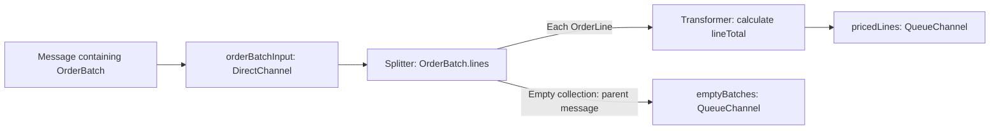

# Splitting a Collection with a Splitter

## 1. Objectives and Practice Problem

In the **Comprehensive Practice** chapter of the **SPRING_INTEGRATION_CORE** module, we build a flow that receives an order batch, splits the order lines, and calculates the line total for each line. The exercise connects `Message`, `MessageChannel`, endpoints, and the Java DSL into an example with clear inputs, outputs, and tests.

After this lesson, you will be able to:

- Choose a splitter when one message contains multiple elements that need separate processing steps.
- Distinguish a parent message payload from child message payloads.
- Track a message group via correlation and sequence headers.
- Define policies for empty collections and per-element errors.
- Test message counts, contents, headers, and error impact in the flow.
- Identify changes needed when adding filters, routers, aggregators, or asynchronous processing.

The system receives a batch of three order lines:

| lineId | sku | quantity | unitPrice | Expected lineTotal |
| --- | --- | ---: | ---: | ---: |
| L-01 | BOOK-JAVA | 2 | 120000 | 240000 |
| L-02 | PEN-BLUE | 5 | 10000 | 50000 |
| L-03 | NOTE-A5 | 3 | 25000 | 75000 |

Contract of the practice exercise:

1. A valid batch with `N` lines produces `N` result messages, each with a `PricedLine` payload.
2. Each result retains `batchId` and `tenantId` from the input headers.
3. Child messages from the same batch share `correlationId`, sequence numbers from 1 to `N`, and `sequenceSize = N`.
4. An empty batch goes to the `emptyBatches` channel as the parent message.
5. When one line is invalid, the synchronous flow propagates the error to the sender and stops at that line.

This is in-memory processing to observe the core mechanism. There is no database, broker, or payment operation in this example.

## 2. How Does a Message Containing a Collection Differ from Multiple Messages?

Input:

```text
Message<OrderBatch>
  payload:
    batchId: B-2026-001
    lines: [L-01, L-02, L-03]
  headers:
    batchId: B-2026-001
    tenantId: tenant-demo
    id: P
```

After the splitter, each element becomes the payload of its own message:

```text
Message<OrderLine> {payload=L-01, correlationId=P, sequenceNumber=1, sequenceSize=3}
Message<OrderLine> {payload=L-02, correlationId=P, sequenceNumber=2, sequenceSize=3}
Message<OrderLine> {payload=L-03, correlationId=P, sequenceNumber=3, sequenceSize=3}
```

After the transformer:

```text
Message<PricedLine> {payload=(L-01, BOOK-JAVA, 240000), ...}
Message<PricedLine> {payload=(L-02, PEN-BLUE, 50000), ...}
Message<PricedLine> {payload=(L-03, NOTE-A5, 75000), ...}
```

A splitter produces multiple messages from parts of an input. A transformer changes data within a single message. Therefore, simply returning a `List<PricedLine>` from a transformer still yields one message containing a list. The Java DSL provides `split()` when the payload is already a collection, and `splitWith(...)` when detailed configuration is needed. [Spring Integration — Splitters in Java DSL](https://docs.spring.io/spring-integration/reference/6.4/dsl/java-splitters.html).



The diagram shows message paths, not parallel threads.

## 3. Preparing the Environment

The example uses **Java 17**, **Maven**, **Spring Integration 6.4.x**, and **JUnit 5**. To practice independently, create a project with the following `pom.xml`. The Spring Boot version is pinned as the baseline for the lesson; Spring libraries and test libraries are managed by the parent. This version management mechanism is described in [Spring Boot — Managed Dependency Coordinates](https://docs.spring.io/spring-boot/3.4/appendix/dependency-versions/coordinates.html).

```xml
<?xml version="1.0" encoding="UTF-8"?>
<project xmlns="http://maven.apache.org/POM/4.0.0"
         xmlns:xsi="http://www.w3.org/2001/XMLSchema-instance"
         xsi:schemaLocation="http://maven.apache.org/POM/4.0.0
                             https://maven.apache.org/xsd/maven-4.0.0.xsd">
    <modelVersion>4.0.0</modelVersion>

    <parent>
        <groupId>org.springframework.boot</groupId>
        <artifactId>spring-boot-starter-parent</artifactId>
        <version>3.4.13</version>
        <relativePath/>
    </parent>

    <groupId>example</groupId>
    <artifactId>collection-splitter-practice</artifactId>
    <version>1.0.0</version>

    <properties>
        <java.version>17</java.version>
        <project.build.sourceEncoding>UTF-8</project.build.sourceEncoding>
    </properties>

    <dependencies>
        <dependency>
            <groupId>org.springframework.boot</groupId>
            <artifactId>spring-boot-starter-integration</artifactId>
        </dependency>
        <dependency>
            <groupId>org.springframework.boot</groupId>
            <artifactId>spring-boot-starter-test</artifactId>
            <scope>test</scope>
        </dependency>
    </dependencies>
</project>
```

The exercise runs via tests so no `@SpringBootApplication` class is required. Two Java files to create in the practice project:

```text
src/main/java/example/split/CollectionSplitConfiguration.java
src/test/java/example/split/CollectionSplitConfigurationTest.java
```

## 4. Building the Complete Configuration

Put the following code into `CollectionSplitConfiguration.java`:

```java
package example.split;

import java.math.BigDecimal;
import java.util.List;
import java.util.Objects;

import org.springframework.context.annotation.Bean;
import org.springframework.context.annotation.Configuration;
import org.springframework.integration.channel.DirectChannel;
import org.springframework.integration.channel.QueueChannel;
import org.springframework.integration.config.EnableIntegration;
import org.springframework.integration.dsl.IntegrationFlow;

@Configuration
@EnableIntegration
public class CollectionSplitConfiguration {

    public record OrderBatch(String batchId, List<OrderLine> lines) {
        public OrderBatch {
            Objects.requireNonNull(batchId, "batchId");
            lines = List.copyOf(Objects.requireNonNull(lines, "lines"));
        }
    }

    public record OrderLine(
            String lineId,
            String sku,
            int quantity,
            BigDecimal unitPrice) {

        public OrderLine {
            Objects.requireNonNull(lineId, "lineId");
            Objects.requireNonNull(sku, "sku");
            Objects.requireNonNull(unitPrice, "unitPrice");
        }
    }

    public record PricedLine(
            String lineId,
            String sku,
            BigDecimal lineTotal) {
    }

    @Bean
    public DirectChannel orderBatchInput() {
        return new DirectChannel();
    }

    @Bean
    public QueueChannel pricedLines() {
        return new QueueChannel(100);
    }

    @Bean
    public QueueChannel emptyBatches() {
        return new QueueChannel(10);
    }

    @Bean
    public IntegrationFlow orderBatchFlow() {
        return IntegrationFlow.from("orderBatchInput")
                .splitWith(splitter -> splitter
                        .expectedType(OrderBatch.class)
                        .function((OrderBatch batch) -> batch.lines())
                        .applySequence(true)
                        .discardChannel("emptyBatches")
                        .sendTimeout(1_000))
                .transformWith(transformer -> transformer
                        .expectedType(OrderLine.class)
                        .transformer((OrderLine line) -> priceLine(line))
                        .sendTimeout(1_000))
                .channel("pricedLines")
                .get();
    }

    private static PricedLine priceLine(OrderLine line) {
        if (line.quantity() <= 0) {
            throw new IllegalArgumentException(
                    "quantity must be positive: " + line.lineId());
        }
        if (line.unitPrice().signum() < 0) {
            throw new IllegalArgumentException(
                    "unitPrice must not be negative: " + line.lineId());
        }

        BigDecimal lineTotal = line.unitPrice()
                .multiply(BigDecimal.valueOf(line.quantity()));

        return new PricedLine(line.lineId(), line.sku(), lineTotal);
    }
}
```

### 4.1. Why Is a Collection-Extracting Function Needed?

The input payload is `OrderBatch`, not `List<OrderLine>`. The function:

```java
.function((OrderBatch batch) -> batch.lines())
```

points to the collection to split. If the input were already `Message<List<OrderLine>>`, the minimal split could be written as:

```java
@Bean
public IntegrationFlow listPayloadFlow() {
    return IntegrationFlow.from("listInput")
            .split()
            .channel("individualLines")
            .get();
}
```

This short snippet illustrates an alternative flow; it is not wired into the main flow and requires corresponding channels when used. Do not register it just to run the test suite below.

In the main configuration, `expectedType(OrderBatch.class)` specifies the function's input type; `function(...)` extracts elements; `applySequence(true)` enables sequence metadata; `discardChannel(...)` receives empty collections. `splitWith(...)` has been available since Spring Integration 6.2. [Javadoc — BaseIntegrationFlowDefinition](https://docs.spring.io/spring-integration/docs/6.4.x/api/org/springframework/integration/dsl/BaseIntegrationFlowDefinition.html), [Javadoc — SplitterSpec](https://docs.spring.io/spring-integration/docs/6.4.x/api/org/springframework/integration/dsl/SplitterSpec.html).

### 4.2. Role of Each Component

| Component | Role in this lesson |
| --- | --- |
| `Message<OrderBatch>` | Carries batch data and business headers |
| `orderBatchInput` | Entry point known to the sender |
| Splitter endpoint | Extracts lines from the batch and emits a message per line |
| Transformer endpoint | Validates quantity and price, and computes line total |
| `pricedLines` | Holds result messages for tests to read |
| `emptyBatches` | Holds the input message for an empty batch |

`@EnableIntegration` enables Spring Integration infrastructure when creating a context directly. `IntegrationFlow` must be registered as a bean so the infrastructure builds the channels and endpoints. [Spring Integration — Java DSL](https://docs.spring.io/spring-integration/reference/6.4/dsl.html).

### 4.3. Data Conventions of the Lesson

`OrderBatch` copies the list via `List.copyOf(...)` so the sender cannot mutate the list structure handed to the flow. A `null` list or `null` element is rejected when creating the batch. Lines use records, `String`, and `BigDecimal`, suited to the immutable data of the example.

The rules `quantity > 0` and `unitPrice >= 0` are checked inside the transformer so we can observe post-split errors. A zero unit price is permitted, such as for a promotional gift line. This is a business choice of the lesson.

`batchId` in the payload describes the batch. For that value to accompany each line after splitting, the sender must place it in a header or embed it in each child payload. The framework does not automatically turn every parent payload field into headers. Here, the test suite's message factory sets `batchId` in the header from the batch itself, avoiding mismatched values.

## 5. Reading Correlation and Sequence Headers

With a three-element input and no nested splits, we expect:

| Header on result | Value | Meaning in the example |
| --- | --- | --- |
| `batchId` | `B-2026-001` | Business batch ID set by the application |
| `tenantId` | `tenant-demo` | Context of the data owner |
| `correlationId` | Parent message ID at the splitter | Links parts of a single split |
| `sequenceNumber` | 1, 2, 3 | Position of the line within the sequence |
| `sequenceSize` | 3 | Number of parts in this split |
| `id` | Result message's own ID | Identifier of the current message |

In tests, read the standard headers using constants `IntegrationMessageHeaderAccessor.CORRELATION_ID`, `SEQUENCE_NUMBER`, and `SEQUENCE_SIZE`. [Javadoc — IntegrationMessageHeaderAccessor](https://docs.spring.io/spring-integration/api/org/springframework/integration/IntegrationMessageHeaderAccessor.html).

Distinguish three kinds of identifiers:

- `batchId` belongs to the business batch and can be preserved if the batch is resent.
- `correlationId` belongs to the split message group. Creating a new parent message on resend creates a different correlation context in this flow.
- `lineId` identifies the business line. When adding deduplicated writes, this is part of the business key to consider.

Do not use an auto-generated message ID to conclude a line was processed only once. Two messages with different IDs can still carry identical business data.

## 6. Testing Flow Behavior

Put all of the following code into `CollectionSplitConfigurationTest.java`. Each test creates its own context, so messages or error states from an earlier test do not affect later ones.

```java
package example.split;

import java.math.BigDecimal;
import java.util.ArrayList;
import java.util.List;

import org.junit.jupiter.api.AfterEach;
import org.junit.jupiter.api.BeforeEach;
import org.junit.jupiter.api.Test;
import org.springframework.context.annotation.AnnotationConfigApplicationContext;
import org.springframework.integration.IntegrationMessageHeaderAccessor;
import org.springframework.integration.channel.DirectChannel;
import org.springframework.integration.channel.QueueChannel;
import org.springframework.messaging.Message;
import org.springframework.messaging.MessagingException;
import org.springframework.messaging.support.MessageBuilder;

import example.split.CollectionSplitConfiguration.OrderBatch;
import example.split.CollectionSplitConfiguration.OrderLine;
import example.split.CollectionSplitConfiguration.PricedLine;

import static org.assertj.core.api.Assertions.assertThat;
import static org.assertj.core.api.Assertions.assertThatThrownBy;

class CollectionSplitConfigurationTest {

    private AnnotationConfigApplicationContext context;
    private DirectChannel input;
    private QueueChannel results;
    private QueueChannel emptyBatches;

    @BeforeEach
    void setUp() {
        context = new AnnotationConfigApplicationContext(
                CollectionSplitConfiguration.class);
        input = context.getBean("orderBatchInput", DirectChannel.class);
        results = context.getBean("pricedLines", QueueChannel.class);
        emptyBatches = context.getBean("emptyBatches", QueueChannel.class);
    }

    @AfterEach
    void tearDown() {
        if (context != null) {
            context.close();
        }
    }

    @Test
    void splitsThreeLinesAndKeepsSequenceAndBusinessHeaders() {
        Message<OrderBatch> request = request("B-001", List.of(
                line("L-01", "BOOK-JAVA", 2, "120000"),
                line("L-02", "PEN-BLUE", 5, "10000"),
                line("L-03", "NOTE-A5", 3, "25000")));

        assertThat(input.send(request)).isTrue();

        List<Message<?>> actual = receiveResults(3);

        assertThat(actual)
                .extracting(message ->
                        ((PricedLine) message.getPayload()).lineId())
                .containsExactly("L-01", "L-02", "L-03");

        assertThat(actual)
                .extracting(message -> message.getHeaders().getId())
                .doesNotHaveDuplicates();

        assertThat(((PricedLine) actual.get(0).getPayload()).lineTotal())
                .isEqualByComparingTo("240000");
        assertThat(((PricedLine) actual.get(1).getPayload()).lineTotal())
                .isEqualByComparingTo("50000");
        assertThat(((PricedLine) actual.get(2).getPayload()).lineTotal())
                .isEqualByComparingTo("75000");

        for (int index = 0; index < actual.size(); index++) {
            Message<?> message = actual.get(index);

            assertThat(message.getHeaders().get("batchId"))
                    .isEqualTo("B-001");
            assertThat(message.getHeaders().get("tenantId"))
                    .isEqualTo("tenant-demo");
            assertThat(message.getHeaders().get(
                    IntegrationMessageHeaderAccessor.CORRELATION_ID))
                    .isEqualTo(request.getHeaders().getId());
            assertThat(message.getHeaders().get(
                    IntegrationMessageHeaderAccessor.SEQUENCE_NUMBER))
                    .isEqualTo(index + 1);
            assertThat(message.getHeaders().get(
                    IntegrationMessageHeaderAccessor.SEQUENCE_SIZE))
                    .isEqualTo(3);
            assertThat(message.getHeaders().getId())
                    .isNotEqualTo(request.getHeaders().getId());
        }

        assertThat(results.receive(0)).isNull();
        assertThat(emptyBatches.receive(0)).isNull();
    }

    @Test
    void sendsTheParentMessageToDiscardChannelForAnEmptyBatch() {
        Message<OrderBatch> request = request("B-EMPTY", List.of());

        assertThat(input.send(request)).isTrue();

        Message<?> discarded = emptyBatches.receive(1_000);
        assertThat(discarded).isNotNull();
        assertThat(discarded.getPayload()).isEqualTo(request.getPayload());
        assertThat(discarded.getHeaders().getId())
                .isEqualTo(request.getHeaders().getId());
        assertThat(discarded.getHeaders().get("batchId"))
                .isEqualTo("B-EMPTY");

        assertThat(results.receive(0)).isNull();
        assertThat(emptyBatches.receive(0)).isNull();
    }

    @Test
    void createsASequenceOfOneForASingleLine() {
        assertThat(input.send(request("B-SINGLE", List.of(
                line("L-01", "BOOK-JAVA", 1, "120000"))))).isTrue();

        Message<?> actual = receiveResults(1).get(0);

        assertThat(actual.getHeaders().get(
                IntegrationMessageHeaderAccessor.SEQUENCE_NUMBER))
                .isEqualTo(1);
        assertThat(actual.getHeaders().get(
                IntegrationMessageHeaderAccessor.SEQUENCE_SIZE))
                .isEqualTo(1);
        assertThat(results.receive(0)).isNull();
    }

    @Test
    void doesNotRemoveRepeatedElementsFromAList() {
        OrderLine repeated = line("L-REPEAT", "PEN-BLUE", 1, "10000");

        assertThat(input.send(request(
                "B-REPEAT", List.of(repeated, repeated)))).isTrue();

        List<Message<?>> actual = receiveResults(2);

        assertThat(actual)
                .extracting(message ->
                        ((PricedLine) message.getPayload()).lineId())
                .containsExactly("L-REPEAT", "L-REPEAT");
        assertThat(actual)
                .extracting(message -> message.getHeaders().get(
                        IntegrationMessageHeaderAccessor.SEQUENCE_NUMBER))
                .containsExactly(1, 2);
        assertThat(results.receive(0)).isNull();
    }

    @Test
    void usesDifferentCorrelationIdsForTwoParentMessages() {
        Message<OrderBatch> first = request("B-FIRST", List.of(
                line("A-01", "BOOK-JAVA", 1, "120000"),
                line("A-02", "PEN-BLUE", 1, "10000")));
        Message<OrderBatch> second = request("B-SECOND", List.of(
                line("B-01", "NOTE-A5", 1, "25000")));

        assertThat(input.send(first)).isTrue();
        assertThat(input.send(second)).isTrue();

        List<Message<?>> actual = receiveResults(3);

        assertThat(actual.get(0).getHeaders().get(
                IntegrationMessageHeaderAccessor.CORRELATION_ID))
                .isEqualTo(first.getHeaders().getId());
        assertThat(actual.get(1).getHeaders().get(
                IntegrationMessageHeaderAccessor.CORRELATION_ID))
                .isEqualTo(first.getHeaders().getId());
        assertThat(actual.get(2).getHeaders().get(
                IntegrationMessageHeaderAccessor.CORRELATION_ID))
                .isEqualTo(second.getHeaders().getId());

        assertThat(actual.get(2).getHeaders().get("batchId"))
                .isEqualTo("B-SECOND");
        assertThat(first.getHeaders().getId())
                .isNotEqualTo(second.getHeaders().getId());
        assertThat(results.receive(0)).isNull();
    }

    @Test
    void stopsAtAnInvalidLineButKeepsTheEarlierQueuedResult() {
        Message<OrderBatch> request = request("B-FAIL", List.of(
                line("L-OK", "BOOK-JAVA", 1, "120000"),
                line("L-BAD", "PEN-BLUE", 0, "10000"),
                line("L-LATER", "NOTE-A5", 1, "25000")));

        assertThatThrownBy(() -> input.send(request))
                .isInstanceOf(MessagingException.class)
                .hasRootCauseInstanceOf(IllegalArgumentException.class);

        Message<?> firstResult = receiveResults(1).get(0);

        assertThat(((PricedLine) firstResult.getPayload()).lineId())
                .isEqualTo("L-OK");
        assertThat(firstResult.getHeaders().get(
                IntegrationMessageHeaderAccessor.SEQUENCE_SIZE))
                .isEqualTo(3);
        assertThat(results.receive(0)).isNull();
        assertThat(emptyBatches.receive(0)).isNull();
    }

    @Test
    void rejectsANegativePriceBeforeProducingAResult() {
        Message<OrderBatch> request = request("B-NEGATIVE", List.of(
                line("L-NEGATIVE", "BOOK-JAVA", 1, "-1")));

        assertThatThrownBy(() -> input.send(request))
                .isInstanceOf(MessagingException.class)
                .hasRootCauseInstanceOf(IllegalArgumentException.class);

        assertThat(results.receive(0)).isNull();
        assertThat(emptyBatches.receive(0)).isNull();
    }

    private List<Message<?>> receiveResults(int expectedCount) {
        List<Message<?>> received = new ArrayList<>();

        for (int index = 0; index < expectedCount; index++) {
            Message<?> message = results.receive(1_000);
            assertThat(message)
                    .as("result number %s", index + 1)
                    .isNotNull();
            assertThat(message.getPayload()).isInstanceOf(PricedLine.class);
            received.add(message);
        }

        return received;
    }

    private static Message<OrderBatch> request(
            String batchId, List<OrderLine> lines) {

        OrderBatch batch = new OrderBatch(batchId, lines);
        return MessageBuilder.withPayload(batch)
                .setHeader("batchId", batch.batchId())
                .setHeader("tenantId", "tenant-demo")
                .build();
    }

    private static OrderLine line(
            String lineId, String sku, int quantity, String unitPrice) {

        return new OrderLine(
                lineId, sku, quantity, new BigDecimal(unitPrice));
    }
}
```

Run in the practice project directory:

```shell
mvn -Dtest=CollectionSplitConfigurationTest test
```

The expected result is seven passing tests. The commands and test code above are a guide for your practice; having source code in the lesson is not proof that a particular environment has executed the tests.

### 6.1. What Do the Tests Prove?

| Scenario | What to observe |
| --- | --- |
| Three valid lines | Three `PricedLine` payloads, accurate line totals, no extra messages |
| Empty batch | Result channel has no messages; discard channel has the parent message |
| Single line | `sequenceNumber = 1`, `sequenceSize = 1` |
| Two repeated elements | Still emits two messages; no implicit deduplication |
| Two batches | Two distinct correlation groups |
| Second line has quantity 0 | Sender receives an error; first line's result remains in the queue |
| Negative price on first line | No success results produced |

Checking both payload and headers catches bugs that simple message counting misses. For example, a flow might still output three messages while attaching the wrong tenant, or lose correlation so an aggregation step cannot identify the group.

### 6.2. Why Not Use sleep?

In the main configuration, the sender calls a `DirectChannel`, and the splitter and transformer run synchronously; results are placed into the final `QueueChannel`. When `send(...)` returns normally, the batch's results are already enqueued. Tests use `receive(1_000)` to impose a wait bound if configuration changes, and `receive(0)` to check that the queue currently has no leftover elements.

The "no extra messages" conclusion from `receive(0)` applies to this synchronous flow. When switching to an executor or poller, an empty queue right now does not prove a late message will not appear; in that case, observe batch completion state or wait conditionally with a deadline.

## 7. Empty Collections, Nulls, and Duplicate Data

These three cases must be defined explicitly:

| Situation | Lesson policy |
| --- | --- |
| `lines = List.of()` | Structurally valid batch with no lines; routes parent message to `emptyBatches` |
| `lines = null` or list with `null` element | Rejected when constructing `OrderBatch` |
| Two elements with identical data | Preserves both list positions and creates two messages |

If the split function returns an empty container, `discardChannel` receives the input message. Returning `null` signals ending the flow and is not equivalent to returning an empty list. Therefore, do not return `null` to indicate an empty batch if you want to observe it via the discard channel. [Spring Integration — Splitter](https://docs.spring.io/spring-integration/reference/6.4/splitter.html).

A data ingestion system might accept an empty batch as "no new data", whereas an ordering system might treat it as a business error. The discard path in this lesson lets you implement the right policy: record empty batch counts, include them in reports, or return a meaningful status to the caller.

This lesson's splitter does not deduplicate. If recording the same line twice is invalid, add a business key check at the persistence boundary. You might consider `(tenantId, batchId, lineId)`, though you must determine whether `batchId` stays identical on resends before choosing the key.

## 8. Synchronous Flows and Per-Element Errors

### 8.1. DirectChannel Determines How Errors Return to the Sender

In this configuration, the splitter sends each line over a direct channel to the transformer. With order `[L-OK, L-BAD, L-LATER]`:

```text
1. L-OK     -> pricing succeeds     -> result enqueued
2. L-BAD    -> transformer throws   -> error propagates back to input.send(...)
3. L-LATER  -> never processed because splitting stops on the error
```

Errors in a handler running on the same thread can propagate to the caller. Merely setting an `errorChannel` header does not cause every `DirectChannel` call to automatically convert exceptions into `ErrorMessage` instances. Asynchronous tasks and pollers have their own error-publishing mechanisms. [Spring Integration — Error Handling](https://docs.spring.io/spring-integration/reference/6.4/error-handling.html).

The error test intentionally checks that the first result remains in the queue. The flow does not yet have an enclosing transaction, and the `QueueChannel` in this lesson does not automatically roll back an already enqueued item when a subsequent line fails.

From this, a business contract must be decided:

| Need | Design approach to consider |
| --- | --- |
| Detect an invalid batch before emitting results | Validate all lines before the splitter |
| Continue remaining lines when one fails | Convert errors into per-line status outcomes |
| One error rolls back all data changes | Design transaction boundaries around participating resources |
| Allow retrying only the failed line | Persist line keys and sufficient processing state to resume |
| Resend the entire batch | Add idempotent handling for lines that already succeeded |

Validating the entire batch before the splitter avoids stopping mid-batch due to malformed data. It still does not eliminate operational failures occurring after validation, such as a downstream service outage.

### 8.2. Do Not Blindly Retry the Entire Batch

If you catch an error and resend the batch, line `L-OK` may run again. With the pure multiplication in this example, the impact is just an extra result. Once you replace the transformer with database writes or inventory deductions, the impact changes.

When independent per-line processing is required, you can design an outcome payload such as:

```java
public record LineOutcome(
        String lineId,
        boolean success,
        BigDecimal lineTotal,
        String errorCode) {
}
```

A business handler maps expected errors into a failed `LineOutcome` and still returns an outcome for that line. Unexpected errors must still have monitoring and handling paths. Do not catch every exception and return `null`, because that drops a group member without showing a cause.

## 9. Connecting with Filters, Routers, and Aggregators

### 9.1. A Filter After a Splitter Can Leave Groups Incomplete

Suppose a batch has three lines and the splitter set `sequenceSize = 3`. If a filter drops the second line, only two messages continue downstream while metadata still describes the original sequence.

By default, an aggregator groups by `correlationId` and relies on sequence completeness to decide when to release results. It is stateful and must store waiting members. [Spring Integration — Aggregator](https://docs.spring.io/spring-integration/reference/6.4/aggregator.html).

For this problem, a group could wait forever without an expiration policy. One of these approaches must be chosen explicitly:

- Filter the collection before splitting if the number of accepted items should determine sequence size.
- Return a `LineOutcome` for both succeeded and rejected lines if full reporting of all outcomes is needed.
- Design a custom release strategy if completion criteria differ from the initial element count.
- Define timeouts, incomplete-group handling, and reconciliation if some members might never arrive.

If pre-split filtering yields an empty list, the `emptyBatches` path still needs a clear policy. Do not merely patch `sequenceSize` individually on a few messages to make a group "complete", as metadata across members can become inconsistent.

### 9.2. Routers Must Align with the Definition of "Complete"

You can route lines by SKU or business type to apply different handlers. Before doing so, define which branches must converge back to the aggregation point.

For instance, a three-line batch has two standard items and one item requiring manual review. If the two standard lines reach the aggregator while the manual-review line stays on another branch, "batch completion" reporting cannot rely solely on the two arrived results.

One way to model this is for every branch to return a `LineOutcome`: succeeded, rejected, or pending review. The reporting layer then interprets batch status per business requirements.

### 9.3. Trying Aggregation After Understanding the Main Flow

In a separate variant of the practice exercise, add the bean:

```java
@Bean
public QueueChannel pricedBatches() {
    return new QueueChannel(10);
}
```

Then replace the tail of the main flow:

```java
.channel("pricedLines")
.get();
```

with:

```java
.aggregate()
.channel("pricedBatches")
.get();
```

Keep the splitter and transformer before the replacement unchanged. When sending a valid three-line batch, reading from `pricedBatches` receives a single message containing the collection of result payloads. This change alters the output contract compared to the original seven tests, so perform it in a separate variant and write assertions for the aggregated output.

For a batch that fails mid-way, the group may only receive the first line's result and not meet completion criteria. An empty batch produces no members for the aggregator to automatically emit an empty list. Both situations require explicit policies before using this variant in a real system.

### 9.4. Gateways Need an Explicit Reply Contract

Calling applications can enter the flow through a messaging gateway to reduce direct coupling to `MessageChannel`. For the main flow, a one-way contract like `void submit(...)` fits better than implicitly promising to return a list.

Merely declaring a return type of `List<PricedLine>` does not automatically create an aggregation step for the splitter's replies. If a response containing the entire batch's results is needed, you must design the aggregation point, reply path, timeouts, and responses for empty or incomplete batches. See how flows and gateways compose in [Spring Integration — Integration Flows Composition](https://docs.spring.io/spring-integration/reference/6.4/dsl/integration-flows-composition.html).

## 10. Ordering, Asynchrony, and Capacity Limits

### 10.1. A Splitter Does Not Make Work Run in Parallel

In this lesson, a `List` is iterated in order and the transformer runs synchronously, so tests can expect `L-01, L-02, L-03`. That does not mean every pipeline using a splitter finishes in order.

`DirectChannel` invokes handlers on the sender's thread. `QueueChannel` holds messages for a consumer to retrieve later, while `ExecutorChannel` can hand off processing to an executor. A channel with a queue does not create a consumer for you automatically. [Spring Integration — Message Channel Implementations](https://docs.spring.io/spring-integration/reference/6.4/channel/implementations.html).

If you replace the link between splitter and transformer with asynchronous processing:

- The third line may finish before the first line.
- Worker exceptions can no longer be tested just by catching errors around the initial send call.
- Wait conditionally for completion instead of assuming the queue already holds all messages right after `send(...)`.
- If reports require the original order, sort explicitly using `sequenceNumber` or business order.

With unordered collections such as `HashSet`, avoid writing business requirements that depend on iteration position. When order matters, normalize the input into a list by deterministic criteria.

### 10.2. Bounded Queues Need Consumers and Wait Policies

`pricedLines` has a capacity of 100. Tests send only a few lines and read results afterward, so they do not hit that limit. In a program that synchronously sends more than 100 lines while only reading the queue after sending completes, the producer may block or fail due to a full queue.

The configuration sets `sendTimeout(1_000)` on the transformer to bound how long it waits to enqueue results. Endpoint timeout options are provided via the DSL. [Javadoc — ConsumerEndpointSpec](https://docs.spring.io/spring-integration/docs/6.4.x/api/org/springframework/integration/dsl/ConsumerEndpointSpec.html), [Javadoc — TransformerEndpointSpec](https://docs.spring.io/spring-integration/docs/6.4.x/api/org/springframework/integration/dsl/TransformerEndpointSpec.html).

The send timeout only bounds waiting to deliver a message at that point; it is not a deadline for the entire batch computation. When the queue fails to accept a result, earlier results still need reconciliation.

Before increasing line counts:

1. Run concurrent consumers to read and process results.
2. Size queue capacity according to payload size and processing throughput.
3. Define behavior when capacity is exceeded or send times out.
4. Measure queue backlog, processing rate, and failed line counts.

### 10.3. Large Collections and Unknown-Size Sources

With an `Iterator`, `Iterable`, or stream whose size cannot be determined, the splitter may set `sequenceSize = 0`. This indicates an unknown size, distinct from an empty collection. Do not apply this lesson's "collect `N` elements" rule verbatim to that case. [Spring Integration — Splitter, Iterators](https://docs.spring.io/spring-integration/reference/6.4/splitter.html#_iterators).

Using a stream does not solve the case where the input has already been loaded entirely into memory. For very large batches, start by reading data by pages or lines, define how end-of-source is detected, and bound in-flight work. Resources like files or cursors must also be closed at the proper boundary.

## 11. Common Mistakes During Practice

| Symptom | Cause to check | How to fix |
| --- | --- | --- |
| Receiving one list payload instead of multiple messages | Only transformed into a list | Add a splitter at the boundary where child messages are needed |
| Handler receives `OrderBatch` instead of `OrderLine` | Did not extract `batch.lines()` when splitting | Check payload type and splitter function configuration |
| `batchId` lost after splitting | Batch ID existed only inside parent payload | Put required context into headers or child payloads |
| Aggregator emits no result | Missing members, lost headers, or unknown size | Check correlation, sequence, filters, and error paths |
| Empty batch missing from output | No elements to emit | Configure discard and test parent message |
| One failing line drops later lines | Synchronous pipeline stops on exception | Choose fail-fast or line-level error outcomes |
| Resending batch creates duplicate results | Previously succeeded lines ran again | Design business keys and idempotent handling |
| Tests occasionally out of order after adding executor | Completion order changed | Assert using correlation and business ordering |
| Send call hangs on large batches | Downstream queue is full | Add consumers, capacity bounds, and timeouts |

When diagnosing, log `batchId`, `lineId`, correlation, and state at key boundaries. A log line with only a message ID is rarely enough to tie a resend back to the original business operation.

## 12. Extension Exercises with Completion Criteria

### Exercise A: Validate the Whole Batch Before Splitting

Add a step validating all lines before the splitter. Keep the `L-OK, L-BAD, L-LATER` order from the error test.

Complete when the sender receives an error and the result queue receives zero lines. Explain why this change avoids partial results from data errors, yet still does not guarantee transactions for downstream service failures.

### Exercise B: Continue Processing After an Invalid Line

Replace `PricedLine` with `LineOutcome`. When `quantity <= 0`, return a failed outcome with a stable `errorCode`; valid lines still receive their calculated line totals.

Complete when a three-line batch yields all three outcomes: two succeeded, one failed. Outcomes still carry sufficient metadata to identify the batch and line position.

### Exercise C: Compare Filter Before vs. After Splitter

With a three-line batch, accept only two lines according to a business rule. Try filtering the collection before splitting, then try filtering messages after splitting.

Complete when you can state the actual message count and `sequenceSize` in each approach. For the variant with an aggregator, describe its release condition and how incomplete groups are handled.

### Exercise D: Resend a Batch

Send two parent messages with different IDs carrying the same `batchId` and identical lines.

Complete when you observe two correlation groups and verify that the splitter still processes elements from both sends. Propose an idempotency key based on the business semantics of the batch and lines.

### Exercise E: Put Backpressure on the Queue

In a separate variant, reduce `pricedLines` capacity to 2 and send three lines without a concurrent consumer reading them.

Complete when you observe a result send error after the timeout, the number of enqueued results, and the impact of resending the batch. Then add a consumer to handle a full queue intentionally.

## 13. Self-Assessment Criteria

You have completed the practice exercise when you can explain and verify:

- `Message<List<T>>` is a single message, whereas split output consists of multiple messages with payload `T`.
- With the main configuration, result count equals line count when all steps succeed.
- Business metadata needed after splitting is present in headers or child payloads.
- Empty collections, `null`, duplicate data, and line errors each have explicit policies.
- Tests verify contents, counts, and correlation/sequence headers.
- A synchronous flow can leave partial results behind when a later line fails.
- Filters, routers, aggregators, and executors are added alongside clear definitions of completion, ordering, and errors.
- Batch resends, queue bounds, and large batches are considered before adding external business side effects.