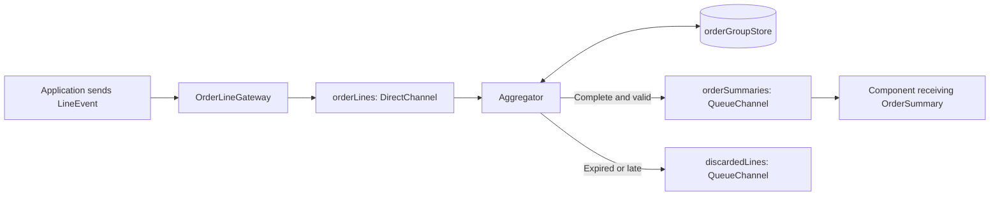

# Aggregating Messages with an Aggregator

## 1. Practice Objectives

In the **Comprehensive Practice** chapter of the `SPRING_INTEGRATION_CORE` module, this lesson builds a flow that receives independent order-line events and emits a summary once all required data has arrived. The exercise connects `Message`, `MessageChannel`, messaging gateways, endpoints, and the Java DSL with a stateful component: the **aggregator**.

Upon completion, you will be able to:

- Choose a correlation key so messages belonging to the same order enter the right group.
- Write a completion condition based on unique business lines.
- Build a result payload with deterministic ordering and total amount.
- Define policies for incomplete groups, conflicting data, and late messages.
- Test the aggregation flow without depending on a broker or database.
- Explain the changes needed when moving from an in-process prototype to a system with durable storage.

Prerequisites: familiarity with declaring Spring beans, reading Java DSL, sending a `Message` to a channel, and writing JUnit tests. The examples use Java 17 and Spring Integration 6.5 APIs; they can be placed in a Spring Boot 3.5 project managing library versions. This is a baseline for reading the examples, not a claim about the latest version.

## 2. Problem Statement: Aggregating Order Lines

A system receives order-line events from multiple sources. Each event carries a tenant ID, order ID, order revision, line number, expected total line count, and the line's amount.

Example for order `ORD-42`, tenant `SHOP-A`, revision `1`:

| Arrival order | Line | Expected lines | Amount | Meaning |
| --- | --- | --- | --- | --- |
| 1 | 3 | 3 | 30000 | Last line arrives first |
| 2 | 1 | 3 | 10000 | Group is still missing line 2 |
| 3 | 1 | 3 | 10000.00 | Redelivery of line 1 |
| 4 | 2 | 3 | 20000 | Lines 1, 2, 3 are all present |

The desired output is a single summary with three lines ordered `1, 2, 3`, total amount `60000`, and status `COMPLETE`. Four message deliveries yield only three business lines.

Contract of the exercise:

1. The group key is the triple `(tenantId, orderId, revision)`.
2. Within a group, `expectedLines` must be consistent and in the range `1..1000`.
3. Each `lineNo` must belong to `1..expectedLines`.
4. Resending the same line with the same amount counts as a valid duplicate.
5. The same line with a different amount, or a differing `expectedLines`, makes the group invalid.
6. Only a valid group with all lines present may emit a normal result.
7. A group that remains incomplete after an idle period moves its messages to a discard channel for investigation or compensation.
8. After a group closes, late messages are discarded for as long as group metadata is retained.

Assume all lines use the same currency and `amount` is already the line total after multiplying by quantity. If the system supports multiple currencies, add `currency` to the contract and verify consistency before summing.

## 3. Designing an Aggregator

An aggregator combines multiple related messages into a single result. Three decisions must be separated: which group a message belongs to, when the group is allowed to emit a result, and how that result is constructed. The corresponding extension points are `CorrelationStrategy`, `ReleaseStrategy`, and `MessageGroupProcessor`. [Aggregator Documentation](https://docs.spring.io/spring-integration/reference/6.5/aggregator.html).

| Component | Question to answer | Decision in this lesson |
| --- | --- | --- |
| Correlation | Which group does this message belong to? | Use `OrderKey` |
| Release | Is the group ready? | Valid and all unique lines present |
| Output processor | What result is produced from the group? | `OrderSummary` |
| Message group store | Where is waiting data kept? | `SimpleMessageStore` |
| Expiry policy | Where do incomplete groups go? | `discardedLines` |
| Closed group tracking | How are late messages handled? | Retain group metadata |



In this design, inputs are independent events; there is no splitter pre-populating sequence metadata. Thus, the flow declares both correlation and release strategies rather than relying on default headers. In a different splitter–aggregator flow, you need to understand `correlationId`, `sequenceNumber`, and `sequenceSize`; do not treat business line numbers and sequence headers as interchangeable concepts in every scenario. [Correlation and Sequence Mechanism](https://docs.spring.io/spring-integration/reference/6.5/aggregator.html).

### 3.1. Group Keys Must Reflect the Business Lifecycle

Using only `orderId` would mix two tenants that both have order `ORD-42`. Using only `(tenantId, orderId)` would mix a revised order with an earlier revision. Adding `revision` to the key allows reprocessing a new revision while still recognizing late messages from the old one.

Do not use `MessageHeaders.ID` as the group key: each message can have a different ID, splitting apart lines that belong together. Nor should you use a single constant for all orders: independent orders would get summed together.

### 3.2. Counting Unique Lines

With `expectedLines = 3`, a group receiving `1, 1, 2` is not complete despite having three messages. Conversely, a group receiving `3, 1, 1, 2` is complete despite having four messages.

The condition in this lesson is:

```text
valid = same group key
        and same expectedLines
        and every lineNo is valid
        and duplicates do not conflict

complete = valid
           and set of unique lineNo equals {1, ..., expectedLines}
```

After checking the `1..expectedLines` range, comparing the count of unique elements against `expectedLines` suffices to confirm the line set. Without range validation, three lines `1, 2, 99` could be miscounted as complete.

## 4. Preparing the Practice Project

In a Spring Boot 3.5 project with Java 17 and Maven configured, declare the following dependencies. Let Boot's BOM/parent manage versions; do not mix individual Spring Framework and Spring Integration versions manually. [Boot Dependency Management](https://docs.spring.io/spring-boot/3.5/appendix/dependency-versions/coordinates.html).

```xml
<dependencies>
    <dependency>
        <groupId>org.springframework.boot</groupId>
        <artifactId>spring-boot-starter-integration</artifactId>
    </dependency>
    <dependency>
        <groupId>org.springframework.boot</groupId>
        <artifactId>spring-boot-starter-test</artifactId>
        <scope>test</scope>
    </dependency>
</dependencies>
```

The classes below belong to package `example.orders`. Place each `public` class or record in a Java file with the same name. The extension snippets at the end of the lesson are optional alternatives or extra exercises; only the classes in the main implementation need to be assembled into the initial application.

```text
src/main/java/example/orders/
  OrderAggregationApplication.java
  OrderKey.java
  LineEvent.java
  OrderSummary.java
  OrderAggregationPolicy.java
  OrderLineGateway.java
  OrderAggregationConfig.java

src/test/java/example/orders/
  OrderAggregationFlowTest.java
  OrderAggregationTimeoutTest.java
```

Boot class:

```java
package example.orders;

import org.springframework.boot.SpringApplication;
import org.springframework.boot.autoconfigure.SpringBootApplication;
import org.springframework.integration.annotation.IntegrationComponentScan;

@SpringBootApplication
@IntegrationComponentScan
public class OrderAggregationApplication {

    public static void main(String[] args) {
        SpringApplication.run(OrderAggregationApplication.class, args);
    }
}
```

`@IntegrationComponentScan` scans the gateway interface in the application package. The practice exercise does not yet connect an external event source; tests act as producers through the gateway.

## 5. Data Model

### 5.1. Correlation Key

```java
package example.orders;

public record OrderKey(String tenantId, String orderId, int revision) {

    public OrderKey {
        if (tenantId == null || tenantId.isBlank()) {
            throw new IllegalArgumentException("tenantId is required");
        }
        if (orderId == null || orderId.isBlank()) {
            throw new IllegalArgumentException("orderId is required");
        }
        if (revision < 1) {
            throw new IllegalArgumentException("revision must be positive");
        }
    }
}
```

The record generates `equals()` and `hashCode()` from all three fields, suitable as keys in this lesson's store. If serializing keys into strings for another system, pick an unambiguous encoding; naive delimiter concatenation can collide when data itself contains that delimiter.

### 5.2. Input Event

```java
package example.orders;

import java.math.BigDecimal;
import java.util.Objects;

public record LineEvent(
        String tenantId,
        String orderId,
        int revision,
        int lineNo,
        int expectedLines,
        BigDecimal amount) {

    public LineEvent {
        // Validate key fields before sending into the flow.
        new OrderKey(tenantId, orderId, revision);
        if (expectedLines < 1 || expectedLines > 1000) {
            throw new IllegalArgumentException("expectedLines must be 1..1000");
        }
        if (lineNo < 1 || lineNo > expectedLines) {
            throw new IllegalArgumentException("lineNo is outside expected range");
        }
        Objects.requireNonNull(amount, "amount is required");
        if (amount.signum() < 0) {
            throw new IllegalArgumentException("amount must not be negative");
        }
    }

    public OrderKey key() {
        return new OrderKey(tenantId, orderId, revision);
    }
}
```

The limit of 1000 is an exercise choice to bound the size of one order. It does not yet bound total duplicate messages received or total open orders. Those two limits require separate policies when building a production intake service.

Examples use `new BigDecimal("10000.00")` to avoid precision errors from `double`. When comparing amounts on redeliveries, the policy uses `compareTo()`, because `10000` and `10000.00` are treated as equal under this contract.

### 5.3. Aggregation Result

```java
package example.orders;

import java.math.BigDecimal;
import java.util.List;

public record OrderSummary(
        OrderKey key,
        int expectedLines,
        List<LineEvent> lines,
        BigDecimal total,
        Status status,
        List<String> issues) {

    public enum Status {
        COMPLETE, PARTIAL, INVALID
    }

    public OrderSummary {
        lines = List.copyOf(lines);
        issues = List.copyOf(issues);
    }
}
```

In the main configuration, only `COMPLETE` is sent to the result channel. `PARTIAL` and `INVALID` describe policy states and support the extension on incomplete results. For an `INVALID` group, `total` is only the sum of selected lines for diagnostics and is not eligible for payment.

## 6. Writing the Aggregation Policy

The policy below constructs a business data snapshot of the group. It does not mutate the `MessageGroup` collection, call external services, or delete messages from the store directly. `MessageGroup` supplies the messages and group identity; the business snapshot is an application-constructed structure. [MessageGroup API](https://docs.spring.io/spring-integration/api/org/springframework/integration/store/MessageGroup.html).

```java
package example.orders;

import java.math.BigDecimal;
import java.util.ArrayList;
import java.util.LinkedHashSet;
import java.util.Set;
import java.util.TreeMap;

import org.springframework.integration.store.MessageGroup;
import org.springframework.messaging.Message;
import org.springframework.messaging.support.MessageBuilder;

public class OrderAggregationPolicy {

    public boolean canRelease(MessageGroup group) {
        return group.size() > 0
                && inspect(group).status() == OrderSummary.Status.COMPLETE;
    }

    public Message<OrderSummary> aggregate(MessageGroup group) {
        OrderSummary summary = inspect(group);
        return MessageBuilder.withPayload(summary)
                .setHeader("tenantId", summary.key().tenantId())
                .setHeader("orderId", summary.key().orderId())
                .setHeader("revision", summary.key().revision())
                .setHeader("aggregationStatus", summary.status().name())
                .build();
    }

    private OrderSummary inspect(MessageGroup group) {
        if (group.size() == 0) {
            throw new IllegalArgumentException("Cannot aggregate an empty group");
        }

        LineEvent first = (LineEvent) group.getOne().getPayload();
        OrderKey key = first.key();
        int expected = first.expectedLines();
        TreeMap<Integer, LineEvent> unique = new TreeMap<>();
        Set<String> issues = new LinkedHashSet<>();

        for (Message<?> message : group.getMessages()) {
            LineEvent line = (LineEvent) message.getPayload();

            if (!key.equals(line.key())) {
                issues.add("CORRELATION_MISMATCH");
            }
            if (line.expectedLines() != expected) {
                issues.add("EXPECTED_LINES_MISMATCH");
            }
            if (line.lineNo() < 1 || line.lineNo() > expected) {
                issues.add("LINE_OUT_OF_RANGE:" + line.lineNo());
            }

            LineEvent previous = unique.putIfAbsent(line.lineNo(), line);
            if (previous != null
                    && previous.amount().compareTo(line.amount()) != 0) {
                issues.add("LINE_AMOUNT_CONFLICT:" + line.lineNo());
            }
        }

        BigDecimal total = unique.values().stream()
                .map(LineEvent::amount)
                .reduce(BigDecimal.ZERO, BigDecimal::add);

        OrderSummary.Status status;
        if (!issues.isEmpty()) {
            status = OrderSummary.Status.INVALID;
        }
        else if (unique.size() == expected) {
            status = OrderSummary.Status.COMPLETE;
        }
        else {
            status = OrderSummary.Status.PARTIAL;
        }

        return new OrderSummary(
                key,
                expected,
                new ArrayList<>(unique.values()),
                total,
                status,
                new ArrayList<>(issues));
    }
}
```

Intentional design choices:

- `TreeMap` orders output lines by `lineNo`, independent of arrival order.
- `putIfAbsent()` keeps one representative per line when summing.
- Duplicates with the same amount do not add an extra line to the result.
- Conflicts are recorded in `issues` and cause release to return `false`; the group waits for the expiry policy.
- `aggregate()` returns a `Message<OrderSummary>` with explicitly set business headers rather than copying all headers from an arbitrary line.

`outputProcessor()` is the configuration hook for `MessageGroupProcessor` in Java DSL; when the processor itself returns a `Message`, the application must actively construct the required result headers. [AggregatorSpec API](https://docs.spring.io/spring-integration/api/org/springframework/integration/dsl/AggregatorSpec.html), [Result header generation rules](https://docs.spring.io/spring-integration/reference/6.5/aggregator.html).

This algorithm deduplicates **during aggregation**. It does not prevent duplicate messages from accumulating in the store before the group closes. Under heavy redelivery volume, add admission control or an ingress idempotency mechanism aligned with the group's intake lifecycle.

## 7. Gateway and Java DSL

### 7.1. Gateway Submitting Individual Events

```java
package example.orders;

import org.springframework.integration.annotation.MessagingGateway;

@MessagingGateway(defaultRequestChannel = "orderLines")
public interface OrderLineGateway {

    void submit(LineEvent line);
}
```

The method returns `void` because each call contributes only one line. The application receives the summary from a separate result channel. If you declared `OrderSummary submit(LineEvent line)` and awaited a reply for each line, the first lines might wait on lines not yet sent; a sequential producer would easily block itself.

In this configuration, `void` only means not awaiting a business reply. The input uses a `DirectChannel`, so the call still executes handlers synchronously and may block if the output channel fills up. Do not infer that the gateway automatically introduces asynchronous execution.

### 7.2. Complete Flow Configuration

```java
package example.orders;

import org.springframework.beans.factory.annotation.Qualifier;
import org.springframework.beans.factory.annotation.Value;
import org.springframework.context.annotation.Bean;
import org.springframework.context.annotation.Configuration;
import org.springframework.integration.channel.DirectChannel;
import org.springframework.integration.channel.QueueChannel;
import org.springframework.integration.dsl.IntegrationFlow;
import org.springframework.integration.store.SimpleMessageStore;

@Configuration
public class OrderAggregationConfig {

    @Bean
    public DirectChannel orderLines() {
        return new DirectChannel();
    }

    @Bean
    public QueueChannel orderSummaries() {
        return new QueueChannel(100);
    }

    @Bean
    public QueueChannel discardedLines() {
        return new QueueChannel(100);
    }

    @Bean
    public SimpleMessageStore orderGroupStore() {
        return new SimpleMessageStore();
    }

    @Bean
    public OrderAggregationPolicy orderAggregationPolicy() {
        return new OrderAggregationPolicy();
    }

    @Bean
    public IntegrationFlow orderAggregationFlow(
            @Qualifier("orderGroupStore") SimpleMessageStore store,
            OrderAggregationPolicy policy,
            @Value("${orders.group-timeout-ms:30000}") long groupTimeoutMs) {

        return IntegrationFlow.from("orderLines")
                .aggregate(a -> a
                        .id("orderAggregator")
                        .messageStore(store)
                        .correlationStrategy(message ->
                                ((LineEvent) message.getPayload()).key())
                        .releaseStrategy(policy::canRelease)
                        .outputProcessor(policy::aggregate)
                        .groupTimeout(groupTimeoutMs)
                        .sendPartialResultOnExpiry(false)
                        .expireGroupsUponCompletion(false)
                        .expireGroupsUponTimeout(false)
                        .minimumTimeoutForEmptyGroups(0)
                        .discardIndividuallyOnExpiry(true)
                        .discardChannel("discardedLines")
                        .sendTimeout(1000))
                .channel("orderSummaries")
                .get();
    }
}
```

The correlation, release, message store, timeout, and discard methods belong to `CorrelationHandlerSpec`; `outputProcessor()` and post-completion expiry policy live on `AggregatorSpec`. `long` duration parameters in these calls are in milliseconds. [CorrelationHandlerSpec 6.5 API](https://docs.spring.io/spring-integration/docs/6.5.0/api/org/springframework/integration/dsl/CorrelationHandlerSpec.html), [AggregatingMessageHandler 6.5 API](https://docs.spring.io/spring-integration/docs/6.5.0/api/org/springframework/integration/aggregator/AggregatingMessageHandler.html).

### 7.3. Why Choose This Configuration?

| Choice | Impact on the practice exercise |
| --- | --- |
| `DirectChannel` at input | Synchronous outcomes can be checked right after `submit()` |
| Two `QueueChannel(100)` at output | Tests actively pull results and discarded messages |
| Dedicated store for order flow | Isolates group data and lifecycle management |
| `sendPartialResultOnExpiry(false)` | Does not emit an incomplete order as a normal result |
| Both `expireGroups...` options `false` | Keeps group tracking after normal completion and timeout |
| `minimumTimeoutForEmptyGroups(0)` | Does not schedule automatic deletion of empty group markers in the exercise setup |
| `discardIndividuallyOnExpiry(true)` | On expiry, each discarded message is received individually |
| `sendTimeout(1000)` | Bounds wait time when sending to capacity-bounded queues |

The configuration retains metadata to observe late messages within a run. Under continuous traffic, a retention limit for markers must be added; keeping them forever causes closed-group count to grow without bound. Completing a group and removing a group are two distinct operations. [Group lifecycle management API](https://docs.spring.io/spring-integration/docs/6.5.0/api/org/springframework/integration/aggregator/AbstractCorrelatingMessageHandler.html).

Both output queues must be consumed. Here, tests call `receive()`; in a real service, corresponding consumers are needed. If adding an Integration Flow starting from a `QueueChannel`, configure a poller on the queue-reading endpoint. Aggregation does not automatically create consumers for its outputs.

## 8. Observing a Group's Lifecycle

With key `(SHOP-A, ORD-42, 1)`, send lines `3, 1, 1, 2` from the problem statement in order:

| After sending | Held messages | Unique lines | Inferred status | Result channel |
| --- | --- | --- | --- | --- |
| Line 3 | 1 | `{3}` | `PARTIAL` | Empty |
| Line 1 | 2 | `{1, 3}` | `PARTIAL` | Empty |
| Line 1 resent | 3 | `{1, 3}` | `PARTIAL` | Empty |
| Line 2 | Processed to close group | `{1, 2, 3}` | `COMPLETE` | One `OrderSummary` |

Normal flow:

```text
Receive message
  → compute OrderKey
  → add to corresponding group
  → evaluate canRelease()
      false: keep group waiting
      true : build OrderSummary → send result → complete group
```

After successful completion, the configuration retains the closed group with its message payloads cleared. You can observe this marker in tests via `isComplete()` and `size()`. A later message with the same key goes to `discardedLines` rather than starting a new order. [MessageGroup API and completion state](https://docs.spring.io/spring-integration/api/org/springframework/integration/store/MessageGroup.html).

Do not confuse the application's `OrderSummary.Status.COMPLETE` with `MessageGroup`'s completion flag. The first describes business data; the second serves endpoint group lifecycle management. The exercise intentionally keeps them aligned on the success branch.

## 9. Testing Success and Abnormal Data Flows

Tests use the real gateway, real channels, and real aggregator inside a Spring context. Synchronous input allows using `receive(0)` to check currently available outputs without arbitrary waits.

Group timeout is set to 60 seconds in this test class so short timeouts do not interfere with regular checks. Each test method uses a fresh context, isolating queues and group markers across scenarios.

```java
package example.orders;

import java.math.BigDecimal;
import java.util.HashMap;
import java.util.Map;

import org.junit.jupiter.api.Test;
import org.springframework.beans.factory.annotation.Autowired;
import org.springframework.beans.factory.annotation.Qualifier;
import org.springframework.boot.test.context.SpringBootTest;
import org.springframework.integration.channel.QueueChannel;
import org.springframework.integration.store.MessageGroup;
import org.springframework.integration.store.SimpleMessageStore;
import org.springframework.messaging.Message;
import org.springframework.test.annotation.DirtiesContext;

import static org.assertj.core.api.Assertions.assertThat;

@SpringBootTest(
        classes = OrderAggregationApplication.class,
        properties = "orders.group-timeout-ms=60000")
@DirtiesContext(classMode = DirtiesContext.ClassMode.AFTER_EACH_TEST_METHOD)
class OrderAggregationFlowTest {

    @Autowired
    private OrderLineGateway gateway;

    @Autowired
    @Qualifier("orderSummaries")
    private QueueChannel output;

    @Autowired
    @Qualifier("discardedLines")
    private QueueChannel discarded;

    @Autowired
    @Qualifier("orderGroupStore")
    private SimpleMessageStore store;

    @Test
    void aggregatesOutOfOrderWithoutDoubleCountingAndDiscardsLateMessage() {
        gateway.submit(line("A", "ORD-42", 1, 3, 3, "30000"));
        gateway.submit(line("A", "ORD-42", 1, 1, 3, "10000"));
        gateway.submit(line("A", "ORD-42", 1, 1, 3, "10000.00"));

        assertThat(output.receive(0)).isNull();
        OrderKey key = new OrderKey("A", "ORD-42", 1);
        assertThat(store.getMessageGroup(key).size()).isEqualTo(3);

        gateway.submit(line("A", "ORD-42", 1, 2, 3, "20000"));

        OrderSummary result = receiveSummary();
        assertThat(result.key()).isEqualTo(key);
        assertThat(result.status()).isEqualTo(OrderSummary.Status.COMPLETE);
        assertThat(result.lines()).extracting(LineEvent::lineNo)
                .containsExactly(1, 2, 3);
        assertThat(result.total()).isEqualByComparingTo("60000");
        assertThat(result.issues()).isEmpty();
        assertThat(output.receive(0)).isNull();

        MessageGroup completed = store.getMessageGroup(key);
        assertThat(completed.isComplete()).isTrue();
        assertThat(completed.size()).isZero();

        LineEvent late = line("A", "ORD-42", 1, 2, 3, "20000");
        gateway.submit(late);
        Message<?> rejected = discarded.receive(0);
        assertThat(rejected).isNotNull();
        assertThat(rejected.getPayload()).isEqualTo(late);
        assertThat(output.receive(0)).isNull();
    }

    @Test
    void separatesTenantsAndRevisions() {
        gateway.submit(line("A", "SAME", 1, 1, 2, "10"));
        gateway.submit(line("B", "SAME", 1, 1, 2, "100"));
        gateway.submit(line("A", "SAME", 2, 1, 2, "1000"));
        assertThat(output.receive(0)).isNull();

        gateway.submit(line("B", "SAME", 1, 2, 2, "200"));
        gateway.submit(line("A", "SAME", 2, 2, 2, "2000"));
        gateway.submit(line("A", "SAME", 1, 2, 2, "20"));

        Map<OrderKey, BigDecimal> totals = new HashMap<>();
        for (int i = 0; i < 3; i++) {
            OrderSummary result = receiveSummary();
            assertThat(result.status()).isEqualTo(OrderSummary.Status.COMPLETE);
            totals.put(result.key(), result.total());
        }

        assertThat(totals).hasSize(3);
        assertThat(totals.get(new OrderKey("A", "SAME", 1)))
                .isEqualByComparingTo("30");
        assertThat(totals.get(new OrderKey("B", "SAME", 1)))
                .isEqualByComparingTo("300");
        assertThat(totals.get(new OrderKey("A", "SAME", 2)))
                .isEqualByComparingTo("3000");
        assertThat(output.receive(0)).isNull();
    }

    @Test
    void doesNotReleaseAConflictingDuplicate() {
        gateway.submit(line("A", "CONFLICT", 1, 1, 2, "10"));
        gateway.submit(line("A", "CONFLICT", 1, 1, 2, "99"));
        gateway.submit(line("A", "CONFLICT", 1, 2, 2, "20"));

        assertThat(output.receive(0)).isNull();
        MessageGroup group = store.getMessageGroup(
                new OrderKey("A", "CONFLICT", 1));
        assertThat(group.isComplete()).isFalse();
        assertThat(group.size()).isEqualTo(3);
        assertThat(discarded.receive(0)).isNull();
    }

    @Test
    void doesNotReleaseWhenExpectedCountsDisagree() {
        gateway.submit(line("A", "COUNT", 1, 1, 2, "10"));
        gateway.submit(line("A", "COUNT", 1, 2, 3, "20"));
        gateway.submit(line("A", "COUNT", 1, 3, 3, "30"));

        assertThat(output.receive(0)).isNull();
        assertThat(store.getMessageGroup(
                new OrderKey("A", "COUNT", 1)).isComplete()).isFalse();
    }

    private OrderSummary receiveSummary() {
        Message<?> message = output.receive(0);
        assertThat(message).isNotNull();
        assertThat(message.getPayload()).isInstanceOf(OrderSummary.class);
        return (OrderSummary) message.getPayload();
    }

    private LineEvent line(
            String tenant, String order, int revision,
            int number, int expected, String amount) {

        return new LineEvent(tenant, order, revision,
                number, expected, new BigDecimal(amount));
    }
}
```

The first test verifies both the pre-release moment and the post-release result. Checking only the final total could miss bugs where a result is emitted early or an extra summary is produced.

In the conflicting-group test, `discardedLines` remains empty right after sending because the lesson chooses to wait for timeout to discard the whole group. That is the specified behavior; if the business requires immediate error reporting, design a dedicated error branch instead of expecting `ReleaseStrategy` returning `false` to emit an error message by itself.

## 10. Timeouts and Incomplete Groups

### 10.1. Idle Window vs. Absolute Deadline

`groupTimeout(30000)` in this lesson means the wait interval when a group has not released and no new message arrives for 30 seconds. It does not guarantee the group closes within 30 seconds of the first line. A line arriving near the end of the window resets the wait schedule. [Group timeout behavior](https://docs.spring.io/spring-integration/reference/6.5/aggregator.html#aggregator-and-group-timeout).

Example with a 30-second timeout:

```text
t =  0 s: line 1 arrives, lines 2 and 3 still missing
t = 20 s: line 1 arrives again
t = 40 s: line 2 arrives
t ≈ 70 s: group may close if no further data arrives
```

Even a business duplicate counts as a message arrival at the endpoint. Therefore, if a hard time limit from group creation is required, choose a corresponding time policy rather than simply lowering the number in `groupTimeout()`.

An alternative in configuration is an absolute timestamp based on group creation time:

```java
// Replaces .groupTimeout(groupTimeoutMs); do not set both at the same time.
.groupTimeoutExpression("new java.util.Date(timestamp + 30000)")
```

Here, `timestamp` is the group creation time in the store. If the business deadline is a timestamp supplied by the producer, include `deadline` in the contract and check consistency across lines; group creation time in the application may not match the business start time. [Timeout expression forms](https://docs.spring.io/spring-integration/reference/6.5/aggregator.html).

### 10.2. Testing the Expiry Branch

The timeout test runs in its own context with a 500 ms group wait. `receive(10000)` waits directly for the discarded event within a bounded window; no `Thread.sleep()` is needed and no claim is made that the scheduler must fire at an exact millisecond.

```java
package example.orders;

import java.math.BigDecimal;

import org.junit.jupiter.api.Test;
import org.springframework.beans.factory.annotation.Autowired;
import org.springframework.beans.factory.annotation.Qualifier;
import org.springframework.boot.test.context.SpringBootTest;
import org.springframework.integration.channel.QueueChannel;
import org.springframework.integration.store.MessageGroup;
import org.springframework.integration.store.SimpleMessageStore;
import org.springframework.messaging.Message;
import org.springframework.test.annotation.DirtiesContext;

import static org.assertj.core.api.Assertions.assertThat;

@SpringBootTest(
        classes = OrderAggregationApplication.class,
        properties = "orders.group-timeout-ms=500")
@DirtiesContext(classMode = DirtiesContext.ClassMode.AFTER_CLASS)
class OrderAggregationTimeoutTest {

    @Autowired
    private OrderLineGateway gateway;

    @Autowired
    @Qualifier("orderSummaries")
    private QueueChannel output;

    @Autowired
    @Qualifier("discardedLines")
    private QueueChannel discarded;

    @Autowired
    @Qualifier("orderGroupStore")
    private SimpleMessageStore store;

    @Test
    void discardsIncompleteGroupAndThenRejectsItsLateLine() {
        LineEvent first = new LineEvent(
                "A", "TIMEOUT", 1, 1, 2, new BigDecimal("10"));
        gateway.submit(first);

        Message<?> expired = discarded.receive(10000);
        assertThat(expired).isNotNull();
        assertThat(expired.getPayload()).isEqualTo(first);
        assertThat(output.receive(0)).isNull();

        LineEvent late = new LineEvent(
                "A", "TIMEOUT", 1, 2, 2, new BigDecimal("20"));
        gateway.submit(late);

        Message<?> rejected = discarded.receive(0);
        assertThat(rejected).isNotNull();
        assertThat(rejected.getPayload()).isEqualTo(late);
        assertThat(output.receive(0)).isNull();

        MessageGroup group = store.getMessageGroup(
                new OrderKey("A", "TIMEOUT", 1));
        assertThat(group.isComplete()).isTrue();
        assertThat(group.size()).isZero();
    }
}
```

Sending the late message goes through the same group key, so it synchronizes with endpoint group management. Inspecting the store afterward avoids assuming that receiving the expired message means every cleanup step on the scheduler thread finished instantaneously.

To execute the lesson in the prepared Maven project, run `mvn test`. All tests above are expected to pass, the result channel contains no incomplete orders, and late messages appear on the discard channel. The code snippets here are practice material for learners to run; this lesson does not present pre-measured benchmark runs or test logs.

## 11. Late Messages and Removing Group Markers

Keeping a completed group distinguishes a late message from the first line of a new group. Removing the group completely from the store leaves the endpoint with no marker to tell those two cases apart. [expireGroupsUponCompletion policy](https://docs.spring.io/spring-integration/docs/6.5.0/api/org/springframework/integration/aggregator/AggregatingMessageHandler.html).

| Option | Value | Situation to accept |
| --- | --- | --- |
| `expireGroupsUponCompletion` | `false` | Keeps marker after normal completion; needs metadata cleanup plan |
| `expireGroupsUponCompletion` | `true` | Future messages with the same key can open a new group |
| `expireGroupsUponTimeout` | `false` | Group closed by timeout still blocks late messages |
| `expireGroupsUponTimeout` | `true` | Messages arriving after timeout can start aggregating from scratch |

In an ordering system, reopening the same revision after it has been finalized usually needs control. The lesson keeps markers while using `revision` to recognize an intentional new business version.

Do not rely solely on markers in `SimpleMessageStore` to promise permanent deduplication. After a process loses in-memory state or metadata is purged, old messages can be accepted again. To protect a finalized business transaction, also persist completion state by business key in durable storage and design idempotent consumer handling.

### 11.1. Choosing Marker Retention Duration

For example, if an upstream source can resend an event for up to 24 hours, keeping markers for only 5 minutes leaves most of the redelivery window unprotected. Conversely, keeping all markers forever makes metadata grow with the total number of orders ever processed.

The contract should specify:

- Maximum delay and supported redelivery window.
- Retention period for closed groups.
- Behavior when an old message arrives after that retention period.
- How a new revision or processing ID is created for valid reruns.

One option is setting `minimumTimeoutForEmptyGroups()` to a positive value matching marker retention. For scheduled group management designs, `MessageGroupStoreReaper` provides a `Runnable` that invokes the store's expiration mechanism. You must configure an execution schedule; merely creating a reaper bean does not guarantee periodic scans. [MessageGroupStoreReaper API](https://docs.spring.io/spring-integration/docs/6.5.0/api/org/springframework/integration/store/MessageGroupStoreReaper.html).

Do not add multiple expiration mechanisms simultaneously without defining each mechanism's responsibility. A store sweep can affect open groups when your original goal was only to purge closed-group markers. Dedicating a store or namespace to the endpoint limits this management scope.

## 12. Distinguishing Discard from Processing Errors

Incomplete or late messages represent a predefined processing branch. Exceptions while accessing the store, computing results, or sending output are a different category of failure. This lesson uses `discardedLines` for the first branch; that queue does not automatically become a sink for all exceptions.

| Situation | Lesson behavior | Information to track |
| --- | --- | --- |
| Not all lines received yet | Keep group, do not emit result | Group key, lines received vs. expected |
| Duplicate with same amount | Not counted again in total | Redelivery count by source |
| Duplicate with different amount | Group does not release, later expires | Conflicting line and received values |
| Incomplete group expires | Messages sent to discard | Which group was missing which lines |
| Line arrives after group closes | That message goes to discard | Arrival lateness, order revision |
| Constructor receives invalid data | Rejected before calling gateway | Input data and validation cause |
| Handler throws during synchronous send | Caller may receive exception | Endpoint, business key, cause |
| Failure inside scheduler task | Must handle error on task thread | Error message, store, and recovery policy |

With `DirectChannel`, exceptions from handlers running on the sending thread can propagate to the caller. Do not assume that merely setting an `errorChannel` header routes every synchronous error to a queue. Asynchronous tasks and schedulers require proper `ErrorMessage` publication mechanisms; when providing your own scheduler, configure its error handling. [Error Handling Documentation](https://docs.spring.io/spring-integration/reference/error-handling.html).

In this lesson, conflicting data is an invalid check outcome, so `canRelease()` returns `false` instead of throwing an exception. This decision allows timeouts to still handle the group via the discard branch. If switching to throwing an exception for immediate reporting, design isolation or repair of the group as well; do not assume an exception automatically rolls back data already added to an in-memory store.

### 12.1. When the Output Channel Is Full

Both queues have a capacity of 100 to prevent unbounded output accumulation in the exercise. If consumers stop reading, sending may wait up to `sendTimeout(1000)` and then fail. `QueueChannel` supports bounded capacity and send timeouts; `DirectChannel` has a different handler-invocation model. [Message Channel Implementations](https://docs.spring.io/spring-integration/reference/channel/implementations.html).

A failure occurring after some data has already been processed does not mean the application achieved an end-to-end transaction. For systems requiring recovery, clearly establish:

1. After failure, what data remains in the group?
2. Will the producer resend the last message?
3. Can the consumer receive the same summary again?
4. What key do downstream business steps use to recognize an already-processed result?

Here, the result key can be `(tenantId, orderId, revision)`. If the consumer writes to a database and then calls an external API, design recovery mechanisms for each step. Correct aggregation alone does not guarantee side effects happen only once.

## 13. Storage, Concurrency, and Resource Limits

### 13.1. Distinguishing Queues from Message Group Stores

`orderSummaries` holds results waiting for consumers. `orderGroupStore` holds in-progress data waiting for completion by key. Reducing queue capacity does not automatically limit the number of open orders in the store.

`SimpleMessageStore` is an in-memory store; the no-arg constructor in the example sets no capacity bound. It is suitable for learning and testing, though group data does not survive process loss. [SimpleMessageStore API](https://docs.spring.io/spring-integration/docs/6.5.0/api/org/springframework/integration/store/SimpleMessageStore.html).

A rough estimate for waiting payload memory:

```text
payload memory ≈ open groups
               × average messages per group
               × average size per message
```

For example, `5000 × 20 × 2 KiB` is roughly `195 MiB`, before counting Java object overhead, headers, collection structures, output queues, and closed-group metadata. Duplicates can still grow the store even though the total amount is deduplicated.

Capping `expectedLines` blocks oversized orders, yet does not solve unbounded group counts or a source endlessly resending one line. A complete intake design also needs per-group, per-source, and time bounds, plus overload response rules.

### 13.2. Moving to a Durable Store

Spring Integration offers multiple message store implementations with differing payload and header storage mechanisms. Check serialization, recovery behavior, and which headers can survive storage. Headers containing transient channel objects or non-serializable objects need separate review. [Message Store Documentation](https://docs.spring.io/spring-integration/reference/message-store.html).

With JDBC, `JdbcMessageStore` serves correlating components like aggregators. `JdbcChannelMessageStore` targets backing channels; do not swap the two merely because both use JDBC. JDBC stores also require database-specific schemas. [JdbcMessageStore API](https://docs.spring.io/spring-integration/docs/6.5.0/api/org/springframework/integration/jdbc/store/JdbcMessageStore.html).

To extend the lesson to JDBC, tasks include:

- Adding JDBC dependencies, driver, `DataSource`, and schema.
- Switching the store and matching store parameter type in configuration.
- Choosing a serializer or adjusting data types to fit the storage mechanism; Java records are not automatically `Serializable` just by being declared with `record`.
- Defining a namespace or region for the endpoint's data.
- Testing restarts while a group is missing lines.
- Handling orphaned groups after restart, because persisting data does not mean in-memory timeout schedules are automatically recreated.

Endpoints provide APIs for handling lingering groups with options like `expireTimeout`, `expireDuration`, and `purgeOrphanedGroups()`. Pick values matching the data contract still valid after restart, and test their impact on waiting groups. [Orphaned group handling API](https://docs.spring.io/spring-integration/docs/6.5.0/api/org/springframework/integration/aggregator/AbstractCorrelatingMessageHandler.html).

### 13.3. Multiple Threads and Multiple Instances

An aggregator must coordinate updates to the same group when multiple threads process concurrently. `LockRegistry` provides locking by correlation key; JVM-local locks and multi-instance locks differ in scope. If two instances access the same group in a shared store, choose cross-instance coordination or partition inputs so only one instance owns a group. [Distributed Locks Documentation](https://docs.spring.io/spring-integration/reference/distributed-locks.html).

For example, partitioning a broker by order key routes all lines of a group to the same consumer at any given time. Even with that design, ownership changes during rebalances or process restarts must still be handled. If choosing a shared store with distributed locks, test lock loss, connection loss, and post-error reprocessing.

Do not pull a group's collection from the store and mutate it on another thread to remove duplicates. That bypasses the endpoint's lifecycle and synchronization. Store inspections in the tests above only read data at well-defined points.

### 13.4. Cost of the Inspection Policy

`inspect()` iterates over messages and inserts unique lines into a `TreeMap`. With `k` messages and `u` unique lines currently present, one check costs roughly `O(k log u)`. When there are no duplicates, re-invoking on each arrival makes total cost for an `n`-line group scale as `O(n² log n)`.

This is a readable choice for a practice exercise with bounded group sizes. When groups are large or duplicates are frequent, consider tracking counts and validation state incrementally. Any extra state must be updated under the same consistency rules as message arrival; using an auxiliary `Map` out of sync with the store creates another source of drift on errors or restarts.

Keep correlation strategies, release strategies, and output processors lean. Avoid slow API calls inside these steps because they prolong processing and lock hold times for the group.

## 14. Two Variants to Extend the Practice

### 14.1. Allowing Partial Results to Be Emitted

A monitoring dashboard might accept provisional summaries, whereas order finalization only accepts complete ones. In that case you can change:

```java
.sendPartialResultOnExpiry(true)
```

and add a router after the aggregator to branch by `OrderSummary.status()`:

```java
// Replaces .channel("orderSummaries") in the main configuration.
// Declare the three destination channels and their consumers before using.
.route(OrderSummary.class, summary -> summary.status().name(), r -> r
        .channelMapping("COMPLETE", "completeOrders")
        .channelMapping("PARTIAL", "partialOrders")
        .channelMapping("INVALID", "invalidOrders"))
```

The current policy already produces three statuses, allowing incomplete groups and conflicting groups to be distinguished. The `lines` and `issues` fields supply data for consumers to decide next steps. To display missing line numbers directly, compute the difference between `1..expectedLines` and the received `lineNo` values.

With this option enabled, conflicting groups still do not release normally, though the processor may be invoked upon expiry and produce an `INVALID` result. Result channels and timeout tests must be updated accordingly. Do not send all statuses to the same order-finalization consumer.

Groups closed with `expireGroupsUponTimeout(false)` still reject late lines. Emitting a partial result does not automatically create a mechanism to update that result when remaining lines arrive; supporting updates requires a versioning contract or a different processing model.

### 14.2. Discarding the Entire Group in One Message

In Spring Integration 6.5, if keeping `sendPartialResultOnExpiry(false)`, you can choose:

```java
.discardIndividuallyOnExpiry(false)
```

Upon expiry, the discarded group's data is packaged into a single message whose payload is the list of messages in the group. This variant is convenient when building an investigation record holding all received lines. [discardIndividuallyOnExpiry API](https://docs.spring.io/spring-integration/docs/6.5.0/api/org/springframework/integration/dsl/CorrelationHandlerSpec.html).

This changes the payload contract of the expiry branch. A consumer casting the payload directly to `LineEvent` will no longer fit that branch. At the same time, individual late messages still need proper handling. One design normalizes both cases into an application compensation event containing order key, cause, related messages, and group close timestamp.

## 15. Troubleshooting Common Issues

| Symptom | Possible cause | How to verify and fix |
| --- | --- | --- |
| Messages do not group together | Key contains a field that changes per send | Check `OrderKey` values on each line |
| Data from two orders gets mixed | Key lacks tenant or revision | Send two cases with the same `orderId` in tests |
| Group releases while lines are missing | Comparing only `group.size()` against expected count | Send sequence `1, 1, 2` for a three-line order |
| Never releases despite receiving many messages | Missing unique line or conflict present | Compare `lineNo` set, `expectedLines`, and `issues` |
| Always waits even after all data sent | Using default strategy with inputs lacking sequence headers | Declare business strategies as shown or supply proper sequences |
| Total amount is doubled | Summing every payload in the group | Deduplicate by line identifier before summing |
| Line order changes | Relying on arrival order or store collection order | Sort explicitly by `lineNo` |
| Old message starts a new summary | Group marker deleted or lost on restart | Check expiry policy and durable completion state |
| Memory grows even though orders complete | Markers not cleaned up, open groups, or many duplicates | Measure open groups, closed groups, and held messages separately |
| Timeout fires later than expected | Using idle window while extra messages arrive | Log group creation time and latest arrival time |
| Exceptions only seen at caller | Flow uses `DirectChannel` | Check thread path and error-handling configuration |
| Nobody receives results | Output queue has no consumer | Check message count in queue and consumer poller |

If a splitter precedes the aggregator and then a filter drops some elements, review the completion condition. The total count advertised by the splitter may no longer match the count reaching the aggregator. Re-align the contract: filter before splitting, emit a status result for dropped branches, or use a release condition matching the actual expected result count.

## 16. Operational Observability Data

The goal of observability is to explain why an order is waiting, closed, or discarded, while spotting abnormal resource buildup.

| Metric / Signal | Operational meaning |
| --- | --- |
| Open group count | Volume of in-flight unfinished business |
| Age of oldest open group | Sign of missing data or broken expiry schedule |
| Held message count | Memory or storage cost of waiting data |
| Closed-group marker count | Cost of anti-reprocessing policy |
| Emitted result count by status | Distinguishes complete, partial, and invalid |
| Discarded message count and reason | Identifies timeouts, late arrivals, and conflicting data |
| Output queue fill level | Slow or stalled consumer |
| Time from group creation to close | End-to-end processing latency per order |

Store APIs such as `getMessageGroupCount()` and `getMessageCountForAllMessageGroups()` aid observability depending on implementation. Do not infer `getMessageGroupCount()` is always the open group count, as the store may retain closed groups. [MessageGroupStore API](https://docs.spring.io/spring-integration/docs/6.5.0/api/org/springframework/integration/store/MessageGroupStore.html).

In logs or traces, include the business key and endpoint to correlate events of the same order. For labeled metrics, avoid putting every `orderId` into a label because cardinality grows with order volume; use bounded labels such as result status or error category.

The discard channel in the initial configuration carries only the raw message, without a standardized reason field across branches. If metrics separating timeouts from late arrivals are needed, add lifecycle events or a contextual compensation layer rather than guessing the cause from payload type.

## 17. Extension Exercises and Completion Criteria

Apply each change independently to observe its effect clearly:

1. **Change order revision:** complete `revision = 1`, resend one line of that revision, then send a complete `revision = 2`. Expect the old revision's line to be discarded and the new revision to produce its own result.
2. **Distinguish timeout types:** send an extra duplicate before the idle window expires, then compare with the deadline variant calculated from group creation time. Expect the two policies to close the group at different times.
3. **Single-line order:** send one event with `lineNo = expectedLines = 1`. Expect immediate single release without waiting for timeout.
4. **Conflicting group expires:** send two copies of the same line with different amounts; receive messages on discard and verify no normal `OrderSummary` is emitted.
5. **Routed partial results:** enable partial emission and add corresponding channels and consumers. Expect incomplete groups to go to `partialOrders` and conflicting groups to go to `invalidOrders`.
6. **Blocked output:** use a small queue capacity and pause the consumer. Identify where the error occurs, remaining group data, and how producer/consumer recover without causing duplicate side effects.
7. **Restart with a durable store:** stop the application after one line, restart, and send the remaining line. Verify group data, timeout policy, and anti-reprocessing state all behave per the chosen contract.

The practice exercise is satisfactory when the flow groups lines sharing the same key, completes only on complete and consistent data, avoids double-counting, produces deterministic line ordering, handles incomplete groups and late messages, and tests verify both pre-release state and post-close state. For variants with persistence or multiple instances, add recovery and concurrency evidence before considering that variant complete.