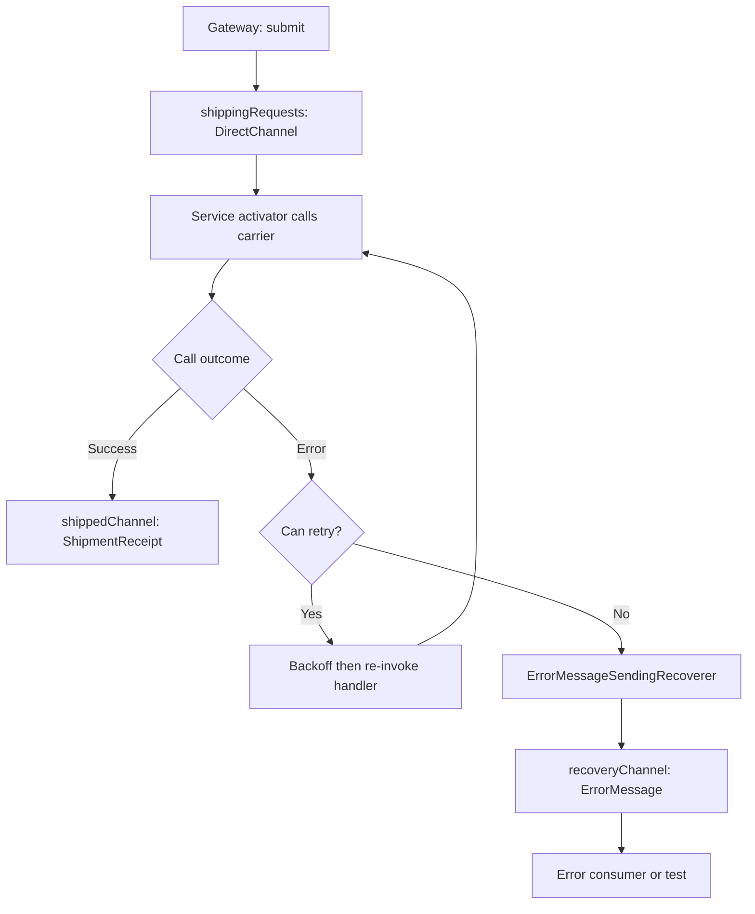

# Adding Retry and Recovery

In the **Comprehensive Practice** chapter of **SPRING_INTEGRATION_CORE**, this lesson adds fault tolerance to a message flow calling a shipping carrier service. We use Message, MessageChannel, a messaging gateway, a service activator, and the Java DSL to retry recoverable operations appropriately and then preserve failed messages at an explicit recovery point.

Target outcomes: distinguish transient errors from errors that should not be retried; determine exact attempt counts; configure backoff; retain failed message information; and write tests proving the success branch, recovery branch, and behavior when recovery itself fails.

## 1. Context and Completion Criteria

Suppose a system receives shipment creation commands. The carrier service may experience brief outages, or it may reject an invalid address. Retrying every exception increases latency and puts unnecessary load on the partner.

The design of the practice exercise has these rules:

- A command invokes the service at most **3 times**, including the initial attempt.
- Only `TemporaryCarrierException` and its subclasses are retried.
- Wait intervals before the next two attempts are **100 ms** and **200 ms**.
- On success, the flow sends a `ShipmentReceipt` to `shippedChannel`.
- When retries are exhausted or not permitted, recovery sends exactly one `ErrorMessage` to `recoveryChannel`.
- If sending to the recovery channel fails, the call must raise an error to the caller.
- Every attempt of the same operation uses the same `idempotencyKey`.

| Scenario | Service call count | Wait intervals | Observed result |
| --- | ---: | --- | --- |
| Immediate success | 1 | None | One receipt |
| Transient failure twice then success | 3 | 100 ms, 200 ms | One receipt |
| Persistent transient failure | 3 | 100 ms, 200 ms | One ErrorMessage |
| Invalid address | 1 | None | One ErrorMessage |
| Transient failure and recoveryChannel is full | 3 | 100 ms, 200 ms | Caller receives exception |

Recovery also applies to non-retryable errors in this configuration: an address error calls the service once and then goes to recovery. "Do not retry" and "do not recover" are two separate decisions.

## 2. Version Scope and Prerequisites

The example pins **Java 17, Spring Boot 3.5.0, Spring Integration 6.5.0, and Spring Retry 2.0.12** so learners have a reproducible setup. The last two library versions are managed by the Spring Boot 3.5.0 BOM. This is the lab baseline; when applying to another project, keep the compatible dependency set of that project. See [Spring Boot 3.5.0 BOM](https://github.com/spring-projects/spring-boot/blob/v3.5.0/spring-boot-project/spring-boot-dependencies/build.gradle).

The `org.springframework.retry.*` imports and `setRetryTemplate(...)` method in this lesson belong to the platform above. If opening docs for another API generation, select the matching 6.5.x documentation before comparing examples.

Learners should already know:

- Payload and headers of `Message<?>`.
- How `DirectChannel` delivers messages to an endpoint.
- How `QueueChannel` holds messages for a receiver to pull.
- How to declare an `IntegrationFlow` with the Java DSL.
- How to run Maven tests with JUnit 5 and AssertJ.

The lab makes no real HTTP calls and requires no broker. Tests initialize the Spring ApplicationContext directly; therefore no `main` class or web server startup is needed.

## 3. Identifying the Retry Boundary

A real flow might consist of:

```text
Receive order
  -> validate data
  -> normalize address
  -> call carrier service
  -> save receipt
  -> emit completion event
```

In this lesson, the advice is attached only to the service activator **calling the carrier service**. Do not wrap the entire flow in a resend-from-start loop. Resending the whole flow can repeat already-completed actions such as generating an order code or publishing events.

With the reply-producing handler used here, `RequestHandlerRetryAdvice` wraps request handling; sending the result to the next endpoint sits outside that wrapper. Therefore, errors occurring after the handler returns do not automatically cause the carrier service to be retried by this advice. See [advice boundary in AbstractReplyProducingMessageHandler 6.5.0](https://github.com/spring-projects/spring-integration/blob/v6.5.0/spring-integration-core/src/main/java/org/springframework/integration/handler/AbstractReplyProducingMessageHandler.java).



The `G -> C` loop uses stateless retry: the retry loop executes within the same processing attempt. It does not require the sender to create a new Message.

## 4. Components to Configure

| Component | Responsibility in this lesson |
| --- | --- |
| `RequestHandlerRetryAdvice` | Attaches retry behavior to an endpoint |
| `RetryTemplate` | Coordinates attempts, policy, backoff, and recovery |
| `SimpleRetryPolicy` | Limits attempt count and classifies exceptions |
| `ExponentialBackOffPolicy` | Increases wait intervals between attempts |
| `ErrorMessageSendingRecoverer` | Sends the final failure to the recovery channel |
| `QueueChannel` | Holds ErrorMessage for observation or forwarding |

In Spring Retry 2.0.12, `maxAttempts = 3` means **one initial attempt and up to two retries**. Do not configure 4 if business requirements allow only 3 calls. The constructor with `traverseCauses = true` lets the policy search wrapped cause chains for matching exceptions; `defaultValue = false` ensures undeclared exception types are not retried by default. See [SimpleRetryPolicy 2.0.12](https://docs.spring.io/spring-retry/docs/2.0.12/apidocs/org/springframework/retry/policy/SimpleRetryPolicy.html).

The example intentionally defines a dedicated transient exception type instead of retrying every `RuntimeException`. In real HTTP integration, the client layer should translate errors judged retryable into this exception type. Data errors, programming bugs, and authentication failures should be classified per the service contract rather than lumped into one retry bucket.

## 5. Creating the Lab Project

Create the following files in **a separate practice Maven project**:

```text
retry-recovery-lab/
  pom.xml
  src/main/java/example/retry/
    ShippingGateway.java
    RetryLabConfig.java
  src/test/java/example/retry/
    ShippingRetryTest.java
```

This is the project layout for learners to practice; the code snippets below are part of this guide and do not require modifying the content module itself.

### 5.1. Dependencies

Contents of `pom.xml`:

```xml
<?xml version="1.0" encoding="UTF-8"?>
<project xmlns="http://maven.apache.org/POM/4.0.0"
         xmlns:xsi="http://www.w3.org/2001/XMLSchema-instance"
         xsi:schemaLocation="http://maven.apache.org/POM/4.0.0 https://maven.apache.org/xsd/maven-4.0.0.xsd">
    <modelVersion>4.0.0</modelVersion>

    <parent>
        <groupId>org.springframework.boot</groupId>
        <artifactId>spring-boot-starter-parent</artifactId>
        <version>3.5.0</version>
        <relativePath/>
    </parent>

    <groupId>example</groupId>
    <artifactId>retry-recovery-lab</artifactId>
    <version>1.0.0</version>

    <properties>
        <java.version>17</java.version>
        <project.build.sourceEncoding>UTF-8</project.build.sourceEncoding>
    </properties>

    <dependencies>
        <dependency>
            <groupId>org.springframework.boot</groupId>
            <artifactId>spring-boot-starter-integration</artifactId>
        </dependency>
        <dependency>
            <groupId>org.springframework.retry</groupId>
            <artifactId>spring-retry</artifactId>
        </dependency>
        <dependency>
            <groupId>org.springframework.boot</groupId>
            <artifactId>spring-boot-starter-test</artifactId>
            <scope>test</scope>
        </dependency>
    </dependencies>
</project>
```

Declaring `spring-retry` explicitly makes the dependency behind this mechanism clear. Because the lab uses Spring Integration's advice directly, you do not need `@EnableRetry` or `@Retryable` on the client.

### 5.2. Gateway Submitting Commands

Contents of `ShippingGateway.java`:

```java
package example.retry;

import example.retry.RetryLabConfig.ShipOrder;
import org.springframework.integration.annotation.MessagingGateway;
import org.springframework.messaging.handler.annotation.Header;

@MessagingGateway(defaultRequestChannel = "shippingRequests")
public interface ShippingGateway {

    void submit(ShipOrder order,
                @Header("idempotencyKey") String idempotencyKey);
}
```

The gateway has a `void` return type because the lab's contract is to submit commands and observe outcomes across two channels. It does not wait for a business reply. However, because the input is a `DirectChannel`, processing and backoff still run on the calling thread: `void` does not make sending asynchronous. See [Messaging Gateways 6.5](https://docs.spring.io/spring-integration/reference/6.5/gateway.html).

A normal return from `submit(...)` could mean "shipment created" or "failure moved to recovery". The caller must not infer that a shipment was created solely from the absence of an exception.

### 5.3. Model, Simulated Client, Retry, and Flow

Contents of `RetryLabConfig.java`:

```java
package example.retry;

import java.util.List;
import java.util.Map;
import java.util.Objects;
import java.util.concurrent.ConcurrentHashMap;
import java.util.concurrent.CopyOnWriteArrayList;
import java.util.concurrent.atomic.AtomicInteger;

import org.springframework.beans.factory.annotation.Qualifier;
import org.springframework.context.annotation.Bean;
import org.springframework.context.annotation.Configuration;
import org.springframework.integration.annotation.IntegrationComponentScan;
import org.springframework.integration.channel.DirectChannel;
import org.springframework.integration.channel.QueueChannel;
import org.springframework.integration.config.EnableIntegration;
import org.springframework.integration.dsl.IntegrationFlow;
import org.springframework.integration.handler.advice.ErrorMessageSendingRecoverer;
import org.springframework.integration.handler.advice.RequestHandlerRetryAdvice;
import org.springframework.retry.backoff.ExponentialBackOffPolicy;
import org.springframework.retry.backoff.Sleeper;
import org.springframework.retry.backoff.ThreadWaitSleeper;
import org.springframework.retry.policy.SimpleRetryPolicy;
import org.springframework.retry.support.RetryTemplate;

@Configuration(proxyBeanMethods = false)
@EnableIntegration
@IntegrationComponentScan(basePackageClasses = ShippingGateway.class)
public class RetryLabConfig {

    public enum Scenario {
        SUCCESS,
        TRANSIENT_TWICE,
        ALWAYS_TRANSIENT,
        INVALID_ADDRESS
    }

    public record ShipOrder(String orderId, Scenario scenario) {
        public ShipOrder {
            Objects.requireNonNull(orderId, "orderId");
            Objects.requireNonNull(scenario, "scenario");
            if (orderId.isBlank()) {
                throw new IllegalArgumentException("orderId must not be blank");
            }
        }
    }

    public record ShipmentReceipt(
            String orderId,
            String trackingCode,
            String idempotencyKey) {
    }

    public static class TemporaryCarrierException extends RuntimeException {
        public TemporaryCarrierException(String message) {
            super(message);
        }
    }

    public static class InvalidAddressException extends RuntimeException {
        public InvalidAddressException(String message) {
            super(message);
        }
    }

    public static class SimulatedCarrier {

        private final Map<String, AtomicInteger> attempts =
                new ConcurrentHashMap<>();

        private final Map<String, CopyOnWriteArrayList<String>> observedKeys =
                new ConcurrentHashMap<>();

        public ShipmentReceipt createShipment(
                ShipOrder order, String idempotencyKey) {

            if (idempotencyKey == null || idempotencyKey.isBlank()) {
                throw new IllegalArgumentException("Missing idempotencyKey");
            }

            int attempt = attempts
                    .computeIfAbsent(order.orderId(), key -> new AtomicInteger())
                    .incrementAndGet();

            observedKeys
                    .computeIfAbsent(order.orderId(),
                            key -> new CopyOnWriteArrayList<>())
                    .add(idempotencyKey);

            switch (order.scenario()) {
                case SUCCESS -> {
                    // Succeeds immediately.
                }
                case TRANSIENT_TWICE -> {
                    if (attempt <= 2) {
                        throw new TemporaryCarrierException(
                                "Carrier unavailable, attempt " + attempt);
                    }
                }
                case ALWAYS_TRANSIENT -> throw new TemporaryCarrierException(
                        "Carrier still unavailable, attempt " + attempt);
                case INVALID_ADDRESS -> throw new InvalidAddressException(
                        "Address must be corrected before resubmission");
            }

            return new ShipmentReceipt(
                    order.orderId(),
                    "SHIP-" + order.orderId(),
                    idempotencyKey);
        }

        public int attemptsFor(String orderId) {
            AtomicInteger value = attempts.get(orderId);
            return value == null ? 0 : value.get();
        }

        public List<String> keysFor(String orderId) {
            List<String> values = observedKeys.get(orderId);
            return values == null ? List.of() : List.copyOf(values);
        }
    }

    @Bean
    DirectChannel shippingRequests() {
        return new DirectChannel();
    }

    @Bean
    QueueChannel shippedChannel() {
        return new QueueChannel();
    }

    @Bean
    QueueChannel recoveryChannel() {
        // Capacity 1 to easily test a full recovery queue.
        return new QueueChannel(1);
    }

    @Bean
    SimulatedCarrier carrier() {
        return new SimulatedCarrier();
    }

    @Bean
    Sleeper retrySleeper() {
        return new ThreadWaitSleeper();
    }

    @Bean
    RetryTemplate shippingRetryTemplate(Sleeper retrySleeper) {
        Map<Class<? extends Throwable>, Boolean> retryable = Map.of(
                TemporaryCarrierException.class, true);

        SimpleRetryPolicy policy = new SimpleRetryPolicy(
                3,          // Total attempts, including the initial call.
                retryable,
                true,       // Traverse causes of wrapped exceptions.
                false);     // Undeclared exception types are not retried by default.

        ExponentialBackOffPolicy backoff = new ExponentialBackOffPolicy();
        backoff.setInitialInterval(100L);
        backoff.setMultiplier(2.0);
        backoff.setMaxInterval(1_000L);
        backoff.setSleeper(retrySleeper);

        RetryTemplate template = new RetryTemplate();
        template.setRetryPolicy(policy);
        template.setBackOffPolicy(backoff);
        return template;
    }

    @Bean
    RequestHandlerRetryAdvice shippingRetryAdvice(
            RetryTemplate shippingRetryTemplate,
            @Qualifier("recoveryChannel") QueueChannel recoveryChannel) {

        ErrorMessageSendingRecoverer recoverer =
                new ErrorMessageSendingRecoverer(recoveryChannel);
        recoverer.setSendTimeout(0L);

        RequestHandlerRetryAdvice advice = new RequestHandlerRetryAdvice();
        advice.setRetryTemplate(shippingRetryTemplate);
        advice.setRecoveryCallback(recoverer);
        return advice;
    }

    @Bean
    IntegrationFlow shippingFlow(
            @Qualifier("shippingRequests") DirectChannel shippingRequests,
            @Qualifier("shippedChannel") QueueChannel shippedChannel,
            SimulatedCarrier carrier,
            RequestHandlerRetryAdvice shippingRetryAdvice) {

        return IntegrationFlow.from(shippingRequests)
                .handle(ShipOrder.class,
                        (order, headers) -> carrier.createShipment(
                                order,
                                headers.get("idempotencyKey", String.class)),
                        endpoint -> endpoint
                                .id("createShipment")
                                .advice(shippingRetryAdvice))
                .channel(shippedChannel)
                .get();
    }
}
```

The Java DSL takes a handler with an explicit payload type, so the lambda receives `ShipOrder` and `MessageHeaders`. The endpoint customizer is where the advice is attached; this is still a service activator in the flow. See [Service Activators and handle() 6.5](https://docs.spring.io/spring-integration/reference/6.5/dsl/java-handle.html).

A few details to read alongside the code:

1. `@EnableIntegration` registers the integration infrastructure when using ApplicationContext directly.
2. `@IntegrationComponentScan` locates the gateway interface; declaring the interface alone is not enough to register a gateway bean.
3. `shippingRetryAdvice` is a Spring-managed bean, so it initializes under the advice's lifecycle.
4. `traverseCauses = true` is required because the business exception may sit inside a `MessagingException`; unwrapping the cause is handled by the policy without manually catching and rewrapping inside the lambda.
5. `setSendTimeout(0L)` applies to sending to the recovery channel. When the queue is already full, the recoverer does not block indefinitely.
6. `shippedChannel` uses a default queue purely so the lab can easily read results. A production project must choose an appropriate capacity and persistence mechanism.

`SimulatedCarrier` counts by orderId to produce deterministic failure scenarios. It does not implement duplicate-shipment prevention yet. The `observedKeys` list only tracks which keys passed through each attempt.

## 6. Understanding Backoff and Time Budgets Correctly

With the configuration above:

```text
Attempt 1: executes immediately
  transient failure -> wait 100 ms
Attempt 2
  transient failure -> wait 200 ms
Attempt 3
  success -> emit receipt
  or failure -> recovery, no third wait
```

`ExponentialBackOffPolicy` scales the wait interval by the multiplier and caps it at `maxInterval`. Since there are only two wait intervals, the 1,000 ms cap is never reached in the lab. See [ExponentialBackOffPolicy 2.0.12](https://docs.spring.io/spring-retry/docs/2.0.12/apidocs/org/springframework/retry/backoff/ExponentialBackOffPolicy.html).

For time budgeting, you can approximate:

```text
Total completion time
  = sum of service call durations
  + sum of backoff intervals
  + result forwarding or recovery time
  + other processing overhead
```

If each call is bounded by a 500 ms total deadline, all three attempts hit the deadline, and the two waits are 100 ms and 200 ms, then service calls and backoff alone take up to roughly:

```text
3 × 500 + 100 + 200 = 1,800 ms
```

The 500 ms figure here must be the limit for **one complete call** under this calculation's assumption. Setting only a 500 ms connect timeout does not guarantee the total call finishes under 500 ms; read timeouts, response transfer, and other client steps also take time.

`ThreadWaitSleeper` waits by blocking the current thread. Thus, backoff in the lab holds the gateway-calling thread throughout the retry loop. See [ThreadWaitSleeper 2.0.12](https://docs.spring.io/spring-retry/docs/2.0.12/apidocs/org/springframework/retry/backoff/ThreadWaitSleeper.html).

If a message needs to wait minutes or hours, design durable storage and scheduled reprocessing. Increasing sleep duration on a processing thread does not create a durable delay queue. With multiple instances retrying concurrently, also consider jitter to avoid all instances hitting a newly recovered service simultaneously.

## 7. What Does Recovery Actually Produce?

`ErrorMessageSendingRecoverer` publishes the final failure as an `ErrorMessage`, then returns `null`. It does not fabricate a replacement `ShipmentReceipt`. In the current flow, this ends the failed processing branch and sends no message to `shippedChannel`. See [ErrorMessageSendingRecoverer 6.5.0 source](https://github.com/spring-projects/spring-integration/blob/v6.5.0/spring-integration-core/src/main/java/org/springframework/integration/handler/advice/ErrorMessageSendingRecoverer.java).

Values to distinguish:

| Value | Meaning |
| --- | --- |
| `ErrorMessage.getPayload()` | Throwable describing the error |
| `MessagingException.getFailedMessage()` | Failed message if retained by the exception |
| `ErrorMessage.getOriginalMessage()` | Original message if supplied by ErrorMessageStrategy |
| Failed Message headers | Where the command's idempotencyKey is retrieved in this example |

Do not assume the payload of an ErrorMessage is the original command. Nor should you assume all command headers are copied onto the outer ErrorMessage headers.

With the default recoverer in the lab, the emitted error is kept or wrapped as a `MessagingException` carrying the failed message. That is why the tests below extract the command via `getFailedMessage()`. See [ErrorMessagePublisher 6.5.0](https://github.com/spring-projects/spring-integration/blob/v6.5.0/spring-integration-core/src/main/java/org/springframework/integration/core/ErrorMessagePublisher.java).

When building a general error consumer, you can extract the message like this:

```java
static org.springframework.messaging.Message<?> failedMessageOf(
        org.springframework.messaging.support.ErrorMessage error) {

    Throwable failure = error.getPayload();

    if (failure instanceof org.springframework.messaging.MessagingException ex
            && ex.getFailedMessage() != null) {
        return ex.getFailedMessage();
    }

    if (error.getOriginalMessage() != null) {
        return error.getOriginalMessage();
    }

    throw new IllegalStateException("Recovery message has no failed input");
}
```

This is a helper utility to place in a recovery consumer class when extending the lab. It is not required to run the test suite in the next section.

### Recovery and Reply Contracts

If you change the gateway to a method returning a business result, such as `ShipmentReceipt submit(...)`, you must also design a failure outcome. The recoverer sending an error and returning `null` does not satisfy a receipt contract. The caller may wait for a reply and time out; if the handler has `requiresReply = true`, lacking a reply can also raise `ReplyRequiredException`.

You can choose to return an outcome with an explicit success/failure status, or return an intake reference ID allowing later status lookup. Never fabricate a fake success receipt just to unblock a waiting gateway.

## 8. Testing Through the Gateway and IntegrationFlow

The test suite below uses Spring Integration's real gateway rather than calling `RetryTemplate.execute(...)` in isolation. That verifies the advice is wired to the right endpoint, exceptions are classified through wrappers, and outputs land on the right channels.

Backoff is still computed by the real policy. Only the sleep operation is replaced by a `Sleeper` recording requested milliseconds, so tests do not actually sleep. `Sleeper` is the extension point for wait behavior. See [Sleeper 2.0.12](https://docs.spring.io/spring-retry/docs/2.0.12/apidocs/org/springframework/retry/backoff/Sleeper.html).

Contents of `ShippingRetryTest.java`:

```java
package example.retry;

import java.util.ArrayList;
import java.util.List;

import example.retry.RetryLabConfig.InvalidAddressException;
import example.retry.RetryLabConfig.Scenario;
import example.retry.RetryLabConfig.ShipOrder;
import example.retry.RetryLabConfig.ShipmentReceipt;
import example.retry.RetryLabConfig.SimulatedCarrier;
import example.retry.RetryLabConfig.TemporaryCarrierException;

import org.junit.jupiter.api.AfterEach;
import org.junit.jupiter.api.BeforeEach;
import org.junit.jupiter.api.Test;
import org.springframework.context.annotation.AnnotationConfigApplicationContext;
import org.springframework.context.annotation.Bean;
import org.springframework.context.annotation.Configuration;
import org.springframework.context.annotation.Primary;
import org.springframework.integration.channel.QueueChannel;
import org.springframework.messaging.Message;
import org.springframework.messaging.MessagingException;
import org.springframework.messaging.support.ErrorMessage;
import org.springframework.messaging.support.GenericMessage;
import org.springframework.retry.backoff.Sleeper;

import static org.assertj.core.api.Assertions.assertThat;
import static org.assertj.core.api.Assertions.assertThatThrownBy;

class ShippingRetryTest {

    private static final String KEY = "ship-order-operation-001";

    private AnnotationConfigApplicationContext context;
    private ShippingGateway gateway;
    private SimulatedCarrier carrier;
    private QueueChannel shipped;
    private QueueChannel recovery;
    private RecordingSleeper sleeper;

    @BeforeEach
    void setUp() {
        context = new AnnotationConfigApplicationContext(
                RetryLabConfig.class, FastRetryConfig.class);

        gateway = context.getBean(ShippingGateway.class);
        carrier = context.getBean(SimulatedCarrier.class);
        shipped = context.getBean("shippedChannel", QueueChannel.class);
        recovery = context.getBean("recoveryChannel", QueueChannel.class);
        sleeper = context.getBean(RecordingSleeper.class);
    }

    @AfterEach
    void tearDown() {
        if (context != null) {
            context.close();
        }
    }

    @Test
    void succeedsOnFirstAttempt() {
        ShipOrder order = new ShipOrder("O-101", Scenario.SUCCESS);

        gateway.submit(order, KEY);

        assertThat(carrier.attemptsFor(order.orderId())).isEqualTo(1);
        assertThat(sleeper.periods()).isEmpty();

        Message<?> result = shipped.receive(0);
        assertThat(result).isNotNull();
        assertThat(result.getPayload()).isEqualTo(new ShipmentReceipt(
                "O-101", "SHIP-O-101", KEY));
        assertThat(shipped.receive(0)).isNull();
        assertThat(recovery.receive(0)).isNull();
    }

    @Test
    void retriesTwiceThenEmitsOneReceiptWithStableKey() {
        ShipOrder order = new ShipOrder("O-102", Scenario.TRANSIENT_TWICE);

        gateway.submit(order, KEY);

        assertThat(carrier.attemptsFor(order.orderId())).isEqualTo(3);
        assertThat(carrier.keysFor(order.orderId()))
                .containsExactly(KEY, KEY, KEY);
        assertThat(sleeper.periods()).containsExactly(100L, 200L);

        Message<?> result = shipped.receive(0);
        assertThat(result).isNotNull();
        assertThat(result.getPayload()).isEqualTo(new ShipmentReceipt(
                "O-102", "SHIP-O-102", KEY));
        assertThat(shipped.receive(0)).isNull();
        assertThat(recovery.receive(0)).isNull();
    }

    @Test
    void recoversAfterThreeTransientFailures() {
        ShipOrder order = new ShipOrder("O-103", Scenario.ALWAYS_TRANSIENT);

        gateway.submit(order, KEY);

        assertThat(carrier.attemptsFor(order.orderId())).isEqualTo(3);
        assertThat(sleeper.periods()).containsExactly(100L, 200L);
        assertSingleRecovery(order, TemporaryCarrierException.class);
    }

    @Test
    void doesNotRetryInvalidAddressButStillRecovers() {
        ShipOrder order = new ShipOrder("O-104", Scenario.INVALID_ADDRESS);

        gateway.submit(order, KEY);

        assertThat(carrier.attemptsFor(order.orderId())).isEqualTo(1);
        assertThat(sleeper.periods()).isEmpty();
        assertSingleRecovery(order, InvalidAddressException.class);
    }

    @Test
    void propagatesFailureWhenRecoveryQueueIsFull() {
        Message<String> occupied = new GenericMessage<>("occupied");
        assertThat(recovery.send(occupied, 0)).isTrue();

        ShipOrder order = new ShipOrder("O-105", Scenario.ALWAYS_TRANSIENT);

        assertThatThrownBy(() -> gateway.submit(order, KEY))
                .isInstanceOf(MessagingException.class);

        assertThat(carrier.attemptsFor(order.orderId())).isEqualTo(3);
        assertThat(sleeper.periods()).containsExactly(100L, 200L);
        assertThat(shipped.receive(0)).isNull();

        assertThat(recovery.receive(0)).isSameAs(occupied);
        assertThat(recovery.receive(0)).isNull();
    }

    private void assertSingleRecovery(
            ShipOrder order, Class<? extends Throwable> expectedCause) {

        Message<?> result = recovery.receive(0);
        assertThat(result).isInstanceOf(ErrorMessage.class);
        ErrorMessage error = (ErrorMessage) result;

        assertThat(error.getPayload())
                .isInstanceOf(MessagingException.class)
                .hasRootCauseInstanceOf(expectedCause);

        MessagingException failure = (MessagingException) error.getPayload();
        Message<?> failed = failure.getFailedMessage();

        assertThat(failed).isNotNull();
        assertThat(failed.getPayload()).isEqualTo(order);
        assertThat(failed.getHeaders().get("idempotencyKey"))
                .isEqualTo(KEY);

        assertThat(recovery.receive(0)).isNull();
        assertThat(shipped.receive(0)).isNull();
    }

    @Configuration(proxyBeanMethods = false)
    static class FastRetryConfig {

        @Bean
        @Primary
        RecordingSleeper recordingSleeper() {
            return new RecordingSleeper();
        }
    }

    static class RecordingSleeper implements Sleeper {

        private final List<Long> requestedPeriods = new ArrayList<>();

        @Override
        public void sleep(long backOffPeriod) {
            requestedPeriods.add(backOffPeriod);
        }

        List<Long> periods() {
            return List.copyOf(requestedPeriods);
        }
    }
}
```

Each test creates a fresh context so attempt counts, queues, and backoff lists do not affect each other. `@Primary` makes the retry configuration pick RecordingSleeper instead of ThreadWaitSleeper in the test context. This mock only eliminates wall-clock waiting; it does not alter attempt counts or exception classification rules.

In the practice project directory, run:

```shell
mvn test
```

When implemented and run properly, the expected criterion is five passing tests. Test code in this document is a guide for learners to run; having test code here does not mean it was executed while authoring the lesson.

Do not verify backoff by measuring total wall-clock runtime and asserting exactly 300 ms. Environment jitter makes timing measurements flaky. Here we assert the exact intervals requested by the policy: 100 ms, 200 ms, and no wait after the final failure.

## 9. Distinguishing recoveryChannel from errorChannel

In the example, the recoverer is explicitly configured with `recoveryChannel` as its target. That is a decision of the retry advice, independent of whether the system already has an `errorChannel` bean.

For synchronous processing over a DirectChannel, an unhandled error can propagate back to the caller. You cannot assume that every error in the flow is automatically sent to the global errorChannel. Once an asynchronous boundary is added, how errors are published depends on the endpoint, poller, or executor handling the work. See [Error Handling 6.5](https://docs.spring.io/spring-integration/reference/6.5/error-handling.html).

| Case | Expected behavior |
| --- | --- |
| Retry succeeds | Recovery does not run; receipt emitted |
| Retries exhausted and recoverer send succeeds | ErrorMessage placed on recoveryChannel; failure branch ends |
| Non-retryable error and recoverer send succeeds | Recovery runs after the first attempt |
| No recovery callback | Final error escapes the advice; on synchronous paths it can reach the caller |
| Recoverer fails to send | Recovery fails; command cannot be considered safely handed off for recovery |

A recovery consumer can group errors into three buckets: data errors needing correction, transient errors whose automatic budget ran out, and unexpected errors needing investigation. Do not blindly route every ErrorMessage back to `shippingRequests`; a policy granting three more attempts per cycle can create an infinite loop.

## 10. The Recovery Queue Is Not Durable Error Storage Yet

`QueueChannel(1)` in the lab has finite capacity, accepts sends while space remains, and can fail to send when its timeout expires. In this setup it is an in-memory queue; stopping the application does not preserve its contents like durable storage. See [QueueChannel 6.5](https://docs.spring.io/spring-integration/reference/6.5/channel/implementations.html).

The lab installs no automatic consumer on this channel. Tests act as the receiver and pull messages via `receive(0)`. Using this configuration outside tests without adding a consumer means the first error message occupies the slot; the next error message can cause recovery to fail.

When bringing this idea to a production system, define a handoff point from which failed messages can be traced and reprocessed. That point could be a database record, a suitable message store, or a broker queue with explicit durability and acknowledgment contracts.

An operational recovery record might include:

| Field | Purpose |
| --- | --- |
| operationId or idempotencyKey | Identifies the operation to recover |
| orderId | Links to the business entity |
| payload and payloadVersion | Sufficient data to reprocess under a defined schema |
| failureCategory | Data error, retries exhausted, or unexpected failure |
| exceptionType, failureTime | Aids root-cause analysis |
| attemptsUsed, redriveCount | Tracks retry/redrive budget consumed |
| status | Example: PENDING_REVIEW, READY, RESOLVED |

Explicitly select the subset of headers to persist; do not serialize an entire Java Message assuming every header is serializable. Internal headers may hold channel instances valid only inside the current process. Payloads and error logs must also be scoped to the business data actually needed for investigation.

In particular, never wrap recovery persistence errors in a catch block that only logs and returns normally. That tricks the caller into believing handoff succeeded when no recovery record exists.

## 11. Retry, Redelivery, and Redrive Are Different Loops

- **Local retry:** within the same processing attempt, advice re-invokes the handler under a small budget.
- **External redelivery:** the upstream source resends a message, such as after a processing error or rollback.
- **Business redrive:** a command previously placed in recovery is selected for controlled reprocessing.

The lab's stateless configuration does not remember retry budgets across future gateway calls. If the caller resubmits a command, that starts a fresh retry cycle.

In 6.5.x, stateful retry can use a `RetryStateGenerator` to recognize redeliveries. It tracks retry state, yet still relies on an external actor actually redelivering the message; the advice itself does not replace a broker or orchestrator. See [RequestHandlerRetryAdvice 6.5.0](https://github.com/spring-projects/spring-integration/blob/v6.5.0/spring-integration-core/src/main/java/org/springframework/integration/handler/advice/RequestHandlerRetryAdvice.java).

Account for layers that already retry. For example, one delivery to the handler has a 3-attempt budget, while the upstream source may perform up to 4 total deliveries for the same command. When both layers exhaust their budgets without early short-circuiting, partner calls can multiply up to:

```text
3 attempts per delivery × 4 deliveries = 12 partner calls
```

This calculation illustrates the assumption above, not the default behavior of every broker. If the HTTP client also retries automatically, that adds another amplification layer. Decide which layer owns the budget and how successful error handling at that layer affects upstream acknowledgment.

## 12. Idempotency When a Call's Outcome Is Ambiguous

The hardest scenario is typically:

```text
Attempt 1: partner created the shipment
           -> response lost or timed out
Attempt 2: system retries the same operation
```

Retry alone still risks creating two shipments. The `idempotencyKey` header in the lab proves the key stays stable across attempts, not that the partner deduplicated requests.

For the key to work in a real system:

1. Generate the key per **business operation**, such as one distinct shipment creation request.
2. Preserve the key across retries and redrives of that exact operation.
3. Transmit the key using the protocol understood and supported by the partner.
4. Have the receiver check the key atomically and return the existing result on duplicates.
5. Enforce a rule detecting when the same key arrives with a different payload.

Do not use MessageHeaders.ID as the business key by default. Constructing a new Message can generate a new message id while the business operation remains the same.

If the partner does not support idempotency, consider querying status by reference ID before recreating. For ambiguous outcomes, recovery may need to transition to a reconciliation state instead of assuming "shipment was definitely not created".

## 13. Observing Retries Without Confusing Counters

During investigations, you should have enough data to answer:

- How many times did an operation call the partner?
- On which attempt did it succeed or move to recovery?
- How many cases failed to write to recovery?
- Which error category and endpoint are producing failures?
- How fast is the recovery store growing, and how long has the oldest message waited?

You can register a `RetryListener` on RetryTemplate to observe failures inside the retry loop. `onError` is called after a failed execution; `close` marks the end of the execution cycle and should not be treated as synonymous with "entered recovery". See [RetryListener 2.0.12](https://docs.spring.io/spring-retry/docs/2.0.12/apidocs/org/springframework/retry/RetryListener.html).

For example, add the following snippet before `return template;` in the RetryTemplate factory method if you want to print failure counts while learning:

```java
template.registerListener(new org.springframework.retry.RetryListener() {
    @Override
    public <T, E extends Throwable> void onError(
            org.springframework.retry.RetryContext context,
            org.springframework.retry.RetryCallback<T, E> callback,
            Throwable throwable) {

        System.out.printf(
                "failedAttempts=%d, exception=%s%n",
                context.getRetryCount(),
                throwable.getClass().getSimpleName());
    }
});
```

In the error callback, retryCount reflects the number of failures recorded so far. After the first failure, its value is 1. In the scenario with two failures followed by success, the listener above logs 1 and 2; the service is still called 3 times in total. Do not add the onError log count to the actual attempt count.

In production systems, use the project's logger and metrics rather than System.out. Metric labels should have bounded cardinality such as endpoint name, error category, and outcome; orderId and idempotencyKey belong in searchable logs or traces.

## 14. Decisions to Clarify Before Scaling Up

### Transactions

Adding retry does not automatically create a transaction spanning remote calls and local data. If an attempt already caused an external side effect, rolling back a local transaction does not undo that remote effect.

When a handler uses transactions, verify whether each attempt gets a fresh transaction or the whole retry loop sits inside one transaction already marked rollback-only. Advice ordering and transaction boundaries must be designed around the actual operations. Do not assume changing declaration order alone guarantees cross-system atomicity.

### Messages and Shared State

In the lab's stateless retry, the handler receives the same request again. Payloads should be immutable or unmutated across attempts. If the first attempt modifies an address or sets a flag on a mutable object, the next attempt may no longer process the original input.

The simulated client's counters use concurrent collections for observation. That is not an operational state store and must not be used to coordinate budgets across multiple instances.

### Stopping Conditions

An error classified as transient does not mean you must always burn through maxAttempts. Systems also have overall deadlines, shutdown signals, or overload shedding mechanisms. Ensure the retry policy does not extend processing past the operation's time contract.

Circuit breakers and retries address different decisions: retry decides whether to re-attempt one operation, whereas a circuit breaker decides whether to keep calling a service showing signs of failure. If combining them, specify application order and what unit each counter observes.

## 15. Hands-On Exercises Built on the Example

After getting the basic test suite passing, perform these steps in order:

1. **Change the budget:** set maxAttempts to 4, predict attempt counts and backoffs for ALWAYS_TRANSIENT, and only then update the assertions.
2. **Test misclassification:** temporarily disable traverseCauses, observe the transient-error test, and explain the effect of MessagingException.
3. **Test missing recovery:** remove the recovery callback, predict what the caller receives on persistent failure, and add an appropriate test.
4. **Prove the endpoint boundary:** add a downstream endpoint after receipt creation and make that new endpoint throw; verify that the error does not cause the current advice to retry the carrier.
5. **Persist recovery:** replace the in-memory error sink with a suitable store; acknowledge handoff only after data has actually been written.
6. **Bounded redrive:** read records eligible for reprocessing, preserve the operation key, and increment redriveCount; stop at a defined overall budget.
7. **Simulate a lost response:** have the simulated partner save a shipment before throwing on the first attempt; implement partner-side key checks and prove the next attempt returns the same shipment.

For each change, state expectations before running: carrier call counts, success message counts, recovery message counts, and state when recovery handoff fails. This exercise focuses on observable flow behavior rather than merely inspecting properties assigned to beans.

## 16. Lesson Completion Checklist

- [ ] Advice is attached to the exact service activator calling the carrier service.
- [ ] MaxAttempts includes the initial call and matches the business budget.
- [ ] Transient errors are retried even through Spring Messaging wrapper exceptions.
- [ ] Invalid address errors call the service only once and have an explicit recovery target.
- [ ] Backoff is bounded and fits within the operation's time budget.
- [ ] Every attempt preserves the operation key.
- [ ] The recovery branch never emits a fake success receipt.
- [ ] Failed command and required headers can be extracted from ErrorMessage.
- [ ] Failed recovery handoff is verified with a dedicated test.
- [ ] There is a plan to consume, store, and reprocess errors in production.
- [ ] Local retry, redelivery, and redrive are clearly distinguished.
- [ ] Tests are executed in the lab project before considering the configuration verified.

The deliverable of this practice exercise is a flow with an explicit failure contract: success produces one receipt; transient errors retry within a finite budget; remaining failures are observably handed off; and failed handoffs propagate according to the processing boundary.