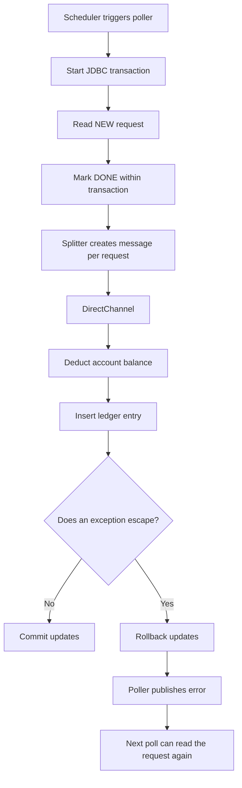

# Adding a Transaction to a Poller

## 1. Practice Objectives

In the **Comprehensive Practice** chapter of **SPRING_INTEGRATION_CORE**, this lesson builds a message flow with a transaction starting right at the poller. You will combine Message, MessageChannel, endpoints, and the Java DSL to ensure the source retrieval operation and business updates either succeed together or roll back together.

After this lesson, you will be able to:

- Place a transaction boundary around source polling and synchronous message processing.
- Choose the appropriate transaction manager for the resources used.
- Observe commits, rollbacks, and reprocessing after errors using integration tests.
- Identify the effects of DirectChannel, QueueChannel, ExecutorChannel, splitters, and filters on processing outcomes.
- Distinguish data rollback, error handling, and retry.

The exercise uses JDBC as a rollback-capable resource. This provides a clear way to observe behavior; the flow structure and poller configuration remain core components of Spring Integration.

## 2. Problem Statement: Polling Debit Requests from a Database

Suppose a system receives debit requests in a `debit_request` table. An integration flow periodically reads requests with state `NEW`, marks each request as processed, deducts the account balance, and inserts a ledger entry.

A successful execution must simultaneously satisfy:

```text
debit_request.state = DONE
account.balance = initial balance - debit amount
debit_ledger has exactly one row matching request_id
```

If ledger insertion fails, or a step after ledger insertion throws an error, the request must return to a state where it can be read again and the balance must remain unchanged.

Sample data:

| Item | Initial value |
| --- | --- |
| Request ID | 101 |
| Account | A-01 |
| Balance | 500000.00 |
| Debit amount | 125000.00 |
| Request state | NEW |
| Ledger entries | 0 |

The post-commit state must be balance `375000.00`, state `DONE`, and one ledger entry. The post-rollback state must preserve all initial values intact.

### 2.1. What Happens If the Transaction Is Placed Only on the Service?

Consider a JDBC source configured to update state immediately upon reading:

```text
Source SELECTs NEW request
  → source UPDATEs state to DONE
  → service starts its own transaction
  → service updates balance
  → service throws an error
```

If the source's two SQL statements ran outside the service's transaction, a rollback in the service cannot undo the already-committed `DONE` state. The request disappears from future queries even though the business work never completed.

Placing `@Transactional` on a `@Bean` configuration method also does not wrap poll executions occurring after application startup. The transaction must be placed at the poller's execution point.

## 3. Target Transaction Boundary



In the standard JDBC transaction model, resources are bound to the executing thread. The poller must open the transaction before `receive()`; downstream steps must run synchronously and use the same managed resource to participate. [Spring Integration: Transaction Support](https://docs.spring.io/spring-integration/reference/transactions.html)

For this lesson, the specific conditions are:

1. The polling source and business `JdbcTemplate` share the same `DataSource`.
2. The poller uses a `DataSourceTransactionManager` managing that `DataSource`.
3. The splitter and handler run on the poller thread.
4. The flow does not hand off to an executor or queue in between.
5. Errors requiring rollback must escape up to the transaction interceptor.

No gateway is needed in the example: the flow starts on a poll schedule and ends at a handler that produces no reply. If a gateway is needed for another application-invoked flow, that call's transaction boundary must be designed separately.

## 4. Preparing the Practice Environment

The example uses Java 17, Spring Integration 6.5.10, H2, JUnit Jupiter, and Awaitility. This is a pinned version set for illustration, not a requirement to upgrade an existing project.

Create a standalone Maven project with this structure:

```text
pom.xml
src/main/java/example/pollertx/PollerTransactionLabConfig.java
src/test/java/example/pollertx/PollerTransactionLabTest.java
```

Contents of `pom.xml`:

```xml
<project xmlns="http://maven.apache.org/POM/4.0.0"
         xmlns:xsi="http://www.w3.org/2001/XMLSchema-instance"
         xsi:schemaLocation="http://maven.apache.org/POM/4.0.0
                             https://maven.apache.org/xsd/maven-4.0.0.xsd">
    <modelVersion>4.0.0</modelVersion>

    <groupId>example</groupId>
    <artifactId>poller-transaction-lab</artifactId>
    <version>1.0.0</version>

    <properties>
        <maven.compiler.release>17</maven.compiler.release>
        <project.build.sourceEncoding>UTF-8</project.build.sourceEncoding>
    </properties>

    <dependencies>
        <dependency>
            <groupId>org.springframework.integration</groupId>
            <artifactId>spring-integration-jdbc</artifactId>
            <version>6.5.10</version>
        </dependency>
        <dependency>
            <groupId>com.h2database</groupId>
            <artifactId>h2</artifactId>
            <version>2.3.232</version>
        </dependency>
        <dependency>
            <groupId>org.junit.jupiter</groupId>
            <artifactId>junit-jupiter</artifactId>
            <version>5.11.4</version>
            <scope>test</scope>
        </dependency>
        <dependency>
            <groupId>org.awaitility</groupId>
            <artifactId>awaitility</artifactId>
            <version>4.2.2</version>
            <scope>test</scope>
        </dependency>
    </dependencies>

    <build>
        <plugins>
            <plugin>
                <groupId>org.apache.maven.plugins</groupId>
                <artifactId>maven-compiler-plugin</artifactId>
                <version>3.13.0</version>
            </plugin>
            <plugin>
                <groupId>org.apache.maven.plugins</groupId>
                <artifactId>maven-surefire-plugin</artifactId>
                <version>3.5.2</version>
            </plugin>
        </plugins>
    </build>
</project>
```

`spring-integration-jdbc` brings in the Integration core and JDBC components needed for the example. In a Spring Boot application, let Boot's dependency management choose aligned Spring versions rather than copying the individual library versions here.

H2 is created in memory with a unique name per application context. Data is initialized in Java so the entire scenario can be read and executed from the two source files below.

## 5. Complete Configuration Using Java DSL

Put the following code in `PollerTransactionLabConfig.java`:

```java
package example.pollertx;

import java.math.BigDecimal;
import java.time.Duration;
import java.util.concurrent.atomic.AtomicBoolean;

import javax.sql.DataSource;

import org.springframework.context.annotation.Bean;
import org.springframework.context.annotation.Configuration;
import org.springframework.integration.channel.DirectChannel;
import org.springframework.integration.channel.QueueChannel;
import org.springframework.integration.config.EnableIntegration;
import org.springframework.integration.dsl.IntegrationFlow;
import org.springframework.integration.dsl.Pollers;
import org.springframework.integration.jdbc.JdbcPollingChannelAdapter;
import org.springframework.jdbc.core.JdbcTemplate;
import org.springframework.jdbc.core.namedparam.MapSqlParameterSource;
import org.springframework.jdbc.datasource.DataSourceTransactionManager;
import org.springframework.jdbc.datasource.embedded.EmbeddedDatabase;
import org.springframework.jdbc.datasource.embedded.EmbeddedDatabaseBuilder;
import org.springframework.jdbc.datasource.embedded.EmbeddedDatabaseType;
import org.springframework.transaction.PlatformTransactionManager;
import org.springframework.transaction.support.TransactionSynchronizationManager;

@Configuration(proxyBeanMethods = false)
@EnableIntegration
public class PollerTransactionLabConfig {

    public record DebitCommand(
            long id,
            String accountId,
            BigDecimal amount) {
    }

    public static class FailureSwitch {

        private final AtomicBoolean enabled = new AtomicBoolean(false);

        public void enable() {
            enabled.set(true);
        }

        public void disable() {
            enabled.set(false);
        }

        public void afterDatabaseWrites() {
            if (enabled.get()) {
                throw new IllegalStateException(
                        "Simulated error after database writes");
            }
        }
    }

    public static class DebitService {

        private final JdbcTemplate jdbc;
        private final FailureSwitch failureSwitch;

        public DebitService(
                JdbcTemplate jdbc,
                FailureSwitch failureSwitch) {
            this.jdbc = jdbc;
            this.failureSwitch = failureSwitch;
        }

        public void apply(DebitCommand command) {
            if (!TransactionSynchronizationManager
                    .isActualTransactionActive()) {
                throw new IllegalStateException(
                        "Handler must run inside the poller transaction");
            }

            int changed = jdbc.update("""
                    update account
                       set balance = balance - ?
                     where account_id = ?
                       and balance >= ?
                    """,
                    command.amount(),
                    command.accountId(),
                    command.amount());

            if (changed != 1) {
                throw new IllegalStateException(
                        "Account not found or insufficient balance");
            }

            jdbc.update("""
                    insert into debit_ledger(
                        request_id, account_id, amount
                    ) values (?, ?, ?)
                    """,
                    command.id(),
                    command.accountId(),
                    command.amount());

            failureSwitch.afterDatabaseWrites();
        }
    }

    @Bean(destroyMethod = "shutdown")
    public EmbeddedDatabase dataSource() {
        return new EmbeddedDatabaseBuilder()
                .generateUniqueName(true)
                .setType(EmbeddedDatabaseType.H2)
                .build();
    }

    @Bean
    public JdbcTemplate jdbcTemplate(DataSource dataSource) {
        JdbcTemplate jdbc = new JdbcTemplate(dataSource);

        jdbc.execute("""
                create table account (
                    account_id varchar(40) primary key,
                    balance decimal(19, 2) not null,
                    check (balance >= 0)
                )
                """);

        jdbc.execute("""
                create table debit_request (
                    id bigint primary key,
                    account_id varchar(40) not null
                        references account(account_id),
                    amount decimal(19, 2) not null,
                    state varchar(10) not null,
                    check (amount > 0),
                    check (state in ('NEW', 'DONE'))
                )
                """);

        jdbc.execute("""
                create table debit_ledger (
                    request_id bigint primary key
                        references debit_request(id),
                    account_id varchar(40) not null
                        references account(account_id),
                    amount decimal(19, 2) not null
                )
                """);

        jdbc.update("""
                insert into account(account_id, balance)
                values ('A-01', 500000.00)
                """);

        jdbc.update("""
                insert into debit_request(
                    id, account_id, amount, state
                ) values (101, 'A-01', 125000.00, 'NEW')
                """);

        return jdbc;
    }

    @Bean
    public PlatformTransactionManager transactionManager(
            DataSource dataSource) {
        return new DataSourceTransactionManager(dataSource);
    }

    @Bean
    public FailureSwitch failureSwitch() {
        return new FailureSwitch();
    }

    @Bean
    public DebitService debitService(
            JdbcTemplate jdbcTemplate,
            FailureSwitch failureSwitch) {
        return new DebitService(jdbcTemplate, failureSwitch);
    }

    @Bean
    public JdbcPollingChannelAdapter debitSource(
            JdbcTemplate jdbcTemplate) {

        JdbcPollingChannelAdapter source =
                new JdbcPollingChannelAdapter(jdbcTemplate, """
                        select id, account_id, amount
                          from debit_request
                         where state = 'NEW'
                         order by id
                        """);

        source.setRowMapper((rs, rowNum) -> new DebitCommand(
                rs.getLong("id"),
                rs.getString("account_id"),
                rs.getBigDecimal("amount")));

        source.setMaxRows(1);
        source.setUpdateSql("""
                update debit_request
                   set state = 'DONE'
                 where id = :id
                """);
        source.setUpdatePerRow(true);
        source.setUpdateSqlParameterSourceFactory(row ->
                new MapSqlParameterSource(
                        "id", ((DebitCommand) row).id()));

        return source;
    }

    @Bean
    public DirectChannel debitWork() {
        return new DirectChannel();
    }

    @Bean
    public QueueChannel debitErrors() {
        return new QueueChannel();
    }

    @Bean
    public IntegrationFlow debitFlow(
            JdbcPollingChannelAdapter debitSource,
            PlatformTransactionManager transactionManager,
            DirectChannel debitWork,
            DebitService debitService) {

        return IntegrationFlow
                .from(debitSource, endpoint -> endpoint
                        .id("debitPoller")
                        .autoStartup(false)
                        .poller(Pollers
                                .fixedDelay(Duration.ofMillis(200))
                                .maxMessagesPerPoll(1)
                                .transactional(transactionManager)
                                .errorChannel("debitErrors")))
                .split()
                .channel(debitWork)
                .handle(debitService, "apply")
                .get();
    }
}
```

### 5.1. Role of Each Component

| Component | Responsibility in the example |
| --- | --- |
| `JdbcPollingChannelAdapter` | Queries new requests and updates the state of read rows |
| `Message` from source | Carries the query result list as payload |
| `split()` | Splits the list into messages with `DebitCommand` payload |
| `DirectChannel debitWork` | Invokes the handler synchronously on the current thread |
| Handler `DebitService.apply` | Deducts balance, inserts ledger entry, and throws simulated error when requested |
| Poller endpoint `debitPoller` | Triggers scheduled polling and wraps the operation in a transaction |
| `DataSourceTransactionManager` | Manages commit/rollback for the H2 database |
| `QueueChannel debitErrors` | Holds errors for tests to observe |

The `debitErrors` queue is only for the practice exercise. It does not persist errors durably and has no automatic consumer. In a production application, a proper error-handling flow is needed to prevent the in-memory queue from growing indefinitely.

### 5.2. The Decisive Configuration Line

```java
.transactional(transactionManager)
```

This call adds a transaction interceptor to the poller's advice chain. Merely declaring a transaction manager bean without attaching it to the poller does not create a transaction for the source poll. [PollerSpec 6.5.10 Source](https://github.com/spring-projects/spring-integration/blob/v6.5.10/spring-integration-core/src/main/java/org/springframework/integration/dsl/PollerSpec.java)

The example does not need `@EnableTransactionManagement` because it does not rely on `@Transactional` method proxies; the transaction interceptor is configured directly by the DSL. If adding services using transaction annotations, configure the corresponding annotation infrastructure.

### 5.3. Why Does the Source Mark DONE Before the Handler?

`JdbcPollingChannelAdapter` runs the query and then executes its configured update statement before returning results to the flow. Here the update statement uses parameters from each `DebitCommand`, explicitly declared with `MapSqlParameterSource`. [JdbcPollingChannelAdapter 6.5.10 Source](https://github.com/spring-projects/spring-integration/blob/v6.5.10/spring-integration-jdbc/src/main/java/org/springframework/integration/jdbc/JdbcPollingChannelAdapter.java)

In this design, `DONE` becomes a committed result only after the handler finishes successfully. If the handler throws an exception, the transaction rolls back the state update, account update, and ledger row together.

Therefore, never insert an asynchronous handoff between the source and handler and still interpret `DONE` as completed business work.

### 5.4. Why Check Transaction Status Inside the Service?

The `isActualTransactionActive()` check helps the lab detect when the handler runs outside a transaction. It does not create a transaction, nor does it prove all other resources are participating.

Stronger proof comes from two factors: sharing the same `DataSource` in configuration and tests confirming all updates roll back together.

`FailureSwitch` is in-memory Java state. A JDBC rollback does not reset the switch's value; tests must explicitly turn it off before retrying processing.

## 6. Distinguishing Result Size from Poll Count

These two settings control two different things:

```java
source.setMaxRows(1);
```

```java
.maxMessagesPerPoll(1)
```

- `maxRows` limits the number of rows in the result of a single source read.
- `maxMessagesPerPoll` limits how many times the poller calls the source read within one scheduled poll cycle.

One message from a JDBC source can contain multiple rows; the splitter creates child messages afterward. Therefore, `maxMessagesPerPoll(1)` alone does not limit the payload to a single record. [Spring Integration: JDBC Inbound Channel Adapter](https://docs.spring.io/spring-integration/reference/jdbc/inbound-channel-adapter.html)

In the standard poller configuration of the version used here, the transaction advice wraps each individual poll operation; increasing the poll count does not automatically combine them into one shared transaction for the entire scheduled cycle. [AbstractPollingEndpoint 6.5.10 Source](https://github.com/spring-projects/spring-integration/blob/v6.5.10/spring-integration-core/src/main/java/org/springframework/integration/endpoint/AbstractPollingEndpoint.java)

This example sets both values to `1` so one request corresponds to one easily observable unit of work.

If you change `maxRows` to `10`, a single read can pull ten requests. While the splitter and handlers still run synchronously in that transaction, a failure on the tenth request can roll back updates from the previous nine requests in that same read.

For large datasets, limit results directly in the SQL query using database-appropriate syntax rather than relying solely on the adapter limit.

## 7. Testing Commit, Rollback, and Reprocessing

Put the following code in `PollerTransactionLabTest.java`:

```java
package example.pollertx;

import java.math.BigDecimal;
import java.time.Duration;

import org.junit.jupiter.api.AfterEach;
import org.junit.jupiter.api.BeforeEach;
import org.junit.jupiter.api.Test;

import org.springframework.context.annotation.AnnotationConfigApplicationContext;
import org.springframework.integration.channel.QueueChannel;
import org.springframework.integration.endpoint.SourcePollingChannelAdapter;
import org.springframework.jdbc.core.JdbcTemplate;
import org.springframework.messaging.Message;
import org.springframework.messaging.support.ErrorMessage;

import static org.awaitility.Awaitility.await;
import static org.junit.jupiter.api.Assertions.*;

class PollerTransactionLabTest {

    private AnnotationConfigApplicationContext context;
    private JdbcTemplate jdbc;
    private SourcePollingChannelAdapter poller;
    private QueueChannel errors;
    private PollerTransactionLabConfig.FailureSwitch failureSwitch;

    @BeforeEach
    void setUp() {
        context = new AnnotationConfigApplicationContext(
                PollerTransactionLabConfig.class);

        jdbc = context.getBean(JdbcTemplate.class);
        poller = context.getBean(
                "debitPoller", SourcePollingChannelAdapter.class);
        errors = context.getBean("debitErrors", QueueChannel.class);
        failureSwitch = context.getBean(
                PollerTransactionLabConfig.FailureSwitch.class);
    }

    @AfterEach
    void tearDown() {
        if (context != null) {
            context.close();
        }
    }

    @Test
    void commitsSourceStateBalanceAndLedgerTogether() {
        poller.start();

        await().atMost(Duration.ofSeconds(5))
                .untilAsserted(() ->
                        assertEquals("DONE", requestState()));

        poller.stop();

        assertBalance("375000.00");
        assertEquals(1, ledgerCount());
        assertNull(errors.receive(0));
    }

    @Test
    void rollsBackAllWritesAndAllowsProcessingAgain() {
        failureSwitch.enable();
        poller.start();

        Message<?> error = errors.receive(5000);
        poller.stop();

        assertNotNull(error, "Must observe error from poller");
        assertInstanceOf(ErrorMessage.class, error);

        assertEquals("NEW", requestState());
        assertBalance("500000.00");
        assertEquals(0, ledgerCount());

        failureSwitch.disable();
        poller.start();

        await().atMost(Duration.ofSeconds(5))
                .untilAsserted(() ->
                        assertEquals("DONE", requestState()));

        poller.stop();

        assertBalance("375000.00");
        assertEquals(1, ledgerCount());
    }

    private String requestState() {
        return jdbc.queryForObject("""
                select state
                  from debit_request
                 where id = 101
                """, String.class);
    }

    private int ledgerCount() {
        return jdbc.queryForObject("""
                select count(*)
                  from debit_ledger
                 where request_id = 101
                """, Integer.class);
    }

    private void assertBalance(String expected) {
        BigDecimal actual = jdbc.queryForObject("""
                select balance
                  from account
                 where account_id = 'A-01'
                """, BigDecimal.class);

        assertNotNull(actual);
        assertEquals(0, new BigDecimal(expected).compareTo(actual));
    }
}
```

Run in the practice project:

```shell
mvn test
```

### 7.1. Why Does the Poller Not Auto-Start?

`autoStartup(false)` lets the test arm the failure condition before the first read. If the poller ran as soon as the application context started, the request might already commit before the test enabled `FailureSwitch`.

Each test creates its own application context and database. This keeps scenarios independent without relying on test execution order.

### 7.2. Why Not Wait Using Thread.sleep?

Reading the final state with Awaitility lets the test wait for a real business condition within a bounded window. The error test waits for a message on `debitErrors` before inspecting database state.

The failure switch stays enabled throughout the rollback check phase. Even if the poller squeezes in one extra attempt, it cannot produce a successful run that hides the rollback state under observation.

### 7.3. Why Not Annotate the Test Class with @Transactional?

The poller runs on a thread controlled by Integration infrastructure. A transaction wrapping the test method does not automatically propagate to that thread.

This lesson intentionally reads data from outside the poller's transaction, after completion signals appear, to verify committed or rolled-back state.

### 7.4. Results to Observe

| Point in time | Request state | Balance | Ledger count |
| --- | --- | --- | --- |
| Before poller starts | NEW | 500000.00 | 0 |
| Normal processing completes | DONE | 375000.00 | 1 |
| Failure after writes and rolled back | NEW | 500000.00 | 0 |
| Failure disabled, poller restarted, and succeeded | DONE | 375000.00 | 1 |

Seeing an exception in the logs is not enough to prove rollback. All three data columns in the table demonstrate the consistency condition required by the problem.

## 8. Error Handling and Rollback Decisions

The error flow in the example proceeds in order:

```text
DebitService throws IllegalStateException
  → exception propagates back through synchronous flow
  → transaction interceptor rolls back
  → poller error handling publishes ErrorMessage
  → test receives message on debitErrors
```

Configuring `.errorChannel("debitErrors")` specifies where poller errors are sent. It is not a data recovery configuration or an automatic request-redelivery mechanism. [Spring Integration: Error Handling](https://docs.spring.io/spring-integration/reference/error-handling.html)

### 8.1. Do Not Turn Errors into Normal Returns Inside a Transaction

The following pattern can cause the transaction to commit normally:

```java
try {
    writeBusinessData();
} catch (RuntimeException exception) {
    logger.error("Processing failed", exception);
    // Returning normally: the transaction interceptor may not see the error.
}
```

If business rules require rollback, let the appropriate exception escape the processing step or explicitly mark the transaction for rollback. Sending an error message and returning normally does not automatically trigger a rollback decision.

If an operation has already marked the transaction rollback-only, catching the exception farther out does not make that transaction usable again.

### 8.2. Rollback Rules Must Apply at the Right Interceptor

With the default configuration used in this lesson, `RuntimeException` and `Error` trigger rollback. Checked exceptions must be evaluated against the actual transaction interceptor's rollback rules; inside a flow, exceptions may also be wrapped by the framework in a messaging exception. [Spring Framework: Rolling Back a Declarative Transaction](https://docs.spring.io/spring-framework/reference/data-access/transaction/declarative/rolling-back.html)

This example uses `IllegalStateException` so outcomes do not depend on a custom rule for checked exceptions.

If custom rollback rules are needed, configure the poller's transaction advice using the appropriate transaction attributes. Merely adding `rollbackFor` to another service method does not replace the configuration of the interceptor wrapping the poll.

### 8.3. Filters and Routers Also Affect Flow Completion

A filter dropping a message normally can allow the poll to finish without error. If the source already marked `DONE`, that state can commit even though the debit handler was never invoked.

You must choose the business semantics explicitly:

- Dropping is a valid outcome: persist an appropriate audit trail or rejection status.
- Dropping must keep data for reprocessing: configure throwing an exception on rejection so the error reaches the transaction boundary.
- Permanently invalid data: transition to an error state or quarantine flow with explicit storage design.

With a router, the chosen branch must still uphold its transaction requirements. One branch dispatching through an executor changes its execution boundary even while other branches remain synchronous.

## 9. What Changes with Asynchronous Channels?

### 9.1. DirectChannel Keeps the Call on the Same Thread

In the written configuration:

```text
poller → splitter → DirectChannel → DebitService
```

The handler completes before the flow call returns back to the poller. That lets business exceptions propagate back to the transaction interceptor.

### 9.2. ExecutorChannel Creates a Separate Dispatch

If the middle segment is replaced by:

```text
poller → ExecutorChannel → worker → DebitService
```

the poller can finish handing off the message and commit the source update before the worker finishes processing. A later error on the worker cannot reach back to roll back the poller's already-committed transaction.

In the practice code, the transaction check inside the service detects when the handler runs outside a transaction. Opening a separate transaction on the worker wraps only the worker's work.

When asynchronous processing is desired, define separate dispatch and recovery units: for example, write a durable job record in the first transaction, then have a consumer process that job in a subsequent transaction.

### 9.3. In-Memory QueueChannel Does Not Automatically Return Messages

If a consumer polls from a regular `QueueChannel`, pulling from the in-memory queue does not become rollback-capable just because the consumer has a JDBC transaction.

Example:

```text
In-memory QueueChannel
  → consumer receives message
  → handler updates JDBC
  → handler throws error
```

JDBC can roll back, while the message already removed from the in-memory queue does not reappear automatically. Therefore, an in-memory queue cannot be used to fully demonstrate message redelivery after rollback.

In this lesson, redelivery capability comes from the `debit_request` row remaining `NEW` after rollback. There is no mechanism automatically putting a message back into a QueueChannel.

## 10. Transactions, Retries, and Idempotency

These three mechanisms play different roles:

| Mechanism | Question it addresses |
| --- | --- |
| Transaction | Which data changes must commit or roll back together? |
| Retry | After failure, when and within what scope should execution be re-attempted? |
| Idempotency | If the same request is processed multiple times, how are duplicate business effects prevented? |

### 10.1. This Lesson Reprocesses via the Next Poll

After rollback, the query still finds the `NEW` request. Once the failure is cleared, a subsequent poll can process it again. No retry advice is configured in the code.

In the test, the poller is stopped after observing the error and restarted after disabling the switch. In a continuously running application, the poll schedule keeps firing as configured.

### 10.2. Permanent Errors Need a Different Handling Path

If the first request always fails and the query always sorts by `id`, it can block requests behind it when reading only one row at a time.

A production design may need:

- Attempt counts and timestamps for when the next attempt is allowed.
- Classification between transient errors and unrecoverable business errors.
- A quarantine state or table storing failed requests.
- A workflow allowing inspection, repair, and replay of requests.

If the attempt count is incremented inside the very transaction that rolls back, the counter update rolls back too. Tracking attempts must be designed intentionally rather than assuming a counter survives rollback automatically.

### 10.3. Order of Retry Advice and Transaction Advice Matters

Retrying a handler multiple times inside a single transaction already marked rollback-only may yield no valid chance to succeed.

When adding retry, decide whether each attempt gets a fresh transaction wrapping read and write, or only retries a sub-operation. Also verify whether the final error still reaches the transaction interceptor after retries are exhausted or gets turned into a normal return by a recovery callback.

### 10.4. Ledger Primary Key Acts as a Safeguard

`debit_ledger.request_id` is a primary key. If the same request attempts to insert a ledger row again, the database rejects the duplicate record.

In this synchronous flow, that error also causes the balance deduction in the same transaction to roll back. Still, a unique constraint alone does not form a complete duplicate-request policy: you must decide whether an already-processed request should be skipped, return its prior result, or raise an error.

## 11. Limits to Understand Before Scaling Up

### 11.1. One JDBC Transaction Manager Manages Its Own Resource

The example has only one database. If adding writes to another database, a single `DataSourceTransactionManager` does not automatically provide atomicity across both.

Similarly, HTTP calls, emails, or filesystem operations do not automatically roll back with a JDBC transaction. When external events must be emitted after persisting data, consider a transactional outbox and consumers capable of handling duplicates.

### 11.2. Transaction Synchronization Does Not Make External Resources Transactional

Post-commit callbacks can emit signals or trigger follow-up work. They do not turn sending an email or moving a file into a rollback-capable part of JDBC.

If the process stops after commit but before the callback finishes, committed data remains while the external task may not have run yet. Work that must be delivered reliably needs durable handoff records.

### 11.3. Multiple Instances Need Concurrent Claiming

The practice query does not yet implement a multi-worker claim mechanism. Two instances can see the same `NEW` request before the other instance's update commits.

When scaling out, choose a mechanism suited to the database and processing model, such as appropriate row locking, conditional claim updates, or durable queue structures. Test concurrency against the real database.

Do not infer that `maxMessagesPerPoll(1)` or default isolation levels automatically provide cluster-wide exclusive ownership.

### 11.4. Longer Transactions Hold Resources Longer

A handler waiting on an external service can hold database connections and locks for a long time. Consider:

| Property | What to decide |
| --- | --- |
| Propagation | Should child services join the poller's transaction or open independent transactions? |
| Isolation | Which isolation level matches actual data contention? |
| Timeout | How long should one processing unit be bounded? |
| Read-only | Is this flow truly read-only? |
| Batch size | How many requests should share the cost of one rollback? |

This flow updates data so it must not use a read-only transaction. Nor should `REQUIRES_NEW` be placed casually on the debit service: the inner transaction could commit while the source transaction later rolls back, breaking the original consistency goal.

## 12. Troubleshooting When Results Are Unexpected

| Symptom | Possibility to check | How to verify |
| --- | --- | --- |
| Request is DONE but balance unchanged | Thread split or source transaction does not wrap handler | Redraw flow, verify channels and transaction boundary |
| Handler reports no active transaction | Poller lacks transaction advice or handler runs on another thread | Check DSL and any executor usage |
| Balance rolls back but request stays DONE | Source ran outside shared transaction | Verify transaction starts before source read |
| Error logged yet data commits | Exception caught, recovery returns normally, or rollback rule mismatch | Trace actual exception escaping to transaction interceptor |
| Message not re-read from queue | In-memory queue does not support transactional receive rollback | Check transactional capability of the source |
| Repeated failures on same request ID | Unprocessable data still marked NEW | Classify errors and add persistent quarantine |
| Multiple requests roll back together | Single poll returned multiple rows processed synchronously | Check maxRows, SQL query, and splitter scope |
| Flaky tests | Poller auto-started before scenario setup or fixed sleep waits | Disable auto-startup and await business conditions |

When investigating, log the request ID, endpoint name, thread name, exception type, and transaction outcome. Use business keys like `request_id` to correlate attempts instead of assuming message IDs stay identical across database re-reads.

## 13. Extension Exercises

1. Add request `102` for the same account. Set `maxRows = 2` and inject an error only while processing request `102`. Verify both requests remain `NEW`, balance stays unchanged, and no ledger entries exist after rollback.
2. Keep `maxRows = 1`, increase `maxMessagesPerPoll` to `2`. Inject an error only on the second request and observe that the first request committed in the previous poll's transaction.
3. Replace `DirectChannel` with an executor-backed channel. Observe the transaction check in the service and the source table state to explain the new boundary.
4. Insert a filter rejecting requests. Compare silent discard against throwing an exception on rejection.
5. Design a `FAILED` state and an attempt-counter mechanism that business rollback does not erase. Document clearly which transaction owns each update.
6. Run two consumers against the same database, add a claim mechanism, and verify each request has only one committed business outcome.

Completion criteria for the main exercise: both tests prove atomic commit of all updates, full rollback after a post-write failure, and successful reprocessing leaving exactly one ledger entry.