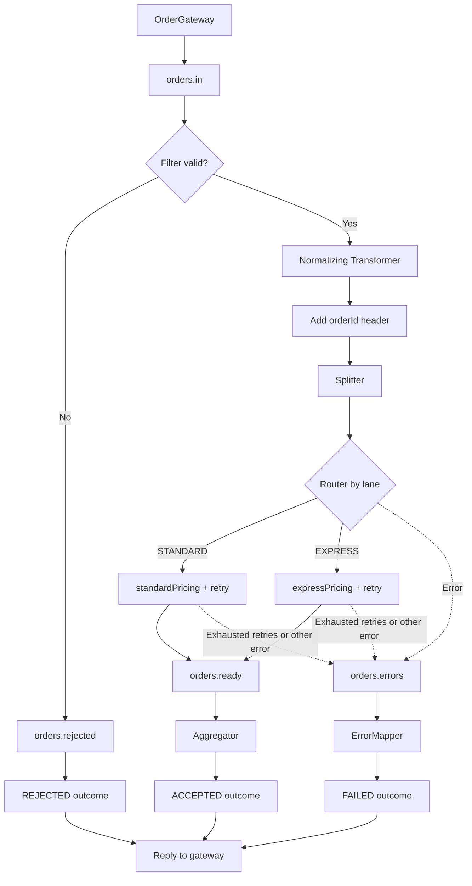

# Testing the Complete Flow

## 1. Practice Objectives

In the **Comprehensive Practice** chapter of the **SPRING_INTEGRATION_CORE** module, this lesson connects the components studied so far into a single test target: a message flow that receives a request, validates data, transforms, routes, calls a service, aggregates, and returns a result through a gateway.

After this lesson, you will be able to:

- Boot a real Java DSL configuration in Spring TestContext and invoke the flow through a gateway.
- Verify payloads, headers, service call counts, and aggregator store state.
- Distinguish business rejections, processing errors, retries, and incomplete message groups.
- Run the same test contract with both `DirectChannel` and `ExecutorChannel`.
- Isolate failures with channel-level tests while maintaining end-to-end tests from input to output.

"Complete flow" here means the entire flow **inside one ApplicationContext**. The pricing port is replaced by a test double to deterministically trigger successes and failures. This test suite does not yet verify HTTP connectivity, brokers, databases, serialization, or transactions with external systems. Those boundaries require separate integration tests.

## 2. Defining the Contract Before Writing Tests

### 2.1. Order-Processing Problem

A request consists of an order ID and multiple order lines. Each line has a SKU, quantity, and processing lane `STANDARD` or `EXPRESS`.

Rules of the practice exercise:

1. Order ID must be non-blank; the line list must be non-null and non-empty.
2. Each line must have a SKU, processing lane, and quantity greater than 0.
3. Invalid data is returned with status `REJECTED` without calling the pricing service.
4. SKU and lane are trimmed of leading/trailing whitespace and uppercased.
5. The router sends each line to the matching endpoint by lane.
6. The pricing endpoint computes line amount as unit price multiplied by quantity.
7. The aggregator waits for all lines of a submission and returns an `ACCEPTED` outcome.
8. Only `TemporaryPriceException` is retried, up to **three total executions**, including the initial attempt.
9. Non-retryable errors, or errors after exhausting retries, are mapped into a `FAILED` outcome.
10. The `traceId` header must appear in the response to correlate request and outcome.

Any lane other than `STANDARD` and `EXPRESS` is treated as a routing error. This example intentionally lets the router catch that case so the routing-error branch can be tested separately.

### 2.2. Diagram to Be Tested



Having two router branches does not mean the two branches execute in parallel automatically. With direct channels in the middle of the flow, work still executes on the sending thread. When asynchronous mode is enabled at ingress, all downstream processing is handed off to an executor.

### 2.3. Test Matrix

| Scenario | Required output | Additional evidence |
|---|---|---|
| Order with both lanes | `ACCEPTED`, accurate total | Each endpoint invoked for its line; sequence headers present |
| Invalid data | `REJECTED` | Pricing port never called; never reaches aggregator |
| Single transient failure | `ACCEPTED` | Two service calls, one line reaches aggregator |
| Persistent transient failure | `FAILED` | Exactly three calls, one final error message |
| Non-retryable error | `FAILED` | One call |
| Unknown lane | `FAILED` | Pricing not called |
| Two interleaved groups | Two independent outcomes | No mixing of order ID, total, or reply channel |
| Incomplete group | No aggregated outcome yet | Group retains one message |
| One line succeeds then next fails | `FAILED` | Partial group still remains; cleanup policy needed in production |

A test asserting only `reply != null` is insufficient for any row in this table.

## 3. Preparing a Standalone Practice Project

The sample below uses Java 17, Maven, Spring Boot parent `3.5.0` for dependency management, and Spring Integration `6.5.0` managed by that parent. This is a pinned version baseline for the example, not a claim about the latest release. Dependency relationships can be checked in [Spring Boot 3.5.0 Dependency Declarations](https://raw.githubusercontent.com/spring-projects/spring-boot/v3.5.0/spring-boot-project/spring-boot-dependencies/build.gradle).

No web application or `main` method is needed: Spring TestContext builds the integration configuration.

```text
spring-integration-flow-lab/
├── pom.xml
└── src/
    ├── main/java/example/integration/
    │   ├── OrderModels.java
    │   ├── PricePort.java
    │   └── OrderFlowConfig.java
    └── test/java/example/integration/
        ├── OrdersFlowTest.java
        └── AsyncOrdersFlowTest.java
```

### 3.1. Dependencies

Contents of `pom.xml` for the practice project:

```xml
<project xmlns="http://maven.apache.org/POM/4.0.0"
         xmlns:xsi="http://www.w3.org/2001/XMLSchema-instance"
         xsi:schemaLocation="http://maven.apache.org/POM/4.0.0
                             https://maven.apache.org/xsd/maven-4.0.0.xsd">
    <modelVersion>4.0.0</modelVersion>

    <parent>
        <groupId>org.springframework.boot</groupId>
        <artifactId>spring-boot-starter-parent</artifactId>
        <version>3.5.0</version>
        <relativePath/>
    </parent>

    <groupId>example</groupId>
    <artifactId>spring-integration-flow-lab</artifactId>
    <version>1.0.0</version>

    <properties>
        <java.version>17</java.version>
    </properties>

    <dependencies>
        <dependency>
            <groupId>org.springframework.integration</groupId>
            <artifactId>spring-integration-core</artifactId>
        </dependency>
        <dependency>
            <groupId>org.springframework.retry</groupId>
            <artifactId>spring-retry</artifactId>
        </dependency>
        <dependency>
            <groupId>org.springframework.boot</groupId>
            <artifactId>spring-boot-starter-test</artifactId>
            <scope>test</scope>
        </dependency>
        <dependency>
            <groupId>org.springframework.integration</groupId>
            <artifactId>spring-integration-test</artifactId>
            <scope>test</scope>
        </dependency>
    </dependencies>
</project>
```

`spring-integration-test` is used when endpoint substitution tools are needed in the extension section. The main test suite needs only Spring Test, JUnit Jupiter, AssertJ, and Mockito from the test starter.

### 3.2. Message Models

Contents of `OrderModels.java`:

```java
package example.integration;

import java.math.BigDecimal;
import java.util.List;

import org.springframework.messaging.Message;
import org.springframework.messaging.handler.annotation.Header;
import org.springframework.messaging.handler.annotation.Payload;

public final class OrderModels {

    private OrderModels() {
    }

    public enum Status {
        ACCEPTED, REJECTED, FAILED
    }

    public record OrderLine(String sku, int quantity, String lane) {
    }

    public record OrderRequest(String orderId, List<OrderLine> lines) {
    }

    public record PricedLine(
            String orderId,
            String sku,
            int quantity,
            String lane,
            BigDecimal amount) {
    }

    public record OrderOutcome(
            String orderId,
            Status status,
            List<PricedLine> lines,
            BigDecimal total,
            String code) {
    }

    public interface OrderGateway {

        Message<OrderOutcome> submit(
                @Payload OrderRequest request,
                @Header("traceId") String traceId);
    }
}
```

The gateway returns `Message<OrderOutcome>` so the exercise can inspect both payload and headers. In another business API, the gateway might return just the DTO when callers need not know about messaging.

Tests use `List.of(...)` for valid inputs. A record does not automatically make a passed `List` immutable; if using this model in an application, decide deliberately how to copy and validate inputs.

Contents of `PricePort.java`:

```java
package example.integration;

import java.math.BigDecimal;

public interface PricePort {

    BigDecimal unitPrice(String sku, String lane);

    final class TemporaryPriceException extends RuntimeException {

        public TemporaryPriceException(String message) {
            super(message);
        }
    }
}
```

`PricePort` is the dependency boundary. Tests control it to simulate pricing responses, transient failures, and permanent failures, while the filter, transformer, router, retry advice, channels, and aggregator remain real components.

## 4. Configuring the Real Flow

Complete contents of `OrderFlowConfig.java`:

```java
package example.integration;

import java.math.BigDecimal;
import java.util.Collection;
import java.util.Comparator;
import java.util.List;
import java.util.Locale;
import java.util.Map;

import org.springframework.beans.factory.annotation.Value;
import org.springframework.context.annotation.Bean;
import org.springframework.context.annotation.Configuration;
import org.springframework.integration.channel.DirectChannel;
import org.springframework.integration.channel.ExecutorChannel;
import org.springframework.integration.config.EnableIntegration;
import org.springframework.integration.dsl.IntegrationFlow;
import org.springframework.integration.gateway.GatewayProxyFactoryBean;
import org.springframework.integration.handler.advice.RequestHandlerRetryAdvice;
import org.springframework.integration.store.SimpleMessageStore;
import org.springframework.messaging.Message;
import org.springframework.messaging.MessageChannel;
import org.springframework.messaging.MessageHeaders;
import org.springframework.messaging.MessagingException;
import org.springframework.messaging.support.ErrorMessage;
import org.springframework.messaging.support.MessageBuilder;
import org.springframework.retry.backoff.NoBackOffPolicy;
import org.springframework.retry.policy.SimpleRetryPolicy;
import org.springframework.retry.support.RetryTemplate;
import org.springframework.scheduling.concurrent.ThreadPoolTaskExecutor;

import static example.integration.OrderModels.*;
import static example.integration.PricePort.TemporaryPriceException;

@Configuration(proxyBeanMethods = false)
@EnableIntegration
public class OrderFlowConfig {

    @Bean
    ThreadPoolTaskExecutor ordersExecutor() {
        ThreadPoolTaskExecutor executor = new ThreadPoolTaskExecutor();
        executor.setCorePoolSize(2);
        executor.setMaxPoolSize(2);
        executor.setQueueCapacity(20);
        executor.setThreadNamePrefix("orders-worker-");
        executor.setWaitForTasksToCompleteOnShutdown(true);
        executor.setAwaitTerminationSeconds(2);
        return executor;
    }

    @Bean(name = "orders.in")
    MessageChannel ordersIn(
            @Value("${orders.async:false}") boolean asynchronous,
            ThreadPoolTaskExecutor ordersExecutor) {
        return asynchronous
                ? new ExecutorChannel(ordersExecutor)
                : new DirectChannel();
    }

    @Bean(name = "orders.ready")
    DirectChannel ordersReady() {
        return new DirectChannel();
    }

    @Bean(name = "orders.errors")
    DirectChannel ordersErrors() {
        return new DirectChannel();
    }

    @Bean
    SimpleMessageStore orderStore() {
        return new SimpleMessageStore();
    }

    @Bean
    GatewayProxyFactoryBean<OrderGateway> orderGateway() {
        GatewayProxyFactoryBean<OrderGateway> gateway =
                new GatewayProxyFactoryBean<>(OrderGateway.class);
        gateway.setDefaultRequestChannelName("orders.in");
        gateway.setErrorChannelName("orders.errors");
        gateway.setDefaultRequestTimeout(1_000L);
        gateway.setDefaultReplyTimeout(3_000L);
        return gateway;
    }

    @Bean
    RequestHandlerRetryAdvice priceRetry() {
        RetryTemplate template = new RetryTemplate();
        template.setRetryPolicy(new SimpleRetryPolicy(
                3, Map.of(TemporaryPriceException.class, true), true));
        template.setBackOffPolicy(new NoBackOffPolicy());

        RequestHandlerRetryAdvice advice = new RequestHandlerRetryAdvice();
        advice.setRetryTemplate(template);
        return advice;
    }

    @Bean
    IntegrationFlow orderFlow() {
        return IntegrationFlow.from("orders.in")
                .filter(OrderRequest.class, OrderFlowConfig::isValid,
                        f -> f.discardChannel("orders.rejected"))
                .transform(OrderRequest.class, OrderFlowConfig::normalize)
                .enrichHeaders(h -> h.headerFunction("orderId",
                        m -> ((OrderRequest) m.getPayload()).orderId()))
                .split(OrderRequest.class, OrderRequest::lines)
                .route(OrderLine.class, OrderLine::lane, r -> r
                        .channelMapping("STANDARD", "orders.standard")
                        .channelMapping("EXPRESS", "orders.express"))
                .get();
    }

    @Bean
    IntegrationFlow rejectedFlow() {
        return IntegrationFlow.from("orders.rejected")
                .transform(OrderRequest.class, request -> new OrderOutcome(
                        request.orderId(), Status.REJECTED, List.of(),
                        BigDecimal.ZERO, "INVALID_ORDER"))
                .get();
    }

    @Bean
    IntegrationFlow standardFlow(
            PricePort prices, RequestHandlerRetryAdvice priceRetry) {
        return IntegrationFlow.from("orders.standard")
                .handle(OrderLine.class,
                        (line, headers) -> price(line, headers, prices, "STANDARD"),
                        e -> e.id("standardPricing").advice(priceRetry))
                .channel("orders.ready")
                .get();
    }

    @Bean
    IntegrationFlow expressFlow(
            PricePort prices, RequestHandlerRetryAdvice priceRetry) {
        return IntegrationFlow.from("orders.express")
                .handle(OrderLine.class,
                        (line, headers) -> price(line, headers, prices, "EXPRESS"),
                        e -> e.id("expressPricing").advice(priceRetry))
                .channel("orders.ready")
                .get();
    }

    @Bean
    IntegrationFlow resultFlow(SimpleMessageStore orderStore) {
        return IntegrationFlow.from("orders.ready")
                .aggregate(a -> a.id("orderAggregator")
                        .messageStore(orderStore)
                        .expireGroupsUponCompletion(true)
                        .outputProcessor(group -> summarize(group.getMessages())))
                .get();
    }

    @Bean
    ErrorMapper errorMapper() {
        return new ErrorMapper();
    }

    @Bean
    IntegrationFlow errorFlow(ErrorMapper errorMapper) {
        return IntegrationFlow.from("orders.errors")
                .handle(errorMapper, "map")
                .get();
    }

    private static boolean isValid(OrderRequest request) {
        return request.orderId() != null
                && !request.orderId().isBlank()
                && request.lines() != null
                && !request.lines().isEmpty()
                && request.lines().stream().allMatch(line ->
                        line != null
                        && line.sku() != null && !line.sku().isBlank()
                        && line.lane() != null && !line.lane().isBlank()
                        && line.quantity() > 0);
    }

    private static OrderRequest normalize(OrderRequest request) {
        List<OrderLine> lines = request.lines().stream()
                .map(line -> new OrderLine(
                        line.sku().strip().toUpperCase(Locale.ROOT),
                        line.quantity(),
                        line.lane().strip().toUpperCase(Locale.ROOT)))
                .toList();
        return new OrderRequest(request.orderId().strip(), lines);
    }

    private static PricedLine price(
            OrderLine line, MessageHeaders headers, PricePort prices, String lane) {
        BigDecimal unitPrice = prices.unitPrice(line.sku(), lane);
        return new PricedLine(
                headers.get("orderId", String.class),
                line.sku(), line.quantity(), lane,
                unitPrice.multiply(BigDecimal.valueOf(line.quantity())));
    }

    private static OrderOutcome summarize(Collection<Message<?>> messages) {
        List<PricedLine> lines = messages.stream()
                .map(message -> (PricedLine) message.getPayload())
                .sorted(Comparator.comparing(PricedLine::sku)
                        .thenComparing(PricedLine::lane))
                .toList();
        BigDecimal total = lines.stream()
                .map(PricedLine::amount)
                .reduce(BigDecimal.ZERO, BigDecimal::add);
        return new OrderOutcome(
                lines.get(0).orderId(), Status.ACCEPTED, lines, total, "OK");
    }

    public static class ErrorMapper {

        public Message<OrderOutcome> map(ErrorMessage error) {
            if (!(error.getPayload() instanceof MessagingException failure)
                    || failure.getFailedMessage() == null) {
                throw new IllegalStateException(
                        "Cannot identify the failed message", error.getPayload());
            }

            Message<?> failed = failure.getFailedMessage();
            String orderId = failed.getHeaders().get("orderId", String.class);
            if (orderId == null && failed.getPayload() instanceof OrderRequest request) {
                orderId = request.orderId();
            }

            OrderOutcome outcome = new OrderOutcome(
                    orderId, Status.FAILED, List.of(),
                    BigDecimal.ZERO, "PROCESSING_ERROR");

            return MessageBuilder.withPayload(outcome)
                    .copyHeaders(failed.getHeaders())
                    .copyHeaders(error.getHeaders())
                    .build();
        }
    }
}
```

### 4.1. Configuration Points That Directly Affect Tests

**Gateway registration.** `GatewayProxyFactoryBean` creates a proxy for `OrderGateway`; tests inject the factory's product. This explicit registration does not require component scanning for the gateway interface. See [GatewayProxyFactoryBean 6.5.0 API](https://docs.spring.io/spring-integration/docs/6.5.0/api/org/springframework/integration/gateway/GatewayProxyFactoryBean.html).

**Rejected branch still produces a reply.** `discardChannel` leads to a transformer producing `REJECTED`. If you omit this branch and let the filter simply drop invalid requests, the gateway may wait until reply timeout. See [Filter](https://docs.spring.io/spring-integration/reference/6.5/filter.html).

**Retry unit is the pricing endpoint.** The advice wraps only the endpoint invocation, not resending the entire order from the gateway. The `true` argument in `SimpleRetryPolicy` enables traversing causes inside wrapper exceptions; undeclared exception types are not retried. No recovery callback is configured in this sample, so the final error proceeds to the flow's error-handling mechanism. See [Retry Advice](https://docs.spring.io/spring-integration/reference/6.5/handler-advice/classes.html).

**Preserving the reply path on error handling.** `ErrorMapper` copies headers from the original failed message to retain `traceId` and `orderId`, then applies headers from the `ErrorMessage` envelope on top. That ordering preserves the reply channel used by the gateway's error handling; do not construct a brand-new message that drops reply headers.

**Group memory is observable state.** `expireGroupsUponCompletion(true)` deletes completed groups. The base configuration does not attach a timer to incomplete groups yet. This lets tests expose partial groups; the later extension adds an expiry policy.

**Result ordering is a contract of the example.** The aggregator calls `summarize`, which sorts by SKU then by lane. Do not rely on message arrival order to implicitly determine output ordering.

## 5. Test Suite from Gateway to Outcome

### 5.1. Test Configuration and Observation Points

`OrdersFlowTest.java` below contains the fixture, helpers, and test cases. Both interceptors merely record messages and return the exact same message so the real flow continues processing.

Do not attach an extra subscriber reading results directly from a `DirectChannel` solely for observation: that subscriber can participate in dispatching and steal work from the real endpoint. Channel interceptors avoid altering the example's topology.

```java
package example.integration;

import java.math.BigDecimal;
import java.util.List;
import java.util.UUID;
import java.util.concurrent.CopyOnWriteArrayList;
import java.util.stream.Stream;

import org.junit.jupiter.api.AfterEach;
import org.junit.jupiter.api.BeforeEach;
import org.junit.jupiter.api.Test;
import org.junit.jupiter.api.Timeout;
import org.junit.jupiter.api.parallel.Execution;
import org.junit.jupiter.api.parallel.ExecutionMode;
import org.junit.jupiter.params.ParameterizedTest;
import org.junit.jupiter.params.provider.MethodSource;
import org.springframework.beans.factory.annotation.Autowired;
import org.springframework.beans.factory.annotation.Qualifier;
import org.springframework.context.annotation.Bean;
import org.springframework.context.annotation.Configuration;
import org.springframework.context.annotation.Import;
import org.springframework.integration.IntegrationMessageHeaderAccessor;
import org.springframework.integration.channel.AbstractMessageChannel;
import org.springframework.integration.channel.QueueChannel;
import org.springframework.integration.store.SimpleMessageStore;
import org.springframework.messaging.Message;
import org.springframework.messaging.MessageChannel;
import org.springframework.messaging.support.ChannelInterceptor;
import org.springframework.messaging.support.ErrorMessage;
import org.springframework.messaging.support.MessageBuilder;
import org.springframework.test.annotation.DirtiesContext;
import org.springframework.test.context.junit.jupiter.SpringJUnitConfig;

import static example.integration.OrderModels.*;
import static example.integration.PricePort.TemporaryPriceException;
import static org.assertj.core.api.Assertions.assertThat;
import static org.mockito.ArgumentMatchers.anyString;
import static org.mockito.Mockito.*;

@SpringJUnitConfig(OrdersFlowTest.TestPorts.class)
@DirtiesContext(classMode = DirtiesContext.ClassMode.AFTER_EACH_TEST_METHOD)
@Execution(ExecutionMode.SAME_THREAD)
@Timeout(10)
class OrdersFlowTest {

    @Configuration(proxyBeanMethods = false)
    @Import(OrderFlowConfig.class)
    static class TestPorts {

        @Bean
        PricePort prices() {
            return mock(PricePort.class);
        }
    }

    @Autowired
    private OrderGateway gateway;

    @Autowired
    private PricePort prices;

    @Autowired
    private SimpleMessageStore store;

    @Autowired
    @Qualifier("orders.ready")
    private AbstractMessageChannel ready;

    @Autowired
    @Qualifier("orders.errors")
    private AbstractMessageChannel errors;

    private final List<Message<?>> seenLines = new CopyOnWriteArrayList<>();
    private final List<ErrorMessage> seenErrors = new CopyOnWriteArrayList<>();
    private ChannelInterceptor lineProbe;
    private ChannelInterceptor errorProbe;

    @BeforeEach
    void prepare() {
        when(prices.unitPrice(anyString(), anyString())).thenAnswer(invocation -> {
            String lane = invocation.getArgument(1, String.class);
            return "STANDARD".equals(lane)
                    ? new BigDecimal("100.00")
                    : new BigDecimal("150.00");
        });

        lineProbe = new ChannelInterceptor() {
            @Override
            public Message<?> preSend(Message<?> message, MessageChannel channel) {
                seenLines.add(message);
                return message;
            }
        };
        errorProbe = new ChannelInterceptor() {
            @Override
            public Message<?> preSend(Message<?> message, MessageChannel channel) {
                seenErrors.add((ErrorMessage) message);
                return message;
            }
        };

        ready.addInterceptor(lineProbe);
        errors.addInterceptor(errorProbe);
    }

    @AfterEach
    void removeProbes() {
        ready.removeInterceptor(lineProbe);
        errors.removeInterceptor(errorProbe);
    }

    @Test
    void acceptsBothRoutesAndPreservesHeaders() {
        OrderRequest request = new OrderRequest(" O-100 ", List.of(
                new OrderLine(" book ", 2, " standard "),
                new OrderLine("pen", 1, "express")));

        Message<OrderOutcome> reply = replyFor(request, "T-100");
        OrderOutcome outcome = reply.getPayload();

        assertThat(outcome.orderId()).isEqualTo("O-100");
        assertThat(outcome.status()).isEqualTo(Status.ACCEPTED);
        assertThat(outcome.code()).isEqualTo("OK");
        assertThat(outcome.total()).isEqualByComparingTo("350.00");
        assertThat(outcome.lines()).containsExactly(
                new PricedLine("O-100", "BOOK", 2, "STANDARD",
                        new BigDecimal("200.00")),
                new PricedLine("O-100", "PEN", 1, "EXPRESS",
                        new BigDecimal("150.00")));
        assertThat(reply.getHeaders().get("traceId")).isEqualTo("T-100");

        verify(prices).unitPrice("BOOK", "STANDARD");
        verify(prices).unitPrice("PEN", "EXPRESS");
        verifyNoMoreInteractions(prices);

        assertThat(seenLines).hasSize(2);
        Object correlation = seenLines.get(0).getHeaders().get(
                IntegrationMessageHeaderAccessor.CORRELATION_ID);
        assertThat(correlation).isNotNull();

        for (int i = 0; i < seenLines.size(); i++) {
            Message<?> line = seenLines.get(i);
            assertThat(line.getHeaders().get("orderId")).isEqualTo("O-100");
            assertThat(line.getHeaders().get("traceId")).isEqualTo("T-100");
            assertThat(line.getHeaders().get(
                    IntegrationMessageHeaderAccessor.CORRELATION_ID))
                    .isEqualTo(correlation);
            assertThat(line.getHeaders().get(
                    IntegrationMessageHeaderAccessor.SEQUENCE_SIZE)).isEqualTo(2);
            assertThat(line.getHeaders().get(
                    IntegrationMessageHeaderAccessor.SEQUENCE_NUMBER))
                    .isEqualTo(i + 1);
        }

        assertThat(seenErrors).isEmpty();
        assertThat(store.getMessageGroupCount()).isZero();
    }

    static Stream<OrderRequest> invalidOrders() {
        return Stream.of(
                new OrderRequest("O-200", List.of()),
                new OrderRequest("O-201", null),
                new OrderRequest(" ", List.of(
                        new OrderLine("BOOK", 1, "STANDARD"))),
                new OrderRequest("O-203", List.of(
                        new OrderLine("BOOK", 0, "STANDARD"))),
                new OrderRequest("O-204", List.of(
                        new OrderLine(" ", 1, "STANDARD"))));
    }

    @ParameterizedTest
    @MethodSource("invalidOrders")
    void rejectsInvalidOrderWithoutPricing(OrderRequest request) {
        Message<OrderOutcome> reply = replyFor(request, "T-invalid");

        assertThat(reply.getPayload().status()).isEqualTo(Status.REJECTED);
        assertThat(reply.getPayload().code()).isEqualTo("INVALID_ORDER");
        assertThat(reply.getPayload().lines()).isEmpty();
        assertThat(reply.getPayload().total()).isEqualByComparingTo("0");
        assertThat(reply.getHeaders().get("traceId")).isEqualTo("T-invalid");
        verifyNoInteractions(prices);
        assertThat(seenLines).isEmpty();
        assertThat(seenErrors).isEmpty();
        assertThat(store.getMessageGroupCount()).isZero();
    }

    @Test
    void retriesTemporaryFailureAtPricingEndpoint() {
        when(prices.unitPrice("BOOK", "EXPRESS"))
                .thenThrow(new TemporaryPriceException("Try again"))
                .thenReturn(new BigDecimal("150.00"));

        Message<OrderOutcome> reply = replyFor(
                oneLine("O-300", "BOOK", "EXPRESS"), "T-300");

        assertThat(reply.getPayload().status()).isEqualTo(Status.ACCEPTED);
        assertThat(reply.getPayload().total()).isEqualByComparingTo("150.00");
        verify(prices, times(2)).unitPrice("BOOK", "EXPRESS");
        verifyNoMoreInteractions(prices);
        assertThat(seenLines).hasSize(1);
        assertThat(seenErrors).isEmpty();
        assertThat(store.getMessageGroupCount()).isZero();
    }

    @Test
    void mapsExhaustedRetryToFailure() {
        when(prices.unitPrice("BOOK", "STANDARD"))
                .thenThrow(new TemporaryPriceException("Unavailable"));

        Message<OrderOutcome> reply = replyFor(
                oneLine("O-400", "BOOK", "STANDARD"), "T-400");

        assertThat(reply.getPayload().status()).isEqualTo(Status.FAILED);
        assertThat(reply.getPayload().orderId()).isEqualTo("O-400");
        assertThat(reply.getPayload().code()).isEqualTo("PROCESSING_ERROR");
        assertThat(reply.getHeaders().get("traceId")).isEqualTo("T-400");
        verify(prices, times(3)).unitPrice("BOOK", "STANDARD");
        verifyNoMoreInteractions(prices);
        assertThat(seenLines).isEmpty();
        assertThat(seenErrors).hasSize(1);
        assertThat(seenErrors.get(0).getPayload())
                .hasRootCauseInstanceOf(TemporaryPriceException.class);
        assertThat(store.getMessageGroupCount()).isZero();
    }

    @Test
    void doesNotRetryPermanentFailure() {
        when(prices.unitPrice("BOOK", "STANDARD"))
                .thenThrow(new IllegalArgumentException("Unknown SKU"));

        Message<OrderOutcome> reply = replyFor(
                oneLine("O-500", "BOOK", "STANDARD"), "T-500");

        assertThat(reply.getPayload().status()).isEqualTo(Status.FAILED);
        verify(prices).unitPrice("BOOK", "STANDARD");
        verifyNoMoreInteractions(prices);
        assertThat(seenLines).isEmpty();
        assertThat(seenErrors).hasSize(1);
        assertThat(seenErrors.get(0).getPayload())
                .hasRootCauseInstanceOf(IllegalArgumentException.class);
    }

    @Test
    void reportsUnknownRoute() {
        Message<OrderOutcome> reply = replyFor(
                oneLine("O-600", "BOOK", "DRONE"), "T-600");

        assertThat(reply.getPayload().status()).isEqualTo(Status.FAILED);
        assertThat(reply.getPayload().orderId()).isEqualTo("O-600");
        assertThat(reply.getHeaders().get("traceId")).isEqualTo("T-600");
        verifyNoInteractions(prices);
        assertThat(seenLines).isEmpty();
        assertThat(seenErrors).hasSize(1);
    }

    @Test
    void failureReplyDoesNotAutomaticallyRemovePartialGroup() {
        when(prices.unitPrice("BROKEN", "EXPRESS"))
                .thenThrow(new IllegalArgumentException("Unknown SKU"));
        OrderRequest request = new OrderRequest("O-700", List.of(
                new OrderLine("BOOK", 1, "STANDARD"),
                new OrderLine("BROKEN", 1, "EXPRESS")));

        Message<OrderOutcome> reply = replyFor(request, "T-700");

        assertThat(reply.getPayload().status()).isEqualTo(Status.FAILED);
        verify(prices).unitPrice("BOOK", "STANDARD");
        verify(prices).unitPrice("BROKEN", "EXPRESS");
        verifyNoMoreInteractions(prices);
        assertThat(seenLines).hasSize(1);
        assertThat(seenErrors).hasSize(1);
        assertThat(store.getMessageGroupCount()).isEqualTo(1);
    }

    @Test
    void keepsInterleavedAggregationGroupsIndependent() {
        Object groupA = UUID.randomUUID();
        Object groupB = UUID.randomUUID();
        QueueChannel repliesA = new QueueChannel(10);
        QueueChannel repliesB = new QueueChannel(10);

        ready.send(partial("A", groupA, 1, 2, "A1", "100.00", repliesA));
        ready.send(partial("B", groupB, 1, 2, "B1", "900.00", repliesB));

        assertThat(repliesA.receive(0)).isNull();
        assertThat(repliesB.receive(0)).isNull();
        assertThat(store.getMessageGroupCount()).isEqualTo(2);

        ready.send(partial("B", groupB, 2, 2, "B2", "100.00", repliesB));

        assertOutcome(repliesB.receive(0), "B", "1000.00");
        assertThat(repliesA.receive(0)).isNull();
        assertThat(store.getMessageGroupCount()).isEqualTo(1);

        ready.send(partial("A", groupA, 2, 2, "A2", "200.00", repliesA));

        assertOutcome(repliesA.receive(0), "A", "300.00");
        assertThat(repliesA.receive(0)).isNull();
        assertThat(repliesB.receive(0)).isNull();
        assertThat(store.getMessageGroupCount()).isZero();
        verifyNoInteractions(prices);
    }

    @Test
    void keepsIncompleteGroupWithoutPublishingSuccess() {
        Object group = UUID.randomUUID();
        QueueChannel replies = new QueueChannel(10);

        ready.send(partial("C", group, 1, 2, "C1", "100.00", replies));

        assertThat(replies.receive(0)).isNull();
        assertThat(store.getMessageGroup(group).size()).isEqualTo(1);
        assertThat(store.getMessageGroupCount()).isEqualTo(1);
        assertThat(seenErrors).isEmpty();
        verifyNoInteractions(prices);
    }

    private Message<OrderOutcome> replyFor(OrderRequest request, String traceId) {
        Message<OrderOutcome> reply = gateway.submit(request, traceId);
        assertThat(reply)
                .as("Gateway must produce an explicit outcome for %s", traceId)
                .isNotNull();
        return reply;
    }

    private static OrderRequest oneLine(String orderId, String sku, String lane) {
        return new OrderRequest(orderId, List.of(new OrderLine(sku, 1, lane)));
    }

    private static Message<PricedLine> partial(
            String orderId, Object group, int number, int size,
            String sku, String amount, QueueChannel replies) {
        return MessageBuilder.withPayload(new PricedLine(
                        orderId, sku, 1, "STANDARD", new BigDecimal(amount)))
                .setHeader("orderId", orderId)
                .setHeader("traceId", "T-" + orderId)
                .setHeader(IntegrationMessageHeaderAccessor.CORRELATION_ID, group)
                .setHeader(IntegrationMessageHeaderAccessor.SEQUENCE_NUMBER, number)
                .setHeader(IntegrationMessageHeaderAccessor.SEQUENCE_SIZE, size)
                .setReplyChannel(replies)
                .build();
    }

    private static void assertOutcome(
            Message<?> message, String orderId, String expectedTotal) {
        assertThat(message).isNotNull();
        assertThat(message.getPayload()).isInstanceOf(OrderOutcome.class);
        OrderOutcome outcome = (OrderOutcome) message.getPayload();
        assertThat(outcome.status()).isEqualTo(Status.ACCEPTED);
        assertThat(outcome.orderId()).isEqualTo(orderId);
        assertThat(outcome.total()).isEqualByComparingTo(expectedTotal);
        assertThat(outcome.lines()).hasSize(2);
        assertThat(outcome.lines())
                .allSatisfy(line -> assertThat(line.orderId()).isEqualTo(orderId));
        assertThat(message.getHeaders().get("traceId")).isEqualTo("T-" + orderId);
    }
}
```

### 5.2. Reading the Meaning of the Assertions Correctly

The success test uses inputs with whitespace and lowercase to force the transformer to do real work. If the fixture were already normalized, deleting the transformer might still leave the test green.

The total `350.00` comes from `2 × 100.00 + 1 × 150.00`. The two `verify` calls also prove the router selected the right endpoint, because each endpoint passes a fixed `lane` value to `PricePort`. `verifyNoMoreInteractions` catches extra calls within the test's scope.

`seenLines` is observed after the pricing endpoint. When the pricing port fails once and then succeeds, it is invoked twice while only one successful message reaches the aggregator. That is proof that retry is placed at the right boundary, rather than merely counting error log lines.

The last two cases send directly to `orders.ready`. They are **focused tests for the aggregator**, complementing the gateway-starting tests. They do not re-test the filter, transformer, or router. Deliberately sending in order `A1, B1, B2, A2` creates a deterministic interleaving scenario independent of scheduler luck.

`receive(0)` reads immediately. That works at `orders.ready` because this channel is a `DirectChannel`: when `send` returns, the corresponding aggregator pass has finished. That assertion must not be copied verbatim to a flow segment with asynchronous processing downstream.

### 5.3. Isolating State Between Tests

`@DirtiesContext(AFTER_EACH_TEST_METHOD)` requests rebuilding the context for the next test. The goal of this choice is isolating mocks, message stores, and executors, especially after a test intentionally leaves an incomplete group behind.

This is a clean approach for a small lab, though it carries startup cost. For large test suites, you can reuse the context and reset intentionally, provided you can prove no background tasks, stored groups, interceptors, queued messages, or mock states remain from the previous test.

`CopyOnWriteArrayList` provides a safe observation point when workers write and the test thread reads. It does not replace waiting for a completion signal: in gateway tests, that signal is a valid reply; in direct aggregator tests, it is the return from `send`.

`@Execution(SAME_THREAD)` prevents methods in this sample suite from contending over test state. If the project's JUnit setup runs multiple test classes concurrently, still evaluate shared contexts and external resources; this annotation does not automatically isolate across all classes in the project.

## 6. Re-Running the Contract with Asynchronous Input

Contents of `AsyncOrdersFlowTest.java`:

```java
package example.integration;

import org.springframework.test.context.TestPropertySource;

@TestPropertySource(properties = "orders.async=true")
class AsyncOrdersFlowTest extends OrdersFlowTest {
}
```

JUnit Jupiter runs all inherited test methods. Spring TestContext inherits the parent class's configuration and adds the property so the `orders.in` bean becomes an `ExecutorChannel`.

The gateway-calling tests now genuinely cross a thread boundary. Downstream steps still use direct channels, so the order of lines within a single splitter invocation is still preserved in the sample setup. Changing only the ingress channel does not yet test all reordering possibilities or all concurrent schedules.

In a direct flow, exceptions can unwind to the gateway on the call stack and the gateway routes them to its configured error channel. In an executor-backed flow, errors are published as `ErrorMessage` instances; the error mechanism prefers the message's `errorChannel` header before the global error channel. Thus error headers must be preserved when forwarding messages. See [Error Handling](https://docs.spring.io/spring-integration/reference/6.5/error-handling.html).

### 6.1. Three Timeout Limits Have Different Meanings

| Configuration | Scope in the sample | What must not be inferred |
|---|---|---|
| `defaultRequestTimeout = 1000` | Request send wait if the sending mechanism supports timed waits | Not a deadline for whole-order processing |
| `defaultReplyTimeout = 3000` | Wait limit for reply once the gateway reaches the waiting step | Does not cancel a running handler |
| `@Timeout(10)` | Test timeout enforced by JUnit | Not a timeout for external services or transactions |

Specifically, with a fully synchronous flow, a slow handler still holds the gateway's call stack. `replyTimeout` does not make the gateway break out of that handler invocation. With an asynchronous flow, the gateway may time out waiting while the worker continues executing. See [Gateway Behavior When No Response Arrives](https://docs.spring.io/spring-integration/reference/6.5/gateway.html#gateway-behavior-no-response).

The `replyFor` helper intentionally fails immediately if it receives `null`, before reading the payload. For APIs that must distinguish timeouts explicitly, design a timeout contract and response mechanism accordingly; do not turn `null` into an implicit success.

### 6.2. Running the Sample Suite

In the practice project directory built from the snippets above:

```bash
mvn test
```

To run only the synchronous or asynchronous class:

```bash
mvn -Dtest=OrdersFlowTest test
mvn -Dtest=AsyncOrdersFlowTest test
```

The expected result is that every contract regarding payloads, headers, retry counts, and group state is verified under both input configurations. This is an execution guide for learners; the code in this document must be run in your practice project to observe real test outcomes.

## 7. Invariants of Splitters and Aggregators

### 7.1. Checking Sequence Metadata at the Right Spot

The splitter creates headers identifying the group, position, and member count: `correlationId`, `sequenceNumber`, `sequenceSize`. With the finite lists in this example, the group size is known immediately upon splitting. See [Splitter](https://docs.spring.io/spring-integration/reference/6.5/splitter.html).

Hence the test observes at `orders.ready`, after messages have passed through the router and pricing endpoints. If an intermediate step drops headers, the test catches it right where the aggregator needs them.

Do not force the final response to retain every part's sequence headers. The post-aggregation response is an order-level message; split/aggregate headers may be consumed or managed by the framework under sequence context rules.

### 7.2. Order ID and Correlation Have Different Purposes

In the sample, `orderId` is business data added to headers. The aggregator uses the default correlation strategy based on splitter-generated metadata rather than using `orderId` as a custom group key.

Two distinct requests sharing the same `orderId` still form two separate groups. Conversely, configuring correlation using only `orderId` risks accidentally merging two submissions with the same ID into one group.

The interleaving test deliberately uses two distinct UUIDs, two reply channels, and two `traceId` values. It independently checks three things: grouping the right data, computing the right total, and replying to the right receiver.

An order-deduplication test requires a separate contract, such as a `(orderId, requestVersion)` key or `idempotencyKey`, along with storage for processed decisions. Testing independent aggregator groups does not prove idempotency.

### 7.3. Missing Parts Does Not Mean an Exception Is Thrown

In `keepsIncompleteGroupWithoutPublishingSuccess`, the group holds one part while declaring a size of two. The aggregator neither emits a result nor throws an exception merely because data is still incomplete.

If you modify the flow by placing a filter after the splitter and dropping one line without changing the completion protocol, the downstream aggregator may wait forever for the dropped part. Before writing timeout assertions, decide explicitly: reject the whole order before the splitter, emit a failure outcome per line, or use a release strategy and expiry policy that fit.

This is why validation in the sample sits before the splitter: an invalid order ends cleanly with `REJECTED` without creating a stranded partial group.

### 7.4. Completion, Group Cleanup, and Deduplication Are Separate Requirements

`expireGroupsUponCompletion(true)` lets success tests verify the store returns to zero groups. However, deleting a completed group also allows a late message with the same correlation to open a new group; depending on configuration, retaining completed-group metadata helps discard late messages. See [Aggregator and Managing Message Groups](https://docs.spring.io/spring-integration/reference/aggregator.html).

In this lab, sequences are generated in memory per send and there is no redelivering broker. When adding redelivery or persistent storage, design and test policies for duplicate messages, late arrivals, invalid sequences, or correlation reuse; never infer an "exactly once" guarantee from these tests alone.

## 8. Extension: Expiring Incomplete Groups

This section is a **practice variant**, applied after running the base suite. Do not add a second flow also consuming `orders.ready`, as that changes dispatching semantics instead of reconfiguring the aggregator under test.

### 8.1. Updating the Aggregator Configuration

In `OrderFlowConfig`, add the import `org.springframework.integration.channel.QueueChannel`, add the `ordersExpired` bean, and **replace** the old `resultFlow` method with the one below:

```java
@Bean(name = "orders.expired")
QueueChannel ordersExpired() {
    return new QueueChannel(20);
}

@Bean
IntegrationFlow resultFlow(SimpleMessageStore orderStore) {
    return IntegrationFlow.from("orders.ready")
            .aggregate(a -> a.id("orderAggregator")
                    .messageStore(orderStore)
                    .groupTimeout(300)
                    .sendPartialResultOnExpiry(false)
                    .expireGroupsUponCompletion(true)
                    .expireGroupsUponTimeout(true)
                    .discardChannel("orders.expired")
                    .outputProcessor(group -> summarize(group.getMessages())))
            .get();
}
```

The contract of this variant is: an incomplete group upon expiry is sent to the expired channel without producing a partial success result. Timeout and discard options belong to [CorrelationHandlerSpec](https://docs.spring.io/spring-integration/docs/6.5.0/api/org/springframework/integration/dsl/CorrelationHandlerSpec.html); output processing belongs to [AggregatorSpec](https://docs.spring.io/spring-integration/docs/6.5.0/api/org/springframework/integration/dsl/AggregatorSpec.html).

`300 ms` is a short interval meant for the exercise. Never use it as a default production threshold. Group timeout depends on message arrival progression and the scheduler, not an absolute end-to-end request deadline.

The 20-item bounded queue is just a discard sink for the test. In an application, this channel needs a consumer and operational policy; an unread queue is not a complete error-handling mechanism.

### 8.2. Testing Expiry Signals Instead of Sleeping for a Fixed Duration

After changing the configuration above, create a separate test class `GroupExpiryTest.java` in the same package:

```java
package example.integration;

import java.math.BigDecimal;
import java.time.Duration;
import java.util.UUID;

import org.junit.jupiter.api.Test;
import org.junit.jupiter.api.Timeout;
import org.springframework.beans.factory.annotation.Autowired;
import org.springframework.beans.factory.annotation.Qualifier;
import org.springframework.integration.IntegrationMessageHeaderAccessor;
import org.springframework.integration.channel.DirectChannel;
import org.springframework.integration.channel.QueueChannel;
import org.springframework.integration.store.SimpleMessageStore;
import org.springframework.messaging.Message;
import org.springframework.messaging.support.MessageBuilder;
import org.springframework.test.annotation.DirtiesContext;
import org.springframework.test.context.junit.jupiter.SpringJUnitConfig;

import static example.integration.OrderModels.PricedLine;
import static org.assertj.core.api.Assertions.assertThat;
import static org.awaitility.Awaitility.await;

@SpringJUnitConfig(OrdersFlowTest.TestPorts.class)
@DirtiesContext
@Timeout(10)
class GroupExpiryTest {

    @Autowired
    @Qualifier("orders.ready")
    private DirectChannel ready;

    @Autowired
    @Qualifier("orders.expired")
    private QueueChannel expired;

    @Autowired
    private SimpleMessageStore store;

    @Test
    void discardsIncompleteGroupAndRemovesItsState() {
        QueueChannel replies = new QueueChannel(10);
        PricedLine line = new PricedLine(
                "O-expired", "BOOK", 1, "STANDARD", new BigDecimal("100.00"));
        Message<PricedLine> partial = MessageBuilder.withPayload(line)
                .setHeader("orderId", "O-expired")
                .setHeader("traceId", "T-expired")
                .setHeader(IntegrationMessageHeaderAccessor.CORRELATION_ID,
                        UUID.randomUUID())
                .setHeader(IntegrationMessageHeaderAccessor.SEQUENCE_NUMBER, 1)
                .setHeader(IntegrationMessageHeaderAccessor.SEQUENCE_SIZE, 2)
                .setReplyChannel(replies)
                .build();

        ready.send(partial);

        Message<?> discarded = expired.receive(2_000);
        assertThat(discarded).isNotNull();
        assertThat(discarded.getPayload()).isEqualTo(line);
        assertThat(discarded.getHeaders().get("traceId")).isEqualTo("T-expired");
        await().atMost(Duration.ofSeconds(2)).untilAsserted(() ->
                assertThat(store.getMessageGroupCount()).isZero());
        assertThat(replies.receive(0)).isNull();
    }
}
```

In this configuration, discards are emitted per message in the group; the fixture has only one part, so the test waits for one message. Receiving the discard and finishing store cleanup are not necessarily atomic at the exact same instant, so the test also awaits the store state condition with an explicit bound.

Run this variant alone using `mvn -Dtest=GroupExpiryTest test`. Do not mix the base suite's "keep incomplete groups indefinitely" expectation with a configuration that has expiry enabled. When folding this variant into the main suite, rewrite partial-group tests to match the new contract.

### 8.3. Expiry Outcomes Must Be Defined at the Order Level

Pushing individual expired lines onto a discard channel does not by itself produce a single error response for the entire order. A multi-line group can emit multiple discard messages. Converting each discard into a reply can produce multiple replies for the same request.

A production design must decide where order terminal state is stored, how error signals are consolidated, and how duplicate replies are prevented. Then test these scenarios: gateway already timed out, worker still running, late line arriving, and group already purged.

## 9. Choosing Isolation Levels and Testing Tools

### 9.1. When to Use MockIntegrationContext

`@SpringIntegrationTest` provides `MockIntegrationContext` to swap components inside a real context. `substituteMessageHandlerFor` accepts the endpoint name wrapping a handler; in the sample setup, those names are `standardPricing` or `expressPricing`. Restore afterward using `resetBeans()`. See [Spring Integration Testing Support](https://docs.spring.io/spring-integration/reference/testing.html).

In the base suite, mocking `PricePort` preserves the real service activator and advice chain, making it suitable for testing retry on the real endpoint. If replacing the entire handler, check which behavior was just bypassed; such a test cannot by itself prove the original handler wiring works.

In systems with inbound adapters connecting externally, `@SpringIntegrationTest`'s `noAutoStartup` attribute can help block endpoints during tests. Initialize data and trigger inputs strictly within the scope under test so a background source does not inject non-fixture messages into the suite.

### 9.2. Four Complementary Testing Layers

| Test layer | Real components | Controlled dependencies | Bugs typically caught |
|---|---|---|---|
| Unit tests for business logic | Normalization, calculation, or classification methods | No context | Data boundaries, math, rules |
| Flow in ApplicationContext | Gateway, channels, endpoints, advice, and in-memory store | `PricePort` | Wiring, headers, routing, retry, aggregation |
| Adapters and external systems | Flow with adapters and corresponding test services | Test broker, HTTP server, or DB | Serialization, connectivity, mapping, acks, transactions |
| Post-deployment system | Path across deployment boundaries | Test data and environment | Environment config, permissions, cross-service interactions |

When adding brokers or databases, also verify per-test resource isolation, clean teardown/reset, and connection closing. Using test doubles at boundaries keeps flow tests fast and deterministic, yet another test layer must still cover the real boundaries.

### 9.3. Concurrency Testing Requires a Real Concurrent Scenario

`AsyncOrdersFlowTest` exercises the thread boundary per request. It does not yet issue two gateway calls simultaneously. To test contention across concurrent requests, extend as follows:

1. Create two requests with different order IDs and `traceId` values.
2. Submit two tasks calling the gateway on a test-side executor.
3. Use a `CountDownLatch` or `CyclicBarrier` inside the test double so both requests reach the coordination point.
4. Release the gate, then collect both results with timed `Future.get`.
5. Verify each result contains only its own request's data; check the store after both finish.
6. Shut down the test executor in a `finally` block.

Gates must have timeouts, and worker threads must suffice for the number of waiting parties. Placing a two-party barrier on a single-worker executor deadlocks the test itself.

The direct interleaving test in section 5 still has distinct value: it forces an exact group ordering deterministically. Concurrency tests add evidence of thread safety under concurrent access rather than replacing assertions on data and group state.

## 10. Diagnosing Test Failures

| Symptom | Check first | How to verify |
|---|---|---|
| Gateway returns `null` | Branch produced no reply, timeout, lost `replyChannel` | Inspect branch termination; check error flow and headers |
| Invalid data still calls pricing | Wrong filter predicate or filter placed after splitter | Use a fixture violating one rule; `verifyNoInteractions` |
| Total is right yet route test fails | Service called on wrong lane or called extra times | Check `(SKU, lane)` pairs and invocation counts |
| More retries than expected | Extra retry layer or caller redelivering | Count gateway entries, port calls, and aggregator arrivals separately |
| Retry never triggers | Wrong exception type, wrong advice, or cause traversal | Inspect final exception and endpoint advice attachment |
| All payloads present yet aggregator never emits | Lost correlation, wrong sequence size, or release strategy | Inspect headers at `orders.ready` and group in store |
| Direct test passes, async fails | Calling-thread assumptions, lost error headers, or premature assertion | Use bounded waits for results; check `ErrorMessage` path |
| Later test affected by earlier test | Context or resource retains state | Check store, queues, mocks, interceptors, and unfinished workers |
| Store still holds group after `FAILED` | Some parts reached aggregator before failure | Apply expiry or group cancellation policy per contract |
| Individual tests pass, full suite fails | Shared state or implicit ordering | Isolate contexts/resources and eliminate ordering dependencies |

When more evidence is needed, log `traceId`, `orderId`, correlation, endpoint name, and exception type. Never use log line counts as sole proof of execution counts: a single error can be logged at multiple layers.

## 11. Practice Completion Criteria

A full-flow test suite meets this lesson's criteria when it demonstrates:

- Valid requests pass through the real gateway and return accurate payloads and required headers.
- Every router branch and rejection branch has at least one fixture directly exercising it.
- Retries have verified attempt counts and exception types, not just final-outcome assertions.
- The aggregator is tested with complete parts, incomplete parts, and interleaved groups.
- Both synchronous and asynchronous inputs obey the same response contract.
- Partial state is visible and has clear handling when expiry is added.
- All waits are bounded; test resources are reset or closed.
- Evidence scope is stated accurately: in-memory flow tests do not verify external integration boundaries.

What matters when maintaining a flow is turning each processing requirement into an observable proof. When modifying channels, adding endpoints, or changing release strategies, those proofs show whether business behavior and messaging contracts stayed intact or shifted.

