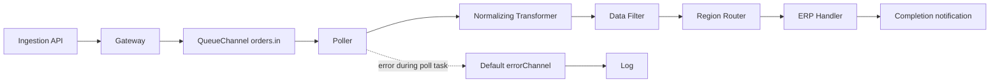
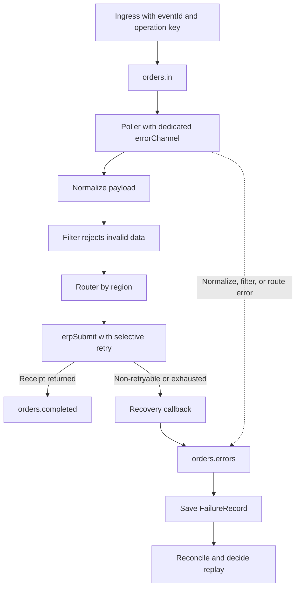
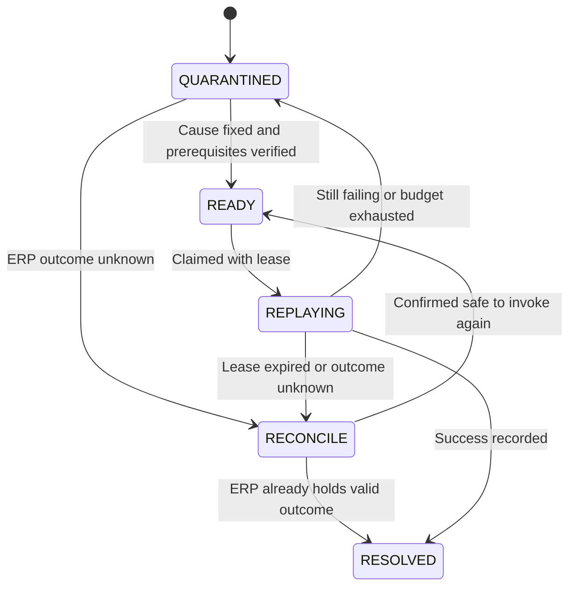

# Handling a Failing Flow in Production

## 1. Practice Objectives and Scope

This comprehensive practice exercise belongs to the **SPRING_INTEGRATION_CORE** module. You act as the on-call engineer operating an order-intake flow, using Spring Integration core components to locate the failure point, contain blast radius, fix error handling, and recover messages in a controlled manner.

Target outcomes:

- Trace a `Message`'s path, identifying headers, and the boundary between sending thread and processing thread.
- Distinguish transformer, filter, router, external-system call, and error-branch failures.
- Use Java DSL, `RequestHandlerRetryAdvice`, and a dedicated error channel to bound retries and retain recovery information.
- Design idempotency, quarantine, and replay around business state.
- Write tests for failure behavior; use evidence to guide deployment and incident closure.

Order IDs, timestamps, traffic rates, and logs in this lesson are **synthetic data**. Never use real customer payloads when reproducing an incident.

### Illustrative Environment

The example uses **Java 17+, Spring Boot 3.5.x, Spring Integration 6.5.x, and Spring Retry 2.x**. The `org.springframework.retry.*` package names in this lesson belong to this version combination. Choose a specific patch version for the practice project and let Spring Boot's BOM manage dependencies; do not manually mix library generations. See [Dependencies Managed by Spring Boot 3.5](https://docs.spring.io/spring-boot/3.5/appendix/dependency-versions/coordinates.html).

In a Maven project already using an appropriate Spring Boot parent/BOM, add these dependencies:

```xml
<dependencies>
    <dependency>
        <groupId>org.springframework.boot</groupId>
        <artifactId>spring-boot-starter-integration</artifactId>
    </dependency>
    <dependency>
        <groupId>org.springframework.retry</groupId>
        <artifactId>spring-retry</artifactId>
    </dependency>
    <dependency>
        <groupId>org.springframework.boot</groupId>
        <artifactId>spring-boot-starter-test</artifactId>
        <scope>test</scope>
    </dependency>
</dependencies>
```

The lab below runs with Spring Test and a simulated ERP, requiring no real broker or ERP. `QueueChannel` in the lab holds data in memory; `FailureStore` is the error persistence port replaced by a mock in tests. The production design section explains what must be added to guarantee recovery across process crashes.

## 2. Scenario: Orders Accepted Yet Missing on ERP

A service ingests `OrderCreated` events and forwards them to an ERP. After a configuration change, the ingestion API still returns success, yet the number of orders created in the ERP drops. An operations team replays events from logs and later discovers duplicate orders.

Flow before the incident:



Synthetic timeline:

| Time | Observation | What to check |
| --- | --- | --- |
| 09:00 | New configuration deployed | Compare endpoints, timeouts, retries, and region mappings |
| 09:05 | ERP response latency rises | Can create backlog or timeouts |
| 09:08 | API still accepts normally | Confirms only ingress if not awaiting ERP outcome |
| 09:12 | Accepted orders far exceed completed orders | Reconcile per event rather than counting HTTP 2xx |
| 09:18 | Replayed several payloads from logs | Risks duplicating side effects without business keys |
| 09:25 | Duplicate orders appear in ERP | Check calls that succeeded yet lost their response |

Business invariants used to evaluate fixes:

1. Every valid event has a stable identifier.
2. One order-creation operation shares the same idempotency key across all retry attempts.
3. Every durably accepted event can be reconciled to a terminal state or an intentional pending state.
4. Errors must never turn into an "order created" outcome merely because an error handler ran without throwing.
5. Cases where it is unknown whether the ERP committed must be reconciled before re-creating.

## 3. Gathering Evidence Before Fixing

### 3.1. Mapping the Actual Flow

Document channels, channel types, endpoint IDs, pollers, executors if any, timeouts, and all retry settings. A short Java DSL definition can still create multiple beans, so stable endpoint IDs help correlate logs with configuration.

| Component | What to verify | Easily missed bug |
| --- | --- | --- |
| Gateway | Return type, request channel, send timeout, reply timeout | Interpreting `void` as business completion |
| Input queue | Capacity, backing store, message age | In-memory queue lost on restart |
| Transformer | Input/output types, preserved headers | Creating a new message and dropping business keys |
| Filter | Reject via exception vs. discard channel | Dropped event leaves no status record |
| Router | Complete mappings, default route, unknown-route handling | New region has no destination |
| ERP handler | Timeouts, error classification, advice scope | Retrying data errors or whole side-effect chains |
| Error flow | Subscribers, error storage, behavior when saving error fails | Logging only and treating as recovered |
| Aggregator if present | Group ID, release condition, expiry, message store | One failed branch leaves group waiting forever |

### 3.2. Connecting Identifiers to Their Proper Purpose

| Field | Purpose | Rule in this scenario |
| --- | --- | --- |
| `MessageHeaders.ID` | Framework message identifier | Do not use as the ERP order creation key |
| `eventId` | Business event identifier | Keep identical across retries or replays of the same event |
| `correlationId` | Links steps of a workflow | Retain for tracing; multiple events may share correlation |
| `idempotencyKey` | Identifies one concrete side effect | Use operation prefix plus stable event ID |
| `flowStage` | Current processing location | Update before each major step |
| `replayId` | Identifies a replay batch/attempt | Generate new per replay; do not replace `eventId` |
| `schemaVersion` | Selects payload deserializer | Verify compatibility before replaying |

A sanitized log entry might look like:

```text
eventId=evt-1042 correlationId=checkout-782
flowStage=erpSubmit endpoint=erpSubmit
idempotencyKey=erp-order:create:evt-1042
attempt=3 outcome=TIMEOUT elapsedMs=2000
```

This log does not prove the ERP did not create the order. Query the ERP using the idempotency key or business identifier per the integration contract.

### 3.3. Distinguishing Thread Boundaries from Error Boundaries

With `DirectChannel`, handlers usually run on the sending thread; exceptions can propagate back to the caller. With a `QueueChannel` and poller, processing occurs after enqueuing. Do not expect a `try/catch` around the enqueue call to catch exceptions thrown later. Spring Integration provides an `ErrorMessage` mechanism for asynchronous task errors; gateways also have their own error-handling rules. See [Spring Integration 6.5 Error Handling](https://docs.spring.io/spring-integration/reference/6.5/error-handling.html).

```java
boolean accepted = ordersIn.send(message, 1_000);
// accepted only indicates that the message was accepted by the channel.
// ERP may not have been called yet at this moment.
```

With a `void` gateway, the caller receives no ERP receipt. If switching to a request/reply gateway, design the reply path, result type, and time budget accordingly. A reply wait timeout does not cancel an in-flight side effect. See [Messaging Gateways](https://docs.spring.io/spring-integration/reference/6.5/gateway.html).

In this lesson's fix, ERP errors are routed by the recovery callback to `orders.errors`; transformer, filter, or router errors are sent by the poller to the same channel. These are two concrete mechanisms, not an assumption that every `DirectChannel` automatically sends exceptions to an error channel.

## 4. Containment and Blast-Radius Reduction

Practice on sanitized copies of data before touching a live environment.

1. **Preserve evidence:** capture deployment ID, config diff, first error, and representative sample events; avoid turning on full payload logging.
2. **Protect ingress:** if still accepting traffic, ensure durable storage and load bounds. If only an in-memory queue exists, stop or redirect upstream to durable storage before stopping consumers.
3. **Relieve pressure on ERP:** limit concurrency, halt bulk replays, and check authentication errors and upstream health.
4. **Classify affected events:** succeeded; clearly failed; ambiguous ERP commit status; not yet processed.
5. **Reproduce with one event:** preserve event ID, headers, and error type. Do not test with a re-typed payload missing headers.
6. **Choose rollback or patch:** roll back config when that removes the cause and remains data-compatible; preserve semantics of business keys.
7. **Reconcile after intervention:** fewer errors is only one signal. Verify valid order counts, duplicates, backlog, and records pending reconciliation.

Stopping an endpoint reading from a queue does not mean the queue is crash-safe on restart. Persistence must be verified separately.

## 5. Hypotheses and Testable Conclusions

| Hypothesis | Evidence to look for | Remediation direction |
| --- | --- | --- |
| Invalid payload | Exception at transformer/filter before first ERP call | Quarantine, fix schema or data |
| Missing route | Region absent from mapping; ERP never receives request | Fix mapping per contract |
| Transient ERP slowdown | Timeouts or retryable errors; matching latency spike | Bounded retry, load shedding, preserve keys |
| ERP committed yet response lost | ERP lookup finds receipt under same key | Record receipt; do not recreate with a new key |
| Queue lacks consumer | Backlog grows; poller stopped or misscheduled | Check lifecycle and configuration |
| Consumers tied up by retries | Workers blocked in backoff; throughput drops | Shrink retry budget, consider delayed retry |
| Error-saving branch broken | Exception in error handler; no quarantine record | Restore storage and redelivery mechanism |
| Duplicates from replay | One event generated multiple ERP call keys | Bind key to side effect, add reconciliation |

In the practice scenario, the assumed root causes are: the ERP experienced transient timeouts; the flow only logged errors; operators mistook enqueue success for completion; and replays failed to preserve idempotency keys. Combined, these caused orders to slip through reconciliation and risked duplicates.

The fix must address processing paths, state persistence, and replay operations together. Merely increasing timeouts will not satisfy the invariants in section 2.

## 6. Designing the Fixed Flow



Design decisions:

- Place retry directly around the ERP call, not around the entire flow.
- Retry only transient failures explicitly classified by the ERP adapter.
- Use the same `idempotencyKey` across all retries of an operation.
- Recovery routes failures to a dedicated branch and never fabricates a fake receipt.
- Filter explicitly throws an exception on rejection so rejected events are recorded.
- Name endpoints for testing and log correlation.
- Bound queues in the lab to observe backpressure when ingress exceeds processing capacity.

`RequestHandlerRetryAdvice` uses Spring Retry; retry is stateless, and backoff can hold the processing thread while waiting. The recovery callback handles failure once no more retries are permitted. See [Retry Advice](https://docs.spring.io/spring-integration/reference/6.5/handler-advice/classes.html).

## 7. Implementing the Lab with Java DSL

Place the classes below in package `example.orders`. File names below are suggestions for the practice project, not requirements to alter production codebases.

### 7.1. Data Models and Integration Ports

File `OrderModel.java`:

```java
package example.orders;

import java.math.BigDecimal;
import java.time.Instant;

public final class OrderModel {

    private OrderModel() {
    }

    public record OrderEvent(
            String eventId, String orderId,
            String region, BigDecimal amount) {
    }

    public record OrderCommand(
            String eventId, String orderId,
            String region, BigDecimal amount) {
    }

    public record ErpReceipt(String orderId, String erpReference) {
    }

    public record FailureRecord(
            String failureId,
            String eventId,
            String correlationId,
            String idempotencyKey,
            String stage,
            String category,
            String exceptionType,
            Object payloadSnapshot,
            Instant occurredAt) {
    }

    @FunctionalInterface
    public interface ErpClient {
        ErpReceipt submit(OrderCommand order, String idempotencyKey);
    }

    @FunctionalInterface
    public interface FailureStore {
        void save(FailureRecord failure);
    }

    public static final class TransientErpException
            extends RuntimeException {
        public TransientErpException(String message) {
            super(message);
        }
    }

    public static final class PermanentErpException
            extends RuntimeException {
        public PermanentErpException(String message) {
            super(message);
        }
    }
}
```

A real `ErpClient` must translate transport failures and ERP responses into the proper exception hierarchy. For instance, data errors must not become `TransientErpException`. For HTTP 429/503, also consider rate limits, upstream-requested wait intervals, and operation idempotency.

`FailureStore.save()` in production must return only after data is durably stored per the chosen contract. Persistence failures must surface outward. `payloadSnapshot` of type `Object` is purely for inspecting payloads in the lab; in production storage, use a versioned schema, scrubbed data, and an explicit serialization format.

### 7.2. Channels, Retry, and Endpoints

File `ProductionFlowConfig.java`:

```java
package example.orders;

import static example.orders.OrderModel.*;

import java.time.Instant;
import java.util.Locale;
import java.util.Map;
import java.util.Objects;

import org.springframework.beans.factory.annotation.Qualifier;
import org.springframework.context.annotation.Bean;
import org.springframework.context.annotation.Configuration;
import org.springframework.integration.annotation.IntegrationComponentScan;
import org.springframework.integration.channel.DirectChannel;
import org.springframework.integration.channel.QueueChannel;
import org.springframework.integration.config.EnableIntegration;
import org.springframework.integration.dsl.IntegrationFlow;
import org.springframework.integration.dsl.Pollers;
import org.springframework.integration.handler.advice.ErrorMessageSendingRecoverer;
import org.springframework.integration.handler.advice.RequestHandlerRetryAdvice;
import org.springframework.integration.MessageRejectedException;
import org.springframework.messaging.Message;
import org.springframework.messaging.MessageHandler;
import org.springframework.messaging.MessagingException;
import org.springframework.messaging.support.ErrorMessage;
import org.springframework.retry.backoff.ExponentialBackOffPolicy;
import org.springframework.retry.policy.SimpleRetryPolicy;
import org.springframework.retry.support.RetryTemplate;

@Configuration
@EnableIntegration
@IntegrationComponentScan(basePackageClasses = ProductionFlowConfig.class)
public class ProductionFlowConfig {

    @Bean("orders.in")
    QueueChannel ordersIn() {
        return new QueueChannel(100);
    }

    @Bean("orders.erp")
    DirectChannel ordersErp() {
        return new DirectChannel();
    }

    @Bean("orders.errors")
    DirectChannel ordersErrors() {
        return new DirectChannel();
    }

    @Bean("orders.completed")
    QueueChannel ordersCompleted() {
        return new QueueChannel(100);
    }

    @Bean
    RequestHandlerRetryAdvice erpRetryAdvice(
            @Qualifier("orders.errors") DirectChannel errors) {

        Map<Class<? extends Throwable>, Boolean> retryable =
                Map.of(TransientErpException.class, true);

        SimpleRetryPolicy policy =
                new SimpleRetryPolicy(3, retryable, true, false);

        ExponentialBackOffPolicy backoff =
                new ExponentialBackOffPolicy();
        backoff.setInitialInterval(200);
        backoff.setMultiplier(2.0);
        backoff.setMaxInterval(1_000);

        RetryTemplate template = new RetryTemplate();
        template.setRetryPolicy(policy);
        template.setBackOffPolicy(backoff);

        RequestHandlerRetryAdvice advice =
                new RequestHandlerRetryAdvice();
        advice.setRetryTemplate(template);
        advice.setRecoveryCallback(
                new ErrorMessageSendingRecoverer(errors));
        return advice;
    }

    @Bean
    IntegrationFlow ordersFlow(
            @Qualifier("orders.in") QueueChannel input) {

        return IntegrationFlow
                .from(input)
                .bridge(endpoint -> endpoint
                        .id("ordersIngressPoller")
                        .poller(Pollers.fixedDelay(100)
                                .maxMessagesPerPoll(1)
                                .errorChannel("orders.errors")))
                .enrichHeaders(headers ->
                        headers.header("flowStage", "normalize", true))
                .transform(OrderEvent.class, event ->
                        new OrderCommand(
                                event.eventId(),
                                event.orderId(),
                                event.region() == null ? ""
                                        : event.region().trim()
                                                .toUpperCase(Locale.ROOT),
                                event.amount()))
                .enrichHeaders(headers ->
                        headers.header("flowStage", "validate", true))
                .filter(OrderCommand.class,
                        order -> hasText(order.eventId())
                                && hasText(order.orderId())
                                && order.amount() != null
                                && order.amount().signum() > 0,
                        endpoint -> endpoint
                                .id("ordersValidation")
                                .throwExceptionOnRejection(true))
                .enrichHeaders(headers ->
                        headers.header("flowStage", "route", true))
                .route(OrderCommand.class, OrderCommand::region,
                        router -> router
                                .channelMapping("VN", "orders.erp")
                                .channelMapping("SG", "orders.erp")
                                .resolutionRequired(true))
                .get();
    }

    @Bean
    IntegrationFlow erpFlow(
            ErpClient erpClient,
            RequestHandlerRetryAdvice erpRetryAdvice) {

        return IntegrationFlow.from("orders.erp")
                .enrichHeaders(headers ->
                        headers.header("flowStage", "erpSubmit", true))
                .handle(OrderCommand.class, (order, headers) -> {
                    String key = Objects.requireNonNull(
                            headers.get("idempotencyKey", String.class),
                            "Missing idempotencyKey");
                    return Objects.requireNonNull(
                            erpClient.submit(order, key),
                            "ERP must return a receipt");
                }, endpoint -> endpoint
                        .id("erpSubmit")
                        .requiresReply(false)
                        .advice(erpRetryAdvice))
                .channel("orders.completed")
                .get();
    }

    @Bean
    IntegrationFlow ordersErrorFlow(
            MessageHandler ordersErrorHandler) {

        return IntegrationFlow.from("orders.errors")
                .handle(ordersErrorHandler,
                        endpoint -> endpoint.id("persistOrderFailure"))
                .get();
    }

    @Bean
    MessageHandler ordersErrorHandler(FailureStore failureStore) {
        return message -> {
            ErrorMessage error = (ErrorMessage) message;
            Throwable failure = error.getPayload();

            Message<?> failed = failure instanceof MessagingException ex
                    ? ex.getFailedMessage() : null;
            if (failed == null) {
                failed = error.getOriginalMessage();
            }

            Throwable root = failure;
            while (root.getCause() != null && root.getCause() != root) {
                root = root.getCause();
            }

            String fallback = failed == null
                    ? message.getHeaders().getId().toString()
                    : failed.getHeaders().getId().toString();

            String eventId = header(failed, "eventId", fallback);
            String stage = header(failed, "flowStage", "unknown");

            String category;
            if (root instanceof TransientErpException) {
                category = "TEMPORARY_EXHAUSTED";
            } else if (root instanceof PermanentErpException
                    || root instanceof MessageRejectedException) {
                category = "PERMANENT_REJECTED";
            } else {
                category = "UNEXPECTED";
            }

            failureStore.save(new FailureRecord(
                    eventId + ":" + stage,
                    eventId,
                    header(failed, "correlationId", "unknown"),
                    header(failed, "idempotencyKey", "unknown"),
                    stage,
                    category,
                    root.getClass().getName(),
                    failed == null ? null : failed.getPayload(),
                    Instant.now()));
        };
    }

    private static boolean hasText(String value) {
        return value != null && !value.isBlank();
    }

    private static String header(
            Message<?> message, String name, String fallback) {
        if (message == null) {
            return fallback;
        }
        return Objects.toString(
                message.getHeaders().get(name), fallback);
    }
}
```

In `SimpleRetryPolicy(3, retryable, true, false)`, three attempts **already include the first call**; `true` enables traversing the cause chain and `false` is the default outcome for unclassified exceptions. See [SimpleRetryPolicy API](https://docs.spring.io/spring-retry/docs/2.0.12/apidocs/org/springframework/retry/policy/SimpleRetryPolicy.html).

When all three attempts fail, the example's backoff is 200 ms then 400 ms, totaling 600 ms. If each ERP call has a 2-second execution limit, the budget for this segment is roughly:

```text
3 × 2,000 ms + 200 ms + 400 ms = 6,600 ms
```

The figure above excludes queue wait, error-persistence cost, and result forwarding. A single read timeout does not necessarily bound the entire call; the adapter must configure all wait points including connection acquisition, TCP connect, and response reading.

`requiresReply(false)` allows recovery to terminate the branch without emitting a receipt. The ERP-calling handler still checks for a `null` receipt so an adapter bug is never mistaken for completion. In the lab, a success result appears on `orders.completed` only when the ERP returns a receipt.

`orders.errors` is a `DirectChannel` with a single error-saving consumer in this configuration. If adding multiple consumers to a `DirectChannel`, understand its dispatching mechanism; do not use it expecting every subscriber to receive the same error. See [Channel Configuration](https://docs.spring.io/spring-integration/reference/6.5/channel/configuration.html).

### 7.3. Ingress Gateway

File `OrderIngress.java`:

```java
package example.orders;

import example.orders.OrderModel.OrderEvent;
import org.springframework.integration.annotation.MessagingGateway;
import org.springframework.messaging.Message;

@MessagingGateway(
        defaultRequestChannel = "orders.in",
        defaultRequestTimeout = "1000")
public interface OrderIngress {
    void submit(Message<OrderEvent> message);
}
```

`@IntegrationComponentScan` in the configuration registers this package's gateway. An example gateway call:

```java
OrderEvent event = new OrderEvent(
        "evt-1042", "order-782", "vn", new BigDecimal("125000"));

Message<OrderEvent> message = MessageBuilder.withPayload(event)
        .setHeader("eventId", event.eventId())
        .setHeader("correlationId", "checkout-782")
        .setHeader("idempotencyKey",
                "erp-order:create:" + event.eventId())
        .setHeader("schemaVersion", 1)
        .build();

orderIngress.submit(message);
```

The snippet above requires imports for `OrderEvent`, `BigDecimal`, `Message`, and `MessageBuilder`. The ingestion API must validate and attach business headers itself rather than letting callers pass arbitrary `replyChannel` or `errorChannel` headers.

The gateway here confirms only sending to the channel within the configured wait limit. If the queue is full, the gateway can throw a send error; the API must translate that into an appropriate response. If choosing HTTP 202, the API contract should return a status-lookup identifier and only promise durable acceptance once the event is actually durably stored.

### 7.4. What to Observe When Running the Lab

Send in order: a valid event, a negative-amount event, an unsupported-region event, and an ERP-timeout event. For each case, record:

- When the gateway returns vs. when processing finishes.
- How many times the ERP is called with the same idempotency key.
- Whether a receipt appears in `orders.completed` or a failure record is written.
- `flowStage`, error category, payload at the failure point, and retained headers.
- How long a failing message occupies the poller thread.

For errors after the transformer, `failedMessage` usually holds the payload converted to `OrderCommand`; that is not necessarily the original input payload. To reconstruct the full input, persist the original envelope keyed by `eventId` rather than relying solely on the failure-point snapshot.

## 8. Testing Behavior When Errors Occur

The tests below mock `ErpClient` and `FailureStore`, while channels, poller, transformer, filter, router, and advice run for real. Thus, tests observe retry and error-routing behavior of the real configuration.

File `OrdersFlowTest.java`:

```java
package example.orders;

import static example.orders.OrderModel.*;
import static org.assertj.core.api.Assertions.assertThat;
import static org.mockito.ArgumentMatchers.*;
import static org.mockito.Mockito.*;

import java.math.BigDecimal;

import org.junit.jupiter.api.Test;
import org.mockito.ArgumentCaptor;
import org.springframework.beans.factory.annotation.Autowired;
import org.springframework.beans.factory.annotation.Qualifier;
import org.springframework.context.annotation.Bean;
import org.springframework.context.annotation.Configuration;
import org.springframework.integration.channel.QueueChannel;
import org.springframework.messaging.Message;
import org.springframework.messaging.support.MessageBuilder;
import org.springframework.test.annotation.DirtiesContext;
import org.springframework.test.context.junit.jupiter.SpringJUnitConfig;

@SpringJUnitConfig({
        ProductionFlowConfig.class,
        OrdersFlowTest.Stubs.class
})
@DirtiesContext(
        classMode = DirtiesContext.ClassMode.AFTER_EACH_TEST_METHOD)
class OrdersFlowTest {

    @Configuration
    static class Stubs {
        @Bean
        ErpClient erpClient() {
            return mock(ErpClient.class);
        }

        @Bean
        FailureStore failureStore() {
            return mock(FailureStore.class);
        }
    }

    @Autowired
    @Qualifier("orders.in")
    QueueChannel input;

    @Autowired
    @Qualifier("orders.completed")
    QueueChannel completed;

    @Autowired
    ErpClient erp;

    @Autowired
    FailureStore failures;

    @Test
    void transientFailureThenSuccessKeepsTheSameKey() {
        when(erp.submit(any(OrderCommand.class), anyString()))
                .thenThrow(new TransientErpException("timeout-1"))
                .thenThrow(new TransientErpException("timeout-2"))
                .thenReturn(new ErpReceipt("order-782", "ERP-9001"));

        assertThat(input.send(
                message("evt-ok", new BigDecimal("125000")), 1_000))
                .isTrue();

        Message<?> result = completed.receive(3_000);
        assertThat(result).isNotNull();
        assertThat(result.getPayload()).isEqualTo(
                new ErpReceipt("order-782", "ERP-9001"));

        verify(erp, times(3)).submit(
                any(OrderCommand.class),
                eq("erp-order:create:evt-ok"));
        verifyNoInteractions(failures);
    }

    @Test
    void permanentFailureIsNotRetried() {
        when(erp.submit(any(OrderCommand.class), anyString()))
                .thenThrow(new PermanentErpException("invalid customer"));

        assertThat(input.send(
                message("evt-permanent", BigDecimal.TEN), 1_000))
                .isTrue();

        ArgumentCaptor<FailureRecord> captured =
                ArgumentCaptor.forClass(FailureRecord.class);
        verify(failures, timeout(3_000)).save(captured.capture());

        assertThat(captured.getValue().eventId())
                .isEqualTo("evt-permanent");
        assertThat(captured.getValue().stage()).isEqualTo("erpSubmit");
        assertThat(captured.getValue().category())
                .isEqualTo("PERMANENT_REJECTED");
        verify(erp, times(1)).submit(
                any(OrderCommand.class),
                eq("erp-order:create:evt-permanent"));
        assertThat(completed.receive(200)).isNull();
    }

    @Test
    void exhaustedRetryStoresFailureWithoutSuccessReceipt() {
        when(erp.submit(any(OrderCommand.class), anyString()))
                .thenThrow(new TransientErpException("ERP unavailable"));

        assertThat(input.send(
                message("evt-exhausted", BigDecimal.TEN), 1_000))
                .isTrue();

        ArgumentCaptor<FailureRecord> captured =
                ArgumentCaptor.forClass(FailureRecord.class);
        verify(failures, timeout(3_000)).save(captured.capture());

        FailureRecord record = captured.getValue();
        assertThat(record.eventId()).isEqualTo("evt-exhausted");
        assertThat(record.correlationId()).isEqualTo("checkout-782");
        assertThat(record.idempotencyKey())
                .isEqualTo("erp-order:create:evt-exhausted");
        assertThat(record.category()).isEqualTo("TEMPORARY_EXHAUSTED");
        assertThat(record.payloadSnapshot())
                .isInstanceOf(OrderCommand.class);

        verify(erp, times(3)).submit(
                any(OrderCommand.class),
                eq("erp-order:create:evt-exhausted"));
        assertThat(completed.receive(200)).isNull();
    }

    @Test
    void validationFailureUsesPollerErrorPathWithoutCallingErp() {
        assertThat(input.send(
                message("evt-invalid", new BigDecimal("-1")), 1_000))
                .isTrue();

        ArgumentCaptor<FailureRecord> captured =
                ArgumentCaptor.forClass(FailureRecord.class);
        verify(failures, timeout(3_000)).save(captured.capture());

        assertThat(captured.getValue().stage()).isEqualTo("validate");
        assertThat(captured.getValue().category())
                .isEqualTo("PERMANENT_REJECTED");
        verifyNoInteractions(erp);
        assertThat(completed.receive(200)).isNull();
    }

    private static Message<OrderEvent> message(
            String eventId, BigDecimal amount) {
        return MessageBuilder.withPayload(
                        new OrderEvent(
                                eventId, "order-782", "vn", amount))
                .setHeader("eventId", eventId)
                .setHeader("correlationId", "checkout-782")
                .setHeader("idempotencyKey",
                        "erp-order:create:" + eventId)
                .setHeader("schemaVersion", 1)
                .build();
    }
}
```

Bounded wait intervals support asynchronous testing. Do not use a long `Thread.sleep` and assume the flow finished. On slow CI machines, tune test timeouts to the environment; never weaken business policies just to turn tests green.

The four tests above verify behavior within one JVM; they do not yet verify that the ERP genuinely deduplicates or that the system recovers after a crash. Complete the following matrix in your practice project:

| Case | Outcome to verify |
| --- | --- |
| ERP succeeds immediately | One call, one receipt, no error recorded |
| Unsupported region | ERP not called; failure has stage `route` |
| Missing idempotency key | No side effect created; config/envelope error recorded |
| Wrong payload type at ingress | Normalization error and identifier to trace input |
| Input queue full | Send terminates on timeout; caller knows it was not accepted |
| Saving FailureRecord fails | Error is not swallowed; verify redelivery with durable source |
| ERP commits then response lost | Retry with same key returns same outcome; no second order created |
| Two workers replay same record | Only one worker claims successfully |
| Process crashes at commit points | No event lost; ambiguous outcomes can be reconciled |
| Non-serializable header | Durable contract strips or converts intentionally |

If the project uses `spring-integration-test`, you can use `@SpringIntegrationTest` and `MockIntegrationContext` to control sources or swap components. When testing retries, mocking the ERP dependency as in the example preserves the endpoint's advice; be careful if replacing the handler under test itself. See [Testing support](https://docs.spring.io/spring-integration/reference/6.5/testing.html).

## 9. Completing Resilience for Production

### 9.1. Persistence and Transaction Boundaries

A regular `QueueChannel` stores only in memory. Use a persistent message store or a broker source with an appropriate redelivery mechanism. Once polled from a queue, the message has already been dequeued; queue persistence alone does not resolve failures occurring after retrieval. See [Message Store](https://docs.spring.io/spring-integration/reference/6.5/message-store.html).

Choose and verify one concrete contract:

| Ingestion style | Point where acceptance can be confirmed | On processing failure |
| --- | --- | --- |
| Broker with ack/redelivery | Per configured publish/consumer contract | Nack or roll back per policy when outcome is not yet saved |
| JDBC-backed queue | After ingress commit | Receive and state updates need compatible transaction |
| Database inbox table | After inbox row commit | Worker claims, processes, persists state, and retries under lease |
| In-memory queue | Confirms temporary in-process receipt only | Crash can lose messages; suitable for this lab |

With synchronous processing on the same thread, a transaction can span multiple endpoints. Queue/executor boundaries change execution and do not carry the sender thread's transaction onto another thread automatically. Place transactions on the right consumer/poller and use rollback-capable resources. See [Transaction Support](https://docs.spring.io/spring-integration/reference/6.5/transactions.html).

A local database transaction cannot roll back an HTTP call already committed on the ERP. The architecture must handle "ERP succeeded yet internal state write failed", typically via idempotency keys, reconciliation, and an outbox for downstream notifications.

### 9.2. When the Error-Persistence Branch Itself Fails

In the lab configuration, recovery invokes `orders.errors` synchronously. If `FailureStore.save()` throws an exception, recovery has not completed. The exception may continue to the poller's error handler; therefore, invoking an error handler must not be treated as proof that the failure was persisted.

Production needs:

- An error store with finite timeouts and outward error reporting on save failures.
- Ack/rollback/redelivery policies tied to the real data source.
- A `failureId` or uniqueness key to upsert errors when the same failure is redelivered.
- A separate alerting channel for error-store outages rather than relying solely on the failing store itself.
- Redelivery caps so failing error writes do not spin in an infinite load loop.

Changing `orders.errors` to an in-memory queue only shifts when failure happens. It does not make failure records durable.

### 9.3. Error Envelopes and Stored Data

A production recovery record should contain:

| Group | Suggested fields |
| --- | --- |
| Identity | `failureId`, `eventId`, `correlationId`, idempotency key |
| Location | Flow name, endpoint, stage, deployment ID |
| Error | Stable error code, category, exception class, sanitized message |
| Payload | Original envelope reference, required snapshot, schema version |
| History | First/last timestamp, attempt count, replay count |
| Operations | Status, owner, lease expiry, replay reason and operator |

Never serialize raw `Throwable` objects, channel beans, or arbitrary headers into the database out of habit. Persist only fields in the data contract. Tokens, credentials, payment details, and unnecessary personal data must be stripped or protected per system policy.

The lab's `failureId = eventId + ":" + stage` is a simple composite key. If one event has multiple side effects or multiple operation versions, add an appropriate operation identifier and store attempt history separately rather than overwriting history needed for investigation.

## 10. Idempotency and Safe Replay

### 10.1. Choosing Keys per Business Side Effect

Examples:

```text
erp-order:create:evt-1042
erp-order:cancel:evt-1099
```

Creating and canceling an order are two distinct side effects. Using only `orderId` across all operation types can make valid operations block one another. Generating a fresh UUID on every retry prevents the external system from recognizing the same operation.

The agreement with the ERP must specify:

- Whether the same key with the same content returns the existing receipt.
- Whether the same key with different content is rejected or how it is handled.
- Key retention duration and status lookup mechanism.
- Atomicity when two concurrent requests arrive with the same key.
- Behavior while status is still `IN_PROGRESS` or outcome is unknown.

A local deduplication store alone does not guarantee the ERP creates only one order: the process can crash between ERP commit and updating the local dedup store. If the ERP lacks idempotency support, establish reference-based lookup, reconciliation, or equivalent business safeguards before permitting replay.

### 10.2. Recovery States

You can use this state model for the failure store:



Never move an expired-lease record back to `READY` automatically without checking whether the previous worker already created the side effect. For operations with verified idempotency, you can use the same key to query or re-check the outcome per contract.

Example compare-and-set claim of a record:

```sql
UPDATE integration_failure
SET status = 'REPLAYING',
    lease_owner = :worker_id,
    lease_until = :lease_until,
    replay_count = replay_count + 1
WHERE failure_id = :failure_id
  AND status = 'READY';
```

Only the worker updating **one row** proceeds with processing. This SQL is illustrative; you need transactions, consistent lease clocks, and owner/version-conditional outcome updates so an expired-lease worker cannot overwrite a newer worker's result.

### 10.3. Replay Procedure

1. Select a small batch by category, stage, and time window rather than the entire failure store.
2. Verify the fix is deployed, upstream capacity is healthy, and payloads match the schema.
3. Reconcile ambiguous timeout cases against the ERP.
4. Claim records while preserving `eventId`, `correlationId`, and idempotency key; attach a new `replayId`.
5. Load the original envelope from durable storage, verifying hash/content if needed; never blindly feed a mid-flow snapshot into the ingress.
6. Rebuild the message with only allowed headers; strip temporary reply/error channels, stale routing flags, and metadata from prior polls.
7. Inject at the right point in the flow, rate-limit, and record replay batch outcomes.
8. Mark `RESOLVED` once the business outcome is durably recorded; if ambiguous, transition to reconciliation.
9. Reconcile counts of claimed, succeeded, failed, and still-pending events.

In the lab, ingress expects `OrderEvent`, whereas an ERP failure holds an `OrderCommand` snapshot. Replaying that snapshot straight into `orders.in` causes a type error. This is why the original envelope must be kept distinct from the message at the failure point.

If business data must be modified, record the revised version and replacement-event policy. Never silently mutate the payload while reusing the key of an operation already recorded by the ERP.

## 11. Observability, Backpressure, and Retry Budgets

### 11.1. Signals to Monitor

The metric names below are **suggested custom business metrics**, not a claim that Actuator exports these exact names automatically.

| Metric/signal | Purpose |
| --- | --- |
| `orders.accepted` | Events accepted under the durable storage contract |
| `orders.completed` | Operations with a successful business outcome |
| `orders.quarantined` | Events awaiting failure handling |
| `orders.inflight` | Events currently being processed |
| `orders.oldest_pending_age` | Detects stuck events even before queues fill |
| `erp.attempts` and latency | Tracks call volume, timeouts, and retry overhead |
| `failure_store.errors` | Detects when the error-handling branch itself is failing |
| Replay rate and duplicate business results | Detects replays causing duplicate side effects |

Do not use event ID or order ID as metric labels because cardinality grows with traffic. Keep those identifiers in logs/traces; metric labels should come from small bounded sets such as flow, stage, category, and outcome.

When reconciling, count **unique events** within the same cohort and cut-off timestamp:

```text
accepted_unique =
    completed_unique
  + quarantined_unique
  + pending_unique
```

States must be mutually exclusive. Total attempt counts and total error-record counts cannot substitute directly for the unique event counts above.

### 11.2. Estimating Queue Pressure

Suppose ingress is 40 events/second and the consumer processes 25 events/second:

```text
Backlog growth rate = 40 - 25 = 15 events/second
Queue has 300 slots remaining -> roughly 300 / 15 = 20 seconds until full
```

This estimate assumes relatively steady rates. A larger queue only buys more time before filling; you must shed load, recover downstream, or scale capacity within ERP limits.

In the lab, one poller processes at most one message per poll and waits 100 ms between tasks. It prioritizes observability over production throughput. Retries/backoff and ERP latency both increase how long a worker stays occupied.

If a broker delivers up to five times and each delivery calls the ERP up to three times, one event can trigger up to **15 ERP calls**, even before manual replay. Budget across HTTP client retries, advice retries, broker redeliveries, and operator tools together.

Retry synchronously only for short, bounded durations. For longer waits, consider delayed retries backed by durable storage to free workers. A circuit breaker can reduce pressure during prolonged upstream outages, yet you must still decide where messages go while the circuit is open.

## 12. When the Flow Includes a Splitter and Aggregator

Do not insert an aggregator around the ERP call merely to collect errors. An aggregator belongs where the business genuinely needs to combine multiple results into one group outcome.

Extension example: an order has multiple line items; each line checks inventory. If a filter drops one line or an error branch only logs, the aggregator may never satisfy its release condition. Aggregators hold group state in a message store and need appropriate release/expiry strategies. See [Aggregator](https://docs.spring.io/spring-integration/reference/6.5/aggregator.html).

When investigating a stuck group, check:

- Whether the group key uses a stable business identifier or changes on replay.
- Whether every expected element reaches a terminal outcome—success or failure—per contract.
- Whether duplicates are deduplicated by line identifier before deciding "all lines arrived".
- Whether group timeout leads to a partial result, quarantine, or reconciliation.
- What rules govern late arrivals or replays on an already-closed group.
- Whether the message store and group locks support multiple instances and restarts.

Never use raw received message count as proof all lines arrived if duplicates are possible. For groups containing errors, output should reflect an explicit business status rather than masking errors as a complete group.

## 13. Practice Sequence and Handoff Evidence

Execute the exercise in these stages:

1. **Reproduce:** run the simulated ERP for success, timeout, and permanent error; record event IDs and trace paths.
2. **Explain the incident:** diagram thread boundaries, error boundaries, and where data becomes durable.
3. **Fix policies:** apply selective retry, bounded timeouts, operation keys, and structured failure persistence.
4. **Test:** run the tests in section 8, adding cases for unknown routes and a full queue.
5. **Add durability:** choose an inbox, persistent queue, or broker; run crash and redelivery tests against real resources.
6. **Rehearse replay:** claim a record, reconcile with ERP, replay with the same key, and verify no duplicate side effects occur.
7. **Canary:** process a small batch while watching backlog, event age, ERP latency, persistence errors, and reconciliation counts.
8. **Close the incident:** confirm every affected event has an assigned state and owner.

Handoff evidence should include before/after diagrams, sanitized event envelopes, retry configuration, test results, reconciliation counts, and a replay runbook. Never declare production safe solely because mocked tests pass.

Acceptance criteria:

| Criterion | Passing evidence |
| --- | --- |
| Bounded retry | Transient errors call at most three times in lab; permanent errors call once |
| No false success | Error branch never emits a completion receipt |
| Failure point traceable | FailureRecord contains event, stage, and category |
| Key consistency preserved | All retries/replays of the same operation use the same key |
| Crash recovery | Tested on durable ingress and real state store |
| Reconcilable | No accepted event disappears from defined states |
| Controlled replay | Atomic claim with lease, rate limit, and history |
| Operators alerted if error branch fails | Dedicated signal for FailureRecord persistence errors |

### Post-Incident Report Template

```text
Incident: Orders accepted yet missing or duplicated in ERP
Impact window: ...
Affected eventId set: ...
Confirmed business impact: ...
Direct root cause and evidence: ...
Contributing factors: ...
Mitigations and patches applied: ...
Reconciliation outcome: completed / quarantined / pending / unresolved
Replay count and duplicate outcome count: ...
Follow-up actions, owners, due dates: ...
```

The end state of this lesson is a flow with an explicit failure path, a verifiable state-persistence contract, and a recovery process that preserves message business identity.

## 14. References

- [Spring Integration 6.5 — Error Handling](https://docs.spring.io/spring-integration/reference/6.5/error-handling.html): exceptions and error messages across execution boundaries.
- [Spring Integration 6.5 — Provided Advice Classes](https://docs.spring.io/spring-integration/reference/6.5/handler-advice/classes.html): retry scope, backoff, and recovery.
- [Spring Retry 2.0.12 — SimpleRetryPolicy](https://docs.spring.io/spring-retry/docs/2.0.12/apidocs/org/springframework/retry/policy/SimpleRetryPolicy.html): attempt limits and exception classification.
- [Spring Integration 6.5 — Configuring Message Channels](https://docs.spring.io/spring-integration/reference/6.5/channel/configuration.html): channel types, queues, and persistence mechanisms.
- [Spring Integration 6.5 — Messaging Gateways](https://docs.spring.io/spring-integration/reference/6.5/gateway.html): gateways, timeouts, and error handling.
- [Spring Integration 6.5 — Transaction Support](https://docs.spring.io/spring-integration/reference/6.5/transactions.html): transactions and thread boundaries.
- [Spring Integration 6.5 — Testing support](https://docs.spring.io/spring-integration/reference/6.5/testing.html): flow testing tools.