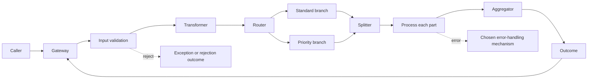

# Spring Integration Core Review Checklist

## 1. Purpose of the Review Session

A flow that runs with sample data does not yet prove the flow behaves correctly when messages arrive late, are redelivered, lack headers, or fail mid-way. A Spring Integration Core review must answer: where does a message go, who processes it, on which thread does it run, when is a result produced, and who is responsible if processing does not complete.

This comprehensive practice lesson sits within the **SPRING_INTEGRATION_CORE** scope: Message, MessageChannel, endpoints, gateways, Java DSL, transformers, routers, filters, aggregators, error handling, and testing enterprise integration patterns. The checklist turns knowledge of each component into concrete evidence usable when reviewing a change.

After this lesson, learners should be able to:

- Trace the paths of messages, replies, and errors from the actual configuration.
- Explain how channels affect dispatching, threading, transactions, and buffering.
- Spot branches that lose replies, aggregator groups that can never complete, and operations that may execute twice.
- Select tests corresponding to each risk rather than testing only the happy path.
- Write review findings stating location, reproduction scenario, impact, and acceptance criteria for the fix.

The Java examples use `record`, requiring Java 17 or higher; the actual Java version must also satisfy the Spring version chosen by the project. When applying this checklist, verify APIs and dependencies against the project's BOM, especially for retry configuration across Spring generations. This lesson does not require upgrading versions or connecting an external broker.

## 2. How to Use the Checklist

For each item, record one of three statuses:

| Status | Meaning | Appropriate evidence |
|---|---|---|
| PASS | Behavior has been explained and verified | Concrete configuration, tests with assertions, run results, or metrics |
| FAIL | Behavior violates the contract or lacks handling for a required scenario | Reproducing input, failure branch, observable impact |
| N/A | Does not apply to the flow under review | Reason tied to design, such as no asynchronous processing |

Never mark PASS merely because a bean name appears in configuration. For example, having an `errorChannel` bean does not prove that errors in a synchronous handler will be routed to that bean.

Priority convention used specifically for this practice exercise:

| Level | Illustrative scenario | How to handle in the review |
|---|---|---|
| P0 | Can charge twice or mix data between two customers | Block approval and require proof of fix |
| P1 | Flow hangs, loses messages, drops replies, or fails required recovery | Fix before approving the change |
| P2 | Hard to diagnose, missing resource bounds, or missing tests on critical branches | Specify impact and concrete remediation conditions |
| P3 | Confusing endpoint names, unclear docs | Give concise feedback without diluting behavioral bugs |

This is the lesson's review convention, not severity levels defined by Spring Integration. Actual severity depends on data, load, and service contracts.

## 3. Preparing the Flow Map and Contract

Before reading individual DSL calls, ask the author to describe a concrete business transaction. For example: receiving an order request, normalizing data, choosing a processing path, processing each order line, and aggregating results.



The diagram shows logical relationships. When reviewing real configuration, add channel names, channel types, and thread boundaries; an arrow to an error branch does not automatically mean Spring publishes every exception on its own.

### Contract Checklist

- [ ] Define success: request accepted, durably persisted, or business operation completed.
- [ ] Distinguish commands requiring execution from events notifying that something happened.
- [ ] Document payload types at ingress, after each transformer, and at final output.
- [ ] Specify whether invalid input produces an exception, a rejection outcome, or enters a separate sink.
- [ ] Specify whether each request expects one reply, multiple replies, or no reply.
- [ ] Record processing deadlines and behavior when deadlines cannot be met.
- [ ] Define the policy when the same business request arrives again.
- [ ] List what state survives when the application stops or restarts.

A clear contract might read: "Request `order-42` has three line items. Each line must produce a succeeded or rejected outcome. Only return a completed outcome once results exist for all three distinct lines. Resending the same request key must not create an additional payment."

## 4. Reviewing Messages, Payloads, and Headers

`Message<T>` consists of a payload and headers. A message's header structure is designed to be read-only, yet payload objects or header values can still be mutable. Thus, sharing a message across multiple branches does not automatically create a deep copy of the data. See [Message](https://docs.spring.io/spring-integration/reference/message.html).

### Checklist

- [ ] Data types and units have clear semantics: currency, timezone, quantity, and identifiers.
- [ ] Data sent across multiple branches is not mutated in place by one branch while another reads it.
- [ ] Message IDs are distinguished from business keys used for deduplication.
- [ ] Header contract documents name, type, origin, and consumer of each required header.
- [ ] Code modifying headers constructs an appropriate message instead of calling `put()` on `getHeaders()`.
- [ ] When building a new message manually, there is an explicit decision on which headers to keep, replace, or drop.
- [ ] Payload size is bounded and avoids carrying live resource objects like connections or HTTP requests.

### Sample Header Contract Table

| Header | Role in the ordering example | Review question |
|---|---|---|
| `businessRequestId` | Stable business request key | Is it preserved across retries and redeliveries? |
| `tenantId` | Customer partitioning | Is it validated and included in deduplication keys? |
| `businessTraceId` | Correlates logs in this exercise | Does it survive transformers and processing branches? |
| `replyChannel` | Return path for request–reply | Is it overwritten or sent across an unsupported boundary? |
| `errorChannel` | Error destination when supported by the mechanism | Which component actually reads this header? |
| `correlationId` | Groups parts belonging to one aggregation | Is it confused with a business tracking key? |
| `sequenceNumber`, `sequenceSize` | Describes parts of a sequence | Are they still accurate after filtering or branching? |

The names `businessRequestId`, `tenantId`, and `businessTraceId` are application conventions in this lesson. Never assume Spring creates or validates them automatically.

Example deduction: if a producer builds a new message for each redelivery, `MessageHeaders.ID` can change. Payment deduplication should rely on a business-meaningful key, such as `(tenantId, businessRequestId)`.

## 5. Reviewing MessageChannel Choices

Choosing a channel means choosing communication semantics. A successful `send()` may only mean a message entered a queue or was handed to an executor; that alone does not prove business work finished. Basic behaviors are described in [Message Channel Implementations](https://docs.spring.io/spring-integration/reference/channel/implementations.html).

| Channel | Typical dispatch | Key trait to identify |
|---|---|---|
| `DirectChannel` | One subscriber selected per dispatch | Handler runs on the sending thread |
| `QueueChannel` | One consumer receives each pulled message | Buffered; requires receive/poll activity |
| `ExecutorChannel` | Hands off to handler via executor | Usually introduces a thread boundary |
| `PublishSubscribeChannel` | Delivers to subscribers | With or without executor depending on config |
| `RendezvousChannel` | Direct handoff between sender and receiver | Zero buffer capacity; requires timing coordination |

### Dispatching Configuration Checklist

- [ ] Does the flow need competing consumption or should every branch receive the message?
- [ ] With multiple subscribers, have load balancing, failover, and configuration order been checked?
- [ ] Is anything mistakenly relying on `DirectChannel` to perform broadcast?
- [ ] With synchronous publish–subscribe, how does an error in one subscriber affect remaining subscribers?
- [ ] With an executor, can the task rejection policy cause the caller to run the task or receive an exception?
- [ ] Is completion ordering still guaranteed when multiple tasks or consumers process concurrently?

Never treat dispatcher failover as an exactly-once business guarantee. If a handler caused side effects before failing, execution on another subscriber still requires analysis. Compare options in [Configuring Message Channels](https://docs.spring.io/spring-integration/reference/channel/configuration.html).

### Resource Limits Checklist

- [ ] Queues have finite capacity chosen from message size and processing throughput.
- [ ] When a queue is full, how long does the sender wait and how is send failure handled?
- [ ] Executors have explicit thread counts, task queue capacities, and overload policies.
- [ ] Queue depth or wait time is measured rather than only measuring handler execution time.
- [ ] There is a plan when sustained arrival rate exceeds processing rate.

Sample back-of-the-envelope estimate: if a message holds roughly 40 KiB and backlog reaches 25,000 messages, payload data alone takes around 977 MiB before object overhead. "Using only in-memory queues" still requires memory budgets and load limits.

## 6. Reviewing Endpoints, Pollers, and Lifecycle

Endpoints connect processing logic to channels. Consumers of `SubscribableChannel` receive messages by subscription; consumers of `PollableChannel` require polling. That is the fundamental difference when switching from `DirectChannel` to `QueueChannel`. See [Poller](https://docs.spring.io/spring-integration/reference/polling-consumer.html).

### Endpoint Checklist

- [ ] Identify which endpoint receives the message, which handler executes, and where output goes.
- [ ] Service activators return appropriate data when the contract requires a reply.
- [ ] Returning `null` or `void` is reviewed explicitly; use `requiresReply` where missing replies should be caught by supporting components.
- [ ] Endpoints have stable IDs for tracing logs, metrics, and test substitution.
- [ ] No unintended extra consumer is subscribed to a point-to-point channel.
- [ ] Start/stop ordering and `autoStartup` match dependent resources.

The role of endpoints and how handlers attach to channels are explained in [Message Endpoints](https://docs.spring.io/spring-integration/reference/endpoint.html).

### Poller Checklist

- [ ] Queue consumers have a dedicated poller or a valid default poller.
- [ ] Fixed delay, fixed rate, or custom trigger is chosen deliberately to fit needs.
- [ ] Polling interval, `maxMessagesPerPoll`, receive timeout, and executor (if any) are documented.
- [ ] Checked how long one poll cycle can occupy the scheduler when downstream is slow.
- [ ] Both polling errors and message-processing errors have observable paths.
- [ ] Transaction configuration attaches to the work needing protection, not inferred from the poller name.

Counterexample to watch for: changing an input channel to a queue to reduce producer wait time while leaving consumer config untouched. A review must inspect the poller, errors on the new thread, backlog, and reply conditions.

## 7. Reviewing Transformers, Filters, and Routers

### 7.1. Transformer: Is the Data Contract Preserved?

- [ ] Document input and output types for every transformation.
- [ ] Check empty inputs, malformed formats, missing fields, and boundary values.
- [ ] Normalize strings, monetary amounts, and timestamps using deterministic rules.
- [ ] Preserve information needed for diagnostics and downstream contracts.
- [ ] Never hide payment calls or database writes inside a transformer that appears to only reformat data.
- [ ] Include tests for invalid data alongside valid samples.

Transformers are a natural point to decouple producer and consumer data models. When returning a brand-new `Message`, check the transformation's header policy. Refer to [Transformer](https://docs.spring.io/spring-integration/reference/transformer.html).

### 7.2. Filter: How Are Dropped Messages Handled?

- [ ] The predicate expresses one clear decision without mixing side effects.
- [ ] It is clear whether rejected messages are dropped silently, routed to a discard channel, or raise an exception.
- [ ] If using a discard channel, it has an appropriate consumer and monitoring.
- [ ] If the request requires a reply, the rejection branch has an explicit terminal outcome.
- [ ] Tests prove rejected messages never reach the business operation being guarded.

A filter can drop messages without raising an error under its default configuration. In request–reply flows, that can turn invalid data into a missing-reply timeout. `throwExceptionOnRejection(true)` is one option when the contract requires raising an error. See [Filter](https://docs.spring.io/spring-integration/reference/filter.html).

### 7.3. Router: Does Every Routing Value Have a Deterministic Outcome?

- [ ] There is a mapping table from business values to channels or subflows.
- [ ] Unknown values, missing headers, and case differences are handled.
- [ ] The impact of `resolutionRequired`, `channelKeyFallback`, and default output (when used) is understood.
- [ ] User-supplied data cannot arbitrarily pick unintended internal channel names.
- [ ] Every branch satisfies the exact reply count expected by the caller.
- [ ] Multi-target routers have a policy when sending to one target fails.

Default output and channel resolution behavior are separate decisions that must be verified from configuration. Compare [Common Router Parameters](https://docs.spring.io/spring-integration/reference/router/common-parameters.html) and [RouterSpec](https://docs.spring.io/spring-integration/api/org/springframework/integration/dsl/RouterSpec.html).

Example routing test table defined by an application:

| Input value | After normalization | Expected outcome |
|---|---|---|
| `standard` | `STANDARD` | Standard branch |
| ` EXPRESS ` | `EXPRESS` | Priority branch |
| `VIP` | `VIP` | Unmapped error or designed rejection branch |
| `null` | Per normalization contract | Must never accidentally select an unrelated channel |

## 8. Reviewing Gateways and the Request–Reply Lifecycle

Gateways hide messaging APIs behind a business interface. A review must trace where requests enter and how replies return. In synchronous flows, a reply wait timeout does not interrupt a slow handler running on the calling thread; in asynchronous flows, a caller timing out does not cancel downstream side effects. See [Messaging Gateways](https://docs.spring.io/spring-integration/reference/gateway.html).

### Checklist

- [ ] Method return type matches a one-way or request–reply contract.
- [ ] Gateway is registered via the application's appropriate configuration or scan mechanism.
- [ ] Request channel and reply return path are identified.
- [ ] Channel send timeout is distinguished from reply wait timeout.
- [ ] Every filter/router/service activator branch has a proper termination.
- [ ] Clients invoked inside handlers have their own timeouts when bounding I/O duration.
- [ ] There is a decision for handling replies arriving after the caller timed out.
- [ ] Caller contract distinguishes business rejections, processing errors, and timed-out outcomes.

A concrete review comment: "The gateway requires a result, yet the `VIP` branch produces no reply. Add a rejection outcome or exception per the contract and add a test for `VIP`." Commenting "just add a timeout" does not fix a branch missing a reply.

## 9. Reviewing Splitters and Aggregators

### 9.1. Identifying the Exact Number of Parts to Collect

A splitter creates multiple messages from one input, usually attaching sequence headers. For sources of unknown size, verify how completion is determined; never assume every case has a usable total part count. See [Splitter](https://docs.spring.io/spring-integration/reference/splitter.html).

- [ ] Each part has a business identity to detect duplicate parts.
- [ ] Empty inputs have a defined outcome.
- [ ] Downstream of a splitter, a dropped part is still accounted for in completion criteria.
- [ ] Arrival order, completion order, and required output order are distinguished.
- [ ] If using a resequencer, rules exist for missing parts and wait limits.

Suppose three lines `A`, `B`, `C` are split, and then a filter drops `B`. If the aggregator still waits for three parts, the group will never complete normally. One option is mapping each line to a succeeded or rejected `LineResult` so all three lines produce an outcome. Another option is filtering before splitting if the contract permits. The fix must preserve business semantics.

### 9.2. Separating the Three Responsibilities of an Aggregator

| Responsibility | Question to answer | Example in this lesson |
|---|---|---|
| Correlation | Which messages belong to the same group? | Same tenant and same order-processing run |
| Release | When is the group allowed to finish? | Outcomes received for all expected distinct lines |
| Aggregation | How is the output constructed? | Build a summary outcome with per-line status |

Never correlate solely by `customerId` if a customer can submit multiple concurrent orders. Never use `group.size() == 3` as a stand-in for "three distinct lines present" if inputs can be redelivered.

### Aggregator Checklist

- [ ] Correlation separates tenants, business entities, and processing runs that must stay distinct.
- [ ] Release strategy matches actual message metadata.
- [ ] If relying on sequences, headers remain intact across intermediate steps.
- [ ] With publish–subscribe or recipient list feeding an aggregator, configuration producing required sequences is verified.
- [ ] Policies exist for duplicates, failed parts, missing parts, and late parts.
- [ ] Expiry behavior is decided: partial result, rejection, or dedicated handling sink.
- [ ] Idle timeout without new messages is distinguished from an absolute deadline from group creation.
- [ ] Policy exists for retaining or purging completed-group metadata.

A plain duration `groupTimeout` normally resets when a new message arrives; do not read it as an absolute end-to-end request deadline. Purging groups also affects how late messages with the same correlation are handled. Compare [Aggregator](https://docs.spring.io/spring-integration/reference/aggregator.html).

### Persistence and Recovery Checklist

- [ ] Store meets requirements for retaining data across restarts.
- [ ] Payloads and headers can be persisted with the chosen serialization mechanism.
- [ ] Multiple instances have a strategy for routing groups consistently and coordinating access.
- [ ] Mechanisms exist to handle leftover groups after restart and purge metadata by retention policy.
- [ ] Tests show emitted results and side effects are not duplicated beyond contract during recovery.

A persistent store protects persisted state; additionally review transactions, locks, and output emission timing to assess the complete flow. Refer to [Message Store](https://docs.spring.io/spring-integration/reference/message-store.html).

### Practice Dataset for an Aggregator

| Scenario | Arrival sequence | What to prove |
|---|---|---|
| Normal | `A, B, C` | One complete outcome |
| Out of order | `C, A, B` | Outcome contents remain accurate |
| Duplicate line | `A, A, B` | Not mistaken for having all of `A, B, C` |
| Missing line | `A, C` | Expires per policy, observably |
| Late arrival | `A, C`, expires, then `B` | Does not emit a spurious complete outcome |
| Two concurrent orders | `A1, A2, B1, B2` | Groups do not mix |
| Mid-flight restart | Receive `A`, stop, receive `B, C` | Behavior matches declared recovery requirements |

## 10. Reviewing Errors, Retries, and Recovery

### 10.1. Tracing Errors by Thread

| Error source | Path to verify |
|---|---|
| Synchronous handler over direct channel | Exception may unwind to caller on call stack |
| Polling task | Poller/scheduler error handler and error destination |
| Processing via executor | Error publishing mechanism or configured error handler |
| Gateway with configured error channel | Error flow and impact on return value |

When error publishing is active, errors are wrapped as `ErrorMessage`; the framework may check the `errorChannel` header before the default error channel. Do not generalize this behavior to every exception in custom-invoked code. See [Error Handling](https://docs.spring.io/spring-integration/reference/error-handling.html).

### Error Checklist

- [ ] Tests genuinely induce failures at critical handlers.
- [ ] Synchronous and asynchronous errors are verified using matching observation points.
- [ ] Errors link back to business requests and the failing endpoint.
- [ ] Error flows do not silently lose failures by only logging and returning.
- [ ] Failures inside the error flow itself have a detection mechanism.
- [ ] Errors are never turned into empty success results.
- [ ] Data written to logs or error stores is bounded and masks sensitive fields.

### 10.2. Retrying the Right Target and Scope

| Scenario type | Decision to review | Evidence |
|---|---|---|
| Transient connection loss before processing | May retry per policy | Attempt count, wait intervals, and bounds |
| Invalid data | Usually ends in rejection | Does not futilely repeat identical bad data |
| Timeout after sending payment request | Unknown whether remote side succeeded | Idempotency key or reconciliation query mechanism |
| Retries exhausted | Hand off to defined recovery | Error record, separate queue, or reprocessing task |

- [ ] Advice wraps the exact endpoint or operation needing retry.
- [ ] Checked whether retry unintentionally re-runs downstream steps or other side effects.
- [ ] Attempt count, backoff, and exception types are chosen appropriately.
- [ ] I/O durations and wait intervals are included in processing time budgets.
- [ ] Attempts are not multiplied unexpectedly across client, handler, and source redelivery.
- [ ] Post-exhaustion recovery has an owner and replay criteria.

Spring Integration supplies advice classes for retries and other policies. Specific APIs must match the version in use; refer to [Provided Advice Classes](https://docs.spring.io/spring-integration/reference/handler-advice/classes.html).

## 11. Reviewing Transactions, Idempotency, and Durability Boundaries

### Transactions

- [ ] Mark on the diagram where transactions start and end.
- [ ] List the actual resources participating in the transaction.
- [ ] Across thread hops, analyze the new transaction and data ownership at the receiver.
- [ ] Test rollback at a point after prior writes have occurred.
- [ ] Distinguish database rollback from undoing an external service call.

`DirectChannel` lets the existing call stack and thread-bound transaction continue; it does not start a transaction on its own. Across queues or executors, never assume the caller's transaction follows the message. See [Transaction Support](https://docs.spring.io/spring-integration/reference/transactions.html).

### Idempotency

- [ ] Deduplication keys are stable across retries, restarts, and redeliveries.
- [ ] Keys distinguish tenants and distinct business operations properly.
- [ ] Two concurrent duplicate requests cannot both pass the check simultaneously.
- [ ] Consistency between recording processed state and executing the side effect is explained.
- [ ] Responses returned for duplicate requests conform to the contract.
- [ ] Deduplication key retention matches the redelivery window.

`IdempotentReceiverInterceptor` supports the Idempotent Receiver pattern, yet designers must still define keys and duplicate handling. Merely having an interceptor does not prove business side effects happen only once. Refer to [Idempotent Receiver](https://docs.spring.io/spring-integration/reference/handler-advice/idempotent-receiver.html).

### Scenario to Analyze Yourself

A flow inserts an order into the database and then calls a shipping service. Rolling back the database does not guarantee the shipping request was canceled. Conversely, recording a deduplication marker before calling and crashing right afterward can cause a retry to be skipped even though no shipment was created.

Reviewers must pinpoint the exact failure window. Depending on the contract, teams can use single-resource transactions, an outbox, downstream idempotency keys, or status reconciliation. Never accept "we added retry" as proof of consistency.

## 12. Java DSL Example for Review Practice

The example below builds a small flow: validate an order, normalize service level, pick one of two branches, and return a result. Branches only construct result objects without I/O. The goal is observing configuration and contracts; aggregator, retry, and durability criteria are practiced separately.

Java DSL creates Spring Integration components and registers them via `IntegrationFlow` beans; the DSL does not automatically supply missing business policies. Refer to [Java DSL](https://docs.spring.io/spring-integration/reference/dsl.html).

Suppose configuration lives in package `example.review`, with the `spring-integration-core` dependency matching the project's Spring stack:

```java
package example.review;

import java.util.Locale;

import org.springframework.context.annotation.Bean;
import org.springframework.context.annotation.Configuration;
import org.springframework.integration.channel.DirectChannel;
import org.springframework.integration.config.EnableIntegration;
import org.springframework.integration.dsl.IntegrationFlow;

@Configuration(proxyBeanMethods = false)
@EnableIntegration
public class OrderReviewConfiguration {

    public record OrderCommand(
            String orderId, int quantity, String serviceLevel) {
    }

    public record OrderResult(String orderId, String selectedRoute) {
    }

    @Bean
    public DirectChannel reviewOrdersIn() {
        return new DirectChannel();
    }

    @Bean
    public DirectChannel reviewStandard() {
        return new DirectChannel();
    }

    @Bean
    public DirectChannel reviewExpress() {
        return new DirectChannel();
    }

    @Bean
    public IntegrationFlow reviewOrdersFlow() {
        return IntegrationFlow.from("reviewOrdersIn")
                .filter(OrderCommand.class,
                        command -> command.orderId() != null
                                && !command.orderId().isBlank()
                                && command.quantity() > 0,
                        endpoint -> endpoint
                                .id("review.validateOrder")
                                .throwExceptionOnRejection(true))
                .transform(OrderCommand.class,
                        command -> new OrderCommand(
                                command.orderId().trim(),
                                command.quantity(),
                                normalize(command.serviceLevel())),
                        endpoint -> endpoint.id("review.normalizeOrder"))
                .<OrderCommand, String>route(OrderCommand::serviceLevel,
                        router -> router
                                .id("review.selectRoute")
                                .channelKeyFallback(false)
                                .resolutionRequired(true)
                                .channelMapping("STANDARD", "reviewStandard")
                                .channelMapping("EXPRESS", "reviewExpress"))
                .get();
    }

    @Bean
    public IntegrationFlow reviewStandardFlow() {
        return IntegrationFlow.from("reviewStandard")
                .handle(OrderCommand.class,
                        (command, headers) -> new OrderResult(
                                command.orderId(), "STANDARD"),
                        endpoint -> endpoint.id("review.standardResult"))
                .get();
    }

    @Bean
    public IntegrationFlow reviewExpressFlow() {
        return IntegrationFlow.from("reviewExpress")
                .handle(OrderCommand.class,
                        (command, headers) -> new OrderResult(
                                command.orderId(), "EXPRESS"),
                        endpoint -> endpoint.id("review.expressResult"))
                .get();
    }

    private static String normalize(String value) {
        return value == null ? "" : value.trim().toUpperCase(Locale.ROOT);
    }
}
```

### Takeaways to Draw from the Configuration

1. All channels are direct channels, so this example processes synchronously on the sending thread.
2. Non-positive quantity or blank order ID causes the filter to throw an error; this branch does not hang awaiting a nonexistent reply.
3. `standard` is normalized to `STANDARD` before routing.
4. Mapping permits only the two chosen values; `channelKeyFallback(false)` prevents unknown keys from being treated as channel names.
5. There is no default output, so unmapped routes are treated as errors in this example.
6. Handlers return `OrderResult`; the request–reply return path is provided by the caller, such as `MessagingTemplate` in the next test.

Do not infer from the example that orders are durably persisted or deduplicated. Turning this into a real business flow requires defining those additional contracts.

## 13. Testing the Example Behavior

The test snippet uses JUnit Jupiter and Spring Test (`spring-test`), along with the example's `spring-integration-core`. In Spring Boot projects, corresponding test dependencies are usually managed via the project BOM. Code snippets are practice material to integrate and run in a suitable environment.

```java
package example.review;

import org.junit.jupiter.api.Test;
import org.springframework.beans.factory.annotation.Autowired;
import org.springframework.beans.factory.annotation.Qualifier;
import org.springframework.integration.core.MessagingTemplate;
import org.springframework.messaging.Message;
import org.springframework.messaging.MessageChannel;
import org.springframework.messaging.MessagingException;
import org.springframework.messaging.support.MessageBuilder;
import org.springframework.test.context.junit.jupiter.SpringJUnitConfig;

import example.review.OrderReviewConfiguration.OrderCommand;
import example.review.OrderReviewConfiguration.OrderResult;

import static org.junit.jupiter.api.Assertions.assertEquals;
import static org.junit.jupiter.api.Assertions.assertNotNull;
import static org.junit.jupiter.api.Assertions.assertThrows;

@SpringJUnitConfig(OrderReviewConfiguration.class)
class OrderReviewFlowTest {

    @Autowired
    @Qualifier("reviewOrdersIn")
    MessageChannel input;

    private final MessagingTemplate template = template();

    private static MessagingTemplate template() {
        MessagingTemplate value = new MessagingTemplate();
        value.setSendTimeout(500);
        value.setReceiveTimeout(500);
        return value;
    }

    @Test
    void normalizesPayloadAndPreservesBusinessTrace() {
        Message<?> request = MessageBuilder
                .withPayload(new OrderCommand(" order-42 ", 2, "standard"))
                .setHeader("businessTraceId", "trace-42")
                .build();

        Message<?> reply = template.sendAndReceive(input, request);

        assertNotNull(reply);
        assertEquals(new OrderResult("order-42", "STANDARD"),
                reply.getPayload());
        assertEquals("trace-42",
                reply.getHeaders().get("businessTraceId"));
    }

    @Test
    void selectsExpressRoute() {
        Message<?> request = MessageBuilder
                .withPayload(new OrderCommand("order-43", 1, " EXPRESS "))
                .build();

        Message<?> reply = template.sendAndReceive(input, request);

        assertNotNull(reply);
        assertEquals(new OrderResult("order-43", "EXPRESS"),
                reply.getPayload());
    }

    @Test
    void rejectsNonPositiveQuantity() {
        Message<?> request = MessageBuilder
                .withPayload(new OrderCommand("order-44", 0, "STANDARD"))
                .build();

        assertThrows(MessagingException.class,
                () -> template.sendAndReceive(input, request));
    }

    @Test
    void failsForUnknownRoute() {
        Message<?> request = MessageBuilder
                .withPayload(new OrderCommand("order-45", 1, "VIP"))
                .build();

        assertThrows(MessagingException.class,
                () -> template.sendAndReceive(input, request));
    }
}
```

Tests verify outputs, application headers, priority routing, and both error paths. In real projects, error assertions should also check the expected exception type or root cause per contract, preventing unrelated misconfigurations from passing the test.

The template's timeouts here only bound send/receive operations that support waiting; they do not interrupt a slow synchronous direct handler.

### Broader Testing Checklist

- [ ] Unit test pure logic of transformers, predicates, and key-selection functions.
- [ ] Test wiring in a Spring context to catch misconfigured channels or endpoints.
- [ ] Test through the real gateway when proving the gateway contract.
- [ ] Test side effects to prove rejected branches never call downstream services.
- [ ] Asynchronous tests await bounded conditions, never using `Thread.sleep()` as completion proof.
- [ ] Error assertions inspect the proper error channel or caller exception.
- [ ] Tests reset queues, stores, and mocks so they do not depend on execution order.

When swapping message sources or handlers is needed, `@SpringIntegrationTest` and `MockIntegrationContext` can be used; target names must be the corresponding endpoint IDs per the API. See [Testing support](https://docs.spring.io/spring-integration/reference/testing.html).

## 14. Test Matrix When Reviewing Integrated Flows

The matrix below is a plan for extended business flows, not guarantees already proven by the four illustrative tests.

| Group | Scenario | Meaningful assertion |
|---|---|---|
| Contract | Valid input | Output has expected type and business status |
| Data | Missing ID or invalid quantity | Rejected per contract; no side effects created |
| Headers | Crosses transformer and branch | Required application headers stay accurate |
| Router | Unmapped key | Defined error or rejection outcome |
| Gateway | One branch produces no reply | Does not hang indefinitely; caller sees defined outcome |
| Synchronous error | Handler throws exception | Caller receives appropriate error |
| Asynchronous error | Consumer fails after producer sent | Error arrives at configured observation point |
| Load | Queue or executor full | Waits, rejects, or throttles per policy |
| Retry | Transient failure then recovery | Attempt counts and outcome match policy |
| Exhausted retry | Target keeps failing | Recovery state and data for reprocessing exist |
| Idempotency | Two concurrent duplicate requests | Side effects occur at most the permitted count |
| Aggregator | Duplicate or missing part | Does not release falsely; expiry is handled |
| Correlation | Two tenants share same order ID | Data does not mix |
| Restart | Stops with backlog or partial group | Behavior meets durable-persistence requirements |
| Ordering | Out-of-order completion | Final outcome follows ordering contract |

For load or restart tests, document environment, data sizes, and failure injection timing. A "no exceptions thrown" assertion does not prove no messages were lost or no duplicate side effects occurred.

## 15. Reviewing Observability and Operations

### Observability Checklist

- [ ] Channel and endpoint names connect configuration to logs and metrics.
- [ ] Metrics exist for successes, failures, drops, and reprocessing as needed.
- [ ] Queue wait time and processing time are tracked separately when backlogs form.
- [ ] Open, expired, and pending-action aggregator groups can be queried.
- [ ] Per-request IDs are not used as unbounded-cardinality metric labels.
- [ ] Traces or application correlation context propagate across thread boundaries via the chosen mechanism.
- [ ] Logging or wire-tap overhead and logged data are controlled.

Spring Integration supports Micrometer for many components; framework metrics do not replace business metrics such as paid order counts. Compare [Metrics and Management](https://docs.spring.io/spring-integration/reference/metrics.html).

### Shutdown and Restart Checklist

- [ ] Stop accepting new work in the right order before stopping remaining processing.
- [ ] Bounded grace period exists for in-flight messages to finish.
- [ ] Know what happens to queued tasks, queues, and open aggregator groups.
- [ ] Recovery or reconciliation guide exists after an abrupt process crash.
- [ ] Behavior of every adapter and executor in use has been tested.

Orderly shutdown capability depends on components and configuration; never treat it as a guarantee that in-memory queues survive restarts. Refer to [Orderly Shutdown](https://docs.spring.io/spring-integration/reference/shutdown.html).

## 16. Practice Exercise: Reviewing a Risky Change

A team proposes the following change:

1. Gateway accepts orders and returns `OrderResult`.
2. Put inputs into an unbounded queue so callers rarely wait.
3. Splitter splits order lines; filter drops invalid lines.
4. Handler calls payment; on timeout, retry three times.
5. Aggregator groups by `customerId` and releases upon receiving three messages.
6. Log errors only; the team assumes the queue preserves data across restarts.

Record each finding following the pattern scenario → impact → fix verification criteria.

| Finding | Concrete scenario | Condition to verify after fix |
|---|---|---|
| Ambiguous gateway contract | Request accepted yet aggregation unfinished | Separate intake ack from business outcome or retain final reply |
| Unbounded queue | Downstream slows down persistently | Capacity, overload policy, and backlog metrics |
| Missing poller analysis | Channel changed from direct to queue | Consumer actually runs and errors are observed |
| Filter causes missing parts | One of three lines dropped | Aggregation still reaches a proper end for all lines |
| Payment retry can duplicate | Downstream charged yet response lost | Idempotency or status lookup before re-calling |
| Overbroad correlation | One customer has two concurrent orders | Two groups isolated by proper key |
| Raw count release | Receives `A, A, B` | Three messages are not mistaken for three distinct lines |
| Unmet recovery requirement | Process stops with data in queue | Durable store or explicit data-loss acceptance contract |
| Logs insufficient to reprocess | Retries exhausted | Persisted data, status, and recovery owner |

Example complete review comment:

> **P1 — Aggregation group may never complete when a line is dropped by the filter.** A three-line order sets sequence size to three, yet only two lines reach the aggregator. Under the current configuration, the group never satisfies its release condition. Either preserve a rejection outcome for the failed line or move validation before splitting per contract; add a test with one invalid line and assert a single final outcome containing status for all lines.

The P1 level here assumes the flow must return a complete outcome to the caller. If the operation is payment and could double-charge, evaluate that side effect's severity separately.

## 17. Review Record Template

```text
Flow / change:
Spring and Java versions:
Input / output contract:
Definition of success:

Message path:
Thread boundaries:
Transaction boundaries:
State required across restarts:

Findings:
- Priority:
- Related endpoint / channel:
- Reproducing input or condition:
- Current behavior:
- Contract impact:
- Required behavior:
- Test or evidence to accept fix:

Unapplied checklist items and rationale:
Agreed residual risks:
Decision: approved / changes required and re-review
```

A review session can conclude once the team explains every branch, blocking findings are resolved, and tests demonstrate critical failure scenarios. The "reviewed" status must be tied to a specific configuration version and concrete evidence.

## 18. Condensed Checklist for Opening a Change

- [ ] I can trace requests, replies, and errors from the actual configuration.
- [ ] Payloads and headers have contracts; business keys are separated from message IDs.
- [ ] Channels match required dispatch semantics, threading, and resource bounds.
- [ ] Queues have clear consumers/pollers and overload policies.
- [ ] Transformers, filters, and routers all define behavior for invalid data.
- [ ] Gateways terminate cleanly on every branch and timeouts are understood accurately.
- [ ] Aggregators define correlation, release, timeouts, and duplicate/late-message policies.
- [ ] Errors are observed through the actual synchronous or asynchronous mechanism in use.
- [ ] Retries, transactions, and idempotency are verified at critical side effects.
- [ ] Restart, state cleanup, and shutdown requirements have matching evidence.
- [ ] Tests cover both the success contract and high-impact failure scenarios.
- [ ] Review conclusion records what remains unproven and conditions required for completion.