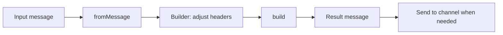
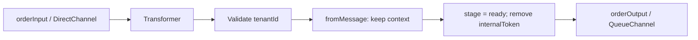

# MessageBuilder.fromMessage

## Objectives and Scope

In the `SPRING_INTEGRATION_CORE` module, `MessageBuilder.fromMessage(...)` helps a processing step continue the message flow with the existing payload and adjusted metadata. This is a common operation when adding information for a router, marking processing results, or forwarding a message while keeping context from a gateway.

After this lesson, you can:

- Create a builder from a `Message<T>` and choose an appropriate way to update headers.
- Distinguish between keeping the payload as-is and creating a copy of the data inside the payload.
- Explain the behavior of `id`, `timestamp`, and the case where the builder returns the original message.
- Use the builder inside a Java DSL transformer, preserve required headers, and test the result.

The examples use `MessageBuilder` from **Spring Integration**:

```java
import org.springframework.integration.support.MessageBuilder;
import org.springframework.messaging.Message;
```

Spring Framework also has a class `org.springframework.messaging.support.MessageBuilder`. Both classes have many methods with the same names, but they are two different APIs; the examples below consistently use the class from Spring Integration. When your IDE automatically adds an import, check the package before using specialized APIs. [Spring Framework MessageBuilder Javadoc](https://docs.spring.io/spring-framework/docs/6.2.x/javadoc-api/org/springframework/messaging/support/MessageBuilder.html).

This lesson uses the Spring Integration 6.4 API line for illustration and does not require changing your project's dependency version. Notes about internal optimizations in `build()` are referenced against version 6.4.9 source code.

## 1. From a Message to a Builder

Method signature:

```java
public static <T> MessageBuilder<T> fromMessage(Message<T> message)
```

`T` is the payload type. With an input of `Message<String>`, the result is `MessageBuilder<String>`. You modify metadata on the builder and then call `build()` to obtain a `Message<String>`.

The builder's starting point is the payload and headers of the input message. The method does not send data to a channel and does not invoke the next endpoint. Nor does it execute routing rules, retries, or message aggregation on its own. [Spring Integration MessageBuilder Javadoc](https://docs.spring.io/spring-integration/docs/6.4.9/api/org/springframework/integration/support/MessageBuilder.html).



The reason a builder is needed is that the header structure of a standard message does not support direct modification:

```java
// Invalid with standard MessageHeaders:
input.getHeaders().put("stage", "validated");
```

The statement above throws `UnsupportedOperationException`. The builder provides a workspace to construct the result without mutating the header structure of `input`. The immutability of the message envelope does not make every object inside it immutable. [Message and MessageHeaders model](https://docs.spring.io/spring-integration/reference/6.4/message.html).

## 2. Example: Adding Status While Keeping Context

Suppose the system receives an order code. After validating it, you want to add a `stage` header and remove temporary information.

The snippet below is placed inside a method; the subsequent short examples also follow this presentation style.

```java
import org.springframework.integration.support.MessageBuilder;
import org.springframework.messaging.Message;

Message<String> input = MessageBuilder.withPayload("ORDER-2048")
        .setHeader("tenantId", "shop-hcm")
        .setHeader("traceId", "trace-2048")
        .setHeader("internalToken", "temporary-value")
        .build();

Message<String> output = MessageBuilder.fromMessage(input)
        .setHeader("stage", "validated")
        .removeHeader("internalToken")
        .build();

System.out.println(output.getPayload());                    // ORDER-2048
System.out.println(output.getHeaders().get("tenantId"));     // shop-hcm
System.out.println(output.getHeaders().get("traceId"));      // trace-2048
System.out.println(output.getHeaders().get("stage"));        // validated
System.out.println(output.getHeaders().get("internalToken"));// null

System.out.println(input.getHeaders().get("stage"));         // null
System.out.println(input.getHeaders().get("internalToken")); // temporary-value
System.out.println(input.getPayload() == output.getPayload());// true
```

The contract of this processing step is very specific:

| Component | Before Processing | After Processing |
| --- | --- | --- |
| Payload | `"ORDER-2048"` | Same payload object |
| `tenantId` | `shop-hcm` | Preserved |
| `traceId` | `trace-2048` | Preserved |
| `stage` | Not present | `validated` |
| `internalToken` | Present with value | No longer in result |
| Headers of `input` | Initial context | Unchanged by builder operations |

Removing `internalToken` is a rule for this example. In a real application, the list of headers to keep or remove must come from the contract of the next step.

## 3. Choosing a Header Update Operation

### 3.1. Overwrite or Only Set a Default

`setHeader(...)` expresses a decision by the current step. `setHeaderIfAbsent(...)` expresses a fallback value.

```java
Message<String> input = MessageBuilder.withPayload("ORDER-2048")
        .setHeader("region", "south")
        .build();

Message<String> output = MessageBuilder.fromMessage(input)
        .setHeaderIfAbsent("region", "unknown")
        .setHeaderIfAbsent("source", "order-api")
        .setHeader("stage", "validated")
        .build();

// region = south, source = order-api, stage = validated
```

For regular headers, `setHeader("name", null)` removes the `name` header. If the intent is explicit removal, `removeHeader("name")` makes the intent faster for readers to understand.

### 3.2. Merging a Group of Headers

You can pass default configuration or processing results into the builder via a `Map`:

```java
import java.util.Map;

Message<String> defaultsApplied = MessageBuilder.fromMessage(input)
        .copyHeadersIfAbsent(Map.of(
                "region", "unknown",
                "schemaVersion", 1))
        .build();

Message<String> regionOverridden = MessageBuilder.fromMessage(input)
        .copyHeaders(Map.of("region", "central"))
        .build();

// defaultsApplied: region = south, schemaVersion = 1
// regionOverridden: region = central
```

`copyHeadersIfAbsent` keeps existing values. `copyHeaders` can overwrite regular headers. Call order also makes a difference:

```java
Message<String> first = MessageBuilder.fromMessage(input)
        .setHeader("region", "north")
        .copyHeaders(Map.of("region", "central"))
        .build(); // region = central

Message<String> second = MessageBuilder.fromMessage(input)
        .copyHeaders(Map.of("region", "central"))
        .setHeader("region", "north")
        .build(); // region = north
```

Place the update operation that has final authority in a position that clearly expresses the policy. For example, if central configuration only provides defaults, use `copyHeadersIfAbsent` rather than relying on overwrite order.

### 3.3. Removing One or Multiple Headers

| Need | API | Example |
| --- | --- | --- |
| Add or replace a value | `setHeader` | `setHeader("stage", "ready")` |
| Fill in a missing value | `setHeaderIfAbsent` | `setHeaderIfAbsent("source", "api")` |
| Merge and allow overwriting | `copyHeaders` | `copyHeaders(overrides)` |
| Merge default values | `copyHeadersIfAbsent` | `copyHeadersIfAbsent(defaults)` |
| Remove an exact name | `removeHeader` | `removeHeader("internalToken")` |
| Remove by simple name pattern | `removeHeaders` | `removeHeaders("internal_*")` |

`removeHeaders` supports simple patterns such as `prefix*`, `*suffix`, `*part*`; this is not a regular expression API. The update rules above apply to writable headers; `id` and `timestamp` are managed by the framework. [Inherited API in BaseMessageBuilder](https://raw.githubusercontent.com/spring-projects/spring-integration/v6.4.9/spring-integration-core/src/main/java/org/springframework/integration/support/BaseMessageBuilder.java).

## 4. `build()`, Message Identity, and Creation Time

Do not interpret `fromMessage(input).build()` as "always allocates a different message."

In the default 6.4.9 implementation, `build()` can return `originalMessage` when the builder has not been modified and no headers need to be removed according to additional read-only configuration. Therefore:

```java
Message<String> input = MessageBuilder.withPayload("ORDER-2048").build();

Message<String> unchanged = MessageBuilder.fromMessage(input).build();

// With the default builder within this illustration:
System.out.println(unchanged == input); // true

Message<String> changed = MessageBuilder.fromMessage(input)
        .setHeader("stage", "validated")
        .build();

System.out.println(changed == input);   // false
```

This is an optimization of the cited implementation. Business contracts should check the expected payload and headers rather than requiring a new object in every case. [Branch returning originalMessage in build()](https://raw.githubusercontent.com/spring-projects/spring-integration/v6.4.9/spring-integration-core/src/main/java/org/springframework/integration/support/BaseMessageBuilder.java#L276-L296).

When the builder actually creates a new message under default behavior, `id` and `timestamp` are regenerated by the framework. When you receive the same old message back, they still belong to the old message. Two messages created close together can have the same millisecond timestamp value; do not use `new timestamp > old timestamp` to prove a new message was created. [Message ID and read-only headers](https://docs.spring.io/spring-integration/reference/message.html).

```java
import org.springframework.messaging.MessageHeaders;

Message<String> input = MessageBuilder.withPayload("ORDER-2048")
        .setHeader("orderId", "ORDER-2048")
        .setHeader("traceId", "trace-2048")
        .build();

Message<String> output = MessageBuilder.fromMessage(input)
        .setHeader("stage", "validated")
        .build();

System.out.println(input.getHeaders().getId());
System.out.println(output.getHeaders().getId()); // new id with default configuration
System.out.println(output.getHeaders().get("orderId")); // ORDER-2048
System.out.println(output.getHeaders().get("traceId")); // trace-2048

// Do not use setHeader(MessageHeaders.ID, ...) to keep the old id.
// Do not use setHeader(MessageHeaders.TIMESTAMP, ...) to set business time.
```

In the example's order design:

- `orderId` identifies the order across multiple steps.
- `traceId` links the steps of a processing run by application convention.
- `MessageHeaders.ID` identifies the message generated by the framework.
- A header such as `receivedAt` can store the business timestamp that needs to be preserved.

You can use a business key as input to a deduplication/idempotency mechanism. Simply copying `orderId` does not create that mechanism by itself.

## 5. Shallow Copying: Payload and Header Values Can Still Be Shared

The `fromMessage` source code passes `message.getPayload()` directly to the builder. It does not call clone, nor does it serialize and deserialize the payload. `null` input is also rejected. [fromMessage implementation](https://raw.githubusercontent.com/spring-projects/spring-integration/v6.4.9/spring-integration-core/src/main/java/org/springframework/integration/support/MessageBuilder.java).

Consider a payload and a header that are both mutable lists:

```java
import java.util.ArrayList;
import java.util.List;
import org.springframework.integration.support.MessageBuilder;
import org.springframework.messaging.Message;

List<String> items = new ArrayList<>(List.of("book"));
List<String> tags = new ArrayList<>(List.of("new"));

Message<List<String>> input = MessageBuilder.withPayload(items)
        .setHeader("tags", tags)
        .build();

Message<List<String>> output = MessageBuilder.fromMessage(input)
        .setHeader("stage", "checked")
        .build();

items.add("pen");
tags.add("reviewed");

System.out.println(output.getPayload());          // [book, pen]
System.out.println(output.getHeaders().get("tags"));// [new, reviewed]
System.out.println(input.getPayload() == output.getPayload()); // true
System.out.println(input.getHeaders().get("tags")
        == output.getHeaders().get("tags"));      // true
```

The builder separates header structure editing from the source message; it does not isolate all referenced objects. If two branches of a flow share `items`, one branch mutating the list can change the data observed by the other branch.

For the string list example, you can proactively create immutable data:

```java
Message<List<String>> isolated = MessageBuilder
        .withPayload(List.copyOf(input.getPayload()))
        .copyHeaders(input.getHeaders())
        .setHeader("tags", List.copyOf(tags))
        .setHeader("stage", "isolated")
        .build();
```

`List.copyOf` creates a list whose structure cannot be modified, though it does not deep-copy individual elements. The example above works well because the elements are `String`. If the elements are mutable business objects, you still need an appropriate copying strategy or immutable model.

Creating a local builder per processing step avoids sharing working state across multiple messages. If a stream-like payload can no longer be used after being read once, wrapping that same stream with `fromMessage` will not make the stream readable again.

## 6. When You Need to Replace the Payload

`fromMessage` fits when continuing to use the current payload. If you need to change the payload's value or type, start with `withPayload(newPayload)` and then choose which headers to inherit.

Example of converting a list of product SKUs into a string:

```java
import java.util.List;
import org.springframework.integration.support.MessageBuilder;
import org.springframework.messaging.Message;
import org.springframework.messaging.MessageHeaders;
import org.springframework.util.MimeTypeUtils;

Message<List<String>> input = MessageBuilder
        .withPayload(List.of("SKU-01", "SKU-02"))
        .setHeader("traceId", "trace-2048")
        .setHeader("schemaVersion", 1)
        .setHeader(MessageHeaders.CONTENT_TYPE, MimeTypeUtils.APPLICATION_JSON)
        .build();

String newPayload = String.join(",", input.getPayload());

Message<String> output = MessageBuilder.withPayload(newPayload)
        .copyHeaders(input.getHeaders())
        .setHeader(MessageHeaders.CONTENT_TYPE, MimeTypeUtils.TEXT_PLAIN)
        .setHeader("schemaVersion", 2)
        .build();

// Payload: SKU-01,SKU-02
// traceId is preserved; contentType and schemaVersion match the new data format.
```

This example explicitly changes the type from `Message<List<String>>` to `Message<String>`. It also shows why inheriting headers requires checking their meaning: `contentType` describes the payload format, while `schemaVersion` in the example describes the data contract.

If the new payload represents an independent business event, re-evaluate the header list instead of carrying the entire context of the previous request into the new event by default. Copy methods do not replace that design decision.

| Scenario | How to Start |
| --- | --- |
| Same payload, add validation result | `fromMessage(input)` |
| Same payload, remove temporary header | `fromMessage(input)` |
| Normalize payload into a different value | `withPayload(normalized)` then select headers |
| Convert to a new DTO | `withPayload(dto)` then select headers |
| Forward message to another channel unchanged | Send the existing message |
| Need independent data for a processing branch | Copy the data according to the business model, then build the message |

## 7. Preserving Context When Connecting Endpoints

Headers are not just for logging. Some headers affect how the flow continues to behave.

| Context | What to Consider When Building the Result |
| --- | --- |
| Gateway awaiting a reply | Keep `replyChannel` if downstream steps rely on that reply address |
| Flow-configured error handling | Keep `errorChannel` when it belongs to the current handling policy |
| Router based on business header | Keep the exact type and value of the header the router reads |
| Filter based on metadata | Clarify how changing a header affects the filter condition |
| Splitter and aggregator | Keep correlation and sequence metadata if the message still belongs to the same group |
| Application activity tracking | Keep the agreed-upon tracking key, such as `traceId` in the example |

`replyChannel` and `errorChannel` can contain a channel name or a channel object. Spring Integration's grouping metadata uses constants such as `IntegrationMessageHeaderAccessor.CORRELATION_ID`, `SEQUENCE_NUMBER`, and `SEQUENCE_SIZE`. Use the proper constants when working with these built-in headers. [Standard Spring Integration headers](https://docs.spring.io/spring-integration/reference/6.4/message.html).

A custom name like `traceId` does not automatically become an aggregator correlation key. Conversely, if you remove grouping metadata from messages traveling between a splitter and an aggregator, you can lose the information needed by the aggregation rule.

For a transformer that returns a full `Message`, application code is responsible for the resulting message, including any required headers. Transformers that only return a payload follow different header propagation rules. Therefore, using `fromMessage` clearly expresses the intent to inherit context when you construct the entire output message yourself. [Transformer header rules](https://docs.spring.io/spring-integration/reference/7.0/message.html).

The following two choices illustrate two different contracts:

```java
// Create a message using only the payload and newly specified headers:
Message<?> fresh = MessageBuilder.withPayload(input.getPayload())
        .setHeader("stage", "validated")
        .build();

// Continue the current message's context and then adjust headers:
Message<?> continued = MessageBuilder.fromMessage(input)
        .setHeader("stage", "validated")
        .build();
```

In the first option, `replyChannel`, `errorChannel`, and the business headers of `input` are not included by this code. If a transformer directly returns `fresh`, do not assume the framework will always re-add all the headers you omitted.

## 8. Practicing in Java DSL

### 8.1. Complete Flow

The following flow receives an order code, checks that `tenantId` is present, adds a default source, sets the ready status, and removes the temporary token.



The example requires `spring-integration-core` along with compatible Spring dependencies managed by the project. Java DSL uses `.transform(...)` to declare a message-transforming endpoint. [Transformers in Java DSL](https://docs.spring.io/spring-integration/reference/6.4/dsl/java-transformers.html).

Save the following class to `OrderFlowConfig.java` in the example's package:

```java
import org.springframework.context.annotation.Bean;
import org.springframework.context.annotation.Configuration;
import org.springframework.integration.channel.DirectChannel;
import org.springframework.integration.channel.QueueChannel;
import org.springframework.integration.config.EnableIntegration;
import org.springframework.integration.dsl.IntegrationFlow;
import org.springframework.integration.support.MessageBuilder;
import org.springframework.integration.transformer.Transformer;

@Configuration
@EnableIntegration
public class OrderFlowConfig {

    @Bean
    public DirectChannel orderInput() {
        return new DirectChannel();
    }

    @Bean
    public QueueChannel orderOutput() {
        return new QueueChannel();
    }

    @Bean
    public IntegrationFlow orderFlow() {
        return IntegrationFlow.from("orderInput")
                .transform((Transformer) message -> {
                    String tenantId = message.getHeaders()
                            .get("tenantId", String.class);

                    if (tenantId == null || tenantId.isBlank()) {
                        throw new IllegalArgumentException(
                                "tenantId must be provided");
                    }

                    return MessageBuilder.fromMessage(message)
                            .setHeaderIfAbsent("source", "order-api")
                            .setHeader("stage", "ready")
                            .removeHeader("internalToken")
                            .build();
                })
                .channel("orderOutput")
                .get();
    }
}
```

The `Transformer` type is specified explicitly so that the lambda receives the entire `Message<?>`. This also makes clear that the step returns a complete message.

The builder only constructs the result inside the lambda. The transformer endpoint receives the result and sends it to `orderOutput` according to the flow configuration.

### 8.2. Expected Behavior

With input:

```text
payload       = ORDER-2048
tenantId      = shop-hcm
traceId       = trace-2048
source        = partner-api
internalToken = temporary-value
```

The result should have:

```text
payload       = ORDER-2048
tenantId      = shop-hcm
traceId       = trace-2048
source        = partner-api
stage         = ready
internalToken = absent
```

`source` keeps the value `partner-api` because the flow uses `setHeaderIfAbsent`. If the business requirement is that every message passing through this step must carry `source = order-api`, replace it with `setHeader` and update the expectation accordingly.

The example uses a transformer to observe how a complete message is built. When the requirement is simply to add or remove headers, Header Enricher and Header Filter endpoints are also suitable choices for expressing metadata operations directly.

### 8.3. When Input Is Invalid

If `tenantId` is missing, the transformer throws an exception before building the result. Do not return `null` to represent discarding a message: a transformer should return a valid result; selecting or discarding messages is the role of a filter. [Transformer contract](https://docs.spring.io/spring-integration/reference/6.4/transformer.html).

This flow starts with a `DirectChannel`, so processing runs on the sending thread. Processing exceptions can propagate back to the caller as a messaging exception wrapping the underlying cause. Having an `errorChannel` header alone does not automatically turn every synchronous error into an error message sent to that channel; an appropriate error-handling mechanism is required at the gateway, endpoint, or asynchronous boundary. [Error handling by thread and channel](https://docs.spring.io/spring-integration/reference/6.4/error-handling.html).

`fromMessage` preserves context as a builder operation; it does not replace the flow's exception-handling policy.

## 9. Testing Against the Output Contract

The tests below illustrate what should be verified. Place them in the test source of a project that already has JUnit Jupiter and Spring Integration; `OrderFlowConfig` is in the same package as the flow test class.

### 9.1. Testing Builder Operations Independently

```java
import org.junit.jupiter.api.Test;
import org.springframework.integration.channel.QueueChannel;
import org.springframework.integration.support.MessageBuilder;
import org.springframework.messaging.Message;

import static org.junit.jupiter.api.Assertions.assertEquals;
import static org.junit.jupiter.api.Assertions.assertFalse;
import static org.junit.jupiter.api.Assertions.assertSame;
import static org.junit.jupiter.api.Assertions.assertTrue;

class MessageBuilderFromMessageTest {

    @Test
    void shouldKeepContextAndLeaveInputHeadersUnchanged() {
        QueueChannel replies = new QueueChannel();
        QueueChannel errors = new QueueChannel();

        Message<String> input = MessageBuilder.withPayload("ORDER-2048")
                .setHeader("tenantId", "shop-hcm")
                .setHeader("traceId", "trace-2048")
                .setHeader("internalToken", "temporary-value")
                .setReplyChannel(replies)
                .setErrorChannel(errors)
                .build();

        Message<String> output = MessageBuilder.fromMessage(input)
                .setHeader("stage", "validated")
                .removeHeader("internalToken")
                .build();

        assertSame(input.getPayload(), output.getPayload());
        assertEquals("shop-hcm", output.getHeaders().get("tenantId"));
        assertEquals("trace-2048", output.getHeaders().get("traceId"));
        assertEquals("validated", output.getHeaders().get("stage"));
        assertSame(replies, output.getHeaders().getReplyChannel());
        assertSame(errors, output.getHeaders().getErrorChannel());
        assertFalse(output.getHeaders().containsKey("internalToken"));

        assertFalse(input.getHeaders().containsKey("stage"));
        assertTrue(input.getHeaders().containsKey("internalToken"));
    }

    @Test
    void shouldKeepExistingValueWhenApplyingDefault() {
        Message<String> input = MessageBuilder.withPayload("ORDER-2048")
                .setHeader("source", "partner-api")
                .build();

        Message<String> output = MessageBuilder.fromMessage(input)
                .setHeaderIfAbsent("source", "order-api")
                .setHeaderIfAbsent("schemaVersion", 1)
                .build();

        assertEquals("partner-api", output.getHeaders().get("source"));
        assertEquals(1, output.getHeaders().get("schemaVersion"));
    }
}
```

These tests verify both sides of the contract: the output receives the changes, and the source headers retain their original state. `assertSame` on the payload confirms reference reuse; it does not prove that the payload is an immutable object.

### 9.2. Testing a Message Traveling Through the Entire Flow

```java
import org.junit.jupiter.api.Test;
import org.springframework.context.annotation.AnnotationConfigApplicationContext;
import org.springframework.integration.channel.DirectChannel;
import org.springframework.integration.channel.QueueChannel;
import org.springframework.integration.support.MessageBuilder;
import org.springframework.messaging.Message;

import static org.junit.jupiter.api.Assertions.assertEquals;
import static org.junit.jupiter.api.Assertions.assertFalse;
import static org.junit.jupiter.api.Assertions.assertNotNull;
import static org.junit.jupiter.api.Assertions.assertSame;
import static org.junit.jupiter.api.Assertions.assertTrue;

class OrderFlowTest {

    @Test
    void shouldEnrichAndForwardOrder() {
        try (AnnotationConfigApplicationContext context =
                     new AnnotationConfigApplicationContext(OrderFlowConfig.class)) {

            DirectChannel input = context.getBean(
                    "orderInput", DirectChannel.class);
            QueueChannel output = context.getBean(
                    "orderOutput", QueueChannel.class);

            Message<String> request = MessageBuilder.withPayload("ORDER-2048")
                    .setHeader("tenantId", "shop-hcm")
                    .setHeader("traceId", "trace-2048")
                    .setHeader("source", "partner-api")
                    .setHeader("internalToken", "temporary-value")
                    .build();

            assertTrue(input.send(request));

            Message<?> result = output.receive(1_000);
            assertNotNull(result);
            assertSame(request.getPayload(), result.getPayload());
            assertEquals("shop-hcm", result.getHeaders().get("tenantId"));
            assertEquals("trace-2048", result.getHeaders().get("traceId"));
            assertEquals("partner-api", result.getHeaders().get("source"));
            assertEquals("ready", result.getHeaders().get("stage"));
            assertFalse(result.getHeaders().containsKey("internalToken"));

            assertFalse(request.getHeaders().containsKey("stage"));
            assertTrue(request.getHeaders().containsKey("internalToken"));
        }
    }
}
```

A bounded wait time in `receive(1_000)` ensures the test finishes if the flow produces no output. This test traverses the input channel, endpoint, and output channel, so it can catch configuration errors that standalone builder tests do not cover.

When extending the flow, add cases matching the new contract: missing `tenantId`, absent `source`, existing `stage`, or a header with an incorrect data type. For error branches, verify the exception cause or error channel according to the actual configuration; do not assume a single expectation applies to all channel types.

## 10. Common Mistakes

| Symptom | Possible Cause | How to Fix |
| --- | --- | --- |
| `UnsupportedOperationException` when adding a header | Mutating `MessageHeaders` directly | Use the builder and obtain the message from `build()` |
| Changes do not appear in the flow | Calling the builder but ignoring its result | Return or send the built message |
| Default value does not replace the old value | Using `setHeaderIfAbsent` | Choose `setHeader` if the current step is allowed to overwrite |
| Header is unexpectedly replaced | `copyHeaders` runs after an explicit set call | Choose an explicit order or use the IfAbsent variant |
| Another branch sees the payload list change | Multiple messages reference the same mutable data | Use immutable data or copy according to the model |
| Reply context is lost | Creating a message solely with `withPayload` | Inherit or re-specify the required headers |
| Want to change payload type but still use `fromMessage` | Confusing inheriting a message with replacing data | Use `withPayload` and select headers |
| Newer-timestamp check is flaky | Two creations occur within the same millisecond | Check content or an appropriate identifier |
| Aggregator does not group properly | Correlation metadata is no longer valid after building the message | Check the grouping contract and related headers |
| Errors do not reach the channel as expected | Equating keeping `errorChannel` with enforcing an error policy | Inspect thread boundaries and endpoint error-handling configuration |

An easily overlooked mistake is building the result but continuing to return the source message:

```java
// Wrong for the requirement to add stage:
MessageBuilder.fromMessage(input)
        .setHeader("stage", "validated")
        .build();
return input;
```

You must return the built result itself:

```java
return MessageBuilder.fromMessage(input)
        .setHeader("stage", "validated")
        .build();
```

## 11. Workflow for Applying to a Processing Step

1. Determine whether the payload keeps both its value and its type.
2. List the headers needed by downstream steps and headers belonging to reply, error, or message-grouping context.
3. Choose `fromMessage` if continuing with the current payload; choose `withPayload` when constructing a different payload.
4. Explicitly state the policy for each header: overwrite, only fill defaults, or remove.
5. Return or send the result from `build()`.
6. Verify the output, the source headers, and the behavior of the entire flow at channel boundaries.

For the order problem, a contract can be stated concisely as: "Keep the payload, tenant, and tracking key; set `stage = ready`; keep the existing source; remove the temporary token; forward the result to the next channel." From this contract, API selection and test assertions become concrete.
