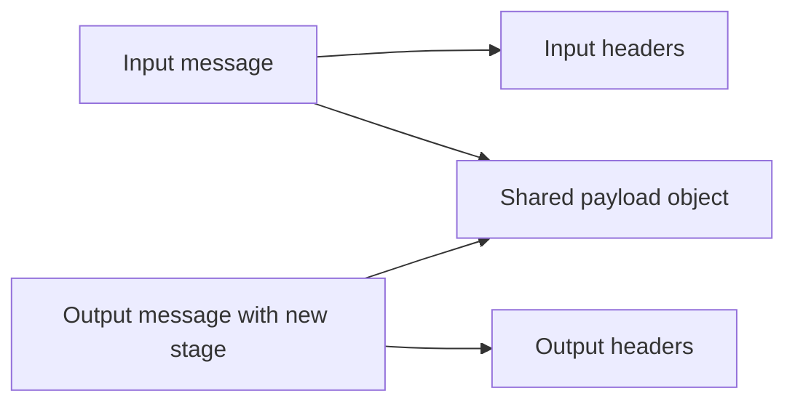

# Copying Payloads and Headers

In the **MessageBuilder** chapter of **SPRING_INTEGRATION_CORE**, copying payloads and headers lets a processing step produce an output message while maintaining the flow's context. For example, a transformer converts a raw order code string into a business object, a router reads headers to pick a branch, and a gateway needs metadata to route replies back to the right place.

This lesson focuses on choosing which data to retain when constructing a `Message`: keeping the payload, replacing the payload, resolving header name collisions, and avoiding unintended sharing of mutable data. These scenarios connect with transformers, channels, aggregators, and error handling in an integration flow.

## 1. Objectives and Example Conventions

After this lesson, you can:

- Use `fromMessage` when keeping the payload and modifying the context.
- Use `withPayload` combined with `copyHeaders` or `copyHeadersIfAbsent` when replacing the payload.
- Explain which header value wins when there is a conflict.
- Distinguish copying the message structure from deep-copying objects.
- Preserve the metadata needed by downstream steps and verify results at the flow's output.

The examples use Java 17 or later, the `spring-integration-core` library, and Spring Integration's builder:

```java
import org.springframework.integration.support.MessageBuilder;
import org.springframework.messaging.Message;
import org.springframework.messaging.MessageHeaders;
```

Spring Framework also has a class `org.springframework.messaging.support.MessageBuilder`. Both classes share the same simple name; when reading or copying examples, check the `import` lines. All builders in this lesson belong to `org.springframework.integration.support`. See [Spring Integration MessageBuilder API](https://docs.spring.io/spring-integration/api/org/springframework/integration/support/MessageBuilder.html).

The short code snippets in Sections 2–7 are placed inside a method body. Snippets using the `incoming` variable build on the sample message in Section 2; the Java DSL section later on has its own complete configuration.

## 2. What Does Copying a Message Actually Copy?

A message has two parts:

| Component | Role | Question When Creating Output |
| --- | --- | --- |
| Payload | Business data | Keep the same object or produce a new result? |
| Headers | Processing context | Which headers are still valid, need replacing, or need removing? |

Create an input message:

```java
Message<String> incoming = MessageBuilder
        .withPayload("  ORD-204  ")
        .setHeader("tenantId", "hcm")
        .setCorrelationId("flow-204")
        .setHeader(MessageHeaders.CONTENT_TYPE, "text/plain")
        .build();
```

Here, the whitespace-padded string is the payload. `tenantId` identifies the business unit, `correlationId` links steps within the same request, and `contentType` describes the current data format.

For a standard message created by this builder, do not mutate the header map directly:

```java
// Wrong approach: MessageHeaders does not allow direct update operations.
incoming.getHeaders().put("stage", "validated");
```

The statement above throws `UnsupportedOperationException`. Make changes through the builder and obtain the resulting `Message`. Map immutability rules are described in [MessageHeaders API](https://docs.spring.io/spring-framework/docs/current/javadoc-api/org/springframework/messaging/MessageHeaders.html).

However, a map that disallows `put` does not mean every object inside it is immutable. If the payload is an `ArrayList`, or a header holds a `HashMap`, that object can still be mutated through its reference. This distinction must be made before sharing a message across multiple consumers.

## 3. Keeping the Payload: Using `fromMessage`

When you only need to add or replace headers, start from the existing message:

```java
Message<String> validated = MessageBuilder
        .fromMessage(incoming)
        .setHeader("stage", "validated")
        .build();

// validated.getPayload() is still "  ORD-204  "
// validated.getHeaders().get("tenantId") is still "hcm"
// validated.getHeaders().get("stage") is "validated"
// incoming.getHeaders().get("stage") is still null
```

You have added context to the output without adding the header to the input message. The payload is still the object retrieved from `incoming`; `fromMessage` does not normalize strings, convert DTOs, or clone business data on its own.

When there are no changes:

```java
Message<String> result = MessageBuilder
        .fromMessage(incoming)
        .build();
```

Do not use `result != incoming` to assert that a copy succeeded. The builder may return the exact original message when creating a new one is unnecessary; this behavior also depends on read-only header policies. Verify the contents and output contract instead. See [BaseMessageBuilder.build()](https://docs.spring.io/spring-integration/api/org/springframework/integration/support/BaseMessageBuilder.html#build()).

### Reference Model When Changing Only Headers



In the example that adds `stage`, the output context changes, but the payload has not been deep-copied. If the payload is a mutable object, both messages can still observe mutations to that object.

## 4. Replacing the Payload: Using `withPayload` and Copying Headers

`fromMessage` fits when continuing to use the old payload. Once you have produced new data, start with `withPayload(newPayload)` and select which headers to carry forward.

```java
String normalizedOrderId = incoming.getPayload().trim();

Message<String> normalized = MessageBuilder
        .withPayload(normalizedOrderId)
        .copyHeaders(incoming.getHeaders())
        .setHeader("stage", "normalized")
        .build();

// normalized.getPayload() is "ORD-204"
// normalized.getHeaders().get("tenantId") is "hcm"
// incoming.getPayload() is still "  ORD-204  "
```

The output payload is determined by `trim()`. `copyHeaders` only operates on headers and does not inspect the payload content to convert data automatically.

The payload type can also change. The following snippet is a standalone example:

```java
Message<String> rawQuantity = MessageBuilder
        .withPayload("12")
        .setHeader("orderId", "ORD-204")
        .setHeader(MessageHeaders.CONTENT_TYPE, "text/plain")
        .build();

int quantity = Integer.parseInt(rawQuantity.getPayload());

Message<Integer> parsedQuantity = MessageBuilder
        .withPayload(quantity)
        .copyHeaders(rawQuantity.getHeaders())
        .removeHeader(MessageHeaders.CONTENT_TYPE)
        .setHeader("payloadType", "quantity")
        .build();
```

The output has type `Message<Integer>`. The `orderId` header is still useful, so it is kept; `contentType=text/plain` is removed because the example is no longer forwarding the original string payload. `payloadType` is an application-defined header, not a Spring type-conversion mechanism.

If `Integer.parseInt` fails, that is a data conversion error. Copying headers does not replace validation or endpoint error-handling configuration.

## 5. Choosing Header Overwrite Rules

Both copy methods take a `Map<String, ?>`, but they follow different rules when the builder already has a value:

| Operation | Builder Already Has Header with Same Name | Common Purpose |
| --- | --- | --- |
| `copyHeaders(source)` | Source value overwrites existing value, except protected headers | Source supplies higher-priority metadata |
| `copyHeadersIfAbsent(source)` | Keeps existing value | Source only fills in missing entries |
| `setHeader(name, value)` | Replaces existing value if header is writable | Apply a specific rule for one header |
| `setHeaderIfAbsent(name, value)` | Keeps existing value | Provide a default value |

Copy rules and exceptions for system headers are documented in [BaseMessageBuilder copy methods API](https://docs.spring.io/spring-integration/api/org/springframework/integration/support/BaseMessageBuilder.html#copyHeaders(java.util.Map)).

### 5.1. `copyHeaders`: Source Overwrites

```java
Message<String> source = MessageBuilder
        .withPayload("ORD-204")
        .setHeader("region", "south")
        .build();

Message<String> copied = MessageBuilder
        .withPayload("processed")
        .setHeader("region", "north")
        .copyHeaders(source.getHeaders())
        .build();

// copied.getHeaders().get("region") is "south"
```

The builder has `region=north` first, but the subsequent copy operation brings in `region=south` and replaces the value.

### 5.2. `copyHeadersIfAbsent`: Builder Retains Priority

Continuing with `source` from the example above:

```java
Message<String> kept = MessageBuilder
        .withPayload("processed")
        .setHeader("region", "north")
        .copyHeadersIfAbsent(source.getHeaders())
        .build();

// kept.getHeaders().get("region") is "north"
```

This approach fits when the current step has already determined the processing region, while source headers only supplement missing context.

### 5.3. Operation Order Expresses Policy

If you want to bring in all headers first and then apply the values computed by the current step:

```java
Message<String> output = MessageBuilder
        .withPayload("processed")
        .copyHeaders(source.getHeaders())
        .setHeader("region", "central")
        .setHeaderIfAbsent("retryLimit", 3)
        .build();

// region is "central"; retryLimit is 3 if the source did not already provide a value.
```

For regular non-null header values, the overwriting operation called later determines the result. During code review, read the builder chain in exact order rather than merely checking whether `copyHeaders` was called.

This is also why default configuration needs a clear policy: should a `retryLimit` supplied by the input take precedence over the service default? `setHeaderIfAbsent` answers yes; `setHeader` lets the current step override it.

## 6. System Headers and Business Identifiers

Do not treat every header as data that can be copied verbatim.

| Header | Meaning When Designing a Flow |
| --- | --- |
| `MessageHeaders.ID` | Message identifier, managed by the framework |
| `MessageHeaders.TIMESTAMP` | Timestamp attached to the message by the header creation mechanism |
| `correlationId` | Links messages belonging to a processing context |
| `orderId`, `requestId` | Identifiers defined by the application |

By default, `id` and `timestamp` are read-only headers. Copy operations do not use source values to overwrite them. When the builder actually creates a new message under default behavior, the framework assigns an ID and timestamp to that message. When the builder reuses an unchanged message, those values may remain unchanged. See [Message: Read-only Headers](https://docs.spring.io/spring-integration/reference/message.html#message-headers-read-only).

Do not assert `newTimestamp > oldTimestamp`: two messages can be created within the same millisecond. Likewise, do not use the message ID as a stable order code across all steps.

If you need to track a request across a chain of transformations, design a dedicated business or correlation header:

```java
Message<String> tracked = MessageBuilder
        .withPayload("ORD-204")
        .setHeader("requestId", "req-204")
        .setCorrelationId("flow-204")
        .build();
```

An application can configure additional read-only headers via the builder or `MessageBuilderFactory`. Therefore, the precedence table in the previous section applies to modifiable headers; do not use `copyHeaders` to bypass that policy.

## 7. Shallow Copy and Mutable Data

Consider a payload and a header value that are both mutable lists:

```java
import java.util.ArrayList;
import java.util.List;

List<String> items = new ArrayList<>(List.of("book"));
List<String> tags = new ArrayList<>(List.of("new"));

Message<List<String>> original = MessageBuilder
        .withPayload(items)
        .setHeader("tags", tags)
        .build();

Message<List<String>> branch = MessageBuilder
        .fromMessage(original)
        .setHeader("branch", "shipping")
        .build();

items.add("pen");
tags.add("priority");

// Both original and branch see payload ["book", "pen"].
// Both "tags" headers reference the list ["new", "priority"].
```

The builder does not provide a general-purpose deep copy for arbitrary object graphs. The fact that multiple consumers can share references to the payload or header values is explained in [MessageBuilder Helper Class](https://docs.spring.io/spring-integration/reference/7.0/message.html#message-builder).

In a `PublishSubscribeChannel`, if the shipping branch appends an item to the shared payload, the invoicing branch may read modified data. Whether dispatching is synchronous or runs via an executor, the business meaning of the two branches can get mixed up.

If you want the output to contain a snapshot of the two lists above:

```java
Message<List<String>> snapshot = MessageBuilder
        .withPayload(List.copyOf(items))
        .copyHeaders(original.getHeaders())
        .setHeader("tags", List.copyOf(tags))
        .build();
```

`List.copyOf` creates a list that disallows structural modification; it does not clone individual elements. With `String`, elements are already immutable. If elements are mutable `OrderLine` objects with setters, you must copy each `OrderLine` or use an immutable data model.

Similarly, a record is only immutable at the level of its reference fields: a record holding a mutable `List` can still observe mutations to that list. Decide data ownership where the payload is constructed.

## 8. Selecting Headers at Processing Boundaries

Keeping all headers is often convenient when continuing within the same internal flow. When transitioning to a new event or communicating with another system, review the meaning of each header.

| Context | Headers to Review | Reason |
| --- | --- | --- |
| Continuing the same request through a gateway | `replyChannel`, `errorChannel` | May determine where replies or errors are routed |
| Splitter then aggregator | `correlationId`, `sequenceNumber`, `sequenceSize` | Supports the configured grouping strategy and release condition |
| Changing payload format | `contentType` | Old metadata may no longer accurately describe the data |
| Producing an event for an external system | Protocol headers and internal information | Only emit data belonging to the event contract |
| Switching tenant or processing region | `tenantId`, `region` | Must be decided based on verified context |

The example below assumes the application is creating an **independent one-way event**; it is not a direct reply step for a gateway:

```java
Message<String> event = MessageBuilder
        .withPayload("OrderAccepted:ORD-204")
        .setHeader("eventType", "OrderAccepted")
        .setHeader("orderId", "ORD-204")
        .setHeader("requestId", "req-204")
        .build();
```

Constructing from selected headers makes the output contract explicit. Sending over HTTP, Kafka, or AMQP also depends on adapters and header mappers; an in-memory map copy does not guarantee every header is transmitted verbatim over the wire.

If you still need to copy most internal metadata and then drop a few regular headers:

```java
Message<String> internalResult = MessageBuilder
        .withPayload("ORD-204")
        .copyHeaders(incoming.getHeaders())
        .removeHeader("temporaryLookup")
        .removeHeaders("debug_*")
        .build();
```

Place removal operations after copy operations so excluded headers are not brought back in. In a request–reply flow, removing `replyChannel` must go hand in hand with an appropriate reply-path design. With splitters/aggregators, also understand the grouping strategy before removing correlation or sequence headers.

## 9. Applying in Transformers and Java DSL

A transformer can return a payload or return an entire `Message`. When returning a full message, the transformer code is responsible for the output header set; when returning only a payload, the framework normally propagates input headers according to endpoint rules. Do not generalize this transformer behavior to every endpoint. See [Message: Header Propagation](https://docs.spring.io/spring-integration/reference/message.html#message-header-propagation).

The hands-on example below takes an order code string, normalizes it into an `OrderCommand`, preserves the input context, and removes the old `contentType`:

```java
import org.springframework.context.annotation.Bean;
import org.springframework.context.annotation.Configuration;
import org.springframework.integration.config.EnableIntegration;
import org.springframework.integration.channel.DirectChannel;
import org.springframework.integration.channel.QueueChannel;
import org.springframework.integration.dsl.IntegrationFlow;
import org.springframework.integration.support.MessageBuilder;
import org.springframework.messaging.Message;
import org.springframework.messaging.MessageChannel;
import org.springframework.messaging.MessageHeaders;

@Configuration
@EnableIntegration
public class OrderFlowConfiguration {

    public record OrderCommand(String orderId) {
    }

    public static class OrderNormalizer {

        public Message<OrderCommand> normalize(Message<String> incoming) {
            String orderId = incoming.getPayload().trim();

            if (orderId.isEmpty()) {
                throw new IllegalArgumentException("orderId must not be blank");
            }

            OrderCommand command = new OrderCommand(orderId);

            return MessageBuilder
                    .withPayload(command)
                    .copyHeaders(incoming.getHeaders())
                    .removeHeader(MessageHeaders.CONTENT_TYPE)
                    .setHeader("stage", "normalized")
                    .build();
        }
    }

    @Bean
    public MessageChannel orderInput() {
        return new DirectChannel();
    }

    @Bean
    public QueueChannel normalizedOrders() {
        return new QueueChannel();
    }

    @Bean
    public OrderNormalizer orderNormalizer() {
        return new OrderNormalizer();
    }

    @Bean
    public IntegrationFlow orderFlow(OrderNormalizer orderNormalizer) {
        return IntegrationFlow.from("orderInput")
                .transform(orderNormalizer, "normalize")
                .channel("normalizedOrders")
                .get();
    }
}
```

Here, the transformer invokes a method accepting `Message<String>` so it has access to both payload and headers. The output is a `Message<OrderCommand>` built by the method itself. `tenantId` and `correlationId` are copied; `stage` is set by the current step after copying.

The flow ends at a `QueueChannel` so the output message can be observed. The methods connecting channels and transformers belong to [Java DSL BaseIntegrationFlowDefinition API](https://docs.spring.io/spring-integration/api/org/springframework/integration/dsl/BaseIntegrationFlowDefinition.html).

`DirectChannel` executes processing synchronously in this configuration. If the order code is blank, the error is returned to the caller of `send` via the endpoint's exception mechanism. Simply copying `errorChannel` does not automatically turn this synchronous flow into an asynchronous error-handling flow.

## 10. Illustrative Output Contract Testing

When testing data copying, useful assertions are: the payload changed as expected, required headers are present, headers that no longer apply were removed, and the input message was not modified.

The JUnit Jupiter snippet below uses the configuration from Section 9, placed in the same package as `OrderFlowConfiguration`. The project needs JUnit Jupiter on the test classpath.

```java
import org.junit.jupiter.api.Test;
import org.springframework.context.annotation.AnnotationConfigApplicationContext;
import org.springframework.integration.channel.QueueChannel;
import org.springframework.integration.support.MessageBuilder;
import org.springframework.messaging.Message;
import org.springframework.messaging.MessageChannel;
import org.springframework.messaging.MessageHeaders;

import static org.junit.jupiter.api.Assertions.*;

class OrderFlowConfigurationTest {

    @Test
    void normalizesPayloadAndPreservesRequiredContext() {
        try (var context = new AnnotationConfigApplicationContext(
                OrderFlowConfiguration.class)) {

            MessageChannel input = context.getBean(
                    "orderInput", MessageChannel.class);
            QueueChannel output = context.getBean(
                    "normalizedOrders", QueueChannel.class);

            Message<String> incoming = MessageBuilder
                    .withPayload("  ORD-204  ")
                    .setHeader("tenantId", "hcm")
                    .setCorrelationId("flow-204")
                    .setHeader(MessageHeaders.CONTENT_TYPE, "text/plain")
                    .build();

            assertTrue(input.send(incoming));

            Message<?> result = output.receive(1000);
            assertNotNull(result);

            assertEquals(
                    new OrderFlowConfiguration.OrderCommand("ORD-204"),
                    result.getPayload());
            assertEquals("hcm", result.getHeaders().get("tenantId"));
            assertEquals("flow-204", result.getHeaders().get("correlationId"));
            assertEquals("normalized", result.getHeaders().get("stage"));
            assertNull(result.getHeaders().get(MessageHeaders.CONTENT_TYPE));

            assertEquals("  ORD-204  ", incoming.getPayload());
            assertEquals("text/plain",
                    incoming.getHeaders().get(MessageHeaders.CONTENT_TYPE));
            assertNull(incoming.getHeaders().get("stage"));

            assertNotEquals(
                    incoming.getHeaders().getId(),
                    result.getHeaders().getId());
        }
    }
}
```

Checking for distinct IDs is appropriate in this example because the payload changed and a new message was created by the default builder. Do not apply that assertion to the case where `fromMessage(incoming).build()` makes no changes to the data.

If the business payload contains mutable collections, add a test case that modifies the source collection after building the output to verify the application's snapshot policy. That is a separate behavior to guarantee; checking that two messages have equal values right at creation time does not prove the data is isolated.

## 11. Common Mistakes and How to Choose Operations

| Symptom | Possible Cause | Adjustment |
| --- | --- | --- |
| Business context lost after changing payload | Only called `withPayload` | Copy or re-select headers belonging to the contract |
| Newly set value reverts to the old value | `copyHeaders` ran after `setHeader` | Set authoritative values after copying, or use `copyHeadersIfAbsent` |
| Two branches both see mutated data | Mutable payload or header still shares a reference | Use immutable data or copy according to the business structure |
| Modifying a header throws an exception | Calling `put` or `remove` directly on `MessageHeaders` | Build the output via the builder |
| Transformer returns a Message but misses headers | Builder code did not preserve enough context | Construct the output header set explicitly |
| Aggregator groups incorrectly or never completes | Grouping/sequence metadata lost or semantically invalid | Check the correlation and release strategies in use |
| Cannot reply to gateway | Reply path no longer has enough information | Check the output channel and `replyChannel` in flow context |
| Metadata misdescribes payload | Copied headers tied to the previous representation | Update or remove those headers after conversion |

When writing a step that produces output, decide in order: whether the payload should be kept or replaced, which objects are allowed to be shared, which headers remain valid, and which source takes priority on name collisions. From those decisions, choose `fromMessage`, `withPayload`, the copy method, and the corresponding set/remove header operations.
