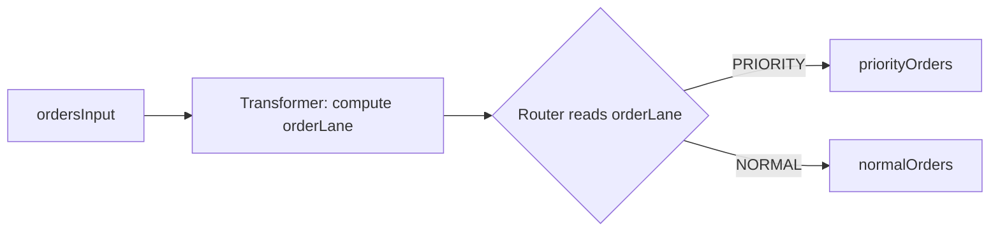

# MessageBuilder: setHeader

In the `SPRING_INTEGRATION_CORE` module, `MessageBuilder` helps construct messages carrying business data along with metadata so endpoints can coordinate processing. This lesson focuses on `setHeader`: adding or replacing a header value, removing a header with `null`, and using the result in a Spring Integration flow.

After this lesson, you can choose the right way to enrich metadata while preserving the input message, distinguish `setHeader` from `setHeaderIfAbsent`, and verify the headers that downstream routers or endpoints actually receive.

## 1. What Problem Do Headers Solve?

Suppose the system receives an order. The payload contains the order code and total amount; the integration flow also needs to know which source the order came from, which processing lane it belongs to, and which trace ID applies. This information used for transport, routing, or tracking can be placed in headers.

```text
Message<Order>
├── payload: Order("DH-004", 15000000)
└── headers
    ├── sourceSystem: "web"
    ├── orderLane: "PRIORITY"
    └── requestId: "req-004"
```

In this example, a router reads `orderLane`; the order-processing logic continues reading the payload. Simply setting a header does not create routing behavior: a component must be configured to consume it.

For standard messages created by `MessageBuilder`, use the builder to change the header set. Calling `message.getHeaders().put(...)` directly throws `UnsupportedOperationException`. This immutability applies to the header structure; an object stored as a header value can still be a mutable object. See [Message in Spring Integration](https://docs.spring.io/spring-integration/reference/message.html).

## 2. Syntax and Contract of `setHeader`

The examples use the Spring Integration builder:

```java
import org.springframework.integration.support.MessageBuilder;
import org.springframework.messaging.Message;
```

Spring Framework also has a class `org.springframework.messaging.support.MessageBuilder`. When reading examples or letting your IDE auto-import, check the package, especially when working with Integration-specific headers. This lesson consistently uses `org.springframework.integration.support.MessageBuilder`.

```java
Message<String> message = MessageBuilder
        .withPayload("DH-004")
        .setHeader("sourceSystem", "web")
        .setHeader("attempt", 1)
        .build();
```

`setHeader(headerName, headerValue)` accepts a `String` name, an `Object` value or `null`, and returns the builder to continue chaining calls. `build()` returns a `Message<T>` with the corresponding payload type. The contract for adding, overwriting, and removing headers is described in [AbstractIntegrationMessageBuilder.setHeader API](https://docs.spring.io/spring-integration/api/org/springframework/integration/support/AbstractIntegrationMessageBuilder.html#setHeader(java.lang.String,java.lang.Object)).

For a writable application header such as `orderLane`:

| State Before Call | Call | State After Call |
| --- | --- | --- |
| Header absent | `setHeader("orderLane", "NORMAL")` | Has value `"NORMAL"` |
| Currently `"NORMAL"` | `setHeader("orderLane", "PRIORITY")` | Value is replaced with `"PRIORITY"` |
| Currently `"NORMAL"` | `setHeader("orderLane", "NORMAL")` | Observed value remains `"NORMAL"` |
| Header present | `setHeader("orderLane", null)` | Header is removed |
| Header absent | `setHeader("orderLane", null)` | Header remains absent |

Multiple calls with the same name are applied in order:

```java
Message<String> result = MessageBuilder.withPayload("DH-004")
        .setHeader("orderLane", "NORMAL")
        .setHeader("orderLane", "PRIORITY")
        .build();

String lane = result.getHeaders().get("orderLane", String.class);
// lane has the value "PRIORITY".
```

Header naming conventions should be meaningful and consistent between sender and receiver. `orderLane` and `OrderLane` are two different keys. This is the application's metadata contract; shared key names can be grouped into constants to avoid typos.

## 3. Complete Example: Adding, Overwriting, and Removing

The example below uses Java 17 or later and assumes `spring-integration-core` and its corresponding dependencies are on the classpath. The program manipulates messages in memory without needing to start a Spring ApplicationContext.

```java
import org.springframework.integration.support.MessageBuilder;
import org.springframework.messaging.Message;

public class SetHeaderDemo {

    public static void main(String[] args) {
        Message<String> original = MessageBuilder.withPayload("DH-004")
                .setHeader("orderLane", "NORMAL")
                .setHeader("requestId", "req-004")
                .build();

        Message<String> enriched = MessageBuilder.fromMessage(original)
                .setHeader("orderLane", "PRIORITY")
                .setHeader("attempt", 1)
                .build();

        Message<String> cleaned = MessageBuilder.fromMessage(enriched)
                .setHeader("attempt", null)
                .build();

        System.out.println(original.getHeaders()
                .get("orderLane", String.class));
        System.out.println(enriched.getHeaders()
                .get("orderLane", String.class));
        System.out.println(enriched.getHeaders()
                .get("attempt", Integer.class));
        System.out.println(cleaned.getHeaders().containsKey("attempt"));
        System.out.println(cleaned.getHeaders()
                .get("requestId", String.class));
        System.out.println(cleaned.getPayload());
    }
}
```

Expected output:

```text
NORMAL
PRIORITY
1
false
req-004
DH-004
```

Here, `original` still has the `NORMAL` lane; `enriched` has the `PRIORITY` lane and attempt count; `cleaned` removes `attempt` while keeping `requestId` and the payload. Passing `null` does not create an entry with a null value in the resulting message.

### Choosing `withPayload` or `fromMessage`

`withPayload(payload)` starts from the supplied payload. `fromMessage(input)` initializes a builder from the payload and headers of the input message; use it when the goal is to adjust metadata of a message flowing through the pipeline. See [MessageBuilder API](https://docs.spring.io/spring-integration/api/org/springframework/integration/support/MessageBuilder.html).

```java
// input is a Message<String> received from the previous step.
Message<String> output = MessageBuilder.fromMessage(input)
        .setHeader("processedBy", "order-service")
        .build();
```

If you replace this with `withPayload(input.getPayload())`, the builder does not automatically carry `requestId`, `replyChannel`, `errorChannel`, or application headers from `input`. Taking only the payload and building another message can break the contract with downstream steps.

Do not write business logic assuming every call to `build()` returns a distinct object. With a builder initialized via `fromMessage`, the implementation may return the original message if no actual changes were made and nothing forces recreation. See [BaseMessageBuilder.build implementation](https://github.com/spring-projects/spring-integration/blob/v6.5.3/spring-integration-core/src/main/java/org/springframework/integration/support/BaseMessageBuilder.java).

## 4. Choosing the Appropriate Overwrite Policy

`setHeader` fits when the current step is responsible for deciding the final value. `setHeaderIfAbsent` fits when the current step only supplies a default value for a header that is not yet present.

```java
Message<String> input = MessageBuilder.withPayload("DH-004")
        .setHeader("sourceSystem", "partner")
        .build();

Message<String> withDefault = MessageBuilder.fromMessage(input)
        .setHeaderIfAbsent("sourceSystem", "web")
        .build();

Message<String> withOverride = MessageBuilder.fromMessage(input)
        .setHeader("sourceSystem", "web")
        .build();

// withDefault:  sourceSystem = "partner"
// withOverride: sourceSystem = "web"
```

In an order intake flow, you might standardize that `sourceSystem` is assigned at the entry point, while `orderLane` is recalculated at the classification step. In that case, the two headers have different policies even though both are manipulated with the builder.

### Optional Data and the `null` Trap

Suppose a lookup step returns `null` when no new lane is found. If you want to keep the existing value, you must express that condition explicitly:

```java
static <T> Message<T> updateLaneIfAvailable(
        Message<T> input, String newLane) {

    MessageBuilder<T> builder = MessageBuilder.fromMessage(input);
    if (newLane != null) {
        builder.setHeader("orderLane", newLane);
    }
    return builder.build();
}
```

This is a method snippet placed inside an application class. Calling `setHeader("orderLane", newLane)` directly would remove the header when `newLane == null`, leading to behavior different from keeping it unchanged. When the primary intent is to remove an application header, `removeHeader("orderLane")` expresses the intent more directly.

## 5. Data Types and Framework-Managed Headers

### Application Headers Do Not Auto-Convert Types

```java
Message<String> input = MessageBuilder.withPayload("DH-004")
        .setHeader("attempt", "1")
        .build();

String text = input.getHeaders().get("attempt", String.class);
// text = "1"

// Throws IllegalArgumentException because the actual value is a String.
Integer count = input.getHeaders().get("attempt", Integer.class);
```

Calling `get(name, type)` asks to check the stored type, not to parse a string. If the contract requires an integer, store `1` instead of `"1"`. An absent header returns `null`, so avoid direct unboxing when there is no default value. See [MessageHeaders.get API](https://docs.spring.io/spring-framework/docs/current/javadoc-api/org/springframework/messaging/MessageHeaders.html#get(java.lang.Object,java.lang.Class)).

### Do Not Overwrite `id` or `timestamp` with `setHeader`

`MessageHeaders.ID` and `MessageHeaders.TIMESTAMP` are read-only headers for this builder. Calling `setHeader` directly on those names is rejected with `IllegalArgumentException`, even if the passed value is `null`. This is the rule of the accessor used by the builder. See [MessageHeaderAccessor.setHeader](https://github.com/spring-projects/spring-framework/blob/v6.2.11/spring-messaging/src/main/java/org/springframework/messaging/support/MessageHeaderAccessor.java).

```java
import org.springframework.messaging.MessageHeaders;

// Snippet illustrating an error; do not place in a success path.
MessageBuilder.withPayload("DH-004")
        .setHeader(MessageHeaders.ID, "DH-004");
```

Keep business IDs or trace IDs in a header such as `orderId` or `requestId`. When creating a new modified message, technical identifiers are managed by the framework; do not use them as durable business IDs. Also do not assert that the new timestamp is always strictly greater than the old timestamp: two messages can be created within the same millisecond.

### Standard Headers Need the Right Type and Consuming Component

| Header | Usage Within This Lesson |
| --- | --- |
| `MessageHeaders.REPLY_CHANNEL` | Uses a `MessageChannel` or `String` channel name; only meaningful when a reply-producing component uses it |
| `MessageHeaders.ERROR_CHANNEL` | Uses a `MessageChannel` or channel name; error-handling behavior depends on the endpoint and execution model |
| `IntegrationMessageHeaderAccessor.PRIORITY` | Uses a numeric value; setting the header does not by itself make every channel type process by priority |
| `IntegrationMessageHeaderAccessor.CORRELATION_ID` | Used when a downstream component needs to correlate messages by a shared key |

The Integration builder validates types for several standard headers; for example, the string `"HIGH"` is invalid for `PRIORITY`. These constants and checks live in [IntegrationMessageHeaderAccessor](https://github.com/spring-projects/spring-integration/blob/v6.5.3/spring-integration-core/src/main/java/org/springframework/integration/IntegrationMessageHeaderAccessor.java).

```java
import org.springframework.integration.IntegrationMessageHeaderAccessor;

Message<String> prioritized = MessageBuilder.withPayload("DH-004")
        .setHeader(IntegrationMessageHeaderAccessor.PRIORITY, 10)
        .build();
```

In the next example, `orderLane` is a custom header for a router to select a channel. Naming a branch `PRIORITY` does not turn the receiving channels into priority-ordered queues.

## 6. Practicing in Java DSL: Classifying Orders Using Headers

Requirement: orders from 10,000,000 VND go to `priorityOrders`, and all remaining orders go to `normalOrders`. The classification step recalculates `orderLane`, while keeping the `requestId` supplied by the sender.



The standalone program below uses Java 17 or later, Spring Integration 6.5.x, and compatible Spring dependencies. Two `QueueChannel` beans let you observe results in memory; the example needs no broker or database.

```java
import java.util.Objects;

import org.springframework.context.annotation.AnnotationConfigApplicationContext;
import org.springframework.context.annotation.Bean;
import org.springframework.context.annotation.Configuration;
import org.springframework.integration.channel.DirectChannel;
import org.springframework.integration.channel.QueueChannel;
import org.springframework.integration.config.EnableIntegration;
import org.springframework.integration.dsl.IntegrationFlow;
import org.springframework.integration.support.MessageBuilder;
import org.springframework.messaging.Message;

public class HeaderRoutingDemo {

    public record Order(String id, long amountVnd) {
    }

    public static Message<?> classify(Message<?> input) {
        if (!(input.getPayload() instanceof Order order)) {
            throw new IllegalArgumentException("Payload must be an Order");
        }
        if (order.amountVnd() < 0) {
            throw new IllegalArgumentException("Total amount must not be negative");
        }

        String lane = order.amountVnd() >= 10_000_000L
                ? "PRIORITY" : "NORMAL";

        return MessageBuilder.fromMessage(input)
                .setHeader("orderLane", lane)
                .build();
    }

    @Configuration
    @EnableIntegration
    public static class Config {

        @Bean
        public DirectChannel ordersInput() {
            return new DirectChannel();
        }

        @Bean
        public QueueChannel priorityOrders() {
            return new QueueChannel();
        }

        @Bean
        public QueueChannel normalOrders() {
            return new QueueChannel();
        }

        @Bean
        public IntegrationFlow orderFlow() {
            return IntegrationFlow.from("ordersInput")
                    .transform(Message.class, message -> classify(message))
                    .route("headers['orderLane']", router -> router
                            .channelMapping("PRIORITY", "priorityOrders")
                            .channelMapping("NORMAL", "normalOrders"))
                    .get();
        }
    }

    public static void main(String[] args) {
        try (var context =
                new AnnotationConfigApplicationContext(Config.class)) {

            Message<Order> input = MessageBuilder
                    .withPayload(new Order("DH-004", 15_000_000L))
                    .setHeader("orderLane", "NORMAL")
                    .setHeader("requestId", "req-004")
                    .build();

            context.getBean("ordersInput", DirectChannel.class).send(input);

            QueueChannel priority = context.getBean(
                    "priorityOrders", QueueChannel.class);
            Message<?> output = Objects.requireNonNull(
                    priority.receive(1_000), "No message received");

            System.out.println(output.getHeaders()
                    .get("orderLane", String.class));
            System.out.println(output.getHeaders()
                    .get("requestId", String.class));
            System.out.println(input.getHeaders()
                    .get("orderLane", String.class));
        }
    }
}
```

Expected output:

```text
PRIORITY
req-004
NORMAL
```

The decisive point is `setHeader("orderLane", lane)` in `classify`: this step overwrites the old lane based on the current total amount. If replaced with `setHeaderIfAbsent`, an input already carrying `NORMAL` would keep that value even when the order meets the priority threshold.

`transform(Message.class, ...)` requests passing the entire message into the function so it can read both payload and headers. The downstream router evaluates the header expression and applies the declared mappings. See [Java DSL API for transform and route](https://docs.spring.io/spring-integration/api/org/springframework/integration/dsl/BaseIntegrationFlowDefinition.html).

You can try additional inputs to observe the example's contract:

| Total Amount | `orderLane` Before Classification | Expected Receiving Channel | Output `orderLane` |
| --- | --- | --- | --- |
| `15_000_000L` | `NORMAL` | `priorityOrders` | `PRIORITY` |
| `10_000_000L` | Absent | `priorityOrders` | `PRIORITY` |
| `2_000_000L` | `PRIORITY` | `normalOrders` | `NORMAL` |

## 7. When to Use Header Enricher?

If a step only adds metadata, the DSL also offers `enrichHeaders`. This is a dedicated header-enrichment endpoint that keeps configuration concise when a separate transformer function is unnecessary. See [Header Enricher in Spring Integration docs](https://docs.spring.io/spring-integration/reference/content-enrichment.html#header-enricher).

Example configuration snippet inside a method creating an `IntegrationFlow`:

```java
return IntegrationFlow.from("ordersInput")
        .enrichHeaders(headers -> headers
                .header("sourceSystem", "web", false)
                .headerExpression("orderLane",
                        "payload.amountVnd() >= 10000000 "
                                + "? 'PRIORITY' : 'NORMAL'",
                        true))
        .route("headers['orderLane']", router -> router
                .channelMapping("PRIORITY", "priorityOrders")
                .channelMapping("NORMAL", "normalOrders"))
        .get();
```

This snippet assumes the same channels as the previous section and an `Order` payload. It illustrates header enrichment and does not yet include the data validation checks from the `classify` method.

The `false` argument keeps an existing `sourceSystem`; `true` tells the enricher to recompute and overwrite `orderLane`. Do not switch from the builder to the enricher assuming both configurations share the same overwrite policy: the `header(name, value)` form of the enricher does not overwrite an existing header unless the overwrite flag is enabled. See [HeaderEnricherSpec API](https://docs.spring.io/spring-integration/api/org/springframework/integration/dsl/HeaderEnricherSpec.html).

## 8. Copying Headers Is Not Deep Copying

A header containing a mutable `List` or `Map` can be referenced by multiple messages simultaneously. The example below is a snippet placed inside a method:

```java
import java.util.ArrayList;
import java.util.List;

List<String> tags = new ArrayList<>();
tags.add("web");

Message<String> first = MessageBuilder.withPayload("DH-004")
        .setHeader("tags", tags)
        .build();

Message<String> second = MessageBuilder.fromMessage(first)
        .setHeader("processedBy", "routing")
        .build();

tags.add("changed-later");

// Both messages see the List with the added element.
System.out.println(first.getHeaders().get("tags"));
System.out.println(second.getHeaders().get("tags"));
```

In this example's metadata design, prefer `String`, numeric wrapper types, enums, or immutable objects. For a list of string tags, you can use `.setHeader("tags", List.copyOf(tags))` to capture an unmodifiable list at assignment time. `List.copyOf` does not deep-copy mutable elements inside it.

Scope the builder to processing each individual message. Do not use a shared builder to hold state for multiple concurrent requests, because the builder itself accumulates header-modification operations.

## 9. Behavior Testing Patterns

The patterns below use JUnit Jupiter, placed in a project that already has test dependencies. They verify the output message contract without needing to start an entire Spring context.

```java
import org.junit.jupiter.api.Test;
import org.springframework.integration.support.MessageBuilder;
import org.springframework.messaging.Message;
import org.springframework.messaging.MessageHeaders;

import static org.junit.jupiter.api.Assertions.*;

class MessageBuilderSetHeaderTest {

    @Test
    void addsAHeader() {
        Message<String> output = MessageBuilder.withPayload("DH-004")
                .setHeader("attempt", 1)
                .build();

        assertEquals(Integer.valueOf(1),
                output.getHeaders().get("attempt", Integer.class));
    }

    @Test
    void overridesWithoutChangingTheInput() {
        Message<String> input = MessageBuilder.withPayload("DH-004")
                .setHeader("orderLane", "NORMAL")
                .setHeader("requestId", "req-004")
                .build();

        Message<String> output = MessageBuilder.fromMessage(input)
                .setHeader("orderLane", "PRIORITY")
                .build();

        assertEquals("NORMAL", input.getHeaders().get("orderLane"));
        assertEquals("PRIORITY", output.getHeaders().get("orderLane"));
        assertEquals("req-004", output.getHeaders().get("requestId"));
        assertEquals(input.getPayload(), output.getPayload());
    }

    @Test
    void removesAHeaderWhenTheValueIsNull() {
        Message<String> input = MessageBuilder.withPayload("DH-004")
                .setHeader("attempt", 1)
                .build();

        Message<String> output = MessageBuilder.fromMessage(input)
                .setHeader("attempt", null)
                .build();

        assertFalse(output.getHeaders().containsKey("attempt"));
        assertEquals(Integer.valueOf(1),
                input.getHeaders().get("attempt", Integer.class));
    }

    @Test
    void rejectsWritingTheTechnicalMessageId() {
        assertThrows(IllegalArgumentException.class,
                () -> MessageBuilder.withPayload("DH-004")
                        .setHeader(MessageHeaders.ID, "DH-004"));
    }
}
```

For the flow in Section 6, also test the result received at the right channel: orders meeting the threshold must arrive at `priorityOrders`, orders below the threshold must arrive at `normalOrders`, and `requestId` must still be preserved. Checking the output helps catch cases where the header is created properly, yet the router reads the wrong name or maps the wrong value.

Do not require fixed values for ID or timestamp. For an unmodified message, also do not use `assertNotSame` as a mandatory condition for every builder call.

## 10. Common Errors and How to Fix Them

| Symptom | Cause to Check | How to Fix |
| --- | --- | --- |
| Header disappears after a lookup step | Lookup result is `null` and passed to `setHeader` | Distinguish clearly between removing and keeping the old value |
| Router still picks the old branch | Used `setHeaderIfAbsent` for a value that needs recalculation | Use `setHeader` at the step responsible for classification |
| `UnsupportedOperationException` | Mutating `message.getHeaders()` directly | Build the result using the builder |
| `IllegalArgumentException` when setting a header | Setting a read-only header or wrong type for a standard header | Check the constant name and value type |
| Reading an integer fails | Header holds a string or another numeric type | Align types between writer and reader |
| Downstream step loses trace ID or reply info | Took only the payload to build another message | Use `fromMessage` when the goal is enriching metadata |
| `orderLane` is set but no branch executes | No router consumes the header or mapping is wrong | Check header consumer configuration and output at receiving channels |
| Headers of multiple messages change together | Sharing a reference to a mutable header value | Use immutable values or copy according to the data contract |

In an integration flow, `setHeader` is the metadata-building operation. The final behavior emerges when downstream transformers, routers, channels, or endpoints read and act on that metadata under an explicit contract.
