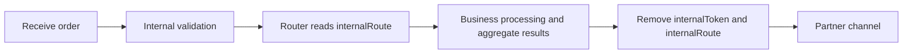

# removeHeader — Removing a Single Header with MessageBuilder

In the **SPRING_INTEGRATION_CORE** module, `Message`, `MessageChannel`, endpoints, gateways, and Java DSL work together to build message flows. Part of designing a flow is deciding which metadata is still needed at each stage. This lesson in the **MessageBuilder** chapter focuses on `removeHeader`: removing an exact header from the output message while keeping the payload and the headers needed by the next step.

Suppose an order carries an `internalToken` header for internal processing. Before forwarding the order to a partner branch, you want to drop that header while keeping `orderId` and `traceId`. This is an appropriate scenario for `MessageBuilder.fromMessage(message).removeHeader(...).build()`.

## 1. Objectives and Prerequisites

After this lesson, you can:

- Remove a header by exact name and obtain the resulting message with `build()`.
- Explain why the operation does not modify the original message's headers.
- Distinguish `removeHeader`, `removeHeaders`, `setHeader(name, null)`, and header filters in Java DSL.
- Choose where to remove metadata while still satisfying the needs of routers, gateways, and aggregators.
- Write tests for both a message-processing method and an integration flow.

You should know the structure of `Message<T>` consisting of payload and headers, how to use `withPayload`, `fromMessage`, `setHeader`, and how a channel delivers messages to an endpoint.

The examples use Spring Integration's builder:

```java
import org.springframework.integration.support.MessageBuilder;
import org.springframework.messaging.Message;
```

Spring Framework also has a class with the same name in the `org.springframework.messaging.support` package. Check your imports when your IDE auto-imports the class. This lesson consistently uses `org.springframework.integration.support.MessageBuilder`, especially when discussing Spring Integration's read-only headers.

## 2. Contract of `removeHeader`

Basic usage:

```java
Message<String> cleaned = MessageBuilder
        .fromMessage(original)
        .removeHeader("internalToken")
        .build();
```

In this call chain:

1. `fromMessage(original)` initializes the builder from the payload and headers of the input message.
2. `removeHeader("internalToken")` removes the header with that exact name from the in-progress builder state.
3. `build()` returns a `Message<String>` for you to send or return to the flow.

`removeHeader` returns the builder for further method chaining; it does not return the removed header value. If you need the old value, read it from the input message before removing it.

By the API contract, `removeHeader` takes a single name, whereas `removeHeaders` accepts multiple names or name patterns. Initializing via `fromMessage` reuses the payload of the passed message. [MessageBuilder Javadoc](https://docs.spring.io/spring-integration/api/org/springframework/integration/support/MessageBuilder.html), [AbstractIntegrationMessageBuilder Javadoc](https://docs.spring.io/spring-integration/api/org/springframework/integration/support/AbstractIntegrationMessageBuilder.html).

### 2.1. Header Names Must Match Exactly

Given these three headers:

```text
internalToken = demo-token
internalRoute = billing
traceId       = trace-100
```

The call:

```java
builder.removeHeader("internalToken");
```

targets only `internalToken`. It does not remove `internalRoute` or `traceId`.

Names are treated as map keys. `internalToken` and `InternalToken` are two distinct names. Do not assume HTTP's case-insensitivity rule applies across all `MessageHeaders`.

### 2.2. Non-Existent Headers

For a valid name that is absent from the message, `removeHeader` does not require you to check existence first:

```java
Message<String> output = MessageBuilder
        .fromMessage(input)
        .removeHeader("temporaryNote")
        .build();
```

If `temporaryNote` was not present, the result still does not have that header. From a data perspective, the operation is idempotent: removing the same header multiple times still yields a state without that header.

Idempotency here refers to header presence. Do not infer that every `build()` call always creates a new object or that system metadata must change after every call.

### 2.3. `removeHeader` Does Not Understand Wildcards

```java
Message<String> output = MessageBuilder
        .fromMessage(input)
        .removeHeader("internal*")
        .build();
```

The call above targets the key literally named `internal*`. It does not mean "remove every header starting with internal." If the input only has `internalToken` and `internalRoute`, both headers remain.

To remove by prefix, the relevant API is:

```java
Message<String> output = MessageBuilder
        .fromMessage(input)
        .removeHeaders("internal*")
        .build();
```

Simple patterns in `removeHeaders` use `*`, such as `prefix*`, `*suffix`, `*part*`, or `prefix*suffix`; these are not regular expressions. [removeHeaders Javadoc](https://docs.spring.io/spring-integration/api/org/springframework/integration/support/AbstractIntegrationMessageBuilder.html#removeHeaders(java.lang.String...)).

## 3. Complete Example: Cleaning Order Metadata

The program below uses only Spring Integration Core and related Spring libraries on the classpath, with no need to start a Spring ApplicationContext:

```java
import org.springframework.integration.support.MessageBuilder;
import org.springframework.messaging.Message;

public class RemoveHeaderExample {

    public static void main(String[] args) {
        Message<String> original = MessageBuilder
                .withPayload("ORDER-100")
                .setHeader("orderId", "ORDER-100")
                .setHeader("traceId", "trace-100")
                .setHeader("internalToken", "demo-token")
                .build();

        Message<String> cleaned = MessageBuilder
                .fromMessage(original)
                .removeHeader("internalToken")
                .build();

        System.out.println(cleaned.getPayload());
        System.out.println(cleaned.getHeaders().get("orderId"));
        System.out.println(cleaned.getHeaders().get("traceId"));
        System.out.println(
                cleaned.getHeaders().containsKey("internalToken"));
        System.out.println(
                original.getHeaders().containsKey("internalToken"));
    }
}
```

Expected output:

```text
ORDER-100
ORDER-100
trace-100
false
true
```

The table below describes only the application headers in the example; the message may also carry framework-managed metadata.

| Component | Original Message | Cleaned Message |
| --- | --- | --- |
| Payload | `ORDER-100` | `ORDER-100` |
| `orderId` | `ORDER-100` | `ORDER-100` |
| `traceId` | `trace-100` | `trace-100` |
| `internalToken` | Present | Absent |

The name `internalToken` and value `demo-token` are mock data for this lesson. The header-removal contract does not depend on whether the old value's type is a string, number, or object.

## 4. Original Message, Payload, and System Headers

### 4.1. Do Not Remove Directly on `MessageHeaders`

For standard immutable messages created by the builder in this lesson, the following is invalid:

```java
// Do not use to mutate an already-built message.
original.getHeaders().remove("internalToken");
```

`MessageHeaders` provides a map-like read interface but disallows structural modifications via `put`, `remove`, or `clear`; those operations throw `UnsupportedOperationException`. The builder provides a workspace to prepare changes and then produce a result to forward. [Message Headers documentation](https://docs.spring.io/spring-integration/reference/message.html#message-headers).

Therefore, keep or return the built result:

```java
Message<String> next = MessageBuilder
        .fromMessage(original)
        .removeHeader("internalToken")
        .build();
```

An easy-to-miss mistake is calling the builder but continuing to send `original`:

```java
MessageBuilder.fromMessage(original)
        .removeHeader("internalToken")
        .build();

// Still the old message, so internalToken is still present.
outputChannel.send(original);
```

Here, building successfully does not alter the object you send. Send `next` to the output channel.

### 4.2. No Deep Copy of the Payload

`fromMessage` does not automatically deep-clone the payload's object graph. In the following example, both messages reference the same list:

```java
import java.util.ArrayList;
import java.util.List;
import org.springframework.integration.support.MessageBuilder;
import org.springframework.messaging.Message;

List<String> items = new ArrayList<>();
items.add("BOOK");

Message<List<String>> original = MessageBuilder
        .withPayload(items)
        .setHeader("temporaryNote", "checked")
        .build();

Message<List<String>> cleaned = MessageBuilder
        .fromMessage(original)
        .removeHeader("temporaryNote")
        .build();

System.out.println(cleaned.getPayload() == original.getPayload());
// true
```

If one branch later modifies the list, the other branch can observe the change. When publishing a message to multiple consumers, choose an immutable payload or proactively copy the payload according to business requirements. Likewise, removing one header does not deep-copy objects held in the remaining headers.

### 4.3. `id` and `timestamp` Are Not Regular Application Headers

`MessageHeaders.ID` and `MessageHeaders.TIMESTAMP` are system metadata. With the standard Spring Integration builder, `removeHeader` calls targeting read-only headers are ignored; do not use this to try to produce a message without an ID or timestamp. Custom read-only header rules also depend on the builder or factory in use. [BaseMessageBuilder source: removeHeader](https://github.com/spring-projects/spring-integration/blob/6.5.x/spring-integration-core/src/main/java/org/springframework/integration/support/BaseMessageBuilder.java).

When there is no actual change, the builder may return the original message. When creating a new message under default behavior, the ID and timestamp belong to the new message's lifecycle. Do not test with the assumption "the timestamp is strictly greater," because two messages can be created within the same millisecond.

To identify the same order across multiple endpoints, use `orderId` or an agreed-upon business key rather than treating each message's ID as an immutable identifier for the entire workflow.

## 5. Operation Order Determines Whether a Header Actually Disappears

The builder processes operations in the order you call them. This example removes and then re-adds the same name:

```java
Message<String> output = MessageBuilder
        .fromMessage(input)
        .removeHeader("internalToken")
        .setHeader("internalToken", "new-demo-token")
        .build();
```

The result has `internalToken = new-demo-token`.

A more realistic case is copying `input`'s headers again afterward:

```java
Message<String> output = MessageBuilder
        .fromMessage(input)
        .removeHeader("internalToken")
        .copyHeaders(input.getHeaders())
        .build();
```

If `input` has `internalToken`, the later `copyHeaders` call will add it back. `copyHeadersIfAbsent` does not solve this either: the just-removed header is now absent, so it qualifies to be copied back in.

When merging metadata, place removal operations after copy steps:

```java
Message<String> output = MessageBuilder
        .fromMessage(input)
        .copyHeaders(additionalHeaders)
        .removeHeader("internalToken")
        .build();
```

In this example, `additionalHeaders` is a `Map<String, ?>` prepared in advance by the application.

You also do not need to call `copyHeaders(input.getHeaders())` right after `fromMessage(input)` just to "keep old headers": `fromMessage` already initializes from the input message.

Treat a cleanup step as a decision at a single point in the flow. A downstream header enricher, interceptor, or endpoint can still re-add the same name if configured to do so.

## 6. Choosing the Right API

| Need | Illustrative API | Meaning |
| --- | --- | --- |
| Remove a specific name | `removeHeader("internalToken")` | Removes that exact key |
| Remove two known names | `removeHeader("a").removeHeader("b")` | Two exact operations |
| Remove multiple names or patterns | `removeHeaders("a", "internal*")` | Uses the API that supports name patterns |
| Clear a header's value via setter | `setHeader("temporaryNote", null)` | For regular application headers, `null` means remove |
| Remove headers at a Java DSL step | `headerFilter("internalToken")` | Places a cleanup endpoint into the flow |
| Discard the entire message | Filter endpoint | Decides whether the message continues |

`setHeader(name, null)` has the contract of removing the header when the passed value is `null`. When the goal of the code is cleaning metadata, `removeHeader` usually expresses the intent more clearly. Do not extrapolate this equivalence to how different builder classes handle read-only headers. [setHeader Javadoc](https://docs.spring.io/spring-integration/api/org/springframework/integration/support/AbstractIntegrationMessageBuilder.html#setHeader(java.lang.String,java.lang.Object)).

Distinguish the two types of filters: a header filter strips selected metadata, whereas a message filter can drop the entire message from the processing branch. Confusing these two concepts will change the number of messages reaching consumers.

## 7. Where in the Flow Should Removal Be Placed?

Consider an order flow with application-defined headers:



In this illustrative design:

- `internalToken` serves internal-stage authentication.
- `internalRoute` is used by the router to pick the processing destination.
- `orderId` is the business key, while `traceId` supports tracking.
- The partner branch only needs the order data and metadata belonging to the integration contract.

If `internalRoute` is removed before the router, the router lacks the input required by its configuration. If internal headers are kept until after the outbound export step, removal happens too late for that export. The right placement must consider the last consumer that still needs the header.

### 7.1. `replyChannel` and Gateways

In a request/reply flow, `replyChannel` may be where the framework needs to send a reply when there is no explicit output channel. Removing it mid-flow can prevent the reply from finding its destination. Whether an output channel or another routing mechanism exists also affects the outcome. [Service Activator documentation](https://docs.spring.io/spring-integration/reference/service-activator.html).

Example prone to a design bug:

```java
Message<?> cleaned = MessageBuilder
        .fromMessage(request)
        .removeHeader("replyChannel")
        .build();
```

Do not remove this header just because it looks like internal data. First know which gateway calls the flow segment still needs to complete and along which path replies travel.

### 7.2. `errorChannel` and Error Handling

`errorChannel` is metadata pointing to the error destination in mechanisms that use this header. Removing the header does not disable errors, nor does it establish a retry policy or route all errors to the same channel. Synchronous flows, asynchronous flows, and specific endpoints may report errors differently.

If the business requirement is only to remove a temporary token, target only the token name. Do not extend cleanup operations to error-control headers without redesigning the flow's error-handling contract.

### 7.3. `correlationId` and Sequence Headers

By default, an aggregator uses `IntegrationMessageHeaderAccessor.CORRELATION_ID` to group messages; the default release strategy relies on sequence size information. Therefore, removing grouping metadata before the aggregator can prevent grouping or release from matching the configuration. [Aggregator documentation](https://docs.spring.io/spring-integration/reference/aggregator.html).

Keep these headers until the processing segment that depends on them has finished. With nested splitters and aggregators, use the framework's appropriate sequence management mechanism; removing a few keys manually does not replace sequence context management.

| Header or Header Group | Consumer to Check Before Removal |
| --- | --- |
| Application routing header | The router reading that header |
| `replyChannel` | Reply-producing endpoints and request/reply gateways |
| `errorChannel` | Mechanism delivering errors to their destination |
| `correlationId` | Aggregator or correlating component |
| `sequenceNumber`, `sequenceSize` | Aggregator, resequencer, or related sequence strategy |
| Protocol control headers | The corresponding protocol adapter |

Constants such as `CORRELATION_ID`, `SEQUENCE_NUMBER`, and `SEQUENCE_SIZE` are provided by `IntegrationMessageHeaderAccessor`. When code works with standard headers, using constants prevents typos. [IntegrationMessageHeaderAccessor Javadoc](https://docs.spring.io/spring-integration/api/org/springframework/integration/IntegrationMessageHeaderAccessor.html).

## 8. Integrating `removeHeader` into a Java DSL Flow

If the removal rule needs to be written in Java, you can place it inside a transformer that accepts and returns a full `Message`. The example below uses the Spring Integration 6.x/7.x Java DSL API.

Put this class in `HeaderRemovalFlowConfig.java` when practicing in your own project:

```java
import org.springframework.context.annotation.Bean;
import org.springframework.context.annotation.Configuration;
import org.springframework.integration.config.EnableIntegration;
import org.springframework.integration.channel.DirectChannel;
import org.springframework.integration.channel.QueueChannel;
import org.springframework.integration.dsl.IntegrationFlow;
import org.springframework.integration.support.MessageBuilder;
import org.springframework.messaging.Message;
import org.springframework.messaging.MessageChannel;

@Configuration
@EnableIntegration
public class HeaderRemovalFlowConfig {

    @Bean
    public MessageChannel ordersToClean() {
        return new DirectChannel();
    }

    @Bean
    public QueueChannel cleanedOrders() {
        return new QueueChannel();
    }

    @Bean
    public OrderHeaderCleaner orderHeaderCleaner() {
        return new OrderHeaderCleaner();
    }

    @Bean
    public IntegrationFlow cleanOrderHeaders(
            OrderHeaderCleaner orderHeaderCleaner,
            QueueChannel cleanedOrders) {

        return IntegrationFlow.from("ordersToClean")
                .transform(orderHeaderCleaner, "clean")
                .channel(cleanedOrders)
                .get();
    }

    public static class OrderHeaderCleaner {

        public Message<?> clean(Message<?> input) {
            return MessageBuilder.fromMessage(input)
                    .removeHeader("internalToken")
                    .removeHeader("internalRoute")
                    .build();
        }
    }
}
```

This flow has an input channel, a transformer endpoint, and a queue to observe output. No gateway is needed to verify header removal. A `QueueChannel` is placed at the end so the receiving side can actively pull messages.

For a POJO transformer, a method returning a `Message` lets the prepared message be forwarded, including the cleaned headers. If you only return `cleaned.getPayload()`, the framework has to build an output message from the payload, so it no longer directly reflects the header set you just constructed. [Transformer documentation](https://docs.spring.io/spring-integration/reference/transformer.html#transformer).

Therefore, a method whose job is removing headers should return `Message<?>` or an appropriate `Message<T>` type.

### 8.1. When You Only Need a Fixed List of Names

If there is no custom conditional logic, you can replace the example's transformer with a header filter:

```java
@Bean
public IntegrationFlow cleanOrderHeaders(QueueChannel cleanedOrders) {
    return IntegrationFlow.from("ordersToClean")
            .headerFilter("internalToken", "internalRoute")
            .channel(cleanedOrders)
            .get();
}
```

This is an alternative to the `cleanOrderHeaders` bean above; do not register both versions at the same time to avoid unintentionally creating two consumers on the input channel.

Header filter is designed for stripping metadata from the output message. Choose it when the requirement can be expressed directly as a list of headers to drop. [Header Filter documentation](https://docs.spring.io/spring-integration/reference/transformer.html#header-filter).

### 8.2. When the Removal Rule Is Conditional

For example, a system rule states that only the `PARTNER` branch strips the internal review note:

```java
public Message<?> clean(Message<?> input) {
    MessageBuilder<?> builder = MessageBuilder.fromMessage(input);
    String audience = input.getHeaders().get("audience", String.class);

    if ("PARTNER".equals(audience)) {
        builder.removeHeader("internalReviewNote");
    }

    return builder.build();
}
```

This rule keeps `internalReviewNote` for other `audience` values. That is a business choice of the example, not a default framework policy. In a real application, explicitly specify how missing or invalid `audience` values are handled.

A new builder is created for each message processing run. Do not keep a shared builder as mutable state in a singleton transformer.

## 9. Testing the Result and the Original Message

The snippets below are test code to practice in a project with Spring Integration Core, Spring Context, and JUnit Jupiter. Unit tests focus on the data contract; flow tests check the message after the endpoint.

### 9.1. Unit Testing with JUnit 5

Put the following class in `RemoveHeaderTest.java`:

```java
import org.junit.jupiter.api.Test;
import org.springframework.integration.support.MessageBuilder;
import org.springframework.messaging.Message;

import static org.junit.jupiter.api.Assertions.*;

class RemoveHeaderTest {

    @Test
    void removesOnlyTheSelectedHeaderAndKeepsTheOriginal() {
        Message<String> original = MessageBuilder
                .withPayload("ORDER-100")
                .setHeader("internalToken", "demo-token")
                .setHeader("traceId", "trace-100")
                .build();

        Message<String> cleaned = MessageBuilder
                .fromMessage(original)
                .removeHeader("internalToken")
                .build();

        assertFalse(cleaned.getHeaders().containsKey("internalToken"));
        assertEquals("trace-100", cleaned.getHeaders().get("traceId"));
        assertEquals("ORDER-100", cleaned.getPayload());
        assertSame(original.getPayload(), cleaned.getPayload());
        assertEquals(
                "demo-token",
                original.getHeaders().get("internalToken"));
    }

    @Test
    void removingAMissingHeaderDoesNotFail() {
        Message<String> input = MessageBuilder
                .withPayload("ORDER-100")
                .setHeader("traceId", "trace-100")
                .build();

        Message<String> output = assertDoesNotThrow(() ->
                MessageBuilder.fromMessage(input)
                        .removeHeader("missingHeader")
                        .build());

        assertFalse(output.getHeaders().containsKey("missingHeader"));
        assertEquals("trace-100", output.getHeaders().get("traceId"));
        assertEquals(input.getPayload(), output.getPayload());
    }

    @Test
    void removeHeaderUsesAnExactNameRatherThanAPattern() {
        Message<String> input = MessageBuilder
                .withPayload("ORDER-100")
                .setHeader("internalToken", "demo-token")
                .setHeader("internalRoute", "billing")
                .build();

        Message<String> exactNameResult = MessageBuilder
                .fromMessage(input)
                .removeHeader("internal*")
                .build();

        assertTrue(
                exactNameResult.getHeaders().containsKey("internalToken"));
        assertTrue(
                exactNameResult.getHeaders().containsKey("internalRoute"));

        Message<String> patternResult = MessageBuilder
                .fromMessage(input)
                .removeHeaders("internal*")
                .build();

        assertFalse(
                patternResult.getHeaders().containsKey("internalToken"));
        assertFalse(
                patternResult.getHeaders().containsKey("internalRoute"));
    }
}
```

These assertions check the target header, retained headers, payload, and original input. Do not assert the total header count, because framework metadata is not the focus of the requirement.

### 9.2. Testing Through a Channel and Transformer

Using the `HeaderRemovalFlowConfig` configuration from Section 8, place the following test in the same package:

```java
import org.junit.jupiter.api.Test;
import org.springframework.context.annotation.AnnotationConfigApplicationContext;
import org.springframework.integration.channel.QueueChannel;
import org.springframework.integration.support.MessageBuilder;
import org.springframework.messaging.Message;
import org.springframework.messaging.MessageChannel;

import static org.junit.jupiter.api.Assertions.*;

class HeaderRemovalFlowTest {

    @Test
    void outputOfTheFlowDoesNotContainInternalHeaders() {
        try (AnnotationConfigApplicationContext context =
                     new AnnotationConfigApplicationContext(
                             HeaderRemovalFlowConfig.class)) {

            MessageChannel inputChannel =
                    context.getBean("ordersToClean", MessageChannel.class);
            QueueChannel outputChannel =
                    context.getBean("cleanedOrders", QueueChannel.class);

            Message<String> input = MessageBuilder
                    .withPayload("ORDER-100")
                    .setHeader("internalToken", "demo-token")
                    .setHeader("internalRoute", "billing")
                    .setHeader("traceId", "trace-100")
                    .build();

            assertTrue(inputChannel.send(input, 1000));

            Message<?> output = outputChannel.receive(1000);

            assertNotNull(output);
            assertEquals("ORDER-100", output.getPayload());
            assertEquals("trace-100", output.getHeaders().get("traceId"));
            assertFalse(output.getHeaders().containsKey("internalToken"));
            assertFalse(output.getHeaders().containsKey("internalRoute"));
            assertTrue(input.getHeaders().containsKey("internalToken"));
        }
    }
}
```

A bounded wait time lets the test terminate if the flow produces no output. Closing the application context releases resources managed by the context.

Flow-level testing is also useful when a step after the transformer causes a header to reappear. When extending the flow, place verification at the input of the consumer that must not receive that header.

## 10. Common Errors and How to Spot Them

| Symptom | Cause to Check | Adjustment |
| --- | --- | --- |
| Header still appears in output | Still sending the old input | Send or return the result of `build()` |
| Removal call does not affect the desired header | Wrong name or wrong letter casing | Use the same name constant where created and where removed |
| `internal*` does not remove internal headers | Used `removeHeader` for a pattern | Use the `removeHeaders` API if patterns are needed |
| Header is removed and then reappears | Headers copied/enriched in a later step | Review ordering and cleanup placement |
| Gateway receives no reply | Lost metadata or destination used for replying | Check `replyChannel` and output channel |
| Aggregator does not work as expected | Missing correlation or sequence metadata | Keep metadata until the dependent segment finishes |
| Test depending on header count fails | Counting framework metadata as well | Assert names and values belonging to the application contract |
| Payload change affects another branch | Sharing a mutable payload | Use immutable data or copy intentionally |

An absent header does not create a "deny list" inside the message. If a downstream handler copies request headers into its result, or an enricher recreates the header, that name can reappear. Copying behavior depends on the endpoint type; verify the whole flow segment rather than inferring from a single builder call. [AbstractMessageProducingHandler source](https://github.com/spring-projects/spring-integration/blob/6.5.x/spring-integration-core/src/main/java/org/springframework/integration/handler/AbstractMessageProducingHandler.java).

When diagnosing, compare header name lists before the removal step, immediately after the removal step, and before the final consumer. For sensitive metadata, log only presence or masked values; do not write real token contents to logs for inspection.

## 11. Scope of Header Removal

`removeHeader` affects only the headers of the message being built. In the order scenario at the start of the lesson, distinguish the places that might hold the same data:

| Where the Value Resides | Removed by `removeHeader` on the Output Message? |
| --- | --- |
| Target header of the output message | Yes, for modifiable application headers |
| Same header in the input message | No |
| Data field inside the payload | No |
| Logs written in an earlier stage | No |
| Other messages already sent to another channel | No |
| Header re-added at a later endpoint | No automatic prevention mechanism |

For example, if the token also exists inside a JSON payload, removing `internalToken` from headers does not edit the JSON. When exporting through an adapter, you must also check protocol header mapping configuration. The fact that an in-memory message lacks a header does not replace verifying the actual data transmitted out.

In a publish-subscribe branch, another consumer may still receive the original message. Cleaning metadata for one branch only guarantees what you designed and tested in that branch.

## 12. Applying to Flow Design

For each header to remove, identify three points: where it is created, the last consumer that needs it, and where to verify its absence. For example:

| Example Header | Where Created | Last Consumer Needing It | Intended Removal Point |
| --- | --- | --- | --- |
| `internalToken` | Internal intake step | Internal authentication step | Before the partner branch, after all steps still needing the token |
| `internalRoute` | Order classification step | Internal router | After the routing segment |
| `traceId` | Trace-context setup step | Endpoints under tracing policy | Keep if allowed by the output contract |
| `orderId` | Business data | Order-processing consumer | Keep according to the integration contract |

The core call pattern of this lesson is:

```java
Message<?> output = MessageBuilder
        .fromMessage(input)
        .removeHeader("internalToken")
        .build();
```

For this operation to meet requirements, the forwarded message must be `output`, the header to remove must be called by its exact name, and downstream endpoints must continue respecting the metadata set that the final consumer expects to receive.
