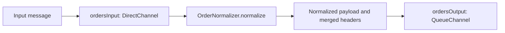

# copyHeaders — Copying and Merging Headers in MessageBuilder

In the **SPRING_INTEGRATION_CORE** module, `copyHeaders` is the operation that helps preserve context when constructing a message for the next step of an integration flow. For example, a transformer normalizing an order code needs to replace the payload while keeping `orderId`, `tenantId`, and `traceId` so routers, aggregators, and downstream processing components continue working properly.

This lesson focuses on `copyHeaders` in the **MessageBuilder** chapter: which headers are copied, which value wins on name collisions, and how to use this operation in Java DSL. The examples use the Spring Integration 6.4.2 API and Java 17 or later; your practice project needs `org.springframework.integration:spring-integration-core` and its compatible project-managed dependencies.

## 1. Choosing the Right MessageBuilder

The examples in this lesson use:

```java
import org.springframework.integration.support.MessageBuilder;
import org.springframework.messaging.Message;
```

Spring Framework also has a class with the same name, `org.springframework.messaging.support.MessageBuilder`. Check imports when your IDE autocompletes, especially if the application uses Spring Integration-specific capabilities.

`MessageBuilder.withPayload(payload)` initializes a builder from a payload; `MessageBuilder.fromMessage(message)` initializes from the payload and headers of an existing message. Call `build()` to obtain `Message<T>`. Building a message does not yet send it to a `MessageChannel`. See [MessageBuilder Javadoc](https://docs.spring.io/spring-integration/docs/6.4.2/api/org/springframework/integration/support/MessageBuilder.html).

## 2. Contract of `copyHeaders`

Basic usage:

```java
Message<String> result = MessageBuilder
        .withPayload("ORDER-42")
        .copyHeaders(headersToCopy)
        .build();
```

The `headersToCopy` argument has type `Map<String, ?>`: header names are strings, while values can have various types. Because `MessageHeaders` implements the `Map` interface, you can pass `source.getHeaders()` directly.

For regular headers, the merge rules are:

| State in Builder | Value in Source Map | Result After `copyHeaders` |
| --- | --- | --- |
| Header absent | Non-null value | Adds the header |
| Header present | Non-null value | Overwrites with the value from source |
| Header present | No matching key | Keeps existing value |
| Header present | Key present with `null` value | Removes that header |
| Any | Empty source map | No change |
| Any | Entire source map is `null` | No change |

`copyHeaders` returns the builder for call chaining. The operation does not change the payload, does not modify the source map, and does not delete headers that only exist on the builder. `id` and `timestamp` are exceptions: they are not overwritten by copy operations. If you need to keep existing values, use `copyHeadersIfAbsent`. See [copyHeaders contract](https://docs.spring.io/spring-integration/docs/6.4.2/api/org/springframework/integration/support/AbstractIntegrationMessageBuilder.html#copyHeaders(java.util.Map)).

## 3. Complete Example: Source Value Wins on Name Collision

The class below only requires Spring Integration Core on the classpath and does not need to initialize a Spring context:

```java
import java.util.LinkedHashMap;
import java.util.Map;

import org.springframework.integration.support.MessageBuilder;
import org.springframework.messaging.Message;

public class CopyHeadersDemo {

    public static void main(String[] args) {
        Map<String, Object> incoming = new LinkedHashMap<>();
        incoming.put("tenantId", "tenant-a");
        incoming.put("traceId", "trace-42");
        incoming.put("source", "web");

        Message<String> result = MessageBuilder
                .withPayload("ORDER-42")
                .setHeader("source", "batch")
                .setHeader("region", "vn")
                .copyHeaders(incoming)
                .build();

        System.out.println(result.getPayload());
        System.out.println(result.getHeaders().get("source", String.class));
        System.out.println(result.getHeaders().get("region", String.class));
        System.out.println(result.getHeaders().get("traceId", String.class));

        incoming.put("source", "mobile");
        System.out.println(result.getHeaders().get("source", String.class));
    }
}
```

Expected output:

```text
ORDER-42
web
vn
trace-42
web
```

`source=web` overwrites `source=batch`; `region=vn` remains because the source map does not have a `region` key. Changing an entry in the `incoming` map afterward does not alter the entry already placed in the message. Distinguish this from mutating a mutable object currently used as a header value in Section 7.

## 4. Call Order Determines Precedence

The two call chains below produce different results:

```java
Map<String, Object> incoming = Map.of("source", "external");

Message<String> first = MessageBuilder.withPayload("ORDER-42")
        .setHeader("source", "internal")
        .copyHeaders(incoming)
        .build();
// first: source = external

Message<String> second = MessageBuilder.withPayload("ORDER-42")
        .copyHeaders(incoming)
        .setHeader("source", "internal")
        .build();
// second: source = internal
```

For writable headers, the last write operation determines the final value. If merging multiple sources, express the precedence order directly in the builder chain:

```java
Map<String, Object> defaults = Map.of(
        "region", "vn",
        "source", "unknown");

Map<String, Object> requestMetadata = Map.of(
        "source", "web",
        "traceId", "trace-42");

String validatedTenantId = "tenant-a"; // Result determined from the authenticated context.

Message<String> message = MessageBuilder.withPayload("ORDER-42")
        .copyHeaders(defaults)
        .copyHeaders(requestMetadata)
        .setHeader("tenantId", validatedTenantId)
        .build();
```

In this example, default settings have the lowest priority, request metadata comes next, and the application-determined `tenantId` is assigned last. This is an application policy; `copyHeaders` does not automatically verify ownership or provenance of a header.

If metadata is only allowed to fill in missing slots:

```java
Message<String> message = MessageBuilder.withPayload("ORDER-42")
        .setHeader("source", "internal")
        .copyHeadersIfAbsent(Map.of(
                "source", "external",
                "traceId", "trace-42"))
        .build();
// source = internal; traceId = trace-42
```

| Need | How to Use |
| --- | --- |
| New map is allowed to replace old values | `copyHeaders` |
| Map only fills in missing information | `copyHeadersIfAbsent` |
| Finalize a value after merging | `setHeader` after `copyHeaders` calls |
| Fill in a single default value | `setHeaderIfAbsent` |

Do not mechanically replace `copyHeaders` with `copyHeadersIfAbsent`: they express two different precedence policies.

## 5. Copying Headers When Replacing the Payload

Suppose the input message has an unnormalized order code:

```java
Message<String> input = MessageBuilder.withPayload("  order-42  ")
        .setHeader("orderId", "42")
        .setHeader("traceId", "trace-42")
        .build();

String normalized = input.getPayload()
        .trim()
        .toUpperCase(java.util.Locale.ROOT);

Message<String> output = MessageBuilder.withPayload(normalized)
        .copyHeaders(input.getHeaders())
        .setHeader("normalized", true)
        .build();
```

`output` has payload `ORDER-42`, keeps `orderId` and `traceId`, and adds `normalized=true`. The payload in `input` remains the original string. You can apply the same structure when changing the payload type, for example from `String` to an order object.

If you only change headers and keep the payload, use `fromMessage` for clearer intent:

```java
Message<String> enriched = MessageBuilder.fromMessage(input)
        .setHeader("processedBy", "normalizer")
        .build();
```

Do not use reference comparison to conclude an operation succeeded: `fromMessage(input).build()` may return the exact original message if no changes are needed. When a new message is created, technical metadata should also be understood in terms of the message lifecycle. See [builder build behavior](https://docs.spring.io/spring-integration/docs/6.4.2/api/org/springframework/integration/support/BaseMessageBuilder.html#build()).

### `id` and `timestamp` Are Not Business Identifiers

`MessageHeaders.ID` identifies the message; `MessageHeaders.TIMESTAMP` indicates creation time. By default they are read-only headers for header modification and copy APIs. Therefore:

```java
Message<String> original = MessageBuilder.withPayload("raw")
        .setHeader("traceId", "trace-42")
        .build();

Message<String> converted = MessageBuilder.withPayload("normalized")
        .copyHeaders(original.getHeaders())
        .build();
```

Do not expect `converted` to keep `original`'s `id`. With the default builder in this example, the new message gets a newly generated ID. Also do not assert timestamp with "must be strictly greater": two messages can be created within the same millisecond.

Use business headers such as `orderId`, `traceId`, or `correlationId` when you need to link messages across multiple steps. `copyHeaders` preserves those headers but does not automatically create tracing or configure an aggregator correlation strategy. See [Message Headers and Header Propagation](https://docs.spring.io/spring-integration/reference/message.html).

## 6. `null`: Ignoring the Whole Map vs. Removing One Header

In the current implementation, `copyHeaders(null)` leaves the builder unchanged. Conversely, an entry with a `null` value is translated into a removal operation for a regular header. You can see the mechanism forwarding each entry to `setHeader` in [MessageHeaderAccessor source code](https://raw.githubusercontent.com/spring-projects/spring-framework/v6.2.2/spring-messaging/src/main/java/org/springframework/messaging/support/MessageHeaderAccessor.java).

```java
Map<String, Object> patch = new java.util.HashMap<>();
patch.put("debugTag", null);
patch.put("traceId", "trace-new");

Message<String> result = MessageBuilder.withPayload("ORDER-42")
        .setHeader("debugTag", "temporary")
        .setHeader("traceId", "trace-old")
        .setHeader("region", "vn")
        .copyHeaders(patch)
        .build();

// debugTag no longer exists.
// traceId = trace-new.
// region = vn.
```

`Map.of("debugTag", null)` cannot construct the map because `Map.of` rejects `null` values. The example above deliberately uses `HashMap`.

If business requirements treat `null` as "do not update," filter out those entries beforehand:

```java
Map<String, Object> nonNullPatch = new java.util.HashMap<>();
patch.forEach((name, value) -> {
    if (value != null) {
        nonNullPatch.put(name, value);
    }
});

Message<String> result = MessageBuilder.withPayload("ORDER-42")
        .setHeader("debugTag", "temporary")
        .copyHeaders(nonNullPatch)
        .build();
// debugTag is still temporary.
```

This snippet is an alternative to the previous build. It reflects normalizing input data according to the application contract, without altering the rules of `copyHeaders`.

## 7. Shallow Copy: Mutable Values Can Still Be Shared

The header map of a standard message disallows `put`, `remove`, or `clear`. However, an object stored as a header value can still be mutable. `copyHeaders` does not recursively clone a `List`, `Map`, or business object. See [Message Headers immutability rules](https://docs.spring.io/spring-integration/reference/message.html#message-headers).

```java
java.util.List<String> tags =
        new java.util.ArrayList<>(java.util.List.of("new"));

Message<String> input = MessageBuilder.withPayload("raw")
        .setHeader("tags", tags)
        .build();

Message<String> output = MessageBuilder.withPayload("normalized")
        .copyHeaders(input.getHeaders())
        .build();

tags.add("changed");

System.out.println(input.getHeaders().get("tags"));
System.out.println(output.getHeaders().get("tags"));
```

Both lines print `[new, changed]`, because the header value still references the same list.

If you want the message to hold a snapshot of the list at creation time, for `String` elements you can use:

```java
Message<String> snapshot = MessageBuilder.withPayload("normalized")
        .copyHeaders(input.getHeaders())
        .setHeader("tags", java.util.List.copyOf(tags))
        .build();
```

Adding or removing elements in `tags` afterward does not change the list inside `snapshot`. If elements are mutable objects, you still need to decide how to copy or make each element immutable according to the data model. `Map.copyOf` also does not automatically perform a deep copy.

In flows with multiple consumers or asynchronous processing, prefer small, stable, immutable header values. Create a separate builder for each message processing run so merge policies do not mix state across requests.

## 8. Applying in Transformers and Java DSL

When a transformer returns a complete `Message`, the transformer code is responsible for building the output headers. If a transformer only returns a payload, the framework normally passes input headers to the output according to propagation rules. Therefore `copyHeaders(input.getHeaders())` is especially useful when explicitly returning a `Message`. See [Header Propagation](https://docs.spring.io/spring-integration/reference/message.html#message-header-propagation) and [Transformer configuration](https://docs.spring.io/spring-integration/reference/transformer.html).

The following example creates a synchronous flow from `ordersInput`, through a transformer, and writes the result to a `QueueChannel` for observation:



The configuration class can run directly in a project that already has Spring Integration Core:

```java
import java.util.Locale;

import org.springframework.context.annotation.AnnotationConfigApplicationContext;
import org.springframework.context.annotation.Bean;
import org.springframework.context.annotation.Configuration;
import org.springframework.integration.channel.DirectChannel;
import org.springframework.integration.channel.QueueChannel;
import org.springframework.integration.config.EnableIntegration;
import org.springframework.integration.dsl.IntegrationFlow;
import org.springframework.integration.support.MessageBuilder;
import org.springframework.messaging.Message;
import org.springframework.messaging.MessageChannel;
import org.springframework.messaging.MessageHeaders;
import org.springframework.util.MimeTypeUtils;

@Configuration
@EnableIntegration
public class CopyHeadersFlowConfig {

    @Bean
    public MessageChannel ordersInput() {
        return new DirectChannel();
    }

    @Bean
    public QueueChannel ordersOutput() {
        return new QueueChannel();
    }

    @Bean
    public OrderNormalizer orderNormalizer() {
        return new OrderNormalizer();
    }

    @Bean
    public IntegrationFlow normalizeOrdersFlow(OrderNormalizer normalizer) {
        return IntegrationFlow.from("ordersInput")
                .transform(normalizer, "normalize")
                .channel("ordersOutput")
                .get();
    }

    public static final class OrderNormalizer {

        public Message<String> normalize(Message<String> input) {
            String normalized = input.getPayload()
                    .trim()
                    .toUpperCase(Locale.ROOT);

            return MessageBuilder.withPayload(normalized)
                    .copyHeaders(input.getHeaders())
                    .setHeader(MessageHeaders.CONTENT_TYPE, MimeTypeUtils.TEXT_PLAIN)
                    .setHeader("normalizedBy", "order-normalizer")
                    .build();
        }
    }

    public static void main(String[] args) {
        try (var context =
                     new AnnotationConfigApplicationContext(CopyHeadersFlowConfig.class)) {
            MessageChannel input = context.getBean("ordersInput", MessageChannel.class);
            QueueChannel output = context.getBean("ordersOutput", QueueChannel.class);

            input.send(MessageBuilder.withPayload("  order-42  ")
                    .setHeader("orderId", "42")
                    .setHeader("traceId", "trace-42")
                    .build());

            Message<?> result = output.receive(1000);
            if (result == null) {
                throw new IllegalStateException("No output message received");
            }

            System.out.println(result.getPayload());
            System.out.println(result.getHeaders().get("traceId"));
            System.out.println(result.getHeaders().get("normalizedBy"));
        }
    }
}
```

The three application lines are expected to print `ORDER-42`, `trace-42`, and `order-normalizer`; the framework may print additional logs. The `contentType` header is set after copying to describe the output payload.

The `normalize` method accepts the full `Message<String>`, giving it both payload and headers. Attaching a bean and method name to `.transform(...)` is described in [Transformers with Java DSL](https://docs.spring.io/spring-integration/reference/transformer.html#configuring-a-transformer-with-java-and-other-dsls).

### Choosing Headers According to Flow Scope

In an internal flow using a gateway, `replyChannel` may be needed for replying when no explicit output channel is configured. `errorChannel` may participate in error routing depending on the endpoint and execution model. When building the next message, decide whether to keep that context.

Similarly, `correlationId`, `sequenceNumber`, and `sequenceSize` matter for grouping or sequencing messages. Copying them is only appropriate when the message still belongs to the same group relationship. If producing a new independent business event, re-evaluate the relevant headers.

At a boundary crossing to another system, construct the allowed set of business headers and let adapters/header mappers handle the protocol layer. `copyHeaders` by itself does not turn an internal channel object into network-transportable metadata.

## 9. Testing Merge Rules

The tests below are meant for learners to run in a project with JUnit Jupiter. They invoke the builder directly without needing a Spring context. The tests verify not only the payload, but also precedence and that the source message remains unchanged.

```java
import java.util.HashMap;
import java.util.Map;

import org.junit.jupiter.api.Test;
import org.springframework.integration.support.MessageBuilder;
import org.springframework.messaging.Message;

import static org.junit.jupiter.api.Assertions.*;

class CopyHeadersTest {

    @Test
    void copiedHeadersOverrideTargetWithoutChangingSource() {
        Message<String> source = MessageBuilder.withPayload("raw")
                .setHeader("source", "web")
                .setHeader("traceId", "trace-42")
                .build();

        Message<String> target = MessageBuilder.withPayload("normalized")
                .setHeader("source", "batch")
                .setHeader("region", "vn")
                .copyHeaders(source.getHeaders())
                .build();

        assertEquals("normalized", target.getPayload());
        assertEquals("web", target.getHeaders().get("source"));
        assertEquals("vn", target.getHeaders().get("region"));
        assertEquals("trace-42", target.getHeaders().get("traceId"));
        assertEquals("raw", source.getPayload());
        assertFalse(source.getHeaders().containsKey("region"));
        assertNotEquals(source.getHeaders().getId(), target.getHeaders().getId());
    }

    @Test
    void copyHeadersIfAbsentPreservesExplicitValue() {
        Message<String> target = MessageBuilder.withPayload("ORDER-42")
                .setHeader("source", "internal")
                .copyHeadersIfAbsent(Map.of(
                        "source", "external",
                        "traceId", "trace-42"))
                .build();

        assertEquals("internal", target.getHeaders().get("source"));
        assertEquals("trace-42", target.getHeaders().get("traceId"));
    }

    @Test
    void nullEntryRemovesHeaderWhileMissingEntryPreservesHeader() {
        Map<String, Object> patch = new HashMap<>();
        patch.put("debugTag", null);

        Message<String> target = MessageBuilder.withPayload("ORDER-42")
                .setHeader("debugTag", "temporary")
                .setHeader("region", "vn")
                .copyHeaders(patch)
                .build();

        assertFalse(target.getHeaders().containsKey("debugTag"));
        assertEquals("vn", target.getHeaders().get("region"));
    }
}
```

You can extend application testing by sending a message through the Java DSL flow and verifying the headers actually consumed by downstream endpoints. Do not use comparing the entire header map as the sole criterion, because `id` and `timestamp` are technical metadata of each message.

## 10. Common Errors and How to Spot Them

| Symptom | Possible Cause | How to Fix |
| --- | --- | --- |
| Newly assigned value gets overwritten | `copyHeaders` ran after `setHeader` | Change order or use `copyHeadersIfAbsent` according to policy |
| Transformer returns right payload but loses `traceId` | Created only with `withPayload` without adding headers to returned `Message` | Copy or select the headers that need to be preserved |
| Header disappears after update | Source map has an entry with a `null` value | Define clearly whether `null` means delete or ignore |
| Two messages both see list mutations | Shared a mutable object as a header value | Create a snapshot appropriate for the data type |
| Output ID differs from input ID | Created a new message with the default builder | Use business headers for correlation |
| Error calling `message.getHeaders().put(...)` | A message's header map is a read-only structure | Use the builder and build the appropriate message |
| Stale metadata overrides verified metadata | Map was copied too late | Assign authoritative values after the merge step |
| Internal metadata appears at system boundary | Copied all headers without defining the output contract | Select business headers and configure adapter mapping |

When designing a step that uses `copyHeaders`, determine three things upfront: the set of headers to keep, the precedence order among sources, and how mutable or `null` values are handled. When those decisions are expressed clearly in the builder and tests, replacing the payload will preserve the context required by downstream endpoints.