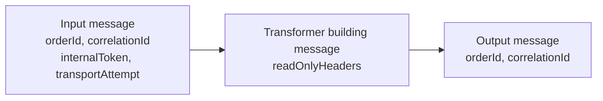

# readOnlyHeaders

In the **MessageBuilder** chapter of the **SPRING_INTEGRATION_CORE** module, `readOnlyHeaders` helps control which headers are allowed into the message created by the builder. This technique is useful at handoff points between integration flows: keeping data needed by business logic while excluding metadata that only had meaning in an earlier processing stage.

This lesson uses the **Spring Integration 6.5** API, referencing **6.5.0** source code when explaining detailed behavior. The `readOnlyHeaders(String...)` API has been available since version 4.3.2. The Java examples assume the project already has `spring-integration-core`; the tests use JUnit Jupiter. When using Spring Boot, choose dependencies according to your project's BOM.

After this lesson, you can:

- Explain accurately what it means for a custom header to be marked read-only.
- Use the builder to exclude headers when copying or rebuilding a message.
- Distinguish configuration scoped to a single builder, a factory, and framework components.
- Place a header-handling step into Java DSL and identify the conditions to test.

## 1. Problem: Metadata from an Earlier Stage Travels Too Far

Suppose an order-ingestion flow produces a message as follows:

| Component | Illustrative Value | Meaning |
| --- | --- | --- |
| Payload | `order-created` | Business event |
| `orderId` | `ORD-2026-008` | Order identifier |
| `correlationId` | `ORDER-FLOW-008` | Links messages belonging to the same process |
| `internalToken` | `temporary-token` | Metadata used during an internal processing step |
| `transportAttempt` | `3` | Attempt count from the previous transport stage |

When transitioning to the business-processing flow, we want to keep `orderId` and `correlationId`, while dropping `internalToken` and `transportAttempt`. This decision belongs to the flow design: another application might still need the attempt count for monitoring.

If you simply copy all headers, stale metadata continues appearing in the output message. `readOnlyHeaders` lets the builder apply a list of header names to prevent from entering the result.



This is a message transformation step. `MessageChannel` transports the message; the transformer in the diagram enforces the header-exclusion policy.

## 2. Understanding "Read-Only" Properly

### 2.1. Custom Headers Are Excluded from the Built Message

For custom headers, the key meaning of `readOnlyHeaders` is **preventing the header from being included in the output message**, even if that header already existed in the source message. This API does not provide a mechanism to "keep the old value intact while forbidding changes to a new value." The documentation describes it as a list of headers that should not be copied from a preceding message. See [Read-only Headers](https://docs.spring.io/spring-integration/reference/6.5/message.html#message-header-accessor).

For example, the requirement:

```text
Keep tenantId=tenant-A in the output and forbid changing tenantId.
```

is not satisfied by adding `tenantId` to `readOnlyHeaders`. Doing so would make `tenantId` absent from the rebuilt message. If you need to protect the tenant value, validate it at data ingestion and restrict where messages with a different tenant value may be created.

### 2.2. Different from the Immutability of `MessageHeaders`

In normal usage, `MessageHeaders` cannot be modified directly via `put`, `remove`, or `clear`. To change headers, the application uses a builder to construct a new result. The immutability of the headers structure also does not mean every object held in the payload or in a header value is immutable. See [Message Headers](https://docs.spring.io/spring-integration/reference/6.5/message.html#message-headers).

Three concepts to keep separate:

| Concept | Question It Answers |
| --- | --- |
| Immutable `MessageHeaders` structure | Can this message's headers map be modified directly? |
| `readOnlyHeaders` on the builder | Which header names are blocked from entering the built result? |
| Immutable object | Can the payload itself or an object inside a header change state? |

`readOnlyHeaders` does not deep-copy the payload and does not make a `List` inside a header immutable.

## 3. Correct `MessageBuilder` Class and Declaration

Spring has two classes with the same name. This lesson uses the class from Spring Integration:

```java
import org.springframework.integration.support.MessageBuilder;
import org.springframework.messaging.Message;
```

Do not use the import below for examples that call `readOnlyHeaders`:

```java
import org.springframework.messaging.support.MessageBuilder;
```

The class in `org.springframework.messaging.support` belongs to Spring Framework and does not provide this method. Compare [Spring Integration MessageBuilder](https://docs.spring.io/spring-integration/docs/6.5.0/api/org/springframework/integration/support/MessageBuilder.html) and [Spring Framework MessageBuilder](https://github.com/spring-projects/spring-framework/blob/v6.2.7/spring-messaging/src/main/java/org/springframework/messaging/support/MessageBuilder.java).

Typical invocation:

```java
Message<String> result = MessageBuilder.withPayload("order-created")
        .readOnlyHeaders("internalToken", "transportAttempt")
        .setHeader("orderId", "ORD-2026-008")
        .build();
```

The arguments are **exact header names**. In the referenced implementation, the custom headers list is checked by exact set membership; therefore `"internal*"` has no wildcard meaning to match `internalToken`. Use `removeHeaders` or a Header Filter step that supports patterns if you want pattern-based matching. See [IntegrationMessageHeaderAccessor 6.5.0](https://github.com/spring-projects/spring-integration/blob/v6.5.0/spring-integration-core/src/main/java/org/springframework/integration/IntegrationMessageHeaderAccessor.java).

Pass the full list in a single call:

```java
.readOnlyHeaders("internalToken", "transportAttempt")
```

A new call with a different list can replace the previously configured custom list. Do not chain multiple calls assuming each call appends another name.

## 4. Example: Rebuilding a Message While Keeping the Source Message Intact

The complete example below can be placed in `ReadOnlyHeadersDemo.java` in a project with the appropriate dependencies:

```java
import org.springframework.integration.IntegrationMessageHeaderAccessor;
import org.springframework.integration.support.MessageBuilder;
import org.springframework.messaging.Message;

public class ReadOnlyHeadersDemo {

    public static void main(String[] args) {
        Message<String> incoming = MessageBuilder.withPayload("order-created")
                .setHeader("orderId", "ORD-2026-008")
                .setHeader(
                        IntegrationMessageHeaderAccessor.CORRELATION_ID,
                        "ORDER-FLOW-008")
                .setHeader("internalToken", "temporary-token")
                .setHeader("transportAttempt", 3)
                .build();

        Message<String> outgoing = MessageBuilder.fromMessage(incoming)
                .readOnlyHeaders("internalToken", "transportAttempt")
                .build();

        System.out.println(outgoing.getPayload());
        System.out.println(outgoing.getHeaders().get("orderId"));
        System.out.println(outgoing.getHeaders().get(
                IntegrationMessageHeaderAccessor.CORRELATION_ID));
        System.out.println(outgoing.getHeaders().containsKey("internalToken"));
        System.out.println(outgoing.getHeaders().containsKey("transportAttempt"));

        // The source message still retains its original header structure.
        System.out.println(incoming.getHeaders().containsKey("internalToken"));
    }
}
```

Expected output:

```text
order-created
ORD-2026-008
ORDER-FLOW-008
false
false
true
```

`fromMessage` takes the source message's payload and headers as its base. When constructing the result, custom headers in the list are excluded. This does not delete headers on `incoming`.

You do not need to add `removeHeader("internalToken")` after `readOnlyHeaders` to achieve the result above. In the 6.5.0 implementation, the accessor filters out custom read-only names when exporting the map for the builder, and the builder avoids returning the original source message directly if it contains a name in the exclusion list. See [BaseMessageBuilder 6.5.0](https://github.com/spring-projects/spring-integration/blob/v6.5.0/spring-integration-core/src/main/java/org/springframework/integration/support/BaseMessageBuilder.java).

## 5. Copying Headers vs. Direct Assignment Behave Differently

Do not assume every operation involving a read-only header is silently ignored.

### 5.1. `copyHeaders` Skips Blocked Names

When the list is declared before the copy operation:

```java
import java.util.Map;
import org.springframework.integration.support.MessageBuilder;
import org.springframework.messaging.Message;

Message<String> result = MessageBuilder.withPayload("order-created")
        .readOnlyHeaders("internalToken")
        .copyHeaders(Map.of(
                "internalToken", "temporary-token",
                "orderId", "ORD-2026-008"))
        .build();
```

`result` has `orderId`, while `internalToken` is absent. `copyHeadersIfAbsent` also skips names marked as read-only; the "if absent" part only governs whether existing writable headers are overwritten.

### 5.2. Direct `setHeader` Can Throw an Exception

With the list already declared:

```java
MessageBuilder<String> builder = MessageBuilder.withPayload("order-created")
        .readOnlyHeaders("internalToken");

builder.setHeader("internalToken", "another-token");
// IllegalArgumentException at the setHeader call.
```

On this call path, the builder delegates to `MessageHeaderAccessor.setHeader`, which checks read-only status and throws `IllegalArgumentException`. Distinguish this from copy operations skipping blocked names. See [MessageHeaderAccessor.setHeader and copyHeaders](https://github.com/spring-projects/spring-framework/blob/v6.2.7/spring-messaging/src/main/java/org/springframework/messaging/support/MessageHeaderAccessor.java).

### 5.3. A Previously Assigned Header Is Still Excluded in the Result

```java
Message<String> result = MessageBuilder.withPayload("order-created")
        .setHeader("internalToken", "temporary-token")
        .readOnlyHeaders("internalToken")
        .build();
```

At the time `setHeader` was called, this name was not yet configured as read-only, so the call was valid. Later, building the result excludes it. Placing the list before copy calls generally makes intent clearer.

Comparison table for the scenarios above:

| Operation | Condition | Expected Outcome |
| --- | --- | --- |
| `copyHeaders(map)` | Name configured as read-only | Skips that name |
| `copyHeadersIfAbsent(map)` | Name configured as read-only | Skips that name |
| `setHeader(name, value)` | Name configured as read-only | `IllegalArgumentException` |
| Set header, then declare it read-only | Header already in builder | Header is excluded when building result |
| `fromMessage(source)` then declare read-only | Header is in source message | Result lacks that header; source remains unchanged |

With `setHeaderIfAbsent`, execution also depends on whether the header already has a value. Do not use it as a workaround to assign a read-only header. In business tests, assert the headers of the output message rather than relying on the presence or absence of a log line.

## 6. `id` and `timestamp` Are Two Special Headers

`MessageHeaders.ID` and `MessageHeaders.TIMESTAMP` are protected by default. Adding custom headers to the list does not remove this protection.

With the standard `GenericMessage` creation path in these examples:

- The new message receives an ID generated by the framework.
- The new message's timestamp represents when that message was created.
- Calling `setHeader` to manually write `id` or `timestamp` is not a valid way to attach source metadata.
- To preserve information from an external system, use custom headers such as `sourceMessageId` and `sourceTimestamp`.

Example storing source info under custom names:

```java
Message<String> result = MessageBuilder.withPayload("order-created")
        .setHeader("sourceMessageId", "external-message-8842")
        .setHeader("sourceTimestamp", 1_795_132_800_000L)
        .build();
```

Do not use the technical ID as a stable order identifier across all transformation steps. `orderId` or a correlation ID is better suited for that purpose.

Also do not assume every `fromMessage(message).build()` call creates a new object: the builder may return the source message if no changes need to be applied. When testing a case that genuinely builds a new message, do not require the new timestamp to be strictly greater than the old timestamp; two creations can occur within the same millisecond. Compare [MessageBuilder.build](https://docs.spring.io/spring-integration/docs/6.5.0/api/org/springframework/integration/support/BaseMessageBuilder.html#build()).

## 7. Configuration Scope: Builder, Factory, and Framework

### 7.1. One Builder Applies Only to Its Own Processing Run

```java
Message<String> first = MessageBuilder.withPayload("event-1")
        .readOnlyHeaders("internalToken")
        .copyHeaders(Map.of("internalToken", "temporary-token"))
        .build();

Message<String> second = MessageBuilder.withPayload("event-2")
        .setHeader("internalToken", "another-token")
        .build();
```

`first` does not have `internalToken`, whereas `second` does. The read-only list is a configuration of the builder/accessor, not a policy written into the message that automatically propagates to every subsequent builder.

Therefore, a downstream step can still re-add the same header name if it uses another builder without the corresponding configuration.

### 7.2. `DefaultMessageBuilderFactory` Helps Reuse the List

```java
import org.springframework.integration.support.DefaultMessageBuilderFactory;
import org.springframework.messaging.Message;

DefaultMessageBuilderFactory factory = new DefaultMessageBuilderFactory();
factory.setReadOnlyHeaders("internalToken");
factory.addReadOnlyHeaders("transportAttempt");

Message<String> result = factory.withPayload("order-created")
        .copyHeaders(Map.of(
                "orderId", "ORD-2026-008",
                "internalToken", "temporary-token",
                "transportAttempt", 3))
        .build();
```

`setReadOnlyHeaders` sets the custom list for the factory; `addReadOnlyHeaders` appends names. Builders created by `factory.withPayload` or `factory.fromMessage` inherit that list. See [DefaultMessageBuilderFactory API](https://docs.spring.io/spring-integration/docs/6.5.0/api/org/springframework/integration/support/DefaultMessageBuilderFactory.html).

A factory you instantiate yourself only affects code that actually uses it. It does not automatically configure every endpoint in the application context. Similarly, static `MessageBuilder.withPayload(...)` calls do not look up configuration from a factory bean automatically. Compare [DefaultMessageBuilderFactory source](https://github.com/spring-projects/spring-integration/blob/v6.5.0/spring-integration-core/src/main/java/org/springframework/integration/support/DefaultMessageBuilderFactory.java).

### 7.3. Global Property for Framework Components

The configuration approach described in the Spring Integration documentation is to place the following property in the classpath resource `META-INF/spring.integration.properties`:

```properties
spring.integration.readOnly.headers=internalToken,transportAttempt
```

In a project with standard Maven or Gradle layout, this resource is placed at:

```text
src/main/resources/META-INF/spring.integration.properties
```

This is a guidance note on where configuration lives in a practice project; this lesson does not require creating that file in the documentation module.

The value is a comma-separated list of header names. The framework uses it to configure the `DefaultMessageBuilderFactory` serving the corresponding components. Do not infer that copying this property into any arbitrary config file guarantees it takes effect; use the mechanism supported by your project's framework version. See [Global Properties](https://docs.spring.io/spring-integration/reference/6.5/configuration/global-properties.html).

Nor does this configuration mean every message already sitting on every channel is scanned to strip headers. A processing path using a factory/builder with that policy must execute. A router or bridge forwarding an existing message does not automatically become a header-sanitizing step.

## 8. Applying the Policy in a Java DSL Flow

The example below uses a transformer that accepts the full `Message<?>` and returns a rebuilt message:

```java
import org.springframework.context.annotation.Bean;
import org.springframework.context.annotation.Configuration;
import org.springframework.integration.channel.DirectChannel;
import org.springframework.integration.channel.QueueChannel;
import org.springframework.integration.config.EnableIntegration;
import org.springframework.integration.dsl.IntegrationFlow;
import org.springframework.integration.support.MessageBuilder;
import org.springframework.integration.transformer.AbstractTransformer;
import org.springframework.messaging.Message;
import org.springframework.messaging.MessageChannel;

@Configuration
@EnableIntegration
public class SanitizedOrderFlowConfiguration {

    @Bean
    public MessageChannel orderInput() {
        return new DirectChannel();
    }

    @Bean
    public QueueChannel sanitizedOrders() {
        return new QueueChannel();
    }

    @Bean
    public IntegrationFlow sanitizeOrderHeaders() {
        return IntegrationFlow.from(orderInput())
                .transform(new AbstractTransformer() {
                    @Override
                    protected Object doTransform(Message<?> message) {
                        return MessageBuilder.fromMessage(message)
                                .readOnlyHeaders(
                                        "internalToken",
                                        "transportAttempt")
                                .build();
                    }
                })
                .channel(sanitizedOrders())
                .get();
    }
}
```

A key point is that the transformer returns **the entire output message**. If a transformer only returns a payload, the framework may construct the resulting message by carrying over input headers. When returning a `Message`, the transformation step is responsible for providing output headers according to its intent. See [AbstractTransformer](https://github.com/spring-projects/spring-integration/blob/v6.5.0/spring-integration-core/src/main/java/org/springframework/integration/transformer/AbstractTransformer.java).

You can test sending a message in a standalone Java program with the dependencies on the classpath:

```java
import org.springframework.context.annotation.AnnotationConfigApplicationContext;
import org.springframework.integration.channel.QueueChannel;
import org.springframework.integration.support.MessageBuilder;
import org.springframework.messaging.Message;
import org.springframework.messaging.MessageChannel;

public class SanitizedOrderFlowDemo {

    public static void main(String[] args) {
        try (var context = new AnnotationConfigApplicationContext(
                SanitizedOrderFlowConfiguration.class)) {

            MessageChannel input =
                    context.getBean("orderInput", MessageChannel.class);
            QueueChannel output =
                    context.getBean("sanitizedOrders", QueueChannel.class);

            input.send(MessageBuilder.withPayload("order-created")
                    .setHeader("orderId", "ORD-2026-008")
                    .setHeader("internalToken", "temporary-token")
                    .setHeader("transportAttempt", 3)
                    .build());

            Message<?> result = output.receive(1_000);

            if (result == null) {
                throw new IllegalStateException("No output message received");
            }

            System.out.println(result.getHeaders().get("orderId"));
            System.out.println(
                    result.getHeaders().containsKey("internalToken"));
        }
    }
}
```

Expected output:

```text
ORD-2026-008
false
```

In an application with a request–reply gateway, preserve the required reply path. In a flow with a header-based router, place the header-removal step after the last point where the router needs it. With splitter–aggregator pairs, review `correlationId`, `sequenceNumber`, and `sequenceSize` before deciding to drop them.

These conditions are design decisions: the placement of the transformation step must align with downstream endpoints that still consume metadata.

## 9. Testing Key Behaviors

The sample tests below focus on the output message contract and direct-assignment errors. They illustrate how to verify behavior in a practice project and do not claim to have been executed while authoring this document.

```java
import java.util.Map;

import org.junit.jupiter.api.Test;
import org.springframework.integration.support.DefaultMessageBuilderFactory;
import org.springframework.integration.support.MessageBuilder;
import org.springframework.messaging.Message;

import static org.junit.jupiter.api.Assertions.*;

class ReadOnlyHeadersTest {

    @Test
    void removesConfiguredHeadersAndPreservesSource() {
        Message<String> incoming = MessageBuilder.withPayload("order-created")
                .setHeader("orderId", "ORD-2026-008")
                .setHeader("internalToken", "temporary-token")
                .setHeader("transportAttempt", 3)
                .build();

        Message<String> outgoing = MessageBuilder.fromMessage(incoming)
                .readOnlyHeaders("internalToken", "transportAttempt")
                .build();

        assertEquals(incoming.getPayload(), outgoing.getPayload());
        assertEquals("ORD-2026-008", outgoing.getHeaders().get("orderId"));
        assertFalse(outgoing.getHeaders().containsKey("internalToken"));
        assertFalse(outgoing.getHeaders().containsKey("transportAttempt"));
        assertTrue(incoming.getHeaders().containsKey("internalToken"));
        assertNotEquals(
                incoming.getHeaders().getId(),
                outgoing.getHeaders().getId());
    }

    @Test
    void skipsBlockedNamesDuringHeaderCopy() {
        Message<String> outgoing = MessageBuilder.withPayload("order-created")
                .readOnlyHeaders("internalToken")
                .copyHeaders(Map.of(
                        "internalToken", "temporary-token",
                        "orderId", "ORD-2026-008"))
                .build();

        assertEquals("ORD-2026-008", outgoing.getHeaders().get("orderId"));
        assertFalse(outgoing.getHeaders().containsKey("internalToken"));
    }

    @Test
    void rejectsDirectAssignmentToBlockedHeader() {
        MessageBuilder<String> builder =
                MessageBuilder.withPayload("order-created")
                        .readOnlyHeaders("internalToken");

        assertThrows(IllegalArgumentException.class,
                () -> builder.setHeader("internalToken", "another-token"));
    }

    @Test
    void factoryPolicyDoesNotConfigureIndependentStaticBuilder() {
        DefaultMessageBuilderFactory factory =
                new DefaultMessageBuilderFactory();
        factory.setReadOnlyHeaders("internalToken");

        Message<String> throughFactory = factory.withPayload("event-1")
                .copyHeaders(Map.of("internalToken", "temporary-token"))
                .build();

        Message<String> throughStaticBuilder =
                MessageBuilder.withPayload("event-2")
                        .setHeader("internalToken", "another-token")
                        .build();

        assertFalse(
                throughFactory.getHeaders().containsKey("internalToken"));
        assertTrue(
                throughStaticBuilder.getHeaders().containsKey("internalToken"));
    }
}
```

In the first test, the source contains the headers to remove, so the builder must construct a different result. Asserting distinct IDs makes sense in this exact scenario. Do not apply that condition mechanically to a `fromMessage(...).build()` call that makes no changes.

If you deploy a global property, add a test with a real application context and real endpoints using that configuration. A unit test that calls the builder directly and sets `readOnlyHeaders` itself only proves local configuration works.

## 10. Choosing the Right Header-Handling Tool

| Need | Suitable Tool | Note |
| --- | --- | --- |
| Prevent a group of header names from appearing in a builder's output | `readOnlyHeaders` | Custom headers are excluded from the result |
| Remove a header at a specific point | `removeHeader` or Header Filter | Expresses the removal step directly |
| Strip a group of headers sharing a prefix | `removeHeaders` or Header Filter with pattern matching enabled | Check the pattern mechanism of the API in use |
| Restrict headers propagated from request to reply in a handler | `notPropagatedHeaders` | Controls header propagation at the endpoint |
| Add a header if it does not exist yet | `setHeaderIfAbsent` | Does not establish a flow-wide protection policy |
| Allow only a subset of headers out to an external adapter | Header mapper or build the allowed header set | Matches the target protocol's contract |

`notPropagatedHeaders` restricts the framework from carrying headers from the input message to the handler's result. It is not equivalent to a step that removes every header already placed by user code on a returned message. The documentation also notes that preventing header propagation does not apply to endpoints that merely forward messages, such as bridges and routers. See [Header Propagation](https://docs.spring.io/spring-integration/reference/6.5/message.html#message-header-propagation).

Also distinguish **Header Filter**, which drops selected headers, from **Message Filter**, which decides whether to forward or discard an entire message based on a condition.

## 11. Common Mistakes and How to Fix Them

| Symptom | Cause to Check | How to Fix |
| --- | --- | --- |
| IDE cannot find `readOnlyHeaders` | Imported `MessageBuilder` from Spring Framework | Switch to `org.springframework.integration.support.MessageBuilder` |
| `tenantId` disappears after `build` | Misinterpreted read-only as preserving the value | Do not put headers you need to keep in the exclusion list |
| `setHeader` throws `IllegalArgumentException` | Directly assigning a name marked read-only | Remove the assignment or adjust the policy at the proper step |
| `internalToken` remains when using `"internal*"` | Passed a pattern to an API taking exact names | Pass full names or use an API supporting patterns |
| One flow drops the header, another still keeps it | Configuration only exists on one builder/factory | Identify exactly how each flow creates messages |
| Header reappears at a later step | New builder lacks the policy or code re-sets it | Inspect the entire path from cleanup step to destination |
| Gateway receives no reply | Removed metadata needed for the reply path | Keep or explicitly configure the reply channel |
| Router picks wrong branch, aggregator misses group | Removed headers before an endpoint that still needs them | Move the header-removal step past the last consumer |

Especially with the global property, do not put `replyChannel`, `errorChannel`, or sequence headers in the list out of habit. Only exclude them when the flow already has appropriate alternative routing and coordination mechanisms.

An error from the builder inside a transformer can be wrapped as a message transformation error; how the error reaches the caller or an error flow depends on channel and endpoint configuration. Do not assume a blocked header always routes the message to a specific error channel.

## 12. Applying to Flow Design

For the order-ingestion flow at the start of the lesson, follow these steps in order:

1. List each header and the last endpoint that still uses it.
2. Place the transformer after the last step needing `internalToken` and `transportAttempt`.
3. Build the output message with `fromMessage(...).readOnlyHeaders(...).build()`.
4. Verify the payload, `orderId`, and correlation ID are still intact; the two excluded headers are absent; and the source message remains unchanged.
5. Send messages through downstream endpoints to confirm replies, routing, and aggregation still work as designed.

Only elevate the policy to the factory or global level when all flows in that scope share the same rule. If each processing branch has a different metadata contract, keeping the configuration close to the transformer helps readers clearly see the transition point and why it exists.
