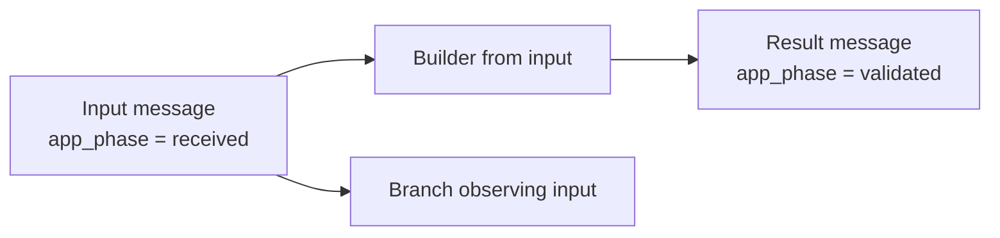

# MessageBuilder and Immutable Headers

In the **SPRING_INTEGRATION_CORE** module, **MessageBuilder** chapter, this lesson explains how to construct and transform messages while preserving metadata semantics. This is the foundation for connecting `Message`, `MessageChannel`, endpoints, and gateways into flows with Java DSL, and it helps transformers, routers, filters, and aggregators exchange data accurately.

An order may pass through normalization, routing, and aggregation steps. Each step needs to attach information such as ingestion source, correlation ID, or processing stage. With the immutable message model, a processing step creates a new result instead of mutating the input message's headers directly. However, this immutability has limits: a list placed inside a header can still be mutated if the application holds a reference to it.

## 1. Objectives and Prerequisites

After this lesson, you can:

- Create a `Message<T>` with `withPayload(...)` and derive from an existing message with `fromMessage(...)`.
- Choose the right operations to set, copy, and remove headers; explain overwrite ordering.
- Distinguish immutability of the header structure from immutability of referenced objects.
- Preserve business metadata when replacing the payload and distinguish message ID from event ID and correlation ID.
- Apply the builder inside a transformer, read results via a channel, and write tests for the message contract.

You should know Java generics, collections, object references, and the channel concept in Spring Integration. Examples use Java 17 syntax and the Spring Integration 6.5.0 API as a baseline. Test examples use JUnit Jupiter; they are illustrative code in the documentation and have not been compiled or executed as part of authoring this lesson.

## 2. In What Ways Is a Message Immutable?

### 2.1. Payload and Headers

A `Message<T>` has two primary accessors:

```java
T payload = message.getPayload();
MessageHeaders headers = message.getHeaders();
```

The payload represents the data being processed, such as an order. Headers carry metadata used for routing, correlation, replies, or tracking.

For a standard message created by the default builder:

- The `Message` interface provides no method to replace the payload.
- `MessageHeaders` exposes a `Map<String, Object>` read view, but structural mutation operations such as `put`, `remove`, `putAll`, and `clear` are rejected.
- Immutability of the outer wrapper does not automatically make the payload or header values immutable objects.

The following example throws `UnsupportedOperationException`:

```java
message.getHeaders().put("app_phase", "validated");
```

To obtain new headers, construct a resulting message. The operation contract on `MessageHeaders` is described in [MessageHeaders Javadoc](https://docs.spring.io/spring-framework/docs/current/javadoc-api/org/springframework/messaging/MessageHeaders.html).

### 2.2. The Builder Holds Mutable State

The builder holds mutable state while assembling a message:

```text
Create builder → set/copy/remove headers → build() → obtain Message
```

Each call to `setHeader(...)` updates the builder's state. After `build()`, downstream code receives a message with a read-only header structure in normal usage.

Because the builder is stateful, create a builder scoped to each processing run. Do not keep a builder as a shared field on a singleton service to construct messages for multiple requests. Even with sequential execution, headers from a previous request could leak into the next request.

### 2.3. Scope of the Immutability Rule

Spring also provides the `MessageHeaderAccessor` API, including mechanisms to leave headers mutable in certain infrastructure workflows. Therefore, do not interpret this as meaning every `Message` implementation has an unconditionally immutable object graph.

This lesson uses Spring Integration's default builder. In business code, the rule applied is to create a new result when changing metadata. Mechanisms like `setLeaveMutable(true)` require dedicated lifecycle management and are unnecessary for the examples here. See [MessageHeaderAccessor Javadoc](https://docs.spring.io/spring-framework/docs/current/javadoc-api/org/springframework/messaging/support/MessageHeaderAccessor.html).

## 3. Choosing the Right `MessageBuilder`

Two commonly encountered classes share the same name:

| Class | Role in This Lesson |
| --- | --- |
| `org.springframework.messaging.support.MessageBuilder` | Builder from Spring Framework, serving shared messaging abstractions. |
| `org.springframework.integration.support.MessageBuilder` | Builder from Spring Integration, providing extra utilities tied to integration metadata such as correlation and sequence. |

Both work with `org.springframework.messaging.Message<T>`. Throughout all examples below, the chosen imports are:

```java
import org.springframework.integration.support.MessageBuilder;
import org.springframework.messaging.Message;
import org.springframework.messaging.MessageHeaders;
```

Do not import both `MessageBuilder` classes by short name at the same time. When your IDE adds an import automatically, check the package if methods such as `setCorrelationId(...)` cannot be found.

Spring Integration's builder has two primary entry points: `withPayload(...)` and `fromMessage(...)`. See [MessageBuilder 6.5.0 Javadoc](https://docs.spring.io/spring-integration/docs/6.5.0/api/org/springframework/integration/support/MessageBuilder.html) and [Spring Framework builder source](https://raw.githubusercontent.com/spring-projects/spring-framework/v6.2.7/spring-messaging/src/main/java/org/springframework/messaging/support/MessageBuilder.java).

## 4. Creating a Message from a Payload

### 4.1. First Complete Example

```java
import java.util.Objects;

import org.springframework.integration.support.MessageBuilder;
import org.springframework.messaging.Message;

public class MessageCreationExample {

    public record Order(String orderId, String email) {
    }

    public static void main(String[] args) {
        Order order = new Order("ORD-1001", "buyer@example.com");

        Message<Order> message = MessageBuilder
                .withPayload(order)
                .setHeader("app_tenant", "shop-vn")
                .setHeader("app_source", "mobile")
                .setHeader("app_phase", "received")
                .build();

        String tenant = Objects.requireNonNull(
                message.getHeaders().get("app_tenant", String.class));

        System.out.println(message.getPayload().orderId());
        System.out.println(tenant);
        System.out.println(message.getHeaders().getId());
    }
}
```

The first two lines print `ORD-1001` and `shop-vn`. The final line prints the message ID assigned by the framework under default configuration.

The `app_` prefix in this lesson is a custom convention for application headers to help identify them when reading logs. It has no special meaning to Spring Integration.

### 4.2. Payload Must Be Non-Null

Do not use `withPayload(null)` to represent the absence of data. The builder validates the payload and rejects `null` values.

Choose based on business semantics:

- To drop a message from the flow: use a filter and decide explicitly where discarded messages are handled.
- To represent a not-found outcome: use an explicit result type, such as a record holding a status.
- To report an error: let the endpoint's error-handling mechanism manage it, or design an intentional error result type.

A transformer's job is to produce an output for an input. Returning `null` from a transformer is not a substitute for a filter. This rule is explained in the [Transformer documentation](https://docs.spring.io/spring-integration/reference/transformer.html).

### 4.3. Reading Headers with Type Checking

```java
String source = message.getHeaders().get("app_source", String.class);
```

If the header is absent, the result is `null`. If the existing value has an incompatible type, the typed getter throws an error; it does not automatically convert an `Integer` into a `String`.

For required headers, validate them at the entry of the processing step. Do not wait until a router or service at the end of the flow discovers bad data.

## 5. Transforming a Message While Keeping Input Intact

### 5.1. Keeping the Payload, Changing Headers with `fromMessage`

```java
Message<String> received = MessageBuilder
        .withPayload("ORD-1001")
        .setHeader("app_phase", "received")
        .setHeader("app_tenant", "shop-vn")
        .build();

Message<String> validated = MessageBuilder
        .fromMessage(received)
        .setHeader("app_phase", "validated")
        .setHeader("app_validator", "order-validator")
        .build();
```

Expected result:

| Property | `received` | `validated` |
| --- | --- | --- |
| Payload | `ORD-1001` | `ORD-1001`, reusing the same payload object |
| `app_phase` | `received` | `validated` |
| `app_tenant` | `shop-vn` | `shop-vn` |
| `app_validator` | Absent | `order-validator` |

The input still represents the received state. The output represents the validated state. This separation is useful when one branch needs to audit the original message while another branch continues processing.



The diagram shows two versions of metadata. It does not imply that the builder deep-cloned the payload or all header values.

### 5.2. Replacing the Payload with `withPayload` and `copyHeaders`

The builder does not provide an operation to swap the payload on an already-created builder. When normalizing a payload or changing to another type, start from the resulting payload:

```java
import java.util.Locale;

Message<String> raw = MessageBuilder
        .withPayload("  buyer@EXAMPLE.COM  ")
        .setHeader("app_tenant", "shop-vn")
        .setHeader("app_phase", "received")
        .build();

String normalizedEmail = raw.getPayload()
        .strip()
        .toLowerCase(Locale.ROOT);

Message<String> normalized = MessageBuilder
        .withPayload(normalizedEmail)
        .copyHeaders(raw.getHeaders())
        .setHeader("app_phase", "normalized")
        .build();
```

Using `Locale.ROOT` ensures lowercasing does not depend on the machine's default locale.

The `copyHeaders(...)` call expresses this example's policy: keep input metadata, then write the new phase. If you omit this operation in a plain Java message-building method, headers such as tenant, event ID, or reply channel are not copied automatically.

Some endpoints have their own header-propagation rules when creating replies. Therefore, distinguish the behavior of a standalone builder method from the behavior of the surrounding endpoint.

### 5.3. `fromMessage` Does Not Guarantee Allocating a New Object Every Time

With the default builder and no extra read-only configuration, the case with no modifications can return the original message:

```java
Message<String> result = MessageBuilder
        .fromMessage(received)
        .build();
```

This is a valid optimization. Do not treat calling `build()` as a guarantee that an independent copy is always created, nor use reference comparison to decide whether a business step has completed.

When headers actually change, as in the `validated` example, the builder creates a result message with new metadata. Details of the change check can be found in [BaseMessageBuilder 6.5.0 source](https://raw.githubusercontent.com/spring-projects/spring-integration/v6.5.0/spring-integration-core/src/main/java/org/springframework/integration/support/BaseMessageBuilder.java).

## 6. Rules for Setting, Copying, and Removing Headers

### 6.1. Choosing Operations by Overwrite Policy

| Operation | Policy for Regular Headers |
| --- | --- |
| `setHeader(name, value)` | Sets the value; replaces the old value if present. |
| `setHeaderIfAbsent(name, value)` | Sets only when no value is present. |
| `copyHeaders(map)` | Copies key–value pairs, overwriting colliding header names. |
| `copyHeadersIfAbsent(map)` | Fills in only missing headers. |
| `removeHeader(name)` | Removes one header by exact name. |
| `removeHeaders(patterns)` | Removes headers matching simple name patterns. |

Read-only system headers such as `id` and `timestamp` follow separate rules in the next section. The operation contract is documented in [AbstractIntegrationMessageBuilder Javadoc](https://docs.spring.io/spring-integration/docs/6.5.0/api/org/springframework/integration/support/AbstractIntegrationMessageBuilder.html).

### 6.2. Call Order Determines the Final Value

```java
import java.util.Map;

Map<String, Object> incomingHeaders = Map.of(
        "app_source", "mobile",
        "app_region", "south");

Message<String> first = MessageBuilder
        .withPayload("ORD-1001")
        .setHeader("app_source", "batch")
        .copyHeaders(incomingHeaders)
        .build();

Message<String> second = MessageBuilder
        .withPayload("ORD-1001")
        .copyHeaders(incomingHeaders)
        .setHeader("app_source", "batch")
        .build();

Message<String> third = MessageBuilder
        .withPayload("ORD-1001")
        .setHeader("app_source", "batch")
        .copyHeadersIfAbsent(incomingHeaders)
        .build();
```

The `app_source` values are `mobile`, `batch`, and `batch`, respectively. The `app_region` header is present in all three results.

A readable convention when processing an input message is:

1. Copy the metadata to keep.
2. Write the values the current step is responsible for deciding.
3. Add defaults using `IfAbsent` operations.
4. Remove metadata that no longer applies to the output.

This order clearly expresses authority over each value. If business requirements differ, change the order and test the final result.

### 6.3. A `null` Value Means Remove

```java
Message<String> withoutDebug = MessageBuilder
        .fromMessage(first)
        .setHeader("app_debug", null)
        .build();
```

For regular headers, `setHeader(name, null)` removes that header. It does not create an entry with a `null` value.

When the intent is deletion, the following style is usually clearer:

```java
Message<String> cleaned = MessageBuilder
        .fromMessage(first)
        .removeHeader("app_debug")
        .build();
```

If you need to distinguish "header absent" from a business state such as "unspecified," use an explicit value or an appropriate data type.

### 6.4. Broad Pattern-Based Removal

```java
Message<String> cleaned = MessageBuilder
        .fromMessage(first)
        .removeHeaders("app_debug_*", "app_internal_*")
        .build();
```

These are name patterns using `*`, not regular expressions. Avoid overly broad patterns like `"*"` unless you have accounted for all metadata that must be kept.

Removing headers in the result does not affect the input. However, that operation can deprive a downstream step of routing or correlation data. Check consumer contracts rather than judging solely by header names that look temporary.

## 7. `id`, `timestamp`, and Correlation Keys

### 7.1. Message ID Belongs to the Message Lifecycle

In default message construction, the framework manages:

- `MessageHeaders.ID`: UUID identifying a single message instance.
- `MessageHeaders.TIMESTAMP`: message creation time, as a `Long`.

Do not assign a business ID to `MessageHeaders.ID`:

```java
// Invalid with the default builder.
MessageBuilder.withPayload("ORD-1001")
        .setHeader(MessageHeaders.ID, "ORD-1001");
```

Directly setting read-only system headers is rejected. When copying a header map via `copyHeaders(...)`, `id` and `timestamp` are not used to overwrite the system values.

When the builder creates a new message after a change, the new message receives a fresh ID and timestamp under the default mechanism. Two timestamps can be equal if two messages are created within the same millisecond; do not test by requiring them to differ.

In the case where `fromMessage(...).build()` returns the input directly, it retains the input's own ID and timestamp. ID management and standard headers are explained in the [Message documentation](https://docs.spring.io/spring-integration/reference/message.html).

### 7.2. Choosing an Identifier Based on the Question to Answer

| Need | Suggested Header in Lesson | Lifecycle |
| --- | --- | --- |
| Identify the message instance currently being processed | `MessageHeaders.ID` | Tied to the framework-created message instance. |
| Identify a business event across multiple steps | `app_event_id` | Kept stable throughout the same event. |
| Know which tenant the data belongs to | `app_tenant` | Tied to the verified business context. |
| Group messages for an aggregator | `IntegrationMessageHeaderAccessor.CORRELATION_ID` | Tied to the designed integration group. |
| Trace an application request | `app_request_id` | Follows the application contract; does not automatically become distributed tracing. |

These are distinct roles. One request can produce multiple events; one event can be repackaged into multiple messages.

Example:

```java
import java.util.UUID;

import org.springframework.integration.IntegrationMessageHeaderAccessor;

String eventId = UUID.randomUUID().toString();

Message<String> incoming = MessageBuilder
        .withPayload("ORD-1001")
        .setHeader("app_event_id", eventId)
        .setCorrelationId("order-group-1001")
        .setHeader("app_phase", "received")
        .build();

Message<String> next = MessageBuilder
        .fromMessage(incoming)
        .setHeader("app_phase", "validated")
        .build();

Object correlationId = next.getHeaders().get(
        IntegrationMessageHeaderAccessor.CORRELATION_ID);
```

Both messages keep the same `app_event_id` and correlation key, while `next` has a new message ID under default configuration.

An application-defined header named `app_request_id` does not automatically configure tracing, and `app_event_id` does not automatically enable deduplication. To use an event ID for idempotency, you must have a corresponding storage/verification mechanism.

### 7.3. Do Not Use Message ID as the Application's Default Grouping Key

Suppose an order is split into line items for processing and later aggregated. If the application picks the current message ID as the grouping key after every transformation, items can end up split into different groups.

Define the correlation key according to the splitter and aggregator contract. If the framework has already set correlation and sequence headers for that flow, keep them until the corresponding aggregation step completes.

## 8. Shallow Immutability: Copying Headers Is Not Deep Copying

### 8.1. Mutable Values Can Still Be Modified

The following example is API-valid but creates shared mutable state:

```java
import java.util.ArrayList;
import java.util.List;

List<String> tags = new ArrayList<>();
tags.add("new");

Message<String> original = MessageBuilder
        .withPayload("ORD-1001")
        .setHeader("app_tags", tags)
        .build();

Message<String> derived = MessageBuilder
        .fromMessage(original)
        .setHeader("app_phase", "validated")
        .build();

tags.add("priority");

System.out.println(original.getHeaders().get("app_tags"));
System.out.println(derived.getHeaders().get("app_tags"));
```

Both reads see `[new, priority]`. Adding the element happens on the list object itself; the application never calls `put` on `MessageHeaders`.

The same thing can happen with:

- A payload that is a JavaBean with setters.
- A header containing a mutable `Map`, array, or collection.
- A mutable object nested inside a record or unmodifiable collection.

Keeping the same payload reference does not mean the payload's internal state stays unchanged.

### 8.2. Taking Snapshots for Application-Owned Data

For a list of strings, you can snapshot the value before putting it into the message:

```java
List<String> tagsSnapshot = List.copyOf(tags);

Message<String> stable = MessageBuilder
        .withPayload("ORD-1001")
        .setHeader("app_tags", tagsSnapshot)
        .build();

tags.clear();
```

Clearing `tags` does not remove elements from `tagsSnapshot`. Because the elements here are immutable `String` values, this approach fits the example's snapshot requirement.

If the list holds mutable `Customer` objects with setters, `List.copyOf(customers)` only protects the list structure. It does not clone each `Customer`. When a full snapshot is required, convert elements to immutable value types or intentionally copy each piece of data.

A record also only prevents its reference fields from being reassigned. A record with a `List<Item>` field still requires handling the collection and the state of each `Item`.

### 8.3. Implications for Multi-Branch Processing

In flows with concurrent consumers, mutable metadata or payloads can be modified by one branch while another branch is reading them. Bugs often manifest as data changing based on execution timing.

Design should make ownership clear:

- When sending data as a snapshot, use value types and collections suited to preserving that snapshot.
- When a branch needs to modify data, create output data for that branch.
- When you must use a mutable resource with its own lifecycle, manage synchronization and resource closing according to that component's contract.

Do not mechanically deep-copy infrastructure headers such as callbacks or channels. They carry control semantics and are typically tied to live resources.

## 9. Preserving Metadata According to Flow Contracts

### 9.1. Header Groups to Review During Transformation

| Group | Examples | What to Decide |
| --- | --- | --- |
| Business context | `app_tenant`, `app_event_id` | Do downstream steps continue processing in the same context? |
| Correlation and ordering | `correlationId`, `sequenceNumber`, `sequenceSize` | Does the message still belong to the same group to aggregate? |
| Reply | `replyChannel` | Does the flow need to reply to a caller or gateway? |
| Error handling | `errorChannel` | Which component will detect and forward errors? |
| Data representation | `contentType` | Does the new payload still have the same format? |
| Temporary diagnostics | `app_debug_*` | Should it be forwarded or excluded from the result? |

This is a design-decision table. It does not require keeping every header in all circumstances.

For example, when a payload changes from a JSON string to a Java object, re-check `contentType` before an outbound adapter. Similarly, a final aggregated message should not carry stale sequence metadata merely because a `copyHeaders` call copied it over.

### 9.2. `replyChannel` and `errorChannel` Do Not Create Behavior on Their Own

Setting `replyChannel` does not send a message automatically. An endpoint or reply-handling component must consume it.

Setting `errorChannel` also does not turn every exception into an error message sent to that channel. Whether exceptions are thrown back to the caller or published depends on the endpoint, gateway, poller, and execution boundary.

Therefore, when preserving reply or error behavior, inspect both the metadata and the configuration of the processing components. The builder only constructs the message.

### 9.3. Read-Only Headers After `build` and `readOnlyHeaders` Configuration Are Different Scopes

Read-only `MessageHeaders` refers to the access interface of an already-built message.

Spring Integration also provides `readOnlyHeaders(...)` on the builder and related configuration in the accessor to control which headers are allowed into a message. That is a construction-time policy, not a mechanism to declare a business header permanently immutable across all subsequent messages.

In particular, do not use this API to assume a tenant cannot be changed in another step. Validate the tenant at the ingestion boundary and uphold the contract with processing code, configuration, and tests. See [BaseMessageBuilder Javadoc](https://docs.spring.io/spring-integration/docs/6.5.0/api/org/springframework/integration/support/BaseMessageBuilder.html).

### 9.4. Crossing Brokers or System Boundaries Requires Different Policies

Within the same JVM, header values can be Java objects. When crossing a broker or external protocol, header mapping and serialization determine which values can be transmitted.

Do not assume a `MessageChannel`, callback, or domain object inside a header will be transmitted intact to another system. At integration boundaries, select header names, types, and subsets to export according to the specific adapter.

## 10. Hands-On: Normalizing Orders in Java DSL

This example focuses on three requirements:

1. Normalize the email in the payload by creating a new `Order`.
2. Preserve the input's tenant and metadata.
3. Set `app_phase=normalized`, keep an existing source if present, and add a default source if missing.

### 10.1. Configuration and Transformer

Put the following code in a Java file inside a project that already has Spring Integration Core. The example requires no broker or database.

```java
import java.util.Locale;
import java.util.Objects;

import org.springframework.context.annotation.Bean;
import org.springframework.context.annotation.Configuration;
import org.springframework.integration.channel.DirectChannel;
import org.springframework.integration.channel.QueueChannel;
import org.springframework.integration.config.EnableIntegration;
import org.springframework.integration.dsl.IntegrationFlow;
import org.springframework.integration.support.MessageBuilder;
import org.springframework.messaging.Message;

@Configuration
@EnableIntegration
public class OrderFlowConfiguration {

    public record Order(String orderId, String email) {
    }

    public static class OrderNormalizer {

        public Message<Order> normalize(Message<Order> input) {
            String tenant = Objects.requireNonNull(
                    input.getHeaders().get("app_tenant", String.class),
                    "Missing app_tenant");

            if (tenant.isBlank()) {
                throw new IllegalArgumentException("app_tenant must not be blank");
            }

            Order current = input.getPayload();
            String email = Objects.requireNonNull(
                    current.email(), "Missing email");

            Order normalized = new Order(
                    current.orderId(),
                    email.strip().toLowerCase(Locale.ROOT));

            return MessageBuilder
                    .withPayload(normalized)
                    .copyHeaders(input.getHeaders())
                    .setHeader("app_phase", "normalized")
                    .setHeaderIfAbsent("app_source", "order-api")
                    .build();
        }
    }

    @Bean
    public DirectChannel ordersInput() {
        return new DirectChannel();
    }

    @Bean
    public QueueChannel ordersOutput() {
        return new QueueChannel();
    }

    @Bean
    public IntegrationFlow normalizeOrdersFlow(
            DirectChannel ordersInput,
            QueueChannel ordersOutput) {

        return IntegrationFlow
                .from(ordersInput)
                .transform(new OrderNormalizer(), "normalize")
                .channel(ordersOutput)
                .get();
    }
}
```

`@EnableIntegration` enables the integration infrastructure for this configuration. Because the example does not declare a gateway yet, no gateway-scanning annotation is needed.

The transformer accepts the full message because it needs to read the tenant and build a result containing both payload and headers. A transformer that only converts the payload can use a simpler signature.

### 10.2. Sending Input and Reading Output

```java
import java.util.Objects;
import java.util.UUID;

import org.springframework.context.annotation.AnnotationConfigApplicationContext;
import org.springframework.integration.channel.DirectChannel;
import org.springframework.integration.channel.QueueChannel;
import org.springframework.integration.support.MessageBuilder;
import org.springframework.messaging.Message;

public class OrderFlowDemo {

    public static void main(String[] args) {
        try (var context = new AnnotationConfigApplicationContext(
                OrderFlowConfiguration.class)) {

            DirectChannel input = context.getBean(
                    "ordersInput", DirectChannel.class);
            QueueChannel output = context.getBean(
                    "ordersOutput", QueueChannel.class);

            String eventId = UUID.randomUUID().toString();

            Message<OrderFlowConfiguration.Order> request = MessageBuilder
                    .withPayload(new OrderFlowConfiguration.Order(
                            "ORD-1001", "  Buyer@EXAMPLE.COM "))
                    .setHeader("app_tenant", "shop-vn")
                    .setHeader("app_event_id", eventId)
                    .setHeader("app_source", "mobile")
                    .setHeader("app_phase", "received")
                    .build();

            if (!input.send(request)) {
                throw new IllegalStateException("Message was not accepted");
            }

            Message<?> result = Objects.requireNonNull(
                    output.receive(1_000),
                    "No result within timeout");

            System.out.println(request.getPayload().email());
            System.out.println(result.getPayload());
            System.out.println(result.getHeaders().get("app_phase"));
            System.out.println(result.getHeaders().get("app_source"));
            System.out.println(result.getHeaders().get("app_event_id"));
        }
    }
}
```

Results to observe:

| Value | Expectation |
| --- | --- |
| Email in `request` | Still the original string with whitespace and uppercase letters. |
| Email in result payload | `buyer@example.com`. |
| `app_phase` in result | `normalized`. |
| `app_source` in result | `mobile`, because `setHeaderIfAbsent` preserves the existing value. |
| `app_event_id` in result | Matches the request's value. |
| Message ID of result | Differs from the input message ID under default behavior. |

The `DirectChannel` at the input invokes the consumer on the example's sending thread. The `QueueChannel` at the end of the flow holds the result for the program to receive with `receive(...)`; no poller is needed because no endpoint is declared to consume from this queue.

If `app_tenant` is missing, the normalizer throws an error. The example does not configure a separate error flow; do not assume the error goes into the output queue automatically.

### 10.3. When Only Adding Headers, Use a Header Enricher

If there is no need to change the payload, Java DSL can express metadata addition directly:

```java
@Bean
public IntegrationFlow markOrdersFlow() {
    return IntegrationFlow
            .from("ordersToMark")
            .enrichHeaders(headers -> headers
                    .header("app_phase", "validated", true)
                    .header("app_source", "order-api", false))
            .channel("markedOrders")
            .get();
}
```

Here, `true` allows overwriting `app_phase`; `false` keeps an existing `app_source`. State the policy explicitly so readers do not have to guess the enricher's default overwrite behavior.

A header enricher fits when changes are limited to metadata. Use a builder inside a transformer when logic must coordinate creating a new payload with custom header policies. The official documentation provides examples of [Header Enricher with Java DSL](https://docs.spring.io/spring-integration/reference/content-enrichment.html#header-enricher).

## 11. Testing the Message Contract

The following tests focus on observable outcomes: the input stays intact, metadata has the right values, and snapshot collections cannot be mutated from outside.

```java
import static org.junit.jupiter.api.Assertions.assertEquals;
import static org.junit.jupiter.api.Assertions.assertFalse;
import static org.junit.jupiter.api.Assertions.assertNotEquals;
import static org.junit.jupiter.api.Assertions.assertSame;
import static org.junit.jupiter.api.Assertions.assertThrows;
import static org.junit.jupiter.api.Assertions.assertTrue;

import java.util.ArrayList;
import java.util.List;
import java.util.Map;

import org.junit.jupiter.api.Test;
import org.springframework.integration.support.MessageBuilder;
import org.springframework.messaging.Message;

class MessageBuilderContractTest {

    @Test
    void builtHeadersRejectStructuralChanges() {
        Message<String> message = MessageBuilder
                .withPayload("ORD-1001")
                .setHeader("app_phase", "received")
                .build();

        assertThrows(UnsupportedOperationException.class,
                () -> message.getHeaders().put("app_phase", "changed"));

        assertThrows(UnsupportedOperationException.class,
                () -> message.getHeaders().remove("app_phase"));
    }

    @Test
    void derivingMessageKeepsInputAndBusinessIdentity() {
        Message<String> input = MessageBuilder
                .withPayload("ORD-1001")
                .setHeader("app_event_id", "EVENT-9001")
                .setHeader("app_phase", "received")
                .build();

        Message<String> output = MessageBuilder
                .fromMessage(input)
                .setHeader("app_phase", "validated")
                .build();

        assertEquals("received", input.getHeaders().get("app_phase"));
        assertEquals("validated", output.getHeaders().get("app_phase"));
        assertEquals("EVENT-9001",
                output.getHeaders().get("app_event_id"));
        assertSame(input.getPayload(), output.getPayload());
        assertNotEquals(input.getHeaders().getId(),
                output.getHeaders().getId());
    }

    @Test
    void defaultsDoNotOverwriteExistingMetadata() {
        Message<String> output = MessageBuilder
                .withPayload("ORD-1001")
                .setHeader("app_source", "mobile")
                .copyHeadersIfAbsent(Map.of(
                        "app_source", "batch",
                        "app_region", "south"))
                .build();

        assertEquals("mobile", output.getHeaders().get("app_source"));
        assertEquals("south", output.getHeaders().get("app_region"));
    }

    @Test
    void immutableSnapshotProtectsAgainstLaterListChanges() {
        List<String> originalTags = new ArrayList<>();
        originalTags.add("new");

        Message<String> unsafe = MessageBuilder
                .withPayload("ORD-1001")
                .setHeader("app_tags", originalTags)
                .build();

        Message<String> safe = MessageBuilder
                .withPayload("ORD-1001")
                .setHeader("app_tags", List.copyOf(originalTags))
                .build();

        originalTags.add("priority");

        List<?> unsafeTags = unsafe.getHeaders().get(
                "app_tags", List.class);
        List<?> safeTags = safe.getHeaders().get(
                "app_tags", List.class);

        assertTrue(unsafeTags.contains("priority"));
        assertFalse(safeTags.contains("priority"));
        assertEquals(List.of("new"), safeTags);
    }
}
```

The message ID comparison test above assumes the default ID generation mechanism. If the project configures a custom `IdGenerator`, adjust the expectation according to the chosen contract.

For the normalizer from the previous section, also test the following outcomes once integrated into the project:

- Input email is unchanged and output email is normalized.
- Required tenant, event ID, and reply channel are preserved.
- An existing source is preserved; a missing source receives the default value.
- A missing or wrongly typed tenant is rejected according to the defined policy.

Do not claim illustrative code has been executed solely on the basis that the documentation file was written successfully.

## 12. Common Mistakes and How to Fix Them

| Symptom | Common Cause | How to Fix |
| --- | --- | --- |
| `UnsupportedOperationException` when adding a header | Calling `put` on `message.getHeaders()`. | Use the builder and continue the flow with the resulting message. |
| Header disappears after payload-change step | Built a new message without applying a metadata propagation policy. | Copy or explicitly select the headers that need to be kept. |
| Source is replaced by default value | Used `setHeader` or `copyHeaders` in an overwriting position. | Use `IfAbsent` operations when existing values take priority. |
| Just-set value is overwritten again | A subsequent copy call overwrites the same name. | Order the builder chain by value authority. |
| "Immutable" header still changes contents | Header value is a shared mutable object. | Create a snapshot or use an immutable value type. |
| Aggregator does not receive the expected group | Lost or altered correlation/sequence in a transformation step. | Inspect metadata at the output of each relevant step. |
| `setCorrelationId` not found | Imported Spring Framework's builder in an example using Integration APIs. | Choose the right package or use the corresponding header constant. |
| Message ID changes break deduplication | Used the message instance's identifier as the event identifier. | Design a stable event ID and an appropriate idempotency mechanism. |
| Flaky timestamp tests | Required two consecutive creations to fall in different milliseconds. | Test a realistic time contract, avoiding non-existent resolution assumptions. |
| Gateway receives no reply | Lost reply metadata or endpoint configuration does not produce replies properly. | Check `replyChannel`, output channel, and endpoint reply behavior. |

## 13. Workflow When Building a Processing Step

Start by determining whether the step replaces the payload or only changes metadata. Use `fromMessage` when keeping the payload, or `withPayload` with the resulting payload when transforming it.

Next, classify headers to keep, update, and remove according to downstream consumers. For request–reply flows, check reply metadata. For split-and-aggregate flows, check correlation and sequence headers. For protocol boundaries, check the data types accepted by adapters.

Then inspect mutable objects in the application-owned payload and headers. Decide whether data is being sent as a snapshot or as a resource with its own lifecycle.

Finally, test the output values and the integrity of the input. The presence of a `MessageBuilder` chain in code is not enough to prove the message contract holds; the results observed by consumers confirm it.
