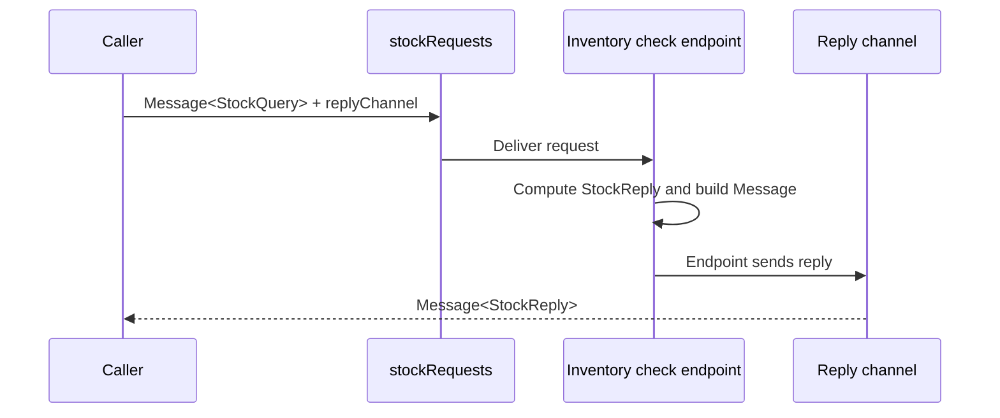

# Building Reply Messages

In the **SPRING_INTEGRATION_CORE** module, building a reply message is the step that turns a processing result into a message carrying enough data and context to continue the flow or return to the caller. This lesson belongs to the **MessageBuilder** chapter and focuses on creating replies in Java, setting headers intentionally, and connecting replies with endpoints, Java DSL, and gateways.

Running scenario: the application asks the warehouse whether there is enough stock for a purchase request. The request contains the item SKU and quantity; the reply contains the available stock and whether the request can be fulfilled. The warehouse only looks up data; it does not reserve or deduct stock yet.

After this lesson, you can:

- Choose between returning a payload and returning a `Message<T>` from an endpoint.
- Use `withPayload`, `fromMessage`, and header-copying methods for their intended purpose.
- Distinguish message identity, conversation correlation, and reply destination address.
- Design a reply path through Java DSL or a gateway, while recognizing missing-reply and lost-header bugs.

## 1. A Reply Consists of Result Data and Exchange Context

A reply is still a standard `Message<T>`. Its "reply" role comes from being the result of a request and being routed to wherever that result is awaited.

Example inventory-check contract:

| Component | Example | Meaning |
| --- | --- | --- |
| Request payload | `StockQuery("BOOK-01", 3)` | Asks whether the warehouse can fulfill 3 items |
| Reply payload | `StockReply("BOOK-01", 3, 8, true)` | 8 items are available and the request is accepted |
| `traceId` | `trace-2026-001` | Tracks the execution path of the processing run |
| `replyChannel` | A channel supplied by the caller | Destination to receive the result |
| `correlationId` | Agreed-upon conversation identifier | Links messages within the same exchange |

An "insufficient stock" outcome can still be a valid business reply, such as `accepted=false`. There is no need to turn every unfavorable outcome into an exception.

Distinguish three operations:

1. **Compute the result:** execute business logic.
2. **Create the message:** package payload and headers with the builder.
3. **Send the message:** the endpoint or channel-calling code performs message delivery.

`build()` completes the second operation. It does not look up a channel, invoke an endpoint, or wait for a receiver.



In a synchronous flow, these steps can run on the same thread. The word "reply" does not imply the flow must be asynchronous.

## 2. Choosing the Right API and Understanding Immutability

The examples use Spring Integration's builder:

```java
import org.springframework.integration.IntegrationMessageHeaderAccessor;
import org.springframework.integration.support.MessageBuilder;
import org.springframework.messaging.Message;
import org.springframework.messaging.MessageHeaders;
```

Spring Framework also has a class with the same name, `org.springframework.messaging.support.MessageBuilder`. Both classes create `Message<T>`, but their sets of methods are not completely identical. In this lesson, calls like `setCorrelationId(...)` belong to Spring Integration's builder; check imports if your IDE reports a missing method. See [Spring Integration MessageBuilder API](https://docs.spring.io/spring-integration/api/org/springframework/integration/support/MessageBuilder.html).

Do not mutate headers by calling `request.getHeaders().put(...)`. Build the required message through the builder. A payload or an object inside a header can still be a mutable object; copying headers does not deep-copy every value. If two messages share a mutable `List`, modifying the list can still affect both. The [Message](https://docs.spring.io/spring-integration/reference/message.html) documentation clearly separates message structure from mutability of objects contained inside.

For replies, prefer an independent result payload, such as a Java record. This avoids accidentally mutating the request while building the response.

## 3. Using the Builder According to Reply Intent

### 3.1. New Payload: Start with `withPayload`

Requests and replies often have different data types. Minimal example:

```java
Message<String> request = MessageBuilder
        .withPayload("book-01")
        .setHeader("traceId", "trace-2026-001")
        .build();

Message<String> reply = MessageBuilder
        .withPayload(request.getPayload().toUpperCase(java.util.Locale.ROOT))
        .copyHeaders(request.getHeaders())
        .setHeader("resultSource", "catalog")
        .build();
```

The payload of `reply` is `BOOK-01`; `traceId` is kept and `resultSource` is added. This snippet only constructs two messages in memory and does not send a reply yet.

When the type changes from `StockQuery` to `StockReply`, use the same structure:

```java
StockReply result = new StockReply("BOOK-01", 3, 8, true);

Message<StockReply> reply = MessageBuilder
        .withPayload(result)
        .copyHeaders(request.getHeaders())
        .setHeader("resultSource", "stock")
        .build();
```

The two records `StockQuery` and `StockReply` are defined in the complete example in Section 6.

### 3.2. Keeping the Payload: `fromMessage` Fits Adding Context

`fromMessage(request)` starts from the request's payload and headers. It fits when forwarding the same data with a metadata change:

```java
Message<String> forwarded = MessageBuilder
        .fromMessage(request)
        .setHeader("checkedBy", "catalog")
        .build();
```

`forwarded` still holds the original payload. Calling `fromMessage` alone does not turn a request payload into a business result.

The builder preserves the selected payload type and provides no `setPayload(...)` to swap the payload arbitrarily. Once you have computed a different result, start with `withPayload(result)`.

Also do not treat `fromMessage(message).build()` as a forced way to allocate a new copy. When no changes need to be applied, the builder may return the original message. This behavior is noted in [BaseMessageBuilder API](https://docs.spring.io/spring-integration/api/org/springframework/integration/support/BaseMessageBuilder.html).

### 3.3. Header-Copying Order Determines the Final Value

`copyHeaders(...)` can overwrite headers currently in the builder. `copyHeadersIfAbsent(...)` only fills in headers that do not exist yet.

Suppose the request has `resultSource=client`:

```java
Message<String> reply = MessageBuilder
        .withPayload("OK")
        .copyHeaders(request.getHeaders())
        .setHeader("resultSource", "stock")
        .build();
```

The result is `resultSource=stock`, because the reply's value is set after the copy step.

The same intent can be expressed with the reverse order:

```java
Message<String> reply = MessageBuilder
        .withPayload("OK")
        .setHeader("resultSource", "stock")
        .copyHeadersIfAbsent(request.getHeaders())
        .build();
```

Choose a consistent ordering convention within a project. A readable convention is "inherit context first, set result-specific values afterward."

`setHeader(name, null)` removes a header from the builder; it does not create a `null` header value. These operations are described in [Spring Framework MessageBuilder API](https://docs.spring.io/spring-framework/docs/current/javadoc-api/org/springframework/messaging/support/MessageBuilder.html); Spring Integration's builder provides corresponding operations.

## 4. Message Identity, Correlation, and Reply Address

The following metadata items address distinct needs:

| Header | Question It Answers | How Used in Examples |
| --- | --- | --- |
| `MessageHeaders.ID` | Which specific message instance is this? | Framework generates an identifier for a new message |
| `IntegrationMessageHeaderAccessor.CORRELATION_ID` | Which conversation or group does this message belong to? | Keep existing correlation; if absent, fall back to request ID by example convention |
| `MessageHeaders.REPLY_CHANNEL` | Where should the result go? | Keep the address provided by the caller or gateway |
| Application header `traceId` | Which key looks up this processing run in logs? | Inherit the tracking key managed by the application |

Do not use the reply's `id` to pretend to be the request's `id`. With the usual `withPayload(...).copyHeaders(...)` reply-building path, the framework manages `id` and `timestamp`; those values are not copied like application headers. Two messages created close together can still share the same millisecond timestamp, so asserting "timestamps must differ" is not a valid check in all cases.

Example choosing correlation:

```java
Message<StockReply> reply = MessageBuilder
        .withPayload(result)
        .copyHeaders(request.getHeaders())
        .setHeaderIfAbsent(
                IntegrationMessageHeaderAccessor.CORRELATION_ID,
                request.getHeaders().getId())
        .build();
```

This is an **example convention**, not a guarantee that Spring Integration automatically sets every reply's correlation ID to the request ID. If the request already carries a correlation ID, this code preserves it.

In a flow with a splitter and aggregator, the correlation ID may already be identifying a group. Overwriting it mid-flow can prevent items from being grouped properly. When you need an extra business key such as an order code, consider a dedicated header like `orderId` with well-defined semantics.

Nor is a correlation ID a delivery address. Two messages sharing a correlation ID do not mean the framework automatically knows which gateway should receive the reply. An internal gateway's return path typically relies on a temporary channel stored in a header, while out-of-process protocols have their own mapping mechanisms.

## 5. How Does an Endpoint Choose the Reply Channel?

Consider a standard service activator **without a routing slip configured**. When the method returns a non-`null` result, the destination resolution order is:

| Order | Destination Source | Example |
| --- | --- | --- |
| 1 | Output channel configured on the endpoint | `outputChannel="stockReplies"` or the next channel in DSL |
| 2 | `replyChannel` on the request | Temporary channel added by a gateway |
| 3 | `replyChannel` on the result message, if the request lacks one | Handler returns a message carrying the address |
| 4 | No destination found | Destination resolution error occurs |

If the header is a channel name, that name must resolve to a channel in the appropriate context. If it is a `MessageChannel`, the endpoint uses that channel instance. This rule is documented in [Service Activator](https://docs.spring.io/spring-integration/reference/service-activator.html).

This has two design consequences:

- Setting a different `replyChannel` on the returned message will not necessarily change the current endpoint's send target, because the request may already supply a higher-precedence address.
- An endpoint with an output channel forwards the result to the next step. The final step of the chain still needs a path back to the caller if the contract is request–reply.

For example, if a flow runs a stock check and then logs the result to a `void`-returning service, the result may stop at that final service. Having the stock-check step build a proper `Message<StockReply>` is not enough by itself for a gateway to receive the reply.

When a routing slip is present, the endpoint also processes that slip before falling back to the reply channel mechanism. Accordingly, the table above is explicitly scoped to the no-routing-slip case.

## 6. Complete Example: Checking Inventory with Java DSL

The example below uses Java 17 or later, Spring Integration Core 6.x with Java DSL, and compatible Spring dependencies. You can use the dependency set managed by Spring Boot; do not mix incompatible Spring version lines manually. If using a newer Java version or a different Spring Integration line, choose dependencies matching that platform.

This is a standalone illustrative class in the `example.reply` package. The program starts a Spring context, sends a request, and receives the reply via a `QueueChannel`.

```java
package example.reply;

import java.util.Map;

import org.springframework.context.annotation.AnnotationConfigApplicationContext;
import org.springframework.context.annotation.Bean;
import org.springframework.context.annotation.Configuration;
import org.springframework.integration.IntegrationMessageHeaderAccessor;
import org.springframework.integration.channel.DirectChannel;
import org.springframework.integration.channel.QueueChannel;
import org.springframework.integration.config.EnableIntegration;
import org.springframework.integration.dsl.IntegrationFlow;
import org.springframework.integration.support.MessageBuilder;
import org.springframework.messaging.Message;
import org.springframework.messaging.MessageChannel;

public final class StockReplyDemo {

    public record StockQuery(String sku, int quantity) {
    }

    public record StockReply(
            String sku,
            int requested,
            int available,
            boolean accepted) {
    }

    public static final class StockService {

        private final Map<String, Integer> stock =
                Map.of("BOOK-01", 8, "PEN-01", 20);

        public Message<StockReply> reply(Message<StockQuery> request) {
            StockQuery query = request.getPayload();

            if (query.sku() == null
                    || query.sku().isBlank()
                    || query.quantity() <= 0) {
                throw new IllegalArgumentException(
                        "sku must have a value and quantity must be greater than 0");
            }

            int available = stock.getOrDefault(query.sku(), 0);
            boolean accepted = available >= query.quantity();

            StockReply result = new StockReply(
                    query.sku(),
                    query.quantity(),
                    available,
                    accepted);

            return MessageBuilder
                    .withPayload(result)
                    .copyHeaders(request.getHeaders())
                    .setHeaderIfAbsent(
                            IntegrationMessageHeaderAccessor.CORRELATION_ID,
                            request.getHeaders().getId())
                    .setHeader("resultSource", "stock")
                    .build();
        }
    }

    @Configuration(proxyBeanMethods = false)
    @EnableIntegration
    public static class FlowConfiguration {

        @Bean
        public DirectChannel stockRequests() {
            return new DirectChannel();
        }

        @Bean
        public StockService stockService() {
            return new StockService();
        }

        @Bean
        public IntegrationFlow stockFlow(
                DirectChannel stockRequests,
                StockService stockService) {

            return IntegrationFlow
                    .from(stockRequests)
                    .handle(stockService, "reply",
                            endpoint -> endpoint.requiresReply(true))
                    .get();
        }
    }

    public static void main(String[] args) {
        try (var context = new AnnotationConfigApplicationContext(
                FlowConfiguration.class)) {

            QueueChannel replies = new QueueChannel(1);

            Message<StockQuery> request = MessageBuilder
                    .withPayload(new StockQuery("BOOK-01", 3))
                    .setHeader("traceId", "trace-2026-001")
                    .setReplyChannel(replies)
                    .build();

            MessageChannel requests =
                    context.getBean("stockRequests", MessageChannel.class);

            if (!requests.send(request, 1000)) {
                throw new IllegalStateException("Failed to send request");
            }

            Message<?> response = replies.receive(1000);
            if (response == null) {
                throw new IllegalStateException("No reply received");
            }

            System.out.println(response.getPayload());
            System.out.println(response.getHeaders().get("traceId"));
        }
    }
}
```

Expected payload output:

```text
StockReply[sku=BOOK-01, requested=3, available=8, accepted=true]
trace-2026-001
```

The `IntegrationFlow` configuration is registered as a Spring bean; the DSL creates the required endpoints and channels in the context. See registration mechanics in [Java DSL](https://docs.spring.io/spring-integration/reference/dsl.html).

Path taken in the example:

1. The caller places `replies` in the request's `replyChannel`.
2. `DirectChannel` delivers the request to the service activator created by `.handle(...)`.
3. `StockService.reply(...)` computes the result and builds a new message.
4. Because the endpoint has no fixed output channel, it sends the result to the address in the request.
5. The caller reads the result from `replies`.

`StockService` does not call `replies.send(...)`. It returns the message for the endpoint to manage. If a method both sends the reply manually and returns it to the endpoint, the receiver could receive two results.

Here `QueueChannel` serves as a holder for the caller to read results; no endpoint polls requests from it, so no poller needs to be configured. Requests through `DirectChannel` are still processed synchronously. Sending and receiving semantics on queues are covered in [Message Channel Implementations](https://docs.spring.io/spring-integration/reference/channel/implementations.html).

Business limitation of the example: `accepted=true` only reflects a snapshot of the queried data. It does not guarantee another purchase transaction will not consume that stock before this order is processed.

## 7. When Is Returning Just the Payload Enough?

If the method only needs to produce result data and does not set custom headers, it can return `StockReply` directly:

```java
public StockReply check(StockQuery query) {
    int available = 8;
    return new StockReply(
            query.sku(),
            query.quantity(),
            available,
            available >= query.quantity());
}
```

When this method is invoked via a service activator, the endpoint builds a reply message from the return value. A direct Java call to `check(...)` only receives a `StockReply` object; such a call does not run an integration flow.

Choose the return type based on your needs:

| Need | Suitable Expression |
| --- | --- |
| Only produce result data | Return the payload |
| Set custom headers on the result | Return `Message<StockReply>` built with the builder |
| Convert data format between steps | Consider a transformer |
| Only perform an action with no reply contract | Can use a `void` method |
| Require a result to be produced | Enable `requiresReply` on the appropriate endpoint |

Parameter-binding and return-value contracts for service activators are documented in [ServiceActivator API](https://docs.spring.io/spring-integration/api/org/springframework/integration/annotation/ServiceActivator.html).

With a standard service activator, the framework may add missing request headers to the output message according to the endpoint's propagation policy. Therefore, do not conclude that "returning a message built solely with `withPayload` always loses all headers." The final outcome depends on the endpoint.

Conversely, a transformer returning a `Message` is treated as having supplied the complete output message, including responsibility for any headers to keep. Do not mechanically generalize service activator behavior to every endpoint type. See [Transformer](https://docs.spring.io/spring-integration/reference/transformer.html).

In the inventory example, copying headers is written explicitly so the reply-building method has clearly observable behavior even when tested via a direct Java call.

## 8. Using a Gateway So Callers Receive Business Results

A gateway lets callers interact through an interface instead of constructing request messages and reading channels manually. You can reuse the flow from Section 6 with the following interface in the same package:

```java
package example.reply;

import org.springframework.integration.annotation.MessagingGateway;

@MessagingGateway(
        defaultRequestChannel = "stockRequests",
        defaultReplyTimeout = "1500")
public interface StockGateway {

    StockReplyDemo.StockReply check(StockReplyDemo.StockQuery query);
}
```

Enable gateway scanning with an additional configuration class:

```java
package example.reply;

import org.springframework.context.annotation.Configuration;
import org.springframework.integration.annotation.IntegrationComponentScan;

@Configuration(proxyBeanMethods = false)
@IntegrationComponentScan(basePackageClasses = StockGateway.class)
public class GatewayConfiguration {
}
```

When using a manual context as in the example, register both `StockReplyDemo.FlowConfiguration.class` and `GatewayConfiguration.class` in `AnnotationConfigApplicationContext`. Then retrieve the `StockGateway` bean and invoke it:

```java
StockGateway gateway = context.getBean(StockGateway.class);

StockReplyDemo.StockReply result = gateway.check(
        new StockReplyDemo.StockQuery("BOOK-01", 3));
```

A standard gateway creates a temporary reply channel and sets that address on the request. With the interface above, the caller receives a `StockReply` payload; if you need to inspect headers at the call boundary, design the method to return `Message<StockReplyDemo.StockReply>`.

The value `1500` is the reply wait timeout in milliseconds, not a mechanism that forcibly aborts the service. In a purely synchronous processing chain, a slow service running on the calling thread can cause the call to take longer than this threshold. Do not rely on reply timeout alone to cap total business execution time.

Temporary channels, gateway configuration, and timeout limits are explained in [Messaging Gateways](https://docs.spring.io/spring-integration/reference/gateway.html).

## 9. Keeping and Dropping Headers at Flow Boundaries

Copying all headers is convenient for an internal example. In a real system, each header needs a clear scope of use.

An illustrative policy for the inventory-check flow:

| Header Group | Suggested Policy for This Scenario |
| --- | --- |
| `traceId`, business request key | Keep so the caller can reconcile results |
| `replyChannel` | Keep the return path in internal flows |
| `errorChannel` | Keep when downstream steps still need error-handling context |
| Result headers such as `resultSource` | Set by the service producing the result |
| Temporary data-reading headers | Remove after the last step that uses them |
| Headers holding authentication info | Forward only to steps that need them per the application contract |
| `id`, `timestamp` | Let the framework manage them via message creation |

This is a design decision for the example, not a default header list applicable to every system.

### 9.1. Removing Only in the Builder May Not Be Enough

Suppose the service builds the reply using:

```java
Message<StockReply> reply = MessageBuilder
        .withPayload(result)
        .copyHeaders(request.getHeaders())
        .removeHeader("transportHint")
        .build();
```

At the moment the method returns, this message lacks `transportHint`. However, a service activator configured to copy missing request headers might put that header back before sending.

If you want to strip headers at an explicit boundary in the flow, place a header filter after the service:

```java
return IntegrationFlow
        .from(stockRequests)
        .handle(stockService, "reply",
                endpoint -> endpoint.requiresReply(true))
        .headerFilter("transportHint")
        .get();
```

Or configure `notPropagatedHeaders` on the endpoint to block automatically copying the corresponding header. That option controls automatic copying from the request; it does not remove a header that the handler placed directly into the reply.

Header-enrichment and `notPropagatedHeaders` mechanics can be inspected in [AbstractMessageProducingHandler 6.5.x source](https://raw.githubusercontent.com/spring-projects/spring-integration/6.5.x/spring-integration-core/src/main/java/org/springframework/integration/handler/AbstractMessageProducingHandler.java).

### 9.2. An Internal Channel Is Not a Network Address

A `MessageChannel` object inside a header only has meaning within the process and context using it. You cannot simply serialize this object into JSON for another application to call back.

If a flow extends over HTTP, JMS, or AMQP, define that protocol's request–reply contract: where responses arrive, correlation keys, and header-mapping rules. That problem requires configuring the corresponding gateway or adapter, going beyond constructing messages with a builder.

For the inventory-check lesson, simply keep the boundary clear: internal messages operate within the same application; outbound data requires its own transport contract.

## 10. Normal Reply, Missing Reply, and Exceptions

Three outcomes must be distinguished:

| Processing Outcome | Inventory Example | Behavior to Design |
| --- | --- | --- |
| Business reply produced | Insufficient stock, `accepted=false` | Caller receives the data and decides the next step |
| No reply produced | Service returns `null` | May cause the caller to time out |
| Exception thrown | Input violates contract or inventory system fails | Propagate or handle error via appropriate error mechanism |

In the example, `requiresReply(true)` makes the endpoint throw an error when the method returns `null`, rather than ending silently. It does not guarantee the caller will receive a result: send errors, misrouted destinations, downstream message filtering, or caller timeouts can still happen.

Do not use `MessageBuilder.withPayload(null)` as an "empty reply." The payload must be non-`null`. If business rules allow "not found," design an explicit payload such as `StockReply` with a clear status or a dedicated result type.

With a synchronous `DirectChannel`, exceptions from a handler typically propagate back on the sending thread. Simply setting `errorChannel` in a header does not mean every exception in a synchronous call turns into an error message on that channel.

In flows using an executor or poller, Spring Integration has mechanisms to publish an `ErrorMessage` through an appropriate error handler. Whether the caller receives a fallback reply depends on the configured error-handling flow. Do not treat `errorChannel` as another name for `replyChannel`. See [Error Handling](https://docs.spring.io/spring-integration/reference/error-handling.html).

In the inventory-check example, the chosen design is: insufficient stock returns a normal reply, while contract-violating input throws an exception. Another application may choose a dedicated business-error payload, but that contract must be agreed upon with callers.

## 11. Testing Reply Creation and Delivery Behavior

Two levels of testing complement each other:

- Call the service directly to inspect the payload and headers it builds.
- Send through the flow to verify the endpoint actually delivers the result to the expected channel.

The JUnit 5 snippet below uses the classes from Section 6. Place it in the `example.reply` package of a project with compatible test dependencies.

```java
package example.reply;

import org.junit.jupiter.api.Test;
import org.springframework.context.annotation.AnnotationConfigApplicationContext;
import org.springframework.integration.IntegrationMessageHeaderAccessor;
import org.springframework.integration.channel.QueueChannel;
import org.springframework.integration.support.MessageBuilder;
import org.springframework.messaging.Message;
import org.springframework.messaging.MessageChannel;

import static org.junit.jupiter.api.Assertions.*;

class StockReplyTest {

    @Test
    void createsReplyWithNewIdentityAndExistingConversation() {
        QueueChannel replies = new QueueChannel(1);

        Message<StockReplyDemo.StockQuery> request = MessageBuilder
                .withPayload(new StockReplyDemo.StockQuery("BOOK-01", 3))
                .setHeader("traceId", "trace-001")
                .setHeader("resultSource", "client")
                .setCorrelationId("conversation-001")
                .setReplyChannel(replies)
                .build();

        Message<StockReplyDemo.StockReply> reply =
                new StockReplyDemo.StockService().reply(request);

        assertEquals(
                new StockReplyDemo.StockReply("BOOK-01", 3, 8, true),
                reply.getPayload());
        assertNotEquals(
                request.getHeaders().getId(),
                reply.getHeaders().getId());
        assertEquals("trace-001", reply.getHeaders().get("traceId"));
        assertEquals("stock", reply.getHeaders().get("resultSource"));
        assertEquals("client", request.getHeaders().get("resultSource"));
        assertSame(replies, reply.getHeaders().getReplyChannel());
        assertEquals(
                "conversation-001",
                reply.getHeaders().get(
                        IntegrationMessageHeaderAccessor.CORRELATION_ID));
    }

    @Test
    void usesRequestIdWhenConversationHeaderIsMissing() {
        Message<StockReplyDemo.StockQuery> request = MessageBuilder
                .withPayload(new StockReplyDemo.StockQuery("BOOK-01", 3))
                .build();

        Message<StockReplyDemo.StockReply> reply =
                new StockReplyDemo.StockService().reply(request);

        assertEquals(
                request.getHeaders().getId(),
                reply.getHeaders().get(
                        IntegrationMessageHeaderAccessor.CORRELATION_ID));
    }

    @Test
    void flowSendsOneReplyToTheRequestAddress() {
        try (var context = new AnnotationConfigApplicationContext(
                StockReplyDemo.FlowConfiguration.class)) {

            QueueChannel replies = new QueueChannel(2);
            Message<StockReplyDemo.StockQuery> request = MessageBuilder
                    .withPayload(new StockReplyDemo.StockQuery("BOOK-01", 30))
                    .setReplyChannel(replies)
                    .build();

            MessageChannel requests =
                    context.getBean("stockRequests", MessageChannel.class);

            assertTrue(requests.send(request, 1000));

            Message<?> response = replies.receive(1000);
            assertNotNull(response);
            assertEquals(
                    new StockReplyDemo.StockReply("BOOK-01", 30, 8, false),
                    response.getPayload());
            assertNull(replies.receive(0));
        }
    }
}
```

The second receive check fits this synchronous flow: once `send` finishes, the handler has completed processing. In an asynchronous flow, a single `receive(0)` is not enough to prove duplicate replies will not arrive later.

When extending the flow, also test behaviors belonging to the new contract: service failing to return a result when `requiresReply` is enabled, headers stripped at boundaries, or results returning to a gateway. Do not merely assert that `build()` returns a non-`null` object.

## 12. Troubleshooting by Symptom

| Symptom | What to Check First |
| --- | --- |
| Service builds a reply but caller does not receive it | Endpoint output channel, reply address in request, and steps after the service |
| Error saying destination could not be found | Whether a valid output channel or reply channel exists |
| Result goes to a fixed channel instead of returning to gateway | Whether the endpoint has an output channel taking precedence |
| Just-removed header reappears | Service activator's propagation policy and header filter placement |
| Result header value is replaced by request value | Order of `copyHeaders`, `copyHeadersIfAbsent`, and `setHeader` |
| Aggregator fails to group after adding reply | Whether correlation ID or sequence info was changed against the contract |
| Gateway hangs even though service ran | Service returned `void`/`null`, message was filtered, or flow ended before return path |
| Received two replies for one request | Handler both sent manually and returned a result, or request took multiple reply-producing branches |
| Reply timeout does not stop the service | Whether processing runs purely synchronously on the calling thread |

A well-designed reply has clear result data, meaningful headers, and a well-defined delivery path. For the inventory example, the practical recipe is: create `StockReply`, use `withPayload(result)`, keep required context, set result-specific headers, and return the message to the endpoint. Testing through the flow verifies that the message actually makes it back to the caller.