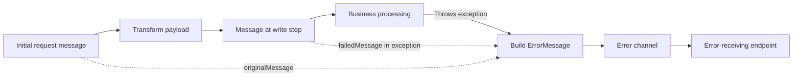

# Building Error Messages

In the **MessageBuilder** chapter of the **SPRING_INTEGRATION_CORE** module, building an error message is the step that turns a processing failure into structured information that other components of an integration flow can consume. A useful error message needs to convey what error occurred, which message failed processing, and what context helps trace the request.

This lesson connects `Message`, `MessageChannel`, endpoints, and Java DSL through an order error-handling flow. The focus is on constructing an `ErrorMessage`, preserving the exception and related data, and routing the message to an explicit error channel.

The examples use Java 17 or later and the Spring Integration 6.4.x API with Spring Framework 6.2.x as a reference baseline. Sections comparing message-copying behavior note the exact referenced versions. The examples assume the application already has `spring-integration-core` and compatible Spring dependencies; the tests use JUnit Jupiter.

## 1. Why Do You Need a Structured Error Message?

Suppose the system receives an order-creation request, converts JSON into a Java object, and writes it to a data store. If the write step fails, a string such as `"Saving order failed"` is not enough to decide what to do next:

- You may need the exception type to distinguish a data error from a connection error.
- You need to know which Java object was passed to the write step.
- You may need to reconcile against the original JSON request.
- You need a trace ID to correlate the error event with the request's logs.

An error message serves as input to another processing flow, such as incident logging, error classification, or forwarding a normalized error record to storage. Being able to build an error message does not mean it has been sent, retried, or that the transaction has been recovered.



The arrow to the error channel in the diagram represents an actual send step. It must be performed by application code or the framework's error-handling mechanism.

## 2. Structure of `ErrorMessage`

`org.springframework.messaging.support.ErrorMessage` extends `GenericMessage<Throwable>`. Its payload is a non-`null` `Throwable`; in addition to headers, it has an optional `originalMessage` property. When the payload is a `MessagingException`, that exception can hold the message at the point of failure in `failedMessage`. [ErrorMessage API](https://docs.spring.io/spring-framework/docs/6.2.0/javadoc-api/org/springframework/messaging/support/ErrorMessage.html).

| Component | Meaning in Order Example | How to Access |
| --- | --- | --- |
| Payload | Exception describing the processing error | `error.getPayload()` |
| Cause of payload | Root cause preserved when wrapping exceptions | `error.getPayload().getCause()` |
| `failedMessage` | Message being processed at the failure point | `MessagingException.getFailedMessage()` |
| `originalMessage` | Message captured at the error-creation boundary | `error.getOriginalMessage()` |
| Headers | Error code, processing stage, trace ID, and error message metadata | `error.getHeaders()` |

`originalMessage` and `failedMessage` are not two names for the same property. They can point to the same object if no transformation has occurred, or differ if the payload or headers changed along the flow.

In the running example of this lesson:

```text
originalMessage.payload = JSON request to create the order
failedMessage.payload   = OrderCommand object after conversion
ErrorMessage.payload    = MessageHandlingException
payload.cause           = IllegalStateException from the write operation
```

The name `originalMessage` also does not guarantee it always points to the very first message in the entire system. It depends on the boundary that the error-creating component is able to retain. In this example, the application deliberately preserves the JSON request as the original message.

A plain `Throwable` does not have `getFailedMessage()`. A valid `ErrorMessage` may also lack `originalMessage`. Consumers must check before accessing these optional fields.

## 3. Creating an Error Message with `MessageBuilder`

### 3.1. Payload Is a `Throwable`

The builder class used in the main examples is:

```java
import org.springframework.integration.support.MessageBuilder;
```

When this builder constructs a new message with a `Throwable` payload, the result is an `ErrorMessage`. The return type of `build()` is still `Message<T>`, so the variable is usually declared with the `Message` interface. This behavior is shown in [Spring Integration 6.4.1 BaseMessageBuilder](https://github.com/spring-projects/spring-integration/blob/v6.4.1/spring-integration-core/src/main/java/org/springframework/integration/support/BaseMessageBuilder.java).

```java
import org.springframework.integration.support.MessageBuilder;
import org.springframework.messaging.Message;
import org.springframework.messaging.support.ErrorMessage;

Throwable cause = new IllegalStateException("Unable to access order store");

Message<Throwable> message = MessageBuilder
        .withPayload(cause)
        .setHeader("errorCode", "ORDER_STORE_UNAVAILABLE")
        .setHeader("requestId", "req-1042")
        .build();

System.out.println(message instanceof ErrorMessage); // true
System.out.println(message.getPayload() == cause);  // true
```

Declaring `cause` with type `Throwable` lets generic inference produce `Message<Throwable>`. If you pass `new IllegalStateException(...)` directly, you may need to specify `MessageBuilder.<Throwable>withPayload(...)` when assigning to a `Message<Throwable>` variable, because Java generics are invariant across these types.

The builder does not automatically identify which business message failed when given only a standalone exception. To retain that message, use a context-carrying exception such as `MessageHandlingException` or the appropriate `ErrorMessage` constructor.

### 3.2. Distinguishing an Error Payload from an Error Description String

```java
Message<String> textMessage = MessageBuilder
        .withPayload("Unable to save order")
        .setHeader("errorCode", "ORDER_WRITE_FAILED")
        .build();
```

The message above holds a string, so it does not become an `ErrorMessage` merely because it has an `errorCode` header. Similarly, a DTO named `ErrorResponse` may be the application's error contract, but it is not the `Throwable` payload of an `ErrorMessage`.

| Creation Approach | Data Preserved | Suitable Purpose |
| --- | --- | --- |
| `MessageBuilder.withPayload(throwable).build()` | Exception object and assigned headers | Building errors for internal Spring flows |
| `new ErrorMessage(throwable)` | Exception object | Directly needing an `ErrorMessage`-typed variable |
| `MessageBuilder.withPayload("...").build()` | Description string | Text notification under a custom contract |
| `MessageBuilder.withPayload(errorDto).build()` | Application-defined DTO | Communicating over an API or external system |

Do not replace an exception with `exception.getMessage()` just to simplify the internal payload: doing so strips the error type, cause chain, and stack trace from the object in transit.

### 3.3. The Two `MessageBuilder` Classes and Preserving `originalMessage`

Spring has two classes with the same name:

| Class | Location |
| --- | --- |
| `org.springframework.integration.support.MessageBuilder` | Spring Integration |
| `org.springframework.messaging.support.MessageBuilder` | Spring Framework, Spring Messaging module |

Both can create an `ErrorMessage` from a `Throwable` payload. However, check your import when copying an `ErrorMessage` that has an `originalMessage` and then modifying its headers.

In Spring Framework **6.2.0**, `MessageBuilder.fromMessage(error).setHeader(...).build()` includes logic to carry `originalMessage` over to the new instance. In Spring Integration **6.4.1**, the builder's new-message creation branch passes only payload and headers to the `ErrorMessage` constructor, so it does not carry that property over. If the builder returns the old instance directly because nothing changed, the property remains. This comparison references those specific versions, not a guarantee across all versions. [Spring Framework 6.2.0 MessageBuilder](https://github.com/spring-projects/spring-framework/blob/v6.2.0/spring-messaging/src/main/java/org/springframework/messaging/support/MessageBuilder.java), [Spring Integration 6.4.1 BaseMessageBuilder](https://github.com/spring-projects/spring-integration/blob/v6.4.1/spring-integration-core/src/main/java/org/springframework/integration/support/BaseMessageBuilder.java).

When preserving the original message is a strict requirement, the clearest way to express it is to call the constructor that accepts `originalMessage`.

## 4. Preserving the Exception, Failed Message, and Original Message

### 4.1. Wrapping Business Errors with `MessageHandlingException`

The example below assumes `inputMessage`, `failedMessage`, and `cause` are already available at the error-handling point:

```java
import org.springframework.messaging.MessageHandlingException;
import org.springframework.messaging.support.ErrorMessage;

MessageHandlingException failure = new MessageHandlingException(
        failedMessage,
        "Unable to record order",
        cause
);

ErrorMessage error = new ErrorMessage(failure, inputMessage);
```

The `MessageHandlingException` constructor lets you attach the failed message and root cause to the exception. This lets consumers locate the offending data without parsing message strings. [MessageHandlingException source](https://github.com/spring-projects/spring-framework/blob/v6.2.0/spring-messaging/src/main/java/org/springframework/messaging/MessageHandlingException.java).

The relationships to preserve in the example are:

```java
error.getPayload() == failure;
failure.getCause() == cause;
failure.getFailedMessage() == failedMessage;
error.getOriginalMessage() == inputMessage;
```

If the caught exception is already a `MessagingException` holding the right `failedMessage`, you can reuse it as the payload. Add a new wrapper only when it adds necessary context; wrapping repeatedly makes the cause chain harder to read.

### 4.2. Adding Headers via the Constructor

```java
import java.util.Map;
import org.springframework.messaging.support.ErrorMessage;

Map<String, Object> errorHeaders = Map.of(
        "errorCode", "ORDER_WRITE_FAILED",
        "errorStage", "persist-order",
        "requestId", "req-1042"
);

ErrorMessage errorWithHeaders = new ErrorMessage(
        failure,
        errorHeaders,
        inputMessage
);
```

The overload taking a `Map` copies the map contents; the overload taking `MessageHeaders` uses the passed headers object directly. The two calls do not have the same copying semantics. Constructors that accept `originalMessage` keep it in a separate property and do not automatically merge its headers into the error message's headers. [ErrorMessage constructors](https://docs.spring.io/spring-framework/docs/6.2.0/javadoc-api/org/springframework/messaging/support/ErrorMessage.html).

With a curated header `Map` as above, the error message receives its own identity. To link it to the failed processing run, store `failedMessageId` or a dedicated trace key instead of assigning the business message's ID to the error message.

Copying the map also does not deep-copy the payload, exception, or objects inside headers. If those objects are mutable, the application must still manage sharing them across flows.

## 5. An Error-Building Helper for the Order Flow

The code below centralizes error-building rules in one place. The method receives the raw exception not yet wrapped by Spring, the initial message, and the message at the failing step. It forwards only selected tracking headers, then adds incident metadata.

In the example, `requestId`, `correlationId`, `orderId`, `failedMessageId`, `errorCode`, and `errorStage` are application conventions. These headers do not automatically trigger framework routing, retry, or error handling.

```java
import java.util.LinkedHashMap;
import java.util.List;
import java.util.Map;
import java.util.Objects;

import org.springframework.messaging.Message;
import org.springframework.messaging.MessageHandlingException;
import org.springframework.messaging.support.ErrorMessage;

public final class OrderErrorMessages {

    private static final List<String> CONTEXT_HEADERS = List.of(
            "requestId", "correlationId", "orderId"
    );

    private OrderErrorMessages() {
    }

    public static ErrorMessage build(
            Message<?> inputMessage,
            Message<?> failedMessage,
            Exception cause) {

        Objects.requireNonNull(inputMessage, "inputMessage");
        Objects.requireNonNull(failedMessage, "failedMessage");
        Objects.requireNonNull(cause, "cause");

        Map<String, Object> headers = new LinkedHashMap<>();
        copyContextHeaders(inputMessage, headers);
        copyContextHeaders(failedMessage, headers);

        headers.put("failedMessageId", failedMessage.getHeaders().getId());
        headers.put("errorCode", "ORDER_WRITE_FAILED");
        headers.put("errorStage", "persist-order");

        MessageHandlingException failure = new MessageHandlingException(
                failedMessage,
                "Unable to record order",
                cause
        );

        return new ErrorMessage(failure, headers, inputMessage);
    }

    private static void copyContextHeaders(
            Message<?> source,
            Map<String, Object> target) {

        for (String name : CONTEXT_HEADERS) {
            Object value = source.getHeaders().get(name);
            if (value != null) {
                target.put(name, value);
            }
        }
    }
}
```

Several decisions in this method are intentional:

- Tracking values from `failedMessage` take precedence if both messages have that header. This is the example's policy and should be adjusted to match your application contract.
- `failedMessageId` uses the UUID type already stored in headers; when serialized to JSON it can be formatted as a string according to the target schema.
- `replyChannel`, `errorChannel`, authentication info, and transport headers are not copied via the map.
- `originalMessage` still holds a reference to the initial message, so filtering headers does not strip data from that original object.
- The method only builds the error. The caller decides where to send it and what to do if the send fails.

Not copying control headers mechanically helps avoid sending the error flow back onto the business route or delivering an unintended error result to the old request's reply channel.

If catching an error right after a Spring endpoint, check whether the exception is already a `MessagingException` with sufficient context. In that case, you can construct `new ErrorMessage(existingException, headers, inputMessage)` directly instead of calling a helper designed for raw exceptions.

## 6. Sending Errors into a Java DSL Flow

The example below uses `OrderErrorMessages` from the previous section and a complete Java configuration. The write operation intentionally throws an error so the constructed message can be observed. The `orderErrors` channel receives the error; a DSL-created bridge endpoint forwards the message unchanged to `capturedOrderErrors` for the program to read out.

```java
import org.springframework.beans.factory.annotation.Qualifier;
import org.springframework.context.annotation.AnnotationConfigApplicationContext;
import org.springframework.context.annotation.Bean;
import org.springframework.context.annotation.Configuration;
import org.springframework.integration.channel.DirectChannel;
import org.springframework.integration.channel.QueueChannel;
import org.springframework.integration.config.EnableIntegration;
import org.springframework.integration.dsl.IntegrationFlow;
import org.springframework.integration.support.MessageBuilder;
import org.springframework.messaging.Message;
import org.springframework.messaging.MessagingException;
import org.springframework.messaging.support.ErrorMessage;

@Configuration
@EnableIntegration
public class OrderErrorFlowDemo {

    record OrderCommand(String orderId) {
    }

    @Bean
    DirectChannel orderErrors() {
        return new DirectChannel();
    }

    @Bean
    QueueChannel capturedOrderErrors() {
        return new QueueChannel(10);
    }

    @Bean
    IntegrationFlow orderErrorFlow(
            @Qualifier("orderErrors") DirectChannel errors,
            @Qualifier("capturedOrderErrors") QueueChannel captured) {

        return IntegrationFlow.from(errors)
                .channel(captured)
                .get();
    }

    public static void main(String[] args) {
        try (var context = new AnnotationConfigApplicationContext(
                OrderErrorFlowDemo.class)) {

            DirectChannel errors = context.getBean(
                    "orderErrors", DirectChannel.class);
            QueueChannel captured = context.getBean(
                    "capturedOrderErrors", QueueChannel.class);

            Message<String> inputMessage = MessageBuilder
                    .withPayload("{\"orderId\":\"O-1042\"}")
                    .setHeader("requestId", "req-1042")
                    .setHeader("orderId", "O-1042")
                    .build();

            // Illustrates the result of converting JSON into a Java object.
            Message<OrderCommand> failedMessage = MessageBuilder
                    .withPayload(new OrderCommand("O-1042"))
                    .copyHeaders(inputMessage.getHeaders())
                    .build();

            try {
                persist(failedMessage.getPayload());
            }
            catch (IllegalStateException cause) {
                ErrorMessage error = OrderErrorMessages.build(
                        inputMessage, failedMessage, cause);

                if (!errors.send(error, 1_000)) {
                    throw new IllegalStateException(
                            "Failed to forward message to error channel",
                            cause
                    );
                }
            }

            Message<?> received = captured.receive(1_000);
            if (!(received instanceof ErrorMessage error)) {
                throw new IllegalStateException("No ErrorMessage received");
            }

            MessagingException failure =
                    (MessagingException) error.getPayload();

            System.out.println(error.getHeaders().get("errorCode"));
            System.out.println(error.getHeaders().get("requestId"));
            System.out.println(error.getOriginalMessage() == inputMessage);
            System.out.println(failure.getFailedMessage() == failedMessage);
        }
    }

    private static void persist(OrderCommand order) {
        throw new IllegalStateException("Data store temporarily unavailable");
    }
}
```

Expected output of the four `println` statements, alongside Spring startup logs, is:

```text
ORDER_WRITE_FAILED
req-1042
true
true
```

`IntegrationFlow.from(MessageChannel)` sets the input of the DSL flow. The configuration above bridges two channels; it does not need a poller to put messages into the queue because the program reads the queue itself with `receive(...)`. [IntegrationFlow initialization API](https://github.com/spring-projects/spring-integration/blob/v6.4.1/spring-integration-core/src/main/java/org/springframework/integration/dsl/IntegrationFlow.java).

In a real flow, you can replace the observation queue with an incident-logging endpoint or an error-classification route. When a queue consumer is managed by the framework, you must configure a poller or appropriate receiving mechanism for that consumer.

This example calls `persist(...)` in application code and catches the error itself. It demonstrates all three distinct steps: building the error message, sending it to a channel, and receiving it in the error flow. A successful send in this example only proves the message entered the observation queue; it does not prove the order-save operation succeeded.

## 7. Using Framework Error-Building Mechanisms

### 7.1. `DefaultErrorMessageStrategy`

When integrating with Spring Integration's error-publishing mechanism, `ErrorMessageStrategy` is the extension point for building an error message from an exception and context. `DefaultErrorMessageStrategy` reads the input message under the key `ErrorMessageUtils.INPUT_MESSAGE_CONTEXT_KEY` to populate `originalMessage`; if absent, it creates an error message solely from the exception. The default strategy does not copy business headers from the original message. [DefaultErrorMessageStrategy](https://github.com/spring-projects/spring-integration/blob/v6.4.1/spring-integration-core/src/main/java/org/springframework/integration/support/DefaultErrorMessageStrategy.java).

The example below reuses `inputMessage`, `failedMessage`, and `cause` at the catch site:

```java
import org.springframework.core.AttributeAccessor;
import org.springframework.integration.support.DefaultErrorMessageStrategy;
import org.springframework.integration.support.ErrorMessageUtils;
import org.springframework.messaging.MessageHandlingException;
import org.springframework.messaging.support.ErrorMessage;

MessageHandlingException failure = new MessageHandlingException(
        failedMessage, "Unable to record order", cause);

AttributeAccessor attributes = ErrorMessageUtils.getAttributeAccessor(
        inputMessage, failedMessage);

ErrorMessage error = new DefaultErrorMessageStrategy()
        .buildErrorMessage(failure, attributes);
```

`ErrorMessageUtils.getAttributeAccessor(...)` stores both messages in the context under two separate keys. Having `failedMessage` in the context does not cause the default strategy to wrap a plain exception into a `MessagingException` automatically; the code explicitly constructs `MessageHandlingException` before calling the strategy. [ErrorMessageUtils](https://github.com/spring-projects/spring-integration/blob/v6.4.1/spring-integration-core/src/main/java/org/springframework/integration/support/ErrorMessageUtils.java).

### 7.2. `ErrorMessagePublisher`

`ErrorMessagePublisher` coordinates building and sending errors. If you already have a context-complete `MessagingException`, you can pass it along with the input message:

```java
import org.springframework.integration.core.ErrorMessagePublisher;

ErrorMessagePublisher publisher = new ErrorMessagePublisher();
publisher.setChannel(orderErrors);
publisher.publish(inputMessage, failure);
```

Here `orderErrors` is a configured `MessageChannel` object with an appropriate consumer. The target channel is specified directly with `setChannel(...)`. Do not infer that this snippet will automatically pick a different channel from the request's headers. The publisher also allows attaching a custom `ErrorMessageStrategy` to add error-building rules. [ErrorMessagePublisher](https://github.com/spring-projects/spring-integration/blob/v6.4.1/spring-integration-core/src/main/java/org/springframework/integration/core/ErrorMessagePublisher.java).

Pick a single place responsible for publishing errors for each failure. If you both send manually inside `catch` and rethrow so an outer mechanism publishes the same error, the system may receive multiple messages for the same incident.

## 8. The `errorChannel` Header and Synchronous vs. Asynchronous Errors

`errorChannel` is information for an appropriate error-handling mechanism to determine the destination; the builder only sets the header and does not install a `try/catch` block. With a synchronous `DirectChannel`, exceptions usually return to the caller. When an error is published by the framework's asynchronous error-handling mechanism, the channel in the request header takes precedence, followed by the global bean named `errorChannel`. [Spring Integration Error Handling](https://docs.spring.io/spring-integration/reference/6.4/error-handling.html).

```java
Message<String> request = MessageBuilder
        .withPayload("create-order")
        .setErrorChannel(orderErrors)
        .build();
```

This snippet creates the request message; it has not sent the request and has not created an `ErrorMessage`.

| Scenario | What to Determine |
| --- | --- |
| Sending directly through `DirectChannel` | Caller catches the exception or lets it propagate |
| Processing via an executor or poller | Which component publishes the error and which channel receives it |
| Calling through a messaging gateway | Whether the gateway is configured to route errors to a channel or return exceptions to the caller |
| Manually building and sending `ErrorMessage` | Sending code must choose the destination and handle send failures |

With `setErrorChannelName("orderErrors")`, the header value is a channel name. Resolving the name to a channel object requires an appropriate resolver and Spring context in the component consuming that header. Setting a name alone does not create a channel bean.

The timeout passed to `send(message, timeout)` is also not a maximum deadline for business logic to finish. For a synchronous handler executing on the caller thread, that parameter provides no mechanism to interrupt the handler when time expires.

## 9. Testing Key Relationships of Error Messages

A useful test verifies that the data travels with the error: the root exception, the failed message, the original message, and the trace ID. Checking only that the message is non-`null` misses these losses of context.

The tests below use `OrderErrorMessages` from Section 5. They are examples to run in a project configured with JUnit Jupiter; expected results are described in the lesson, not a test execution report.

```java
import static org.junit.jupiter.api.Assertions.*;

import org.junit.jupiter.api.Test;
import org.springframework.integration.channel.QueueChannel;
import org.springframework.integration.support.MessageBuilder;
import org.springframework.messaging.Message;
import org.springframework.messaging.MessageHeaders;
import org.springframework.messaging.MessagingException;
import org.springframework.messaging.support.ErrorMessage;

class OrderErrorMessagesTest {

    @Test
    void throwablePayloadCreatesErrorMessage() {
        Throwable cause = new IllegalArgumentException("orderId is missing");

        Message<Throwable> message = MessageBuilder
                .withPayload(cause)
                .build();

        ErrorMessage error = assertInstanceOf(ErrorMessage.class, message);
        assertSame(cause, error.getPayload());
        assertNull(error.getOriginalMessage());
    }

    @Test
    void errorKeepsBothMessagesAndTheCause() {
        Message<String> input = MessageBuilder.withPayload("raw-order")
                .setHeader("requestId", "req-1042")
                .build();
        Message<Integer> failed = MessageBuilder.withPayload(1042)
                .setHeader("requestId", "req-1042")
                .build();
        IllegalStateException cause =
                new IllegalStateException("Data store is unavailable");

        ErrorMessage error = OrderErrorMessages.build(input, failed, cause);
        MessagingException failure = assertInstanceOf(
                MessagingException.class, error.getPayload());

        assertSame(cause, failure.getCause());
        assertSame(failed, failure.getFailedMessage());
        assertSame(input, error.getOriginalMessage());
        assertEquals("req-1042", error.getHeaders().get("requestId"));
        assertEquals("persist-order", error.getHeaders().get("errorStage"));
        assertEquals(failed.getHeaders().getId(),
                error.getHeaders().get("failedMessageId"));
        assertNotEquals(failed.getHeaders().getId(), error.getHeaders().getId());
    }

    @Test
    void controlHeadersAreNotCopiedAndErrorCanBeSent() {
        QueueChannel queue = new QueueChannel(1);
        Message<String> request = MessageBuilder.withPayload("order")
                .setErrorChannel(queue)
                .setReplyChannel(queue)
                .build();

        ErrorMessage error = OrderErrorMessages.build(
                request, request, new IllegalStateException("write failed"));

        assertFalse(error.getHeaders().containsKey(MessageHeaders.ERROR_CHANNEL));
        assertFalse(error.getHeaders().containsKey(MessageHeaders.REPLY_CHANNEL));
        assertSame(queue, error.getOriginalMessage().getHeaders()
                .get(MessageHeaders.ERROR_CHANNEL));

        assertTrue(queue.send(error, 100));
        assertSame(error, queue.receive(100));
    }
}
```

The third test also clarifies the boundary of header filtering: control headers do not appear on the outer layer of the error message, yet they remain inside the retained `originalMessage`.

For an integration test of the DSL flow, you can send a context-rich error into `orderErrors`, read from `capturedOrderErrors` with a bounded timeout, and assert the same relationships. Testing automatic asynchronous error publishing requires a real flow with an executor or poller; testing the factory alone does not prove that mechanism works.

## 10. Common Mistakes When Building Error Messages

| Symptom | Cause to Check | How to Fix |
| --- | --- | --- |
| Payload is just a string | Used `exception.getMessage()` as the payload | Keep the exception for internal flows; convert to a DTO at communication boundaries |
| Cannot locate the offending data | Exception payload does not hold `failedMessage` | Use an appropriate `MessagingException` or preserve clear context |
| `getOriginalMessage()` returns `null` | Original message was not passed or was lost while rebuilding | Use the constructor with that parameter and check the imported builder class |
| Original message disappears after adding a header | Newly built message did not carry non-header properties | Construct a new `ErrorMessage` and pass `originalMessage` again |
| Has `errorChannel` header but caller still gets exception | Running synchronously with no configured error-routing mechanism | Identify where errors are caught or published in the real flow |
| Consumer does not receive the error | Only built the message or channel has no consumer | Check the send step, consumer configuration, and send result |
| Error flow loops back to business branch | Copied control headers or wired wrong destination | Select headers carefully and explicitly set the error flow's output |
| One incident is logged multiple times | Multiple layers are publishing errors | Choose a single publishing responsibility and use a trace ID |
| Error was published but order remains unprocessed | Treated error reporting as a successful recovery | Design retry, recovery, and transaction policies separately |

Do not base retry eligibility solely on whether the payload is an exception. For example, an invalid input error and a transient data-store error may require different policies even though both are represented by `ErrorMessage`.

## 11. Choosing an Error-Building Approach by Processing Boundary

When a component only needs to emit an exception with a few headers, `MessageBuilder.withPayload(throwable)` is concise. When you need to preserve both the original message and the message at the failure point separately, the `ErrorMessage` constructor combined with `MessagingException` expresses the contract more clearly. When you need uniform rules across many error-publishing components, use `ErrorMessageStrategy` within the appropriate publisher mechanism.

In memory within the same application, retaining the exception and message references aids diagnostics. When exporting an incident over HTTP, a broker, or durable storage, translate to an intentional error schema such as error code, trace ID, processing stage, and selected fields. Do not assume every Java exception, channel, or payload can be serialized by the same mechanism.

An integration application's error flow needs to preserve context, have an actual consumer, and handle the case where publishing the error itself fails. A properly constructed `ErrorMessage` provides the foundation for classification, retry, or manual-intervention steps to make informed decisions.
