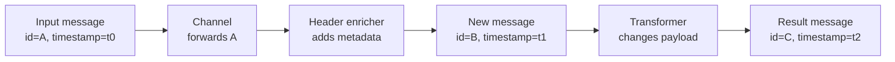

# id and timestamp

In a Spring Integration flow, the payload indicates the data to be processed, while headers provide the context for delivering and processing that data. The two foundational headers are `id` and `timestamp`: one value identifies the message, and the other records when the message was created.

This lesson belongs to the **Message headers** chapter of the **SPRING_INTEGRATION_CORE** module. The focus is on reading and understanding the lifecycle of these two headers as a message passes through `MessageChannel`, endpoints, and Java DSL flows, and from there designing appropriate approaches for tracing, reprocessing, and testing. Components such as transformers, routers, filters, and aggregators are examined only in terms of how they affect message identity.

## 1. Two headers answer two different questions

| Header | Constant | Data type | Meaning |
| --- | --- | --- | --- |
| `id` | `MessageHeaders.ID` | `java.util.UUID` | Technical identifier of the message being observed |
| `timestamp` | `MessageHeaders.TIMESTAMP` | `java.lang.Long` | Message creation time, in milliseconds since the Unix epoch |

With Spring Integration's default message creation mechanism, both values are generated by the framework. When processing produces a new message, system values are generated for that new message. Therefore, you need to determine at which step in the flow you are observing the message. [Spring Integration Message Reference](https://docs.spring.io/spring-integration/reference/message.html).

For example, a log might contain:

```text
payload=order-42
id=ed20bc57-6716-4cd7-b6ed-3c1752bf9c9b
timestamp=1805695200000
```

Here, `order-42` may be the order code in the business data. The UUID identifies the message carrying that data. If the application creates another message for the same order, the UUID may differ even though the order code does not change.

`timestamp` is a number representing an absolute point in time. It does not include a display time zone. Converting it to `Instant`, then applying a time zone for presentation, helps avoid confusion between stored data and how users read the time.

## 2. Reading headers with the right data type

The following examples use Java 17 and the Spring Integration 6.5.x API. The application runtime code requires the `spring-integration-core` dependency; the tests use JUnit Jupiter and Spring Test. Library versions should follow the application's dependency management configuration.

### 2.1. Creating and observing the first message

Note the `MessageBuilder` import from the **Spring Integration** package in this example:

```java
import java.time.Instant;
import java.util.UUID;

import org.springframework.integration.support.MessageBuilder;
import org.springframework.messaging.Message;
import org.springframework.messaging.MessageHeaders;

public final class MessageMetadataExample {

    public static void main(String[] args) {
        Message<String> message = MessageBuilder
                .withPayload("order-42")
                .setHeader("eventId", "evt-order-created-42")
                .build();

        UUID id = message.getHeaders().getId();
        Long timestamp = message.getHeaders().getTimestamp();

        // Two ways to read the same header with the UUID type.
        UUID typedId = message.getHeaders()
                .get(MessageHeaders.ID, UUID.class);

        String createdAt = timestamp == null
                ? "<absent>"
                : Instant.ofEpochMilli(timestamp).toString();

        System.out.println("payload=" + message.getPayload());
        System.out.println("id=" + id);
        System.out.println("typedId=" + typedId);
        System.out.println("createdAt=" + createdAt);
    }
}
```

`getId()` and `getTimestamp()` clearly express the intent to read standard headers. Using `get("id")` only returns `Object`, forcing the code to cast manually.

### 2.2. Why null handling is still necessary

The example above uses Spring Integration's default builder, so the new message has both an ID and a timestamp. However, the API allows specialized ways to construct headers; `MessageHeaderAccessor` and header initializers can control whether these two values are generated. When receiving messages from adapters or code outside your control, verify the input contract before assuming they are always present. [MessageHeaderAccessor API](https://docs.spring.io/spring-framework/docs/current/javadoc-api/org/springframework/messaging/support/MessageHeaderAccessor.html).

In particular, there are two classes with the same name:

```text
org.springframework.integration.support.MessageBuilder
org.springframework.messaging.support.MessageBuilder
```

Do not swap imports and assume every header-generation detail stays the same. In Spring Framework 6.2.x, the accessor used to build headers does not enable timestamp generation by default; the Spring Integration builder used in this lesson creates a `GenericMessage` through a different code path. This is one cause to check when you see a missing timestamp. [MessageHeaderAccessor 6.2.x source](https://github.com/spring-projects/spring-framework/blob/6.2.x/spring-messaging/src/main/java/org/springframework/messaging/support/MessageHeaderAccessor.java), [Spring Integration 6.5.x builder source](https://github.com/spring-projects/spring-integration/blob/6.5.x/spring-integration-core/src/main/java/org/springframework/integration/support/BaseMessageBuilder.java).

Code used across integration boundaries should keep the `Long` type for timestamp until it has been checked. Assigning it directly to `long` will cause an unboxing error if the header is absent.

## 3. Lifecycle: forwarding a message vs. creating a new message

Distinguishing between the following two operations explains most ID-change scenarios:

- **Forwarding:** the component passes along the existing message without creating new content or metadata.
- **Creating a new result:** the component builds a message carrying a modified payload or headers.

### 3.1. Ordinary channels do not reissue an ID just for sending and receiving

The following standalone example uses an in-memory queue, with no interceptors and no custom message store:

```java
import org.springframework.integration.channel.QueueChannel;
import org.springframework.integration.support.MessageBuilder;
import org.springframework.messaging.Message;

QueueChannel queue = new QueueChannel(10);
Message<String> sent = MessageBuilder.withPayload("order-42").build();

if (!queue.send(sent, 1000)) {
    throw new IllegalStateException("Failed to send message");
}

Message<?> received = queue.receive(1000);
if (received == null) {
    throw new IllegalStateException("Failed to receive message");
}

System.out.println(sent == received); // true in this example
System.out.println(received.getHeaders().getId());
```

`QueueChannel` stores the message for the receiver to pull; the time the message waits in the queue does not advance the timestamp. [QueueChannel Reference](https://docs.spring.io/spring-integration/reference/channel/implementations.html#queuechannel).

If the system has interceptors that replace messages, protocol conversions, or recovery from persistence, those mechanisms must be examined separately. The observation about the same Java reference in this example is not a contract for every channel or every messaging boundary.

### 3.2. Changing a business header can also create a new identity

With Spring Integration's `MessageBuilder` imported in the previous section:

```java
Message<String> original = MessageBuilder
        .withPayload("order-42")
        .setHeader("eventId", "evt-42")
        .build();

Message<String> forwarded = MessageBuilder
        .fromMessage(original)
        .build();

Message<String> enriched = MessageBuilder
        .fromMessage(original)
        .setHeader("processingStage", "validated")
        .build();

System.out.println(original == forwarded); // true with this default builder
System.out.println(original == enriched);  // false
System.out.println(original.getHeaders().getId());
System.out.println(enriched.getHeaders().getId()); // different ID
```

In this default case, `fromMessage(original).build()` can return the original message if nothing changed. When `processingStage` is added, the builder creates a new message. This rule is conditional; custom factories or additional read-only header lists can affect reuse. [BaseMessageBuilder build method](https://github.com/spring-projects/spring-integration/blob/6.5.x/spring-integration-core/src/main/java/org/springframework/integration/support/BaseMessageBuilder.java).

Two messages created closely together can have the **same timestamp** because the resolution is milliseconds. Therefore, having different IDs does not imply that their timestamps must differ.

### 3.3. Reading a flow through message identity



`t0`, `t1`, `t2` represent the creation time of each message. The values may be equal; the diagram does not assert that the clock always increases strictly.

When reading endpoint configurations, you can use the following table to ask the right questions:

| Operation in the flow | How to reason about ID and timestamp |
| --- | --- |
| Bridge or forwarding-only channel | Observe the existing message; do not infer a new ID just because a hop was added |
| Filter accepts and forwards the original message | Accepted messages retain existing metadata if there is no additional processing |
| Router only selects the destination | Selecting a route by itself does not require rebuilding the message |
| Header enricher actually adds or changes headers | Expect a result message with new system metadata when using the default factory |
| Transformer produces a different payload | Treat the result as a new message; track its relationship to the input via custom metadata |
| Splitter or aggregator produces results | Distinguish the identity of each result from the correlation data of the whole group |
| Re-invoking a handler on the same request during retry | Do not assume every attempt generates a new ID or timestamp |

With complex configurations, inspect the actual messages at the input and output of the component. An endpoint's name does not substitute for understanding whether it forwards or constructs a result.

## 4. Read-only headers and how to copy properly

### 4.1. Do not assign business identifiers to id

With the default API, `id` and `timestamp` are read-only system headers. The following code is invalid:

```java
// Spring Integration's MessageBuilder.
MessageBuilder.withPayload("order-42")
        .setHeader(MessageHeaders.ID, "order-42")
        .build();
```

The `setHeader` call on this path is rejected with `IllegalArgumentException`. Even when passing a properly typed `UUID`, the application is not permitted to assign system headers directly through that operation. [Read-only header check source](https://github.com/spring-projects/spring-framework/blob/6.2.x/spring-messaging/src/main/java/org/springframework/messaging/support/MessageHeaderAccessor.java).

Similarly, with a standard immutable message, calling `message.getHeaders().put(...)` throws `UnsupportedOperationException`. Custom metadata should have names that clearly express their meaning, such as `eventId`, `orderId`, or `eventOccurredAt`. [MessageHeaders API](https://docs.spring.io/spring-framework/docs/current/javadoc-api/org/springframework/messaging/MessageHeaders.html).

### 4.2. copyHeaders does not preserve id and timestamp

When changing the payload, you can copy the headers the application needs:

```java
Message<String> normalized = MessageBuilder
        .withPayload(original.getPayload().toUpperCase(java.util.Locale.ROOT))
        .copyHeaders(original.getHeaders())
        .build();
```

In this example, `eventId` is copied. The two system headers are protected; do not use `copyHeaders` or `copyHeadersIfAbsent` to force the result to carry the input's ID and timestamp. The builder API also states that these two values are not overwritten when copying headers. [Spring Framework copyHeaders API](https://docs.spring.io/spring-framework/docs/current/javadoc-api/org/springframework/messaging/support/MessageBuilder.html#copyHeaders(java.util.Map)).

Do not switch to a low-level constructor just to bypass the rule. The public `MessageHeaders(Map)` constructor also regenerates ID and timestamp, overwriting those two old values in the map. Specialized APIs meant for recovery or infrastructure initialization must be used according to their own contracts. [MessageHeaders Constructor](https://docs.spring.io/spring-framework/docs/current/javadoc-api/org/springframework/messaging/MessageHeaders.html#%3Cinit%3E(java.util.Map)).

## 5. Designing stable metadata for business logic

Suppose an "order created" event goes through data normalization, validation, and persistence. The application needs to distinguish three levels:

| Value | Example | Scope chosen by the application |
| --- | --- | --- |
| `id` | Framework-generated UUID | Technical message currently being processed |
| `eventId` | `evt-order-created-42` | A logical event, preserved across redeliveries of the same event |
| `orderId` | `order-42` | Business entity that may be involved in multiple events |
| `originMessageId` | Message ID upon entering the flow | Links messages produced during a single data ingestion |
| `eventOccurredAt` | Time when the source recorded the event | Business time according to the contract with the publisher |
| `ingestedAt` | Time when the system received the data | Processing time benchmark within the system scope |

Names other than `id` in the table are illustrative application conventions. Spring Integration does not automatically understand or preserve business semantics just because headers are named that way. Define the data types, generation sources, and which components are allowed to modify them.

### 5.1. Saving origin information before transformation

```java
Message<String> tracked = MessageBuilder
        .fromMessage(original)
        .setHeader("originMessageId", original.getHeaders().getId())
        .setHeader("ingestedAt", original.getHeaders().getTimestamp())
        .build();
```

The `tracked` message has its own technical identity. `originMessageId` holds the ID of `original`, while `ingestedAt` holds the timestamp chosen before transformation.

This example uses the input message's timestamp as the ingestion mark, assuming the message was just created at the application entry boundary. If the message already existed earlier, record the actual receipt time using `Clock` at the entry boundary. If you need to keep both concepts, use `originMessageTimestamp` for the original timestamp and reserve `ingestedAt` for when the system received it.

A message with a missing timestamp must be handled according to the contract: add the receipt time at the boundary, or reject the input if required metadata is missing. Assigning an arbitrary default value can make operational metrics hard to explain.

### 5.2. Choosing a deduplication key

If the same `eventId` is resent and the adapter creates a new message, the technical ID may change. Using `headers.id` as the deduplication key in that case will treat each receipt as a new event.

A more suitable design for the order example is keying by the pair `(consumerName, eventId)`. `eventId` must be kept stable by the publisher across redeliveries; the receiving side needs to persist state and synchronize recording with the business side effect as required by the application.

Spring Integration provides `IdempotentReceiverInterceptor` and `MetadataStoreSelector` to support state checks. Choosing the key and ensuring business side effects remain part of application design. [Idempotent Receiver Reference](https://docs.spring.io/spring-integration/reference/handler-advice/idempotent-receiver.html).

`correlationId`, on the other hand, serves to link multiple messages within a processing group. An order can have many related events, so correlation and deduplication usually require keys with different semantics. When using a splitter or aggregator, define the correlation contract before picking any ID as the group key.

## 6. Java DSL example: preserving origin across a transformer

The flow below receives a string containing an order code, captures input metadata, normalizes the payload, and sends the result to an output channel. The timestamps are captured once at the entry boundary of the illustrative flow.

```java
import java.util.Locale;

import org.springframework.beans.factory.annotation.Qualifier;
import org.springframework.context.annotation.Bean;
import org.springframework.context.annotation.Configuration;
import org.springframework.integration.channel.DirectChannel;
import org.springframework.integration.channel.QueueChannel;
import org.springframework.integration.config.EnableIntegration;
import org.springframework.integration.dsl.IntegrationFlow;
import org.springframework.messaging.MessageChannel;

@Configuration
@EnableIntegration
public class MessageHeadersFlowConfig {

    @Bean
    public MessageChannel ordersInput() {
        return new DirectChannel();
    }

    @Bean
    public QueueChannel ordersOutput() {
        return new QueueChannel(10);
    }

    @Bean
    public IntegrationFlow normalizeOrders(
            @Qualifier("ordersInput") MessageChannel input,
            @Qualifier("ordersOutput") QueueChannel output) {

        return IntegrationFlow.from(input)
                .enrichHeaders(headers -> headers
                        .headerExpression("originMessageId", "headers['id']")
                        .headerExpression("ingestedAt", "headers['timestamp']"))
                .<String, String>transform(text ->
                        text.strip().toUpperCase(Locale.ROOT))
                .channel(output)
                .get();
    }
}
```

Java DSL registers channels and endpoints as beans in the Spring context; `IntegrationFlow` describes how to wire them into a flow. [Java DSL Reference](https://docs.spring.io/spring-integration/reference/dsl.html).

With input created by Spring Integration's builder, the expected result is:

| Property | Input | Output |
| --- | --- | --- |
| Payload | `"  order-42  "` | `"ORDER-42"` |
| `id` | ID of the input message | ID of the result message |
| `originMessageId` | Not yet present | ID of the input message |
| `ingestedAt` | Not yet present | Timestamp captured from the input message |
| `eventId` | `evt-42` | `evt-42` |
| `timestamp` | Input creation time | Result creation time, which may equal the input value |

The header enricher itself creates an intermediate result when adding metadata. Therefore, do not assume the flow has only two IDs just because users only observe the input and output.

The transformer example here returns a **payload**. If replaced with a transformer that returns a full `Message<?>`, the code building the result must proactively supply the headers the application wants to keep; do not assume all old headers are automatically added for you. [Spring Integration Header Propagation Rules](https://docs.spring.io/spring-integration/reference/message.html#header-propagation).

## 7. Testing meaningful invariants

Tests should verify what the application depends on: the data is normalized, the ID reflects the result message, and the origin metadata remains intact. Do not hardcode a specific UUID or require two consecutively created timestamps to be different.

### 7.1. Testing the flow in a Spring context

Place the test class in the same package as `MessageHeadersFlowConfig`:

```java
import org.junit.jupiter.api.Test;
import org.springframework.beans.factory.annotation.Autowired;
import org.springframework.beans.factory.annotation.Qualifier;
import org.springframework.integration.channel.QueueChannel;
import org.springframework.integration.support.MessageBuilder;
import org.springframework.messaging.Message;
import org.springframework.messaging.MessageChannel;
import org.springframework.test.context.junit.jupiter.SpringJUnitConfig;

import static org.junit.jupiter.api.Assertions.assertEquals;
import static org.junit.jupiter.api.Assertions.assertNotEquals;
import static org.junit.jupiter.api.Assertions.assertNotNull;
import static org.junit.jupiter.api.Assertions.assertTrue;

@SpringJUnitConfig(MessageHeadersFlowConfig.class)
class MessageHeadersFlowTest {

    @Autowired
    @Qualifier("ordersInput")
    MessageChannel input;

    @Autowired
    @Qualifier("ordersOutput")
    QueueChannel output;

    @Test
    void preservesOriginWhileCreatingANormalizedMessage() {
        Message<String> request = MessageBuilder
                .withPayload("  order-42  ")
                .setHeader("eventId", "evt-42")
                .build();

        assertNotNull(request.getHeaders().getId());
        assertNotNull(request.getHeaders().getTimestamp());
        assertTrue(input.send(request, 1000));

        Message<?> result = output.receive(1000);
        assertNotNull(result);
        assertEquals("ORDER-42", result.getPayload());
        assertNotNull(result.getHeaders().getId());
        assertNotEquals(request.getHeaders().getId(),
                result.getHeaders().getId());
        assertEquals(request.getHeaders().getId(),
                result.getHeaders().get("originMessageId"));
        assertEquals(request.getHeaders().getTimestamp(),
                result.getHeaders().get("ingestedAt"));
        assertEquals("evt-42", result.getHeaders().get("eventId"));
        assertNotNull(result.getHeaders().getTimestamp());
    }
}
```

The test does not depend on what string the generated UUID is. It also does not use `Thread.sleep` to force timestamps to differ. The timeout on `receive` only limits how long to wait for the result.

### 7.2. Testing the queue-forwarding-only case

```java
import org.junit.jupiter.api.Test;
import org.springframework.integration.channel.QueueChannel;
import org.springframework.integration.support.MessageBuilder;
import org.springframework.messaging.Message;

import static org.junit.jupiter.api.Assertions.assertEquals;
import static org.junit.jupiter.api.Assertions.assertSame;
import static org.junit.jupiter.api.Assertions.assertTrue;

class QueueMessageHeadersTest {

    @Test
    void keepsTheMessageWhenOnlyPassingThroughAnInMemoryQueue() {
        QueueChannel queue = new QueueChannel(1);
        Message<String> sent = MessageBuilder.withPayload("order-42").build();

        assertTrue(queue.send(sent, 1000));
        Message<?> received = queue.receive(1000);

        assertSame(sent, received);
        assertEquals(sent.getHeaders().getId(), received.getHeaders().getId());
        assertEquals(sent.getHeaders().getTimestamp(),
                received.getHeaders().getTimestamp());
    }
}
```

`assertSame` here accurately describes the in-memory queue configuration under test. If you switch to a different storage or transport mechanism, review the new contract before keeping this assertion.

## 8. Using timestamp for measurement and timing decisions

### 8.1. Age of the current message vs. elapsed time since ingestion

Suppose the application receives an event at `T0`, transforms the payload at `T1`, and completes at `T2`:

```text
Elapsed time since ingestion = T2 - T0
Age of the result message    = T2 - T1
```

These two calculations answer two different questions. If you want to track the full journey through the system, choose a stable ingestion mark and carry it across transformation steps.

With the convention that `ingestedAt` is a `Long` in epoch milliseconds:

```java
import java.time.Clock;

import org.springframework.messaging.Message;

static long elapsedSinceIngestion(Message<?> message, Clock clock) {
    Long ingestedAt = message.getHeaders().get("ingestedAt", Long.class);
    if (ingestedAt == null) {
        throw new IllegalArgumentException("Missing ingestedAt header");
    }
    return clock.millis() - ingestedAt;
}
```

The function is an illustrative method placed in an application utility class. Passing `Clock` makes it possible to test with a fixed time. A negative result may indicate clock skew or an input mark in the future; the application needs to decide how to record it based on operational requirements.

### 8.2. Measuring the duration of a code block

For local durations within the same process, you can take the difference of `System.nanoTime()`:

```java
long started = System.nanoTime();
try {
    processOrder();
}
finally {
    long elapsedNanos = System.nanoTime() - started;
    recordDuration(elapsedNanos);
}
```

`processOrder` and `recordDuration` are business and telemetry functions provided by the application. A `nanoTime` value is suitable for measuring elapsed differences within a process; do not send it to another machine and treat it as a calendar timestamp.

### 8.3. Processing limits require an explicit contract

An old message does not disappear automatically just because its timestamp is far in the past. If the rule is "only process within 30 seconds of ingestion," the application must retain the ingestion mark or `deadlineAt`, and then have a filter or business logic check that mark.

When crossing multiple machines, consider clock synchronization and how time is defined by the source. `eventOccurredAt`, the time the broker received the event, and the internal message's timestamp can be three different points in time. Naming them clearly provides a sound basis for SLA calculations and incident investigation.

## 9. Observing errors, retries, and protocol boundaries

A useful log line might include:

```text
stage=normalize
messageId=<current ID>
originMessageId=<ID at entry boundary>
eventId=evt-42
messageTimestamp=<current timestamp>
ingestedAt=<chosen ingestion mark>
```

With this, operators can link results from a single receipt using `originMessageId`, and identify redeliveries of the same event using `eventId`.

When an error occurs, distinguish the failing message from the message used to carry error information. A separately constructed error message may have its own ID. To find the right request, use the metadata or original message information provided by the error-handling mechanism, rather than searching for the request by the error wrapper's ID.

Retries also need to be interpreted according to the actual mechanism. Re-invoking a handler with the same request may keep the ID, whereas re-consuming from a broker and building a new message may produce a different ID. Attempt counts should be recorded in metadata dedicated to delivery or processing attempts, depending on adapter capabilities and application policy.

At HTTP, JMS, AMQP, or Kafka boundaries, do not assume the internal `id` is synonymous with the external protocol's identifier. Decide which fields are mapped across the boundary, how data types are encoded, and how `eventId` is preserved across redeliveries. This lesson does not assume a single mapping rule for all adapters.

## 10. Common design mistakes

| Symptom | Assumption leading to the bug | Fix |
| --- | --- | --- |
| Cannot correlate logs after a transformer | Technical ID stays stable throughout the business flow | Keep origin metadata and event ID at the entry boundary |
| Resent event is still processed twice | New message ID is a stable deduplication key | Choose a key based on the event or business operation and persist state appropriately |
| Unusually low processing-time metrics | Output timestamp is the initial receipt time | Compute from the ingestion mark preserved across steps |
| Flaky tests that fail occasionally | Two different messages must have different timestamps | Assert ID relationships and business metadata; avoid unguaranteed timing conditions |
| Unboxing error when reading timestamp | Every message source generates full headers | Check for null and normalize the contract at the boundary |
| Error when enriching system headers | `id` and `timestamp` are editable application headers | Use separate headers for business codes and source timestamps |
| Business headers lost after a custom transformer | Returning a full Message always gets input headers appended automatically | Proactively construct the required headers for the result |

## 11. Guided practice

### Exercise 1: Observing identity across steps

Using `MessageHeadersFlowConfig`, record the ID and timestamp at the input, after the header enricher, and at the output. Keep the payload unchanged in one run, then modify the payload in another run.

The result should explain which message is only forwarded and which message is newly created. When two timestamps are equal, determine what the ID and origin metadata tell you, instead of adding wait time to change the outcome.

### Exercise 2: Distinguishing receipt from event

Create two independent messages with the same `eventId` but different technical IDs, and send them into the flow one after another. Compare `eventId`, `originMessageId`, and `id` at the output.

Expected result: both outputs relate to the same logical event, while the origin metadata distinguishes the two input messages. From there, design the processing-attempt identifier and the deduplication key for the consumer.

### Exercise 3: Defining the ingestion timestamp mark

Replace capturing the input timestamp with an `ingestedAt` mark obtained from `Clock` at the entry boundary. Use a fixed time in the test, pass data through the transformer, and verify that this mark is preserved.

Target outcome: compute elapsed time since ingestion according to the application contract without depending on intermediate message creation times or the speed of the test machine.
