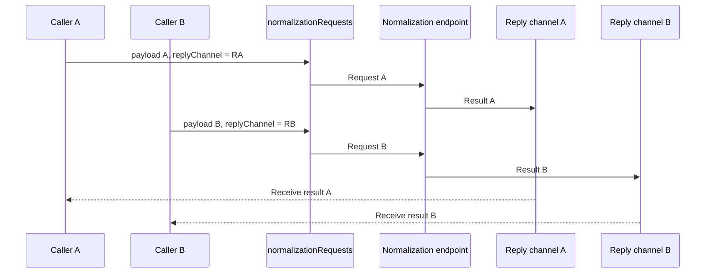

# replyChannel: determining the return path of a reply message

In the `SPRING_INTEGRATION_CORE` module, `replyChannel` is the piece that connects `Message`, `MessageChannel`, endpoints, and gateways into a request–reply flow. This lesson belongs to the **Message headers** chapter, focusing on how results are returned after a message passes through a transformer, router, filter, or aggregator, along with error scenarios and testing related to the reply path.

## 1. The problem: once processing finishes, who receives the result?

Suppose a service receives requests to normalize product names. Two callers both send data into `normalizationRequests`:

- An admin screen sends `"  spring integration  "`.
- A data import job sends `"  message channel  "`.

Both share the same processing logic, yet each needs to receive its own result. If the endpoint always sends to a shared queue and callers simply pull the next message, they may pick up each other's replies by mistake.

The **Return Address** pattern solves this by placing the return destination inside the request itself. In Spring Integration, the `replyChannel` header plays the role of that address. The endpoint can be reused without knowing which Java class sent the request. This mechanism is described in [Service Activator](https://docs.spring.io/spring-integration/reference/service-activator.html).



The diagram illustrates two separate reply addresses. Whether execution happens concurrently or sequentially depends on the channel type and runtime configuration.

## 2. Header name and value types

The standard name is `replyChannel`; the corresponding constant resides in Spring Messaging:

```java
import org.springframework.messaging.Message;
import org.springframework.messaging.MessageHeaders;

Object destination = message.getHeaders().get(MessageHeaders.REPLY_CHANNEL);
Object sameDestination = message.getHeaders().getReplyChannel();
```

In the snippet above, `message` is a `Message<?>` being processed. The return type is `Object` because the reply destination can be represented in multiple ways.

| Value | Example | How it is used |
| --- | --- | --- |
| `MessageChannel` object | A dedicated `QueueChannel` created for the request | The endpoint sends directly to that object |
| Channel name string | `"normalizationReplies"` | The framework resolves the name to a channel in the application context |
| Header absent | `null` when reading the header | The endpoint needs another valid outbound path if it produces a result |

`MessageHeaders.REPLY_CHANNEL` belongs to `org.springframework.messaging`, not `IntegrationMessageHeaderAccessor`. The `MessageHeaders` structure is immutable; do not use `put()` to modify it directly. See [MessageHeaders API](https://docs.spring.io/spring-framework/docs/current/javadoc-api/org/springframework/messaging/MessageHeaders.html).

A header named `replyChannel` does not require the target channel to have the bean name `replyChannel`. Likewise, naming a bean `replyChannel` does not automatically attach that address to every message.

## 3. In what order does an endpoint choose its output channel?

For a typical reply-producing endpoint, such as a service activator, when no additional routing mechanism such as a routing slip is used, consider this order:

1. If the endpoint has a configured `outputChannel`, use that channel.
2. Otherwise, read `replyChannel` from the request message.
3. If the request does not have this header and the result is a `Message<?>`, inspect `replyChannel` on the result message.
4. If there is still no valid destination when sending a result, raise a destination resolution error.

A string value must resolve to an existing channel; an invalid name does not automatically create a new channel. These rules are covered in [Service Activator configuration](https://docs.spring.io/spring-integration/reference/service-activator.html).

| Endpoint configuration | Header on request | Header on result Message | Selected destination |
| --- | --- | --- | --- |
| `outputChannel = nextStep` | `callerReplies` | Any | `nextStep` |
| No output channel | `callerReplies` | `anotherReplies` | `callerReplies` |
| No output channel | Absent | `resultReplies` | `resultReplies` |
| No output channel | Absent | Absent | Error when sending result |

This table applies when the handler actually produces a result. A handler that produces no result is a separate case discussed later.

### Why doesn't the message return immediately after the first step?

In Java DSL:

```java
IntegrationFlow.from("requests")
        .<String, String>transform(String::trim)
        .<String, String>transform(value -> value.toUpperCase(Locale.ROOT))
        .get();
```

The DSL wires endpoints with intermediate channels. The first transformer already has an outbound path to the next transformer. Only when the message reaches the final endpoint without its own output channel can `replyChannel` be used to return the result. `.get()` completes the flow definition; it is not an operation that receives a reply.

Read more about how the DSL represents endpoints in [DSL Basics](https://docs.spring.io/spring-integration/reference/dsl/java-basics.html).

## 4. Full example: returning to a dedicated QueueChannel

The example below uses compatible versions of Spring Integration Core and Spring Context, managed by the project's dependency management. No broker, database, or Spring Boot is required. Save the example class as `ReplyChannelDemo.java` in a Java project that has those libraries.

```java
package learning.reply;

import java.util.Locale;

import org.springframework.context.annotation.AnnotationConfigApplicationContext;
import org.springframework.context.annotation.Bean;
import org.springframework.context.annotation.Configuration;
import org.springframework.integration.channel.DirectChannel;
import org.springframework.integration.channel.QueueChannel;
import org.springframework.integration.config.EnableIntegration;
import org.springframework.integration.dsl.IntegrationFlow;
import org.springframework.messaging.Message;
import org.springframework.messaging.MessageChannel;
import org.springframework.messaging.support.MessageBuilder;

@Configuration
@EnableIntegration
public class ReplyChannelDemo {

    @Bean
    public DirectChannel normalizationRequests() {
        return new DirectChannel();
    }

    @Bean
    public IntegrationFlow normalizationFlow(
            DirectChannel normalizationRequests) {

        return IntegrationFlow.from(normalizationRequests)
                .<String, String>transform(String::trim)
                .<String, String>transform(
                        value -> value.toUpperCase(Locale.ROOT))
                .get();
    }

    public static void main(String[] args) {
        try (AnnotationConfigApplicationContext context =
                     new AnnotationConfigApplicationContext(
                             ReplyChannelDemo.class)) {

            MessageChannel requests = context.getBean(
                    "normalizationRequests", MessageChannel.class);

            QueueChannel replies = new QueueChannel(1);

            Message<String> request = MessageBuilder
                    .withPayload("  spring integration  ")
                    .setHeader("requestId", "req-42")
                    .setReplyChannel(replies)
                    .build();

            if (!requests.send(request, 1_000)) {
                throw new IllegalStateException("Failed to send request");
            }

            Message<?> response = replies.receive(1_000);

            if (response == null) {
                throw new IllegalStateException("Failed to receive reply");
            }

            System.out.println(response.getPayload());
            System.out.println(response.getHeaders().get("requestId"));
        }
    }
}
```

Expected output:

```text
SPRING INTEGRATION
req-42
```

`replies` does not need to be a Spring bean: the request holds a direct reference to it. `QueueChannel` stores the reply until the caller calls `receive()`; the `new QueueChannel(1)` constructor caps capacity at one message. `DirectChannel` invokes the handler on the sending thread in this configuration. See [MessageChannel implementations](https://docs.spring.io/spring-integration/reference/channel/implementations.html).

The caller is performing two distinct operations: `send()` dispatches the request, while `receive()` retrieves the result. A `true` return value from `send()` is not a substitute for checking the business reply.

### Using a bean name instead of a channel object

Add the following bean to the configuration:

```java
@Bean
public QueueChannel normalizationReplies() {
    return new QueueChannel(10);
}
```

When sending, change how the request is built:

```java
Message<String> request = MessageBuilder
        .withPayload("  spring integration  ")
        .setReplyChannelName("normalizationReplies")
        .build();

QueueChannel replies = context.getBean(
        "normalizationReplies", QueueChannel.class);
```

`context` is the application context from the full example. Continue calling `requests.send(request, 1_000)` and `replies.receive(1_000)` as before. `setReplyChannel()` and `setReplyChannelName()` express intent more clearly than writing the header name manually; see [MessageBuilder API](https://docs.spring.io/spring-framework/docs/current/javadoc-api/org/springframework/messaging/support/MessageBuilder.html).

To test a multi-caller scenario, keep the approach where each request has its own `QueueChannel`. The shared bean approach here only demonstrates name resolution; if multiple callers call `receive()` on a shared queue, an additional mechanism is needed to match replies to requests.

## 5. How does a Gateway manage the reply address?

A gateway lets the caller invoke a Java method:

```java
String result = gateway.normalize("  spring integration  ");
```

For a standard request–reply call, the gateway creates a temporary reply channel, puts it in the `replyChannel` header, and waits for the result. The final endpoint uses that address; the gateway converts the received payload into the return value.

There is no need to declare a fixed channel bean for each call. When `defaultReplyChannel` is configured, the gateway also sets up a bridge from the specified channel to the temporary channel. Therefore, that configuration does not mean all callers pull the next message from a shared queue. See [Messaging Gateways — Setting the Default Reply Channel](https://docs.spring.io/spring-integration/reference/gateway.html#gateway-default-reply-channel).

### Gateway interface for the normalization flow

```java
package learning.reply;

import org.springframework.integration.annotation.MessagingGateway;

@MessagingGateway(
        defaultRequestChannel = "normalizationRequests",
        defaultRequestTimeout = "1000",
        defaultReplyTimeout = "2000")
public interface NormalizationGateway {

    String normalize(String value);
}
```

To use this interface with the configuration in section 4, add the following annotation on the `ReplyChannelDemo` class:

```java
import org.springframework.integration.annotation.IntegrationComponentScan;

@IntegrationComponentScan(
        basePackageClasses = NormalizationGateway.class)
```

Keep `@Configuration` and `@EnableIntegration`. After initializing the context, replace the manual send/receive code with:

```java
NormalizationGateway gateway =
        context.getBean(NormalizationGateway.class);

String result = gateway.normalize("  spring integration  ");
System.out.println(result);
```

`@IntegrationComponentScan` discovers interfaces annotated with `@MessagingGateway`; regular component scanning is not responsible for creating this gateway proxy. Both timeouts in the annotation are in milliseconds. The attributes are documented in [MessagingGateway API](https://docs.spring.io/spring-integration/api/org/springframework/integration/annotation/MessagingGateway.html).

Avoid overwriting the `replyChannel` of a gateway-created request just to "send the result to an easy-to-inspect queue." Doing so can divert the reply away from where the gateway is waiting. If the goal is observation, consider a wire tap or interceptor on the appropriate channel.

## 6. outputChannel takes precedence: an example that easily causes timeouts

Suppose you replace the flow configuration method in section 4 with the following version and add a `normalizationReplies` bean:

```java
@Bean
public IntegrationFlow normalizationFlow(
        DirectChannel normalizationRequests) {

    return IntegrationFlow.from(normalizationRequests)
            .<String, String>transform(
                    value -> value.trim().toUpperCase(Locale.ROOT))
            .channel("normalizationReplies")
            .get();
}
```

Even though the request has `replyChannel = callerReplies`, the transformer's result is still sent to `normalizationReplies` because the endpoint has an output channel. If there is no consumer or bridge forwarding the message onward, `callerReplies` receives nothing.

When an intermediate channel is intentional by design, add a continuation flow or an appropriate bridge. For example, with a registered intermediate `DirectChannel`:

```java
@Bean
public DirectChannel normalizedResults() {
    return new DirectChannel();
}

@Bean
public IntegrationFlow normalizationFlow(
        DirectChannel normalizationRequests,
        DirectChannel normalizedResults) {

    return IntegrationFlow.from(normalizationRequests)
            .<String, String>transform(
                    value -> value.trim().toUpperCase(Locale.ROOT))
            .channel(normalizedResults)
            .get();
}

@Bean
public IntegrationFlow returnToCaller(
        DirectChannel normalizedResults) {

    return IntegrationFlow.from(normalizedResults)
            .bridge()
            .get();
}
```

This is an alternative to the previous `normalizationFlow` method; do not register duplicate methods with the same name simultaneously. The final bridge forwards the message along the reply path preserved in the header. If you use a `QueueChannel` as the intermediate channel, the consuming side needs a poller.

Key takeaway when reading configurations: distinguish **the next-step channel** from **the return channel to the caller**. An endpoint with an output channel can still be a link in a flow that returns to the caller at a later step.

## 7. Preserving replyChannel when transforming messages

Spring Integration normally propagates headers from the request to the output of a message-producing endpoint. However, a transformer returning a complete `Message<?>` is a special case: application code is responsible for that message's headers. When a transformer returns only a payload, the framework propagates input headers according to its standard mechanism.

Example of a transformation function that risks dropping the reply address:

```java
public static Message<String> rebuildWithoutHeaders(
        Message<String> request) {

    return MessageBuilder
            .withPayload(request.getPayload().trim())
            .build();
}
```

If this result is sent through an output channel to a subsequent endpoint, the request received by that next endpoint no longer has `replyChannel`. The error might only surface at the end of the flow.

When you need to build a message yourself, keep the required headers:

```java
public static Message<String> rebuildWithHeaders(
        Message<String> request) {

    return MessageBuilder
            .withPayload(request.getPayload().trim())
            .copyHeaders(request.getHeaders())
            .build();
}
```

These snippets use `Message` and `MessageBuilder` imported in the full example. If you only change the payload, returning the payload usually makes the configuration easier to understand.

An important nuance: the current transformer can still resolve its destination from the **current request** even if the result message you created lacks headers. Therefore, you must also inspect the message sent to the **next step**; succeeding at one endpoint does not prove headers were preserved across the whole flow.

See the specific rules at [Message — Header Propagation](https://docs.spring.io/spring-integration/reference/message.html#message-header-propagation).

## 8. No reply is different from no reply address

The two situations behave very differently:

| Situation | Meaning | How to handle |
| --- | --- | --- |
| Handler returns `null` or `void` | May not produce a result message | Check the request–reply contract |
| Handler produces a result but has no destination | Cannot find an output channel or reply channel | Fix configuration or headers |
| Filter drops the request | The branch does not reach a reply step | Return a rejection result or throw an explicit exception |
| Destination exists but sending fails | Channel has send/receive issues | Check subscribers, capacity, and lifecycle |

With a service activator, you can require that a result is always produced:

```java
@Bean
public IntegrationFlow validateFlow() {
    return IntegrationFlow.from("validationRequests")
            .<String>handle(
                    (payload, headers) ->
                            payload.isBlank() ? null : payload,
                    endpoint -> endpoint.requiresReply(true))
            .get();
}
```

A blank input leads to `ReplyRequiredException` instead of completing the handler without producing a reply. This requirement only detects that the handler returned no result; it does not supply a reply address. See [Service Activator — requiresReply](https://docs.spring.io/spring-integration/reference/service-activator.html).

At the message-producing handler level, missing both an output channel and a reply channel can lead to `DestinationResolutionException`. A header carrying an unsupported type is also an error, not a fallback channel. When diagnosing, read the underlying cause if the exception has been wrapped. You can cross-reference [AbstractMessageProducingHandler](https://github.com/spring-projects/spring-integration/blob/main/spring-integration-core/src/main/java/org/springframework/integration/handler/AbstractMessageProducingHandler.java).

### Filters in a flow with a waiting caller

If rejection is an error, configure it explicitly:

```java
@Bean
public IntegrationFlow nonBlankFlow() {
    return IntegrationFlow.from("nonBlankRequests")
            .<String>filter(
                    value -> !value.isBlank(),
                    endpoint -> endpoint
                            .throwExceptionOnRejection(true))
            .get();
}
```

If rejection is a normal business outcome, you can design a branch that returns a DTO such as `ValidationResult(false, "EMPTY_INPUT")`. Simply routing the request to a discard channel for logging will not satisfy a contract that requires replying to the caller.

Discard and exception options are described in [Filter](https://docs.spring.io/spring-integration/reference/filter.html).

## 9. replyChannel and errorChannel serve two different paths

`replyChannel` routes replies; `errorChannel` routes error handling in mechanisms that support emitting error messages. Merely attaching `errorChannel` does not turn every exception into a message, nor does it automatically generate a business result for the caller.

In a synchronous flow over `DirectChannel`, exceptions can propagate back up the call stack to the sender. When processing is handed off to an executor or poller, the `ErrorMessage` emission mechanism and error receiver must be evaluated according to the executing component. You cannot assume a `try/catch` around `send()` will catch errors occurring on another thread. See [Error Handling](https://docs.spring.io/spring-integration/reference/error-handling.html).

When designing a flow with a gateway, decide what the caller needs to receive:

- A successful result.
- A business result representing rejection.
- An exception representing a processing error.

For the approach that turns errors into results, the error flow must produce a reply and preserve or restore the right request context. An error handler that only logs can leave the caller waiting indefinitely.

If you intentionally discard a result, configuring `nullChannel` as the output is an explicit choice. For an API with a request–reply contract, determine upfront how the caller will terminate rather than waiting for a discarded result.

## 10. Timeout is not a task-cancellation mechanism

The gateway example sets `defaultReplyTimeout = "2000"`. Distinguish between:

| Timeout | What it controls |
| --- | --- |
| Request/send timeout | How long to wait to send when the send operation may block |
| Reply/receive timeout | How long to wait for a reply on the receiving side |
| HTTP, JDBC, or target service timeout | Duration of external operations, configured separately |
| Task cancellation policy | Must be designed and supported separately |

In a completely synchronous flow, a slow task continues running on the calling thread; the reply timeout does not interrupt that task. In a flow that hands off to another thread, the caller may time out before the result is produced. Timing out does not automatically roll back downstream work. See [Gateway Behavior When No Response Arrives](https://docs.spring.io/spring-integration/reference/gateway.html#gateway-no-response).

An illustrative timeline for reading a flow:

```text
t = 0 ms       caller invokes gateway
t = 50 ms      flow hands request off to executor
t ≈ 2050 ms    caller exhausts 2000 ms wait window
t = 5000 ms    downstream finally finishes
```

These are illustrative numbers, not real-time guarantees. When a call times out, the application must have a way to handle late-arriving results and avoid duplicate side effects if the caller retries the request.

In the manual example in section 4, `receive(1_000)` runs after `send()` returns. If `send()` is executing a very slow synchronous handler, this receive timeout window has not started yet.

## 11. replyChannel is not a correlation key

`replyChannel` answers the question **where to send the result**. A key such as `requestId` or `correlationId` serves to relate or group messages according to application rules. A shared receiving address does not automatically separate replies into individual calls.

In a splitter–aggregator design:

1. A request can be split into multiple parts.
2. The parts are processed and grouped into the right correlation group.
3. Once release conditions are met, the aggregator builds the combined result.
4. The combined result needs an appropriate return path.

By default, the aggregator uses `correlationId` to group messages and has header aggregation logic; conflicting headers may be omitted from the aggregated header set. Therefore, do not arbitrarily group messages from multiple calls with different reply addresses into the same group. See [Aggregator](https://docs.spring.io/spring-integration/reference/aggregator.html).

Design scenario: an order has three product line items. Keep parts belonging to the same request in one group, then return one aggregated result to the caller. If you want to return each part as a stream of results, select an API contract and receiving mechanism suited to multiple replies.

## 12. Across serialization boundaries: channel objects have limits

An in-JVM `MessageChannel` reference is not a network address that can be used as-is in another process. When persisting messages or crossing a transport, inspect the serializer and header mapping of that specific component.

Spring Integration provides `HeaderChannelRegistry` to store mappings from strings to channels. You can convert channel headers to strings using Java DSL:

```java
.enrichHeaders(headers -> headers.headerChannelsToString())
```

This is a snippet within a flow, placed before the step that persists or serializes the message; see [HeaderEnricherSpec API](https://docs.spring.io/spring-integration/api/org/springframework/integration/dsl/HeaderEnricherSpec.html).

This mechanism applies to existing `replyChannel` and `errorChannel` headers when their values are channels. Mappings expire and require the registry to resolve back. See [Content Enricher — Header Channel Registry](https://docs.spring.io/spring-integration/reference/content-enrichment.html#header-channel-registry).

From the fact that the registry holds in-memory references to channels, a deployment limitation follows: such a token does not by itself establish durable reply routing across nodes, nor does it recover callers after a process restart.

For inter-process communication, design reply destinations, correlation, timeouts, and header mapping according to the transport's protocol or gateway. Do not treat converting a channel reference to a string as completing a distributed request–reply design.

## 13. Testing the reply return path

Tests should prove that the result arrives at the right receiver, rather than merely asserting that `send()` was called. The class below uses JUnit Jupiter and the original `ReplyChannelDemo` configuration from section 4, before swapping in variants with a fixed output channel.

```java
package learning.reply;

import org.junit.jupiter.api.Test;
import org.springframework.context.annotation.AnnotationConfigApplicationContext;
import org.springframework.integration.channel.QueueChannel;
import org.springframework.messaging.Message;
import org.springframework.messaging.MessageChannel;
import org.springframework.messaging.support.MessageBuilder;

import static org.junit.jupiter.api.Assertions.assertEquals;
import static org.junit.jupiter.api.Assertions.assertNotNull;
import static org.junit.jupiter.api.Assertions.assertNull;
import static org.junit.jupiter.api.Assertions.assertTrue;

class ReplyChannelDemoTest {

    @Test
    void sendsEachResultToItsOwnReplyChannel() {
        try (AnnotationConfigApplicationContext context =
                     new AnnotationConfigApplicationContext(
                             ReplyChannelDemo.class)) {

            MessageChannel requests = context.getBean(
                    "normalizationRequests", MessageChannel.class);

            QueueChannel repliesA = new QueueChannel(1);
            QueueChannel repliesB = new QueueChannel(1);

            Message<String> requestA = MessageBuilder
                    .withPayload("  alpha  ")
                    .setHeader("requestId", "A")
                    .setReplyChannel(repliesA)
                    .build();

            Message<String> requestB = MessageBuilder
                    .withPayload("  beta  ")
                    .setHeader("requestId", "B")
                    .setReplyChannel(repliesB)
                    .build();

            assertTrue(requests.send(requestA, 1_000));
            assertTrue(requests.send(requestB, 1_000));

            Message<?> responseA = repliesA.receive(1_000);
            Message<?> responseB = repliesB.receive(1_000);

            assertNotNull(responseA);
            assertNotNull(responseB);

            assertEquals("ALPHA", responseA.getPayload());
            assertEquals("A", responseA.getHeaders().get("requestId"));
            assertEquals("BETA", responseB.getPayload());
            assertEquals("B", responseB.getHeaders().get("requestId"));

            assertNull(repliesA.receive(0));
            assertNull(repliesB.receive(0));
        }
    }
}
```

This test case verifies proper address routing and preservation of `requestId` in the synchronous example. It does not yet test thread contention, high load, or external transports.

Scenarios to add as the application grows:

| Test case | Result to prove |
| --- | --- |
| Output channel configured and request has a different reply channel | Result goes to the output channel; the other channel receives nothing |
| Header contains a valid bean name | Reply is received on that bean |
| Header contains a non-existent name | Resolution error is thrown; does not wait for a channel to appear |
| Transformer returns a Message, followed by another endpoint | Required headers remain on the message received by the next step |
| Filter rejects the request | Caller receives the expected rejection result or exception per contract |
| Handler returns no result | `requiresReply` detects it properly if enabled |
| Asynchronous processing produces a late result | Caller and downstream task terminate according to the chosen policy |

For timeouts, use finite wait bounds in tests so a failing case does not hang the entire test suite. For asynchronous tests, use controlled synchronization points rather than simply inserting `Thread.sleep()` and guessing the task has finished.

## 14. Diagnosing when the caller receives no result

Start at the point where the caller enters the flow and trace the same request identifier:

1. Check what `replyChannel` the request has; whether the value is a channel object or a string.
2. Confirm the request reached the endpoint and the endpoint produced a result.
3. Check the endpoint's output channel before concluding the header was ignored.
4. Trace headers after every step that rebuilds a `Message` or filters headers.
5. Check router branches, filters, and aggregator release conditions.
6. Check where the reply is consumed: subscribers for subscribable channels, or `receive()`/pollers for pollable channels.
7. Inspect exceptions and error flows, especially when execution has switched to another thread.
8. Compare processing time against wait windows and late-reply policies.

Example of logging diagnostic details in a handler:

```java
Object replyTo = message.getHeaders().getReplyChannel();

logger.debug(
        "requestId={}, replyChannelType={}, replyChannel={}",
        message.getHeaders().get("requestId"),
        replyTo == null ? "absent" : replyTo.getClass().getName(),
        replyTo);
```

Here `message` and `logger` are existing variables in the handler. Use the request identifier to correlate logs; the channel's class name or string representation only aids observation and does not replace a business identifier.

## 15. Practice exercises

Based on the example in section 4, perform these steps in order:

1. Send two requests with two separate `QueueChannel` instances, verifying the payload and `requestId`.
2. Replace the channel reference with `setReplyChannelName()` and a corresponding bean.
3. Configure a fixed output channel and observe which channel receives the result.
4. Create a transformer returning a new message without copying headers, place another endpoint after it, and observe where the reply path breaks.
5. Preserve the required headers and repeat the check.
6. Add a filter rejecting blank strings and define clearly what the caller must receive.
7. Switch one step to asynchronous processing and test both on-time and late replies.

Completion criteria: be able to explain where the reply address comes from, which endpoint decides the outbound destination, and whether the caller ends with a result, an exception, or a timeout in each case. When reading a new flow, always identify both the request-processing path and the reply-return path.
