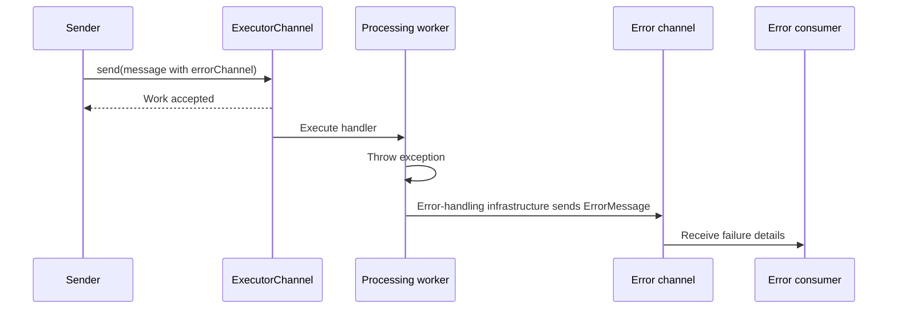
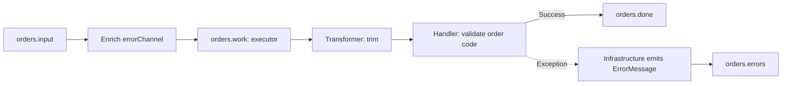

# errorChannel

## 1. The role of errorChannel in a message flow

In the **Message headers** chapter of the **SPRING_INTEGRATION_CORE** module, `errorChannel` represents the destination that receives error messages. When designing flows with `Message`, `MessageChannel`, endpoints, gateways, and Java DSL, you need to define both the success path and where failures are received.

Suppose a system receives an order, normalizes the order code, and then validates business rules. If a worker processes the order after the sender has moved on to other work, throwing an exception on the worker will not surface inside a `try/catch` block that already exited on the sender. An error message delivers the failure information to the component responsible for handling it.

After this lesson, learners can:

- Distinguish between the `errorChannel` header, the global `errorChannel` bean, and the error channel configuration of a gateway or poller.
- Identify which component catches exceptions and emits an `ErrorMessage`.
- Attach an error channel using `MessageBuilder` and Java DSL while preserving request context.
- Write an error consumer and test both success and failure paths.
- Design the boundary between error reporting, retries, and business recovery decisions.

The examples target Java 17 and Spring Integration 6.5 using `spring-integration-core`. Test examples use JUnit Jupiter. When using Spring Boot, choose the Boot-managed dependency BOM rather than mixing Spring Framework and Spring Integration versions manually.

## 2. Three places where the name errorChannel commonly appears

| Location | Meaning | Example |
| --- | --- | --- |
| Message header | Error destination for the request being processed | `MessageHeaders.ERROR_CHANNEL` with value `"orders.errors"` |
| Bean in ApplicationContext | An actual channel object | Bean `orders.errors` is a `QueueChannel` |
| Endpoint configuration attribute | Error-handling policy of the corresponding component | `@MessagingGateway(errorChannel = "quotes.errors")` |

The standard header name is `errorChannel`, declared by `MessageHeaders.ERROR_CHANNEL`. `MessageHeaders` is immutable for standard `Map` operations; use a builder to create a new message when headers must change. See [MessageHeaders API](https://docs.spring.io/spring-framework/docs/current/javadoc-api/org/springframework/messaging/MessageHeaders.html).

The header can hold a `MessageChannel` object or a `String` bean name within the channel-resolution mechanism supported by the framework. Java DSL provides overloads that accept both value forms directly. See [HeaderEnricherSpec.errorChannel API](https://docs.spring.io/spring-integration/api/org/springframework/integration/dsl/HeaderEnricherSpec.html).

Example of two ways to represent the same destination:

```java
import org.springframework.messaging.Message;
import org.springframework.messaging.MessageChannel;
import org.springframework.messaging.MessageHeaders;
import org.springframework.messaging.support.MessageBuilder;

Message<String> byName = MessageBuilder.withPayload("ORDER-17")
        .setHeader(MessageHeaders.ERROR_CHANNEL, "orders.errors")
        .build();

// ordersErrors is a MessageChannel already provided by the application.
Message<String> byReference = MessageBuilder.withPayload("ORDER-17")
        .setHeader(MessageHeaders.ERROR_CHANNEL, ordersErrors)
        .build();
```

`"orders.errors"` in the example is a bean name that the resolver in the Spring context must find. It is not a broker queue name or the address of an external service.

## 3. Who actually turns an exception into an error message?

The header only provides an address. A component is needed to catch the exception, build the error message, and send it out. `MessagePublishingErrorHandler` is one mechanism that performs this job; an application can also publish errors explicitly. See [MessagePublishingErrorHandler API](https://docs.spring.io/spring-integration/api/org/springframework/integration/channel/MessagePublishingErrorHandler.html).

### 3.1. Synchronous path through DirectChannel

```text
Calling thread:
  send(message) -> DirectChannel -> handler -> exception
       ^_________________________________________|
```

When the handler runs on the same thread, the exception can propagate back up the Java call stack. Attaching an `errorChannel` header to a message does not automatically wrap a `DirectChannel.send(...)` call in a new error catcher.

```java
import org.springframework.integration.channel.DirectChannel;
import org.springframework.messaging.MessageHeaders;
import org.springframework.messaging.MessagingException;
import org.springframework.messaging.support.MessageBuilder;

DirectChannel input = new DirectChannel();
input.subscribe(message -> {
    throw new IllegalStateException("Inventory is not ready");
});

try {
    input.send(MessageBuilder.withPayload("ORDER-17")
            .setHeader(MessageHeaders.ERROR_CHANNEL, "orders.errors")
            .build());
} catch (MessagingException ex) {
    // The sender remains responsible for this synchronous failure.
    System.out.println(ex.getMessage());
}
```

In this standalone example, `DirectChannel` does not look up the `orders.errors` bean to publish the error. The synchronous exception path and the `ErrorMessage` emission path must be distinguished when reading configurations. The [Error Handling](https://docs.spring.io/spring-integration/reference/6.5/error-handling.html) documentation describes this boundary.

### 3.2. Worker execution path

`ExecutorChannel` dispatches work through an `Executor`. With an executor using another thread, the sender and the handler no longer share the same Java call stack. Nor do they automatically share a transaction bound to the sender's thread. See [ExecutorChannel API](https://docs.spring.io/spring-integration/api/org/springframework/integration/channel/ExecutorChannel.html).



In the default error-handling infrastructure, the request's header takes precedence; if absent, the default destination is the global `errorChannel` bean. When an application configures a separate default destination for a component, check that component's policy as well. See [Error Handling: error channel resolution](https://docs.spring.io/spring-integration/reference/6.5/error-handling.html).

Do not infer business success from `send()` returning `true` on an asynchronous channel. An order may be accepted by the executor and fail afterward. Likewise, submission errors such as the executor rejecting a task can still happen inside the `send` call itself; distinguish those from errors thrown by the handler on the worker.

### 3.3. QueueChannel needs a receiver

`QueueChannel` stores messages waiting for a receiver. A polling consumer managed by Spring Integration can receive the message and process it inside a scheduled task. Poller configuration provides `errorChannel(...)` to specify the destination for errors in polling tasks. See [PollerSpec API](https://docs.spring.io/spring-integration/api/org/springframework/integration/dsl/PollerSpec.html).

If you call `queue.receive()` manually and process the message on an application-created thread, the application must design how exceptions are caught and published for that processing block. The act of pulling a message off a queue does not by itself create a business consumer.

## 4. Reading ErrorMessage and failure context

`ErrorMessage` implements `Message<Throwable>`. Its payload is the exception, commonly a `MessagingException` carrying `failedMessage`. The optional `originalMessage` property provides the message where the error context was created; this message may differ from the transformed message at the point of failure. See [ErrorMessage API](https://docs.spring.io/spring-framework/docs/current/javadoc-api/org/springframework/messaging/support/ErrorMessage.html).

| Component | What to look for? |
| --- | --- |
| `error.getPayload()` | The exception and its cause chain |
| `MessagingException.getFailedMessage()` | The message attached to the failed processing step, if present |
| `error.getOriginalMessage()` | The original message context saved by the error producer, if present |
| Business message headers | Order code, trace ID, and correlation keys that were preserved |

Do not assume every business header is copied onto the `ErrorMessage` itself. For instance, instead of only reading `error.getHeaders().get("traceId")`, actively locate the related message:

```java
import org.springframework.messaging.Message;
import org.springframework.messaging.MessagingException;
import org.springframework.messaging.support.ErrorMessage;

public final class ErrorContext {

    private ErrorContext() {
    }

    public static Message<?> findMessage(ErrorMessage error) {
        Throwable current = error.getPayload();
        while (current != null) {
            if (current instanceof MessagingException messaging
                    && messaging.getFailedMessage() != null) {
                return messaging.getFailedMessage();
            }
            Throwable next = current.getCause();
            if (next == current) {
                break;
            }
            current = next;
        }
        return error.getOriginalMessage();
    }
}
```

This is the convention of the example: prefer the message at the point of failure, then fall back to `originalMessage`. If business requirements need both the initial input and the post-transformation state, capture both rather than choosing one and losing the other. The consumer must also tolerate the case where both context sources are absent.

## 5. Java DSL example: an error channel per order flow

The example consists of four channels:

| Bean | Type | Responsibility |
| --- | --- | --- |
| `orders.input` | `DirectChannel` | Receive requests and attach the error destination |
| `orders.work` | `ExecutorChannel` | Offload processing to a worker |
| `orders.done` | `QueueChannel` | Hold successful results for a receiver |
| `orders.errors` | `QueueChannel` | Hold error messages for a receiver |



### 5.1. Full configuration

Place the following class in the application's example package. The Spring context manages the lifecycle of the executor and integration components via `@EnableIntegration`.

```java
import org.springframework.beans.factory.annotation.Qualifier;
import org.springframework.context.annotation.Bean;
import org.springframework.context.annotation.Configuration;
import org.springframework.integration.channel.DirectChannel;
import org.springframework.integration.channel.ExecutorChannel;
import org.springframework.integration.channel.QueueChannel;
import org.springframework.integration.config.EnableIntegration;
import org.springframework.integration.dsl.IntegrationFlow;
import org.springframework.scheduling.concurrent.ThreadPoolTaskExecutor;

@Configuration
@EnableIntegration
public class OrderErrorDemo {

    @Bean
    public ThreadPoolTaskExecutor ordersExecutor() {
        ThreadPoolTaskExecutor executor = new ThreadPoolTaskExecutor();
        executor.setCorePoolSize(2);
        executor.setMaxPoolSize(2);
        executor.setQueueCapacity(20);
        executor.setThreadNamePrefix("orders-worker-");
        return executor;
    }

    @Bean("orders.input")
    public DirectChannel ordersInput() {
        return new DirectChannel();
    }

    @Bean("orders.work")
    public ExecutorChannel ordersWork(
            @Qualifier("ordersExecutor") ThreadPoolTaskExecutor executor) {
        return new ExecutorChannel(executor);
    }

    @Bean("orders.done")
    public QueueChannel ordersDone() {
        return new QueueChannel(100);
    }

    @Bean("orders.errors")
    public QueueChannel ordersErrors() {
        return new QueueChannel(100);
    }

    @Bean
    public IntegrationFlow ordersFlow() {
        return IntegrationFlow.from("orders.input")
                .enrichHeaders(headers ->
                        headers.errorChannel("orders.errors", false))
                .channel("orders.work")
                .<String, String>transform(String::trim)
                .handle(String.class, (orderId, headers) -> {
                    if (orderId.isBlank() || orderId.startsWith("BAD-")) {
                        throw new IllegalArgumentException("Invalid order code");
                    }
                    return "ACCEPTED:" + orderId;
                })
                .channel("orders.done")
                .get();
    }
}
```

`errorChannel("orders.errors", false)` adds a default value while preserving any existing header. This policy is useful when the caller has already specified its own error destination. Choose `true` only when the flow must proactively replace an existing error address. Overloads and overwrite options are described in [HeaderEnricherSpec](https://docs.spring.io/spring-integration/api/org/springframework/integration/dsl/HeaderEnricherSpec.html).

The header is added **before** switching to the executor. As a result, failures in downstream transformers or handlers can use the attached destination. Steps running before the header enricher still need an appropriate error policy.

`orders.errors` in the example is an in-memory queue with finite capacity. When the application stops, queue contents are not persisted by default. Operational design must include a receiver and a persistence mechanism matching recovery requirements.

### 5.2. Sending a request and reading the outcome

```java
import org.springframework.context.annotation.AnnotationConfigApplicationContext;
import org.springframework.integration.channel.QueueChannel;
import org.springframework.messaging.Message;
import org.springframework.messaging.MessageChannel;
import org.springframework.messaging.support.ErrorMessage;
import org.springframework.messaging.support.MessageBuilder;

try (var context = new AnnotationConfigApplicationContext(OrderErrorDemo.class)) {
    MessageChannel input = context.getBean("orders.input", MessageChannel.class);
    QueueChannel errors = context.getBean("orders.errors", QueueChannel.class);

    boolean accepted = input.send(MessageBuilder.withPayload("  BAD-17  ")
            .setHeader("traceId", "trace-order-17")
            .build(), 1_000);

    System.out.println("Accepted: " + accepted);

    Message<?> received = errors.receive(5_000);
    if (received instanceof ErrorMessage error) {
        Message<?> failed = ErrorContext.findMessage(error);
        Object traceId = failed == null ? null : failed.getHeaders().get("traceId");
        System.out.println("traceId=" + traceId);
        System.out.println("exception=" + error.getPayload().getClass().getName());
    }
}
```

With this request, the handler receives the trimmed code `BAD-17` and throws an error. The correlation identifier `trace-order-17` links the failure to the request. If no message arrives within the timeout, the snippet exits without concluding that processing succeeded.

The two calls have different timeouts: `send(..., 1_000)` sets a send timeout if supported by the channel; `receive(5_000)` waits for a message up to five seconds. The send timeout does not bound how long the handler runs on the worker.

### 5.3. Adding an error consumer in a real application

Instead of waiting with `receive()` in the calling code, you can add the following bean to the configuration. This is an option **that replaces the manual error receiver in the example**; if both a poller and manual `receive()` run on the same queue, the two will compete for each message.

```java
import java.time.Duration;

import org.springframework.context.annotation.Bean;
import org.springframework.integration.dsl.IntegrationFlow;
import org.springframework.integration.dsl.Pollers;
import org.springframework.messaging.Message;
import org.springframework.messaging.support.ErrorMessage;

@Bean
public IntegrationFlow consumeOrderErrors() {
    return IntegrationFlow.from("orders.errors")
            .handle(message -> {
                if (message instanceof ErrorMessage error) {
                    Message<?> failed = ErrorContext.findMessage(error);
                    Object traceId = failed == null
                            ? null : failed.getHeaders().get("traceId");
                    System.err.println("Order failed; traceId=" + traceId
                            + "; exception="
                            + error.getPayload().getClass().getSimpleName());
                }
            }, endpoint -> endpoint.poller(Pollers
                    .fixedDelay(Duration.ofMillis(200))
                    .receiveTimeout(0)
                    .maxMessagesPerPoll(10)))
            .get();
}
```

The illustrative consumer only logs the correlation key and exception type. In production, replace it with a logger, metrics, or error-record persistence per the operational contract. Avoid dumping entire order payloads, credentials, or personal data into logs.

## 6. Global error channel vs. dedicated channels

When the default infrastructure is enabled, Spring Integration provides an `errorChannel` bean of type `PublishSubscribeChannel` with an `ERROR`-level logging subscriber. A dedicated channel does not automatically forward errors to the global channel. See [Error Handling: global error channel](https://docs.spring.io/spring-integration/reference/6.5/error-handling.html).

| Option | Suitable when | What must be designed |
| --- | --- | --- |
| Use the global channel | Application-wide error observability is needed | Define consumers and how errors are classified across flows |
| Dedicated channel per business area | Orders and payments have different recovery workflows | Proactively log, persist errors, and route alerts |
| Dedicated channel per request | A caller needs to receive the error outcome of its own request | Preserve the destination and reply timeout |

`PublishSubscribeChannel` broadcasts messages to subscribers; when no executor is configured, subscribers run on the sending thread. Therefore, adding more subscribers does not automatically parallelize logging or error persistence. See [PublishSubscribeChannel API](https://docs.spring.io/spring-integration/api/org/springframework/integration/channel/PublishSubscribeChannel.html).

If you add a bridge from a dedicated channel to the global channel, that is an explicit forwarding step to design intentionally. With a `QueueChannel`, you cannot attach two polling consumers and expect both to receive a copy of each error: each message is pulled by one consumer. To support multiple observers, use an appropriate broadcast model or one consumer that forwards to branches.

When declaring your own bean named `errorChannel`, the application explicitly chooses its type and behavior. If you change it to a `QueueChannel`, add a polling consumer and manage capacity; do not rely on the default configuration's logging behavior.

## 7. A Gateway can turn synchronous errors into a reply

A gateway is a boundary that can catch errors for a caller's invocation. `@MessagingGateway(errorChannel = "quotes.errors")` configures an error-handling flow; a transformer in that flow can build a return payload matching the gateway's contract. When no error channel is configured, the gateway propagates the exception back to the caller by default, unwrapping messaging exception wrappers. See [Messaging Gateways: Error Handling](https://docs.spring.io/spring-integration/reference/6.5/gateway.html#error-handling).

The following standalone example uses a synchronous flow to demonstrate this role of the gateway:

```java
import org.springframework.context.annotation.Bean;
import org.springframework.context.annotation.Configuration;
import org.springframework.context.annotation.Import;
import org.springframework.integration.annotation.MessagingGateway;
import org.springframework.integration.channel.DirectChannel;
import org.springframework.integration.config.EnableIntegration;
import org.springframework.integration.dsl.IntegrationFlow;

@Configuration
@EnableIntegration
@Import(GatewayErrorDemo.QuoteGateway.class)
public class GatewayErrorDemo {

    @MessagingGateway(
            defaultRequestChannel = "quotes.input",
            errorChannel = "quotes.errors",
            defaultReplyTimeout = "2000")
    public interface QuoteGateway {
        String quote(String productCode);
    }

    @Bean("quotes.input")
    public DirectChannel quotesInput() {
        return new DirectChannel();
    }

    @Bean("quotes.errors")
    public DirectChannel quotesErrors() {
        return new DirectChannel();
    }

    @Bean
    public IntegrationFlow quoteFlow() {
        return IntegrationFlow.from("quotes.input")
                .<String, String>transform(code -> {
                    if (code.startsWith("BAD-")) {
                        throw new IllegalArgumentException("Invalid product code");
                    }
                    return "AVAILABLE:" + code;
                })
                .get();
    }

    @Bean
    public IntegrationFlow quoteErrorFlow() {
        return IntegrationFlow.from("quotes.errors")
                .<Throwable, String>transform(failure -> "UNAVAILABLE")
                .get();
    }
}
```

Expected results when retrieving the `QuoteGateway` bean from the context:

| Call | Return value |
| --- | --- |
| `gateway.quote("SKU-17")` | `AVAILABLE:SKU-17` |
| `gateway.quote("BAD-17")` | `UNAVAILABLE` |

`@Import` registers the gateway interface in the example. For a different application layout, you can use `@IntegrationComponentScan` as appropriate; regular component scanning is not enough to generate a proxy for a gateway interface. See [Messaging Gateways: annotation configuration](https://docs.spring.io/spring-integration/reference/6.5/gateway.html).

Here `UNAVAILABLE` is a business choice for the example. A real system might return a DTO containing `status`, `errorCode`, and `traceId` instead of a single string for all errors. Decide which error types are mapped into expected replies and which should fail the caller.

If the error flow only logs and ends, it produces no reply payload for a method returning `String`. Therefore, design the no-reply behavior and the gateway timeout explicitly. When introducing an executor into a gateway flow, also preserve the headers used for returning errors or replies; replacing `errorChannel` with a queue that stores errors and stops can leave the caller waiting without a business result.

## 8. Pollers and errors before any business message exists

A poll task can fail while reading from the source: connection errors, authentication errors, or decoding errors occur before a `Message` can be constructed. At that point, there is no request message from which to look up an `errorChannel` header.

With a polling consumer, you can set an error destination on the poller. The configuration snippet below assumes the application already provides the `incoming.orders` queue, the `orderHandler` bean with a `process` method, and the `polling.errors` channel:

```java
import java.time.Duration;

import org.springframework.context.annotation.Bean;
import org.springframework.integration.dsl.IntegrationFlow;
import org.springframework.integration.dsl.Pollers;

@Bean
public IntegrationFlow polledOrdersFlow() {
    return IntegrationFlow.from("incoming.orders")
            .handle("orderHandler", "process", endpoint -> endpoint
                    .poller(Pollers.fixedDelay(Duration.ofSeconds(1))
                            .errorChannel("polling.errors")))
            .get();
}
```

This is an endpoint/poller configuration, whereas `headers.errorChannel(...)` in the orders example attaches a header to each message. Both participate in error-path design, but they take effect at two different places. See the [PollerSpec.errorChannel](https://docs.spring.io/spring-integration/api/org/springframework/integration/dsl/PollerSpec.html) methods.

When evaluating precedence in a specific flow, identify which error handler is catching the exception, whether a message is present, and whether that component has its own default policy. Polling errors without a message must still be observable even when the consumer finds no `failedMessage`.

## 9. Relationship with transformers, filters, routers, and aggregators

Error paths often cut across multiple integration patterns. The table below helps identify what to design when combining core components:

| Component | Scenario | How to design in an example flow |
| --- | --- | --- |
| Transformer | Data cannot be converted to target format | Keep a correlation key so you know which record failed |
| Filter | Order does not meet acceptance criteria | Choose a discard branch as an expected outcome, or configure it to throw if the contract requires |
| Router | Cannot determine forwarding destination | Define a fallback destination or let the flow fail per policy |
| Aggregator | Missing part of a group after one branch fails | Define timeout, partial results, and group release strategy |
| Gateway | Caller needs a result reflecting failure | Choose a structured error reply or propagate the exception |

For example, consider a group of three quote requests where two succeed and one is sent to the error channel. Merely logging the third error does not produce the third reply for the aggregator. The designer must choose: return a partial result after a timeout, emit a failure item carrying the same correlation key, or cancel the workflow per contract.

Similarly, a message rejected by a filter under normal rules is not automatically an exception to route to `errorChannel`. Express business statuses clearly such as `REJECTED`, `SKIPPED`, and `FAILED` rather than dumping every outcome into a single undifferentiated error list.

## 10. Retry, recovery, and the error channel

`errorChannel` provides a destination for error information. The retry policy decides whether to re-invoke the operation, how many times to try, and how long to wait between attempts. In Spring Integration 6.5, `RequestHandlerRetryAdvice` uses Spring Retry; `ErrorMessageSendingRecoverer` can emit an error when retries are exhausted. See [Provided Advice Classes: Retry Advice](https://docs.spring.io/spring-integration/reference/6.5/handler-advice/classes.html).

An illustrative policy for the inventory call step:

```text
Attempt operation
  -> succeeds: proceed
  -> transient failure: retry with bounded count and backoff
  -> non-retryable failure: route to error handling
  -> retries exhausted: recover or emit final error message
```

When using a recovery callback, decide what the callback returns or whether it rethrows an exception. If the callback handles the failure and completes normally, do not expect outer layers to still see the original exception for rollback or emitting another error message.

Do not unconditionally send failed messages back to the start of the flow. An order with an invalid code like `BAD-17` will keep failing on every attempt. Even transient failures need an attempt limit, next-attempt timing, and a policy once attempts are exhausted.

For operations with side effects, store a business-stable idempotency key. For example, an inventory-deduction request may have been recorded by the target while the reply was lost; a retry must avoid deducting a second time. `traceId` helps trace execution, while an idempotency key enforces deduplication rules; these two purposes should be defined separately.

An in-memory error channel is also not equivalent to a broker dead-letter queue. To persist failure details for processing after a restart, proactively use durable storage or a transport destination that meets that requirement. Acknowledgment, rollback, and redelivery depend on the specific adapter, container, and transaction configuration of the flow.

## 11. Testing behavior instead of only checking header presence

A test that only asserts `getHeaders().getErrorChannel()` is non-null does not prove errors reach the intended consumer. Verify observable outcomes at each boundary.

The class below uses the `OrderErrorDemo` and `GatewayErrorDemo` configurations presented earlier. Keep `OrderErrorDemo` from section 5.1 without adding the optional consumer from section 5.3, so the test can receive messages directly from the error queue.

```java
import org.junit.jupiter.api.Test;
import org.springframework.context.annotation.AnnotationConfigApplicationContext;
import org.springframework.integration.channel.DirectChannel;
import org.springframework.integration.channel.QueueChannel;
import org.springframework.messaging.Message;
import org.springframework.messaging.MessageChannel;
import org.springframework.messaging.MessageHeaders;
import org.springframework.messaging.MessagingException;
import org.springframework.messaging.support.ErrorMessage;
import org.springframework.messaging.support.MessageBuilder;

import static org.junit.jupiter.api.Assertions.*;

class ErrorChannelExamplesTest {

    @Test
    void validOrderProducesBusinessResult() {
        try (var context = new AnnotationConfigApplicationContext(OrderErrorDemo.class)) {
            MessageChannel input = context.getBean("orders.input", MessageChannel.class);
            QueueChannel done = context.getBean("orders.done", QueueChannel.class);
            QueueChannel errors = context.getBean("orders.errors", QueueChannel.class);

            assertTrue(input.send(MessageBuilder.withPayload("  ORDER-17  ").build()));

            Message<?> result = done.receive(5_000);
            assertNotNull(result);
            assertEquals("ACCEPTED:ORDER-17", result.getPayload());
            assertNull(errors.receive(0));
        }
    }

    @Test
    void invalidOrderPublishesFailureWithBusinessContext() {
        try (var context = new AnnotationConfigApplicationContext(OrderErrorDemo.class)) {
            MessageChannel input = context.getBean("orders.input", MessageChannel.class);
            QueueChannel errors = context.getBean("orders.errors", QueueChannel.class);

            assertTrue(input.send(MessageBuilder.withPayload("  BAD-17  ")
                    .setHeader("traceId", "trace-order-17")
                    .build()));

            ErrorMessage error = assertInstanceOf(ErrorMessage.class, errors.receive(5_000));
            MessagingException failure = assertInstanceOf(
                    MessagingException.class, error.getPayload());
            Message<?> failed = failure.getFailedMessage();
            assertNotNull(failed);
            assertEquals("BAD-17", failed.getPayload());
            assertEquals("trace-order-17", failed.getHeaders().get("traceId"));
            assertTrue(hasCause(failure, IllegalArgumentException.class));
        }
    }

    @Test
    void existingErrorDestinationIsPreserved() {
        try (var context = new AnnotationConfigApplicationContext(OrderErrorDemo.class)) {
            MessageChannel input = context.getBean("orders.input", MessageChannel.class);
            QueueChannel defaultErrors = context.getBean("orders.errors", QueueChannel.class);
            QueueChannel callerErrors = new QueueChannel(1);

            assertTrue(input.send(MessageBuilder.withPayload("BAD-18")
                    .setHeader(MessageHeaders.ERROR_CHANNEL, callerErrors)
                    .build()));

            assertInstanceOf(ErrorMessage.class, callerErrors.receive(5_000));
            assertNull(defaultErrors.receive(0));
        }
    }

    @Test
    void directSendStillThrowsEvenWithErrorHeader() {
        DirectChannel input = new DirectChannel();
        QueueChannel errors = new QueueChannel(1);
        input.subscribe(message -> {
            throw new IllegalStateException("Synchronous error");
        });

        Message<String> request = MessageBuilder.withPayload("ORDER-19")
                .setHeader(MessageHeaders.ERROR_CHANNEL, errors)
                .build();

        assertThrows(MessagingException.class, () -> input.send(request));
        assertNull(errors.receive(0));
    }

    @Test
    void gatewayMapsExceptionToItsReplyContract() {
        try (var context = new AnnotationConfigApplicationContext(GatewayErrorDemo.class)) {
            var gateway = context.getBean(GatewayErrorDemo.QuoteGateway.class);

            assertEquals("AVAILABLE:SKU-17", gateway.quote("SKU-17"));
            assertEquals("UNAVAILABLE", gateway.quote("BAD-17"));
        }
    }

    private static boolean hasCause(Throwable failure, Class<? extends Throwable> type) {
        for (Throwable current = failure; current != null; current = current.getCause()) {
            if (type.isInstance(current)) {
                return true;
            }
            if (current.getCause() == current) {
                break;
            }
        }
        return false;
    }
}
```

Each test creates its own context and closes it afterward to prevent messages from leaking across runs. `receive(5_000)` waits for an observable condition rather than guessing the worker will finish after a fixed `Thread.sleep(...)`.

The five scenarios above test distinct contracts: business result, failure context, precedence of an existing destination, synchronous exception, and gateway reply. When adding pollers, retries, or durable error storage to the application, add tests for the new behavior rather than merely repeating header assertions.

## 12. Common design mistakes

| Symptom | Cause to investigate | Fix |
| --- | --- | --- |
| Sender `try/catch` does not catch business error | Handler runs after passing through an executor or poller | Inspect the asynchronous error path and identify the consumer receiving `ErrorMessage` |
| Header is attached but error is still thrown at `send()` | Error occurred on a synchronous call path | Choose the caller, gateway, or advice as the error-handling boundary |
| Dedicated channel has no default logging | No logging consumer registered for that channel | Add a consumer or forward intentionally |
| Messages stay in the error queue forever | No receiver or poller is not active | Monitor endpoint state and queue depth |
| Gateway caller receives no result | Error flow ends without replying, or required headers were altered | Check the reply contract and wait timeout |
| Cannot find `traceId` on `ErrorMessage` | Context lives on the associated message | Read `failedMessage`, then inspect `originalMessage` |
| Channel name cannot be resolved | Wrong bean name or resolver lacks the appropriate Spring context | Check destination name and how the error-emitting component is initialized |
| Order still fails after multiple redeliveries | Retry is applied to invalid data | Classify errors and terminate retries per policy |
| Errors spike when the error consumer is slow | Error path has finite resources and isn't drained fast enough | Set capacity, send timeouts, and a fallback when errors cannot be stored |

Error consumers can also fail. For example, persisting a record to a failing database and emitting back to the same channel being processed can create a loop. Design a clear termination path: bounded attempts, minimal alerting, and an appropriate final failure sink.

## 13. Checklist for applying to a new flow

1. Diagram the steps running on the caller's thread and the steps running on workers; mark every thread switch.
2. Identify every exception-catching boundary: caller, gateway, polling task, executor task, or advice.
3. Choose the default error destination and dedicated error destinations according to the business contract.
4. Enrich headers before the steps that need them; decide explicitly whether to preserve a caller-supplied destination.
5. Define the data to retain for correlating requests: business codes, trace IDs, correlation keys, and idempotency keys where needed.
6. Design the error consumer, storage capability, capacity, and behavior when that consumer itself fails.
7. Test the success path, error path, and observable caller behavior together.

With the order example, this process yields a concrete outcome: `ORDER-17` produces `ACCEPTED:ORDER-17`; `BAD-17` produces an error message with correlation context; callers can track both paths without guessing outcomes from the send call.
