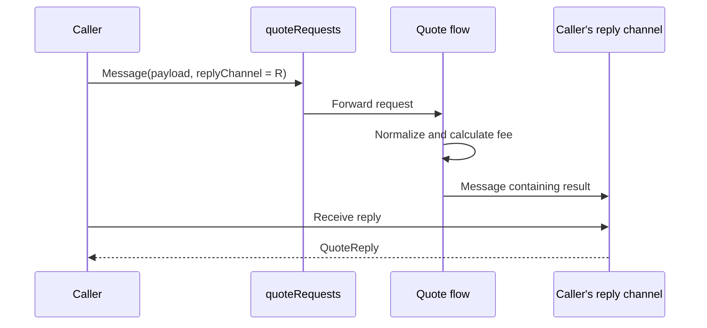

# returnAddress: reply destination in Spring Integration

## 1. Objectives and use case

In a request–reply flow, the component sending a request needs to indicate where to receive the result. **Return Address** is an integration pattern that places that information on the request message so the processing side knows where to send the reply. See the definition in [Enterprise Integration Patterns](https://www.enterpriseintegrationpatterns.com/patterns/messaging/ReturnAddress.html).

For example, a shipping-fee calculation service receives requests from a website and an admin tool. Both send to `quoteRequests`, yet each needs to receive its own result. If the fee service always sends to a fixed channel, adding a caller will require changing the processing configuration. Placing the reply destination on each request allows the flow to serve multiple callers.

This lesson belongs to the **Message headers** chapter of **SPRING_INTEGRATION_CORE**, focusing on how to wire `Message`, `MessageChannel`, endpoints, gateways, and Java DSL to implement this mechanism.

After this lesson, you can:

- Distinguish the pattern name `returnAddress` from the actual header used by Spring.
- Build a request carrying a reply destination using either a channel object or a channel name.
- Explain how an endpoint selects where to send a result and how a gateway receives that result.
- Recognize errors involving lost headers, overwritten addresses, missing replies, and crossing process boundaries.

## 2. Which header represents `returnAddress`?

In the Spring Messaging API used by Spring Integration, the return address is represented by **`MessageHeaders.REPLY_CHANNEL`**, whose header name is **`replyChannel`**. `returnAddress` in the lesson title is the integration pattern concept; do not create a custom header with that name and expect the framework to use it automatically. The standard headers list is documented in [Message](https://docs.spring.io/spring-integration/reference/message.html).

| Component | Meaning in this lesson |
| --- | --- |
| Return Address | Where the caller wants to receive the reply |
| `MessageHeaders.REPLY_CHANNEL` | Constant used in Java code |
| `replyChannel` | Header key read by endpoints |
| A `MessageChannel` | Address that is already a channel object in the application |
| A `String` | Channel name or registry-issued key to be resolved |

Two ways of building a request with equivalent intent:

```java
// MessageChannel object already existing in the current JVM.
Message<String> byReference = MessageBuilder.withPayload("ORDER-001")
        .setReplyChannel(replyChannel)
        .build();

// MessageChannel bean name that the receiving application can resolve.
Message<String> byName = MessageBuilder.withPayload("ORDER-001")
        .setReplyChannelName("quoteReplies")
        .build();
```

In the snippet above, `replyChannel` is a variable of type `MessageChannel`; `Message` and `MessageBuilder` belong to `org.springframework.messaging` and `org.springframework.messaging.support` respectively. These message-building methods are published in [MessageBuilder API](https://docs.spring.io/spring-framework/docs/current/javadoc-api/org/springframework/messaging/support/MessageBuilder.html).

The snippet below only creates a custom header:

```java
Message<String> customHeader = MessageBuilder.withPayload("ORDER-001")
        .setHeader("returnAddress", "quoteReplies")
        .build();
```

To use that custom name, the application must map it to `replyChannel` itself or implement its own handling logic. In the following examples, we use the standard API directly.

## 3. How does an endpoint decide where to send the result?

For a reply-producing service activator, when no routing slip is used, destination selection is understood as follows:

1. Use the endpoint's `outputChannel` if present.
2. If no destination is set yet, read `replyChannel` from the request message.
3. If the request lacks that header and the result is a `Message`, `replyChannel` may be taken from the result message.

A `String` value must resolve to a channel; a non-existent name can cause `DestinationResolutionException`. See [Service Activator](https://docs.spring.io/spring-integration/reference/service-activator.html).

If the flow uses a routing slip, the remaining destinations in the routing slip must also be accounted for before falling back to `replyChannel`; do not apply the simplified flow above mechanically.



In a pipeline, intermediate endpoints have outbound channels to continue processing; the final endpoint can use the address provided by the caller. For example:

```text
quoteRequests -> normalize -> calculate fee -> request's replyChannel
```

Do not attach a fixed outbound channel at the end just because its name is `replyChannel`. A bean with that name is still a fixed destination; the header of the same name allows the destination to vary per request.

## 4. Full example: caller chooses its own fee-reply channel

### 4.1. Preparation

The example uses Java 17 or later and compatible Spring Integration libraries, with `spring-integration-core` and Spring Context on the classpath. If using Spring Boot, the project can manage dependencies via `spring-boot-starter-integration`. The example creates `AnnotationConfigApplicationContext` directly to focus on the messaging mechanics.

Data types and configuration are placed together in the `ReturnAddressDemo` class. The illustrative shipping fee is 5% of the order amount; this is purely a rule for the practice exercise.

### 4.2. Source code

```java
package example.returnaddress;

import java.math.BigDecimal;

import org.springframework.context.annotation.AnnotationConfigApplicationContext;
import org.springframework.context.annotation.Bean;
import org.springframework.context.annotation.Configuration;
import org.springframework.integration.channel.DirectChannel;
import org.springframework.integration.channel.QueueChannel;
import org.springframework.integration.config.EnableIntegration;
import org.springframework.integration.dsl.IntegrationFlow;
import org.springframework.messaging.Message;
import org.springframework.messaging.support.MessageBuilder;

public class ReturnAddressDemo {

    public record QuoteRequest(String orderId, BigDecimal orderAmount) {
    }

    public record QuoteReply(String orderId, BigDecimal shippingFee) {
    }

    @Configuration(proxyBeanMethods = false)
    @EnableIntegration
    public static class FlowConfiguration {

        @Bean
        public DirectChannel quoteRequests() {
            return new DirectChannel();
        }

        @Bean
        public QueueChannel namedQuoteReplies() {
            return new QueueChannel(10);
        }

        @Bean
        public IntegrationFlow quoteFlow(DirectChannel quoteRequests) {
            return IntegrationFlow.from(quoteRequests)
                    .<QuoteRequest, QuoteRequest>transform(request ->
                            new QuoteRequest(
                                    request.orderId().trim(),
                                    request.orderAmount()))
                    .<QuoteRequest>handle((request, headers) ->
                            new QuoteReply(
                                    request.orderId(),
                                    request.orderAmount()
                                            .multiply(new BigDecimal("0.05"))))
                    .get();
        }
    }

    public static void main(String[] args) {
        try (AnnotationConfigApplicationContext context =
                     new AnnotationConfigApplicationContext(
                             FlowConfiguration.class)) {

            DirectChannel requests = context.getBean(
                    "quoteRequests", DirectChannel.class);

            // Local channel created by the caller; no need to register as a bean.
            QueueChannel returnTo = new QueueChannel(1);

            Message<QuoteRequest> request = MessageBuilder.withPayload(
                            new QuoteRequest(
                                    " ORDER-001 ",
                                    new BigDecimal("1000000")))
                    .setReplyChannel(returnTo)
                    .setHeader("requestId", "REQ-001")
                    .build();

            if (!requests.send(request, 1_000)) {
                throw new IllegalStateException("Failed to send request");
            }

            Message<?> response = returnTo.receive(1_000);
            if (response == null) {
                throw new IllegalStateException("Failed to receive reply");
            }

            System.out.println(response.getPayload());
            System.out.println(response.getHeaders().get("requestId"));
        }
    }
}
```

Expected output:

```text
QuoteReply[orderId=ORDER-001, shippingFee=50000.00]
REQ-001
```

### 4.3. Tracing the request path

The caller creates `returnTo`, attaches it to the header, and sends the request to `quoteRequests`. The transformer trims whitespace from the order ID; the handler builds `QuoteReply`. At the end of the flow there is no `.channel(...)` specifying a fixed destination, so the reply is sent to `returnTo`.

Java DSL expresses a transformer with `.transform()` and a service activator with `.handle()`. Adjacent endpoints are chained into a flow; see [DSL Basics](https://docs.spring.io/spring-integration/reference/dsl/java-basics.html).

In the example, the handler returns only the business object. The caller still receives a `Message` whose payload is that object and whose headers are propagated through the flow by the default mechanism.

`quoteRequests` is a `DirectChannel`, while `returnTo` is a `QueueChannel`: request processing runs on the sending thread; the result is placed into the queue for the caller to retrieve after `send()` returns. A reply queue does not by itself make the entire flow asynchronous. See characteristics of [MessageChannel implementations](https://docs.spring.io/spring-integration/reference/channel/implementations.html).

`receive(1_000)` limits how long the receive step waits for a reply. The timeout argument on `send()` cannot interrupt a long-running handler on the current thread.

## 5. Using a channel name and serving multiple callers

### 5.1. Address as a bean name

Within the same `try` block of the example, you can replace the request creation and receive code with:

```java
QueueChannel replies = context.getBean(
        "namedQuoteReplies", QueueChannel.class);

Message<QuoteRequest> request = MessageBuilder.withPayload(
                new QuoteRequest("ORDER-002", new BigDecimal("2000000")))
        .setReplyChannelName("namedQuoteReplies")
        .setHeader("requestId", "REQ-002")
        .build();

if (!requests.send(request, 1_000)) {
    throw new IllegalStateException("Failed to send request");
}

Message<?> response = replies.receive(1_000);
if (response == null) {
    throw new IllegalStateException("Failed to receive reply");
}

System.out.println(response.getPayload());
```

The flow still processes the same request type; the caller selects the `namedQuoteReplies` bean as the receiver. The result of this example has `shippingFee=100000.00`.

In environments using bean names, verify spelling and the resolution context. The string `namedQuoteReplies` in another JVM does not automatically point to the bean in the JVM that sent the request.

### 5.2. Each caller has its own address

Suppose two requests enter the same flow:

| Caller | Request ID | `replyChannel` value |
| --- | --- | --- |
| Website | `REQ-WEB-01` | `webReturnTo` object |
| Admin tool | `REQ-ADMIN-01` | `adminReturnTo` object |

The fee-calculation flow does not need to inspect the caller type to pick a destination. To observe this, create two `QueueChannel(1)` instances, send two requests with different addresses, and receive from each channel.

If multiple callers call `receive()` on a shared `QueueChannel`, a reply may be picked up by a caller other than the one that sent the request. When sharing a receive path, a component is needed to match replies to waiting requests; merely adding an ID field does not create that matching component.

## 6. Gateway managing the reply return address

When business code just wants to call `quote(request)` and receive a `QuoteReply`, a messaging gateway can be used. The gateway creates a temporary reply channel, sets it in the `replyChannel` header, and receives the result to return to the caller. Normally there is no need to specify a fixed reply channel. See [Messaging Gateways](https://docs.spring.io/spring-integration/reference/gateway.html).

Place the following interface in the same package as the example:

```java
package example.returnaddress;

import org.springframework.integration.annotation.MessagingGateway;

@MessagingGateway(
        defaultRequestChannel = "quoteRequests",
        defaultReplyTimeout = "2000")
public interface QuoteGateway {

    ReturnAddressDemo.QuoteReply quote(
            ReturnAddressDemo.QuoteRequest request);
}
```

So that Spring discovers the interface, add this annotation to `FlowConfiguration`:

```java
import org.springframework.integration.annotation.IntegrationComponentScan;

// Placed on the configuration class, alongside @Configuration and @EnableIntegration.
@IntegrationComponentScan(basePackageClasses = QuoteGateway.class)
```

Once the context contains the gateway proxy, the calling code inside the `try` block becomes:

```java
QuoteGateway gateway = context.getBean(QuoteGateway.class);

ReturnAddressDemo.QuoteReply reply = gateway.quote(
        new ReturnAddressDemo.QuoteRequest(
                "ORDER-003", new BigDecimal("3000000")));

if (reply == null) {
    throw new IllegalStateException("Gateway did not receive a result");
}

System.out.println(reply.shippingFee()); // 150000.00
```

Do not attach an extra fixed `replyChannel` inside the flow just to serve this gateway. If you replace the temporary address the gateway is waiting on with another channel, the result can go to that channel while the call still receives no reply.

`defaultReplyTimeout = "2000"` configures the reply wait timeout in milliseconds. With a flow running synchronously on `DirectChannel`, it does not forcibly stop a slow-running service. If execution switches to another thread, timing out does not mean the task was cancelled either. The application must separately design timeouts for calling external services and handling late replies.

## 7. Preserving the reply address when transforming messages

### 7.1. Returning a payload vs. building a message yourself are two different operations

In the main example, the transformer returns a `QuoteRequest`, without building an entire message itself. When building a message yourself to send onward, explicitly decide which headers must travel along.

```java
// input is a Message<String> received from the previous step.
Message<String> next = MessageBuilder
        .withPayload(input.getPayload().trim())
        .copyHeaders(input.getHeaders())
        .build();
```

This snippet suits an internal flow that wants to keep carrying input headers. If selecting only certain headers, preserve the required addresses as well:

```java
Message<String> next = MessageBuilder
        .withPayload(input.getPayload().trim())
        .setHeader(
                org.springframework.messaging.MessageHeaders.REPLY_CHANNEL,
                input.getHeaders().getReplyChannel())
        .setHeader(
                org.springframework.messaging.MessageHeaders.ERROR_CHANNEL,
                input.getHeaders().getErrorChannel())
        .setHeader("requestId", input.getHeaders().get("requestId"))
        .build();
```

`getReplyChannel()` returns `Object` because the address may be a channel or a string. Do not cast directly to `MessageChannel` without knowing the actual runtime type.

Headers read from `MessageHeaders` are not a map to mutate directly. Create a new message with a builder instead of calling `put()`; see [MessageHeaders API](https://docs.spring.io/spring-framework/docs/current/javadoc-api/org/springframework/messaging/MessageHeaders.html).

### 7.2. When are headers easily lost?

Code such as `new GenericMessage<>(newPayload)` does not carry the business headers or addresses of the old message. If that message is sent to another step, the receiver no longer has enough information to return to the caller unless a mechanism restores the headers.

Do not assume every endpoint returning a new `Message` shares the same header-copying behavior: check the endpoint type and its header-propagation configuration. With code that creates and sends a message manually, responsibility for keeping the address lies with that code.

A header filter can also intentionally remove `replyChannel`. Therefore, when filtering headers before a system boundary, establish the alternative reply path first. Spring Integration supports removing headers via `.headerFilter(...)`; see [Transformer and Header Filter](https://docs.spring.io/spring-integration/reference/transformer.html).

## 8. Distinguishing address, routing, and reply correlation

Consider a concrete request:

```text
payload.orderId = ORDER-010
requestId = REQ-010
replyChannel = webReturnTo
```

| Information | Question answered | Applied to the example |
| --- | --- | --- |
| Inbound channel | Where should the request be sent? | `quoteRequests` |
| Router | Which step or branch processes next? | Standard-fee or express-fee branch |
| `replyChannel` | Where should the result be sent back? | `webReturnTo` |
| Custom `requestId` | Which business request does the result belong to? | `REQ-010` |
| `errorChannel` | Where does error-handling infrastructure send error notifications? | Configured error channel |

`requestId` in this lesson is a header set and retained by the application across the flow; it is not an automatic Spring reply-correlation feature. If the application chooses to use `correlationId` or an external protocol ID, it must still define conventions for generating and using that ID.

A router may choose the express-fee branch without itself calculating the fee. An aggregator may collect multiple partial results yet still require a group release condition. The return address is only useful when the final processing branch actually produces a result to send.

When using a splitter and aggregator, the contract with the caller must clarify whether one aggregated result or multiple individual replies are returned. For a gateway returning a single `QuoteReply`, design the flow so one successful request yields one final result.

## 9. Error handling and no-reply cases

`replyChannel` does not automatically convert every exception into a business reply. With `DirectChannel`, handler exceptions can propagate back to the sending thread. When processing asynchronously through Spring Integration infrastructure, errors are typically published as an `ErrorMessage` using the request's `errorChannel` or the default error channel. See [Error Handling](https://docs.spring.io/spring-integration/reference/error-handling.html).

In the fee-calculation application, you may choose a contract that returns a result containing a success or rejection status. In that case, the error flow must actively convert matching errors into the contract's result and deliver it back to the waiting caller. Merely logging on a separate error channel produces no reply for the gateway.

| Symptom | Cause to check | How to fix |
| --- | --- | --- |
| Reply arrives at a different channel | Final endpoint has a fixed `outputChannel` | Check the outbound channel of the final endpoint |
| Cannot resolve address | Wrong bean name, wrong context, or expired registry key | Compare the header value against the resolver |
| Handler reports no output channel | No fixed destination and missing reply address | Inspect headers entering the final endpoint |
| Caller waits even after calculation finished | Address was overwritten or new message lost headers | Trace the address at each step |
| Caller waits though flow finished | Service activator returned `null`/`void`, or filter dropped message | Explicitly define the result or error for that case |
| Request sent but not yet processed | Input is a queue with no consumer or poller | Check consumer and polling configuration |
| Caller times out | Reply arrived late or was never created | Inspect both processing duration and reply path |

For a service activator required to produce a result, you can enable `requiresReply` so `null` fails immediately at the endpoint. Example of an alternative configuration for the fee-calculation handler:

```java
import org.springframework.integration.annotation.ServiceActivator;

@ServiceActivator(inputChannel = "quoteRequests", requiresReply = "true")
public ReturnAddressDemo.QuoteReply quote(
        ReturnAddressDemo.QuoteRequest request) {
    return new ReturnAddressDemo.QuoteReply(
            request.orderId().trim(),
            request.orderAmount().multiply(new BigDecimal("0.05")));
}
```

This is an **alternative approach** for the flow receiving from `quoteRequests` in the example; do not register both consumers simultaneously expecting both to handle the same request. With a signature requiring a reply, returning `null` throws `ReplyRequiredException`; see this option in [Service Activator](https://docs.spring.io/spring-integration/reference/service-activator.html).

Do not use a handler that only calls `System.out.println(...)` as the last step of a flow expected to return a fee: printing does not produce a `QuoteReply` for the caller.

## 10. Reply addresses when persisting or crossing a broker

A local `MessageChannel` can hold subscribers, queues, and application state. That object cannot be treated as a network address usable directly between two JVMs.

When messages must be persisted or sent over a medium supporting only serializable data, `HeaderChannelRegistry` can replace channel references with string keys and resolve them back in an application that holds the registry. Spring Integration provides the `header-channels-to-string` mechanism for `replyChannel` and `errorChannel` headers; see [Header Channel Registry](https://docs.spring.io/spring-integration/reference/content-enrichment.html#header-channel-registry).

Visualize the handling as follows:

```text
Application A:
  local channel -> register -> string key in header

Message persisted or transported:
  payload + string key preserved

Back in Application A:
  string key -> registry still valid -> local channel
```

The registry does not turn a channel in A into a channel B can call directly. Between two independent applications, request–reply design also requires the transport's reply destination, header mapping, and reply-matching mechanism. For example, a JMS reply destination cannot simply be replaced by a Spring bean name on A's side.

From that limitation, when designing distributed flows, answer:

- By what path does the reply return to the exact instance holding the channel?
- Do the transport and message store preserve the required headers?
- Is the registry key still valid when the reply arrives?
- If the instance restarts or the caller has timed out, where will the result be handled?

For long-running tasks that must survive restarts, a model that stores results by request ID may fit better than keeping a caller waiting on a temporary address.

## 11. Practice exercises for observing the mechanism

Apply the following changes one by one to the example to observe behavior. Change only one factor at a time and restore it before the next step.

### Exercise 1: two addresses, one flow

Create two `QueueChannel(1)` instances and two requests with different `requestId` values. Attach each request to a channel and send through `quoteRequests`.

What to observe: each channel receives the exact `QuoteReply` for its attached request; the `quoteFlow` configuration needs no knowledge of there being two callers.

### Exercise 2: name-based address

Use `.setReplyChannelName("namedQuoteReplies")`, receive from the bean of the same name, then try changing the header value to a non-existent bean name.

What to observe: the first run returns the fee; the second fails to find a valid destination. With a synchronous flow, the error may appear immediately on `send()`.

### Exercise 3: outbound channel precedence

Add `.channel("namedQuoteReplies")` after the fee-calculation handler in the DSL, while the request still carries `.setReplyChannel(returnTo)`.

What to observe: the fee arrives at `namedQuoteReplies`; `returnTo.receive(...)` does not receive that result. Restore the flow after observing.

### Exercise 4: verifying the standard header name

Replace `.setReplyChannel(returnTo)` with `.setHeader("returnAddress", returnTo)` and keep the rest of the flow unchanged.

What to observe: the custom header does not supply the standard reply destination; the final endpoint does not use it automatically. Switch back to `setReplyChannel(...)` to restore behavior.

While observing, log `requestId`, payload type, and `replyChannel` value at request receipt, after the transformer, and before producing the result. These facts help distinguish fee-calculation errors from reply-path errors.
