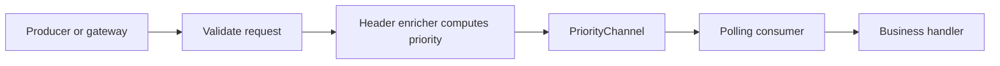

# priority — Controlling message ordering in Spring Integration

## Lesson objectives

In the **Message headers** chapter of the **SPRING_INTEGRATION_CORE** module, `priority` is metadata describing the priority level of a message. This lesson connects `Message`, `MessageChannel`, and endpoints to a concrete scenario: multiple requests are waiting to be processed, and certain requests need to be dequeued first.

After this lesson, you can:

- Set, read, and change `priority` with the proper data type.
- Choose a channel with priority support and place the header at the right position in the flow.
- Build a Java DSL flow with a classification step, a queue, and a polled consumer.
- Verify dequeue order deterministically while recognizing the practical limits of priority in a running system.

The examples use Java 17 and the Spring Integration 6.5 API. The project needs `spring-integration-core` and corresponding Spring dependencies; if using Spring Boot, you can use `spring-boot-starter-integration` at your project's managed version. Test examples use JUnit Jupiter. Configuration and test snippets are presented for hands-on learning and do not require modifying build configuration to follow the lesson.

## 1. From business requirement to the `priority` header

Suppose a service receives order-processing requests. When request volume increases, orders must wait in a queue. The business team defines this rule:

| Request type | Application-defined level | Reason |
| --- | --- | --- |
| Standard order | `3` | Processed with remaining capacity |
| Expedited order | `9` | Needs to be dequeued ahead of waiting standard orders |

Information about the order lives in the payload. The priority level used to coordinate the flow lives in a header. This separation lets the queuing component process generic metadata without understanding the entire order domain model.

```text
Message<OrderCommand>
├── payload: OrderCommand(orderId="ORD-208", expedited=true)
└── headers:
    ├── priority: 9
    ├── id: ...
    └── timestamp: ...
```

`priority` is a header defined by Spring Integration with the conventional type `Integer`; the header name constant is `IntegrationMessageHeaderAccessor.PRIORITY`. Do not confuse this constant with the general header constants in `MessageHeaders`. See [Spring Integration message headers catalog](https://docs.spring.io/spring-integration/reference/message.html#message-headers).

The two levels `3` and `9` above are an illustrative application policy. They do not establish a universal business standard across all systems. When multiple teams send messages together, agree on the meaning of each level before implementation.

## 2. The header's data contract

| Property | Rule to apply |
| --- | --- |
| Name in message | `priority` |
| Constant used in code | `IntegrationMessageHeaderAccessor.PRIORITY` |
| Type the application should standardize on | `java.lang.Integer` |
| Interpretation by default comparator | Higher values are dequeued before lower values |
| When header is absent in default `PriorityChannel` | Compared as level `0` |
| Component enforcing ordering | A channel or component with logic that reads the priority level |

With Spring Integration 6.5's in-memory `PriorityChannel` implementation, messages of equal priority are tie-broken by the channel's internal sequence. When a producer sends sequentially, messages at the same priority are received in send order. This is a rule of this channel implementation; do not generalize it to global ordering across multiple machines or every message store. You can inspect [`PriorityChannel` 6.5.4 comparator and sequence mechanism](https://github.com/spring-projects/spring-integration/blob/v6.5.4/spring-integration-core/src/main/java/org/springframework/integration/channel/PriorityChannel.java) directly.

Normalize data right at entry. The string `"9"` and the integer `9` are values of different types. Do not rely on the channel parsing strings into numbers automatically. Spring Integration's header accessor accepts numeric values and reads back integers; standardizing on `Integer` avoids implicit conversions or lost information. See [`IntegrationMessageHeaderAccessor` type checking](https://github.com/spring-projects/spring-integration/blob/main/spring-integration-core/src/main/java/org/springframework/integration/IntegrationMessageHeaderAccessor.java).

If the application contract only permits `3` and `9`, validate those two values. Do not blindly accept any number supplied by the caller: when every request claims the highest level, the priority policy becomes meaningless.

## 3. Creating, reading, and modifying priority

The following example uses Spring Messaging's `MessageBuilder` to create messages and Spring Integration's header constant to avoid typos:

```java
import org.springframework.integration.IntegrationMessageHeaderAccessor;
import org.springframework.messaging.Message;
import org.springframework.messaging.support.MessageBuilder;

public class PriorityHeaderExample {

    public static void main(String[] args) {
        Message<String> original = MessageBuilder
                .withPayload("ORD-208")
                .setHeader(IntegrationMessageHeaderAccessor.PRIORITY, 3)
                .build();

        Integer current = original.getHeaders().get(
                IntegrationMessageHeaderAccessor.PRIORITY,
                Integer.class);

        Message<String> promoted = MessageBuilder
                .fromMessage(original)
                .setHeader(IntegrationMessageHeaderAccessor.PRIORITY, 9)
                .build();

        System.out.println(current);
        System.out.println(promoted.getHeaders().get(
                IntegrationMessageHeaderAccessor.PRIORITY,
                Integer.class));
        System.out.println(original.getHeaders().get(
                IntegrationMessageHeaderAccessor.PRIORITY,
                Integer.class));
    }
}
```

Expected output:

```text
3
9
3
```

`promoted` carries the new level, while `original` keeps level `3`. With standard messages, the header map does not allow direct modification via `put()`; create a new message through a builder. This immutability rule applies to the message structure and does not automatically make objects inside the payload immutable. See [Message and MessageHeaders model](https://docs.spring.io/spring-integration/reference/message.html).

When messages are always normalized to `Integer`, a typed read as in the example is sufficient. When you want to read using Spring Integration's dedicated accessor API, you can use:

```java
Integer priority = org.springframework.integration
        .StaticMessageHeaderAccessor.getPriority(original);
```

The result can be `null` when the header is absent. The default comparison level of `0` is how the channel handles a missing header; it does not mean every headerless message gets a `priority=0` header added automatically. See [`StaticMessageHeaderAccessor` API](https://docs.spring.io/spring-integration/api/org/springframework/integration/StaticMessageHeaderAccessor.html).

If you want only to fill in a default while preserving an existing value, use `setHeaderIfAbsent(...)`. If you want to enforce the application's policy, use `setHeader(...)`. These two choices carry different business semantics and must be decided clearly where requests are ingested.

## 4. The header needs a channel that enforces priority

Attaching `priority` only supplies data to the flow. You must also choose a component that acts on that data:

| Channel | How messages are delivered | Effect of default `priority` |
| --- | --- | --- |
| `DirectChannel` | Invokes handler via dispatcher, usually on sending thread | Does not create a priority queue |
| `QueueChannel` with default queue | Stores messages for consumers to pull in FIFO order | Does not alter FIFO just because the header is present |
| `PriorityChannel` | Stores messages and selects elements by comparator | Default comparator reads `priority` |
| `ExecutorChannel` | Dispatches work through an executor | Does not become a priority queue by header automatically |

These channel characteristics are described in [Message Channel Implementations](https://docs.spring.io/spring-integration/reference/6.5/channel/implementations.html). With `PriorityChannel`, the application can also pass a custom comparator via the constructor; in that case, ordering depends on the supplied comparator. See [`PriorityChannel` API](https://docs.spring.io/spring-integration/docs/current/api/org/springframework/integration/channel/PriorityChannel.html).

The flow must compute priority **before** the queue:



If the enricher sits after `PriorityChannel`, the earlier queuing step did not have the value you just computed. Changing the header downstream cannot retroactively affect a selection that already happened.

## 5. Observing receive order with a minimal example

To see the mechanism clearly, send all messages into the channel first before starting to receive. This example does not require starting a Spring context:

```java
import java.util.List;

import org.springframework.integration.IntegrationMessageHeaderAccessor;
import org.springframework.integration.channel.PriorityChannel;
import org.springframework.messaging.Message;
import org.springframework.messaging.support.MessageBuilder;

public class PriorityQueueExample {

    public static void main(String[] args) {
        PriorityChannel channel = new PriorityChannel(10);

        List<Message<String>> messages = List.of(
                message("ORD-A", 3),
                message("ORD-B", 9),
                message("ORD-C", 6),
                MessageBuilder.withPayload("ORD-D").build());

        for (Message<String> message : messages) {
            if (!channel.send(message, 0)) {
                throw new IllegalStateException("No space left in channel");
            }
        }

        for (int index = 0; index < messages.size(); index++) {
            Message<?> received = channel.receive(0);
            if (received == null) {
                throw new IllegalStateException("Missing expected message");
            }
            System.out.println(received.getPayload());
        }
    }

    private static Message<String> message(String orderId, int priority) {
        return MessageBuilder.withPayload(orderId)
                .setHeader(IntegrationMessageHeaderAccessor.PRIORITY, priority)
                .build();
    }
}
```

Expected output:

```text
ORD-B
ORD-C
ORD-A
ORD-D
```

`ORD-C` uses level `6` to illustrate comparison, independent of the two-level policy of the order service in the next section. `ORD-D` has no header, so it ranks behind messages with positive priority in this example.

An important condition of this experiment is that all four messages are waiting at the moment of the first receive. In a system with an active concurrent consumer, a standard message might already be pulled before an urgent message arrives. In that case, the observed sequence is no longer a sort over the entire send history.

## 6. Building a Java DSL flow for orders

The configuration below has two flows:

1. `classifyOrders`: receives orders, recomputes priority per internal policy, and puts them into the channel.
2. `processOrders`: polls the channel, processes orders, and sends results to the output channel.

```java
import org.springframework.context.annotation.Bean;
import org.springframework.context.annotation.Configuration;
import org.springframework.integration.IntegrationMessageHeaderAccessor;
import org.springframework.integration.channel.DirectChannel;
import org.springframework.integration.channel.PriorityChannel;
import org.springframework.integration.channel.QueueChannel;
import org.springframework.integration.config.EnableIntegration;
import org.springframework.integration.dsl.IntegrationFlow;
import org.springframework.integration.dsl.Pollers;

@Configuration
@EnableIntegration
public class PriorityOrderConfiguration {

    public record OrderCommand(String orderId, boolean expedited) {
    }

    @Bean
    public DirectChannel orderInput() {
        return new DirectChannel();
    }

    @Bean
    public PriorityChannel priorityOrders() {
        return new PriorityChannel(100);
    }

    @Bean
    public QueueChannel completedOrders() {
        return new QueueChannel(100);
    }

    @Bean
    public IntegrationFlow classifyOrders() {
        return IntegrationFlow.from(orderInput())
                .enrichHeaders(headers -> headers
                        .<OrderCommand>headerFunction(
                                IntegrationMessageHeaderAccessor.PRIORITY,
                                message -> message.getPayload().expedited() ? 9 : 3,
                                true))
                .channel(priorityOrders())
                .get();
    }

    @Bean
    public IntegrationFlow processOrders() {
        return IntegrationFlow.from(priorityOrders())
                .handle(OrderCommand.class,
                        (order, headers) -> "PROCESSED:" + order.orderId(),
                        endpoint -> endpoint.poller(
                                Pollers.fixedDelay(100)
                                        .maxMessagesPerPoll(1)))
                .channel(completedOrders())
                .get();
    }
}
```

`headerFunction` computes the value from the current message. The `true` argument requests overwriting any existing level so the classification step reapplies the service's policy. If you choose to keep an upstream level, define which upstream sources are authorized to set that level. See [`HeaderEnricherSpec` API](https://docs.spring.io/spring-integration/api/org/springframework/integration/dsl/HeaderEnricherSpec.html).

Both flows reference the `priorityOrders()` bean. Declaring a shared channel as a bean avoids creating two independent queues or duplicate registrations when wiring multiple flows. This is also the approach guided in [Java DSL: Message Channels](https://docs.spring.io/spring-integration/reference/dsl/java-channels.html).

`PriorityChannel` is a pollable channel. The poller attaches to the processing endpoint immediately following the queue input. The example uses a `100` millisecond delay and at most one message per poll to make the flow easy to observe. Both parameters must be tuned for load; they are not recommended throughput settings for all systems.

To practice, create an `AnnotationConfigApplicationContext` with the configuration class above, retrieve the `orderInput` bean, and send a `Message<OrderCommand>`. You can retrieve results from the `completedOrders` bean using `receive(timeout)`. The output channel is where results are observed in this lesson; in production, attach a consumer so the output queue does not grow unbounded.

If the application has a messaging gateway, the gateway can route requests into `orderInput`. Whether a call starts from a gateway or from `MessageChannel.send(...)`, the final priority in the example is still determined by the classification step. If adding request/reply semantics, design the return path and timeout accordingly; the current example places results into a separate channel.

## 7. Distinguishing dequeue order, execution start, and completion

Consider a consumer currently processing standard order `A`:

```text
Time        State
10:00:00    Consumer pulls A(priority=3), starts processing
10:00:01    B(priority=9) is placed into the queue
10:00:02    C(priority=3) is placed into the queue
10:00:05    A finishes; consumer pulls B before C
```

B is prioritized among the waiting items. The consumer does not preempt the handler currently processing A to run B.

With multiple consumers, observe three distinct orders:

| Order | Observation question |
| --- | --- |
| Dequeued from queue | Which message is selected at each `receive()`? |
| Business start | Which thread actually begins calling the service first? |
| Completion | Which result appears first when tasks have varying durations? |

A high-priority task can still finish after a low-priority task if it takes longer to process or waits on another resource. Therefore, tests for channel priority should measure dequeue order; completion-time requirements must be tested separately at the flow level.

Similarly, do not use `priority` as a substitute for mandatory business ordering. For example, debit and refund operations for the same transaction have a strict before/after relationship. Enforce that constraint through locking, partitioning, or appropriate orchestration, even when the two messages have different priority levels.

## 8. Capacity and send timeout

A bounded channel helps control pending work. When using the constructor that accepts capacity, `PriorityChannel` limits the number of messages in the queue. See [`PriorityChannel` configuration](https://docs.spring.io/spring-integration/reference/channel/configuration.html).

```java
PriorityChannel channel = new PriorityChannel(1);

boolean firstAccepted = channel.send(
        MessageBuilder.withPayload("NORMAL")
                .setHeader(IntegrationMessageHeaderAccessor.PRIORITY, 3)
                .build(),
        0);

boolean urgentAccepted = channel.send(
        MessageBuilder.withPayload("URGENT")
                .setHeader(IntegrationMessageHeaderAccessor.PRIORITY, 9)
                .build(),
        0);

// Expected: firstAccepted == true, urgentAccepted == false.
```

Here `send(message, 0)` does not wait for space. An urgent message does not automatically evict a message already occupying the slot. Therefore, designing dequeue order alone is not enough to guarantee acceptance of critical requests under overload.

The application must explicitly choose the behavior when sending fails: report an error to the caller, route to a fallback intake, or retry under a bounded policy. If waiting for space, choose a timeout appropriate for the request's deadline. Never ignore a `false` return value and record the request as accepted.

Capacity only bounds the number of messages currently sitting in the channel, not the total number of tasks already pulled by consumers and still running. When increasing workers, account for in-flight work and downstream service resource limits as well.

## 9. Verifying the mechanism with JUnit Jupiter

The test below creates channels purely in memory without starting pollers or background threads. All messages are sent before calling `receive(0)`, so no `Thread.sleep()` is needed to guess when the channel is ready.

```java
import org.junit.jupiter.api.Test;
import org.springframework.integration.IntegrationMessageHeaderAccessor;
import org.springframework.integration.channel.PriorityChannel;
import org.springframework.integration.channel.QueueChannel;
import org.springframework.messaging.Message;
import org.springframework.messaging.support.MessageBuilder;

import static org.junit.jupiter.api.Assertions.assertEquals;
import static org.junit.jupiter.api.Assertions.assertFalse;
import static org.junit.jupiter.api.Assertions.assertNotNull;
import static org.junit.jupiter.api.Assertions.assertNull;
import static org.junit.jupiter.api.Assertions.assertTrue;

class PriorityChannelLessonTest {

    @Test
    void receivesHigherPriorityFirstAndPreservesEqualPriorityOrder() {
        PriorityChannel channel = new PriorityChannel(10);

        assertTrue(channel.send(message("NORMAL", 3), 0));
        assertTrue(channel.send(message("URGENT-1", 9), 0));
        assertTrue(channel.send(message("URGENT-2", 9), 0));
        assertTrue(channel.send(
                MessageBuilder.withPayload("NO-PRIORITY").build(), 0));

        assertEquals("URGENT-1", nextPayload(channel));
        assertEquals("URGENT-2", nextPayload(channel));
        assertEquals("NORMAL", nextPayload(channel));
        assertEquals("NO-PRIORITY", nextPayload(channel));
        assertNull(channel.receive(0));
    }

    @Test
    void defaultQueueChannelStillUsesFifo() {
        QueueChannel channel = new QueueChannel(10);

        assertTrue(channel.send(message("NORMAL", 3), 0));
        assertTrue(channel.send(message("URGENT", 9), 0));

        assertEquals("NORMAL", nextPayload(channel));
        assertEquals("URGENT", nextPayload(channel));
    }

    @Test
    void fullChannelDoesNotEvictNormalMessageForUrgentMessage() {
        PriorityChannel channel = new PriorityChannel(1);

        assertTrue(channel.send(message("NORMAL", 3), 0));
        assertFalse(channel.send(message("URGENT", 9), 0));
        assertEquals("NORMAL", nextPayload(channel));
        assertNull(channel.receive(0));
    }

    private static Message<String> message(String payload, int priority) {
        return MessageBuilder.withPayload(payload)
                .setHeader(IntegrationMessageHeaderAccessor.PRIORITY, priority)
                .build();
    }

    private static Object nextPayload(QueueChannel channel) {
        Message<?> message = channel.receive(0);
        assertNotNull(message);
        return message.getPayload();
    }
}
```

Each test answers a distinct question: does the comparator select higher levels first, does a FIFO channel ignore priority, and does capacity prevent accepting new messages? Testing only with distinct levels misses equal-priority behavior; testing only successful ordering misses the full-queue scenario.

For full Java DSL flow tests, add checks for the classification step: expedited orders become `9`, standard orders become `3`, and a sender-supplied level is overwritten per policy. If you need to test the order of a batch of messages in a flow, control the consumer lifecycle so the batch is loaded before receiving starts; do not infer a fixed outcome merely from the send speed of the test machine.

## 10. Priority across the rest of the flow's components

The header value must be considered in the context of each specific endpoint:

| Component or operation | What must be decided |
| --- | --- |
| Transformer | When creating a new message manually, which headers need to be forwarded? |
| Router | Should routing be based on priority level or other business criteria? |
| Filter | Which requests are dropped, and is the rejection reason recorded? |
| Aggregator | Which key groups messages, when is the group released, and what priority does the result carry? |
| Retry flow | Keep the old priority, recompute it, or move to a separate flow? |

For instance, after aggregating several parts of an order, you might pick the highest priority in the group or recompute it from business data. This is a rule to implement explicitly; grouping and processing priority are two independent decisions. `correlationId` identifies relationships between messages, while `priority` coordinates ordering when a component uses it.

If transformer code manually calls `MessageBuilder.withPayload(...)` to build a new message, proactively copy the required headers. Losing `priority` before the queue can cause an urgent request to revert to default behavior. At the same time, copy intentionally for headers meaningful at each hop, such as reply or error paths.

## 11. Error handling after entering the queue

In a flow with a polling consumer, the sender may finish placing the message into the channel before the business handler runs. Thus, a successful send does not prove order processing succeeded.

Errors occurring in a poller-executed task must be observed through the flow's error-handling mechanism. Spring Integration supports emitting an `ErrorMessage` to an error channel; for synchronous calls on the sending thread, exceptions can propagate back to the caller. See [Error Handling](https://docs.spring.io/spring-integration/reference/error-handling.html).

When designing the error flow for the order example, determine:

- Which order failed and at which business step.
- Whether it can be retried safely or must prevent duplicate processing by `orderId`.
- Whether retries keep the old priority or get reclassified.
- When to stop retrying so one failing request does not monopolize high-priority capacity.

Do not assume an error message always carries the same header set as the original message. If retry decisions depend on priority, extract the actual failed message when available, then apply the retry flow's rules.

## 12. Limitations to design around

### Low-priority messages can wait a long time

If level `9` requests arrive continuously at or faster than processing capacity, level `3` requests can be bypassed indefinitely. This phenomenon is called starvation.

Depending on business requirements, you can separate queues by priority tier and allocate service turns, dedicate a portion of workers to the standard group, or promote requests waiting too long to another tier via an explicit process. Merely changing the comparator to read the current clock is not enough to guarantee an existing queue re-sorts over time; if applying aging, design how messages are updated or re-inserted into the queuing structure as well.

Track wait times per priority level, especially the oldest unprocessed message. A single overall average metric can hide starvation in the standard group.

### In-memory storage and durable persistence are separate decisions

`new PriorityChannel(100)` in this lesson is an in-process memory queue. If business requirements demand preserving waiting messages across restarts, choose an appropriate durable storage design. Spring Integration has mechanisms for priority-aware message stores; inspect separately how the store applies ordering, transactions, and its limits. See [channel configuration with message store](https://docs.spring.io/spring-integration/reference/channel/configuration.html).

### Protocol boundaries need explicit mapping rules

When crossing an external adapter or broker, verify which headers are forwarded, which types are accepted, and which component actually enforces ordering. Do not merely check that an in-memory message has `priority` and conclude the external system will prioritize identically. Test the entire path across the protocol the application uses.

## 13. Diagnosing common mistakes

| Symptom | Possible cause | How to check |
| --- | --- | --- |
| Messages still arrive in send order | Default `QueueChannel` is being used | Verify the actual channel bean type |
| Urgent message does not overtake an earlier order | The earlier order was already pulled by a consumer | Distinguish queue dequeue time from completion time |
| Priority reading step reports type error | Header is a string or unnormalized data | Log the type name and inspect input data |
| Header is occasionally missing | A component creating a new message failed to forward required headers | Inspect right before the queue |
| Standard orders wait very long | High-priority traffic consumes all capacity | Measure message age and queue depth per level |
| Cannot accept urgent orders | Channel is full and send timeout expired | Check send result, capacity, and overload handling |
| Ordering test results vary | Consumer ran while messages were still being loaded | Control when receiving starts |
| Every request has high priority | Upstream attaches levels without input reclassification | Check level sources and overwrite policy |

## 14. Practice exercises

1. Run the standalone channel example, switch `PriorityChannel` to a default `QueueChannel`, and record the receive order. Explain via the channel's mechanics.
2. Add two messages with the same level `9`, send sequentially, and observe the order of just those two messages.
3. Reduce capacity to `1`, send two messages without receiving any. Record the return value of each `send(message, 0)` call.
4. In the Java DSL configuration, send a standard order while manually attaching level `9`. Check whether the classification step resets it to `3` per policy.
5. Make the handler take a long time processing a standard order, then send an urgent order. Explain why the urgent order still has to wait for the running task.
6. Propose a service policy ensuring the standard group still makes progress when the urgent group has continuous load. Also name a metric used to evaluate that policy.

You have met the goal when you can explain the queue's choice at every receive, point out which component assigns priority, and distinguish request acceptance from the final business outcome.
