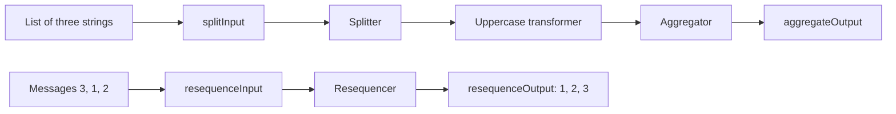

# sequenceNumber and sequenceSize

In the **Message headers** chapter of the **SPRING_INTEGRATION_CORE** module, `sequenceNumber` and `sequenceSize` help endpoints understand the position and size of a message sequence. They are especially useful when a request is split into multiple parts, processed independently, and then reordered or aggregated.

This lesson progresses from the meaning of the headers to how they work with `Message`, `MessageChannel`, splitters, aggregators, resequencers, and Java DSL. After studying it, you will be able to read sequence information accurately, distinguish logical order from arrival order, and recognize causes that prevent a message group from completing.

## 1. The problem: parts of the same request can arrive out of order

Suppose the system receives a request to check three items in an order:

```text
Order: [keyboard, mouse, monitor]
```

The splitter creates three messages. When each message is processed on a different thread or sent to an external service, the results may come back in this order:

```text
mouse → monitor → keyboard
```

The downstream endpoint needs to know three things:

1. Which processing run does the result belong to?
2. Which part of the original request does the result correspond to?
3. How many parts are expected in total?

The triple of headers typically used to answer this is:

```text
(correlationId, sequenceNumber, sequenceSize)
```

For a group with illustrative key `batch-A`, the data might look like:

| Payload | correlationId | sequenceNumber | sequenceSize |
| --- | --- | ---: | ---: |
| Keyboard result | batch-A | 1 | 3 |
| Mouse result | batch-A | 2 | 3 |
| Monitor result | batch-A | 3 | 3 |

The value `batch-A` is only an example key. In a standard splitter flow, the correlation key is usually generated from the input message's ID, not necessarily the business order ID.

## 2. Meaning and conventions of the two headers

### 2.1. sequenceNumber: position in the sequence

`sequenceNumber` represents the logical ordinal position of the message within a sequence. For a finite sequence generated by a standard splitter, numbering starts at **1**:

```text
First part:  sequenceNumber = 1
Second part: sequenceNumber = 2
Third part:  sequenceNumber = 3
```

This position is determined when the sequence is created. A message with `sequenceNumber = 3` arriving first does not become part number 1. Reading the header value does not make a channel automatically reorder messages either.

Do not treat this header as a 0-based Java array index. If you need to map into an array, your code must explicitly convert and bounds-check it:

```java
int arrayIndex = sequenceNumber - 1;
```

### 2.2. sequenceSize: expected number of parts in the sequence

`sequenceSize` represents the expected number of messages in the current sequence. When splitting a three-element list, every child message has:

```text
sequenceSize = 3
```

This is the total number of parts, not the number of received parts or remaining parts. Therefore, `sequenceSize` does not count down from 3 to 2 to 1 during processing.

For a finite sequence of known size, the data contract should guarantee:

```text
sequenceSize = N, with N > 0
1 <= sequenceNumber <= N
Each position from 1 to N represents one logical part
Parts of the same sequence share the same correlationId and sequenceSize
```

That is a contract the application must uphold; do not assume every endpoint automatically validates all of these conditions.

### 2.3. Data types and constant names

Both headers are stored as `Integer` values in the header map. Spring Integration provides constant names in `IntegrationMessageHeaderAccessor`:

| Header name | Constant | Meaning |
| --- | --- | --- |
| `sequenceNumber` | `SEQUENCE_NUMBER` | Position of the part in the sequence |
| `sequenceSize` | `SEQUENCE_SIZE` | Expected total number of parts |
| `correlationId` | `CORRELATION_ID` | Key linking the parts |

Use the constants rather than typing string literals manually to avoid typos and confusion with business headers. The corresponding constants and accessors are documented in [IntegrationMessageHeaderAccessor API](https://docs.spring.io/spring-integration/api/org/springframework/integration/IntegrationMessageHeaderAccessor.html).

## 3. Distinguishing message ID, group key, and sequence number

These three concepts serve different roles:

| Information | Scope | Example |
| --- | --- | --- |
| `id` | Identifies a single message | Each child message has its own ID |
| `correlationId` | Links messages belonging to the same group | Three results belonging to one split |
| `sequenceNumber` | Identifies position within the group | Part 1, part 2, part 3 |
| `sequenceSize` | Describes sequence size | The whole group expects 3 parts |
| Custom `orderId` | Identifies business entity | Order `ORD-2026-018` |

Two orders can both produce parts numbered `1`, `2`, `3`. The aggregator needs the group key to avoid mixing them together.

A single order may also be processed multiple times. If you intentionally use the order code as the correlation key without a processing-run ID, results from two runs may land in the same group. A key such as `orderId + processingRunId` usually expresses scope more clearly when the application designs its own correlation mechanism.

Do not conclude that message number 3 is the last message **to arrive** just because `sequenceNumber == sequenceSize`. It is only last in logical order; parts 1 and 2 may still be in flight.

## 4. Which components create and use sequence headers?

### 4.1. Splitter creates sequence information

The standard splitter has `applySequence` enabled by default. When splitting a collection of known size, it attaches the correlation key, sequence number, and sequence size to the child messages. Downstream processing endpoints must preserve this information if later stages rely on it.

With an input payload of `List.of("alpha", "beta", "gamma")`, visualize the result as:

```text
Original message with id = X
    ├── payload = alpha, correlationId = X, sequenceNumber = 1, sequenceSize = 3
    ├── payload = beta,  correlationId = X, sequenceNumber = 2, sequenceSize = 3
    └── payload = gamma, correlationId = X, sequenceNumber = 3, sequenceSize = 3
```

If `applySequence` is disabled, the splitter no longer takes responsibility for generating sequence info for that split. The downstream flow must provide a correlation and completion mechanism suited to its own design. Reference the splitter model in [Spring Integration: Splitter](https://docs.spring.io/spring-integration/reference/splitter.html).

### 4.2. PublishSubscribeChannel and recipient list router

A message can also be broadcast to multiple branches, each producing a result to be aggregated. In that scenario, the sequence number can describe the receiving branch rather than an element's position in a list.

`PublishSubscribeChannel` has an `applySequence` option; by default it is disabled. It can be enabled in Java:

```java
import org.springframework.context.annotation.Bean;
import org.springframework.integration.channel.PublishSubscribeChannel;

@Bean
public PublishSubscribeChannel enrichmentBranches() {
    PublishSubscribeChannel channel = new PublishSubscribeChannel();
    channel.setApplySequence(true);
    return channel;
}
```

When enabled, the channel attaches sequence information to the message copies sent to subscribers. See [PublishSubscribeChannel configuration](https://docs.spring.io/spring-integration/reference/channel/configuration.html).

Recipient list routers also offer a corresponding option for multi-recipient patterns. Do not assume every router automatically starts a new sequence: a router that only picks a route is not the same as a splitter.

### 4.3. Aggregator and resequencer use sequence information

| Endpoint | Primary job | Role of headers |
| --- | --- | --- |
| Aggregator | Combine multiple messages into a group result | Correlation identifies the group; release strategy determines when the group is ready |
| Resequencer | Emit individual messages in logical order | `sequenceNumber` determines order; `sequenceSize` helps detect a complete sequence |

An aggregator must answer "when is there enough data to combine?" A resequencer must additionally answer "which part can be emitted next while keeping order?" Java DSL provides `.aggregate()` and `.resequence()` for these two purposes; see [Aggregators and Resequencers](https://docs.spring.io/spring-integration/reference/dsl/java-aggregators.html).

## 5. Reading and creating headers in Java

### 5.1. Reading by constant name and data type

The following example is a utility method you can place in a message-processing class:

```java
import org.springframework.integration.IntegrationMessageHeaderAccessor;
import org.springframework.messaging.Message;

static void printSequence(Message<?> message) {
    Object correlationId = message.getHeaders().get(
            IntegrationMessageHeaderAccessor.CORRELATION_ID);

    Integer number = message.getHeaders().get(
            IntegrationMessageHeaderAccessor.SEQUENCE_NUMBER,
            Integer.class);

    Integer size = message.getHeaders().get(
            IntegrationMessageHeaderAccessor.SEQUENCE_SIZE,
            Integer.class);

    System.out.printf("group=%s, number=%s, size=%s%n",
            correlationId, number, size);
}
```

If a header does not exist, reading this way returns `null`. That helps distinguish **header absent** from **header present with value 0**. If the incoming data has the wrong type, such as the string `"3"` instead of `Integer`, typed reading does not automatically convert it to an integer.

### 5.2. Creating part of a sequence with MessageBuilder

Spring Integration provides a builder with methods dedicated to sequences:

```java
import org.springframework.integration.support.MessageBuilder;
import org.springframework.messaging.Message;

Message<String> secondPart = MessageBuilder.withPayload("beta")
        .setCorrelationId("batch-A")
        .setSequenceNumber(2)
        .setSequenceSize(3)
        .setHeader("orderId", "ORD-2026-018")
        .build();
```

Here the import is `org.springframework.integration.support.MessageBuilder`. Spring Framework also has a `MessageBuilder` class in a different package; check your imports when using Spring Integration's dedicated helper methods. See [MessageBuilder API](https://docs.spring.io/spring-integration/api/org/springframework/integration/support/MessageBuilder.html).

If you receive a message with a suitable payload and only want to add a header, you can start from that message:

```java
Message<String> tagged = MessageBuilder.fromMessage(secondPart)
        .setHeader("processedBy", "inventory-service")
        .build();
```

Do not modify the map returned by `message.getHeaders()` directly. Build a new message via a builder or use a header enricher endpoint.

Setting headers manually is appropriate when the application builds parts itself from an external source or needs a custom sequence contract. With a regular splitter, let the framework generate the sequence rather than overwriting it after every step.

## 6. Full example: split, transform, aggregate, and resequence

The example uses Java 17 or later with Spring Integration 6.x and the `org.springframework.integration:spring-integration-core` dependency. Dependency versions should be managed consistently by a BOM or project dependency configuration. Place the code in a single file `SequenceHeadersDemo.java`; no Spring Boot is required.

The application has two independent flows:



```java
import java.util.List;
import java.util.Locale;

import org.springframework.context.annotation.AnnotationConfigApplicationContext;
import org.springframework.context.annotation.Bean;
import org.springframework.context.annotation.Configuration;
import org.springframework.integration.IntegrationMessageHeaderAccessor;
import org.springframework.integration.channel.DirectChannel;
import org.springframework.integration.channel.QueueChannel;
import org.springframework.integration.config.EnableIntegration;
import org.springframework.integration.dsl.IntegrationFlow;
import org.springframework.integration.support.MessageBuilder;
import org.springframework.messaging.Message;

@Configuration
@EnableIntegration
public class SequenceHeadersDemo {

    @Bean
    public DirectChannel splitInput() {
        return new DirectChannel();
    }

    @Bean
    public QueueChannel aggregateOutput() {
        return new QueueChannel();
    }

    @Bean
    public IntegrationFlow splitAggregateFlow() {
        return IntegrationFlow.from(splitInput())
                .split()
                .transform(String.class,
                        value -> value.toUpperCase(Locale.ROOT))
                .aggregate()
                .channel(aggregateOutput())
                .get();
    }

    @Bean
    public DirectChannel resequenceInput() {
        return new DirectChannel();
    }

    @Bean
    public QueueChannel resequenceOutput() {
        return new QueueChannel();
    }

    @Bean
    public IntegrationFlow resequenceFlow() {
        return IntegrationFlow.from(resequenceInput())
                .resequence()
                .channel(resequenceOutput())
                .get();
    }

    private static Message<String> part(
            String correlationId, int number, int size, String payload) {

        if (size <= 0 || number < 1 || number > size) {
            throw new IllegalArgumentException("Invalid finite sequence");
        }

        return MessageBuilder.withPayload(payload)
                .setCorrelationId(correlationId)
                .setSequenceNumber(number)
                .setSequenceSize(size)
                .build();
    }

    public static void main(String[] args) {
        try (AnnotationConfigApplicationContext context =
                     new AnnotationConfigApplicationContext(
                             SequenceHeadersDemo.class)) {

            DirectChannel splitInput = context.getBean(
                    "splitInput", DirectChannel.class);
            QueueChannel aggregateOutput = context.getBean(
                    "aggregateOutput", QueueChannel.class);

            splitInput.send(MessageBuilder.withPayload(
                            List.of("alpha", "beta", "gamma"))
                    .setHeader("orderId", "ORD-2026-018")
                    .build());

            Message<?> aggregated = aggregateOutput.receive(1_000);
            if (aggregated == null) {
                throw new IllegalStateException("No aggregate result");
            }
            System.out.println("Aggregate payload: "
                    + aggregated.getPayload());

            DirectChannel resequenceInput = context.getBean(
                    "resequenceInput", DirectChannel.class);
            QueueChannel resequenceOutput = context.getBean(
                    "resequenceOutput", QueueChannel.class);

            resequenceInput.send(part("demo-run-A", 3, 3, "gamma"));
            resequenceInput.send(part("demo-run-A", 1, 3, "alpha"));

            System.out.println("Before part 2: "
                    + resequenceOutput.receive(0));

            resequenceInput.send(part("demo-run-A", 2, 3, "beta"));

            for (int i = 0; i < 3; i++) {
                Message<?> result = resequenceOutput.receive(1_000);
                if (result == null) {
                    throw new IllegalStateException("Incomplete sequence");
                }

                Integer number = result.getHeaders().get(
                        IntegrationMessageHeaderAccessor.SEQUENCE_NUMBER,
                        Integer.class);

                System.out.printf("Resequenced: %s -> %s%n",
                        number, result.getPayload());
            }
        }
    }
}
```

In the first flow, the splitter creates three messages with sequence numbers `1`, `2`, `3` and the same size `3`. The transformer converts payloads to uppercase, and the aggregator produces a single message holding a collection of the resulting payloads. You will receive a collection containing `ALPHA`, `BETA`, `GAMMA`.

In the second flow, parts are sent in the order `3 → 1 → 2`. With the default resequencer configuration waiting for a complete sequence, the line printed before sending part 2 is:

```text
Before part 2: null
```

After part 2 arrives, the three messages are emitted in order:

```text
Resequenced: 1 -> alpha
Resequenced: 2 -> beta
Resequenced: 3 -> gamma
```

`receive(1_000)` only bounds how long the application waits to read a message from the queue. It does not configure a group timeout in the aggregator or resequencer.

`QueueChannel` here is read directly by the application, so no poller is needed for a consumer. If you attach an endpoint that consumes from the queue via polling in another flow, that endpoint must have an appropriate poller configuration.

## 7. Sufficient count and correct order are two separate requirements

### 7.1. Group completion condition

For a valid sequence of size `N`, an aggregator can normally combine once it has received `N` parts belonging to the same group. However, do not turn that observation into an assumption that the default aggregator has verified all positions `1..N`.

`SimpleSequenceSizeReleaseStrategy` compares the number of messages currently in the group against the expected `sequenceSize`. This strategy does not perform duplicate-sequence-number checks. For example, if three distinct messages carry positions `1`, `1`, `3` with `sequenceSize = 3`, the count may be satisfied while part 2 is still missing. This detail is noted in [SimpleSequenceSizeReleaseStrategy API](https://docs.spring.io/spring-integration/api/org/springframework/integration/aggregator/SimpleSequenceSizeReleaseStrategy.html).

Therefore, systems capable of redelivering data need a deduplication policy or sequence-contract validation. You can consider a release strategy with sequence-aware checking; [SequenceSizeReleaseStrategy](https://docs.spring.io/spring-integration/api/org/springframework/integration/aggregator/SequenceSizeReleaseStrategy.html) supports sequence-related behavior and partial sequence release. Choosing a strategy must still go hand in hand with a business-part identification policy.

### 7.2. Ordering emissions

A resequencer keeps individual messages and emits them by `sequenceNumber`. It does not sum numbers, concatenate text, or produce a single combined business result like an aggregator.

If there is a requirement to release contiguous segments as soon as possible, the resequencer provides the `releasePartialSequences(true)` option:

```java
.resequence(spec -> spec.releasePartialSequences(true))
```

With parts arriving in order `1`, `3`, `2`, this setting can emit part 1 immediately; part 3 must wait until the gap at position 2 is filled. This releases a contiguous prefix, rather than skipping a missing part. See [Spring Integration: Resequencer](https://docs.spring.io/spring-integration/reference/resequencer.html).

If downstream uses an executor or another parallel processing mechanism after the resequencer, task completion times can still reverse order. Distinguish the order in which the endpoint **emits** messages from the order in which tasks **finish**.

Do not add a resequencer just because a flow has an aggregator. Use it when there is a specific requirement on message order across a boundary. If you need a result collection sorted by a business rule, express that rule explicitly inside the group result processor.

## 8. sequenceSize of 0: unknown size

Not every data source knows the number of elements upfront. With an iterator or lazy stream whose size the splitter cannot determine, parts may be tagged with:

```text
correlationId = batch-stream-A
sequenceNumber = 1, sequenceSize = 0
sequenceNumber = 2, sequenceSize = 0
sequenceNumber = 3, sequenceSize = 0
...
```

In this context, `sequenceSize = 0` indicates an unknown size. It does not mean the group is already complete, nor does it say the current message does not belong to a sequence.

Do not take the count of parts seen so far and arbitrarily update `sequenceSize`. For example, marking the first part as `1/1` could cause downstream to conclude immediately that the sequence is complete.

For sources of unknown size, choose an alternative completion contract:

| Approach | How to apply | What to consider |
| --- | --- | --- |
| Known total upfront | Read the count from source metadata | The total must accurately match the actual dataset |
| Materialize into a collection before splitting | Determine the full list before splitting | Memory cost and latency before processing begins |
| Business completion signal | Custom release strategy based on group state | The completion signal may arrive before parts under async processing |
| Bounded aggregation window | Timeout and incomplete-result policy | Must accept and explicitly represent incompleteness |

Do not merely check "saw end flag" if parts can arrive out of order. A completion contract may need to carry the total count and verify received parts. In addition, an empty list typically produces no child messages for an aggregator to receive; handle empty requests at an appropriate boundary.

## 9. Filters and routers can alter the set of arriving parts

Consider the flow:

```text
List of 3 parts
    → split
    → filter drops part 2
    → aggregate
```

The splitter attached `sequenceSize = 3`, yet the aggregator receives only parts 1 and 3. The headers on the two remaining parts do not automatically change to size 2.

A similar bug occurs when a router sends parts of the same sequence to different branches while each branch has an aggregator waiting for the entire original sequence.

Depending on business requirements, you can choose to:

1. Filter the input list before the splitter creates a sequence if filtering can be decided upfront.
2. Produce a result representing "dropped," "invalid," or "failed" for the rejected part so the group still receives all positions.
3. Design a new sequence on the branch that needs aggregation, with its own group key and size defined by that branch's contract.
4. Use another release strategy if the goal is to group by time, business count, or a separate completion signal.

Do not modify `sequenceSize` on a few messages to "the number of parts I think will arrive." All members of a group must share the same contract. In particular, one branch usually lacks enough information to know how many parts another branch is still processing.

## 10. Keeping headers across transformers, endpoints, and system boundaries

In the Java DSL example, the transformer returns a new payload and the framework manages creating the reply message. When writing endpoints that construct a `Message` manually, pay attention to which headers must be preserved.

The snippet below builds a message from a payload without copying input headers:

```java
Message<String> output = MessageBuilder.withPayload("processed")
        .build();
```

If this message enters an aggregator using default correlation, the required group metadata may already be lost. When you truly must construct a new message yourself, keep the appropriate headers:

```java
static Message<String> replacePayload(Message<String> input) {
    return MessageBuilder.withPayload("processed: " + input.getPayload())
            .copyHeaders(input.getHeaders())
            .build();
}
```

Copying headers also requires context awareness: do not keep an old sequence for a new set of messages with a different meaning. If a task produces additional parts, define a new sequence level rather than letting every output carry the input part's sequence number.

When crossing HTTP, a broker, or JSON serialization, define header mapping and data types on the receiving side. Seeing `sequenceNumber` in the sender's logs is not enough to confirm the header still exists with the right type when the message re-enters the flow.

A gateway can provide a Java method API for flow entry or exit, but a gateway does not replace the sequence contract. Likewise, `errorChannel` receiving an error does not mean the aggregator received a substitute result for the failed part.

## 11. Nested splitting and aggregation

An order can be split into line items; each line item can in turn be split into warehouse checks:

```text
Order
    → split line items: outer sequence
        → split warehouses to check: inner sequence
        → aggregate warehouse results
    → aggregate line-item results
```

At the inner level, the visible `sequenceNumber`, `sequenceSize`, and `correlationId` headers describe the warehouse-check sequence. They do not simultaneously represent the outer line-item sequence directly.

Spring Integration has a mechanism to store nested sequence info via `sequenceDetails` and `pushSequenceDetails`/`popSequenceDetails` operations. Related APIs are presented in [BaseMessageBuilder](https://docs.spring.io/spring-integration/api/org/springframework/integration/support/BaseMessageBuilder.html).

With the standard splitter–aggregator model, aggregation supports processing sequence details to restore the outer level. The `popSequence` setting and how custom processors build results affect this behavior; see [Aggregator and nested sequence details](https://docs.spring.io/spring-integration/reference/aggregator.html).

When writing a custom endpoint, do not clear `sequenceDetails` or overwrite the current three headers without considering sequence nesting. If you need to preserve business position across multiple levels, use an extra dedicated header such as `orderLineIndex`; do not force a single `sequenceNumber` to represent every level at once.

## 12. Missing parts, redelivery, and timeouts

### 12.1. Group timeout differs from caller timeout

Suppose a group has `sequenceSize = 3`, but part 2 fails permanently. Without an expiration or alternative completion policy, the group can keep waiting.

An aggregator configuration snippet allowing incomplete results when the group expires might look like:

```java
.aggregate(spec -> spec
        .groupTimeout(5_000)
        .sendPartialResultOnExpiry(true))
```

This snippet must be placed inside an `IntegrationFlow` being configured; it is not a standalone flow. `groupTimeout` handles group expiration, while `sendPartialResultOnExpiry(true)` chooses how missing results are handled. A timeout does not make a lost part appear.

For business processes requiring all three parts, design an error or reconciliation flow rather than treating a two-part collection as success. When accepting a partial result, return additional status fields such as `complete=false` and missing-part details per the application contract. The framework does not infer these business fields automatically.

A gateway timing out while waiting for a reply does not automatically delete a group stored in the aggregator either. Design caller timeouts, group lifecycles, and late-result handling consistently together.

### 12.2. Retries do not create new logical positions

If part 2 must be reprocessed, it still represents part 2 of the same processing run. Do not increment `sequenceNumber` on each retry, and do not increment `sequenceSize` just because an extra message delivery occurred.

A new message created during redelivery may have a new technical ID while still being a duplicate of the same business part. Therefore, deduplication should rely on a stable part identifier, such as the pair `(processingRunId, partId)`, as required by the domain.

After a group has completed or expired, late-arriving results need an explicit policy. Depending on group metadata lifecycle, they may be discarded or start a newly created group; do not reuse group keys without control.

## 13. How to verify behavior during practice

When applying this to a project, inspect messages at three points: immediately after the splitter, before the aggregating or resequencing endpoint, and at the output. Log the group key, sequence number, size, and business part identifier to distinguish lost-header bugs from missing-result bugs.

| Test data | Behavior to observe |
| --- | --- |
| One group, send parts `1 → 2 → 3` | Aggregates one result after all parts arrive |
| One group, send `3 → 1 → 2` into default resequencer | Waits until complete, then emits `1 → 2 → 3` |
| Two groups sent interleaved, both having positions `1`, `2`, `3` | Each group is handled separately by correlation key |
| Send only parts `1` and `3`, declaring size `3` | Group is incomplete; timeout policy decides next step |
| Part with string header instead of integer | Detects data-type contract error at the receiving boundary |
| Different messages sharing the same logical position | Verifies chosen deduplication policy and release strategy |
| One part dropped by a filter | Confirms group has compensation, expiration, or alternative completion |
| Iterator cannot determine total parts | Does not rely on `sequenceSize = 0` to conclude completion |

When testing output via a `QueueChannel`, use finite wait timeouts so a missing-part failure does not hang the test indefinitely. At the same time, do not treat a single `null` read as proof that the group was cancelled: it only indicates no output message arrived during that wait window.

These two headers work effectively when every component shares the same contract: which part belongs to which group, which positions are valid, and which condition allows completion. Once that contract is clear, you can combine splitters, transformers, routers, filters, aggregators, and resequencers while still understanding the impact of each step on the message sequence.
