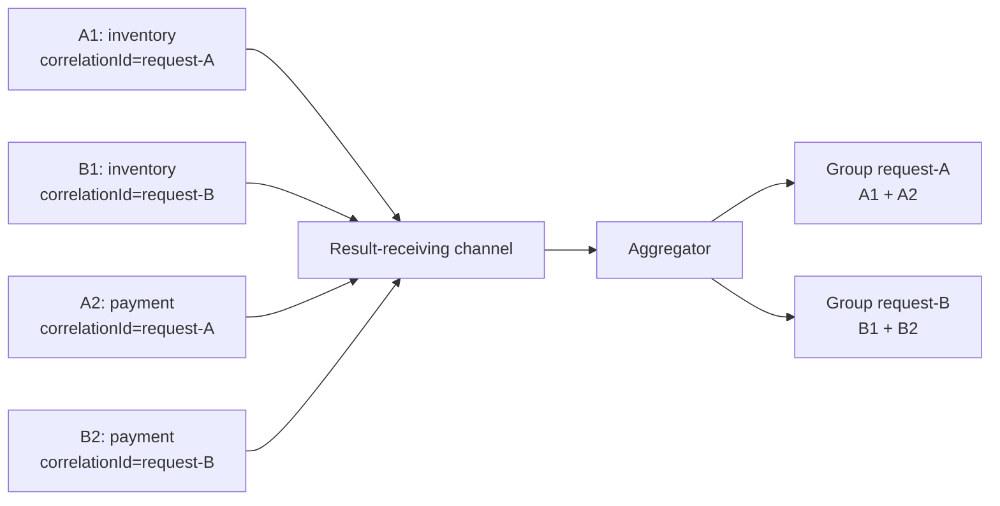

# correlationId

> Chapter: **Message headers** — Module **Spring Integration Core** (`SPRING_INTEGRATION_CORE`).

In an integration flow, a single request may be split into multiple messages, run through different endpoints, and produce multiple results arriving at different times. The `correlationId` header represents the relationship among those messages. Understanding this header properly helps you design flows with `Message`, `MessageChannel`, splitters, transformers, aggregators, and gateways without accidentally mixing results from concurrently processed requests.

This lesson focuses on Spring Integration Core's correlation mechanism. Any examples of external communication are solely to clarify header-propagation boundaries; they do not require setting up an external broker system.

## 1. Objectives and prerequisites

After this lesson, you can:

- Read and set `correlationId` using the Java API.
- Distinguish between message identity, group identity, business identity, and reply destination.
- Explain the relationship between `correlationId`, `sequenceNumber`, and `sequenceSize`.
- Build a Java DSL flow that aggregates related messages.
- Preserve context properly across message transformations, error handling, and system boundaries.
- Design group keys and test scenarios to detect mixed-up results.

You should know the structure of `Message<T>` consisting of payload and headers, how to declare Spring beans, and the basic roles of channels and endpoints. Java configuration snippets use `spring-integration-core`; test examples add JUnit Jupiter and `spring-test`. Use compatible Spring versions managed by your project. The configuration and test classes below can live in the same package in a project that already has those dependencies.

## 2. The problem: which request does this result belong to?

Suppose the system receives two order requests:

- Request A checks inventory and payment for order A.
- Request B checks inventory and payment for order B.

The results may arrive in this order:

| Arrival order | Result payload | Group it should belong to |
| --- | --- | --- |
| 1 | `A:inventory-ok` | Request A |
| 2 | `B:inventory-ok` | Request B |
| 3 | `A:payment-ok` | Request A |
| 4 | `B:payment-ok` | Request B |

If you simply take the first two arriving results to combine them, the system will pair A's inventory with B's inventory. A group value needs to travel with each message:

```text
Message A1: correlationId = request-A
Message A2: correlationId = request-A

Message B1: correlationId = request-B
Message B2: correlationId = request-B
```

Two messages with different payloads can belong to the same group. Two messages with identical payloads can also belong to two different groups.



The channel delivers messages to the processing component; the aggregator decides how to group them. A channel does not automatically become a result combiner just because messages share a `correlationId`.

## 3. Definition and exact API

### 3.1. Header name and constant

The header name is `correlationId`. In Java code, use the constant:

```java
import org.springframework.integration.IntegrationMessageHeaderAccessor;

String headerName = IntegrationMessageHeaderAccessor.CORRELATION_ID;
```

This constant belongs to `IntegrationMessageHeaderAccessor`, not `MessageHeaders`. In Spring Integration's API, the correlation value has the general type `Object`; you can use a string, UUID, or another suitable key type. There is no general requirement that every correlation ID must be a UUID. See [IntegrationMessageHeaderAccessor API](https://docs.spring.io/spring-integration/api/org/springframework/integration/IntegrationMessageHeaderAccessor.html).

In internal flows, an immutable object with consistent `equals()` and `hashCode()` is a reasonable choice. When crossing another protocol or persisting durably, check the key's representability and serializability. A clearly structured string is often easier to exchange than an application-specific Java object.

### 3.2. Not every message has a correlationId

Creating a standard `Message` does not mean it already has a `correlationId`. This header appears when the application sets it or when a component with sequence-generation behavior, such as a splitter, attaches it.

Reading the header when absent from a message returns `null`. Do not assume a message missing a key belongs to a shared group named "null."

If an endpoint requires correlation, validate early and define how to return an error or route invalid messages to a separate flow.

### 3.3. Immutability of headers

Do not update the `MessageHeaders` structure directly with `put()`. Create a message through a builder when headers need to change. The headers structure is protected against direct mutation; that does not make every object stored inside headers immutable. Therefore, do not use a key object whose contents could be mutated while the message is in flight. See [Message and Message Headers](https://docs.spring.io/spring-integration/reference/message.html).

## 4. Distinguishing types of identifiers and addresses

| Component | Meaning | Relationship to correlationId |
| --- | --- | --- |
| `MessageHeaders.ID` — `id` | Identifies a single message | Child messages can have distinct IDs and share a correlation ID |
| `correlationId` | Relates multiple messages within one processing scope | Commonly used as the group key |
| `sequenceNumber` | Position of a message within a sequence | Meaningful inside the corresponding group |
| `sequenceSize` | Expected number of elements in a sequence when known upfront | Helps determine when the full group has been received |
| `replyChannel` | Where to send replies in a messaging flow | Cannot be inferred solely from the correlation ID |
| `businessRequestId` or `orderId` | Application-defined header expressing business meaning | Can be used to build a custom group key |
| `traceId` | Identifier for observability tracing systems | Requires a separate mapping contract if correlated with correlation |

A helpful way to read them is:

- `id`: "Which message is this?"
- `correlationId`: "Which group does this message belong to?"
- `replyChannel`: "Where should the reply be sent?"
- `sequenceNumber`: "Which part number is this?"
- `sequenceSize`: "How many parts are expected?"

Do not use each result message's `id` as its correlation ID if the goal is to combine them into the same group. When each result carries a different key, the aggregator creates separate groups.

Also do not use the same fixed `correlationId` for every request. Otherwise, results from different requests will land in the same group.

An `orderId` may live long across multiple operations such as placing an order, charging payment, and refunding. Using `orderId` alone as the group key is insufficient if those operations can overlap. The key must reflect the actual aggregation scope.

## 5. Reading, creating, and preserving correlationId in Java

### 5.1. Creating two messages belonging to the same group

The following example explicitly constructs result messages to illustrate the header contract:

```java
import org.springframework.messaging.Message;
import org.springframework.messaging.support.MessageBuilder;

import static org.springframework.integration.IntegrationMessageHeaderAccessor.CORRELATION_ID;
import static org.springframework.integration.IntegrationMessageHeaderAccessor.SEQUENCE_NUMBER;
import static org.springframework.integration.IntegrationMessageHeaderAccessor.SEQUENCE_SIZE;

String requestId = "request-A";

Message<String> inventoryResult = MessageBuilder
        .withPayload("A:inventory-ok")
        .setHeader(CORRELATION_ID, requestId)
        .setHeader(SEQUENCE_NUMBER, 1)
        .setHeader(SEQUENCE_SIZE, 2)
        .build();

Message<String> paymentResult = MessageBuilder
        .withPayload("A:payment-ok")
        .setHeader(CORRELATION_ID, requestId)
        .setHeader(SEQUENCE_NUMBER, 2)
        .setHeader(SEQUENCE_SIZE, 2)
        .build();
```

Both messages share the `request-A` key and both declare a two-element sequence. Each element has its own position.

Here, the developer is responsible for keeping sequence numbers and sequence size consistent. If the flow uses a suitable splitter, let the splitter manage these technical headers.

### 5.2. Reading headers according to the data-type contract

```java
Object genericKey = inventoryResult.getHeaders().get(CORRELATION_ID);

String stringKey = inventoryResult.getHeaders()
        .get(CORRELATION_ID, String.class);

if (stringKey == null || stringKey.isBlank()) {
    throw new IllegalArgumentException("Missing valid correlationId");
}
```

Reading with `String.class` fits here because the example specifies a string key. In a flow where a splitter derives the key from the input message's ID, the value may be a UUID. Do not apply a string-typed read blindly across all flows.

Having the same display text does not guarantee the same key. For instance, a `UUID` and a string created via `uuid.toString()` are objects of different types and are not equal under `equals()`. Standardize the data type when writing and reading keys.

### 5.3. Adding headers while keeping existing context

```java
Message<String> markedResult = MessageBuilder
        .fromMessage(inventoryResult)
        .setHeader("processedBy", "inventory-service")
        .build();
```

`fromMessage()` carries forward the payload and headers from the source message when adding information. There is no need to extract all headers and mutate them directly.

At an application-managed entry port, you can add a correlation ID only if one does not already exist:

```java
import java.util.UUID;

Message<String> request = MessageBuilder
        .withPayload("check-order")
        .setHeaderIfAbsent(CORRELATION_ID, UUID.randomUUID().toString())
        .build();
```

`setHeaderIfAbsent()` does not validate an already-present value. If the input already contains a blank string or a key with the wrong scope, a separate validation step is still needed.

Only generate a new key when starting a new processing scope. Generating a new UUID for each result belonging to the same request destroys the relationship needed for grouping.

## 6. Correlation and sequence in splitter–aggregator

### 6.1. Three headers working together

A typical scenario:

```text
Original message:
  id = P
  payload = [item-1, item-2, item-3]

After splitter with applySequence=true:
  child message 1: correlationId=P, sequenceNumber=1, sequenceSize=3
  child message 2: correlationId=P, sequenceNumber=2, sequenceSize=3
  child message 3: correlationId=P, sequenceNumber=3, sequenceSize=3
```

In this standard case, the splitter uses the input message's ID as the correlation ID for the new sequence. Child messages are created for the different elements and all relate back to the parent message.

Sequence information helps describe an expected set of results. For iterator or stream inputs whose size is not known upfront, do not assume `sequenceSize` is always an accurate positive number; an appropriate completion strategy is required. See [Splitter](https://docs.spring.io/spring-integration/reference/splitter.html).

### 6.2. Group key and completion condition are two separate decisions

An aggregator must answer two questions:

1. **Which group does the message belong to?** This is the responsibility of the correlation strategy.
2. **Is the group ready to be aggregated?** This is the responsibility of the release strategy.

By default, the aggregator's correlation strategy reads `correlationId`. The default release strategy relies on sequence size information to determine when the group has enough messages.

Having only `correlationId` does not tell the aggregator how many results to wait for. Without a valid sequence and without configuring an appropriate release strategy, the group may not be released as expected. See [Aggregator](https://docs.spring.io/spring-integration/reference/aggregator.html).

For example, group `request-A` has received one message with `sequenceSize=2`:

```text
correlation: request-A
received:    1 message
expected:    2 messages
conclusion:  group incomplete
```

Group `request-B` can complete before A if both of B's results arrive before A's missing result.

### 6.3. Headers do not replace business validation

Having two messages does not necessarily mean you received one inventory result and one payment result. They could be two redeliveries of the same branch.

With real-world data, determine:

- Do we need deduplication before entering the aggregator?
- Do we need to receive all distinct result types rather than just a count?
- Does a failed result count as a completed result for a branch?
- If a branch is dropped by a filter, will the flow produce a placeholder result or mark the request incomplete?

Do not treat `correlationId` as a deduplication mechanism or an exactly-once processing guarantee.

### 6.4. Multiple splitter levels require multiple correlation levels

An order can be split into packages; each package can be split into line items. That creates two aggregation scopes.

Spring Integration provides a mechanism to store nested sequence context and restore it when an aggregator finishes a level. This handling involves `sequenceDetails` and `popSequence` behavior. Do not overwrite technical headers mid-flow just to preserve a business identifier. You can keep the business identifier in a separate `businessRequestId` or `orderId`. See [Aggregator nested sequence mechanism](https://docs.spring.io/spring-integration/reference/aggregator.html).

Because sequence context can be restored or removed after aggregation, do not assume the aggregator's output always retains the `correlationId` used at the inner level. If the system needs a cross-cutting request code, put that code in its own business contract.

## 7. Java DSL example: aggregating two groups with interleaved results

### 7.1. Minimal flow configuration

The configuration below uses:

- `DirectChannel` to receive messages already carrying correlation and sequence headers.
- Default aggregator to group messages and build a result payload containing component payloads.
- `QueueChannel` to hold results for the program or test to read.

```java
import org.springframework.context.annotation.Bean;
import org.springframework.context.annotation.Configuration;
import org.springframework.integration.channel.DirectChannel;
import org.springframework.integration.channel.QueueChannel;
import org.springframework.integration.config.EnableIntegration;
import org.springframework.integration.dsl.IntegrationFlow;

@Configuration
@EnableIntegration
public class CorrelationFlowConfig {

    @Bean
    public DirectChannel correlationInput() {
        return new DirectChannel();
    }

    @Bean
    public QueueChannel correlationOutput() {
        return new QueueChannel();
    }

    @Bean
    public IntegrationFlow correlationFlow() {
        return IntegrationFlow
                .from("correlationInput")
                .aggregate()
                .channel("correlationOutput")
                .get();
    }
}
```

The input is a subscribable channel, so the aggregator processes messages as they are sent in. The output is a queue from which the receiver explicitly calls `receive()`; in this example there is no endpoint polling the output automatically, so no poller needs to be declared for it.

The `.aggregate()` syntax uses the default configuration; the DSL callback lets you customize correlation strategy, release strategy, and message store when needed. See [Aggregators and Resequencers in Java DSL](https://docs.spring.io/spring-integration/reference/dsl/java-aggregators.html).

### 7.2. Testing grouping behavior

This is test code for learners to run in their project, not a pre-assumed execution output.

```java
import java.util.Collection;
import java.util.HashSet;
import java.util.Set;

import org.junit.jupiter.api.Test;
import org.springframework.beans.factory.annotation.Autowired;
import org.springframework.beans.factory.annotation.Qualifier;
import org.springframework.messaging.Message;
import org.springframework.messaging.MessageChannel;
import org.springframework.messaging.PollableChannel;
import org.springframework.messaging.support.MessageBuilder;
import org.springframework.test.context.junit.jupiter.SpringJUnitConfig;

import static org.junit.jupiter.api.Assertions.assertEquals;
import static org.junit.jupiter.api.Assertions.assertInstanceOf;
import static org.junit.jupiter.api.Assertions.assertNotNull;
import static org.junit.jupiter.api.Assertions.assertNull;
import static org.junit.jupiter.api.Assertions.assertTrue;
import static org.springframework.integration.IntegrationMessageHeaderAccessor.CORRELATION_ID;
import static org.springframework.integration.IntegrationMessageHeaderAccessor.SEQUENCE_NUMBER;
import static org.springframework.integration.IntegrationMessageHeaderAccessor.SEQUENCE_SIZE;

@SpringJUnitConfig(CorrelationFlowConfig.class)
class CorrelationFlowTest {

    @Autowired
    @Qualifier("correlationInput")
    MessageChannel input;

    @Autowired
    @Qualifier("correlationOutput")
    PollableChannel output;

    @Test
    void groupsInterleavedResultsByCorrelationId() {
        assertTrue(input.send(part("request-A", 1, "A:inventory-ok")));
        assertTrue(input.send(part("request-B", 1, "B:inventory-ok")));

        // Each group only has one of its two results so far.
        assertNull(output.receive(0));

        assertTrue(input.send(part("request-A", 2, "A:payment-ok")));

        Message<?> resultA = output.receive(1_000);
        assertPayloads(resultA, Set.of("A:inventory-ok", "A:payment-ok"));
        assertNull(output.receive(0));

        assertTrue(input.send(part("request-B", 2, "B:payment-ok")));

        Message<?> resultB = output.receive(1_000);
        assertPayloads(resultB, Set.of("B:inventory-ok", "B:payment-ok"));
        assertNull(output.receive(0));
    }

    private static Message<String> part(
            String correlationId, int sequenceNumber, String payload) {

        return MessageBuilder.withPayload(payload)
                .setHeader(CORRELATION_ID, correlationId)
                .setHeader(SEQUENCE_NUMBER, sequenceNumber)
                .setHeader(SEQUENCE_SIZE, 2)
                .build();
    }

    private static void assertPayloads(Message<?> message, Set<String> expected) {
        assertNotNull(message);
        assertInstanceOf(Collection.class, message.getPayload());

        Collection<?> payloads = (Collection<?>) message.getPayload();
        assertEquals(expected.size(), payloads.size());
        assertEquals(expected, new HashSet<>(payloads));
    }
}
```

Things to observe:

1. After A1 and B1, two messages in total have been received, yet neither group has two elements yet.
2. A2 completes only group A.
3. B2 completes group B.
4. The test compares the members of the result rather than coupling list ordering requirements to the grouping problem.

This is a test for interleaved arrivals. It does not replace tests for concurrency, retries, duplicates, or restarts when using a durable store.

## 8. When a custom correlation strategy is needed

### 8.1. A composite business key

Suppose every result message has three required string headers:

| Header | Example | Role |
| --- | --- | --- |
| `tenantId` | `tenant-01` | Identifies customer or organization |
| `businessRequestId` | `req-471` | Identifies business request |
| `operation` | `reserve-stock` | Identifies operation type |

Using `businessRequestId` alone can collide if two tenants use the same code, or if the code is reused for a different operation. In an internal Java flow, a record can serve as the key:

```java
import org.springframework.integration.aggregator.CorrelationStrategy;
import org.springframework.messaging.Message;

record RequestGroupKey(
        String tenantId,
        String requestId,
        String operation) {
}

final class BusinessCorrelation {

    private BusinessCorrelation() {
    }

    static CorrelationStrategy strategy() {
        return message -> new RequestGroupKey(
                requiredHeader(message, "tenantId"),
                requiredHeader(message, "businessRequestId"),
                requiredHeader(message, "operation"));
    }

    private static String requiredHeader(Message<?> message, String name) {
        String value = message.getHeaders().get(name, String.class);
        if (value == null || value.isBlank()) {
            throw new IllegalArgumentException("Invalid header: " + name);
        }
        return value;
    }
}
```

Apply it by replacing the aggregator step in the existing flow:

```java
.aggregate(a -> a.correlationStrategy(BusinessCorrelation.strategy()))
```

This replacement only changes how the group is selected. If keeping the default release strategy, messages still need appropriate sequence information.

Do not declare a second flow consuming from the same `correlationInput` just to test an alternative strategy: multiple subscribers on a `DirectChannel` do not mean every subscriber gets the same copy of a message.

A record provides `equals()` and `hashCode()` out of the box based on its key components. If using this key type with a durable message store, verify the store's and serializer's requirements; do not assume the record automatically satisfies every persistence mechanism.

### 8.2. Release strategy must match the result contract

If results do not come from a splitter that knows the element count upfront, you may need a release strategy that checks for both result types:

```java
import java.util.Set;
import java.util.stream.Collectors;

// Replace the aggregate step in the flow; each message has a resultType header.
.aggregate(a -> a
        .correlationStrategy(BusinessCorrelation.strategy())
        .releaseStrategy(group -> group.getMessages().stream()
                .map(message -> message.getHeaders()
                        .get("resultType", String.class))
                .collect(Collectors.toSet())
                .containsAll(Set.of("inventory", "payment"))))
```

This is a chained snippet inside the DSL builder, not a standalone compilation unit.

The strategy above answers "have both result types been seen?" It does not remove duplicates of the same type, nor does it interpret business success or failure on its own. If multiple `inventory` results arrive, the output processor still needs a policy for them, or the flow needs deduplication before aggregation.

The correlation strategy determines group scope; the release strategy determines release timing; the output processor determines the result data. Designing these three parts separately keeps requirements clear.

## 9. How do other endpoints interact with correlationId?

### 9.1. Transformer and service activator

A transformer that only changes the payload usually lets the framework carry forward header context per the endpoint's mechanism. When manually creating or returning a full `Message`, configuring header filtering, or passing messages through a custom component, inspect the output's header contract.

In particular, a converter that merely serializes the payload to JSON does not automatically put Java headers inside the JSON. For the receiver to get the correlation ID, an explicit mapping step is needed.

When adding information to an existing message with custom code, the `MessageBuilder.fromMessage()` pattern above clearly expresses the intent to preserve context.

### 9.2. Router and filter

A router chooses the destination. Selecting the same channel does not create a group, and taking two different channels does not necessarily break the relationship if headers are preserved.

A filter can drop an element an aggregator is waiting for. For example, a splitter creates three elements with `sequenceSize=3`, and a filter drops one; the two remaining messages still fail to complete the group under the initial contract. Design a placeholder result, timeout, or updated completion rule.

Do not arbitrarily reduce `sequenceSize` on a single message to "fix" a missing group, because members can end up carrying conflicting expectations.

### 9.3. Publish-subscribe and recipient list router

When using a publish-subscribe channel or recipient list router to fan out to multiple branches and later aggregate, consider enabling `applySequence`. These components do not generate sequence information by default like a splitter.

Enabling `applySequence` adds sequence metadata for aggregation; it does not guarantee every branch succeeds or sends back exactly one result. See [channel configuration and apply-sequence](https://docs.spring.io/spring-integration/reference/channel/configuration.html).

### 9.4. Resequencer

A resequencer also uses correlation info to identify groups, then emits messages in sequence order. An aggregator produces a combined result; a resequencer solves message emission order. Having the same correlation ID does not automatically make parallel processing complete in order. See [Resequencer](https://docs.spring.io/spring-integration/reference/resequencer.html).

## 10. Gateway and request–reply: avoiding false assumptions

A messaging gateway typically creates a temporary reply channel and puts it in the `replyChannel` header. The reply flow must send the result back to that address or to a properly configured output. See [Messaging Gateways](https://docs.spring.io/spring-integration/reference/gateway.html).

Therefore:

- Attaching the same `correlationId` to request and response is not enough for a Java gateway to locate the waiting call by itself.
- Having a correlation ID while losing or misconfiguring the reply path can still prevent the call from receiving a result.
- A gateway call timeout does not prove all downstream work was cancelled.
- Two requests with the same group key but different reply addresses are a sign to review correlation scope; you may be merging independent calls.

When communicating with external systems, the adapter or protocol may have its own correlation mechanism. Do not treat the Java `correlationId` header, an application-named HTTP header, and a broker correlation field as a single field with built-in automatic mapping.

An exchange contract might specify:

```text
Application A:
  businessRequestId = req-471
        |
        | map to requestId field in exchange message
        v
System B:
  process and return requestId = req-471
        |
        | map into businessRequestId at receiving port
        v
Application A:
  apply configured correlation strategy
```

If using `businessRequestId` as the key, configure the strategy to read that header. The default aggregator does not automatically switch to reading a business header just because its name contains the word "request."

An internal channel object is a runtime detail of the running JVM; do not transmit a channel object as if it were an address usable directly by an external system.

## 11. Errors, timeouts, duplicates, and group lifecycle

### 11.1. Missing correlationId

With the default correlation strategy, a missing key leaves the aggregator without a valid key to assign the message to a group. Do not design the application assuming all keyless messages will be grouped together.

You can choose one of these contracts:

- Reject immediately at the entry port and return a meaningful error.
- Route invalid messages to a data-error handling channel.
- Generate a key where the request starts if business rules allow and no key exists yet.

Do not generate a new key at the aggregator for each result message, as related results will no longer share a group.

### 11.2. Failing processing branch

If a branch errors before producing a result, the aggregator may wait for an element that never arrives.

The application must decide whether the failure becomes a business result for that branch or fails the entire request. A "payment-failed" message can still be a completed outcome for the payment branch; the aggregation business logic decides whether to accept the order.

For same-thread errors, exceptions can propagate to the caller. For asynchronous processing, errors need an appropriate forwarding mechanism, usually via an error channel. When reading correlation in an error flow, inspect the failing message, such as `failedMessage` on `MessagingException` when present, rather than assuming all original message headers sit at the top level of `ErrorMessage`. See [Error Handling](https://docs.spring.io/spring-integration/reference/error-handling.html).

### 11.3. Group timeout

Timeouts must answer concrete questions:

1. Are partial results allowed to be returned?
2. Where are incomplete groups routed?
3. When a result arrives after timeout, is it accepted, discarded, or does it open another processing run?
4. Who cleans up group data and completion markers?

Options such as `groupTimeout`, `sendPartialResultOnExpiry`, and `discardChannel` help implement this policy. Configuration must align with the release strategy and business rules; do not enable returning partial results if a missing payment result could cause a wrong decision. Extension points are documented in [AggregatorSpec](https://docs.spring.io/spring-integration/api/org/springframework/integration/dsl/AggregatorSpec.html).

### 11.4. Retries and duplicate messages

Keeping the same request code across a retry can help trace the same operation, but it does not replace deduplication.

If the business opens a new collection run while old results may still arrive late, add a run discriminator to the group key. Otherwise, an old result may be merged into the new run.

For example:

```text
Group key:
  tenantId + requestId + operation + generation

Result deduplication key:
  group scope + branchId + resultId
```

These are the logical components of the keys; string concatenation with plus signs is not mandatory. Choose a format or data type that avoids collisions.

### 11.5. Message store and completed groups

An aggregator holds group state in a message store. When groups stall or request volume grows continuously, bound lifetimes and monitor the number of incomplete groups.

Keeping markers of completed groups helps filter out certain late messages; deleting a group immediately upon completion can let a late message recreate a group under the same key. Conversely, keeping markers indefinitely can grow storage usage.

An in-memory store does not retain state across process restarts. If requirements demand recovering groups after a restart, choose a durable store and verify header data, serializability, group keys, and concurrent access coordination across multiple instances.

## 12. Observing and diagnosing correlation issues

A helpful log line should distinguish:

```text
messageId=...
correlationId=...
businessRequestId=...
resultType=...
sequenceNumber=...
sequenceSize=...
endpoint=...
```

There is no need to log entire payloads to debug correlation. What matters is tracing messages before and after transformation, splitting, result receipt, and aggregation.

| Symptom | What to check |
| --- | --- |
| Every group has only one message and waits forever | Are different keys being generated for parts of the same request? |
| Results from two requests are mixed | Is the key hardcoded or missing tenant, operation, or run generation? |
| Many messages received but no output yet | Has each group met its own release condition? |
| After splitter, correlation code differs from business request code | Is it the parent message ID of the new sequence? |
| Values look identical yet still end up in separate groups | Is a UUID mixed with a String or different key types? |
| Gateway receives no reply | Is the `replyChannel` path or output still valid? |
| Group never completes after a filter | Was one element dropped while the original sequenceSize remained? |
| Group completes too early | Are there duplicate messages or a release strategy that only counts messages? |
| Key is lost after external transmission | Do mappers at both ends transmit and restore the right field? |
| Groups grow continuously in the store | Are timeout, expiry, and late-result policies configured? |

Trace ID supports tracing, whereas the correlation key governs grouping according to the flow's contract. If you want to link both, log them as separate fields so changing observability configuration never accidentally alters group keys.

## 13. Practice exercises

### Exercise 1: Groups completing in different orders

Based on the configuration and test in section 7, change the send order to B2, A1, B1, A2.

What to observe:

- Group B completes when B1 arrives even though sequence 2 arrived before sequence 1.
- Group A only completes when A2 arrives.
- Each output contains only payloads belonging to the right request.

This exercise verifies group relationships; if the application needs guarantees on the output order of individual elements, define an additional ordering contract.

### Exercise 2: Dropping an element

Send only A1, B1, and B2.

Outcome to explain: B can complete while A is missing one element. Next, design a timeout policy and a destination for incomplete group A. Do not use arbitrary wait times in tests to treat a timeout as configured.

### Exercise 3: Key collision between two tenants

Create two requests from two tenants that both have `businessRequestId=req-001`.

Compare:

1. A strategy reading only `businessRequestId`.
2. A strategy using `RequestGroupKey` containing tenant, request, and operation.

Write a test proving results from the two tenants do not enter the same group in the second approach.

### Exercise 4: Two results coming from the same branch

Send two messages with `resultType=inventory` for the same request, and only then send `payment`.

Requirements:

- Explain why merely counting two messages can terminate wrongly.
- Use a release strategy based on the set of result types.
- Decide how to handle the duplicate inventory result in a deduplication step or output processor.

### Exercise 5: Checking transformation boundaries

Place a payload transformation step before the aggregator.

Verify the correlation key and sequence information at the output of that step. Next, describe the contract needed if the payload is sent out of process as JSON and a result comes back.

## 14. Self-check questions

**Does a message always have to have a correlationId?**

No. It needs the header or an appropriate correlation strategy when entering a component that groups messages by relationship.

**Do two messages with the same correlationId always get released together as one result immediately?**

No. They share a group per the correlation strategy, while the release strategy decides whether the group meets completion criteria.

**Can orderId be used as correlationId?**

Yes, if it accurately distinguishes the aggregation scope. When there are multiple tenants, multiple operation types, or multiple processing runs for the same order, additional fields must be included in the key.

**Is setting correlationId alone enough for a gateway to receive a reply?**

No. The flow also needs a mechanism to send the reply to the right channel or the configured adapter's own correlation mechanism.

**Does correlationId prevent duplicate message delivery?**

No. Correlation and deduplication are two separate responsibilities.

**Why keep a separate businessRequestId when using a splitter?**

Because a splitter may create a new technical correlation scope. A separate business header preserves the request code's meaning end-to-end without interfering with sequence context.

**What should be checked before putting an aggregating flow into production?**

Group keys must have the right scope; data types must be consistent; completion conditions must match business rules; branches must retain required context; errors, duplicates, timeouts, and late-arriving results must have clear handling policies.
