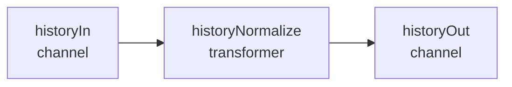
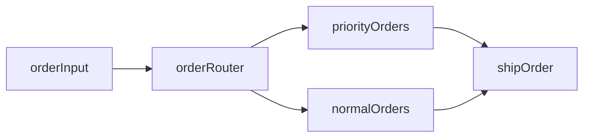

# history header — Tracing the path of a message

## 1. Objectives and context

In the **Message headers** chapter of the **SPRING_INTEGRATION_CORE** module, `history` helps observe which Spring Integration components a message has passed through. This knowledge connects `Message`, `MessageChannel`, endpoints, and Java DSL to troubleshooting in a real integration flow.

After this lesson, you can:

- Enable Message History and limit the components to be tracked.
- Read component name, component type, and recorded timestamp from the `history` header.
- Build a Java DSL flow with an easily inspectable route history.
- Find the history of the failing message rather than looking only at the error notification message.
- Understand limitations when branching, processing asynchronously, and communicating with external systems.

The running example is a flow that receives an order code, normalizes it, and sends the result to an output channel. When an order does not reach the expected destination, the first question is: **Which points in the flow did the message reach?**

## 2. What does `history` contain?

`history` is an infrastructure header recorded by Spring Integration's Message History mechanism as a message passes through components selected for tracking. It lives in headers, not in the business content of the payload. Enabling tracking does not require adding a history field to the order object.

The header value is `MessageHistory`, an implementation of `List<Properties>`. Each element represents one traversal through a component, typically containing three properties:

| Property | Meaning | Illustrative example |
| --- | --- | --- |
| `name` | Name of the tracked component | `historyNormalize` |
| `type` | Component type provided by the framework | `transformer` |
| `timestamp` | Recorded time, represented as a string of milliseconds since the Unix epoch | `1730000000012` |

Use the constants `MessageHistory.HEADER_NAME`, `NAME_PROPERTY`, `TYPE_PROPERTY`, and `TIMESTAMP_PROPERTY` when accessing in Java to avoid misspelling property names. `MessageHistory.read(message)` may return `null` when the header is absent. See [MessageHistory API](https://docs.spring.io/spring-integration/api/org/springframework/integration/history/MessageHistory.html).

Below is an **illustrative representation of the elements**, not a guarantee about the format of `history.toString()`:

```text
[
  {name=historyIn,        type=channel,     timestamp=1730000000000},
  {name=historyNormalize, type=transformer, timestamp=1730000000012},
  {name=historyOut,       type=channel,     timestamp=1730000000015}
]
```

You can read it as a route:



This path shows the points recorded within the tracking scope. An entry for a handler does not prove that the business operation inside the handler completed; the component may receive the message and throw an exception. Similarly, seeing the output channel does not guarantee an external system persisted the data successfully.

## 3. Enabling Message History and choosing scope

### 3.1. Configuration with annotations

In a Java-configured application, you can enable tracking for eligible Spring Integration components with:

```java
@Configuration
@EnableIntegration
@EnableMessageHistory
public class IntegrationConfiguration {
}
```

The corresponding annotations belong to these packages:

```java
import org.springframework.context.annotation.Configuration;
import org.springframework.integration.config.EnableIntegration;
import org.springframework.integration.config.EnableMessageHistory;
```

`@EnableMessageHistory` uses the `*` pattern by default. This selects Spring Integration components by name, not a mechanism that logs every bean, every method, or every Java statement. Within a single application context, centralize Message History configuration in one place. See [Message History Guide](https://docs.spring.io/spring-integration/reference/message-history.html).

### 3.2. Selective tracking

Example tracking only three components of the flow under investigation:

```java
@EnableMessageHistory({
    "historyIn",
    "historyNormalize",
    "historyOut"
})
```

If multiple components follow a naming convention, you can use patterns:

```java
@EnableMessageHistory({"order*", "*Gateway"})
```

`order*` matches names starting with `order`; `*Gateway` matches names ending with `Gateway`. These are component-name patterns, not regular expressions. Each pattern is a separate element in the annotation array. See [EnableMessageHistory API](https://docs.spring.io/spring-integration/api/org/springframework/integration/config/EnableMessageHistory.html).

In this lesson's example, bean names are declared explicitly so the pattern and observed data align. With DSL lambdas that generate handlers automatically, distinguish the endpoint name from the handler name that actually appears in history. The endpoint's `.id(...)` method configures the endpoint name; inspect the recorded component names before narrowing patterns too aggressively. See [DSL and endpoint configuration](https://docs.spring.io/spring-integration/reference/dsl/java-endpoints.html).

## 4. Complete Java DSL example

### 4.1. Runtime requirements

The example below targets Java 17 and Spring Integration 6.3.x. The project needs `spring-integration-core` and compatible Spring dependencies. If using Spring Boot with `spring-boot-starter-integration`, use the version managed by your project's dependency management.

The following dependency snippet applies when your project already manages Spring Integration versions via a BOM or equivalent configuration:

```xml
<dependency>
    <groupId>org.springframework.integration</groupId>
    <artifactId>spring-integration-core</artifactId>
</dependency>
```

Plain Spring projects must declare matching versions; do not mix arbitrary Spring versions. This lesson does not require HTTP, a database, or a message broker.

### 4.2. Configuration and runnable example

Place the following class in a Java project with the dependency above:

```java
import java.util.Locale;
import java.util.Properties;

import org.springframework.context.annotation.AnnotationConfigApplicationContext;
import org.springframework.context.annotation.Bean;
import org.springframework.context.annotation.Configuration;
import org.springframework.integration.channel.DirectChannel;
import org.springframework.integration.channel.QueueChannel;
import org.springframework.integration.config.EnableIntegration;
import org.springframework.integration.config.EnableMessageHistory;
import org.springframework.integration.dsl.IntegrationFlow;
import org.springframework.integration.history.MessageHistory;
import org.springframework.integration.transformer.MessageTransformingHandler;
import org.springframework.messaging.Message;
import org.springframework.messaging.MessageChannel;
import org.springframework.messaging.support.MessageBuilder;

@Configuration(proxyBeanMethods = false)
@EnableIntegration
@EnableMessageHistory({
    "historyIn",
    "historyNormalize",
    "historyOut"
})
public class HistoryHeaderExample {

    @Bean
    public DirectChannel historyIn() {
        return new DirectChannel();
    }

    @Bean
    public MessageTransformingHandler historyNormalize() {
        return new MessageTransformingHandler(message -> {
            String input = (String) message.getPayload();
            String normalized = input.trim().toUpperCase(Locale.ROOT);

            return MessageBuilder.withPayload(normalized)
                    .copyHeaders(message.getHeaders())
                    .build();
        });
    }

    @Bean
    public QueueChannel historyOut() {
        return new QueueChannel(10);
    }

    @Bean
    public IntegrationFlow historyFlow(
            DirectChannel historyIn,
            MessageTransformingHandler historyNormalize,
            QueueChannel historyOut) {

        return IntegrationFlow.from(historyIn)
                .handle(historyNormalize)
                .channel(historyOut)
                .get();
    }

    public static void main(String[] args) {
        try (var context = new AnnotationConfigApplicationContext(
                HistoryHeaderExample.class)) {

            Message<String> request = MessageBuilder
                    .withPayload("  order-009  ")
                    .setHeader("orderId", "O-009")
                    .build();

            MessageChannel input = context.getBean(
                    "historyIn", MessageChannel.class);

            if (!input.send(request, 1_000)) {
                throw new IllegalStateException("Failed to send message");
            }

            QueueChannel output = context.getBean(
                    "historyOut", QueueChannel.class);
            Message<?> result = output.receive(1_000);

            if (result == null) {
                throw new IllegalStateException("Failed to receive result");
            }

            System.out.println("payload=" + result.getPayload());
            System.out.println("orderId="
                    + result.getHeaders().get("orderId"));

            MessageHistory history = MessageHistory.read(result);
            if (history == null) {
                throw new IllegalStateException("Missing history header");
            }

            for (Properties entry : history) {
                System.out.printf("name=%s, type=%s, timestamp=%s%n",
                        entry.getProperty(MessageHistory.NAME_PROPERTY),
                        entry.getProperty(MessageHistory.TYPE_PROPERTY),
                        entry.getProperty(MessageHistory.TIMESTAMP_PROPERTY));
            }
        }
    }
}
```

`MessageTransformingHandler` is a handler that produces a reply by delegating to a `Transformer`. Declaring the handler as a dedicated bean gives the example a stable component name `historyNormalize`. See [MessageTransformingHandler API](https://docs.spring.io/spring-integration/api/org/springframework/integration/transformer/MessageTransformingHandler.html).

### 4.3. What to observe

Expected business output:

```text
payload=ORDER-009
orderId=O-009
```

Following that are entries corresponding to `historyIn`, `historyNormalize`, and `historyOut`, in this flow's order. Actual timestamp values change on every run; multiple entries can share the same timestamp because steps happen within the same millisecond.

Notable details:

1. `DirectChannel` delivers the message to the handler on the current calling thread.
2. The transformer changes the payload and copies the input message's headers, including `orderId` and `history` if already present.
3. `QueueChannel` holds the result for the program to explicitly `receive(...)`; no poller is needed because no automatic queue consumer is configured here.
4. The program reads history from the **actual result** received at the output. Do not treat the initial `request` variable as guaranteed to hold the complete post-processing history.
5. The pattern selects only three components; infrastructure beans or auto-generated endpoints do not alter the observation goal of the example.

`receive(1_000)` lets the program terminate with a clear message when a result is missing. It does not add an entry representing queue wait time to history.

## 5. Safely reading history in application code

In monitoring or logging code, missing history can be a valid state: configuration is disabled, the name does not match the pattern, or the message has not yet passed through any tracked component.

```java
import java.util.List;

import org.springframework.integration.history.MessageHistory;
import org.springframework.messaging.Message;

public final class HistoryReader {

    private HistoryReader() {
    }

    public static List<String> componentNames(Message<?> message) {
        MessageHistory history = MessageHistory.read(message);
        if (history == null) {
            return List.of();
        }

        return history.stream()
                .map(entry -> entry.getProperty(
                        MessageHistory.NAME_PROPERTY))
                .toList();
    }
}
```

You can also read directly by type:

```java
MessageHistory history = message.getHeaders()
        .get(MessageHistory.HEADER_NAME, MessageHistory.class);
```

Do not cast `history` to `String` or `List<String>`. When logging information, build your own representation from the entries. That lets you pick which fields to log without depending on `toString()` implementation details.

## 6. Preserving headers and understanding immutability properly

### 6.1. When creating a new message

Code that manually builds a message and sends it directly to another channel can break history if it only keeps the payload:

```java
// In code that builds and sends an independent Message:
Message<?> replacement = MessageBuilder
        .withPayload(newPayload)
        .build();

targetChannel.send(replacement);
```

`replacement` does not inherit the old message's history. If the goal is to continue along the same processing path and there is no requirement to drop headers, pass along the appropriate headers:

```java
Message<?> replacement = MessageBuilder
        .withPayload(newPayload)
        .copyHeaders(original.getHeaders())
        .build();
```

This is an example for **code that manually constructs and sends messages**. Inside Spring Integration endpoints, how headers are inherited also depends on the handler type, transformer, and header propagation configuration. Do not assume every method returning a new payload loses history; inspect the message at the component's actual output.

When configuring header filtering or omitting certain headers, verify whether `history` falls in the excluded set. The framework provides APIs to control header propagation on output-producing handlers; see [AbstractMessageProducingHandler source](https://raw.githubusercontent.com/spring-projects/spring-integration/main/spring-integration-core/src/main/java/org/springframework/integration/handler/AbstractMessageProducingHandler.java).

### 6.2. Difference before and starting from version 6.3

Before Spring Integration 6.3, appending history created a new history copy alongside a new message copy. Starting in 6.3, once the header is initialized, the framework appends entries to the existing history container to reduce object allocation. Therefore, do not assume holding a `MessageHistory` reference gives you a frozen snapshot of an earlier point in time. This change is described in [Message History Guide](https://docs.spring.io/spring-integration/reference/message-history.html).

If you need to save a snapshot for logging or later processing, convert the needed data into a separate object at the moment of observation, such as the list of name strings in `HistoryReader.componentNames(...)`. Do not mutate the `Properties` entries obtained from history; treat framework history data as read-only in business code.

Do not call operations such as `history.add(...)`, `history.clear()`, or `history.set(...)` to alter the route. The public list API does not permit applications to modify it with those operations. How the framework appends entries via `MessageHistory.write(...)` is a separate internal mechanism; see [MessageHistory source](https://raw.githubusercontent.com/spring-projects/spring-integration/main/spring-integration-core/src/main/java/org/springframework/integration/history/MessageHistory.java).

## 7. Using history to investigate errors

### 7.1. Identifying the right message to inspect

Suppose an order-processing flow has these steps:

```text
orderInput -> normalizeOrder -> validateOrder -> reserveStock -> orderOutput
```

An order fails at `reserveStock`. The history of the failing message helps answer whether it passed through `validateOrder` or not. It does not by itself show inventory counts, SQL statements, or transaction outcomes; those data points must be observed at their respective application layers.

When you have an `ErrorMessage`, distinguish:

- `errorMessage.getHeaders()` describes the error notification message traveling on the error-handling flow.
- `MessagingException.getFailedMessage()` may provide the message associated with the failure.
- `ErrorMessage.getOriginalMessage()` may provide the original message depending on how the error was constructed.

There is no guarantee that all of the above references exist or represent the same stage of the flow. How `ErrorMessage` and `originalMessage` are built depends on the error strategy; see [Error Handling Guide](https://docs.spring.io/spring-integration/reference/error-handling.html).

### 7.2. Helper to extract the message for diagnosis

The function below prioritizes the failed message closest to the outermost exception, walks the cause chain, and finally falls back to the original message if present:

```java
import java.util.Collections;
import java.util.IdentityHashMap;
import java.util.Set;

import org.springframework.messaging.Message;
import org.springframework.messaging.MessagingException;
import org.springframework.messaging.support.ErrorMessage;

public final class FailedMessageReader {

    private FailedMessageReader() {
    }

    public static Message<?> find(ErrorMessage errorMessage) {
        Throwable current = errorMessage.getPayload();
        Set<Throwable> visited = Collections.newSetFromMap(
                new IdentityHashMap<Throwable, Boolean>());

        while (current != null && visited.add(current)) {
            if (current instanceof MessagingException messagingException) {
                Message<?> failed = messagingException.getFailedMessage();
                if (failed != null) {
                    return failed;
                }
            }
            current = current.getCause();
        }

        return errorMessage.getOriginalMessage();
    }
}
```

Where an `ErrorMessage` is received, you can use:

```java
Message<?> failed = FailedMessageReader.find(errorMessage);
if (failed != null) {
    System.out.println("failedRoute="
            + HistoryReader.componentNames(failed));
}
```

This helper may return `null`; the caller must handle that case. It is a function for reading existing data, not a configuration that routes all exceptions to `errorChannel`.

### 7.3. Synchronous and asynchronous

The `HistoryHeaderExample` sends over `DirectChannel`. If the transformer throws an exception, the caller invoking `send(...)` can catch the exception on the same call stack. Do not assume an `ErrorMessage` will arrive on `errorChannel` for this direct-send case.

For asynchronous tasks managed by Spring Integration or poller tasks, errors can be emitted as error messages according to the configured error-handling mechanism. When investigating, identify both the error receiver and the message referenced by the error. See [distinguishing synchronous and asynchronous error handling](https://docs.spring.io/spring-integration/reference/error-handling.html).

## 8. Reading timestamps without over-inferring

Suppose the following three timestamps are extracted:

| Component | Illustrative timestamp | Delta from previous |
| --- | --- | --- |
| `orderInput` | `1730000000000` | — |
| `validateOrder` | `1730000000003` | `3 ms` |
| `reserveStock` | `1730000000123` | `120 ms` |

The `120 ms` gap suggests inspecting the segment between those two recordings. It does not by itself prove `reserveStock` ran for `120 ms`. That interval can include processing time in the preceding step, handoff delay, queue wait time, scheduling, and untracked steps.

When you need to measure an operation's latency, place timing instrumentation directly around that operation or use appropriate metrics/observation mechanisms. When analyzing timing across multiple services, use timestamps and trace context with explicit conventions. History is useful for choosing where to look more closely.

Do not write tests requiring every entry's timestamp to differ. Millisecond resolution and system clocks are unsuitable for proving absolute causal ordering in distributed systems.

## 9. Branching, splitters, routers, and aggregators

### 9.1. History belongs to each message's processing path

Consider a hypothetical flow:



With a router picking one branch by priority level, an order's history should reflect the branch that was chosen. If a message arrives at `normalOrders`, do not infer it also passed through `priorityOrders` just because both branches exist in the configuration.

With a splitter or publish-subscribe channel, a single input can lead to multiple messages or multiple branches. When reading each output, treat it as the history of its respective path, not a merged list of all activity across the entire flow.

Under the 6.3 history mechanism, the framework's standard branching components handle cloning history so branches keep independent tracking paths. If writing custom code that emits multiple outputs concurrently, inspect Spring Integration's builder API `AbstractIntegrationMessageBuilder.cloneMessageHistoryIfAny()` before sharing the same history container. Copying the header map alone does not create an independent history container. See [history rules on branching](https://docs.spring.io/spring-integration/reference/message-history.html).

### 9.2. Aggregator case

An order is split into three line items, and then an aggregator creates one combined result. Do not assume the combined result's history is the concatenation of all three line items' histories. The result depends on how the aggregator creates its output and how headers are selected or preserved.

To know fully how each line item was processed, record per-line observability data and link them using a business identifier or correlation key. History on a single output does not substitute for observability across the entire group.

## 10. System boundary limits and operational overhead

### 10.1. Across HTTP, Kafka, AMQP, or persistence

Within an application, `history` is a Java header value. When crossing an external adapter, gateway, or broker, preserving the header depends on header mappers, serializers, protocols, and specific configurations.

Therefore, when history stops at an integration boundary, inspect the data transfer contract at that boundary. Do not conclude the receiving service processed an error just because downstream history lacks earlier entries.

If cross-service tracking is required, select a business identifier or trace mechanism that is propagated deliberately. Expose externally only metadata that fits the integration contract.

### 10.2. Overhead scales with entries and messages

Suppose a path has 25 tracked components. Moving from 2,000 to 20,000 messages per second increases created entries from roughly 50,000 to 500,000 per second, before counting branching and retries. This is an entry-count estimate, not a memory measurement of one entry.

With queues or aggregation groups holding many messages, history is retained alongside them. A loop sending messages back into a flow can grow history further. A sound strategy is to select points with diagnostic value, name them clearly, and measure impact with representative traffic.

### 10.3. Distinguishing metadata types

| Data | Question it helps answer |
| --- | --- |
| `history` | Which tracked components did the message pass through? |
| `correlationId` | Which messages belong to the same correlation group? |
| `sequenceNumber`, `sequenceSize` | What are the position and size of the message sequence? |
| `errorChannel` | In the corresponding error-handling mechanism, where are errors sent? |
| Order code or request ID | Which business operation is being processed? |
| Trace/span data | How are operations linked and observed across boundaries? |

Do not use component-name history as a correlation key or deduplication key. Changing flow configuration can change history while the order code stays the same.

## 11. Testing the sample flow's history behavior

Tests should prove two things together: the business outcome is right and history contains the intentionally configured observation points. There is no need to hardcode timestamps or every auto-generated infrastructure bean name.

The JUnit 5 example below reuses `HistoryHeaderExample` and `HistoryReader`:

```java
import static org.junit.jupiter.api.Assertions.assertEquals;
import static org.junit.jupiter.api.Assertions.assertNotNull;
import static org.junit.jupiter.api.Assertions.assertTrue;

import java.util.List;

import org.junit.jupiter.api.Test;
import org.springframework.context.annotation.AnnotationConfigApplicationContext;
import org.springframework.integration.channel.QueueChannel;
import org.springframework.messaging.Message;
import org.springframework.messaging.MessageChannel;
import org.springframework.messaging.support.MessageBuilder;

class HistoryHeaderExampleTest {

    @Test
    void recordsTheConfiguredRouteAndPreservesBusinessHeaders() {
        try (var context = new AnnotationConfigApplicationContext(
                HistoryHeaderExample.class)) {

            MessageChannel input = context.getBean(
                    "historyIn", MessageChannel.class);
            QueueChannel output = context.getBean(
                    "historyOut", QueueChannel.class);

            Message<String> request = MessageBuilder
                    .withPayload("  order-009  ")
                    .setHeader("orderId", "O-009")
                    .build();

            assertTrue(input.send(request, 1_000));
            Message<?> result = output.receive(1_000);
            assertNotNull(result);
            assertEquals("ORDER-009", result.getPayload());
            assertEquals("O-009", result.getHeaders().get("orderId"));

            List<String> names = HistoryReader.componentNames(result);
            int inputIndex = names.indexOf("historyIn");
            int normalizeIndex = names.indexOf("historyNormalize");
            int outputIndex = names.indexOf("historyOut");

            assertTrue(inputIndex >= 0, names.toString());
            assertTrue(normalizeIndex > inputIndex, names.toString());
            assertTrue(outputIndex > normalizeIndex, names.toString());
        }
    }
}
```

The test verifies the order of key points rather than pinning the list to an exact fixed length across all future configurations. For branching flows, add dedicated tests per branch and check the expected branch name at that branch's output.

To test a configuration with history disabled, use a separate application context without `@EnableMessageHistory` and send a fresh message without a pre-existing history header. If the input already carries history from earlier, disabling tracking does not automatically strip that header.

## 12. Common pitfalls and misunderstandings

| Symptom | What to check |
| --- | --- |
| `history` is missing | Is configuration loaded, do names match patterns, and at which stage is the message read? |
| A step is missing from the list | Is that step a tracked component, or just a Java method call inside a handler? |
| Only auto-generated names appear | Give channels/handlers meaningful names and inspect component names before choosing patterns. |
| History stops after a custom transformer | Inspect output message, manual message creation, and header propagation settings. |
| Handler entry exists yet task failed | Inspect the failed message and exception; an entry is not proof of successful processing. |
| Error flow history differs from main flow | Distinguish `ErrorMessage` headers from failed/original message headers. |
| Two branches share mixed histories in custom code | Check history container sharing on manual fan-out, especially since 6.3. |
| Missing entries after calling an external service | Check mappers, serializers, and metadata contracts at the system boundary. |
| Equal timestamps | Do not assume lost entries; multiple recordings can occur within the same millisecond. |
| History grows abnormally long | Look for loops, whether retries re-enter the flow, and overly broad tracking scope. |

## 13. Guided practice

Perform these steps on the sample flow in order:

1. Run the example with payload `"  order-009  "`, verifying the result `ORDER-009`, the `orderId` header, and the three key component names.
2. Change configuration to `@EnableMessageHistory({"historyIn", "historyOut"})`, recreate the application context, and send a new message. The business result stays the same, while history no longer records the middle transformer.
3. Rename the transformer bean and update every place using it. Keep the old pattern to observe the missing entry, then update the pattern to match the new name.
4. Inside the transformer, intentionally throw `IllegalArgumentException` for a specific payload. Catch the exception at the `send(...)` caller, locate the `MessagingException` carrying the failed message in the cause chain, and read that failed message's history.
5. Add a branch for priority orders. For each output, verify the observation points match the chosen branch; do not use one history to draw conclusions about all branches.

Your practice work should demonstrate the link between **component selection configuration**, **the actual path taken**, and **the observed message**. When those three align, `history` becomes a useful diagnostic tool without forcing business logic to know the structure of the entire flow.
