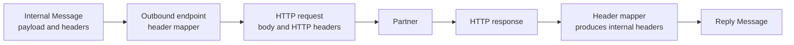

# Header mapper in Spring Integration

In the **Message headers** chapter of the **SPRING_INTEGRATION_CORE** module, header mappers help control metadata when a message crosses a communication boundary: from an internal `Message<?>` in the application to an HTTP request, JMS message, or AMQP message, and back in the reverse direction.

A flow can run transformers, routers, and service activators properly yet still integrate incorrectly if a request ID is lost, a correlation ID changes type, or an internal header leaks to a partner system. Learning header mappers is learning how to turn permitted exchange headers into an explicit contract.

## 1. Objectives and prerequisites

After this lesson, you can:

- Explain the responsibility of a header mapper and its place inside an adapter or gateway.
- Distinguish the `fromHeaders` and `toHeaders` directions from the request/reply directions.
- Configure `DefaultHttpHeaderMapper` and attach it in Java DSL.
- Write a custom mapper when renaming, normalizing types, or validating values is required.
- Design tests to detect lost, leaked, or misconverted headers.

You should know that `Message<T>` consists of payload and headers, `MessageChannel` transports messages, endpoints process messages, and gateways provide request/reply entry points.

The examples use Java DSL with `IntegrationFlow`, HTTP support, and JUnit Jupiter. When incorporating them into a project, use Spring versions managed by a single Spring Boot BOM or Spring Integration BOM; do not pick individual versions separately for each library.

## 2. The practical problem: internal messages differ from wire messages

Suppose an order service builds a message:

```text
payload:
  {"orderId":"O-1001"}

headers:
  requestId    = "req-42"
  tenantId     = "tenant-a"
  retryAttempt = Integer(2)
  replyChannel = application MessageChannel object
  internalNote = "pricing-cache-hit"
```

The HTTP partner expects the contract:

```http
POST /partner/orders HTTP/1.1
Content-Type: application/json
X-Request-Id: req-42
X-Tenant-Id: tenant-a
X-Retry-Attempt: 2

{"orderId":"O-1001"}
```

The two representations differ in both names and types:

- `requestId` must become `X-Request-Id`.
- `retryAttempt` is an `Integer` in the application but represented as a string over HTTP.
- `replyChannel` has meaning only inside the current process, not as a return address a partner can use.
- `internalNote` is for internal processing and is not part of the exchange contract.

The header mapper is the right place to perform this metadata mapping. Converting JSON to Java objects or vice versa belongs to payload handling.



In this scenario, the HTTP header names are determined by the partner contract. The `X-` prefix is not a mandatory rule for creating custom HTTP headers.

## 3. The `HeaderMapper<T>` contract

Spring Integration provides the interface:

```java
package org.springframework.integration.mapping;

import java.util.Map;
import org.springframework.messaging.MessageHeaders;

public interface HeaderMapper<T> {

    void fromHeaders(MessageHeaders headers, T target);

    Map<String, Object> toHeaders(T source);
}
```

`T` is the data type holding metadata on the protocol side. For example, the HTTP mapper uses `HttpHeaders`. The two methods are named relative to `MessageHeaders`: `fromHeaders` maps **from internal headers**, while `toHeaders` maps **to internal headers**. [HeaderMapper API](https://docs.spring.io/spring-integration/api/org/springframework/integration/mapping/HeaderMapper.html)

| Method | Source | Target | Common work |
| --- | --- | --- | --- |
| `fromHeaders(headers, target)` | `MessageHeaders` | Protocol metadata object | Select headers, rename, convert types for outbound sending |
| `toHeaders(source)` | Protocol metadata object | `Map<String, Object>` | Read metadata, normalize to construct internal message |

`fromHeaders` writes into the passed-in `target` object. `toHeaders` returns a map for the caller to use when building a message; it does not create a payload or send a message to a channel by itself.

In a typical Spring application, treat an already-delivered message as immutable. When headers must be added or changed, use a builder to create an appropriate message; do not use a mapper to mutate an incoming message's header map directly.

### 3.1. A mapper does not run automatically just because it is declared as a bean

A bean implementing `HeaderMapper<?>` only becomes part of a flow when an adapter, gateway, or handler code invokes it.

The HTTP Java DSL example uses `.headerMapper(mapper)` on the HTTP endpoint. Sending a message through an ordinary `DirectChannel` does not automatically trigger a header mapper.

### 3.2. Distinguishing from similar components

| Component | Primary responsibility | Example |
| --- | --- | --- |
| Header enricher | Add or replace headers on an internal message | Compute `tenantId` from business context |
| Header filter | Remove headers from an internal message | Strip a temporary header before the next step |
| Header mapper | Map metadata at a protocol boundary | `requestId` to `X-Request-Id` |
| Payload transformer/converter | Convert the data body | Order object to JSON |
| Router | Decide processing route | Choose flow by tenant or event type |

For example, an enricher can create `requestId`, while a mapper exports that value to HTTP. The two steps solve two distinct tasks.

## 4. Distinguishing inbound/outbound from request/reply

An HTTP outbound gateway both sends a request out and receives a response back. Therefore, the word "outbound" in the gateway's name does not mean the mapper only operates in the outbound direction.

| HTTP endpoint role | Communication leg | Mapper method |
| --- | --- | --- |
| Inbound gateway: app receives call | HTTP request into app | `toHeaders` |
| Inbound gateway: app returns result | Internal message to HTTP response | `fromHeaders` |
| Outbound gateway: app calls partner | Internal message to HTTP request | `fromHeaders` |
| Outbound gateway: app receives result | HTTP response to internal message | `toHeaders` |

With `DefaultHttpHeaderMapper`, `setOutboundHeaderNames(...)` selects header names mapped from message to HTTP; `setInboundHeaderNames(...)` selects header names mapped from HTTP to message. The `outboundMapper()` and `inboundMapper()` factories apply defaults matching the endpoint role. [DefaultHttpHeaderMapper API](https://docs.spring.io/spring-integration/api/org/springframework/integration/http/support/DefaultHttpHeaderMapper.html)

A reliable way to check mapping direction is to state start and end points using data types: "from `MessageHeaders` to `HttpHeaders`" is clearer than "outbound headers," especially when a gateway handles both request and reply.

## 5. Designing the header contract before configuring

For the order flow, we can define a contract:

| Business header | Internal type | External representation | Policy |
| --- | --- | --- | --- |
| `requestId` | `String` | `X-Request-Id` | Used to correlate requests; bounded length |
| `tenantId` | `String` | `X-Tenant-Id` | Export only values verified from a trusted source |
| `retryAttempt` | `Integer` | `X-Retry-Attempt` as string | Reject negative or out-of-range numbers |
| `contentType` | Appropriate media type | `Content-Type` | Must match body and converter |
| `replyChannel`, `errorChannel` | Channel reference or name | Not part of partner contract | Keep within internal processing scope |
| `internalNote` | `String` | Not exported | Internal diagnostics only |

Beyond name and type, define:

1. Whether the header is required or optional.
2. Which sources are allowed to supply or overwrite it.
3. Whether missing or invalid values are ignored, defaulted, or rejected with an error.
4. Whether multi-value headers are valid.
5. Whether the reply direction uses the same contract as the request direction.

### 5.1. Technical ID vs. business correlation

`MessageHeaders.ID` identifies a message instance. `MessageHeaders.TIMESTAMP` represents message creation time. `replyChannel` and `errorChannel` serve reply/error routing inside the messaging system. [Message model and predefined headers](https://docs.spring.io/spring-integration/reference/message.html)

To correlate a workflow across multiple services, design an explicit request code or business correlation ID. Do not rely on every `MessageHeaders.ID` remaining equal across message-creation steps as a success condition.

If using an aggregator, preserve the values that the correlation strategy and release strategy actually read. A header named `X-Request-Id` only helps group messages when the flow actively uses it or maps it into the grouping key.

## 6. Configuring the default HTTP mapper with Java DSL

The first example keeps the same custom header names in the internal message and over HTTP. Only when renaming is needed, such as `requestId` to `X-Request-Id`, do we use the custom mapper in a later section.

Dependencies required are `org.springframework.integration:spring-integration-core` and `org.springframework.integration:spring-integration-http`. Example classes live in package `example.integration`.

### 6.1. Mapper bean and integration flow

```java
package example.integration;

import org.springframework.context.annotation.Bean;
import org.springframework.context.annotation.Configuration;
import org.springframework.http.HttpHeaders;
import org.springframework.http.HttpMethod;
import org.springframework.integration.annotation.IntegrationComponentScan;
import org.springframework.integration.config.EnableIntegration;
import org.springframework.integration.dsl.IntegrationFlow;
import org.springframework.integration.http.dsl.Http;
import org.springframework.integration.http.support.DefaultHttpHeaderMapper;

@Configuration
@EnableIntegration
@IntegrationComponentScan(basePackageClasses = PartnerGateway.class)
public class PartnerHttpConfiguration {

    @Bean
    public DefaultHttpHeaderMapper partnerHeaderMapper() {
        DefaultHttpHeaderMapper mapper =
                DefaultHttpHeaderMapper.outboundMapper();

        mapper.setUserDefinedHeaderPrefix("");

        mapper.setOutboundHeaderNames(
                HttpHeaders.CONTENT_TYPE,
                HttpHeaders.ACCEPT,
                "X-Request-Id",
                "X-Tenant-Id");

        mapper.setInboundHeaderNames(
                HttpHeaders.CONTENT_TYPE,
                "X-Request-Id");

        return mapper;
    }

    @Bean
    public IntegrationFlow partnerOrderFlow(
            DefaultHttpHeaderMapper partnerHeaderMapper) {

        return IntegrationFlow.from("partnerRequests")
                .handle(Http.outboundGateway(
                                "http://localhost:8081/partner/orders")
                        .httpMethod(HttpMethod.POST)
                        .expectedResponseType(String.class)
                        .headerMapper(partnerHeaderMapper))
                .get();
    }
}
```

`.headerMapper(...)` attaches the mapper to the HTTP handler. The DSL also offers request/response header-name settings, but in this example the entire mapping policy resides in the mapper bean. [HTTP handler configuration API in Java DSL](https://docs.spring.io/spring-integration/api/org/springframework/integration/http/dsl/BaseHttpMessageHandlerSpec.html)

Explicitly configured name lists replace the corresponding defaults. Spring supports simple `*` patterns and the `HTTP_REQUEST_HEADERS` / `HTTP_RESPONSE_HEADERS` groups if standard header groups are needed. `setUserDefinedHeaderPrefix("")` makes clear that the example preserves custom header names as-is. [HTTP Header Mapping configuration](https://docs.spring.io/spring-integration/reference/http/header-mapping.html)

Here we allow only four names on the request leg and two names on the response leg. If the partner needs additional headers, add them per contract rather than immediately switching to `*`.

These lists control headers copied by the mapper from messages. The HTTP client, converter, and protocol layer can still generate headers such as `Host` or `Content-Length` to send a valid request.

### 6.2. Messaging gateway to invoke the flow

```java
package example.integration;

import org.springframework.integration.annotation.MessagingGateway;
import org.springframework.messaging.Message;

@MessagingGateway(defaultRequestChannel = "partnerRequests")
public interface PartnerGateway {

    Message<?> exchange(Message<String> request);
}
```

A business bean can inject `PartnerGateway` and call:

```java
import example.integration.PartnerGateway;
import org.springframework.http.HttpHeaders;
import org.springframework.http.MediaType;
import org.springframework.messaging.Message;
import org.springframework.messaging.MessageHeaders;
import org.springframework.messaging.support.MessageBuilder;

// gateway is injected into the business bean.
Message<String> request = MessageBuilder
        .withPayload("{\"orderId\":\"O-1001\"}")
        .setHeader(MessageHeaders.CONTENT_TYPE, MediaType.APPLICATION_JSON)
        .setHeader(HttpHeaders.ACCEPT, "application/json")
        .setHeader("X-Request-Id", "req-42")
        .setHeader("X-Tenant-Id", "tenant-a")
        .setHeader("internalNote", "pricing-cache-hit")
        .build();

Message<?> reply = gateway.exchange(request);
```

What to observe on the HTTP request is that `X-Request-Id` and `X-Tenant-Id` are sent, while `internalNote` is not copied by the mapper.

Spring Messaging's `contentType` and HTTP's `Content-Type` have built-in mapping rules in the standard mapper. Do not assume the mapper automatically knows how to rename arbitrary business names, such as `requestId` to `X-Request-Id`.

The localhost URL is for hands-on practice; a listening HTTP stub or partner service is required. Whether the gateway returns a reply depends not only on the mapper, but also on the endpoint, HTTP status code, and client configuration.

### 6.3. A header still present in the reply does not prove it crossed the network

In many request/reply flows, certain internal request headers may be retained when building the reply. Therefore, seeing `internalNote` on the reply message is not enough to conclude it was exported over HTTP or returned by the partner.

When checking for header leaks, inspect the actual HTTP request received by the stub. When checking the inbound direction, inspect the map returned by `toHeaders` or the headers placed onto the reply by the endpoint under its specific configuration.

## 7. When is a custom mapper needed?

The default mapper is usually sufficient if the requirement is simply selecting which headers are exchanged.

A custom mapper is appropriate when the contract requires:

- Renaming between internal and protocol models.
- Controlled conversions, such as `Integer` to a decimal string.
- Rejecting malformed values before sending.
- Explicit handling of duplicate or multi-value headers.

Do not put database lookups or external API calls inside a mapper. Those operations belong in processing endpoints or enrichers so they remain easy to test, track errors, and control latency.

The next example illustrates two headers:

| Internal | HTTP | Rule in the example |
| --- | --- | --- |
| `requestId` | `X-Request-Id` | 1–64 alphanumeric, dot, underscore, or hyphen characters; first character alphanumeric |
| `retryAttempt` | `X-Retry-Attempt` | Internally an `Integer` from 0 to 5; over HTTP a matching single digit |

Both headers are optional in the example. If business logic requires `requestId`, validate presence in a validation step or explicitly tighten the mapper contract.

## 8. Writing a custom mapper while keeping standard HTTP handling

```java
package example.integration;

import java.util.HashMap;
import java.util.List;
import java.util.Map;

import org.springframework.http.HttpHeaders;
import org.springframework.integration.http.support.DefaultHttpHeaderMapper;
import org.springframework.integration.mapping.HeaderMapper;
import org.springframework.messaging.MessageHeaders;

public final class BusinessHttpHeaderMapper
        implements HeaderMapper<HttpHeaders> {

    private static final String REQUEST_ID = "X-Request-Id";
    private static final String RETRY_ATTEMPT = "X-Retry-Attempt";

    private final DefaultHttpHeaderMapper delegate;

    public BusinessHttpHeaderMapper() {
        this.delegate = DefaultHttpHeaderMapper.outboundMapper();
        this.delegate.setUserDefinedHeaderPrefix("");
        this.delegate.setOutboundHeaderNames(
                HttpHeaders.CONTENT_TYPE, HttpHeaders.ACCEPT);
        this.delegate.setInboundHeaderNames(HttpHeaders.CONTENT_TYPE);
    }

    @Override
    public void fromHeaders(MessageHeaders headers, HttpHeaders target) {
        String requestId = checkedRequestId(headers.get("requestId"));
        Integer retryAttempt = checkedAttempt(headers.get("retryAttempt"));

        this.delegate.fromHeaders(headers, target);

        if (requestId != null) {
            target.set(REQUEST_ID, requestId);
        }
        if (retryAttempt != null) {
            target.set(RETRY_ATTEMPT, retryAttempt.toString());
        }
    }

    @Override
    public Map<String, Object> toHeaders(HttpHeaders source) {
        String requestId = checkedRequestId(singleValue(source, REQUEST_ID));
        String retryText = singleValue(source, RETRY_ATTEMPT);

        Integer retryAttempt = null;
        if (retryText != null) {
            if (!retryText.matches("[0-5]")) {
                throw new IllegalArgumentException(
                        "X-Retry-Attempt must be one digit from 0 to 5");
            }
            retryAttempt = Integer.valueOf(retryText);
        }

        Map<String, Object> result =
                new HashMap<>(this.delegate.toHeaders(source));

        if (requestId != null) {
            result.put("requestId", requestId);
        }
        if (retryAttempt != null) {
            result.put("retryAttempt", retryAttempt);
        }
        return result;
    }

    private static String checkedRequestId(Object value) {
        if (value == null) {
            return null;
        }
        if (!(value instanceof String text)
                || !text.matches("[A-Za-z0-9][A-Za-z0-9._-]{0,63}")) {
            throw new IllegalArgumentException("Invalid requestId");
        }
        return text;
    }

    private static Integer checkedAttempt(Object value) {
        if (value == null) {
            return null;
        }
        if (!(value instanceof Integer attempt)
                || attempt < 0 || attempt > 5) {
            throw new IllegalArgumentException(
                    "retryAttempt must be an Integer from 0 to 5");
        }
        return attempt;
    }

    private static String singleValue(HttpHeaders source, String name) {
        List<String> values = source.get(name);
        if (values == null) {
            return null;
        }
        if (values.size() != 1) {
            throw new IllegalArgumentException(
                    name + " must have exactly one value");
        }
        return values.get(0);
    }
}
```

Key design points:

1. The mapper holds only fixed configuration; it never stores per-message `requestId` or counters in shared fields.
2. Outbound mapping validates types before converting to strings, avoiding turning arbitrary objects into "plausible-looking" values via `toString()`.
3. Inbound mapping rejects multiple values for headers specified by contract as single-valued.
4. The delegate handles only the selected standard HTTP headers; the custom mapper handles business renaming itself.
5. Format errors do not echo raw input values verbatim into error messages.

`retryAttempt` in the example is application-defined metadata. Incrementing or checking this header does not implement retry by itself and does not replace endpoint retry configuration.

To use this mapper, **replace** the `partnerHeaderMapper` bean from the previous example:

```java
@Bean
public BusinessHttpHeaderMapper partnerHeaderMapper() {
    return new BusinessHttpHeaderMapper();
}
```

Also update the flow's parameter type from `DefaultHttpHeaderMapper` to `BusinessHttpHeaderMapper`. The `.headerMapper(partnerHeaderMapper)` call stays the same.

Outbound messages should now use the internal names `requestId` and `retryAttempt`:

```java
Message<String> request = MessageBuilder
        .withPayload("{\"orderId\":\"O-1001\"}")
        .setHeader(MessageHeaders.CONTENT_TYPE, MediaType.APPLICATION_JSON)
        .setHeader("requestId", "req-42")
        .setHeader("retryAttempt", 2)
        .setHeader("internalNote", "pricing-cache-hit")
        .build();
```

The illustrative mapper does not export `tenantId` yet. If the partner contract requires that header, add the mapping and corresponding tests; do not assume a header will be forwarded simply because it exists on the message.

With an outbound gateway, `toHeaders` in the class above applies to **the partner's response**. It will only produce `retryAttempt` from the response if the response actually contains `X-Retry-Attempt`.

## 9. Testing the mapping contract

Tests should prove behavior in both directions and the ability to reject invalid data. A mapper might export requests properly yet import the wrong data type on responses.

### 9.1. Unit tests for the custom mapper

The class below uses JUnit Jupiter without starting a Spring context or HTTP server:

```java
package example.integration;

import java.util.Map;

import org.junit.jupiter.api.Test;
import org.springframework.http.HttpHeaders;
import org.springframework.integration.channel.DirectChannel;
import org.springframework.messaging.Message;
import org.springframework.messaging.MessageHeaders;
import org.springframework.messaging.support.MessageBuilder;

import static org.junit.jupiter.api.Assertions.*;

class BusinessHttpHeaderMapperTest {

    private final BusinessHttpHeaderMapper mapper =
            new BusinessHttpHeaderMapper();

    @Test
    void exportsBusinessHeadersAndExcludesInternalHeaders() {
        Message<String> message = MessageBuilder.withPayload("body")
                .setHeader("requestId", "req-42")
                .setHeader("retryAttempt", 2)
                .setHeader("internalNote", "do-not-export")
                .setReplyChannel(new DirectChannel())
                .build();

        HttpHeaders target = new HttpHeaders();

        mapper.fromHeaders(message.getHeaders(), target);

        assertEquals("req-42", target.getFirst("X-Request-Id"));
        assertEquals("2", target.getFirst("X-Retry-Attempt"));
        assertFalse(target.containsKey("requestId"));
        assertFalse(target.containsKey("retryAttempt"));
        assertFalse(target.containsKey("internalNote"));
        assertFalse(target.containsKey(MessageHeaders.REPLY_CHANNEL));
        assertFalse(target.containsKey(MessageHeaders.ID));
        assertFalse(target.containsKey(MessageHeaders.TIMESTAMP));
    }

    @Test
    void importsOnlyAllowedHeadersAndRestoresIntegerType() {
        HttpHeaders source = new HttpHeaders();
        source.set("X-Request-Id", "req-42");
        source.set("X-Retry-Attempt", "2");
        source.set("internalNote", "untrusted-value");

        Map<String, Object> headers = mapper.toHeaders(source);

        assertEquals("req-42", headers.get("requestId"));
        assertEquals(Integer.valueOf(2), headers.get("retryAttempt"));
        assertFalse(headers.containsKey("internalNote"));
        assertFalse(headers.containsKey("X-Retry-Attempt"));
    }

    @Test
    void rejectsUnexpectedInternalType() {
        Message<String> message = MessageBuilder.withPayload("body")
                .setHeader("retryAttempt", "2")
                .build();

        assertThrows(IllegalArgumentException.class,
                () -> mapper.fromHeaders(
                        message.getHeaders(), new HttpHeaders()));
    }

    @Test
    void rejectsInvalidOrRepeatedExternalValues() {
        HttpHeaders invalid = new HttpHeaders();
        invalid.set("X-Retry-Attempt", "99");

        assertThrows(IllegalArgumentException.class,
                () -> mapper.toHeaders(invalid));

        HttpHeaders repeated = new HttpHeaders();
        repeated.add("X-Request-Id", "req-1");
        repeated.add("X-Request-Id", "req-2");

        assertThrows(IllegalArgumentException.class,
                () -> mapper.toHeaders(repeated));
    }

    @Test
    void acceptsMissingOptionalBusinessHeaders() {
        Map<String, Object> headers =
                mapper.toHeaders(new HttpHeaders());

        assertFalse(headers.containsKey("requestId"));
        assertFalse(headers.containsKey("retryAttempt"));
    }
}
```

Assertions focus on the contract: HTTP names, internal types, excluded headers, and invalid data. They do not require a message passing through an endpoint to keep the same technical ID as the original message.

### 9.2. Additional tests at the endpoint level

Unit tests do not prove the mapper bean is properly wired into the HTTP gateway. A flow test with an HTTP stub is needed:

1. Start the context containing the configuration and gateway.
2. Have the stub accept requests at `/partner/orders`.
3. Send a message containing valid headers and an internal header.
4. Inspect headers on the request the stub actually received.
5. Have the stub return `X-Request-Id` along with a valid body and media type.
6. Verify the reply payload and imported headers.

Spring Integration provides a module supporting flow tests; the documentation also covers Spring's HTTP testing tools. Tool selection depends on the HTTP client configured in the endpoint. [Testing support](https://docs.spring.io/spring-integration/reference/testing.html)

If the custom mapper enforces a policy rejecting invalid headers, additionally test that the error reaches the destination required by the flow design.

## 10. Applying the same thinking to JMS and AMQP

Do not copy HTTP header-name configuration verbatim to other adapters. Each protocol has its own metadata model and constraints.

| Protocol | Common mapper | Metadata object | What to check |
| --- | --- | --- | --- |
| HTTP | `DefaultHttpHeaderMapper` | `HttpHeaders` | Header names, multiple values, string representation |
| JMS | `DefaultJmsHeaderMapper` | JMS message | JMS API headers vs. custom properties |
| AMQP | `DefaultAmqpHeaderMapper` | `MessageProperties` | Standard AMQP properties vs. custom headers map |

These are protocol-specific mapping strategies. APIs across mapper families can differ; for example, AMQP uses a contract distinguishing request/reply, so do not assume every mapper is configured with HTTP's two setters.

### 10.1. JMS

JMS distinguishes headers accessed via the JMS API from message properties. Spring Integration provides a mapper for this metadata layer; payload conversion is a separate responsibility. Custom properties must conform to JMS data types and naming rules. [JMS support](https://docs.spring.io/spring-integration/reference/jms.html)

Some quality-of-service options such as priority or time-to-live also involve the producer and endpoint. Merely setting a header named like a protocol option is not enough to guarantee the broker applies the desired behavior.

### 10.2. AMQP

AMQP has standard properties alongside a custom headers map. `DefaultAmqpHeaderMapper` supports selecting headers for requests and replies. Read the defaults for the version in use, especially when forwarding broker-generated headers, rather than assuming `*` is an appropriate policy. [AMQP message headers](https://docs.spring.io/spring-integration/reference/amqp/message-headers.html)

When taking a message received from a broker into a new outbound send, determine which metadata is business data and which only describes the previous delivery. Forwarding everything can cause downstream systems to misinterpret semantics.

## 11. Data types, round-tripping, and reliability

### 11.1. Do not require all headers to round-trip unchanged

Mapping often changes representation:

```text
Integer(2) -> HTTP "2" -> Integer(2)
```

Some headers are excluded intentionally, some are added by the transport, and some belong only to a specific message instance. Therefore, round-trip tests should compare **the set of business headers preserved by contract**.

If the inbound parsing step is omitted:

```text
Integer(2) -> HTTP "2" -> String("2")
```

The displayed values look identical, yet a router or type-checking expression may handle them differently.

### 11.2. Explicit type conversions

For numbers, agree on valid ranges and overflow handling. For timestamps, agree on format and time zone. For collections, agree on multiple protocol values versus a structured string.

Do not export a complex domain object using `toString()` and expect the receiver to reconstruct it. If data is structured and large, consider placing it in the payload rather than headers.

### 11.3. Externally received headers are not authenticated facts

A mapper can translate `X-Tenant-Id` into `tenantId`, but renaming does not prove the caller is authorized to act on that tenant. The flow still needs authentication, authorization, or verification against a trusted context.

Similarly, a well-formatted `requestId` only aids request correlation. It does not guarantee uniqueness or provide deduplication by itself.

### 11.4. Trace context propagation needs its own design

If the system uses tracing, inspect the propagation mechanism provided by your observability library and HTTP client. Merely adding `traceparent` to a mapper's list does not create spans, link spans, or complete end-to-end tracing.

## 12. Handling mapper errors in a flow

In the custom mapper, invalid data raises `IllegalArgumentException`. When invoked inside an endpoint, the error may be wrapped with messaging context before reaching the caller.

How the error reaches a handler depends on the execution model:

- For synchronous calls over a direct channel, errors typically propagate back to the caller depending on configured gateways and advice.
- For flows with a poller or executor, configure an error-handling mechanism appropriate for that executing component.
- `errorChannel` is not a guarantee that every exception at every point automatically appears on a global channel.

Contract errors can be distinguished from transient errors:

| Situation | Usually appropriate handling |
| --- | --- |
| `retryAttempt` is an object of the wrong type | Fix data or mapping; retrying the same input does not help |
| `X-Request-Id` repeats values contrary to contract | Reject and log communication error |
| Timeout calling partner | Consider retry per business policy and idempotency |
| Missing required header | Explicit validation; do not synthesize a value that distorts semantics |

When logging, record the header name, mapping direction, and violation kind. Avoid logging entire headers if they may contain credentials or sensitive data.

## 13. Common mistakes and how to diagnose them

| Symptom | Possible cause | How to check |
| --- | --- | --- |
| Custom header disappears when sending | Not in allowlist or wrong mapper attached | Inspect message before endpoint and request at stub |
| Configured outbound, yet response lacks expected header | Confused `fromHeaders` vs. `toHeaders` direction | Identify HTTP request/response and gateway role |
| Named `requestId` internally while partner requires `X-Request-Id` | Default mapper does not perform business renaming | Use consistent names or a custom mapper |
| Standard headers stop being copied after customization | New list replaced default selection | Add needed standard names or the appropriate header group |
| Router behaves differently after HTTP hop | Java type became a string | Assert both value and type after `toHeaders` |
| Mapper bean exists but has no effect on requests | Bean not wired to the right endpoint | Check `.headerMapper(...)` on the flow actually invoked |
| Reply still carries internal header despite no response mapping | Header may have been preserved from request message | Inspect wire request and mapper output separately |
| Aggregator builds wrong groups | Correlation key was not preserved or normalized | Inspect the exact value read by the correlation strategy |
| Data leaks across requests | Mapper stores per-message state in a shared field | Move transient data to local variables; keep config immutable |

Troubleshooting should follow the communication boundary: inspect the message before the endpoint, inspect real wire data on the protocol, then inspect the message after the endpoint. Looking only at payload logs is rarely enough to spot header bugs.

## 14. Reinforcement practice

Extend the order example through these steps:

1. Use the default mapper and confirm only the selected custom headers appear at the HTTP stub.
2. Swap in the custom mapper and rename `requestId` to `X-Request-Id`.
3. Have the response return `X-Retry-Attempt: 2`, and verify the imported internal header is an `Integer`.
4. Have the response return `X-Retry-Attempt: 99`, and verify the error is handled according to the flow design.
5. Add `tenantId` with trusted-source rules, format constraints, and tests confirming unlisted headers are excluded.
6. If attaching a downstream router or aggregator, test its processing decisions using those normalized headers.

You have completed the practice when you can explain the source, name, type, mapping direction, and error policy for every header in the contract.
