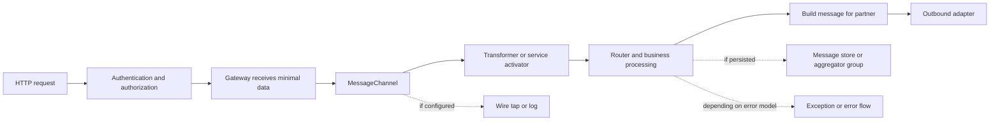

# Do not put sensitive data in headers

## 1. Objectives and scope

In Spring Integration, headers help endpoints understand how to handle a message: routing, correlating steps, returning results, or forwarding errors. Headers also travel through many infrastructure components, so data placed in headers must be designed as carefully as data in the payload.

This lesson belongs to the **Message headers** section of **SPRING_INTEGRATION_CORE**. After this lesson, you can:

- Distinguish integration metadata from authentication secrets and personal data.
- Identify data propagation paths through `MessageChannel`, transformers, routers, gateways, and error branches.
- Use Java DSL to strip known headers and build outbound messages using an allowlist.
- Write tests ensuring flows keep working while out-of-contract data does not reach receiving destinations.

The examples use Java 17 and the Spring Integration 6.5 API; test configurations use JUnit Jupiter with Spring Test. The content focuses on the core module. HTTP and brokers are mentioned to explain integration boundaries and do not require implementing extra adapters in the examples.

Design principle: **put into headers only the data the next component genuinely needs, with its usage scope and permitted destinations explicitly defined**.

## 2. Headers are not secret storage

A message can be pictured as follows:

```text
Message
├── payload: business data
└── headers: metadata for processing and transport
```

Headers are part of the message and can be read by any component handed that message. Pulling a value out of the payload and moving it into a header does not create encryption or access control.

`MessageHeaders` has a read-only structure; direct operations like `remove()` or `put()` fail. That property does not prevent other components from reading headers, nor does it make objects stored inside headers immutable. It is an API property, not a confidentiality guarantee. [MessageHeaders Documentation](https://docs.spring.io/spring-framework/docs/current/javadoc-api/org/springframework/messaging/MessageHeaders.html).

The following example illustrates a design to avoid. These strings are dummy data, not real credentials:

```java
Message<String> unsafe = MessageBuilder.withPayload("order-demo-001")
        .setHeader("Authorization", "Bearer TEST_ONLY_TOKEN")
        .setHeader("customerEmail", "demo@example.invalid")
        .setHeader("apiKey", "TEST_ONLY_KEY")
        .build();
```

A router that only needs to know the order type will also receive the token if given this message. A diagnostic branch might accidentally log the email as well. Renaming `apiKey` to `context` does not change the sensitive nature of the value.

### 2.1. Classify before creating headers

The table below gives design guidance for the illustrative application; each system must classify according to its actual data and access permissions.

| Data | Recommended handling | Reason |
| --- | --- | --- |
| Passwords, private keys, client secrets | Keep in a secrets manager; components needing them fetch directly | Does not serve business message routing |
| Access tokens, refresh tokens, API keys, session cookies | Handle at the auth boundary or client calling the target service | Can grant the subject's permissions if exposed |
| Personal ID numbers, payment info | Include only in data contracts that strictly require them, with access control | No reason to duplicate into metadata |
| Email, phone number, address | Avoid using as correlation or routing keys | Easily surfaces in logs, lookup screens, or support branches |
| Event type, schema version | Can be used as headers with a controlled set of values | Supports processing without carrying user profiles |
| Server-generated random request ID | Can be used for correlation within permitted scope | Avoids using personal identifiers for tracing |
| Tenant ID, customer ID, order ID | Evaluate purpose, sharing scope, and data-linking risk | Even an internal code can identify a subject |
| `replyChannel`, `errorChannel`, sequence data | Manage according to flow semantics | Control metadata, not data to ship externally at will |

A UUID can also become linkable data when a mapping table connects it to a user. Therefore, "contains no person's name" is not enough to conclude a header is safe to expose publicly.

OWASP recommends avoiding logging data such as tokens, passwords, keys, and sensitive personal information directly. In this lesson, that recommendation is applied by restricting what data can reach logging points in the first place. [OWASP Logging Cheat Sheet](https://cheatsheetseries.owasp.org/cheatsheets/Logging_Cheat_Sheet.html#data-to-exclude).

### 2.2. Nested data must be classified too

Headers do not hold only strings. A header named `requestContext` might hold a `Map`, a user object, or an authentication object carrying credentials.

```text
requestContext
├── requestId
├── customer
│   ├── email
│   └── phone
└── credentials
    └── accessToken
```

Removing an `accessToken` header at the top level will not remove `requestContext.credentials.accessToken`. Metadata design should prefer small, clearly typed, schema-bound values; avoid passing entire requests, entire profiles, or entire authentication contexts through business headers.

## 3. How can data propagate?

Suppose an API receives an order-creation request and calls a gateway to start the processing flow:



The diagram shows possibilities to consider during design; a channel does not automatically enable all of these branches.

Under header propagation, many message-producing endpoints inherit input headers. A transformer returning a payload also keeps input headers; a transformer returning a full `Message` gives application code responsibility for constructing the output message. Routers and bridges do not automatically act as header-sanitizing points. [Spring Integration: Header Propagation](https://docs.spring.io/spring-integration/reference/message.html#message-header-propagation).

Design consequences:

| Operation | What to control |
| --- | --- |
| Converting payload from object to JSON | Do not assume authentication headers disappeared |
| Routing by `eventType` | Receiving branches can still see unnecessary headers |
| Adding an audit or wire-tap branch | The new branch expands where data is received |
| Persisting messages for retry or recovery | Identify exact fields stored and retention duration |
| Grouping messages in an aggregator | Inspect data inside every message in the group |
| Wrapping errors with failed messages | Inspect both error content and referenced messages |

### 3.1. Sanitizing output does not modify the original message

Do not modify headers like this:

```java
// UnsupportedOperationException on standard MessageHeaders.
message.getHeaders().remove("Authorization");
```

You can build a message with specified headers removed using a builder:

```java
Message<?> cleaned = MessageBuilder.fromMessage(message)
        .removeHeaders("Authorization", "authorization", "private_*")
        .build();
```

`fromMessage()` initializes the builder from the input message; `removeHeaders()` supports header-name patterns. The returned message must be passed to the next step. [MessageBuilder Javadoc](https://docs.spring.io/spring-framework/docs/current/javadoc-api/org/springframework/messaging/support/MessageBuilder.html).

After this operation, a reference still holding the original `message` can still read `Authorization`. Any branch that already received the message or any log already written is unchanged as well. Do not treat calling `build()` as a way to wipe secrets from memory or recall already-dispatched data.

## 4. Limiting data at the entry boundary

For an application receiving HTTP requests, the recommended flow has these steps:

1. The authentication layer reads credentials and verifies the caller.
2. The authorization layer checks the requested operation on the specific resource.
3. The adapter/translation layer creates a minimal business DTO along with approved metadata.
4. The gateway receives only data belonging to that contract.

For example, the gateway's input contract might consist of an order ID and an application-generated request ID. There is no need to add a `Map<String, Object> allHttpHeaders` parameter just for future convenience.

If tenant metadata is needed, obtain it from the trusted authentication outcome and check permissions on the corresponding resource. A client-supplied `tenantId` header is not sufficient proof of authorization. Format validation does not replace origin verification either.

When calling external services, the client or adapter may need protocol-level credentials. Prefer configuring credential provisioning directly on the component calling the target; if a user token must be propagated, design its scope, recipients, and lifecycle explicitly. Do not carry tokens through the entire flow just because the final step might need them.

**HTTP headers and Spring Message headers are two separate layers.** Just because a valid HTTP request carries `Authorization` does not mean every internal business message needs a copy of it.

## 5. Two ways to control headers

### 5.1. Denylist: removing known headers

A Header Filter produces output with configured headers removed. It is a specialized transformer, distinct from a Message Filter which decides whether to pass or drop an entire message. [Spring Integration: Header Filter](https://docs.spring.io/spring-integration/reference/6.5/transformer.html#header-filter).

A denylist fits when an internal flow has a known metadata contract and needs to drop specific temporary fields. Its limitation is that any new header outside the list can still pass through.

Header names in the map must be handled according to their actual names. Do not assume HTTP's case-insensitivity rule applies by default to every operation on `MessageHeaders`. A list containing `Authorization` does not yet express a policy for every case variant produced by an application or mapper.

When using name patterns in Java DSL, declare `patternMatch(true)` explicitly and verify behavior with the version in use. The example below uses `HeaderFilterSpec`, available since Spring Integration 6.2. [HeaderFilterSpec 6.5 API](https://docs.spring.io/spring-integration/docs/6.5.0/api/org/springframework/integration/dsl/HeaderFilterSpec.html).

### 5.2. Allowlist: building messages to match the target contract

At a partner-facing outbound boundary, a stricter approach is constructing a new message and adding only headers belonging to the export contract. New headers outside the contract are not copied automatically.

This approach requires two separate decisions:

- **What goes into the outbound payload?** If the payload contains personal data beyond the partner's needs, build a minimal outbound DTO.
- **What goes into the outbound headers?** Add only approved metadata from a proper source.

Do not call `copyHeaders(input.getHeaders())` in this step and assume the new message already has a smaller data footprint. Nor should you return just a new payload if the goal is to cut off header inheritance.

## 6. Java DSL example with two independent boundaries

The example uses the string payload `order-demo-001`, assumed to be valid and permitted for delivery to the target. `appRequestId` is a UUID generated by the application at entry; the outbound `eventType` is a fixed value belonging to the contract.

Two flows operate independently to compare policies:

- `internal.sanitize.in` → `internal.sanitize.out`: removes known headers while keeping remaining metadata for internal processing.
- `partner.export.in` → `partner.export.out`: builds a message for the target containing exactly two application headers.

The `QueueChannel` at the output only helps observe results in the example and tests. It does not represent data actually sent over the network by an HTTP client or broker.

### 6.1. Flow configuration

Illustrative file `HeaderBoundaryConfiguration.java`:

```java
package example.integration;

import java.util.UUID;

import org.springframework.context.annotation.Bean;
import org.springframework.context.annotation.Configuration;
import org.springframework.integration.channel.DirectChannel;
import org.springframework.integration.channel.QueueChannel;
import org.springframework.integration.config.EnableIntegration;
import org.springframework.integration.dsl.IntegrationFlow;
import org.springframework.integration.handler.LoggingHandler;
import org.springframework.messaging.Message;
import org.springframework.messaging.MessageChannel;
import org.springframework.messaging.support.MessageBuilder;

@Configuration
@EnableIntegration
public class HeaderBoundaryConfiguration {

    @Bean(name = "internal.sanitize.in")
    public MessageChannel internalInput() {
        return new DirectChannel();
    }

    @Bean(name = "internal.sanitize.out")
    public QueueChannel internalOutput() {
        return new QueueChannel(10);
    }

    @Bean(name = "partner.export.in")
    public MessageChannel partnerInput() {
        return new DirectChannel();
    }

    @Bean(name = "partner.export.out")
    public QueueChannel partnerOutput() {
        return new QueueChannel(10);
    }

    @Bean
    public IntegrationFlow internalSanitizingFlow() {
        return IntegrationFlow.from("internal.sanitize.in")
                .headerFilter(spec -> spec
                        .headersToRemove(
                                "Authorization", "authorization",
                                "Cookie", "cookie",
                                "Set-Cookie", "set-cookie",
                                "apiKey", "accessToken", "refreshToken",
                                "customerEmail", "private_*")
                        .patternMatch(true))
                .log(LoggingHandler.Level.INFO, "integration.internal",
                        m -> "internal.accepted messageId="
                                + m.getHeaders().getId())
                .channel("internal.sanitize.out")
                .get();
    }

    @Bean
    public IntegrationFlow partnerExportFlow() {
        return IntegrationFlow.from("partner.export.in")
                .transform(new PartnerEnvelopeTransformer(), "transform")
                .log(LoggingHandler.Level.INFO, "integration.partner",
                        m -> "partner.export appRequestId="
                                + m.getHeaders().get("appRequestId"))
                .channel("partner.export.out")
                .get();
    }

    public static class PartnerEnvelopeTransformer {

        public Message<?> transform(Message<?> input) {
            UUID requestId = input.getHeaders()
                    .get("appRequestId", UUID.class);

            if (requestId == null) {
                throw new IllegalArgumentException("appRequestId is required");
            }

            return MessageBuilder.withPayload(input.getPayload())
                    .setHeader("appRequestId", requestId)
                    .setHeader("eventType", "order.accepted")
                    .build();
        }
    }
}
```

`@EnableIntegration` along with the flow beans is sufficient for the illustrative configuration. Gateway interface scanning is unnecessary because the example sends directly to the input channels.

In the internal flow, the Header Filter precedes the logging point we configured. This does not guarantee that an interceptor or framework logger ahead of the input never saw the original message. Controlling data at the producer remains the first line of defense.

In the partner flow, the transformer returns a complete `Message` without copying headers from the input. The output still carries infrastructure headers such as `id` and `timestamp`; "exactly two application headers" does not mean the total header count equals two.

### 6.2. Limitations to understand clearly

This is a one-way branch with a fixed output. The transformer does not retain `replyChannel`, `errorChannel`, or sequence data from the input message. Do not drop this pattern unaltered into a request–reply flow relying on those headers.

If a gateway is waiting for a reply, losing the return path can cause the call to fail or time out. If an aggregator still needs group info, stripping metadata before aggregation can break processing semantics.

The right structure is to complete internal orchestration within the trusted scope, and then build a dedicated message for the outbound export branch. Keep control metadata only where clearly needed inside the application, while preventing mappers from exporting them to external protocols.

Checking `UUID.class` in the example only enforces the data type. Ensuring `appRequestId` was generated by the application is the responsibility of the intake boundary. If replacing the string payload with a complex object, evaluate the outbound DTO separately; this example keeps the payload unchanged and therefore does not sanitize data inside the payload.

## 7. Testing the policy at the flow output

Tests must verify both confidentiality and functionality. A flow that strips tokens yet breaks the reply return path still fails requirements.

The example below uses `spring-integration-core`, `spring-test`, and `junit-jupiter` with compatible project-managed versions. Both illustrative classes share the same package. Neither Spring Boot nor a broker connection is needed to observe output at the channel.

Illustrative file `HeaderBoundaryConfigurationTest.java`:

```java
package example.integration;

import java.util.Map;
import java.util.Set;
import java.util.UUID;

import org.junit.jupiter.api.Test;
import org.springframework.beans.factory.annotation.Autowired;
import org.springframework.beans.factory.annotation.Qualifier;
import org.springframework.integration.channel.QueueChannel;
import org.springframework.messaging.Message;
import org.springframework.messaging.MessageChannel;
import org.springframework.messaging.MessageHeaders;
import org.springframework.messaging.support.MessageBuilder;
import org.springframework.test.context.junit.jupiter.SpringJUnitConfig;

import static org.junit.jupiter.api.Assertions.*;

@SpringJUnitConfig(HeaderBoundaryConfiguration.class)
class HeaderBoundaryConfigurationTest {

    @Autowired
    @Qualifier("internal.sanitize.in")
    MessageChannel internalInput;

    @Autowired
    @Qualifier("internal.sanitize.out")
    QueueChannel internalOutput;

    @Autowired
    @Qualifier("partner.export.in")
    MessageChannel partnerInput;

    @Autowired
    @Qualifier("partner.export.out")
    QueueChannel partnerOutput;

    @Test
    void internalBoundaryRemovesKnownHeadersAndPreservesControlHeaders() {
        UUID requestId = UUID.randomUUID();
        QueueChannel replies = new QueueChannel(1);
        QueueChannel errors = new QueueChannel(1);

        Message<String> input = fixture(requestId)
                .setReplyChannel(replies)
                .setErrorChannel(errors)
                .build();

        assertTrue(internalInput.send(input, 1_000));
        Message<?> output = internalOutput.receive(1_000);
        assertNotNull(output);
        assertEquals("order-demo-001", output.getPayload());
        assertEquals(requestId, output.getHeaders().get("appRequestId"));

        for (String name : Set.of(
                "Authorization", "authorization", "Cookie", "cookie",
                "apiKey", "accessToken", "refreshToken",
                "customerEmail", "private_note")) {
            assertFalse(output.getHeaders().containsKey(name), name);
        }

        assertSame(replies,
                output.getHeaders().get(MessageHeaders.REPLY_CHANNEL));
        assertSame(errors,
                output.getHeaders().get(MessageHeaders.ERROR_CHANNEL));

        // Illustrates the limitation of a denylist.
        assertTrue(output.getHeaders().containsKey("legacyCredential"));
        assertTrue(output.getHeaders().containsKey("requestContext"));

        // Original message does not have data deleted by the transformer.
        assertTrue(input.getHeaders().containsKey("Authorization"));
    }

    @Test
    void partnerBoundaryExportsOnlyApprovedApplicationHeaders() {
        UUID requestId = UUID.randomUUID();
        Message<String> input = fixture(requestId)
                .setReplyChannel(new QueueChannel(1))
                .setErrorChannel(new QueueChannel(1))
                .build();

        assertTrue(partnerInput.send(input, 1_000));
        Message<?> output = partnerOutput.receive(1_000);
        assertNotNull(output);
        assertEquals("order-demo-001", output.getPayload());
        assertEquals(requestId, output.getHeaders().get("appRequestId"));
        assertEquals("order.accepted", output.getHeaders().get("eventType"));

        Set<String> allowed = Set.of(
                MessageHeaders.ID, MessageHeaders.TIMESTAMP,
                "appRequestId", "eventType");

        assertTrue(allowed.containsAll(output.getHeaders().keySet()));
        assertFalse(output.getHeaders().containsKey("legacyCredential"));
        assertFalse(output.getHeaders().containsKey("requestContext"));
        assertFalse(output.getHeaders().containsKey(MessageHeaders.REPLY_CHANNEL));
        assertFalse(output.getHeaders().containsKey(MessageHeaders.ERROR_CHANNEL));
    }

    private static MessageBuilder<String> fixture(UUID requestId) {
        return MessageBuilder.withPayload("order-demo-001")
                .setHeader("appRequestId", requestId)
                .setHeader("eventType", "internal.order.received")
                .setHeader("Authorization", "Bearer TEST_ONLY_TOKEN")
                .setHeader("authorization", "Bearer TEST_ONLY_LOWERCASE")
                .setHeader("Cookie", "session=TEST_ONLY_SESSION")
                .setHeader("cookie", "session=TEST_ONLY_LOWERCASE_SESSION")
                .setHeader("apiKey", "TEST_ONLY_KEY")
                .setHeader("accessToken", "TEST_ONLY_ACCESS")
                .setHeader("refreshToken", "TEST_ONLY_REFRESH")
                .setHeader("customerEmail", "demo@example.invalid")
                .setHeader("private_note", "TEST_ONLY_PRIVATE_NOTE")
                .setHeader("legacyCredential", "TEST_ONLY_UNKNOWN_SECRET")
                .setHeader("requestContext",
                        Map.of("accessToken", "TEST_ONLY_NESTED_SECRET"));
    }
}
```

The first test intentionally verifies that unlisted headers remain present. That demonstrates the limitation of the policy, not an endorsement that those contents are allowed to circulate. In a real application, the producer must stop creating those secret headers.

The second test runs through the flow's transformer, thereby also testing whether the framework automatically supplements input headers back in. Calling the transformer method directly alone would not observe the full endpoint behavior.

These two tests do not prove the system never leaks data through logs, exceptions, or real outbound protocols. When attaching adapters, test at the corresponding boundary as well.

## 8. Header mapping at the outbound boundary

A header-restricted message is one layer of control. The adapter's header mapper is another layer, deciding which metadata is represented on the target protocol.

For HTTP, Spring Integration provides mapping mechanisms for requests and responses supporting name lists or patterns. Do not infer HTTP policy from AMQP or Kafka mapper settings. [Spring Integration: HTTP Header Mappings](https://docs.spring.io/spring-integration/reference/http/header-mapping.html).

When designing an outbound adapter:

1. Identify required protocol headers such as content type and approved correlation codes.
2. Configure the mapper according to the target receiver's exact contract.
3. Inspect response headers coming back into the application as well.
4. Use a test endpoint to observe what data is actually transmitted.

Do not assume internal header maps are transmitted verbatim over the network; nor rely on a current mapper dropping a field as permission for secrets to exist everywhere inside the application.

If the HTTP client must attach `Authorization` to call a partner, that can happen after the minimal message-building step. Also check client logging and tracing mechanisms, because the very point where credentials are added is also where copies can be emitted.

## 9. Logging, tracing, and error handling

### 9.1. Choosing explicit log contents

The following expressions expose more data than diagnostic needs justify:

```java
logger.info("message={}", message);
logger.info("headers={}", message.getHeaders());
```

Masking tokens in one log layout does not guarantee protection in another appender, a trace exporter, or HTTP client logs. Choose which fields to log from the start: processing step name, status, validated request code, and fixed error code.

Java DSL lets `.log()` accept a content-selection function, as in the two flows in the example. This operator uses a wire tap and `LoggingHandler`; treat it as a data-receiving point in the flow. [Spring Integration: Operator log()](https://docs.spring.io/spring-integration/reference/dsl/java-log.html).

For tracing and metrics, apply per-field policies. Avoid putting tokens or personal data into baggage, span attributes, or tags. Per-message request codes are also usually unsuitable as metric labels because cardinality grows with traffic; they may be used for log correlation when permitted.

### 9.2. Error branches can retain the original message

In synchronous processing over `DirectChannel`, exceptions typically return to the caller. With asynchronous processing or pollers, errors can be sent as an `ErrorMessage` to the configured error channel. The global `errorChannel` has a logging subscriber by default, so do not assume an error flow never leaks data. [Spring Integration: Error Handling](https://docs.spring.io/spring-integration/reference/error-handling.html).

`MessagingException` can hold the failing message in `failedMessage`. Therefore, filtering headers on an outbound message is not enough to conclude exception logging will be safe. [Spring Integration: Gateway Error Handling](https://docs.spring.io/spring-integration/reference/gateway.html#gateway-error-handling).

For example, if a transformer detects a missing `appRequestId` and throws an error: no outbound message exists yet, yet the exception may reference the input message. That is why you must control data entering the flow rather than waiting for the export step to solve everything.

A minimal error-record design might contain:

```json
{
  "step": "partner.export",
  "status": "FAILED",
  "errorCode": "INVALID_REQUEST_METADATA",
  "appRequestId": "c072ab4d-84f8-4939-a03f-f6736cfe32c0"
}
```

If the request ID is invalid or absent, do not copy that unvalidated value into the record. Never automatically use `exception.getMessage()` as a public description: error messages can contain data injected by the application, libraries, or users.

An `ErrorMessage` with its outer headers stripped can still hold an exception in its payload, and that exception can hold the original message. To forward an error to a lower-privilege domain, construct a minimal error DTO per contract; do not merely filter the header map of `ErrorMessage`.

## 10. Fixes that fail to address the root cause

| Practice | What is still missing | Better approach |
| --- | --- | --- |
| Renaming `Authorization` to `contextToken` | Token contents and privileges remain intact | Remove tokens from the business contract |
| Base64-encoding a token before putting it in a header | Base64 can be decoded directly | Use credential provisioning at the point where it is needed |
| Moving all sensitive headers into the payload | Payload can still be logged, stored, or forwarded | Minimize DTOs and control every receiving point |
| Building a new payload yet returning only the payload | Endpoint may still inherit old headers | Return a full `Message` at the export boundary |
| Filtering right before outbound while wire-tapping earlier | Side branch already received the original | Restrict at the producer and control side-branch placement |
| Stripping all headers before an aggregator completes | Group coordination metadata can be lost | Separate internal processing from outbound message construction |
| Only adding a safe-logging subscriber to the global error channel | Other subscribers may still receive the original error | Manage the full error path and emitted contents |
| Using email as correlation ID for easy lookup | Observability systems receive extra personal data | Use random IDs and authorized lookup when needed |

Reference codes must also be designed properly. A code used to look up records must be paired with access control; if anyone knowing the code can fetch secrets, that code becomes a credential. Hashing an email alone does not prove anonymity because the email space can be guessed and correlated.

## 11. Extended practice

Use the two flows and fixture above to verify the following changes:

1. Add `Set-Cookie` and `set-cookie` to the fixture and confirm the internal flow removes both exact names.
2. Add an arbitrary header such as `futureSecret` and confirm the partner flow still excludes it without modifying the transformer.
3. Omit `appRequestId` or change it to a string, and observe how the error returns to the caller when sent via `DirectChannel`; use dummy data only during testing.
4. Capture logs from both illustrative categories and verify neither `TEST_ONLY_` markers nor test email addresses appear.
5. Attach a controlled error branch and confirm error records contain no markers from headers or nested objects.
6. When an outbound adapter is present, inspect the request or message on the real protocol with a test receiver; distinguish that result from output at `QueueChannel`.

Completion criteria require observing behavior at every boundary: internal flows retain needed metadata, outbound export flows carry only approved fields, and logs plus error branches create no extra copies of secrets. If sensitive data was already recorded before a filter point, fixing the flow does not recall past copies; handle affected copies and credentials according to your system's operational procedures.

## 12. Takeaways for flow design

Headers are a metadata contract between components. The smaller and clearer in origin the contract is, the easier it stays to control as a flow gains routers, transformers, aggregators, gateways, or retry mechanisms.

Decide data right at the entry boundary, preserve control metadata only within the needed scope, and construct minimal messages for each receiving target. Output testing must accompany testing of secondary paths data can reach: logs, tracing, message stores, and error handling.
