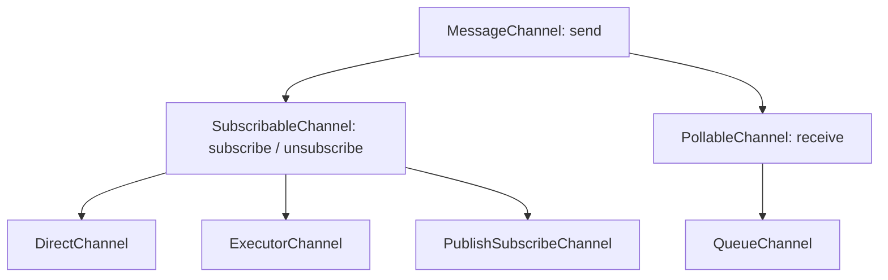

# MessageChannel

## 1. Objectives and Context

In the **SPRING_INTEGRATION_CORE** module, `MessageChannel` is the connection point between steps of a message flow. After this lesson, you should be able to explain the send/receive contract, choose a channel based on distribution and execution semantics, and recognize how a channel affects error handling, transactions, and testing.

Consider an order intake system:

```text
Application → orders.input → Validate order → orders.valid → Save order
                                                          → Publish saved event
```

Each name such as `orders.input` represents an intentional communication point. The sender needs to know the data contract and target channel; the processor needs to know how to receive messages. This organization allows replacing a processing step with minimal impact on the request originator.

In the diagram above, validating and saving the order belong to endpoints. The channel determines the mechanism by which a message is delivered to the next step. This is an important boundary when designing a flow.

## 2. How do message, channel, endpoint, and gateway relate?

| Component | Responsibility | Example in the order flow |
| --- | --- | --- |
| `Message<?>` | Carries the payload and headers of a single exchange | Payload contains the order, header contains `orderId` |
| `MessageChannel` | Provides the send point and message transfer mechanism | `orders.input`, `orders.valid` |
| `Endpoint` | Performs an integration or business step | Transformer normalizes data, filter checks conditions |
| `Router` | Selects output based on the message | Routes international orders to `orders.international` |
| `Gateway` | Provides an interface for calling into or out of the flow | `submitOrder` method accepting a business object |
| `Aggregator` | Collects related messages before emitting a result | Aggregates inventory check results across order line items |

The same channel name may be referenced by multiple components. That name must still come with a single contract: what type the payload has, which headers are required, who receives it, whether it is buffered, and when it is considered accepted.

For example, `orders.valid` may establish the convention that it only accepts orders that passed input validation and must have `orderId`. Descriptive naming helps readers infer the right meaning; endpoints and tests are where that convention is enforced and verified.

## 3. The MessageChannel Contract

`MessageChannel` is in the `org.springframework.messaging` package. The send operations you need to know are:

```java
boolean send(Message<?> message);
boolean send(Message<?> message, long timeout);
```

`timeout` is measured in milliseconds. The value `MessageChannel.INDEFINITE_TIMEOUT` indicates no wait limit under this contract. In the current API, the single-parameter overload is a default method. The snippet above only lists the signatures in use, rather than copying the full interface declaration. See [MessageChannel Javadoc](https://docs.spring.io/spring-framework/docs/current/javadoc-api/org/springframework/messaging/MessageChannel.html).

### 3.1. Interpreting the Send Result Correctly

A `send` call has three possible outcomes to handle:

- Returns `true`: the channel reports a successful send according to the implementation's mechanism.
- Returns `false`: the message was not sent successfully; for example, waiting for space timed out.
- Throws an exception: an error occurred during sending or synchronous processing.

`send` may block, depending on the implementation. Passing a timeout does not establish a deadline for all downstream business logic after the channel. The API contract allows both return values and exceptions, so checking only the boolean is insufficient when error recovery is needed. See [the send contract](https://docs.spring.io/spring-framework/docs/current/javadoc-api/org/springframework/messaging/MessageChannel.html#send(org.springframework.messaging.Message,long)).

A handling pattern at the application boundary:

```java
import org.springframework.messaging.Message;
import org.springframework.messaging.MessageChannel;
import org.springframework.messaging.MessagingException;

public final class OrderSender {

    private final MessageChannel input;

    public OrderSender(MessageChannel input) {
        this.input = input;
    }

    public void submit(Message<?> orderMessage) {
        try {
            boolean accepted = input.send(orderMessage, 200);
            if (!accepted) {
                throw new IllegalStateException(
                        "Unable to accept order within the allowed time");
            }
        }
        catch (MessagingException ex) {
            throw new IllegalStateException(
                    "Order flow encountered an error during intake or processing", ex);
        }
    }
}
```

The example chooses to report a clear error to the caller. A real-world application might map the result to an API response or an appropriate retry mechanism. If retrying an operation with side effects, a business key must be used to avoid duplicate recording.

### 3.2. How Far Does a Successful Send Go?

Describe the meaning of `true` according to the channel being used:

| Case | What is known when send returns `true` | What must still be verified separately |
| --- | --- | --- |
| `DirectChannel` with a synchronously completing handler | The handler call on the same thread returned normally | Any asynchronous work spawned by the handler itself |
| `QueueChannel` | The message has entered the queue | Whether a consumer has received and processed it successfully |
| `ExecutorChannel` with an asynchronous executor | The dispatch task has been accepted | The outcome of the handler running afterward |
| `PublishSubscribeChannel` | The meaning depends on subscriber and executor configuration | Whether all intended business effects have completed |

These differences stem from the execution mechanisms of [DirectChannel](https://docs.spring.io/spring-integration/api/org/springframework/integration/channel/DirectChannel.html), [QueueChannel](https://docs.spring.io/spring-integration/api/org/springframework/integration/channel/QueueChannel.html), [ExecutorChannel](https://docs.spring.io/spring-integration/api/org/springframework/integration/channel/ExecutorChannel.html), and [PublishSubscribeChannel](https://docs.spring.io/spring-integration/api/org/springframework/integration/channel/PublishSubscribeChannel.html).

An API that returns "accepted" as soon as a message enters a queue needs a way to track the result later, such as looking it up by `orderId`. If the caller needs the processing result immediately, a request–reply exchange must be designed as well.

## 4. Two Common Consumption Models

### 4.1. SubscribableChannel: Handlers Register to Receive

```java
boolean subscribe(MessageHandler handler);
boolean unsubscribe(MessageHandler handler);
```

The channel delivers messages to registered `MessageHandler` instances. Consumers do not call `receive()` on this interface. `DirectChannel`, `ExecutorChannel`, and `PublishSubscribeChannel` belong to this group.

### 4.2. PollableChannel: Consumers Actively Pull

```java
Message<?> receive();
Message<?> receive(long timeout);
```

Consumers call `receive` to retrieve a message. When the timeout expires or the call is interrupted under conditions described by the contract, the result can be `null`. `QueueChannel` is a common example.

These two interfaces describe how consumers access messages. You cannot look only at the word "subscribe" and conclude that processing runs asynchronously. See [MessageChannel and Related Interfaces](https://docs.spring.io/spring-integration/reference/channel/interfaces.html).



The diagram shows the branches commonly used in this lesson. Spring Integration also provides `FluxMessageChannel` for Reactive Streams integration; it does not belong to either of these two consumer branches. See [the FluxMessageChannel description](https://docs.spring.io/spring-integration/reference/channel/implementations.html#fluxmessagechannel).

## 5. Choosing a Channel by Distribution and Execution

Two questions should be answered separately:

1. Should one message go to a single consumer or to multiple subscribers?
2. Should processing happen immediately on the sending thread, be executed by an executor, or wait for a consumer to pull from a queue?

| Channel | Distribution | Execution or Waiting Mechanism | Illustrative Use Case |
| --- | --- | --- | --- |
| `DirectChannel` | One handler per normal dispatch | Invokes handler on the sending thread | Synchronous validation and normalization chain |
| `QueueChannel` | One consumer takes each message from the queue | Buffers for a consumer to pull later | Absorbing a short burst of requests exceeding processing speed |
| `ExecutorChannel` | One handler per normal dispatch | Delegates to an executor | Decoupling processing steps from the calling thread |
| `PublishSubscribeChannel` | Broadcasts to subscribers | Synchronous by default; executor configurable | Notifying multiple branches of an event |

The comparison table is based on the APIs of [DirectChannel](https://docs.spring.io/spring-integration/api/org/springframework/integration/channel/DirectChannel.html), [QueueChannel](https://docs.spring.io/spring-integration/api/org/springframework/integration/channel/QueueChannel.html), [ExecutorChannel](https://docs.spring.io/spring-integration/api/org/springframework/integration/channel/ExecutorChannel.html), and [PublishSubscribeChannel](https://docs.spring.io/spring-integration/api/org/springframework/integration/channel/PublishSubscribeChannel.html).

### 5.1. DirectChannel: Next Step Runs on the Sending Thread

On the synchronous path, the handler completes before `send` returns. A slow handler slows down the sender. If there are multiple subscribers, `DirectChannel` distributes work among handlers; do not use it to broadcast the same event to all branches.

The dispatcher supports failover: when the selected handler throws an error, another handler may be tried next depending on configuration. If a handler has already produced side effects before failing, the risk of duplicate processing must be accounted for. See [DirectChannel and dispatcher configuration](https://docs.spring.io/spring-integration/reference/channel/implementations.html#directchannel).

An example to observe execution flow; this class can run standalone when Spring Integration Core is on the classpath:

```java
import org.springframework.integration.channel.DirectChannel;
import org.springframework.messaging.Message;
import org.springframework.messaging.support.MessageBuilder;

public class DirectChannelDemo {

    public static void main(String[] args) {
        DirectChannel input = new DirectChannel();

        input.subscribe(message -> {
            System.out.println("handler: " + Thread.currentThread().getName());
            System.out.println("payload: " + message.getPayload());
        });

        Message<String> message = MessageBuilder
                .withPayload("ORDER-001")
                .setHeader("orderId", "ORDER-001")
                .build();

        System.out.println("before: " + Thread.currentThread().getName());
        boolean sent = input.send(message);
        System.out.println("after: sent=" + sent);
    }
}
```

When run normally from `main`, the output before and inside the handler both print the `main` thread name; the `after` line appears after the lines inside the handler.

If there are no subscribers yet, sending to `DirectChannel` fails with an exception. Merely creating a channel bean is not enough to form a flow with a processing endpoint.

### 5.2. QueueChannel: Buffering with an Explicit Bound

`QueueChannel` uses a queue to hold messages until a consumer takes them. You should set capacity according to demand and available memory. The no-argument constructor creates a queue with a very large limit, so it is not a good choice for self-regulating load. See [QueueChannel Javadoc](https://docs.spring.io/spring-integration/api/org/springframework/integration/channel/QueueChannel.html).

```java
import org.springframework.integration.channel.QueueChannel;
import org.springframework.messaging.Message;
import org.springframework.messaging.support.MessageBuilder;

public class QueueChannelDemo {

    public static void main(String[] args) {
        QueueChannel inbox = new QueueChannel(1);

        boolean first = inbox.send(
                MessageBuilder.withPayload("ORDER-001").build(), 0);
        boolean second = inbox.send(
                MessageBuilder.withPayload("ORDER-002").build(), 0);

        Message<?> received = inbox.receive(0);
        Message<?> empty = inbox.receive(0);

        System.out.println("first=" + first);    // true
        System.out.println("second=" + second);  // false: queue is full
        System.out.println("payload=" + received.getPayload());
        System.out.println("empty=" + empty);    // null
    }
}
```

Here, `0` means do not wait: sending when full returns `false`, and receiving when empty returns `null`. The non-timeout overloads of `QueueChannel` may wait indefinitely. See [QueueChannel send and receive semantics](https://docs.spring.io/spring-integration/reference/channel/implementations.html#queuechannel).

A queue does not create workers on its own. In the example, `main` itself retrieves the message. When connecting a queue to an endpoint in a Spring application, a polling consumer is typically used to fetch messages on a schedule.

### 5.3. ExecutorChannel: The Executor Decides How It Runs

`ExecutorChannel` accepts an executor to execute dispatch to the handler. With an asynchronous thread pool, the sender typically continues before the handler finishes; a transaction bound to the sending thread does not automatically propagate to the worker. See [ExecutorChannel Javadoc](https://docs.spring.io/spring-integration/api/org/springframework/integration/channel/ExecutorChannel.html).

When choosing this approach, you must decide the number of workers, the executor's queue size, and the behavior when resources are exhausted. Policies such as `CallerRunsPolicy` can cause tasks to run directly on the calling thread when the pool is overloaded; therefore, do not rely on the assumption that it "is always a different thread". See [notes on ExecutorChannel](https://docs.spring.io/spring-integration/reference/channel/implementations.html#executorchannel).

### 5.4. PublishSubscribeChannel: Multiple Interested Branches

For example, an `OrderAccepted` event needs to reach both an email-sending branch and a statistics branch. `PublishSubscribeChannel` provides the mechanism to broadcast to subscribers. The default constructor invokes handlers on the sending thread; the constructor taking an executor delegates execution. See [PublishSubscribeChannel Javadoc](https://docs.spring.io/spring-integration/api/org/springframework/integration/channel/PublishSubscribeChannel.html).

Broadcasting to multiple branches does not create an atomic transaction covering all side effects. When designing an order event, you must define how to handle the situation where the email was sent but recording statistics failed.

### 5.5. Extended Options

`PriorityChannel` prioritizes messages by priority rather than solely by queue insertion order. `RendezvousChannel` performs a direct handoff between sender and receiver with a zero-capacity queue. These two types are useful when ordering or handoff timing is part of the requirement. See [message channel implementations](https://docs.spring.io/spring-integration/reference/channel/implementations.html).

## 6. Java DSL Example: DirectChannel → transformer → QueueChannel

The following example normalizes an order code and stores the result in an output queue. Each snippet is placed in its corresponding Java file in the `example.channels` package.

`org.springframework.integration:spring-integration-core` and compatible Spring dependencies are required on the classpath. In a Spring Boot project, you can use `spring-boot-starter-integration` and let Boot's dependency management choose the versions. The examples use the Java DSL API of the form `IntegrationFlow.from(...)`.

### 6.1. Declaring the Flow

```java
package example.channels;

import java.util.Locale;

import org.springframework.beans.factory.annotation.Qualifier;
import org.springframework.context.annotation.Bean;
import org.springframework.context.annotation.Configuration;
import org.springframework.integration.channel.DirectChannel;
import org.springframework.integration.channel.QueueChannel;
import org.springframework.integration.config.EnableIntegration;
import org.springframework.integration.dsl.IntegrationFlow;

@Configuration
@EnableIntegration
public class ChannelFlowConfig {

    @Bean
    public DirectChannel orderInput() {
        return new DirectChannel();
    }

    @Bean
    public QueueChannel normalizedOrders() {
        return new QueueChannel(10);
    }

    @Bean
    public IntegrationFlow normalizeOrderFlow(
            @Qualifier("orderInput") DirectChannel input,
            @Qualifier("normalizedOrders") QueueChannel output) {

        return IntegrationFlow.from(input)
                .<String, String>transform(
                        value -> value.strip().toUpperCase(Locale.ROOT))
                .channel(output)
                .get();
    }
}
```

`@EnableIntegration` enables the integration infrastructure for this standalone Spring configuration. `IntegrationFlow` is a bean through which Spring registers the channels and endpoints in the flow. Java DSL uses Spring Integration components directly, so the fluent syntax still creates real channels and endpoints. See [Java DSL](https://docs.spring.io/spring-integration/reference/dsl.html).

### 6.2. Sending Messages and Receiving Results

```java
package example.channels;

import org.springframework.context.annotation.AnnotationConfigApplicationContext;
import org.springframework.messaging.Message;
import org.springframework.messaging.MessageChannel;
import org.springframework.messaging.PollableChannel;
import org.springframework.messaging.support.MessageBuilder;

public class ChannelFlowDemo {

    public static void main(String[] args) {
        try (AnnotationConfigApplicationContext context =
                     new AnnotationConfigApplicationContext(ChannelFlowConfig.class)) {

            MessageChannel input =
                    context.getBean("orderInput", MessageChannel.class);
            PollableChannel output =
                    context.getBean("normalizedOrders", PollableChannel.class);

            Message<String> request = MessageBuilder
                    .withPayload("  order-001  ")
                    .setHeader("orderId", "ORDER-001")
                    .build();

            boolean sent = input.send(request);
            if (!sent) {
                throw new IllegalStateException("Failed to send request");
            }

            Message<?> result = output.receive(1_000);
            if (result == null) {
                throw new IllegalStateException("Failed to receive result");
            }

            System.out.println(result.getPayload());               // ORDER-001
            System.out.println(result.getHeaders().get("orderId")); // ORDER-001
        }
    }
}
```

Let us trace a single message:

1. `orderInput` invokes the transformer on the `main` thread.
2. The transformer produces the normalized result.
3. The result is sent into `normalizedOrders`.
4. `main` retrieves the output message using `receive`.

Because the queue is at the end, no poller is needed in the example: the program actively pulls from it. If you keep sending without retrieving results, the queue will fill up. A timeout passed to `input.send(request, 200)` also does not automatically bound the send call into the output queue; that is a separate send performed by the endpoint, which must be configured separately if you want to bound it.

A message carrying a new result may have a different `id` from the input message. To correlate an order across transformation steps, use the business header `orderId` chosen in the contract.

## 7. When a Consumer Sits Behind a QueueChannel

If you want the framework to pull messages automatically and invoke a handler, a polling consumer is needed. You can add the following bean to `ChannelFlowConfig`; this snippet requires importing `org.springframework.integration.dsl.Pollers`:

```java
@Bean
public IntegrationFlow consumeNormalizedOrders(
        @Qualifier("normalizedOrders") QueueChannel output) {

    return IntegrationFlow.from(output)
            .handle(message ->
                    System.out.println("Received: " + message.getPayload()),
                    endpoint -> endpoint.poller(
                            Pollers.fixedDelay(100)
                                    .maxMessagesPerPoll(5)))
            .get();
}
```

The poller controls when the consumer attempts to pull messages and the maximum number of messages per poll. An endpoint connected to a `PollableChannel` uses the polling model; an endpoint connected to a `SubscribableChannel` uses the event-driven receiving model. See [Polling Consumer](https://docs.spring.io/spring-integration/reference/polling-consumer.html).

This is a variation of the previous example. When adding an automatic consumer, remove the `output.receive(...)` part in `main`: if both are kept, they compete to pull messages from the same queue.

A common configuration mistake is changing an endpoint's input channel from `DirectChannel` to `QueueChannel` while forgetting to declare a poller or default poller. Check both the channel and how the endpoint consumes from it, rather than only swapping the channel constructor.

## 8. How Execution Flow Affects Errors and Transactions

### 8.1. Errors in a Synchronous Chain

If a handler after `DirectChannel` throws an exception, the error can propagate back to the sender along the call stack. Calling `send` directly or using `MessagingTemplate` does not automatically turn an error on the synchronous path into a send to `errorChannel`. A gateway has the ability to configure separate error handling. See [Error Handling](https://docs.spring.io/spring-integration/reference/error-handling.html).

Therefore, when an order-intake API requires immediate feedback on data validation errors, the synchronous path helps tie the response to the current call. Afterward, the exception still needs to be mapped to a clear business message.

### 8.2. Errors After Switching to a Worker

For asynchronous tasks managed by Spring Integration infrastructure, errors can be sent as an `ErrorMessage`. The default mechanism checks the message's `errorChannel` header, and then the shared bean named `errorChannel`. If an application spawns its own threads and calls `receive` itself, it must set up its own exception handling. See [asynchronous error reporting](https://docs.spring.io/spring-integration/reference/error-handling.html).

A sender that already received `true` from a queue cannot catch an error thrown later in a worker using a `try/catch` around the original send call. Include `orderId` in tracking data to correlate errors with the initial request.

### 8.3. Transactions Need a Clear Boundary

`DirectChannel` keeps handler invocation on the same thread, so it can participate in an active transaction if resources and the transaction manager are configured appropriately. A channel does not open a transaction on its own. See [DirectChannel and transactions](https://docs.spring.io/spring-integration/reference/channel/implementations.html#directchannel).

When switching to an executor or queue-polling worker, define the transaction boundary on the new processing side. For instance, "saving the order to the database" and "sending the email" need a concrete coordination strategy if business requirements do not allow omissions or duplicates.

## 9. Durability, Ordering, and Load Control

### 9.1. In-Memory Queues Have Finite Guarantees

Default queue channels hold messages in memory. If the process stops, you cannot expect pending data to survive a restart. When durability is required, you must design a persistent message store or integrate a messaging system with appropriate persistence. See [storage notes for queue channels](https://docs.spring.io/spring-integration/reference/channel/implementations.html).

In the order problem, clearly define whether "accepted" means placed in RAM or persisted to durable storage. The application's response must match the chosen guarantee.

### 9.2. FIFO Does Not Determine Completion Order

Even when messages are pulled from the queue in arrival order, multiple workers can still finish out of order:

```text
Pulled from queue:   ORDER-001 → ORDER-002
Processing time:     500 ms      20 ms
Completion order:    ORDER-002 → ORDER-001
```

This is a consequence of parallel processing. If business logic requires changes to the same order to execute in order, you must constrain concurrency or partition work by order key.

### 9.3. Using Capacity to Quantify a Load Burst

Suppose over 4 seconds:

- The producer submits 150 messages/second.
- All consumers combined process 100 messages/second.
- The queue is initially empty.

The backlog grows by approximately:

```text
(150 - 100) × 4 = 200 messages
```

A capacity of 200 only barely meets the calculated figure under the assumption of steady rates. In real designs, you must account for variance, payload size, and maximum acceptable wait time. If input persistently exceeds output, increasing capacity only delays the moment the queue fills up.

Useful signals to observe include queue depth, oldest message age, failed send count, and processing latency. They answer different questions: a long queue indicates accumulation, while an overly old message indicates requests are waiting too long.

## 10. Interceptors and Channel Observability

`ChannelInterceptor` allows adding behavior around send/receive operations. The example below attaches to `orderInput` to require a business header:

```java
import org.springframework.messaging.Message;
import org.springframework.messaging.MessageChannel;
import org.springframework.messaging.support.ChannelInterceptor;

// Replace the orderInput() bean method in ChannelFlowConfig.
@Bean
public DirectChannel orderInput() {
    DirectChannel channel = new DirectChannel();
    channel.addInterceptor(new ChannelInterceptor() {
        @Override
        public Message<?> preSend(Message<?> message, MessageChannel target) {
            String orderId = message.getHeaders().get("orderId", String.class);
            if (orderId == null || orderId.isBlank()) {
                throw new IllegalArgumentException("Missing orderId");
            }
            return message;
        }
    });
    return channel;
}
```

This method uses the `Bean` and `DirectChannel` imports already present in the configuration. It expresses a shared convention at the channel boundary. Long transformations or business routing logic should be made explicit as endpoints in the flow so maintainers can follow them easily.

`preSend` can return `null` to prevent further sending; receive hooks apply only to pollable channels. `postSend` on an asynchronous channel does not mean the entire business operation has completed. See [Channel Interceptors](https://docs.spring.io/spring-integration/reference/channel/interceptors.html).

When logging, prioritize the order ID, channel, and processing state needed for lookup. Avoid logging the entire payload if it contains information unnecessary for troubleshooting.

## 11. Testing Channel Behavior

The tests below use JUnit Jupiter and `ChannelFlowConfig` from Section 6. The goal is to verify the observable contract: execution thread, behavior when the queue is full, and data passing through the flow.

```java
package example.channels;

import java.util.concurrent.atomic.AtomicReference;

import org.junit.jupiter.api.Test;
import org.springframework.context.annotation.AnnotationConfigApplicationContext;
import org.springframework.integration.channel.DirectChannel;
import org.springframework.integration.channel.QueueChannel;
import org.springframework.messaging.Message;
import org.springframework.messaging.MessageChannel;
import org.springframework.messaging.PollableChannel;
import org.springframework.messaging.support.MessageBuilder;

import static org.junit.jupiter.api.Assertions.*;

class MessageChannelTest {

    @Test
    void directChannelInvokesHandlerOnSendingThread() {
        DirectChannel channel = new DirectChannel();
        Thread sender = Thread.currentThread();
        AtomicReference<Thread> handlerThread = new AtomicReference<>();

        channel.subscribe(message ->
                handlerThread.set(Thread.currentThread()));

        assertTrue(channel.send(
                MessageBuilder.withPayload("ORDER-001").build()));
        assertSame(sender, handlerThread.get());
    }

    @Test
    void fullQueueRejectsImmediateSendAndKeepsFirstMessage() {
        QueueChannel channel = new QueueChannel(1);

        assertTrue(channel.send(
                MessageBuilder.withPayload("ORDER-001").build(), 0));
        assertFalse(channel.send(
                MessageBuilder.withPayload("ORDER-002").build(), 0));

        Message<?> first = channel.receive(0);
        assertNotNull(first);
        assertEquals("ORDER-001", first.getPayload());
        assertNull(channel.receive(0));
    }

    @Test
    void flowNormalizesPayloadAndPreservesBusinessHeader() {
        try (AnnotationConfigApplicationContext context =
                     new AnnotationConfigApplicationContext(ChannelFlowConfig.class)) {

            MessageChannel input =
                    context.getBean("orderInput", MessageChannel.class);
            PollableChannel output =
                    context.getBean("normalizedOrders", PollableChannel.class);

            Message<String> request = MessageBuilder
                    .withPayload("  order-001  ")
                    .setHeader("orderId", "ORDER-001")
                    .build();

            assertTrue(input.send(request));

            Message<?> result = output.receive(1_000);
            assertNotNull(result);
            assertEquals("ORDER-001", result.getPayload());
            assertEquals("ORDER-001", result.getHeaders().get("orderId"));
        }
    }
}
```

The third test uses the original configuration, without adding the automatic consumer from Section 7. If that consumer is added, the test calling `receive` directly will compete for results with the consumer.

When testing a variant with asynchronous workers, wait using a timeout-aware mechanism such as `receive` or a latch. A fixed `Thread.sleep` does not confirm that the message has finished processing and easily depends on machine speed.

The test snippets are illustrative code for learners to run in a project with appropriate dependencies; this article does not include their execution output.

## 12. Common Misconceptions to Avoid

| Misconception | Consequence | How to Verify or Design |
| --- | --- | --- |
| Every channel is a queue | Trying to call `receive` on an unsupported type | Identify the interface and consumer mechanism |
| Having a subscriber means asynchronous execution | Misjudging sender latency | Observe the actual execution thread |
| `send(..., 200)` limits the entire handler | Assuming business logic cannot run longer than 200 ms | Identify which send or operation the timeout applies to |
| Two consumers on a queue both receive the same message | An expected branch never runs | Use a broadcast mechanism when that is the requirement |
| A queue comes with its own worker | Messages pile up without being consumed | Check the polling consumer or `receive` code |
| Default queues survive restarts | Misjudging intake guarantees | Choose appropriate persistence and recovery mechanisms |
| Having `errorChannel` routes all errors there automatically | Missing synchronous exceptions or errors on custom threads | Check the invocation mechanism and error-handling infrastructure |
| FIFO guarantees in-order completion | Business outcomes arrive out of order | Consider concurrency and work-partitioning keys |

## 13. Practice Exercises

Reuse `ChannelFlowConfig` and explain the outcome before running:

1. Remove `IntegrationFlow` while keeping the `orderInput` bean. What happens when sending?
2. Set the output capacity to 1 and send two messages without receiving. Why can the second send block even though the input channel is a `DirectChannel`?
3. Add the polling consumer while keeping the `receive` call in `main`. Why can results appear in two different places across runs?
4. Replace the processing step with an asynchronous task. How should success detection and error tracking be changed?
5. An event must reach both the email branch and the statistics branch. Which distribution mechanism should you choose, and what needs to be decided when only one branch succeeds?

When presenting your solution, draw the path of a single message and clearly note: which consumer receives it, which thread executes it, where blocking can occur, where errors go back to, and when the business request can be confirmed as complete.
