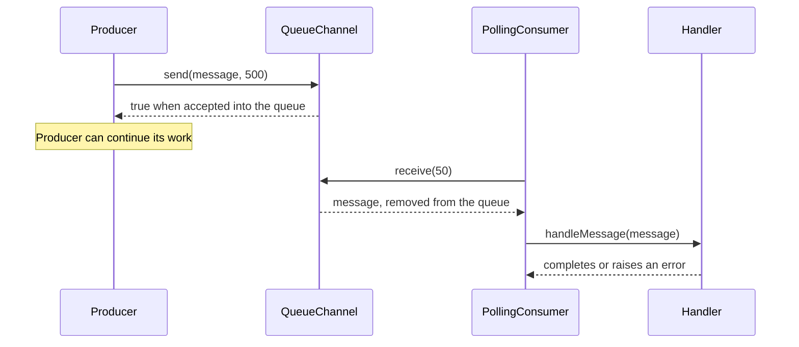

# PollableChannel

## 1. Objectives and Context

In the **Message channel** chapter of the **SPRING_INTEGRATION_CORE** module, this lesson explains how a component actively pulls messages from a channel instead of being invoked immediately by the channel when a new message arrives.

After this lesson, you will be able to:

- Distinguish the `PollableChannel` contract, an implementation such as `QueueChannel`, and the `PollingConsumer` endpoint.
- Use `receive()`, `receive(timeout)`, and control wait time when sending.
- Wire a channel into Java DSL, place the poller on the right endpoint, and bound the work per poll.
- Explain the difference between entering a channel, completing processing, and durable storage.
- Design tests for timeouts, capacity, ordering, and flows with a poller.

Suppose a system receives order-processing requests faster than its normal processing speed. A queue can absorb a short load burst; consumers pull one message at a time according to their processing capacity. This design must clearly define the queue limit, behavior when full, and how failed requests are tracked.

The configuration examples below target **Java 17 and Spring Integration 6.5.x**, using `spring-integration-core`. Dependency versions should be managed consistently via a BOM or the project's dependency management. JUnit Jupiter is only needed for the illustrative test snippets.

## 2. PollableChannel Is the Active Receive Contract

`PollableChannel` belongs to Spring Framework's `org.springframework.messaging` package and extends `MessageChannel`. It adds two receive methods:

```java
import org.springframework.messaging.Message;
import org.springframework.messaging.MessageChannel;

public interface PollableChannel extends MessageChannel {

    Message<?> receive();

    Message<?> receive(long timeout);
}
```

This is a trimmed version to show the signatures; the actual API declares that the result may be `null`. `receive()` may wait indefinitely; `receive(timeout)` uses a wait time in milliseconds. If the timeout expires with no message available, the result is `null`; an interrupted receive may also return `null`. [PollableChannel Javadoc](https://docs.spring.io/spring-framework/docs/current/javadoc-api/org/springframework/messaging/PollableChannel.html).

Three roles should be separated:

| Component | Responsibility | Example |
| --- | --- | --- |
| `PollableChannel` | Defines the send and active receive API | Dependency variable used by a consumer |
| Channel implementation | Determines how messages are stored or handed off | `QueueChannel`, `PriorityChannel`, `RendezvousChannel` |
| Endpoint/poller | Determines when to pull messages and pass them to the handler | `PollingConsumer` with a trigger |

The interface itself does not mandate FIFO, capacity, persistence, or whether threads are created. Those characteristics depend on the implementation and configuration.

### Comparison with Subscription-Based Receiving

With `SubscribableChannel`, a handler registers to be called when the channel dispatches. With `PollableChannel`, the receiving side calls `receive(...)`. Spring Integration provides `EventDrivenConsumer` and `PollingConsumer` respectively for these two connection styles. [Poller Documentation](https://docs.spring.io/spring-integration/reference/polling-consumer.html).

A `QueueChannel` instantiated with `new` can be used directly on the same thread. When wired into an endpoint with a poller, receiving typically happens on the thread serving the poller. Therefore, you must determine the thread from the overall configuration, not solely from the channel type.

## 3. Path of a Message



The example above has two distinct points in time:

1. **The channel accepts the message:** the producer can finish its send operation.
2. **The handler completes the business logic:** happens after the consumer receives the message.

If an order-intake API returns an "accepted" status, that status should be represented separately from "processed". For clients to look up progress, the application needs a business key, a status store, and a result-updating mechanism.

In addition, `Message<T>` carries both payload and headers. Passing through a queue does not automatically convert a message into a different payload type. A transformer is the right component when changing data structure.

## 4. Receiving Messages and Setting Timeouts

With `QueueChannel`, a timeout of `0` requests an immediate return. When the queue already has a message available, the receive operation does not need to wait out the timeout. [QueueChannel Mechanism](https://docs.spring.io/spring-integration/reference/channel/implementations.html#queuechannel).

| Receive Call | Meaning for QueueChannel | Appropriate Use |
| --- | --- | --- |
| `receive()` | Waits until a message is available, potentially indefinitely | Consumer with managed lifecycle and interruption |
| `receive(0)` | Attempts immediate retrieval; returns `null` if empty | Checking current state or a short probe |
| `receive(500)` | Waits at most 500 ms if no data is present yet | Operations requiring a finite deadline |
| `receive(MessageChannel.INDEFINITE_TIMEOUT)` | Requests an indefinite wait time | Cases intentionally choosing to wait indefinitely |

Example without a Spring container:

```java
import org.springframework.integration.channel.QueueChannel;
import org.springframework.messaging.Message;
import org.springframework.messaging.PollableChannel;
import org.springframework.messaging.support.MessageBuilder;

public class ManualReceiveDemo {

    public static void main(String[] args) {
        PollableChannel channel = new QueueChannel(10);

        Message<String> request = MessageBuilder
                .withPayload("ORDER-1001")
                .setHeader("businessRequestId", "REQ-1001")
                .build();

        if (!channel.send(request, 500)) {
            throw new IllegalStateException("Unable to put request into channel");
        }

        Message<?> received = channel.receive(500);

        if (received == null) {
            throw new IllegalStateException("No message received");
        }

        System.out.println(received.getPayload());
        System.out.println(received.getHeaders().get("businessRequestId"));
        System.out.println(channel.receive(0)); // null: queue is now empty
    }
}
```

The timeout on `receive(500)` bounds waiting for a message. It does not impose a 500 ms deadline on subsequent business processing.

In a self-managed loop, calling `receive(0)` continuously on an empty channel can spike CPU usage. Use a finite wait time and a clear stop policy, or let a Spring Integration endpoint manage polling.

## 5. Capacity and Send Timeouts

`QueueChannel(int capacity)` lets you choose a positive capacity. The no-argument constructor creates a queue with a very large capacity; it should not be treated as a safe memory budget for an application. The channel provides `getQueueSize()` and `getRemainingCapacity()` to observe instantaneous state. [QueueChannel Javadoc](https://docs.spring.io/spring-integration/api/org/springframework/integration/channel/QueueChannel.html).

```java
QueueChannel inbox = new QueueChannel(1);

boolean first = inbox.send(
        MessageBuilder.withPayload("A").build(), 0);

boolean second = inbox.send(
        MessageBuilder.withPayload("B").build(), 0);

// first == true
// second == false because no consumer has taken A out yet
```

With `QueueChannel`, `send(message)` can wait indefinitely when the queue is full. `send(message, timeout)` bounds the time waiting for space; a timeout of `0` only tries to send immediately. [QueueChannel Send and Receive Behavior](https://docs.spring.io/spring-integration/reference/channel/implementations.html#queuechannel).

The application must handle a `false` result according to the business contract. For example:

- Reject intake and let the caller retry per an agreed policy.
- Route to a pre-designed durable store.
- Record a rejection metric to detect insufficient processing capacity.

Do not continue reporting "accepted" if the send operation failed.

### Estimating a Load Burst

Suppose over 5 seconds:

- The producer generates 120 messages/second.
- The consumer processes 80 messages/second.
- The queue is initially empty.

The backlog grows by approximately:

```text
(120 - 80) × 5 = 200 messages
```

This is a calculation assuming steady load, without accounting for variance or errors. If input persistently exceeds output, any finite capacity can fill up. To choose capacity, you also need to measure payload size, memory limits, and acceptable latency.

Queue limits create backpressure through blocking or rejection. This mechanism is not equivalent to the demand contract of Reactive Streams.

## 6. Pollers Belong to the Channel-Consuming Endpoint

When a handler receives data from a `PollableChannel`, Spring Integration uses `PollingConsumer` to connect the two components. The endpoint manages the polling schedule and hands messages to the handler. Handler types such as transformers, routers, filters, or service activators can be connected via this mechanism. [Message Endpoints](https://docs.spring.io/spring-integration/reference/6.5/endpoint.html).

In Java DSL, configure the poller on the **first endpoint reading from the pollable channel**:

```java
IntegrationFlow.from(ordersQueue)
        .handle(orderService, "process",
                endpoint -> endpoint.poller(
                        Pollers.fixedDelay(Duration.ofMillis(200))
                                .receiveTimeout(50)
                                .maxMessagesPerPoll(10)))
        .get();
```

In this snippet, `.handle(...)` is the point consuming `ordersQueue`. Therefore, the poller is placed on the `.handle(...)` endpoint.

If a transformer is the component reading from the queue first, move the poller configuration to the transformer:

```java
IntegrationFlow.from(ordersQueue)
        .<String, String>transform(String::trim,
                endpoint -> endpoint.poller(
                        Pollers.fixedDelay(Duration.ofMillis(200))
                                .receiveTimeout(50)
                                .maxMessagesPerPoll(10)))
        .handle(textService, "process")
        .get();
```

The two snippets above are independent illustrative configurations with their respective payload types. If both are attached to the same queue, they become competing consumers.

Do not attach a poller to a downstream handler just because that handler is slow: identify the input channel of that specific endpoint. If its input channel is a `DirectChannel`, the handler receives via subscription.

### Local Poller and Default Poller

The examples in this lesson configure pollers directly so each endpoint's behavior is visible. When you want a shared configuration, the DSL also supports a default poller bean:

```java
@Bean(name = PollerMetadata.DEFAULT_POLLER)
public PollerSpec defaultPoller() {
    return Pollers.fixedDelay(Duration.ofMillis(200))
            .receiveTimeout(50)
            .maxMessagesPerPoll(10);
}
```

Additional imports:

```java
import org.springframework.integration.dsl.PollerSpec;
import org.springframework.integration.scheduling.PollerMetadata;
```

If no local poller is declared, the endpoint requires a suitable default poller. When creating a `PollerSpec` as a `@Bean`, return the spec for the container to initialize; do not call `getObject()` yourself. [Java DSL Pollers](https://docs.spring.io/spring-integration/reference/dsl/java-pollers.html).

## 7. Three Parameters to Understand Independently

| Parameter | Question Answered | Example in This Lesson |
| --- | --- | --- |
| `fixedDelay` | How long to wait before the next polling cycle? | 200 ms |
| `receiveTimeout` | How long at most does one receive wait for data? | 50 ms |
| `maxMessagesPerPoll` | At most how many messages does one polling cycle take? | 10 |

`PollerSpec` provides configuration for messages per poll and receive timeout; it can also configure an executor, transaction advice, and an error channel. [PollerSpec Javadoc](https://docs.spring.io/spring-integration/api/org/springframework/integration/dsl/PollerSpec.html).

### Fixed Delay and Fixed Rate

`fixedDelay` measures the interval after the polling task completes; `fixedRate` is based on scheduled start times. [Pollers 6.5 Javadoc](https://docs.spring.io/spring-integration/docs/6.5.0/api/org/springframework/integration/dsl/Pollers.html).

With the synchronous configuration in the example:

```text
poll 1: receive + process a number of messages
        -> complete
        -> wait ~200 ms
        -> poll 2
```

Do not interpret `fixedDelay(200)` as "one message will be finished exactly every 200 ms." A polling cycle also spends time receiving, executing the handler, and sending results.

### Max Messages Is Not a Batch Payload

`maxMessagesPerPoll(10)` bounds the work in a single poll. The handler is still invoked with one message at a time, rather than automatically receiving a `List<Message<?>>`. If you need to group by correlation ID or completion condition, that is the job of an aggregator.

It also does not create 10 workers. In the example without an added executor, invocations within a poll execute sequentially. If only three messages are available and the channel remains empty afterward, the poll does not wait for ten messages before passing those three to the handler.

### Estimating Throughput from Configuration

Suppose there is always a backlog, one poll takes 10 messages, each handler takes 20 ms, and there is no other significant overhead:

```text
processing time per poll ≈ 10 × 20 = 200 ms
cycle including fixed delay ≈ 200 + 200 = 400 ms
estimated throughput        ≈ 10 / 0.4 = 25 messages/second
```

This is an inference from assumptions, not a framework guarantee. When the queue is empty, receive wait time affects the cycle. When an executor is added, the scheduler and executor have a different relationship; you must also measure the number of queued tasks waiting to run.

## 8. Complete Example Using Java DSL

The example creates a request queue, a result queue, and an error channel. The service returns a result string so the flow can be observed without `Thread.sleep()`.

The `QueueChannel` at the end of the flow is for illustration only; in a real application, results must have an appropriate consumer or storage destination.

### 8.1. Configuration

```java
import java.time.Duration;
import java.util.logging.Level;
import java.util.logging.Logger;

import org.springframework.beans.factory.annotation.Qualifier;
import org.springframework.context.annotation.Bean;
import org.springframework.context.annotation.Configuration;
import org.springframework.integration.channel.DirectChannel;
import org.springframework.integration.channel.QueueChannel;
import org.springframework.integration.config.EnableIntegration;
import org.springframework.integration.dsl.IntegrationFlow;
import org.springframework.integration.dsl.Pollers;
import org.springframework.messaging.MessageChannel;

@Configuration
@EnableIntegration
public class PollableChannelConfig {

    private static final Logger LOG =
            Logger.getLogger(PollableChannelConfig.class.getName());

    @Bean
    public QueueChannel ordersQueue() {
        return new QueueChannel(100);
    }

    @Bean
    public QueueChannel processedOrders() {
        return new QueueChannel(100);
    }

    @Bean
    public DirectChannel orderErrors() {
        return new DirectChannel();
    }

    @Bean
    public OrderService orderService() {
        return new OrderService();
    }

    @Bean
    public IntegrationFlow orderFlow(
            @Qualifier("ordersQueue") QueueChannel input,
            @Qualifier("processedOrders") QueueChannel output,
            OrderService service) {

        return IntegrationFlow.from(input)
                .handle(service, "process",
                        endpoint -> endpoint
                                .id("orderPollingConsumer")
                                .poller(Pollers
                                        .fixedDelay(Duration.ofMillis(200))
                                        .receiveTimeout(50)
                                        .maxMessagesPerPoll(10)
                                        .errorChannel("orderErrors")))
                .channel(output)
                .get();
    }

    @Bean
    public IntegrationFlow orderErrorFlow(
            @Qualifier("orderErrors") MessageChannel errors) {

        return IntegrationFlow.from(errors)
                .handle(message -> {
                    Throwable failure = (Throwable) message.getPayload();
                    LOG.log(Level.SEVERE,
                            "Unable to process order request", failure);
                })
                .get();
    }

    public record OrderCommand(String orderId) {
    }

    public static class OrderService {

        public String process(OrderCommand command) {
            if (command.orderId() == null || command.orderId().isBlank()) {
                throw new IllegalArgumentException("Invalid orderId");
            }

            // Replace with real business logic once the application has state storage.
            return "Processed " + command.orderId();
        }
    }
}
```

`IntegrationFlow.from(input)` uses the declared channel as input; the framework registers the components created by the DSL into the application context. [IntegrationFlow 6.5 Javadoc](https://docs.spring.io/spring-integration/docs/6.5.0/api/org/springframework/integration/dsl/IntegrationFlow.html).

There are two endpoints with different receiving styles:

- `orderFlow` starts from a `QueueChannel`, using a poller to pull requests.
- `orderErrorFlow` starts from a `DirectChannel`, registering a handler to receive errors sent to this channel.

In the sample service, returning a string only confirms that the illustrative method ran. When adding a database or external API, clearly define which outcome counts as business completion.

### 8.2. Sending and Waiting for Results with a Deadline

Place the class below in the same package as the configuration class:

```java
import org.springframework.context.annotation.AnnotationConfigApplicationContext;
import org.springframework.messaging.Message;
import org.springframework.messaging.MessageChannel;
import org.springframework.messaging.PollableChannel;
import org.springframework.messaging.support.MessageBuilder;

public class PollableChannelDemo {

    public static void main(String[] args) {
        try (var context = new AnnotationConfigApplicationContext(
                PollableChannelConfig.class)) {

            MessageChannel input =
                    context.getBean("ordersQueue", MessageChannel.class);

            PollableChannel results =
                    context.getBean("processedOrders", PollableChannel.class);

            Message<PollableChannelConfig.OrderCommand> request =
                    MessageBuilder.withPayload(
                            new PollableChannelConfig.OrderCommand("ORDER-1001"))
                            .setHeader("businessRequestId", "REQ-1001")
                            .build();

            if (!input.send(request, 500)) {
                throw new IllegalStateException("Request queue is full");
            }

            Message<?> reply = results.receive(2000);

            if (reply == null) {
                throw new IllegalStateException(
                        "No result within wait timeout");
            }

            System.out.println(reply.getPayload());
        }
    }
}
```

Expected output:

```text
Processed ORDER-1001
```

The 500 ms bound is for intake into the queue; the 2000 ms bound is for waiting on the result in the demo program. If the result wait times out, you cannot infer that the request has definitely not been processed: it may be executing or already finished with the result not yet arrived.

If sending multiple requests, correlate results using a correlation key instead of assuming a received result belongs to the most recent send.

### 8.3. Relationship to Gateways and Other EIPs

A messaging gateway can be placed in front of `ordersQueue` so business code calls through a Java interface. The gateway hides the messaging API; a method returning a value needs a reply path with an appropriate timeout. [Messaging Gateways](https://docs.spring.io/spring-integration/reference/gateway.html).

In that design, a queue on the request channel does not make the gateway call return immediately: the caller may still have to wait for the reply. Distinguish the timeout for putting the request onto the channel from the timeout for waiting on the reply.

After reading from the queue, the flow can add a transformer, filter, router, or aggregator. `PollableChannel` handles transport; individual endpoints handle transformation, filtering, branching, or aggregation.

## 9. Errors After Receiving a Message

### 9.1. Does the Producer See Handler Errors?

Once the producer has sent to the queue and a poller processes on another thread, exceptions from the handler do not automatically propagate back onto the producer's call stack.

With the default error-handling infrastructure, errors from a poller task are represented as an `ErrorMessage`. A message's `errorChannel` header can specify the error destination; if absent, the default mechanism uses the `errorChannel` bean. The example above configures a dedicated error destination on the poller as `orderErrors`. [Error Handling](https://docs.spring.io/spring-integration/reference/error-handling.html).

If you write your own `receive()` loop and invoke the service directly, you must handle service exceptions yourself. Do not assume that loop is covered by the error mechanism of a framework-managed endpoint.

### 9.2. Failing After Removing from the Queue

Consider an in-memory queue with no extra retry or transaction mechanism:

```text
receive takes M out of QueueChannel
        -> handler calls external service
        -> external service fails
        -> M does not automatically return to QueueChannel
```

The logging handler in the example only provides error visibility. It does not create a recovery workflow, does not durably record the failed request, and does not schedule a retry.

A design can add:

- Bounded retries for transient failures, with appropriate backoff.
- A store for failed messages along with business IDs and failure reasons.
- A controlled reprocessing operation.
- Idempotency so retries do not create duplicate side effects.

For example, a payment API may have executed successfully while the response was lost. If the application resends the same request, an idempotency key must identify the earlier transaction.

### 9.3. Transactions Do Not Automatically Cross Every Boundary

A poller can be wrapped by transaction advice. However, the resources must support transactions and enlist in the right transaction manager; a thread-bound transaction does not automatically bridge the producer and consumer threads. [Transaction Support](https://docs.spring.io/spring-integration/reference/transactions.html).

Consequently, adding a transaction to the handler's database operation does not automatically turn an in-memory queue into a rollback-capable queue. Consistency across message intake, data persistence, and downstream message emission must be designed explicitly.

## 10. Ordering, Competing Consumers, and Persistence

### 10.1. Receive Order vs. Completion Order

With a normal FIFO `QueueChannel` and one consumer processing sequentially, requests A, B, and C are pulled in the order they entered the queue. When multiple consumers read concurrently, each message is taken by one consumer; this model partitions work rather than broadcasting copies to all consumers. [Message Channel Implementations](https://docs.spring.io/spring-integration/reference/channel/implementations.html).

Even if A is pulled before B, A can finish after B when multiple branches process concurrently. For instance, A takes 2 seconds while B takes 20 ms.

If strict ordering per order is mandatory, define the ordering key, routing strategy, and number of consumers permitted to process the same key.

### 10.2. Choosing an Implementation by Need

| Need | Starting Point to Consider | Further Checks Required |
| --- | --- | --- |
| Buffer a bounded number of requests | `QueueChannel` with capacity | Memory usage and behavior when full |
| Pull requests by priority | `PriorityChannel` | Priority rules and starvation risk for low-priority items |
| Hand off when the receiver is ready | `RendezvousChannel` | Timeouts and risk of mutual waiting |
| Broadcast the same event to multiple destinations | `PublishSubscribeChannel` | Error policy and how each subscriber executes |

`RendezvousChannel` has no buffer like a positive-capacity queue; a successful handoff still does not confirm that handler business logic has completed. `PriorityChannel` requires an appropriate priority comparator. [Channel Implementations](https://docs.spring.io/spring-integration/reference/channel/implementations.html).

### 10.3. In-Memory Storage vs. Durable Storage

`new QueueChannel(100)` in the example does not persist messages to disk. Restarting the process can lose unprocessed messages remaining in memory. When persistence is needed, Spring Integration supports configuring a suitable message store or integrating with an external messaging system. [Channel Persistence](https://docs.spring.io/spring-integration/reference/channel/implementations.html).

Choosing an external system still requires acknowledgement policies, redelivery, retry limits, and idempotency. Do not infer an "exactly once" guarantee from the `PollableChannel` type alone.

## 11. Testing Core Behaviors

The snippets below are test code for learners to include in a project. They were not executed during the authoring of this lesson.

### 11.1. Empty Channel, Capacity Limits, and FIFO

Two tests use a timeout of `0` to verify instantaneous state without relying on a fixed sleep duration:

```java
import org.junit.jupiter.api.Test;
import org.springframework.integration.channel.QueueChannel;
import org.springframework.messaging.support.MessageBuilder;

import static org.junit.jupiter.api.Assertions.*;

class QueueChannelContractTest {

    @Test
    void emptyQueueReturnsNullImmediately() {
        var channel = new QueueChannel(2);

        assertNull(channel.receive(0));
    }

    @Test
    void boundedQueueRejectsWhenFullAndReceivesInOrder() {
        var channel = new QueueChannel(2);

        var first = MessageBuilder.withPayload("A").build();
        var second = MessageBuilder.withPayload("B").build();
        var third = MessageBuilder.withPayload("C").build();

        assertTrue(channel.send(first, 0));
        assertTrue(channel.send(second, 0));
        assertFalse(channel.send(third, 0));

        assertEquals(first, channel.receive(0));
        assertEquals(second, channel.receive(0));
        assertNull(channel.receive(0));
    }
}
```

The assertions verify the contract the application relies on: do not block when empty, reject when full, receive in order, and do not re-deliver an already consumed message.

### 11.2. Testing a Flow with a Poller

The following test uses `PollableChannelConfig` from Section 8 directly; place it in the same package as the configuration class.

```java
import org.junit.jupiter.api.Test;
import org.springframework.context.annotation.AnnotationConfigApplicationContext;
import org.springframework.messaging.Message;
import org.springframework.messaging.MessageChannel;
import org.springframework.messaging.PollableChannel;
import org.springframework.messaging.support.MessageBuilder;

import static org.junit.jupiter.api.Assertions.*;

class OrderPollingFlowTest {

    @Test
    void pollerProcessesAcceptedOrder() {
        try (var context = new AnnotationConfigApplicationContext(
                PollableChannelConfig.class)) {

            MessageChannel input =
                    context.getBean("ordersQueue", MessageChannel.class);

            PollableChannel output =
                    context.getBean("processedOrders", PollableChannel.class);

            assertTrue(input.send(MessageBuilder.withPayload(
                    new PollableChannelConfig.OrderCommand("ORDER-42"))
                    .build(), 500));

            Message<?> result = output.receive(2000);

            assertNotNull(result);
            assertEquals("Processed ORDER-42", result.getPayload());
        }
    }
}
```

Here, `receive(2000)` waits for an observable result within a bound. Do not assert that execution time equals the configured millisecond count, because the scheduler and machine load can cause execution timing to vary.

For flows with multiple requests or multiple branches, extend tests by checking correlation IDs, result content, and result counts. Only increase timeouts after investigating the cause of slowness.

## 12. Diagnosing Common Situations

| Symptom | Possibilities to Check | Resolution Approach |
| --- | --- | --- |
| Send succeeds but business logic never runs | No consumer, endpoint not started, missing poller | Check the channel-reading endpoint and lifecycle |
| Producer blocks for a long time | Queue is full and send has no timeout | Set a send timeout and handle failed sends |
| Receiving `null` | Channel is empty, timeout expired, receive was interrupted | Check input data and lifecycle |
| CPU spikes when no data is present | Custom loop calling `receive(0)` continuously | Use a bounded wait or a scheduled poller |
| Queue grows despite having a poller | Input rate exceeds processing capacity | Measure handler duration and consumption rate |
| Increasing max messages adds no extra workers | Confusing per-poll limit with concurrency | Design concurrency according to ordering requirements |
| Errors only appear in logs | Error flow does not persist or recover requests | Add error storage and a retry workflow |
| Results arrive out of send order | Multiple consumers or concurrent processing | Correlate via correlation ID and review ordering needs |
| Indefinite mutual waiting | Two blocking operations need the same thread to progress | Separate sender/receiver threads appropriately and set timeouts |

When monitoring operations, measure intake rate, completion rate, queue wait time, and failed request count. Low queue depth alone does not prove system health: requests may have left the queue and failed in the handler.

## 13. Practice Exercises

1. Run `ManualReceiveDemo`, change capacity to 1, and try sending two messages before the first receive. Explain the result of each send.
2. Run the sample flow, changing `maxMessagesPerPoll` to 1 and then 10 with the same request set. Observe completion times when there is a backlog.
3. Send `new OrderCommand("")`. Identify where the error log appears and why the result queue has no success response.
4. Simulate a handler taking 100 ms, keeping input rate above output rate for a finite period. Measure the backlog and observe how the system behaves when the queue fills up.
5. Sketch a plan to store failed requests and reprocess them by business key. State how to avoid creating duplicate side effects.

After completing these, you should be able to explain four decisions in your design: who receives the message, how long to wait at most, what to do when space runs out, and how to recover when business processing fails.
