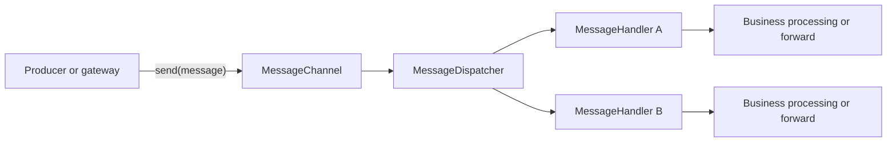
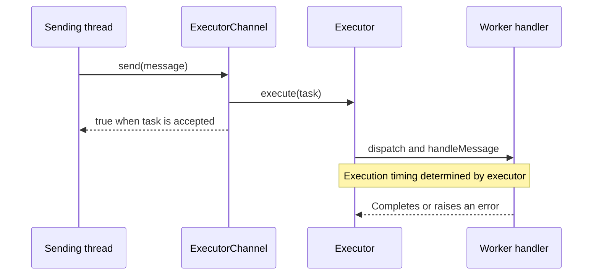

# MessageDispatcher

## 1. Objectives and Scope

In the **Message channel** chapter of the **SPRING_INTEGRATION_CORE** module, this lesson explains how Spring Integration transfers a `Message<?>` from a channel to registered `MessageHandler` instances. After this lesson, you will be able to choose an appropriate dispatching mechanism, configure failover, predict where errors originate, and test how many handlers are actually invoked.

The running scenario is order processing:

- Two workers have the same capability to intake orders: each order needs one worker to process it.
- The primary service has a backup service: try the next service when an error permits failover.
- An order event needs to notify both the audit department and notification delivery: each branch needs to receive the event.

The examples use `spring-integration-core`; the testing section uses JUnit Jupiter. Specifically, `setFailoverStrategy(Predicate<Exception>)` requires Spring Integration 6.3 or later. You do not need to create a separate dispatcher bean to apply the channel configurations in this lesson.

## 2. Where Does Dispatcher Sit in a Message Flow?

`MessageDispatcher` belongs to the `org.springframework.integration.dispatcher` package. It is a strategy interface that manages handlers and dispatches messages to them. The main operations include:

| Method | Meaning |
| --- | --- |
| `addHandler(MessageHandler)` | Registers a handler; the return value indicates whether it was added |
| `removeHandler(MessageHandler)` | Removes a handler |
| `getHandlerCount()` | Returns the number of currently registered handlers |
| `dispatch(Message<?>)` | Performs dispatching according to the dispatcher's strategy |

Typical applications call `channel.send(message)` and declare endpoints. Direct access to the dispatcher is mainly useful when studying internals or extending the framework. [MessageDispatcher API](https://docs.spring.io/spring-integration/api/org/springframework/integration/dispatcher/MessageDispatcher.html).



The two edges from the dispatcher to A and B represent candidate targets that may be invoked. How many targets are called in a single send depends on the strategy.

With `AbstractSubscribableChannel`, `subscribe(handler)` registers with the dispatcher; `unsubscribe(handler)` unregisters; the send path forwards to `dispatch(message)`. In a Spring application, an endpoint such as `EventDrivenConsumer` handles registering and unregistering handlers according to the endpoint lifecycle. Thus, the mere existence of a business-handler bean is not enough to establish that a channel has a subscriber. [AbstractSubscribableChannel Source](https://raw.githubusercontent.com/spring-projects/spring-integration/v6.5.0/spring-integration-core/src/main/java/org/springframework/integration/channel/AbstractSubscribableChannel.java).

The responsibilities in the same example can be summarized as:

| Component | Responsibility |
| --- | --- |
| Message | Carries the order payload and headers |
| Channel | Send/receive point to which components connect |
| Dispatcher | Decides how the channel's handlers are invoked |
| Endpoint | Attaches a handler to the flow and manages lifecycle |
| Handler | Executes a processing step, such as transformer, filter, or service activator |
| Gateway | Provides a Java interface for the application to enter the message flow |

## 3. Relationship Between Channel and Dispatcher

This lesson focuses on two common strategies: unicast and broadcast.

| Channel | Associated Dispatcher | Distribution Model | Typical Execution Thread |
| --- | --- | --- | --- |
| `DirectChannel` | `UnicastingDispatcher` | Stops once one handler completes normally | Thread calling `send()` |
| `ExecutorChannel` | `UnicastingDispatcher` | Same handler selection mechanism as synchronous unicast | Offloaded to an executor |
| `PublishSubscribeChannel` | `BroadcastingDispatcher` | Dispatches to subscribers | Sending thread or executor if provided |

`QueueChannel` stores messages for consumers to pull via `receive()`; it does not use handler subscription and direct dispatch like the channels above. Nor is this an exhaustive list of channel types: Spring Integration also offers specialized options such as `PartitionedChannel`. [Message Channel Implementations](https://docs.spring.io/spring-integration/reference/channel/implementations.html).

When designing a flow, answer two questions separately:

1. Does a message need to be processed by one worker or multiple branches?
2. Does the handler run on the sending thread or get handed off to an executor?

For example, adding an executor to publish-subscribe changes how the branches execute; the requirement to distribute to multiple subscribers remains unchanged.

## 4. UnicastingDispatcher: Selecting One Handler to Process

### 4.1. When Does the Dispatcher Stop?

`UnicastingDispatcher` iterates over handlers in the order provided by the load-balancing strategy. When a `handleMessage(message)` call completes normally, the dispatcher stops and considers the dispatch successful.

`MessageHandler.handleMessage()` returns `void`. Therefore, "a handler accepts the message" means the call does not throw an exception. If failover is enabled, the same message may already have been tried on multiple handlers before one completes. [UnicastingDispatcher API](https://docs.spring.io/spring-integration/api/org/springframework/integration/dispatcher/UnicastingDispatcher.html).

With two workers of equivalent capability:

```text
Order 101 -> worker A completes -> stop
Order 102 -> worker B completes -> stop
Order 103 -> worker A completes -> stop
```

If A performs part of the work and then throws an exception, B may still be invoked. Therefore, the number of attempts and the number of side effects produced must be observed separately.

### 4.2. Round-Robin Controls the Starting Point

`new DirectChannel()` uses `RoundRobinLoadBalancingStrategy`. This strategy rotates which handler is tried first; when failover is needed, the iterator still allows walking through the remaining handlers. [DirectChannel API](https://docs.spring.io/spring-integration/api/org/springframework/integration/channel/DirectChannel.html), [RoundRobinLoadBalancingStrategy API](https://docs.spring.io/spring-integration/api/org/springframework/integration/dispatcher/RoundRobinLoadBalancingStrategy.html).

Assuming stable subscribers, no errors, and sequential send calls:

| Message | Illustrative Trial Order | Outcome |
| --- | --- | --- |
| M1 | A, B, C | A completes; B and C are not called |
| M2 | B, C, A | B completes; C and A are not called |
| M3 | C, A, B | C completes; A and B are not called |

Round-robin distributes the starting turn. Processing times of A, B, and C can still differ. You cannot infer from this table that completion times are equal or that handlers always run in parallel.

### 4.3. Failover and Fixed Ordering

Failover is enabled by default. To always try the primary service first, you can omit the load-balancing strategy:

```java
DirectChannel primaryThenBackup = new DirectChannel(null);
primaryThenBackup.setFailover(true);
```

For handlers without a custom priority, registering primary before backup yields a trial order of primary then backup. In real endpoint configurations, specify ordering explicitly if primary/backup roles are a business requirement. `AbstractDispatcher` maintains an order-aware handler collection. [AbstractDispatcher API](https://docs.spring.io/spring-integration/api/org/springframework/integration/dispatcher/AbstractDispatcher.html).

Two independent settings should be distinguished:

| Configuration | What It Controls |
| --- | --- |
| `new DirectChannel(null)` | Does not rotate the starting point with a load balancer |
| `setFailover(false)` | Stops when the handler currently being tried throws an exception |

Setting the load balancer to `null` still allows failing over to the next handler when failover is enabled. [Configuring Message Channels](https://docs.spring.io/spring-integration/reference/channel/configuration.html).

### 4.4. Example: Primary and Backup Services

The following example is a standalone Java program when `spring-integration-core` and its dependencies are on the classpath:

```java
import java.util.ArrayList;
import java.util.List;

import org.springframework.integration.channel.DirectChannel;
import org.springframework.messaging.Message;
import org.springframework.messaging.support.MessageBuilder;

public class UnicastFailoverDemo {

    public static void main(String[] args) {
        List<String> attempts = new ArrayList<>();
        DirectChannel orders = new DirectChannel(null);
        orders.setFailover(true);

        orders.subscribe(message -> {
            attempts.add("primary:" + message.getPayload());
            throw new IllegalStateException("Primary unavailable");
        });

        orders.subscribe(message ->
                attempts.add("backup:" + message.getPayload()));

        Message<String> message = MessageBuilder
                .withPayload("ORDER-101")
                .setHeader("orderId", "101")
                .build();

        boolean sent = orders.send(message);

        System.out.println("sent=" + sent);
        System.out.println(attempts);
    }
}
```

Ignoring framework logs, the expected output is:

```text
sent=true
[primary:ORDER-101, backup:ORDER-101]
```

Success at the backup causes `send()` to return `true`, even though primary failed. When primary health needs to be monitored, logs or metrics must capture each attempt.

Changing to `orders.setFailover(false)`: the send call throws an exception at primary, backup is not invoked, and the two print statements after `send()` do not run.

### 4.5. Failover by Exception Type

Starting in Spring Integration 6.3, a `Predicate<Exception>` can be used to choose which errors allow trying the next handler. `setFailover(boolean)` and `setFailoverStrategy(...)` override each other's setting; choose one configuration style clearly. [setFailoverStrategy API](https://docs.spring.io/spring-integration/api/org/springframework/integration/dispatcher/UnicastingDispatcher.html#setFailoverStrategy(java.util.function.Predicate)).

This example permits failover when the cause chain contains an application-defined transient error:

```java
import org.springframework.integration.channel.DirectChannel;

public class SelectiveFailover {

    static final class TemporaryBackendException extends RuntimeException {
        TemporaryBackendException(String message) {
            super(message);
        }
    }

    public static DirectChannel createChannel() {
        DirectChannel channel = new DirectChannel(null);
        channel.setFailoverStrategy(SelectiveFailover::isTemporary);
        return channel;
    }

    private static boolean isTemporary(Exception exception) {
        Throwable current = exception;
        while (current != null) {
            if (current instanceof TemporaryBackendException) {
                return true;
            }
            current = current.getCause();
        }
        return false;
    }
}
```

Walking the cause chain helps the example recognize the business exception when wrapped by an outer handling layer. For malformed order data, this design returns `false` and lets the error surface instead of trying another backend that would also receive the same invalid data.

### 4.6. Three Boundaries to Get Right

**Failover vs. retry:** failover tries another handler in the subscriber list. Retry applies a policy to re-invoke an operation, typically with attempt counts and wait intervals. For example, primary then backup has two processing targets; retrying primary three times is a different decision.

**Filter rejection vs. exception:** a filter can discard a message without throwing an exception. When the filter call returns normally, unicast does not automatically forward the message to the next subscriber to look for one that "agrees" to handle it. To branch by order type, use a router; to signal an error on filter rejection, configure the filter's rejection behavior. [Filter](https://docs.spring.io/spring-integration/reference/filter.html).

**Error scope:** if a handler forwards further through `DirectChannel` instances, an exception in a downstream step can propagate back to the original send call. Failover can then retry the entire processing branch on another subscriber. When an earlier branch has already called a payment gateway or sent an email, design idempotency around a business key such as `orderId` and an appropriate recording mechanism; the dispatcher itself does not undo side effects that already occurred.

## 5. BroadcastingDispatcher: Distributing to Multiple Subscribers

### 5.1. Subscribers Receive the Same Event

With `PublishSubscribeChannel`, both auditing and notification can receive an order event:

```java
import java.util.ArrayList;
import java.util.List;

import org.springframework.integration.channel.PublishSubscribeChannel;
import org.springframework.messaging.support.GenericMessage;

public class BroadcastDemo {

    public static void main(String[] args) {
        List<String> calls = new ArrayList<>();
        PublishSubscribeChannel events = new PublishSubscribeChannel(true);

        events.subscribe(message ->
                calls.add("audit:" + message.getPayload()));
        events.subscribe(message ->
                calls.add("notification:" + message.getPayload()));

        boolean sent = events.send(new GenericMessage<>("ORDER-CREATED"));

        System.out.println("sent=" + sent);
        System.out.println(calls);
    }
}
```

Expected output, ignoring framework logs:

```text
sent=true
[audit:ORDER-CREATED, notification:ORDER-CREATED]
```

Passing `true` to the constructor requires at least one subscriber. When no executor is provided, handler invocations run on the sending thread. Consequently, the duration of the audit branch directly affects when the notification branch starts and when `send()` returns. [PublishSubscribeChannel API](https://docs.spring.io/spring-integration/api/org/springframework/integration/channel/PublishSubscribeChannel.html).

### 5.2. One Failing Branch Can Block Subsequent Branches

By default, `ignoreFailures=false`. With synchronous broadcasting, if subscriber A throws an exception, execution may stop before calling B and C.

```text
send(event)
  -> A throws exception
  -> B not yet called
  -> C not yet called
  -> exception escapes send()
```

You can request continuing to try the remaining subscribers:

```java
PublishSubscribeChannel events = new PublishSubscribeChannel(true);
events.setIgnoreFailures(true);
```

In that case, the error is logged and suppressed at the dispatch step so the dispatcher continues. When an executor is present, a failure in one task does not prevent other tasks already submitted for execution; enabling `ignoreFailures` can also prevent handler errors from reaching an error handler. [BroadcastingDispatcher API](https://docs.spring.io/spring-integration/api/org/springframework/integration/dispatcher/BroadcastingDispatcher.html).

For example, if auditing is mandatory before sending an email, express that relationship with a sequential chain. If two branches are independent yet both must complete reliably, each branch needs proper tracking and recovery mechanisms. A continue-dispatching flag alone cannot express these two requirements.

### 5.3. No Subscribers, Minimum Subscribers, and Send Result

Options that are easy to confuse:

| Option | Purpose | What Cannot Be Inferred |
| --- | --- | --- |
| `requireSubscribers=true` | Fails when there are no subscribers | Every subscriber processed successfully |
| `minSubscribers=n` | Sets threshold for dispatcher to return `true` | At least n business outcomes succeeded when processing asynchronously |
| `ignoreFailures=true` | Continues trying other handlers when a handler fails | Failed handler is automatically retried |
| `maxSubscribers` | Limits the number of registered handlers | Bounds in-flight messages or thread pool size |

With a default channel, `requireSubscribers=false` and `minSubscribers=0`, so sending with no subscribers can still return `true`. When using an executor, dispatch counting reflects tasks submitted for execution; handlers may not have finished yet. In synchronous broadcasting, some subscribers may already have run before the dispatcher determines the minimum threshold was not met. Therefore, `minSubscribers` is not a pre-check before allowing any branch to run. [BroadcastingDispatcher Source](https://raw.githubusercontent.com/spring-projects/spring-integration/v6.5.0/spring-integration-core/src/main/java/org/springframework/integration/dispatcher/BroadcastingDispatcher.java).

Example configuration requiring subscribers and setting a threshold of two:

```java
PublishSubscribeChannel events = new PublishSubscribeChannel(true);
events.setMinSubscribers(2);
```

If business logic needs proof that both auditing and notification completed, collect each branch's result by order ID. A boolean value at the send point is no substitute for that result record.

### 5.4. applySequence and Aggregator

When broadcast branches need their results merged, `setApplySequence(true)` adds correlation and sequence metadata to the outgoing messages:

```java
PublishSubscribeChannel checks = new PublishSubscribeChannel(true);
checks.setApplySequence(true);
```

With two subscribers, each branch receives `sequenceSize=2`, the same correlation ID, and distinct sequence numbers. This data helps an aggregator recognize that results belong to the same group. The messages created for the branches still reference the same payload; enabling sequence does not deep-copy the business object. [apply-sequence Configuration](https://docs.spring.io/spring-integration/reference/channel/configuration.html).

From this follow two design consequences for the order example:

- Shared payloads should be treated as immutable data so branches do not mutate each other's state.
- If one branch filters out a message or produces no result, the aggregator may lack a member. Define rejection outcomes, timeouts, or an appropriate group completion policy.

The dispatcher provides distribution metadata; determining whether a group has enough results belongs to the aggregator configuration and the contract between branches.

## 6. Threads, Errors, and the Meaning of send()

### 6.1. DirectChannel

With `DirectChannel`, handler invocations run on the sending thread. If the synchronous downstream branch completes normally, `send()` then returns. Unhandled errors can propagate back to the caller.

This allows a synchronous flow to participate in a transaction enclosing the send call when components use the proper transaction manager and transactional resources. The channel does not open a transaction on its own, nor does it automatically roll back an HTTP call that already produced side effects. [DirectChannel API](https://docs.spring.io/spring-integration/api/org/springframework/integration/channel/DirectChannel.html).

### 6.2. ExecutorChannel

`ExecutorChannel` hands off dispatching to an executor, typically creating a thread boundary. When `send()` returns `true`, the task may only have just been accepted by the executor. Business errors occurring later in a worker cannot be caught by a `try/catch` that already exited on the sending thread. The executor can also reject the task at send time if overloaded.

A transaction bound to the sending thread does not automatically propagate to the worker thread. A specialized executor or rejection policy may run the task on the calling thread; design should rely on the specific executor configuration. [ExecutorChannel API](https://docs.spring.io/spring-integration/api/org/springframework/integration/channel/ExecutorChannel.html).



The relative timing between when the worker starts and when the caller receives `true` can vary. The diagram illustrates task handoff, without mandating that the worker always starts after `send()` returns.

### 6.3. Exception Paths

| Context | Error Handling Approach |
| --- | --- |
| Sending directly to a synchronous channel | Catch the exception at the caller or let it propagate up the call stack |
| Gateway invoking a synchronous flow | Check the gateway contract and the gateway's error channel configuration |
| Handler running via an executor | Use an appropriate error handler and `ErrorMessage` flow |
| Task rejected by the executor | Handle errors at submission time, overload configuration, and recovery policy |

In the standard error-publishing mechanism, the message's `errorChannel` header takes precedence; if absent, the global bean named `errorChannel` is used. Merely adding this header to a message sent through a `DirectChannel` does not automatically convert every exception into an `ErrorMessage`. [Error Handling](https://docs.spring.io/spring-integration/reference/error-handling.html).

With a `PublishSubscribeChannel` that has an executor, an `ErrorHandler` can be configured; by default the channel uses `MessagePublishingErrorHandler`. When there is no executor, this channel's error handler does not apply and errors are thrown on the sending thread. [PublishSubscribeChannel.setErrorHandler API](https://docs.spring.io/spring-integration/api/org/springframework/integration/channel/PublishSubscribeChannel.html#setErrorHandler(org.springframework.util.ErrorHandler)).

## 7. Declaring with Java DSL

The following example creates two endpoints both receiving from the `work` channel, then broadcasts result events to two endpoints receiving from `events`. The collections are used solely to observe behavior in the example.

```java
import java.util.List;
import java.util.concurrent.CopyOnWriteArrayList;

import org.springframework.context.annotation.Bean;
import org.springframework.context.annotation.Configuration;
import org.springframework.integration.channel.DirectChannel;
import org.springframework.integration.channel.PublishSubscribeChannel;
import org.springframework.integration.config.EnableIntegration;
import org.springframework.integration.dsl.IntegrationFlow;
import org.springframework.messaging.MessageHandler;

@Configuration
@EnableIntegration
public class OrderDispatchConfiguration {

    private final List<String> processed = new CopyOnWriteArrayList<>();
    private final List<String> audited = new CopyOnWriteArrayList<>();
    private final List<String> notified = new CopyOnWriteArrayList<>();

    @Bean
    public DirectChannel work() {
        DirectChannel channel = new DirectChannel();
        channel.setFailover(false);
        return channel;
    }

    @Bean
    public PublishSubscribeChannel events() {
        return new PublishSubscribeChannel(true);
    }

    @Bean
    public IntegrationFlow workerA() {
        return IntegrationFlow.from("work")
                .<String, String>transform(order -> "A:" + order)
                .channel("events")
                .get();
    }

    @Bean
    public IntegrationFlow workerB() {
        return IntegrationFlow.from("work")
                .<String, String>transform(order -> "B:" + order)
                .channel("events")
                .get();
    }

    @Bean
    public IntegrationFlow auditFlow() {
        return IntegrationFlow.from("events")
                .handle((MessageHandler) message -> {
                    String value = (String) message.getPayload();
                    processed.add(value);
                    audited.add(value);
                })
                .get();
    }

    @Bean
    public IntegrationFlow notificationFlow() {
        return IntegrationFlow.from("events")
                .handle((MessageHandler) message ->
                        notified.add((String) message.getPayload()))
                .get();
    }

    public List<String> processed() {
        return List.copyOf(processed);
    }

    public List<String> audited() {
        return List.copyOf(audited);
    }

    public List<String> notified() {
        return List.copyOf(notified);
    }
}
```

After the Spring context starts, sending four `String` messages sequentially into the `work` bean:

- Each message passes through one of the two transformers.
- When there are no errors, round-robin divides the four turns evenly between A and B.
- Each result is sent to both the audit and notification branches.
- All three collections have four elements once the synchronous send calls finish.

Java DSL creates and registers the flow components in the Spring context. Having two flows both start with `from("work")` creates two subscribers on the same channel; the channel type decides whether they compete for turns or both receive messages. [Java DSL](https://docs.spring.io/spring-integration/reference/dsl.html).

The example intentionally disables failover on `work` so an error in the result-broadcast step is returned to the caller. When replacing the collections with external services, re-evaluate where failover belongs to avoid reprocessing partially completed orders.

## 8. Testing Dispatch Behavior

The tests below test channels directly without starting a Spring context. They help observe the number of handlers invoked, failover, and broadcasting; endpoints created with Java DSL still need separate integration tests when applied to an application.

```java
import java.util.ArrayList;
import java.util.List;
import java.util.concurrent.atomic.AtomicInteger;

import org.junit.jupiter.api.Test;
import org.springframework.integration.MessageDispatchingException;
import org.springframework.integration.channel.DirectChannel;
import org.springframework.integration.channel.PublishSubscribeChannel;
import org.springframework.messaging.MessageDeliveryException;
import org.springframework.messaging.MessagingException;
import org.springframework.messaging.support.GenericMessage;

import static org.junit.jupiter.api.Assertions.assertEquals;
import static org.junit.jupiter.api.Assertions.assertSame;
import static org.junit.jupiter.api.Assertions.assertThrows;
import static org.junit.jupiter.api.Assertions.assertTrue;

class MessageDispatcherBehaviorTest {

    @Test
    void unicastDistributesSixMessagesInTheCallingThread() {
        DirectChannel channel = new DirectChannel();
        AtomicInteger countA = new AtomicInteger();
        AtomicInteger countB = new AtomicInteger();
        Thread caller = Thread.currentThread();

        channel.subscribe(message -> {
            assertSame(caller, Thread.currentThread());
            countA.incrementAndGet();
        });
        channel.subscribe(message -> {
            assertSame(caller, Thread.currentThread());
            countB.incrementAndGet();
        });

        for (int i = 1; i <= 6; i++) {
            assertTrue(channel.send(new GenericMessage<>("ORDER-" + i)));
        }

        assertEquals(3, countA.get());
        assertEquals(3, countB.get());
    }

    @Test
    void failoverTriesBackupAndStopsAfterSuccess() {
        DirectChannel channel = new DirectChannel(null);
        channel.setFailover(true);
        List<String> calls = new ArrayList<>();

        channel.subscribe(message -> {
            calls.add("primary");
            throw new IllegalStateException("Primary unavailable");
        });
        channel.subscribe(message -> calls.add("backup"));
        channel.subscribe(message -> calls.add("third"));

        assertTrue(channel.send(new GenericMessage<>("ORDER-1")));

        assertEquals(List.of("primary", "backup"), calls);
    }

    @Test
    void disabledFailoverDoesNotInvokeBackup() {
        DirectChannel channel = new DirectChannel(null);
        channel.setFailover(false);
        List<String> calls = new ArrayList<>();

        channel.subscribe(message -> {
            calls.add("primary");
            throw new IllegalStateException("Primary unavailable");
        });
        channel.subscribe(message -> calls.add("backup"));

        assertThrows(MessagingException.class,
                () -> channel.send(new GenericMessage<>("ORDER-1")));

        assertEquals(List.of("primary"), calls);
    }

    @Test
    void broadcastContinuesAfterFailureWhenConfigured() {
        PublishSubscribeChannel channel = new PublishSubscribeChannel(true);
        channel.setIgnoreFailures(true);
        List<String> calls = new ArrayList<>();

        channel.subscribe(message -> {
            calls.add("audit");
            throw new IllegalStateException("Audit unavailable");
        });
        channel.subscribe(message -> calls.add("notification"));

        assertTrue(channel.send(new GenericMessage<>("ORDER-1")));

        assertEquals(List.of("audit", "notification"), calls);
    }

    @Test
    void missingSubscriberPolicyDependsOnChannelConfiguration() {
        GenericMessage<String> message = new GenericMessage<>("ORDER-1");
        DirectChannel direct = new DirectChannel();
        PublishSubscribeChannel permissive = new PublishSubscribeChannel();
        PublishSubscribeChannel required = new PublishSubscribeChannel(true);

        MessageDeliveryException directError = assertThrows(
                MessageDeliveryException.class, () -> direct.send(message));
        assertTrue(directError.getCause() instanceof MessageDispatchingException);

        assertTrue(permissive.send(message));

        MessageDeliveryException broadcastError = assertThrows(
                MessageDeliveryException.class, () -> required.send(message));
        assertTrue(broadcastError.getCause() instanceof MessageDispatchingException);
    }
}
```

The broadcast test intentionally uses the default `minSubscribers=0`. Therefore, `true` here does not mean the audit branch succeeded; the `calls` list only proves that notification was still invoked after the audit attempt.

For variants using an executor, the testing approach must change:

| Behavior to Verify | Appropriate Observation Method |
| --- | --- |
| Handler actually ran | `CountDownLatch`, future, or result queue with timeout |
| Errors reach the right destination | Capture `ErrorMessage` on the configured error channel |
| No duplicate processing | Count results by business key and verify the idempotency store |
| Complete broadcast results | Await responses from each branch by correlation ID |

Do not rely on `Thread.sleep()` to assume a task has completed. If a test creates its own executor, shut down the executor after the test finishes to release threads.

## 9. Error Recognition and Diagnostics

### 9.1. Distinguishing Dispatcher Errors from Channel-Observed Errors

At the dispatcher layer, having no handlers produces a `MessageDispatchingException`. When sending through `AbstractSubscribableChannel`, this error is wrapped in `org.springframework.messaging.MessageDeliveryException`. Therefore, when reading a stack trace, inspect both the outer exception and its `cause`. [AbstractSubscribableChannel Source](https://raw.githubusercontent.com/spring-projects/spring-integration/v6.5.0/spring-integration-core/src/main/java/org/springframework/integration/channel/AbstractSubscribableChannel.java).

With unicast failover, multiple failed attempts can produce an `AggregateMessageDeliveryException`. If only one error is recorded, such as when failover is disabled at the first handler, the implementation may throw the corresponding delivery exception instead of always creating an aggregate exception. [UnicastingDispatcher Source](https://raw.githubusercontent.com/spring-projects/spring-integration/v6.5.0/spring-integration-core/src/main/java/org/springframework/integration/dispatcher/UnicastingDispatcher.java).

### 9.2. Symptom-Based Diagnostic Table

| Symptom | Possibilities to Check | Resolution Approach |
| --- | --- | --- |
| `Dispatcher has no subscribers` | Endpoint not started, stopped, or pointing to the wrong channel | Check channel name, endpoint state, and subscriber count |
| Only one of two flows receives each message | Both subscribed to a `DirectChannel` | Use publish-subscribe if the requirement is for both to receive |
| Both handlers try the same order | First handler failed and unicast performed failover | Inspect attempt logs, failover policy, and idempotency |
| Primary is not always tried first | Channel still uses round-robin | Remove the load balancer and define subscriber order |
| Later broadcast branch does not run | Earlier branch failed during synchronous dispatch | Decide whether to continue or stop; arrange proper error flow |
| `send()` succeeds but no result appears | Task runs asynchronously or pub-sub channel has no subscribers | Observe worker results and check subscriber policy |
| Caller cannot catch worker errors | Error occurred across an executor boundary | Check error handler and error channel subscribers |
| Aggregator waits forever | A branch filtered, failed, or lost correlation info | Check sequence metadata, per-branch outputs, and group timeout |
| Some orders produce side effects twice | Failover or resend after partial processing | Use a business key and idempotent processing records |

When investigating the order example, log `orderId`, channel name, handler name, thread, start/end timestamps, and failure cause. `messageId` helps trace individual messages, whereas a business key is more useful when a request is recreated as a new message.

`getSubscriberCount()` helps inspect subscriptions at a point in time. A subscriber count greater than zero does not prove the backend is healthy, that handlers will succeed, or that the endpoint remains in that state on the next send.

## 10. Practice Exercises

1. Keep two subscribers on a `DirectChannel`, send six messages sequentially, and record how many times each worker processes a message. Then switch to `new DirectChannel(null)` to observe the change in starting point.
2. Make primary always fail. Compare the list of invoked handlers with failover enabled and disabled.
3. With a synchronous `PublishSubscribeChannel`, make the first subscriber throw an exception. Compare `ignoreFailures=false` and `true`, and record which subscribers created side effects.
4. Remove all subscribers. Compare `DirectChannel`, default publish-subscribe, and publish-subscribe requiring subscribers.
5. Replace a channel with `ExecutorChannel`. Use a latch or a result queue with timeout to separate the moment of send success from the moment of processing completion.

When presenting your results, explain three things: which handler was called, which thread executed it, and where the caller observes the result or error. These three facts help select the right channel before expanding a flow with gateways, routers, filters, or aggregators.
