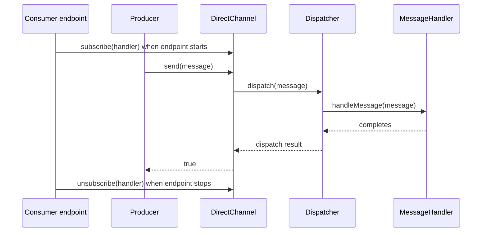
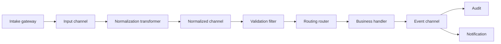

# Subscribing a MessageHandler to a Channel

In the **SPRING_INTEGRATION_CORE** module, connecting channels with processing components is foundational to designing message flows with Message, MessageChannel, endpoints, gateways, and Java DSL. Transformers, routers, filters, and aggregators all need a mechanism to receive messages before performing their respective functions.

This lesson belongs to the **Message channel** chapter and focuses on the question: when calling `channel.send(message)`, what causes a `MessageHandler` to be invoked? Starting from this subscription mechanism, we will build a simple flow, manage consumer lifecycles, distinguish message distribution modes, and test error-handling behavior.

## 1. Distinguishing Message, Channel, Handler, and Endpoint

Suppose a system receives the order code `ORD-101`. The producer creates a message containing this code and sends it to the `orders` channel. The order-processing component is connected to the channel to receive the message.

| Component | Responsibility | Example in the order flow |
| --- | --- | --- |
| `Message<T>` | Carries the payload and headers of a single exchange | Payload is `ORD-101`, header `source` is `checkout` |
| `MessageChannel` | Provides the message send point | Producer calls `orders.send(message)` |
| `MessageHandler` | Processes the delivered message | Validates, records, or forwards the order |
| Consumer endpoint | Connects the handler to the channel and manages how messages are received | `EventDrivenConsumer` or `PollingConsumer` |
| Producer or gateway | Feeds data into the flow | Checkout service or a messaging gateway |

The producer only needs to know the input channel. How the channel selects a consumer and how the consumer processes messages belong to flow configuration.

A `MessageHandler` bean is merely an object capable of processing. There must be a step connecting it to a channel before messages sent to the channel reach that object.

## 2. The MessageHandler and SubscribableChannel Contract

### 2.1. MessageHandler Receives the Whole Message

`MessageHandler` is in the `org.springframework.messaging` package. Its core contract is:

```java
void handleMessage(Message<?> message) throws MessagingException;
```

Because this is a functional interface, it can be implemented with a lambda. The parameter contains both payload and headers; the return type is `void`. This contract does not define taking a return value and automatically sending it to the next channel. See [MessageHandler Javadoc](https://docs.spring.io/spring-framework/docs/current/javadoc-api/org/springframework/messaging/MessageHandler.html).

Example of a handler that only logs the input:

```java
MessageHandler handler = message -> {
    Object payload = message.getPayload();
    Object source = message.getHeaders().get("source");
    System.out.println("payload=" + payload + ", source=" + source);
};
```

When using a raw handler like this, the application must check the payload type itself. When you want Spring to bind the payload to method parameters and manage replies, you can use a service activator or Java DSL in later sections.

### 2.2. Subscription Is a Capability of SubscribableChannel

The `MessageChannel` interface provides `send(...)`. The ability to add or remove handlers lives on the sub-interface `SubscribableChannel`:

```java
boolean subscribe(MessageHandler handler);
boolean unsubscribe(MessageHandler handler);
```

Meaning of return values:

| Call | `true` | `false` |
| --- | --- | --- |
| `subscribe(handler)` | The handler was just added | The handler was already registered |
| `unsubscribe(handler)` | The handler was just removed | The handler was not in the subscription list |

This is the result of modifying the subscriber list, not the result of processing a message. The contract is described in [SubscribableChannel Javadoc](https://docs.spring.io/spring-framework/docs/current/javadoc-api/org/springframework/messaging/SubscribableChannel.html).

The declared variable type also affects which operations can be called:

```java
MessageChannel sendingPort = new DirectChannel();
sendingPort.send(new GenericMessage<>("ORD-101"));

// sendingPort.subscribe(handler); // Does not compile: MessageChannel does not have subscribe().
```

When you need to manage subscriptions, accept `SubscribableChannel` or an appropriate concrete channel type. Do not cast every `MessageChannel` to `SubscribableChannel`, because some channels only support polling.

## 3. What Happens When Sending to DirectChannel?

With a registered handler, the synchronous call flow can be represented as follows:



`DirectChannel` invokes the subscriber on the thread sending the message. Therefore, while the handler runs synchronously, the `send()` call remains on the same call stack. Subscribing does not create extra worker threads. See [DirectChannel Javadoc](https://docs.spring.io/spring-integration/api/org/springframework/integration/channel/DirectChannel.html).

For example, if the handler calls an external service and takes two seconds to complete, a producer sending through `DirectChannel` must also wait for that work. Adding more subscribers does not automatically turn a single send operation into parallel processing.

The diagram above describes the success branch, with no interceptor blocking the message and no asynchronous boundary downstream of the handler. The final business outcome of a long flow also depends on subsequent steps.

## 4. Example: Manual Subscription, Sending a Message, and Unsubscribing

The example below only needs Spring Integration Core and Spring Messaging libraries on the classpath; no broker or Spring ApplicationContext is required.

```java
import org.springframework.integration.channel.DirectChannel;
import org.springframework.messaging.Message;
import org.springframework.messaging.MessageHandler;
import org.springframework.messaging.support.MessageBuilder;

public class ManualSubscriptionDemo {

    public static void main(String[] args) {
        DirectChannel orders = new DirectChannel();

        MessageHandler orderHandler = message -> {
            if (!(message.getPayload() instanceof String)) {
                throw new IllegalArgumentException("Payload must be an order code String");
            }

            String orderId = (String) message.getPayload();
            String source = message.getHeaders().get("source", String.class);

            System.out.println(
                    "Received " + orderId
                    + ", source=" + source
                    + ", thread=" + Thread.currentThread().getName());
        };

        boolean added = orders.subscribe(orderHandler);
        System.out.println("First subscribe: " + added);
        System.out.println("Re-subscribe same handler: "
                + orders.subscribe(orderHandler));

        try {
            Message<String> message = MessageBuilder
                    .withPayload("ORD-101")
                    .setHeader("source", "checkout")
                    .build();

            boolean sent = orders.send(message);
            System.out.println("send() returned: " + sent);
        }
        finally {
            System.out.println("Unsubscribe: "
                    + orders.unsubscribe(orderHandler));
        }
    }
}
```

Expected output when run from the `main` thread:

```text
First subscribe: true
Re-subscribe same handler: false
Received ORD-101, source=checkout, thread=main
send() returned: true
Unsubscribe: true
```

Key observations:

1. Only after `subscribe(orderHandler)` does the channel have a subscriber to process messages.
2. Re-subscribing the same handler does not create an additional registration.
3. The handler runs before the line printing the `send()` result executes.
4. `finally` ensures the right handler is removed even if processing throws an exception.

Keep a reference to the registered handler. Creating a new lambda with the same body is not a reliable way to locate the old subscriber:

```java
MessageHandler original = message -> System.out.println(message.getPayload());
orders.subscribe(original);

MessageHandler another = message -> System.out.println(message.getPayload());
boolean removedWrongHandler = orders.unsubscribe(another); // false

orders.unsubscribe(original); // Removes the exact object that was added.
```

Manual subscription is useful for learning the mechanism and writing small tests. In an application with a Spring container, endpoints manage subscriptions alongside the application lifecycle.

## 5. Subscriber Count Alone Does Not Determine Distribution

Two channels may both have `subscribe()` yet distribute messages differently.

| Channel Type | How Consumers Connect | Distribution Under Successful Processing | Processing Thread |
| --- | --- | --- | --- |
| `DirectChannel` | Subscribe handler | Each message goes to one subscriber | Sending thread |
| `PublishSubscribeChannel` without executor | Subscribe handler | Broadcasts to current subscribers | Sending thread, invoked sequentially |
| `ExecutorChannel` | Subscribe handler | Each message goes to one subscriber | According to configured executor |
| `QueueChannel` | Consumer calls `receive()` | Each pull delivers a message to one consumer | Thread calling receive or poller |

With an executor, actual execution depends on configuration; for example, an executor might execute directly on the calling thread. Do not rely solely on a channel's class name to assume a threading guarantee.

The difference between pushing to subscribers and pulling via `receive()` is covered in [The MessageChannel Interface](https://docs.spring.io/spring-integration/reference/channel/interfaces.html).

### 5.1. DirectChannel: Subscribers Compete for Work

Suppose two handlers are subscribed to process the same kind of task:

```java
DirectChannel jobs = new DirectChannel();
jobs.subscribe(message -> System.out.println("worker-A: " + message.getPayload()));
jobs.subscribe(message -> System.out.println("worker-B: " + message.getPayload()));

jobs.send(new GenericMessage<>("JOB-1"));
jobs.send(new GenericMessage<>("JOB-2"));
```

In this simple case, the default round-robin strategy alternates work between the two handlers. A successfully processed message is not sent on to the remaining subscriber.

`DirectChannel` also enables failover by default: if the selected handler throws an exception, the dispatcher can try another handler. Consequently, a message may already have been attempted by one handler before reaching the next handler. This mechanism can be disabled:

```java
DirectChannel jobs = new DirectChannel();
jobs.setFailover(false);
```

Default settings and options are described in [DirectChannel Configuration](https://docs.spring.io/spring-integration/reference/channel/configuration.html#channel-configuration-directchannel).

For tasks with side effects, such as charging payment, account for the case where the first handler already produced side effects before throwing an error. Trying the next handler may repeat those side effects. Business-key design or an idempotency mechanism must address that scenario; handler subscription does not provide an exactly-once guarantee.

### 5.2. PublishSubscribeChannel: Subscribers Receive the Same Event

If the requirement is to send an event to both audit and notification, you can use:

```java
PublishSubscribeChannel orderEvents = new PublishSubscribeChannel();

orderEvents.subscribe(message ->
        System.out.println("audit: " + message.getPayload()));

orderEvents.subscribe(message ->
        System.out.println("notification: " + message.getPayload()));

orderEvents.send(new GenericMessage<>("ORDER_ACCEPTED"));
```

When both handlers succeed, both are invoked. With the no-executor constructor, they run sequentially on the sending thread. If one handler throws an error, whether subsequent handlers continue to run depends on the failure-handling configuration.

This channel does not store event history to replay for late-subscribing handlers. With the standard default configuration that allows zero subscribers, `send()` can still succeed even when no handler received the message. See [Message Channel Implementations](https://docs.spring.io/spring-integration/reference/channel/implementations.html).

When you need to reject sends to a publish-subscribe channel that has no receivers, you can choose the constructor that requires subscribers:

```java
PublishSubscribeChannel requiredEvents = new PublishSubscribeChannel(true);
```

`requireSubscribers` controls the zero-subscriber case; `minSubscribers` configures a minimum delivery threshold tied to the dispatch result. These two settings have distinct meanings, described in [PublishSubscribeChannel Javadoc](https://docs.spring.io/spring-integration/api/org/springframework/integration/channel/PublishSubscribeChannel.html).

In the order example, two operations that must run in the order "save order first, notify second" should be chained as flow steps. Putting multiple subscribers on a `DirectChannel` does not express that sequential requirement.

## 6. EventDrivenConsumer Manages Subscriptions in Spring

A consumer endpoint connects a `SubscribableChannel` with a `MessageHandler`. With `EventDrivenConsumer`, starting subscribes the handler, while stopping unsubscribes it. You can inspect the mechanism directly in the [EventDrivenConsumer source code](https://github.com/spring-projects/spring-integration/blob/v7.1.1/spring-integration-core/src/main/java/org/springframework/integration/endpoint/EventDrivenConsumer.java).

The complete configuration example below uses a Spring ApplicationContext. Each configuration class in this lesson is a standalone option unless specific instructions say to combine them.

```java
import org.springframework.beans.factory.annotation.Qualifier;
import org.springframework.context.annotation.AnnotationConfigApplicationContext;
import org.springframework.context.annotation.Bean;
import org.springframework.context.annotation.Configuration;
import org.springframework.integration.channel.DirectChannel;
import org.springframework.integration.config.EnableIntegration;
import org.springframework.integration.endpoint.EventDrivenConsumer;
import org.springframework.messaging.MessageHandler;
import org.springframework.messaging.SubscribableChannel;
import org.springframework.messaging.support.GenericMessage;

@Configuration
@EnableIntegration
public class ManagedSubscriptionDemo {

    @Bean
    public DirectChannel orders() {
        return new DirectChannel();
    }

    @Bean
    public MessageHandler orderHandler() {
        return message ->
                System.out.println("Processing order: " + message.getPayload());
    }

    @Bean
    public EventDrivenConsumer orderConsumer(
            @Qualifier("orders") SubscribableChannel input,
            @Qualifier("orderHandler") MessageHandler handler) {

        return new EventDrivenConsumer(input, handler);
    }

    public static void main(String[] args) {
        try (AnnotationConfigApplicationContext context =
                new AnnotationConfigApplicationContext(ManagedSubscriptionDemo.class)) {

            DirectChannel orders = context.getBean("orders", DirectChannel.class);
            EventDrivenConsumer endpoint =
                    context.getBean("orderConsumer", EventDrivenConsumer.class);

            System.out.println("Consumer running: " + endpoint.isRunning());
            System.out.println("Subscribers: " + orders.getSubscriberCount());

            orders.send(new GenericMessage<>("ORD-201"));

            endpoint.stop();
            System.out.println("After stop: " + orders.getSubscriberCount());

            endpoint.start();
            orders.send(new GenericMessage<>("ORD-202"));
        }
    }
}
```

The application needs `spring-integration-core` and compatible Spring Context dependencies; select versions via a BOM or the project's dependency management. `@EnableIntegration` enables Spring Integration configuration infrastructure in this Java configuration example.

After the context finishes initializing, the consumer starts automatically under the default lifecycle configuration and the channel has one subscriber. Calling `stop()` removes the subscriber; `start()` reconnects it. Closing the context also stops endpoints managed by the context.

Declaring only the two beans `orders` and `orderHandler` still lacks the wiring. A handler bean's name does not automatically imply an input channel.

Do not both manually subscribe and let an endpoint own the same subscription. Having two managers makes the lifecycle unpredictable: one may unsubscribe while the other still assumes ownership.

Unsubscribing should also not be mistaken for forcibly aborting in-flight executions. When a graceful shutdown is needed, producers, endpoints, and running tasks must have an explicit coordination policy.

## 7. Connecting with @ServiceActivator

Instead of creating `EventDrivenConsumer` directly, you can declare a business method and let the framework create the handler component and endpoint.

```java
import org.springframework.context.annotation.Bean;
import org.springframework.context.annotation.Configuration;
import org.springframework.integration.annotation.ServiceActivator;
import org.springframework.integration.channel.DirectChannel;
import org.springframework.integration.config.EnableIntegration;
import org.springframework.messaging.handler.annotation.Header;

@Configuration
@EnableIntegration
public class AnnotatedOrderConfiguration {

    @Bean
    public DirectChannel orders() {
        return new DirectChannel();
    }

    @Bean
    public OrderService orderService() {
        return new OrderService();
    }

    public static class OrderService {

        @ServiceActivator(inputChannel = "orders")
        public void accept(
                String orderId,
                @Header(name = "source", required = false) String source) {

            System.out.println("orderId=" + orderId + ", source=" + source);
        }
    }
}
```

In this example:

- `OrderService` is a Spring-managed bean.
- `inputChannel = "orders"` explicitly names the input channel.
- Spring binds the payload to `orderId` and the `source` header to the corresponding parameter.
- The method returns `void`, making this a processing point that produces no reply.

With `DirectChannel` as the input channel, the consumer normally operates in event-driven mode. Another option is placing `@Bean` and `@ServiceActivator(inputChannel = "...")` on a method returning a `MessageHandler` bean to connect that handler bean directly to the channel.

Method binding and output selection mechanisms are covered in [Service Activator](https://docs.spring.io/spring-integration/reference/service-activator.html).

If the business method returns a value, the framework can use a reply-producing handler to send the result to an output channel or appropriate reply address. This does not change the `void` signature of `MessageHandler.handleMessage(...)`: sending the output happens inside the implementation used by the framework.

## 8. Java DSL Declares the Same Connection with .handle()

Java DSL lets you describe the input channel and processing steps in an `IntegrationFlow`. The following example normalizes an order code and passes it to a terminal handler.

```java
import java.util.Locale;

import org.springframework.beans.factory.annotation.Qualifier;
import org.springframework.context.annotation.Bean;
import org.springframework.context.annotation.Configuration;
import org.springframework.integration.channel.DirectChannel;
import org.springframework.integration.config.EnableIntegration;
import org.springframework.integration.dsl.IntegrationFlow;
import org.springframework.messaging.MessageHandler;

@Configuration
@EnableIntegration
public class OrderDslConfiguration {

    @Bean
    public DirectChannel orders() {
        return new DirectChannel();
    }

    @Bean
    public MessageHandler orderSink() {
        return message ->
                System.out.println("Normalized order code: " + message.getPayload());
    }

    @Bean
    public IntegrationFlow normalizeOrders(
            @Qualifier("orders") DirectChannel input,
            @Qualifier("orderSink") MessageHandler sink) {

        return IntegrationFlow.from(input)
                .handle(String.class,
                        (payload, headers) ->
                                payload.trim().toUpperCase(Locale.ROOT))
                .handle(sink)
                .get();
    }
}
```

Sending payload `"  ord-301  "` to the `orders` bean causes the sink to receive `"ORD-301"`.

The two overloads in the example have different roles:

| Usage | Callback Input | Result |
| --- | --- | --- |
| `.handle(String.class, (payload, headers) -> ...)` | Mapped payload and headers | Return value can produce a message for the next step |
| `.handle(sink)` where `sink` is the raw `MessageHandler` above | Entire `Message<?>` | Sink returns `void` and ends processing in the example |

The DSL registers the flow's endpoints with Spring; you do not need to call `input.subscribe(sink)` manually. See [Service Activators and the .handle() method](https://docs.spring.io/spring-integration/reference/dsl/java-handle.html).

In this flow, `sink` is not a direct subscriber of the `orders` channel: the normalization step receives the input first, and then the framework forwards the result to the sink step. That distinction helps you read diagrams accurately when a flow has multiple endpoints.

In terms of business intent, data normalization can also be expressed with `.transform(...)`. The example uses `.handle(...)` to illustrate how the framework wires different handler forms.

### Why Can a Gateway Wait Forever Even Though the Handler Ran?

If a gateway has a method requiring a return value, the processing branch must produce a reply and send it to the appropriate reply destination. A sink that merely logs and terminates does not satisfy that requirement; the gateway may wait until timeout.

When designing a gateway, decide immediately whether a method is one-way send or request-reply. Then verify the reply path rather than only checking that the handler was invoked.

## 9. QueueChannel Needs PollingConsumer

`QueueChannel` implements `PollableChannel`: messages are retrieved via `receive()`. It has no `subscribe(handler)` operation.

```java
QueueChannel backlog = new QueueChannel(100);

// backlog.subscribe(handler); // Does not compile.
```

To use the same processing logic with a queue input, an active pulling consumer is needed. Spring Integration provides `PollingConsumer`; this distinction is explained in [Message Endpoints](https://docs.spring.io/spring-integration/reference/endpoint.html).

Example declaring a poller directly on a service activator:

```java
import org.springframework.context.annotation.Bean;
import org.springframework.context.annotation.Configuration;
import org.springframework.integration.annotation.Poller;
import org.springframework.integration.annotation.ServiceActivator;
import org.springframework.integration.channel.QueueChannel;
import org.springframework.integration.config.EnableIntegration;
import org.springframework.messaging.MessageHandler;

@Configuration
@EnableIntegration
public class QueuedOrderConfiguration {

    @Bean
    public QueueChannel backlog() {
        return new QueueChannel(100);
    }

    @Bean
    @ServiceActivator(
            inputChannel = "backlog",
            poller = @Poller(fixedDelay = "200", maxMessagesPerPoll = "5"))
    public MessageHandler queuedOrderHandler() {
        return message ->
                System.out.println("Pulled from backlog: " + message.getPayload());
    }
}
```

`fixedDelay = "200"` configures the pause in milliseconds between polling cycles; `maxMessagesPerPoll = "5"` limits how many messages are processed in one cycle. This is not a guarantee that every order is always processed within 200 ms: latency also depends on backlog, handler duration, and the scheduler.

If a poller is not declared directly, a consumer using a pollable input needs an appropriate default poller configuration. See [Using the @Poller Annotation](https://docs.spring.io/spring-integration/reference/configuration/annotations.html#using-the-poller-annotation).

Producers can send to the queue even when no consumer is running, as long as the queue has space. A successful send at this point only confirms the message entered the queue; business processing occurs when the poller pulls the message. Default queues store messages in memory, so surviving crashes requires designing a message store or appropriate transport mechanism.

## 10. Error Flow Once a Handler Is Subscribed

Having a subscriber only resolves the path to the handler. Processing can succeed or raise an error.

### 10.1. Synchronous Errors Propagate Back to the send() Caller

Example of a handler rejecting an order:

```java
import org.springframework.integration.channel.DirectChannel;
import org.springframework.messaging.MessageHandlingException;
import org.springframework.messaging.support.GenericMessage;

DirectChannel orders = new DirectChannel();
orders.setFailover(false);

orders.subscribe(message -> {
    throw new MessageHandlingException(message, "Invalid order");
});

try {
    orders.send(new GenericMessage<>("ORD-INVALID"));
}
catch (MessageHandlingException ex) {
    System.out.println("Producer received error: " + ex.getMessage());
}
```

This is a snippet inside a method body; place the imports at the top of the Java file when applying it.

Because the handler runs synchronously on `DirectChannel`, the exception propagates back to the producer. Merely adding an `errorChannel` header to the message does not automatically divert all errors of this synchronous call to another channel.

### 10.2. Errors Beyond an Asynchronous Boundary Need a Dedicated Error Path

If the producer has sent to a queue or handed a task off to an executor and moved on to other work, an error occurring later cannot be thrown back onto the producer's already-finished call stack.

For asynchronous tasks managed by Spring Integration infrastructure, the error-publishing mechanism can create an `ErrorMessage` and send it to the request's `errorChannel` or the default error channel depending on configuration. To apply this mechanism to a custom executor or scheduler, configure a corresponding error handler.

This distinction is described in [Error Handling](https://docs.spring.io/spring-integration/reference/error-handling.html).

### 10.3. DirectChannel with No Subscribers Is a Delivery Error

When sending to a `DirectChannel` that has no handler, the dispatcher has no target to handle the message. With Spring Integration's implementation, the dispatch error is wrapped into a `MessageDeliveryException`; the message typically contains `Dispatcher has no subscribers`. See [AbstractSubscribableChannel source code](https://github.com/spring-projects/spring-integration/blob/v7.1.1/spring-integration-core/src/main/java/org/springframework/integration/channel/AbstractSubscribableChannel.java).

Causes to check include:

- The endpoint has not started or has stopped.
- Only a handler bean exists without wiring its input channel.
- Producer and consumer use two different channel instances.
- Wrong channel name in an annotation or DSL.
- Producer sends too early, before the consumer is ready.

Do not rely on `send(message, timeout)` to limit business execution time on a `DirectChannel`. Channel operation timeout is not a mechanism that automatically interrupts a running synchronous handler.

## 11. Testing Subscription and Dispatch Behavior

The following tests use JUnit Jupiter and do not require starting a Spring context. They verify externally observable facts: invocation count, processing thread, subscription state, and returned errors.

These are reference test snippets to place into a practice project with compatible test dependencies.

```java
import java.util.concurrent.atomic.AtomicInteger;
import java.util.concurrent.atomic.AtomicReference;

import org.junit.jupiter.api.Test;
import org.springframework.integration.channel.DirectChannel;
import org.springframework.integration.channel.PublishSubscribeChannel;
import org.springframework.messaging.MessageDeliveryException;
import org.springframework.messaging.MessageHandler;
import org.springframework.messaging.MessageHandlingException;
import org.springframework.messaging.support.GenericMessage;

import static org.junit.jupiter.api.Assertions.*;

class HandlerSubscriptionTest {

    @Test
    void repeatedRegistrationDoesNotDuplicateDelivery() {
        DirectChannel channel = new DirectChannel();
        AtomicInteger calls = new AtomicInteger();
        MessageHandler handler = message -> calls.incrementAndGet();

        assertTrue(channel.subscribe(handler));
        assertFalse(channel.subscribe(handler));

        assertTrue(channel.send(new GenericMessage<>("ORD-1")));
        assertEquals(1, calls.get());

        assertTrue(channel.unsubscribe(handler));
        assertFalse(channel.unsubscribe(handler));
        assertEquals(0, channel.getSubscriberCount());

        assertThrows(MessageDeliveryException.class,
                () -> channel.send(new GenericMessage<>("ORD-2")));
        assertEquals(1, calls.get());
    }

    @Test
    void directChannelUsesTheSendingThread() {
        DirectChannel channel = new DirectChannel();
        Thread sender = Thread.currentThread();
        AtomicReference<Thread> handlerThread = new AtomicReference<>();

        channel.subscribe(message ->
                handlerThread.set(Thread.currentThread()));

        assertTrue(channel.send(new GenericMessage<>("ORD-3")));
        assertSame(sender, handlerThread.get());
    }

    @Test
    void directChannelChoosesOneSuccessfulHandlerPerMessage() {
        DirectChannel channel = new DirectChannel();
        AtomicInteger first = new AtomicInteger();
        AtomicInteger second = new AtomicInteger();

        channel.subscribe(message -> first.incrementAndGet());
        channel.subscribe(message -> second.incrementAndGet());

        channel.send(new GenericMessage<>("ORD-4"));

        assertEquals(1, first.get() + second.get());
    }

    @Test
    void publishSubscribeChannelInvokesBothSuccessfulHandlers() {
        PublishSubscribeChannel channel = new PublishSubscribeChannel();
        AtomicInteger first = new AtomicInteger();
        AtomicInteger second = new AtomicInteger();

        channel.subscribe(message -> first.incrementAndGet());
        channel.subscribe(message -> second.incrementAndGet());

        assertTrue(channel.send(new GenericMessage<>("ORDER_ACCEPTED")));

        assertEquals(1, first.get());
        assertEquals(1, second.get());
    }

    @Test
    void synchronousHandlerFailureReachesTheSender() {
        DirectChannel channel = new DirectChannel();
        channel.setFailover(false);

        channel.subscribe(message -> {
            throw new MessageHandlingException(message, "Rejected");
        });

        assertThrows(MessageHandlingException.class,
                () -> channel.send(new GenericMessage<>("ORD-INVALID")));
    }
}
```

The third test only asserts that the total invocation count equals one. It does not tie business behavior to which handler is picked first.

To test the Spring configuration, you can use `ManagedSubscriptionDemo` in a dedicated context test: retrieve the `orderConsumer` bean, verify one subscriber is present, call `stop()` and verify zero remain, then `start()` and verify the handler receives messages again.

For flows using an executor or poller, await a bounded signal such as a `CountDownLatch` or receive from an output queue with a timeout. Asserting immediately after `send()` may happen before the handler finishes; sleeping for a fixed duration also does not prove the condition being tested.

## 12. Common Design Mistakes

| Symptom | Misunderstanding or Misconfiguration | How to Resolve |
| --- | --- | --- |
| Handler bean exists but receives no messages | Bean is not wired to an input channel | Use an endpoint, annotation, or DSL |
| `subscribe()` does not compile | Variable has type `MessageChannel`, or object is a queue | Pick the right interface; use polling for queues |
| Only one of two handlers runs | Used `DirectChannel` for a broadcast requirement | Choose an event-broadcast channel or design the right flow |
| Same business logic runs multiple times | Created multiple endpoints or multiple handler instances | Audit configuration and subscription ownership |
| Unsubscribed yet the old handler remains | Passed a new handler instance | Keep the reference or let an endpoint manage it |
| `send()` is slow despite subscribing | Synchronous handler performs slow work | Define processing boundaries and executor/queue policy |
| Gateway times out even though logs appeared | Processing branch produces no reply | Design the reply path and gateway method signature |
| Producer misses exceptions after sending to queue | Error occurred later on the poller thread | Monitor the consumer's error path |

An easily overlooked bug is creating two separate Java objects:

```java
DirectChannel channelUsedByProducer = new DirectChannel();
DirectChannel channelUsedByConsumer = new DirectChannel();

channelUsedByConsumer.subscribe(handler);
channelUsedByProducer.send(message); // This channel has no subscribers.
```

In Spring configuration, inject channel beans by explicit name or qualifier. Identical variable names or the same class type do not turn two instances into one channel.

## 13. Relation to Integration Patterns in This Module

The message-receiving mechanism does not replace an endpoint's business role:

| Component | Work After Receiving a Message |
| --- | --- |
| Transformer | Converts content or data type |
| Router | Decides the destination channel |
| Filter | Decides whether to pass or discard |
| Aggregator | Collects correlated messages and emits results when ready |
| Service activator | Invokes application logic |
| Gateway | Provides an entry or exchange point with an appropriate contract |

An order flow can be pictured across steps:



Each connection needs an appropriate channel and endpoint mechanism. If the channel is subscribable, the endpoint receives in event-driven mode; if the channel is pollable, the endpoint needs polling. Features such as aggregation, routing, or error handling still require their own configuration.

For an order branch requiring a return result, add a reply path back to the gateway. For a branch that may re-run after failure, define a business identifier and behavior on duplicate receipt. Both decisions begin with understanding which handler receives the message, on which thread, and at what point in time.

## 14. Practice Exercises

Build a flow that receives an order code from a producer and perform each step in order:

1. Create a `DirectChannel`, subscribe one handler, and verify the handler receives both the payload and the `source` header.
2. Send two messages with two succeeding handlers on the same `DirectChannel`; record how many times each handler is invoked.
3. Switch the input to `PublishSubscribeChannel` and observe both handlers receiving every message.
4. Move the processing logic into `@ServiceActivator`, letting Spring own the endpoint lifecycle.
5. Use a `QueueChannel` and a poller; distinguish the moment of send success from the moment of processing completion.
6. Make the handler throw an error and observe where the error appears on the synchronous branch and on the polling branch.

Your exercise results should demonstrate four things: which receiving style the channel uses, who manages the subscription, which handlers each message is delivered to, and which side observes errors. That is the foundation for continuing to design and test multi-step Spring Integration flows.
