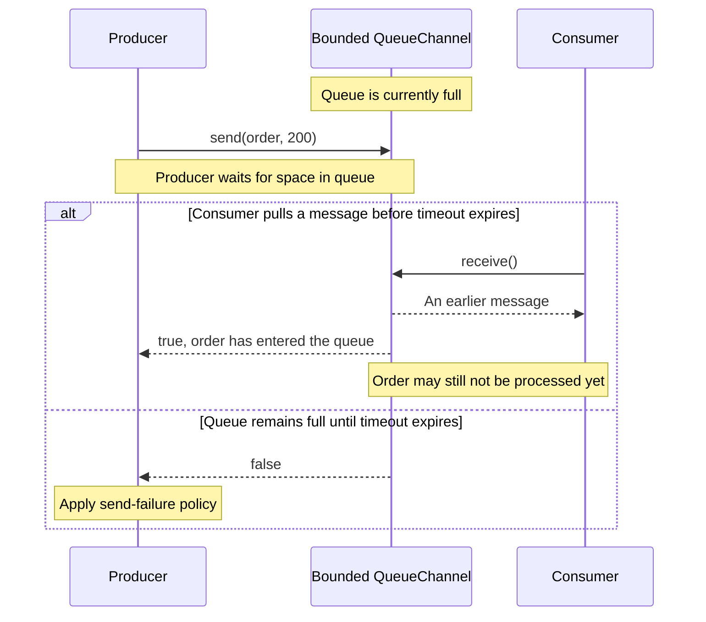

# Send timeout

In the **Message channel** chapter of the **SPRING_INTEGRATION_CORE** module, send timeout answers the question: **how long is the producer willing to wait for a channel to accept a message?** This is a decision at the message-sending boundary that directly affects the load tolerance and error reporting of an integration flow.

Suppose an application receives order-entry requests faster than workers can process them. A bounded-capacity queue will fill up. If producers keep waiting indefinitely, request-handling threads can become tied up. Send timeout lets the application bound that wait and then execute a policy for handling send failures.

This lesson uses Spring Integration 6.5 and Spring Messaging APIs, with explicitly configured timeouts. The standalone Java examples require `org.springframework.integration:spring-integration-core`; the configuration section requires a Spring application context, and the illustrative tests require JUnit Jupiter. Use the dependency versions managed by your project's BOM.

## 1. Objectives and Prerequisites

After this lesson, you will be able to:

- Explain the meaning of timeout on a send operation to a `MessageChannel`.
- Choose between non-blocking, bounded wait, and indefinite wait.
- Predict the behavior of `QueueChannel`, `RendezvousChannel`, `DirectChannel`, and `ExecutorChannel`.
- Configure timeouts on producers, `MessagingTemplate`, gateways, and endpoints in Java DSL.
- Distinguish a failed send from a missing reply, and design appropriate error handling.
- Write tests for a full queue and for successful sending when a consumer frees up space.

You should already know that a `Message` consists of a payload and headers; producers send to a channel; and endpoints receive messages to transform, route, or invoke business logic. With queued channels, intake and processing normally occur at two different times.

## 2. The Send Operation Contract

`MessageChannel` provides two primary call forms:

```java
boolean send(Message<?> message);
boolean send(Message<?> message, long timeout);
```

The `timeout` parameter is in **milliseconds**. `true` indicates the send succeeded according to the channel's contract; `false` indicates it could not be sent. Failures can also be represented by runtime exceptions, so not every failure can be assumed to return `false`. The overload without a timeout may wait indefinitely, depending on the implementation. [MessageChannel Javadoc](https://docs.spring.io/spring-framework/docs/current/javadoc-api/org/springframework/messaging/MessageChannel.html)

For a `QueueChannel` using a standard blocking queue:

| Value | Behavior When Queue Is Full | Use Case |
|---|---|---|
| `0` | Tries to send immediately; does not wait for space | Producer must decide immediately whether more load can be accepted |
| Positive number, e.g. `200` | Waits for space up to the requested duration | Absorbs short-term congestion |
| `-1`, corresponding to `MessageChannel.INDEFINITE_TIMEOUT` | Waits until able to send, unless interrupted | Flow intentionally accepts indefinite waiting |

The implementation uses `offer`, timed `offer`, or `put` respectively. If the thread is interrupted while waiting, `QueueChannel` restores the interrupt flag and returns `false`. Thus, even in this case, `false` alone does not prove the cause was a timeout. These details apply to blocking queues; when passing a custom queue to the constructor, inspect that queue's contract. [QueueChannel 6.5.0 Source](https://raw.githubusercontent.com/spring-projects/spring-integration/v6.5.0/spring-integration-core/src/main/java/org/springframework/integration/channel/QueueChannel.java)

Do not interpret `send(message, 0)` as "the entire call must finish instantaneously." It means not waiting on the channel's acceptance condition via timeout. The call may still execute interceptors or other synchronous processing.

## 3. Where Does Send Timeout Fit in the Message Lifecycle?

Consider the order-entry flow:



If the queue already has space, the producer does not wait the full `200 ms`. If sending fails because the queue remained full until timeout, the new message is not added to that queue. Existing messages remain in the queue.

In the order model, three milestones should be distinguished:

| Milestone | What the Application Knows | What Is Not Yet Confirmed |
|---|---|---|
| Channel accepts | The message passed this send step | Whether a consumer has started processing it |
| Consumer takes message | The message was delivered to the consumption step | Whether business processing has completed |
| Business confirms | Result is recorded per the application's protocol | Durability level still depends on transactions, storage, and downstream systems |

For example, an API returning "accepted for processing" after enqueuing must mean something different from "order created successfully." Send timeout helps control the first milestone; the application must design business confirmation separately.

## 4. Behavior Depends on Channel Type

### 4.1. QueueChannel: Waiting for Capacity

A `QueueChannel` with finite capacity is the easiest case to observe. When capacity remains, sending succeeds without a consumer needing to be ready. When full, the send operation can wait for a consumer to drain messages. The default channel without a capacity argument has a very large limit of `Integer.MAX_VALUE`, so it is usually hard to trigger a full condition in small tests. [Message Channel Implementations — QueueChannel](https://docs.spring.io/spring-integration/reference/6.5/channel/implementations.html#queuechannel)

Queue capacity and send wait time are two separate decisions. In a hypothetical example, a queue holds up to 100 orders while the producer only waits 200 ms. The queue does not become a 200-element queue, nor do messages already in the queue expire after 200 ms.

### 4.2. RendezvousChannel: Waiting for a Receiver

`RendezvousChannel` uses a `SynchronousQueue` and has no buffer to store messages. A successful send requires a matching receive operation to hand off the message. Therefore, send timeout is meaningful even without a full buffer of messages: the producer is waiting for a receiver to appear. [RendezvousChannel Javadoc](https://docs.spring.io/spring-integration/docs/6.5.0/api/org/springframework/integration/channel/RendezvousChannel.html)

```java
RendezvousChannel handoff = new RendezvousChannel();
boolean sent = handoff.send(
        MessageBuilder.withPayload("ORDER-101").build(),
        100);
```

This illustrative snippet requires importing `RendezvousChannel` from `org.springframework.integration.channel` and `MessageBuilder` from `org.springframework.messaging.support`. When no thread receives, the send returns `false` after the wait period. When handoff succeeds, the consumer still needs to execute its business work.

### 4.3. DirectChannel: Invokes Handler on the Sending Thread

`DirectChannel` invokes subscribers on the producer's own thread. There is no queue-capacity wait step where send timeout applies as in the queue example. If the handler runs slowly, the send call also stretches out. [DirectChannel Javadoc](https://docs.spring.io/spring-integration/docs/6.5.0/api/org/springframework/integration/channel/DirectChannel.html)

```text
Producer thread
  -> directChannel.send(message, 50)
     -> handler calls a service taking 2 seconds
     <- handler finishes
  <- send finishes after synchronous processing
```

The value `50` does not create a timer to interrupt the handler after 50 ms. The `doSend` method of the subscribable channel base class forwards the message to the dispatcher without using the timeout parameter to bound processing duration. [AbstractSubscribableChannel 6.5.0 Source](https://raw.githubusercontent.com/spring-projects/spring-integration/v6.5.0/spring-integration-core/src/main/java/org/springframework/integration/channel/AbstractSubscribableChannel.java)

If the handler needs to make HTTP calls or database queries, set deadlines on the client or corresponding operation. Channel send timeout does not replace those settings.

### 4.4. ExecutorChannel: Depends on the Executor

`ExecutorChannel` hands work off to an executor, usually so the handler runs on another thread. Task submission and the policy when the executor is overloaded form a separate boundary. Do not infer that `send(message, 200)` configures a wait time in the internal queue of an arbitrary executor. [ExecutorChannel Javadoc](https://docs.spring.io/spring-integration/docs/6.5.0/api/org/springframework/integration/channel/ExecutorChannel.html)

In particular, `CallerRunsPolicy` can cause the producer to run the handler when the pool and work queue are full. In that situation, the send call can last as long as the handler. Therefore, evaluate both channel type and rejection policy when assessing latency. [Message Channel Implementations — ExecutorChannel](https://docs.spring.io/spring-integration/reference/6.5/channel/implementations.html#executorchannel)

## 5. Java Example: Full Queue and Retrying When Space Opens

The standalone example below does not require starting a Spring application context:

```java
import org.springframework.integration.channel.QueueChannel;
import org.springframework.messaging.Message;
import org.springframework.messaging.support.MessageBuilder;

public class SendTimeoutDemo {

    public static void main(String[] args) {
        QueueChannel orders = new QueueChannel(1);

        Message<String> first = MessageBuilder
                .withPayload("ORDER-101")
                .build();
        Message<String> second = MessageBuilder
                .withPayload("ORDER-102")
                .build();

        System.out.println("first = " + orders.send(first, 0));

        long started = System.nanoTime();
        boolean secondSent = orders.send(second, 200);
        long elapsedMs = (System.nanoTime() - started) / 1_000_000;

        System.out.println("second = " + secondSent);
        System.out.println("elapsedMs = " + elapsedMs);

        Message<?> received = orders.receive(0);
        if (received != null) {
            System.out.println("received = " + received.getPayload());
        }

        System.out.println("second retry = " + orders.send(second, 0));
    }
}
```

Illustrative output:

```text
first = true
second = false
elapsedMs = approximately 200, depending on the runtime environment
received = ORDER-101
second retry = true
```

The queue has only one slot. After the first send, no consumer pulls from it, so the second send times out. `receive(0)` retrieves `ORDER-101`, freeing a slot; the final send places `ORDER-102` into the queue.

The example intentionally avoids calling `send(second)` without a timeout while the queue is full: with a single thread, that thread could never advance to the `receive(0)` statement to free space itself. This is also why indefinite waiting must be evaluated against the actual thread structure.

Measured time is for observation, not a millisecond-accurate guarantee. CPU scheduling, GC, and other work on the send path can make actual elapsed time longer than the configured wait time.

## 6. Configuring on MessagingTemplate

If a producer wants to use Spring Integration's message-sending abstraction, timeout can be configured once on `MessagingTemplate`:

```java
import org.springframework.integration.channel.QueueChannel;
import org.springframework.integration.core.MessagingTemplate;
import org.springframework.messaging.MessageDeliveryException;
import org.springframework.messaging.support.MessageBuilder;

public class TemplateTimeoutDemo {

    public static void main(String[] args) {
        QueueChannel orders = new QueueChannel(1);
        orders.send(MessageBuilder.withPayload("ORDER-101").build(), 0);

        MessagingTemplate template = new MessagingTemplate();
        template.setSendTimeout(200);

        try {
            template.send(
                    orders,
                    MessageBuilder.withPayload("ORDER-102").build());
            System.out.println("Message sent");
        }
        catch (MessageDeliveryException ex) {
            System.out.println("Unable to send message to channel");
            // Apply the application's policy here.
        }
    }
}
```

`MessagingTemplate` inherits send operations and timeout configuration from `GenericMessagingTemplate`. The `template.send(...)` method returns `void`; the application does not receive a boolean value as when calling the channel directly. [MessagingTemplate Javadoc](https://docs.spring.io/spring-integration/api/org/springframework/integration/core/MessagingTemplate.html)

The template converts a `false` send result into a `MessageDeliveryException`. With the already-full queue in the example, the `catch` branch executes. In a real application, classify the cause before retrying: the same exception class can occur for other delivery errors.

Placing the timeout on a producer bean or template is usually better than looking for a single shared timeout property on the `QueueChannel` bean: producer A may tolerate waiting 50 ms while producer B tolerates 500 ms when sending to the same channel.

### Per-Message Timeout

`GenericMessagingTemplate` supports a header to override the send timeout for a single message. The default header is named `sendTimeout`, and the template strips this control header before sending. This is a template mechanism, not a rule that every channel reads headers automatically. [GenericMessagingTemplate Javadoc](https://docs.spring.io/spring-framework/docs/current/javadoc-api/org/springframework/messaging/core/GenericMessagingTemplate.html#setSendTimeoutHeader(java.lang.String))

Example using the imports from the previous snippet plus `Message` from `org.springframework.messaging` and `GenericMessagingTemplate` from `org.springframework.messaging.core`:

```java
Message<String> urgent = MessageBuilder
        .withPayload("ORDER-URGENT")
        .setHeader(GenericMessagingTemplate.DEFAULT_SEND_TIMEOUT_HEADER, 0L)
        .build();

template.send(orders, urgent);
```

With the queue full, the configuration above tells the template to try sending immediately and fail if it cannot. If changed to `orders.send(urgent, 200)`, the directly passed timeout is `200`; do not expect the channel to apply the header value on its own.

## 7. Gateway: Request Timeout and Reply Timeout

A gateway turns Java method calls into message exchanges. Two deadlines must be distinguished:

| Gateway Attribute | Phase Controlled | Corresponding Question |
|---|---|---|
| `defaultRequestTimeout` | Sending the request to a request channel that supports waiting | Can the request enter the flow? |
| `defaultReplyTimeout` | Waiting for a reply after the send phase | When is a response available to return to the caller? |

Gateway-level timeout attributes can be overridden per method using `@Gateway`. [Messaging Gateways — Gateway Timeouts](https://docs.spring.io/spring-integration/reference/6.5/gateway.html#gateway-timeouts)

```java
import org.springframework.integration.annotation.MessagingGateway;

@MessagingGateway(
        defaultRequestChannel = "orders",
        defaultRequestTimeout = "200",
        defaultReplyTimeout = "1000")
public interface OrderGateway {

    String submit(String orderId);
}
```

This snippet declares the interface. To use it in an application context, register the gateway, such as with `@IntegrationComponentScan` on a configuration class alongside `@EnableIntegration`, and define the `orders` channel bean. With a `QueueChannel`, a consumer must actually receive requests and produce replies; merely creating a queue bean provides no business processing. The annotation attributes accept string representations of durations; both values above are in milliseconds. [MessagingGateway 6.5.0 Javadoc](https://docs.spring.io/spring-integration/docs/6.5.0/api/org/springframework/integration/annotation/MessagingGateway.html)

A hypothetical scenario:

1. The request queue is full and no slot opens within 200 ms: the request did not pass the send step.
2. The request is enqueued after 40 ms, but no reply arrives during the next 1000 ms wait: sending succeeded, yet the caller did not receive a result.
3. The consumer may still continue processing the request from the second scenario.

The deadlines belong to two phases; they do not automatically combine into an end-to-end deadline. On a completely synchronous path, the gateway only enters the reply wait once the send flow returns control. A handler running long on the calling thread will not be interrupted midway by request timeout or reply timeout. [Messaging Gateways — timeout limits in synchronous flows](https://docs.spring.io/spring-integration/reference/6.5/gateway.html#gateway-behavior-no-response)

Therefore, when encountering a "gateway timeout", determine whether the request failed to send or was sent and is missing a reply. Those two situations lead to different retry decisions.

## 8. Java DSL: Send Timeout at an Endpoint's Output

In a multi-step flow, the producer is not only the calling application. A transformer is also a producer of its output message:

```text
rawOrders (DirectChannel)
  -> normalizeHandler
  -> normalizedOrders (QueueChannel, capacity = 2)
```

We want the handler to wait at most 200 ms when placing the normalized result into the output queue. `MessageTransformingHandler` wraps a `Transformer` and sends the result to an output channel. [MessageTransformingHandler Javadoc](https://docs.spring.io/spring-integration/docs/6.5.0/api/org/springframework/integration/transformer/MessageTransformingHandler.html)

Complete configuration for the illustrative flow:

```java
import java.util.Locale;

import org.springframework.beans.factory.annotation.Qualifier;
import org.springframework.context.annotation.Bean;
import org.springframework.context.annotation.Configuration;
import org.springframework.integration.channel.DirectChannel;
import org.springframework.integration.channel.QueueChannel;
import org.springframework.integration.config.EnableIntegration;
import org.springframework.integration.dsl.IntegrationFlow;
import org.springframework.integration.transformer.AbstractPayloadTransformer;
import org.springframework.integration.transformer.MessageTransformingHandler;

@Configuration
@EnableIntegration
public class NormalizationConfig {

    @Bean
    public DirectChannel rawOrders() {
        return new DirectChannel();
    }

    @Bean
    public QueueChannel normalizedOrders() {
        return new QueueChannel(2);
    }

    @Bean
    public MessageTransformingHandler normalizeHandler(
            @Qualifier("normalizedOrders") QueueChannel output) {

        AbstractPayloadTransformer<String, String> transformer =
                new AbstractPayloadTransformer<String, String>() {
                    @Override
                    protected String transformPayload(String payload) {
                        return payload.trim().toUpperCase(Locale.ROOT);
                    }
                };

        MessageTransformingHandler handler =
                new MessageTransformingHandler(transformer);
        handler.setOutputChannel(output);
        handler.setSendTimeout(200);
        return handler;
    }

    @Bean
    public IntegrationFlow normalizeFlow(
            @Qualifier("rawOrders") DirectChannel input,
            MessageTransformingHandler normalizeHandler) {

        return IntegrationFlow.from(input)
                .handle(normalizeHandler)
                .get();
    }
}
```

`AbstractPayloadTransformer` lets you define the payload transformation; `MessageTransformingHandler` handles sending the resulting message. [AbstractPayloadTransformer Javadoc](https://docs.spring.io/spring-integration/docs/6.5.0/api/org/springframework/integration/transformer/AbstractPayloadTransformer.html)

Java DSL accepts the configured handler via `.handle(MessageHandler)`. [BaseIntegrationFlowDefinition Javadoc](https://docs.spring.io/spring-integration/docs/6.5.0/api/org/springframework/integration/dsl/BaseIntegrationFlowDefinition.html#handle(org.springframework.messaging.MessageHandler))

The point to watch is `handler.setSendTimeout(200)`: this property is passed to the messaging template the handler uses to send output. It does not bound the execution time of `transformPayload`. [AbstractMessageProducingHandler 6.5.0 Source](https://raw.githubusercontent.com/spring-projects/spring-integration/v6.5.0/spring-integration-core/src/main/java/org/springframework/integration/handler/AbstractMessageProducingHandler.java)

To observe manually after the context initializes, retrieve both channel beans and run:

```java
rawOrders.send(MessageBuilder.withPayload(" order-101 ").build(), 0);
rawOrders.send(MessageBuilder.withPayload(" order-102 ").build(), 0);

// Not received yet, so normalizedOrders already holds two messages.
rawOrders.send(MessageBuilder.withPayload(" order-103 ").build(), 0);
```

This usage snippet requires importing `org.springframework.messaging.support.MessageBuilder`; `rawOrders` and `normalizedOrders` are beans from the context. The example intentionally leaves the output queue without a consumer to preserve the full-queue condition.

The first two messages are normalized and placed into the queue. The third call may throw an error after the handler's output wait times out. Even though the producer called `rawOrders.send(..., 0)`, the handler still uses its 200 ms timeout for **another send** into `normalizedOrders`.

After draining a message with `normalizedOrders.receive(0)`, the third message can be sent again. When deploying a continuous processing flow, add a consumer with a poller for the output queue according to application needs.

This example clarifies one point: timeouts do not automatically propagate across every step. Each producer can have its own deadline, so inspect the flow send by send.

## 9. Distinguishing Common Timeout Types

| Concept | What It Bounds | Example in the Order System |
|---|---|---|
| Send timeout | Time spent waiting for a channel to accept a message on a wait-capable send | Waiting for space in a queue |
| Receive timeout | Time spent waiting to pull a message from a pollable channel | Worker waiting for a new order |
| Reply timeout | Time spent waiting for a response on the calling side | Gateway waiting for confirmation result |
| Business deadline | Time budget the application enforces for work | Must finalize the order within a specified window |
| Message expiration/TTL | Condition evaluating whether a message has expired | A reservation order is invalid after the scheduled cutoff |

The last rows are policies or mechanisms that must be configured on appropriate components. Setting a send timeout does not automatically create a TTL, does not delete an already-enqueued message, and does not cancel an in-flight task.

Example hypothetical time budget for an interactive 1500 ms request:

```text
100 ms  : work before sending
200 ms  : budget for waiting to send into queue
900 ms  : budget for waiting on reply after sending
300 ms  : reserve and finalize response
```

This is a design allocation, not a system-wide latency guarantee. If there are multiple sends or retries, add together wait durations, backoff intervals, and synchronous work. If business logic requires an absolute deadline, the application can carry an explicit deadline timestamp, recompute remaining budget before each step, and reject work that is already overdue.

## 10. Handling Send Failures

### 10.1. Choosing Where Errors Are Received

When sending directly via a channel, the producer must check the boolean and handle exceptions that may be raised. When sending via a template, handle exceptions. For a flow running on the same thread through `DirectChannel`, exceptions usually return to the caller's call stack. An `errorChannel` header does not automatically turn a `channel.send(...)` call into asynchronous error handling. With pollers or executors, check the `ErrorMessage`-publishing mechanism of the component running the work. [Spring Integration — Error Handling](https://docs.spring.io/spring-integration/reference/6.5/error-handling.html)

In the Java DSL example, the output send failure occurs while the handler is still being invoked synchronously from `rawOrders`. The calling application must decide whether to retry, report overload, or route to recovery storage.

### 10.2. Business Policies After Failure

| Policy | When It May Fit | What the Application Must Clarify |
|---|---|---|
| Return overload response | Caller can resubmit later | Distinguish not accepted from already processed |
| Bounded retry with backoff | Congestion is expected to be brief | Attempt limit and remaining total time |
| Write to recovery store | Requests must be accepted durably | Only confirm after the write succeeds |
| Route to fallback flow | A pre-designed alternative target exists | The fallback target can also overload |
| Drop with recording | Data loss is acceptable by requirement | Clear criteria and tracking metrics |

The options above are design decisions for the example, not automatic actions performed by send timeout.

### 10.3. Scoped Retries

If a send to a specific in-memory queue returns `false` because the queue timed out while full, that send's message did not enter the queue. However, if you retry **the entire flow**, steps that ran before the failed send may execute again.

Suppose a flow performs:

```text
write request to database
  -> send notification message to queue
     -> send fails because queue is full
```

Retrying from the beginning can create duplicate records. A proper design may require a unique business key, idempotent handling, or a transactional outbox. Nor should `MessageHeaders.ID` be used as the unique business key across all retries, because the application may reconstruct messages with new IDs.

If the request already sent successfully but the gateway timed out waiting for a reply, the risk of duplicate execution is even clearer: the consumer may currently be completing the work. Query business state or apply an idempotency key before allowing the caller to retry.

### 10.4. Avoiding Wait Loops on Exhausted Resources

A structure prone to trouble:

```text
Pool has N threads
  -> N producers occupy all threads waiting for queue space
  -> consumer needs that exact same pool to receive messages
```

Indefinite waiting can trap the system without forward progress. Finite timeouts let producers break out of waiting, but do not replace reorganizing executors, consumers, and concurrency levels. Increasing wait times usually only delays the failure if consumers have no chance to run.

## 11. Choosing Timeouts Based on Load and Processing Capacity

Start from the caller's allowable latency limit and actual consumption capacity. No single value fits every channel.

Hypothetical example:

- Producer generates a steady 120 messages/second.
- Consumer processes a steady 100 messages/second.
- The queue has 200 free slots at the start.

If rates remain constant, the backlog grows by about 20 messages/second and the queue will fill in about `200 / 20 = 10` seconds. Increasing send timeout from 200 ms to 5 seconds does not make the consumer process faster. Producers simply become more likely to hold threads while waiting.

To choose, answer:

1. How long can the caller wait before needing a response?
2. Does tail-percentile consumption latency exceed that budget?
3. Is the queue absorbing a short burst or masking a sustained capacity shortage?
4. When waiting times out, will the application return an error, retry, or persist durably somewhere?
5. Given total concurrent producers, are enough threads left for consumers and response handling?

A large queue can delay errors while also making messages wait longer. A long timeout can reduce rejections during a brief spike while increasing the number of hanging calls. Measure both backlog depth and the number of waiting producers.

## 12. Testing Boundary Scenarios

The JUnit 5 tests below are standalone learning examples requiring no Spring context. They verify outcomes and messages remaining in the queue; they do not assert that elapsed time equals the exact timeout.

```java
import java.util.concurrent.CountDownLatch;
import java.util.concurrent.ExecutorService;
import java.util.concurrent.Executors;
import java.util.concurrent.Future;
import java.util.concurrent.TimeUnit;

import org.junit.jupiter.api.Test;
import org.springframework.integration.channel.QueueChannel;
import org.springframework.integration.channel.RendezvousChannel;
import org.springframework.integration.core.MessagingTemplate;
import org.springframework.messaging.Message;
import org.springframework.messaging.MessageDeliveryException;
import org.springframework.messaging.support.MessageBuilder;

import static org.junit.jupiter.api.Assertions.*;

class SendTimeoutTest {

    private static Message<String> message(String payload) {
        return MessageBuilder.withPayload(payload).build();
    }

    @Test
    void fullQueueRejectsWithoutReplacingExistingMessage() {
        QueueChannel channel = new QueueChannel(1);
        assertTrue(channel.send(message("first"), 0));

        assertFalse(channel.send(message("second"), 20));

        Message<?> remaining = channel.receive(0);
        assertNotNull(remaining);
        assertEquals("first", remaining.getPayload());
        assertNull(channel.receive(0));
    }

    @Test
    void messageCanBeSentWhenConsumerMakesRoom() throws Exception {
        QueueChannel channel = new QueueChannel(1);
        assertTrue(channel.send(message("first"), 0));
        CountDownLatch producerStarted = new CountDownLatch(1);
        ExecutorService executor = Executors.newSingleThreadExecutor();

        try {
            Future<Boolean> sent = executor.submit(() -> {
                producerStarted.countDown();
                return channel.send(message("second"), 5000);
            });

            assertTrue(producerStarted.await(2, TimeUnit.SECONDS));
            Message<?> first = channel.receive(0);
            assertNotNull(first);
            assertEquals("first", first.getPayload());

            assertTrue(sent.get(6, TimeUnit.SECONDS));
            Message<?> second = channel.receive(0);
            assertNotNull(second);
            assertEquals("second", second.getPayload());
        }
        finally {
            executor.shutdownNow();
            executor.awaitTermination(2, TimeUnit.SECONDS);
        }
    }

    @Test
    void templateRaisesDeliveryExceptionWhenChannelReturnsFalse() {
        QueueChannel channel = new QueueChannel(1);
        assertTrue(channel.send(message("first"), 0));
        MessagingTemplate template = new MessagingTemplate();
        template.setSendTimeout(20);

        assertThrows(MessageDeliveryException.class,
                () -> template.send(channel, message("second")));
    }

    @Test
    void rendezvousCannotAcceptWithoutAReceiver() {
        RendezvousChannel channel = new RendezvousChannel();

        assertFalse(channel.send(message("order"), 20));
    }
}
```

The second test verifies successful sending in a concurrent producer/consumer scenario. The latch only confirms that the producer task has started; it does not prove the producer is already inside `send`'s waiting state. Therefore, the test does not rely on fine-grained thread ordering or a guessed `Thread.sleep` duration.

When specifically testing bounded wait times, you can measure with `System.nanoTime()` and use wide tolerances suited to CI environments. Avoid `assertEquals(20, elapsedMs)`; that check easily fails due to thread scheduling even when send behavior is correct.

## 13. Observability and Diagnostics

To investigate a send failure, record the target channel, applied timeout, actual duration, boolean result or exception class, along with the appropriate business key or correlation ID. In the order example, useful metrics include:

| Indicator | Hypothesis to Check |
|---|---|
| Queue near full and send failure count rising | Intake rate exceeds processing rate |
| Queue full despite no new requests | Consumer stopped, failing, or starved of threads |
| `DirectChannel.send` takes many seconds | Handler or downstream external call is slow |
| Executor rejects tasks | Pool or work queue has reached its limit |
| Gateway hits reply timeout while request queue is not full | Missing reply or post-enqueue processing is too slow |
| Producer interrupted while sending | Task cancelled, application stopping, or executor shutting down |

Indicators are starting points for investigation, not sufficient to conclude a root cause from a single metric. Observed queue length is also a point-in-time snapshot; in a concurrent system, queue state may have changed by the time a log is written.

Short checklist for reading a flow with send timeouts:

1. Identify the exact failing send and the producer performing it.
2. Check the channel type and the wait mechanism supported by its implementation.
3. Locate the timeout source: direct call, template, header, gateway, or handler.
4. Identify which thread runs the consumer and whether resources remain to receive messages.
5. Distinguish intake errors from business errors or reply-wait errors before retrying.

## 14. Key Takeaways

- Send timeout is tied to a single send operation and how the channel accepts messages.
- With bounded queues, finite timeouts let producers stop waiting when no space is available.
- Successfully entering a queue does not confirm business completion or durable persistence.
- `DirectChannel` and executors have their own execution policies; the timeout value does not create a universal handler-cancellation mechanism.
- Handle booleans, exceptions, and business state properly before deciding how to retry.
- Tests should verify whether messages are accepted or rejected, queue state, and error propagation; timing assertions need tolerance margins.

When designing a flow, ask three questions at every send boundary: **what condition are we waiting on, how long will we wait, and if sending fails, who is responsible for handling it?**
