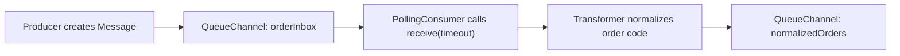

# Receive Timeout in Message Channels

Receive timeout is the duration a receive operation is willing to wait when no message is available yet. In the **Message channel** chapter of **SPRING_INTEGRATION_CORE**, understanding this parameter properly helps design the link between `MessageChannel` and endpoints: how quickly a flow responds, how long an execution thread is held, and when a polling cycle finishes.

This lesson focuses on `PollableChannel`, especially `QueueChannel`, and then applies it to Java DSL and `MessagingTemplate`. This knowledge also helps distinguish waiting for a message from error handling, waiting for a gateway reply, and waiting for group completion in an aggregator.

## 1. Where Does the Wait Time Sit in the Message Flow?

Consider an order-code processing flow:



The producer sends a `Message` into `orderInbox`. The endpoint connected to this channel actively pulls messages to pass to the transformer. If the queue is empty, the endpoint must decide whether to keep waiting or finish the receive attempt.

There are three separate intervals:

| Interval | Start and End | Related Configuration |
| --- | --- | --- |
| Waiting to receive a message | From calling receive until a message arrives or the wait expires | `receive(timeout)`, `receiveTimeout` |
| Processing the message | From when the handler receives the message until processing finishes | Handler logic and timeouts of invoked resources |
| Pause between polls under fixed delay | From when a poll finishes until the next poll is scheduled, when not delegated to a separate executor | `fixedDelay` |

Receive timeout controls the first interval. Once a message is received, the handler may continue running longer than that timeout value.

## 2. The PollableChannel Contract

`MessageChannel` provides the send operation. `PollableChannel` adds receive operations; below is a trimmed signature, omitting annotations marking that the result may be `null`:

```java
public interface PollableChannel extends MessageChannel {

    Message<?> receive();

    Message<?> receive(long timeout);
}
```

`DirectChannel`, `ExecutorChannel`, and `PublishSubscribeChannel` deliver messages to subscribers and do not provide a `receive()` API in the manner of `PollableChannel`. Therefore, you do not configure a poller to pull messages directly from those channels. The distinction between the two channel categories is described in [The MessageChannel Interface](https://docs.spring.io/spring-integration/reference/channel/interfaces.html).

### 2.1. Meaning of Each Timeout Value

For standard implementations extending `AbstractPollableChannel`, such as `QueueChannel`:

| Call | When a Message Is Available | When No Message Is Available Yet |
| --- | --- | --- |
| `receive(0)` | Returns an available message | Returns `null` immediately without waiting for a message to arrive |
| `receive(500)` | Returns an available message | Waits up to about 500 milliseconds for a message; returns `null` on expiration |
| `receive(-1)` | Returns an available message | Waits indefinitely |
| `receive()` | Returns an available message | Waits indefinitely |

The API uses **milliseconds**. Negative values indicate indefinite waiting; `-1` is the conventional value. Expiring a receive timeout simply results in receiving no message, not automatically an exception. The API documentation also notes that interrupting the waiting thread can result in `null`. See [AbstractPollableChannel.receive(long)](https://docs.spring.io/spring-integration/docs/current/api/org/springframework/integration/channel/AbstractPollableChannel.html).

The words "immediately" and "at most" describe the receive operation's wait behavior. They do not establish hard real-time guarantees: OS scheduling, GC, and interceptors can make the observed total time longer.

### 2.2. A Positive Timeout Does Not Force Waiting Until Expiration

If the queue already contains a message, `receive(5000)` can return immediately. If a message arrives after about 120 milliseconds while the consumer is waiting, the receive can complete at that moment rather than waiting the full 5 seconds.

Thus, increasing receive timeout does not add latency to messages that are already ready. The noticeable cost appears when the queue is empty: the receiving thread may be held longer.

### 2.3. Timeout Belongs to the Call or Caller

There is no single shared receive timeout that forces every consumer of the same `QueueChannel` to use it. Two consumers can call:

```java
Message<?> first = channel.receive(0);
Message<?> second = channel.receive(800);
```

Each call has its own wait policy. When a poller or template has a `receiveTimeout` property, that component uses its configured value for its own receive operations.

With `QueueChannel`, one message is taken from the queue by one consumer. Another consumer may receive `null` because no message remains to take; that does not prove the producer never sent a message.

## 3. Practicing Direct Receive from QueueChannel

The example below only needs classes from Spring Integration Core and Spring Messaging. It does not require starting a Spring application context:

```java
import org.springframework.integration.channel.QueueChannel;
import org.springframework.messaging.Message;
import org.springframework.messaging.support.MessageBuilder;

public class ReceiveTimeoutDemo {

    public static void main(String[] args) {
        QueueChannel inbox = new QueueChannel(10);

        Message<?> immediate = inbox.receive(0);
        System.out.println("Immediate receive when empty: " + immediate);

        Message<?> waited = inbox.receive(150);
        System.out.println("Bounded wait when empty: " + waited);

        Message<String> order = MessageBuilder
                .withPayload("order-42")
                .setHeader("orderId", "42")
                .build();

        boolean accepted = inbox.send(order, 100);
        if (!accepted) {
            throw new IllegalStateException("Unable to put order into inbox");
        }

        Message<?> available = inbox.receive(5000);
        if (available == null) {
            throw new IllegalStateException("Did not receive the sent order");
        }

        System.out.println("Payload: " + available.getPayload());
        System.out.println("orderId: " + available.getHeaders().get("orderId"));

        System.out.println("After already pulled: " + inbox.receive(0));
    }
}
```

Expected output content:

```text
Immediate receive when empty: null
Bounded wait when empty: null
Payload: order-42
orderId: 42
After already pulled: null
```

The second receive may wait around 150 milliseconds. The receive with `5000` does not wait the full 5 seconds because the message is already available. The final call returns `null` because the previous receive removed the message from the queue.

`send(order, 100)` has a different wait time: the producer is willing to wait to send if the queue is full. It does not set a receive timeout for the consumer. Queue behavior and the send/receive operations are explained in [Message Channel Implementations](https://docs.spring.io/spring-integration/reference/channel/implementations.html).

Do not put `receive()` or `receive(-1)` on an empty queue in a single-threaded example like the one above: without a producer on another thread, the program could block there indefinitely.

## 4. Configuring receiveTimeout with Java DSL

In a Spring application, an endpoint connected to a `PollableChannel` typically uses a poller to receive and forward messages.

The complete example below uses the Java DSL API built into Spring Integration Core. The project needs compatible Spring version management with `spring-integration-core` and Spring Context; no separate Java DSL library is needed.

```java
import java.util.Locale;

import org.springframework.beans.factory.annotation.Qualifier;
import org.springframework.context.annotation.AnnotationConfigApplicationContext;
import org.springframework.context.annotation.Bean;
import org.springframework.context.annotation.Configuration;
import org.springframework.integration.channel.QueueChannel;
import org.springframework.integration.config.EnableIntegration;
import org.springframework.integration.dsl.IntegrationFlow;
import org.springframework.integration.dsl.Pollers;
import org.springframework.messaging.Message;
import org.springframework.messaging.support.MessageBuilder;

@Configuration
@EnableIntegration
public class ReceiveTimeoutFlowConfiguration {

    @Bean
    public QueueChannel orderInbox() {
        return new QueueChannel(100);
    }

    @Bean
    public QueueChannel normalizedOrders() {
        return new QueueChannel(100);
    }

    @Bean
    public IntegrationFlow normalizeOrders(
            @Qualifier("orderInbox") QueueChannel orderInbox,
            @Qualifier("normalizedOrders") QueueChannel normalizedOrders) {

        return IntegrationFlow.from(orderInbox)
                .transform(
                        String.class,
                        value -> value.trim().toUpperCase(Locale.ROOT),
                        endpoint -> endpoint
                                .id("normalizeOrderEndpoint")
                                .poller(Pollers.fixedDelay(200)
                                        .receiveTimeout(800)
                                        .maxMessagesPerPoll(3)))
                .channel(normalizedOrders)
                .get();
    }

    public static void main(String[] args) {
        try (AnnotationConfigApplicationContext context =
                     new AnnotationConfigApplicationContext(
                             ReceiveTimeoutFlowConfiguration.class)) {

            QueueChannel input =
                    context.getBean("orderInbox", QueueChannel.class);
            QueueChannel output =
                    context.getBean("normalizedOrders", QueueChannel.class);

            boolean accepted = input.send(MessageBuilder
                    .withPayload(" order-42 ")
                    .setHeader("orderId", "42")
                    .build(), 100);

            if (!accepted) {
                throw new IllegalStateException("Unable to send order");
            }

            Message<?> result = output.receive(2000);
            if (result == null) {
                throw new IllegalStateException(
                        "No result within the example wait timeout");
            }

            System.out.println(result.getPayload()); // ORDER-42
            System.out.println(result.getHeaders().get("orderId")); // 42
        }
    }
}
```

The configuration has three independent numbers:

| Setting | Meaning in the Example |
| --- | --- |
| `fixedDelay(200)` | Sets the fixed-delay pause between polling cycles |
| `receiveTimeout(800)` | Each poller receive from `orderInbox` may wait 800 milliseconds if no message is available yet |
| `maxMessagesPerPoll(3)` | One polling cycle pulls and processes at most three messages, or stops early upon receiving `null` |

`output.receive(2000)` is the demo driver's own wait policy when receiving from `normalizedOrders`. It does not alter the poller reading `orderInbox`.

The poller is configured on the transformer endpoint because that is the component consuming directly from `orderInbox`. If the input channel is changed to `DirectChannel`, remove the corresponding poller configuration.

The DSL's `receiveTimeout(long)` method takes milliseconds. `Pollers` provides ways to create fixed-delay, fixed-rate, or cron triggers. See [PollerSpec](https://docs.spring.io/spring-integration/docs/current/api/org/springframework/integration/dsl/PollerSpec.html) and [Pollers](https://docs.spring.io/spring-integration/docs/current/api/org/springframework/integration/dsl/Pollers.html).

## 5. Distinguishing a Single Receive from a Polling Cycle

One polling cycle can contain multiple receives:

```text
Trigger fires a polling cycle
    |
    +-- receive(receiveTimeout)
    |      +-- Message present -> invoke handler
    |      +-- null            -> end cycle
    |
    +-- still within maxMessagesPerPoll limit?
           +-- yes -> perform next receive
           +-- no  -> end cycle
```

This diagram assumes the poll runs normally without errors or an endpoint stop request. Consecutive receives within the same cycle do not wait for the next trigger. However, each receive may still have to wait up to receive timeout if the queue is empty.

### 5.1. A Polling Cycle Can Last Longer Than receiveTimeout

Suppose:

- `receiveTimeout = 800` milliseconds.
- `maxMessagesPerPoll = 3`.
- Handler execution time is negligible.
- Messages arrive at 700, 1,400, and 2,100 milliseconds from the start of the cycle.

The polling cycle can unfold as follows:

| Receive | Approximate Start | Message Arrives | Wait Time of That Single Receive |
| --- | --- | --- | --- |
| 1 | 0 ms | 700 ms | 700 ms |
| 2 | 700 ms | 1,400 ms | 700 ms |
| 3 | 1,400 ms | 2,100 ms | 700 ms |

Each wait is shorter than 800 milliseconds, yet the whole cycle lasts about 2,100 milliseconds. After the third message, the cycle ends because the message limit is reached.

This is an example derived from the execution model to clarify timeout scope; the timestamps are not performance guarantees.

### 5.2. Queue Empties Mid-Cycle

If only one message is ready and the limit is three:

1. The poller receives the first message immediately.
2. The handler processes that message.
3. The poller tries to receive a second message and may wait up to 800 milliseconds.
4. If no message arrives, the result is `null` and the cycle ends.

The poller is not forced to perform all three receives once a receive returns `null`. At the same time, the second receive's receive timeout can lengthen the cycle even though the first message was processed very quickly.

A negative value for `maxMessagesPerPoll` means unlimited messages per poll; combining it with an indefinite wait can prevent the cycle from ending when data runs out. Distinguish this value from a negative `receiveTimeout`, which controls wait duration. See [Message Endpoints](https://docs.spring.io/spring-integration/reference/endpoint.html).

## 6. How Receive Timeout and Polling Cadence Affect Each Other

For a simple analysis, assume a single polling consumer, no delegation to a separate executor, fixed delay, and an always-empty queue:

- `R`: finite receive timeout.
- `D`: fixed delay.
- Ignore overhead and scheduling jitter.

Then the interval between consecutive receive start times is approximately:

```text
Cycle when empty ≈ R + D
Receives per second ≈ 1000 / (R + D)   // R and D in ms
```

With `R = 800` and `D = 200`:

```text
0 ms            800 ms      1000 ms          1800 ms
|-- wait receive --|-- pause --|-- wait receive --|
```

If a message arrives during the wait-receive interval, the consumer can take it as soon as the wait wakes up. If a message arrives during the pause interval, it waits until the next receive.

In this model, a thread is held waiting to receive roughly `800 / (800 + 200) = 80%` of the time when the system is empty. This is the fraction of time the thread is occupied, not CPU utilization.

### 6.1. Two Configurations with Different Characteristics

| Illustrative Configuration | Behavior When Messages Are Sparse | What to Consider |
| --- | --- | --- |
| `receiveTimeout(0)`, `fixedDelay(1000)` | Checks quickly then pauses; a message arriving right after a check may wait almost a second | Holds the thread very little while waiting for data |
| `receiveTimeout(800)`, `fixedDelay(200)` | Longer windows where a consumer is already waiting to receive | Holds the thread longer when empty |
| `receiveTimeout(0)`, `fixedDelay(10)` | Checks frequently | Many wakeups and empty-poll executions |

The observations above assume the scheduler is available and there is no backlog. If handlers are busy, the executor runs out of threads, or tasks queue up for scheduling, latency can be much larger.

The `R + D` formula does not apply verbatim to fixed rate, cron, custom executors, or queues that continuously have data. In particular, fixed rate does not guarantee a busy thread can start a new receive on schedule.

### 6.2. Choosing Timeouts by Operational Goals

A sensible process:

1. Define acceptable wait time before processing begins, separate from business processing duration.
2. Estimate how many endpoints need to poll concurrently and how many scheduler/executor threads are available.
3. Choose a finite receive timeout along with a trigger and per-poll message limit.
4. Observe time from send to processing start, queue depth, and thread utilization.
5. Tune based on real load, especially quiet periods and traffic spikes.

Lowering receive timeout helps when many endpoints share threads and frequently encounter empty queues. If the goal is fast reaction to new messages while still using a pollable channel, you can increase the receive wait combined with a short pause, while provisioning enough execution resources.

There is no single optimal receive timeout for all integration flows.

## 7. Managing Execution Threads and Application Shutdown

`PollingConsumer` has a default receive timeout of **1,000 milliseconds**. This default belongs to the polling consumer; it does not mean a direct `QueueChannel.receive()` call automatically times out after one second. See [PollingConsumer.DEFAULT_RECEIVE_TIMEOUT](https://docs.spring.io/spring-integration/docs/current/api/org/springframework/integration/endpoint/PollingConsumer.html).

When a poller has no separate executor, its work runs on a scheduler thread. Many endpoints waiting long periods on empty queues at once can tie up all available threads, delaying other endpoints.

Options to consider:

- Use a shorter receive timeout when waiting long brings little benefit.
- Configure an appropriate executor for polling tasks when work must be separated from the scheduler.
- Set appropriate bounds on the executor's thread count and task queue.
- Monitor rejected tasks, queued tasks, and actual latency after changes.

A dedicated executor moves where tasks execute; it still consumes resources for waiting receives. When allowing multiple poll tasks to run concurrently, also consider handler thread safety and processing completion order. Pulling order from the queue does not guarantee completion order under parallel processing.

Notes on pollers, schedulers, and executors are covered in [Configuring the Task Scheduler](https://docs.spring.io/spring-integration/reference/configuration/namespace-taskscheduler.html).

With indefinite receiving, a consumer can block when the queue runs out of data. Stopping an endpoint and cancelling tasks also depend on lifecycle mechanisms, the executor, and how running code responds to interruption. Do not assume a `stop()` call always cuts off all executing work instantaneously.

If writing a custom receive loop, include a termination condition and respect thread interruption status. Avoid tight loops calling `receive(0)` on an empty queue without pauses or throttling.

## 8. Receive Timeout in MessagingTemplate

When application code needs to pull actively from a channel, `MessagingTemplate` can be used:

```java
import org.springframework.integration.channel.QueueChannel;
import org.springframework.integration.core.MessagingTemplate;
import org.springframework.messaging.Message;

public class TemplateReceiver {

    public Message<?> receiveNext(QueueChannel inbox) {
        MessagingTemplate template = new MessagingTemplate();
        template.setReceiveTimeout(250);

        return template.receive(inbox);
    }
}
```

If `inbox` is empty, the call may wait 250 milliseconds. The caller must handle a `null` return value.

This configuration applies only to operations executed by that template. It does not change the receive timeout of another polling consumer reading the same channel.

`MessagingTemplate` also provides a receive overload taking an explicit timeout:

```java
Message<?> message = template.receive(inbox, 50);
```

In this call, `50` is the timeout passed explicitly for the receive operation. Receive methods require a pollable destination; passing a `DirectChannel` does not turn it into a queue. See [MessagingTemplate](https://docs.spring.io/spring-integration/docs/current/api/org/springframework/integration/core/MessagingTemplate.html).

The receive timeout property also participates in the template's `sendAndReceive` operation during the reply-wait phase. Analyze the send operation and receive operation separately; that value does not create a deadline for all downstream processing. The configuration API is described at [GenericMessagingTemplate.setReceiveTimeout](https://docs.spring.io/spring-framework/docs/current/javadoc-api/org/springframework/messaging/core/GenericMessagingTemplate.html).

Do not mutate the timeout of a shared template per request to apply different policies: that is shared configuration and can cause flows to interfere with one another. For direct receive operations, prefer the overload passing a timeout whenever individual calls need distinct values.

## 9. Distinguishing from Other Types of Timeouts

| Concept | What Is Being Waited On? | Does Channel Receive Timeout Solve It? |
| --- | --- | --- |
| Send timeout | Waiting to be able to send a message, e.g. waiting for space in a full queue | No; inspect the send operation |
| Receive timeout | Waiting to retrieve a message | This is the scope of this lesson |
| Polling interval | Waiting for the next poll cycle to trigger | Adjust the trigger |
| Gateway reply timeout | Waiting for a response to a request–reply call | Configured on the gateway; does not replace endpoint receive timeouts |
| HTTP/JDBC timeout | Waiting for connection or external resource response | Configure the corresponding client/driver |
| Aggregator group timeout | Waiting for a message group to become complete or expire | Configure group lifecycle |
| Message validity window | Waiting until a message is considered expired by business rules | Requires expiration checks or a supporting component |

For example, a poller receives a message after 10 milliseconds and then the handler makes an HTTP call lasting 8 seconds. Even if the poller sets `receiveTimeout(100)`, the HTTP call can still take 8 seconds if the client and execution mechanism allow it.

Similarly, in a synchronous flow through `DirectChannel`, the handler runs on the caller's thread. A gateway's reply timeout does not interrupt a handler running on that same thread. When an asynchronous boundary exists, the caller may time out waiting for a response while downstream work continues. See [Gateway Behavior When No Response Arrives](https://docs.spring.io/spring-integration/reference/gateway.html).

Receive timeout must therefore be placed within the overall time budget: schedule wait, receive wait, processing, resource access, and reply wait are distinct segments.

## 10. Timeouts, Processing Errors, and Late Messages

### 10.1. Receiving null Does Not Produce an ErrorMessage

With a standard `QueueChannel`, timing out on an empty queue is usually a normal outcome:

```java
Message<?> message = inbox.receive(300);

if (message == null) {
    // No message received yet; choose behavior appropriate for the caller.
    return;
}
```

Receiving no message means the handler for that receive attempt was not called. There is no handler failure to route automatically into `errorChannel`.

An exception thrown while a handler processes a message during a polling task is a different situation; the error mechanism depends on scheduler, executor, and error handler configuration. See [Error Handling](https://docs.spring.io/spring-integration/reference/error-handling.html).

If business requirements demand "a response within 300 milliseconds," the caller may translate receiving no message into an application status or exception. That is the caller's policy, not evidence that the message failed in processing.

### 10.2. Messages Arriving After Timeout Can Still Be Received

Consider a standard `QueueChannel` with no other consumers or expiration mechanism:

```text
t =   0 ms: consumer calls receive(300)
t ≈ 300 ms: no message yet, receive returns null
t = 350 ms: producer sends a message into the queue
t = 500 ms: consumer calls receive(0), retrieves that message
```

A timeout on the earlier receive does not discard a message sent later. Nor does it attach a 300-millisecond time-to-live to every message in the channel.

### 10.3. Receiving a Message Does Not Mean Processing Succeeded

After a message has been pulled from an in-memory `QueueChannel`, the handler may throw an exception. Receive timeout does not automatically put the message back into the queue and does not guarantee retries or persistence.

If error recovery is needed, design retries, error handling, and durable storage explicitly. Using transactions only provides recovery to the extent supported by resources actually enlisted in the transaction; delivery guarantees cannot be inferred from timeout configuration alone.

## 11. Testing Behavior Without Depending on Exact Clocks

The test examples below use JUnit Jupiter and the Spring classes introduced above. The goal is to verify receive outcomes, message removal from the queue, and receiving a message sent after an earlier wait finished.

```java
import org.junit.jupiter.api.Test;
import org.junit.jupiter.api.Timeout;
import org.springframework.integration.channel.QueueChannel;
import org.springframework.messaging.Message;
import org.springframework.messaging.support.MessageBuilder;

import static org.junit.jupiter.api.Assertions.assertEquals;
import static org.junit.jupiter.api.Assertions.assertNotNull;
import static org.junit.jupiter.api.Assertions.assertNull;
import static org.junit.jupiter.api.Assertions.assertTrue;

@Timeout(5)
class ReceiveTimeoutBehaviorTest {

    @Test
    void emptyQueueCanBeCheckedWithoutWaiting() {
        QueueChannel channel = new QueueChannel(2);

        assertNull(channel.receive(0));
    }

    @Test
    void availableMessageIsTakenOnce() {
        QueueChannel channel = new QueueChannel(2);

        assertTrue(channel.send(MessageBuilder
                .withPayload("order-42")
                .build(), 0));

        Message<?> received = channel.receive(1000);

        assertNotNull(received);
        assertEquals("order-42", received.getPayload());
        assertNull(channel.receive(0));
    }

    @Test
    void timedOutReceiveDoesNotDiscardAFutureMessage() {
        QueueChannel channel = new QueueChannel(2);

        assertNull(channel.receive(25));

        assertTrue(channel.send(MessageBuilder
                .withPayload("late-order")
                .build(), 0));

        Message<?> received = channel.receive(0);

        assertNotNull(received);
        assertEquals("late-order", received.getPayload());
    }
}
```

`@Timeout(5)` sets an overall five-second limit per test to catch hangs, without requiring a receive operation to finish at an exact millisecond mark. These tests verify outcomes; they do not prove exact timing bounds or waking up a blocked consumer.

When extending tests for a Java DSL flow, verify the following scenarios:

| Scenario | Outcome to Observe |
| --- | --- |
| Send a valid message to input | Output receives the normalized payload and business header |
| Input empty during a poll | No output, no error generated merely for lack of messages |
| Send more than the per-poll limit | All messages are processed across subsequent polls while the endpoint remains active |
| Producer sends while consumer is waiting | Consumer receives the message without waiting out the full receive timeout |
| Handler processes longer than receive timeout | Handler is not aborted simply for exceeding that duration |

With multi-threaded tests, use a latch or synchronization primitive to coordinate producer and consumer, and set finite timeouts when awaiting results. Avoid relying on a single `Thread.sleep(10)` to guess that another thread has begun waiting.

If measuring duration is needed, use a monotonic clock such as `System.nanoTime()`, appropriate tolerance bands, and explicit environment conditions. Do not use assertions like "must equal 25 milliseconds" in ordinary tests.

## 12. Diagnosing Common Misconceptions

| Symptom | Points to Check | Resolution Approach |
| --- | --- | --- |
| Set `receiveTimeout = 100` yet handler runs for seconds | Are you expecting receive wait timeout to cut off business logic? | Configure resource timeouts and appropriate execution mechanisms |
| Queue has data yet endpoint starts processing late | Is the poller in fixed delay, waiting for the scheduler, or waiting for the executor? | Observe receive start times and execution resources |
| Application holds many threads despite almost no messages | Are many pollers waiting with large timeouts? | Review receive timeouts and scheduler/executor allocation |
| Consumer gets `null` while logs show message was sent | Did another consumer take it or did it arrive after the wait? | Check competing consumers and timeline |
| Trying to configure `receiveTimeout` on `DirectChannel` | Does the channel support polling? | Choose the right subscriber model or use a pollable channel |
| Received `null` yet `errorChannel` has no messages | Was there an actual exception or just a receive timeout? | Handle missing-message outcomes on the caller side |
| Test hangs on an empty queue | Was `receive()` called or a negative timeout passed? | Use finite timeouts and ensure termination conditions |

When reading an integration flow, clearly identify **who calls receive**, **on which channel**, **how long each attempt waits**, and **when the trigger allows the next receive**. These four facts explain latency accurately without confusing receive timeout with end-to-end message processing time.
