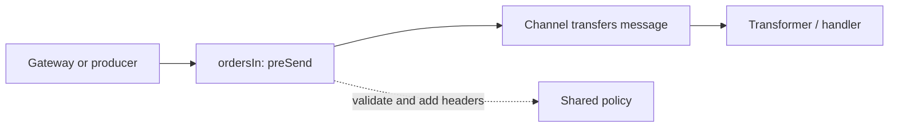

# Channel Interceptors

In the **Message channel** chapter of the **SPRING_INTEGRATION_CORE** module, channel interceptors allow adding shared behavior wherever messages pass through a channel. This lesson explains how to intercept send, receive, and handler invocation operations; from there, you can design flows with controlled headers, observability, and clear error handling.

After this lesson, you will be able to:

- Choose the right callbacks for send, receive, and completion operations.
- Distinguish channel acceptance of a message from business processing completion.
- Register interceptors on a single channel, in Java DSL, or across multiple channels.
- Predict outcomes when an interceptor blocks a message or throws an exception.
- Design tests for interceptor chains and asynchronous boundaries.

The examples use Java 17+, Spring Integration 6.5 APIs, and Spring Framework 6.2. When practicing in a Spring Boot project, use the project-managed dependency versions to keep Spring libraries compatible. `spring-integration-core` is required; the illustrative tests use JUnit Jupiter. Learners should already know `Message`, headers, `DirectChannel`, `QueueChannel`, and the basic structure of `IntegrationFlow`.

## 1. Where Do Interceptors Sit in a Flow?

Suppose a system receives order requests from a gateway. Every request must carry a `tenantId` and an application-managed trace ID. Instead of repeating header checks across multiple handlers, an interceptor can be placed on the intake channel:



`ChannelInterceptor` belongs to the `org.springframework.messaging.support` package. The channel invokes the interceptor during send or receive operations. Its methods have default implementations, so an interceptor only needs to override the callbacks that serve its purpose. [Spring Integration: Channel Interceptors](https://docs.spring.io/spring-integration/reference/6.5/channel/interceptors.html)

Placing behavior according to responsibility keeps flow diagrams easy to understand:

| Need in the Order System | Suitable Component |
| --- | --- |
| Validate infrastructure headers at the entry point | Channel interceptor |
| Convert JSON into an order command | Transformer |
| Select a flow by order type | Router |
| Discard orders failing business rules and send to a reject branch | Filter with discard channel |
| Combine multiple processing results | Aggregator |
| Retry a call to the payment service | Endpoint advice |
| Observe messages via a side branch | Wire tap |

These are design choices for this example. If validation hidden in an interceptor prevents operators from seeing an important business step, represent that step as an explicit endpoint instead.

## 2. Six Fundamental Callbacks

Method names reflect two separate operations: `send()` and `receive()`.

| Callback | Role | Return Value |
| --- | --- | --- |
| `preSend(message, channel)` | Runs before the channel sends the message | Message to proceed with; `null` blocks sending |
| `postSend(message, channel, sent)` | Observes the outcome when the send operation returns normally | `void` |
| `afterSendCompletion(message, channel, sent, ex)` | Completes the send attempt, supporting resource cleanup on error | `void` |
| `preReceive(channel)` | Runs before pulling a message | `true` permits receiving; `false` blocks it |
| `postReceive(message, channel)` | Runs after a message is retrieved | Message to return; `null` blocks further delivery |
| `afterReceiveCompletion(message, channel, ex)` | Completes the receive attempt, including empty receives or errors | `void` |

The three receive callbacks apply only to `PollableChannel`. Attaching an interceptor to `DirectChannel` does not produce `receive()` calls. See the official contract in [ChannelInterceptor Javadoc](https://docs.spring.io/spring-framework/docs/6.2.x/javadoc-api/org/springframework/messaging/support/ChannelInterceptor.html).

Note an extra condition on completion callbacks: for a given interceptor itself, `afterSendCompletion()` is only called after its `preSend()` returned a message; `afterReceiveCompletion()` is only called after its `preReceive()` returned `true`. Therefore, do not put a resource into a state requiring cleanup and expect the completion callback to run if that same `pre...` callback is about to reject or throw an exception.

## 3. Lifecycle and Execution Order

### 3.1. Successful Send Path

Suppose a channel has two interceptors, listed in order `A, B`, and no callback throws an error:

```text
A.preSend
B.preSend
channel performs send
A.postSend
B.postSend
B.afterSendCompletion
A.afterSendCompletion
```

The `preSend` and `postSend` callbacks run in list order; completion callbacks run in reverse order. The message returned by A becomes the input to B. This is the interceptor chain behavior in [AbstractMessageChannel of Spring Integration 6.5.0](https://raw.githubusercontent.com/spring-projects/spring-integration/v6.5.0/spring-integration-core/src/main/java/org/springframework/integration/channel/AbstractMessageChannel.java).

For example, if A adds a trace ID and B logs it, B sees the newly added ID. If you reverse the two interceptors, B's log may lack the ID. Thus, ordering is a configuration detail that must be made explicit.

### 3.2. Blocking Send with `null`

If B returns `null` from `preSend()`:

```text
A.preSend -> returns message
B.preSend -> returns null
A.afterSendCompletion(sent=false, ex=null)
send(...) -> false
```

No actual send happens and `postSend()` does not run. B receives no completion callback for this invocation because B did not pass its own `preSend()` step. Interceptors after B are not called either.

Returning `null` does not automatically produce an error message or a message on a discard channel. If a producer calls `MessageChannel.send()` directly, it must handle the `false` result. A gateway or higher-level sending component may apply its own timeout or error-reporting policy; test at the actual entry point your application uses.

### 3.3. When an Exception Occurs

If B throws an exception inside `preSend()`, earlier interceptors that already completed that step, such as A, receive their completion callback with the corresponding `ex`. B must clean up any resources it opened before throwing the exception.

If the send operation itself throws an error, the `postSend()` chain never starts. If an error occurs inside `postSend()`, remaining `postSend()` callbacks do not continue, while the completion chain still cleans up resources for interceptors that passed `preSend()`.

A notable situation is `sent=true` alongside `ex!=null`: the channel sent successfully, yet a `postSend()` callback failed. In that case, blindly resending can cause duplicate side effects. Inspect both `sent` and `ex`, and design idempotency at the business execution layer.

### 3.4. Receive Path and Empty Queues

With `QueueChannel`, a receive where a message passes through runs:

```text
A.preReceive
B.preReceive
take message from queue
A.postReceive
B.postReceive
B.afterReceiveCompletion
A.afterReceiveCompletion
return message to caller
```

If `receive(0)` sees an empty queue, there is no `postReceive()`; completion callbacks still run for interceptors that permitted the receive, with `message=null`, `ex=null`. Consequently, polling attempt counts must be measured separately from actual messages received. If `preReceive()` returns `false`, no message is pulled from the queue. [AbstractPollableChannel of Spring Integration 6.5.0](https://raw.githubusercontent.com/spring-projects/spring-integration/v6.5.0/spring-integration-core/src/main/java/org/springframework/integration/channel/AbstractPollableChannel.java)

If `postReceive()` returns `null`, the message has already been removed from the queue. In the in-memory queue example, it does not automatically go back into the queue. This is why a filter and discard branch should be used when discarded messages need explicit tracking. Recovery capabilities when using a message store and transactions depend on the specific configuration.

## 4. Understanding `sent`, Threads, and Processing Boundaries

`sent` reflects the result of the send operation on the intercepted channel.

| Channel in Typical Configuration | What Happens on Send? | What Can Be Concluded from `sent=true`? |
| --- | --- | --- |
| `DirectChannel` | Handler is invoked on the sending thread | The synchronous processing call returned normally at this boundary |
| `QueueChannel` | Message is placed into the queue | The queue accepted the message |
| `ExecutorChannel` with a thread pool | Work is handed off to the executor | Work was accepted for dispatch; the handler may not be done yet |

A chain starting with `DirectChannel` can still hand off to a queue or executor downstream. In that case, send completion at the entry point only covers the processing that ran synchronously.

With a channel using an executor, send callbacks run on the thread calling `send()`; handler work may run on a worker. The handler may start before `postSend()` runs, or start after `send()` has returned. An executor configuration can also allow running directly on the caller, such as with a synchronous executor or caller-runs policy. Do not rely on the channel class name to guarantee the actual thread. [Spring Integration: ExecutorChannel configuration](https://docs.spring.io/spring-integration/reference/channel/configuration.html#executorchannel-configuration)

With a queue, send and receive are two independent calls. If producer and consumer run concurrently, do not assume a total ordering across all callbacks on both sides. For instance, the consumer may pull the message before the producer finishes running `postSend()`. [Spring Integration: relationship between send and receive](https://docs.spring.io/spring-integration/reference/channel/interceptors.html)

Applying this to the order system design:

- Name the metric `channel.send.accepted` if it counts send outcomes.
- Emit an "order processed" event where the business outcome is known.
- Record transaction commits via a transaction-bound mechanism when that level of accuracy is needed.
- Measure handler processing time at the handler boundary; measure end-to-end duration using trace IDs and corresponding event milestones.

## 5. Example: Validating Tenant and Adding a Trace ID

### 5.1. Ingress Policy

In the example, internal producers have already authenticated the tenant before creating the message. The interceptor requires `tenantId` to be a non-blank string, and adds `appTraceId` if not already present.

`tenantId` here is merely metadata set by a trusted component. Checking that a header exists is not sufficient to authorize access. If an external client can supply headers itself, the authentication step must bind the tenant to the identity before the flow uses it.

Place the following class in package `study.integration` when practicing:

```java
package study.integration;

import java.util.UUID;

import org.springframework.messaging.Message;
import org.springframework.messaging.MessageChannel;
import org.springframework.messaging.MessageDeliveryException;
import org.springframework.messaging.support.ChannelInterceptor;
import org.springframework.messaging.support.MessageBuilder;

public final class IngressHeadersInterceptor implements ChannelInterceptor {

    public static final String TENANT_ID = "tenantId";
    public static final String APP_TRACE_ID = "appTraceId";

    @Override
    public Message<?> preSend(Message<?> message, MessageChannel channel) {
        Object tenant = message.getHeaders().get(TENANT_ID);

        if (!(tenant instanceof String tenantId) || tenantId.isBlank()) {
            throw new MessageDeliveryException(
                    message, "tenantId must be a non-blank string");
        }

        Object trace = message.getHeaders().get(APP_TRACE_ID);
        if (trace != null) {
            if (!(trace instanceof String traceId) || traceId.isBlank()) {
                throw new MessageDeliveryException(
                        message, "appTraceId must be a non-blank string");
            }
            return message;
        }

        return MessageBuilder.fromMessage(message)
                .setHeader(APP_TRACE_ID, UUID.randomUUID().toString())
                .build();
    }
}
```

`MessageBuilder.fromMessage()` initializes a builder from the existing message. This preserves required application and routing headers when adding a header, instead of building a payload-only message and forgetting to copy headers. [MessageBuilder Javadoc](https://docs.spring.io/spring-framework/docs/6.2.x/javadoc-api/org/springframework/messaging/support/MessageBuilder.html)

This class uses a dedicated `appTraceId` for illustration, not as a replacement for a tracing library's propagation mechanism. Do not use `MessageHeaders.ID` as a business identifier expected to stay constant across message reconstructions. Keeping the same payload also does not mean the payload was deep-copied; prefer immutable payloads when sharing across branches.

### 5.2. Local Registration and Flow Construction

The following configuration has a synchronous input channel, a transformer, and a result queue:

```java
package study.integration;

import java.util.Locale;

import org.springframework.context.annotation.Bean;
import org.springframework.context.annotation.Configuration;
import org.springframework.integration.channel.DirectChannel;
import org.springframework.integration.channel.QueueChannel;
import org.springframework.integration.config.EnableIntegration;
import org.springframework.integration.dsl.IntegrationFlow;

@Configuration
@EnableIntegration
public class OrdersConfiguration {

    @Bean
    public IngressHeadersInterceptor ingressHeadersInterceptor() {
        return new IngressHeadersInterceptor();
    }

    @Bean
    public DirectChannel ordersIn(IngressHeadersInterceptor interceptor) {
        DirectChannel channel = new DirectChannel();
        channel.addInterceptor(interceptor);
        return channel;
    }

    @Bean
    public QueueChannel orderResults() {
        return new QueueChannel(10);
    }

    @Bean
    public IntegrationFlow ordersFlow(
            DirectChannel ordersIn, QueueChannel orderResults) {

        return IntegrationFlow.from(ordersIn)
                .transform(String.class,
                        payload -> payload.strip().toUpperCase(Locale.ROOT))
                .channel(orderResults)
                .get();
    }
}
```

`addInterceptor()` appends to the end of the list. The `InterceptableChannel` API also supports indexed insertion, inspecting the list, and replacing the entire list. Note that `setInterceptors()` clears the previous list before setting the new one. [InterceptableChannel Javadoc](https://docs.spring.io/spring-framework/docs/6.2.x/javadoc-api/org/springframework/messaging/support/InterceptableChannel.html)

Simply declaring a `ChannelInterceptor` bean does not automatically attach it to every channel. In this configuration, attachment happens explicitly in `ordersIn()`.

### 5.3. Sending and Observing Results

The demo runner below uses the two classes above:

```java
package study.integration;

import org.springframework.context.annotation.AnnotationConfigApplicationContext;
import org.springframework.integration.channel.DirectChannel;
import org.springframework.integration.channel.QueueChannel;
import org.springframework.messaging.Message;
import org.springframework.messaging.support.MessageBuilder;

public final class OrdersDemo {

    public static void main(String[] args) {
        try (var context =
                new AnnotationConfigApplicationContext(OrdersConfiguration.class)) {

            DirectChannel input =
                    context.getBean("ordersIn", DirectChannel.class);
            QueueChannel results =
                    context.getBean("orderResults", QueueChannel.class);

            Message<String> request = MessageBuilder
                    .withPayload("  order-1001  ")
                    .setHeader(IngressHeadersInterceptor.TENANT_ID, "tenant-a")
                    .build();

            boolean sent = input.send(request, 1_000);
            Message<?> result = results.receive(1_000);

            System.out.println("sent=" + sent);

            if (result == null) {
                throw new IllegalStateException("Did not receive result");
            }

            System.out.println("payload=" + result.getPayload());
            System.out.println("tenantId=" + result.getHeaders().get("tenantId"));
            System.out.println("hasTrace="
                    + result.getHeaders().containsKey("appTraceId"));
        }
    }
}
```

Expected output:

```text
sent=true
payload=ORDER-1001
tenantId=tenant-a
hasTrace=true
```

Steps occurring in the example:

1. `ordersIn` invokes the interceptor to validate headers.
2. The interceptor adds `appTraceId` and returns the message to continue.
3. The transformer normalizes the payload.
4. The output message is placed into `orderResults`.
5. The `send()` call returns, and then the program pulls the result from the queue.

The queue has a capacity of 10 so the example has a bounded buffer. The timeout parameter on the `DirectChannel` send is not a deadline imposed on all code inside the transformer or every downstream send. When building real flows, configure timeouts at the specific component performing a blocking operation.

## 6. Attaching Interceptors Directly in Java DSL

If you want to express a channel and its interceptor at the same place in the flow, you can use `interceptor(...)` on the channel spec:

```java
@Bean
public IntegrationFlow alternativeOrdersFlow(
        IngressHeadersInterceptor interceptor,
        QueueChannel orderResults) {

    return IntegrationFlow.from("orders.raw")
            .channel(channels -> channels.direct("orders.checked")
                    .interceptor(interceptor))
            .transform(String.class,
                    payload -> payload.strip().toUpperCase(Locale.ROOT))
            .channel(orderResults)
            .get();
}
```

This snippet is an alternative to the `ordersFlow` bean in the previous example, using the same imports and supporting beans in that configuration. The entry point is `orders.raw`; the interceptor is attached to `orders.checked`. Producers must send to this entry point when trying the DSL variant.

The `interceptor(ChannelInterceptor...)` method is on `MessageChannelSpec`. It configures the channel created by the spec; the call site expresses which boundary is intercepted. [MessageChannelSpec Javadoc](https://docs.spring.io/spring-integration/api/org/springframework/integration/dsl/MessageChannelSpec.html)

Suppose there is another channel before `orders.checked`: a successful send to that earlier channel only describes that earlier boundary. Test design should verify both ingress acceptance and the final output the application needs.

## 7. Global Channel Interceptors

### 7.1. Applying by Channel Name

When multiple channels share a policy, a global interceptor can be declared. The example below is a registration alternative to calling `addInterceptor()` or `interceptor(...)` with the same instance in earlier sections:

```java
import org.springframework.context.annotation.Bean;
import org.springframework.integration.config.GlobalChannelInterceptor;

@Bean
@GlobalChannelInterceptor(
        patterns = {"!orders.audit*", "orders.*"},
        order = -100)
public IngressHeadersInterceptor ingressHeadersInterceptor() {
    return new IngressHeadersInterceptor();
}
```

Place this bean in a configuration with `@EnableIntegration` infrastructure. When using the global approach, remove local registration of the same interceptor to avoid applying it twice.

| Channel Name | Matches Example? | Reason |
| --- | --- | --- |
| `orders.in` | Yes | Matches `orders.*` |
| `orders.checked` | Yes | Matches `orders.*` |
| `orders.audit` | No | Matches exclusion pattern first |
| `orders.audit.raw` | No | Matches exclusion pattern first |
| `ordersIn` | No | No dot after `orders` |
| `payments.in` | No | Not in the selected namespace |

Patterns are evaluated under the rule that the first matching pattern decides the result. Therefore, place exclusions before broader inclusion patterns. This is the behavior of [PatternMatchUtils.smartMatch](https://raw.githubusercontent.com/spring-projects/spring-integration/v6.5.0/spring-integration-core/src/main/java/org/springframework/integration/support/utils/PatternMatchUtils.java).

Channel names in global configuration are part of the operational contract. For example, `orders.*` does not include the `ordersIn` bean from the earlier local configuration; rename intentionally or choose appropriate patterns when switching approaches.

### 7.2. Ordering Global and Local Interceptors

A global interceptor with a negative `order` is placed before interceptors configured directly on the channel; a positive value is placed after. Among global interceptors, the `order` value determines relative order. [GlobalChannelInterceptor Javadoc](https://docs.spring.io/spring-integration/api/org/springframework/integration/config/GlobalChannelInterceptor.html)

Example design:

```text
global: header validation    order = -100
local:  channel wire tap
global: intake statistics    order = 100
```

With this arrangement, the wire tap sees headers that have already been validated and enriched. If observation must also include rejected messages, place an observation point before the rejection step or record them explicitly inside that step.

Use distinct order values when ordering matters, and verify the channel's `getInterceptors()` list in tests.

### 7.3. Scope of "Global"

"Global" still depends on channels managed by Spring Integration infrastructure and channel names matching the patterns. Creating a channel via `new DirectChannel()` and using it entirely outside Spring does not automatically attach global interceptors.

Since Spring Integration 5.1, the global mechanism also supports channels registered dynamically through infrastructure such as `IntegrationFlowContext`. When adding dynamic flows, still verify channel names and pattern matching. [Spring Integration: global interceptors and dynamic channels](https://docs.spring.io/spring-integration/reference/6.5/channel/interceptors.html)

Do not use overly broad patterns purely for convenience: in the example, the tenant-requiring policy should cover channels that have a tenant contract, rather than accidentally applying to error channels or internal task channels.

## 8. When Handler Invocation on an Executor Must Be Intercepted

`ExecutorChannelInterceptor` extends `ChannelInterceptor` with two callbacks:

| Callback | Observation Point |
| --- | --- |
| `beforeHandle(message, channel, handler)` | Before invoking the target handler |
| `afterMessageHandled(message, channel, handler, ex)` | After the handler call, for completion and resource cleanup |

`beforeHandle()` can return a new message or `null` to skip that handler invocation. That interceptor's completion callback only runs when `beforeHandle()` returned a message. These callbacks are supported by compatible channels/dispatchers; do not assume every `MessageChannel` invokes them. [ExecutorChannelInterceptor Javadoc](https://docs.spring.io/spring-framework/docs/6.2.x/javadoc-api/org/springframework/messaging/support/ExecutorChannelInterceptor.html)

Example of an interceptor observing handlers without storing per-message state in fields:

```java
package study.integration;

import org.springframework.messaging.Message;
import org.springframework.messaging.MessageChannel;
import org.springframework.messaging.MessageHandler;
import org.springframework.messaging.support.ExecutorChannelInterceptor;

public final class HandlerLoggingInterceptor
        implements ExecutorChannelInterceptor {

    private static final System.Logger LOGGER =
            System.getLogger(HandlerLoggingInterceptor.class.getName());

    @Override
    public Message<?> beforeHandle(
            Message<?> message,
            MessageChannel channel,
            MessageHandler handler) {

        LOGGER.log(System.Logger.Level.DEBUG,
                "Starting handler, appTraceId={0}",
                message.getHeaders().get("appTraceId"));
        return message;
    }

    @Override
    public void afterMessageHandled(
            Message<?> message,
            MessageChannel channel,
            MessageHandler handler,
            Exception ex) {

        LOGGER.log(System.Logger.Level.DEBUG,
                "Finished handler, appTraceId={0}, error={1}",
                message.getHeaders().get("appTraceId"),
                ex == null ? "none" : ex.getClass().getSimpleName());
    }
}
```

Attach this instance to an `ExecutorChannel` using `addInterceptor()` as usual. Spring Integration implements handler wrapping inside its executor mechanism. [AbstractExecutorChannel of Spring Integration 6.5.0](https://raw.githubusercontent.com/spring-projects/spring-integration/v6.5.0/spring-integration-core/src/main/java/org/springframework/integration/channel/AbstractExecutorChannel.java)

On a channel broadcasting to multiple subscribers, clarify whether you are counting messages or handler invocations. One message can correspond to multiple executions.

If setting MDC or thread-bound context, set it on the thread executing the handler and restore the previous state afterward. With nested calls, simply clearing the context can wipe out an outer scope's context; save and restore per scope. Headers carry data with the message, while `ThreadLocal` binds to a thread, so they solve two different problems.

## 9. Exceptions, Error Channels, and Retries

An interceptor can detect invalid input data and throw `MessageDeliveryException`, as in the tenant example. When sending directly to a synchronous channel, the caller can catch the error via the call stack. In asynchronous processing, errors in a worker must go through the corresponding error-handling mechanism. An `errorChannel` header does not automatically convert every direct `send()` call into asynchronous error handling. [Spring Integration: Error Handling](https://docs.spring.io/spring-integration/reference/error-handling.html)

Distinguish three situations to choose the right behavior:

| Situation | Behavior Choice in Design |
| --- | --- |
| Producer violates a mandatory contract, such as missing tenant | Throw an error so the sender knows the request is invalid |
| A message may be dropped under an infrastructure policy | Return `null` intentionally, alongside rejection metrics |
| Order is rejected by business rules | Use a filter/router and an explicit rejection result branch |

Completion callbacks exist to close a scope, record outcomes, or clean up resources. They have no API to turn a send result into a controlled retry.

If a service call needs retries, place retry advice on the appropriate endpoint. Retrying over too wide a scope can re-execute upstream side effects that already succeeded. [Spring Integration: Adding Behavior to Endpoints](https://docs.spring.io/spring-integration/reference/handler-advice.html)

In the order system, a missing-tenant error must not share the same retry policy as a transient network error. A contract-violating request will keep failing if the exact same data is resent.

## 10. Wire Tap and Observability

Wire tap is a built-in option to send messages to a secondary channel, commonly used for diagnostics or auditing. Whether the secondary branch runs asynchronously depends on the target channel; the wire tap itself does not create a thread boundary. [Spring Integration: Wire Tap](https://docs.spring.io/spring-integration/reference/6.5/channel/configuration.html#wire-tap)

Design example: `orders.checked` can be tapped to `orders.audit`, which is a bounded `QueueChannel` with its own consumer. Decide how to behave if the audit branch overloads; if business rules require durable auditing, an in-memory observation branch does not satisfy that requirement.

Practical choices for the flow in this lesson:

- Log channel name, trace ID, outcome type, and exception type.
- Count blocked, successfully sent, and failed messages separately.
- Do not attach every `appTraceId` as a metric tag because cardinality grows with message volume.
- Bound the size and contents of logged headers.
- Reuse the application's existing observation/tracing mechanism if it meets requirements, avoiding duplicate instrumentation of the same operation.

Do not interpret a "passed interceptor" log line as proof that the order was recorded in all target systems. Evidence belongs where the confirmed outcome is produced.

## 11. Testing Fragile Contracts

The tests below illustrate behaviors worth protecting. They use `IngressHeadersInterceptor` from Section 5 and can be placed in the same package when practicing; these are lesson code samples, not executed repository test results.

```java
package study.integration;

import java.util.ArrayList;
import java.util.List;
import java.util.concurrent.atomic.AtomicInteger;

import org.junit.jupiter.api.Test;
import org.springframework.integration.channel.DirectChannel;
import org.springframework.integration.channel.QueueChannel;
import org.springframework.messaging.Message;
import org.springframework.messaging.MessageChannel;
import org.springframework.messaging.MessageDeliveryException;
import org.springframework.messaging.support.ChannelInterceptor;
import org.springframework.messaging.support.MessageBuilder;

import static org.junit.jupiter.api.Assertions.*;

class ChannelInterceptorsTest {

    @Test
    void addsTraceAndPreservesApplicationHeaders() {
        QueueChannel channel = new QueueChannel(1);
        channel.addInterceptor(new IngressHeadersInterceptor());

        Message<String> input = MessageBuilder.withPayload("order-1001")
                .setHeader("tenantId", "tenant-a")
                .setHeader("businessKey", "order-1001")
                .build();

        assertTrue(channel.send(input, 0));

        Message<?> received = channel.receive(0);
        assertNotNull(received);
        assertEquals("tenant-a", received.getHeaders().get("tenantId"));
        assertEquals("order-1001", received.getHeaders().get("businessKey"));
        assertFalse(received.getHeaders()
                .get("appTraceId", String.class).isBlank());
        assertFalse(input.getHeaders().containsKey("appTraceId"));
    }

    @Test
    void rejectsMissingTenantBeforeEnqueue() {
        QueueChannel channel = new QueueChannel(1);
        channel.addInterceptor(new IngressHeadersInterceptor());

        assertThrows(MessageDeliveryException.class,
                () -> channel.send(
                        MessageBuilder.withPayload("order-1001").build(), 0));

        assertNull(channel.receive(0));
    }

    @Test
    void nullFromPreSendStopsSendAndCompletesOnlyEarlierInterceptors() {
        List<String> events = new ArrayList<>();
        QueueChannel channel = new QueueChannel(1);

        channel.addInterceptor(recording("A", events));
        channel.addInterceptor(new ChannelInterceptor() {
            @Override
            public Message<?> preSend(Message<?> message, MessageChannel ch) {
                events.add("B.pre");
                return null;
            }

            @Override
            public void afterSendCompletion(
                    Message<?> message, MessageChannel ch,
                    boolean sent, Exception ex) {
                events.add("B.after");
            }
        });
        channel.addInterceptor(recording("C", events));

        assertFalse(channel.send(
                MessageBuilder.withPayload("order-1001").build(), 0));
        assertEquals(List.of("A.pre", "B.pre", "A.after:false"), events);
        assertNull(channel.receive(0));
    }

    @Test
    void sendCallbacksHaveDifferentCompletionOrder() {
        List<String> events = new ArrayList<>();
        DirectChannel channel = new DirectChannel();
        channel.addInterceptor(recording("A", events));
        channel.addInterceptor(recording("B", events));
        channel.subscribe(message -> events.add("handler"));

        assertTrue(channel.send(
                MessageBuilder.withPayload("order-1001").build(), 0));

        assertEquals(List.of(
                "A.pre", "B.pre", "handler",
                "A.post:true", "B.post:true",
                "B.after:true", "A.after:true"), events);
    }

    @Test
    void fullQueueReturnsFalseWithoutAnException() {
        QueueChannel channel = new QueueChannel(1);
        Message<String> message =
                MessageBuilder.withPayload("order-1001").build();

        assertTrue(channel.send(message, 0));
        assertFalse(channel.send(message, 0));
    }

    @Test
    void emptyQueueSkipsPostReceiveButCompletesReceive() {
        AtomicInteger postReceiveCalls = new AtomicInteger();
        AtomicInteger completionCalls = new AtomicInteger();
        QueueChannel channel = new QueueChannel(1);

        channel.addInterceptor(new ChannelInterceptor() {
            @Override
            public Message<?> postReceive(Message<?> message, MessageChannel ch) {
                postReceiveCalls.incrementAndGet();
                return message;
            }

            @Override
            public void afterReceiveCompletion(
                    Message<?> message, MessageChannel ch, Exception ex) {
                if (message == null && ex == null) {
                    completionCalls.incrementAndGet();
                }
            }
        });

        assertNull(channel.receive(0));
        assertEquals(0, postReceiveCalls.get());
        assertEquals(1, completionCalls.get());
    }

    private static ChannelInterceptor recording(
            String name, List<String> events) {

        return new ChannelInterceptor() {
            @Override
            public Message<?> preSend(Message<?> message, MessageChannel ch) {
                events.add(name + ".pre");
                return message;
            }

            @Override
            public void postSend(
                    Message<?> message, MessageChannel ch, boolean sent) {
                events.add(name + ".post:" + sent);
            }

            @Override
            public void afterSendCompletion(
                    Message<?> message, MessageChannel ch,
                    boolean sent, Exception ex) {
                events.add(name + ".after:" + sent);
            }
        };
    }
}
```

The checks use `send(..., 0)` and `receive(0)` to avoid blocking when the queue is full or empty. `ArrayList` is only used for synchronous calls within these tests. If recording callbacks from multiple threads, use a thread-safe structure.

With a full Spring configuration, add appropriate integration tests:

| What to Verify | How to Test |
| --- | --- |
| Preserves existing trace ID | Send a fixed `appTraceId` and assert it at the output |
| Wrong header type or blank string | Send each variant, assert error and no enqueue |
| Global patterns match properly | Retrieve channels by name from context and inspect interceptor lists |
| Interceptor not registered twice | Inspect interceptor list after context startup |
| Error in synchronous handler | Have subscriber throw error, verify completion receives `ex` |
| Async handler not done when send returns | Block handler with a latch and observe the send call separately |
| Async error branch works | Wait for error message on configured channel and inspect cause |

When testing asynchronously, use `CountDownLatch` or condition-based waiting with a finite timeout. A useful scenario is holding the handler at a latch, waiting for `send()` to complete, asserting the handler has not finished yet, and then releasing the latch. Release latches and close executors in `finally` so failed tests do not leak resources.

## 12. Common Design Mistakes

| Symptom | Cause to Investigate | How to Adjust |
| --- | --- | --- |
| `postReceive()` never called | Using `DirectChannel`, or queue has no messages yet | Verify `receive()` calls exist and messages are actually received |
| Missing completion log from the rejecting interceptor | That `preSend()` itself returned `null` or threw an error | Clean up resources inside the rejection branch of that callback itself |
| Messages vanish after polling | `postReceive()` returned `null` after pulling from the queue | Use an observable discard branch if tracking is a business requirement |
| Tenant logs mix across requests | Storing per-message data in a singleton field | Use local variables, headers, and proper scoped context |
| "Succeeded processing" metric is higher than reality | Counting inside `postSend()` of a queue or executor | Place measurements where the confirmed work completes |
| Global interceptor does not run | Channel outside context or name does not match pattern | Check actual channel names and interceptor lists |
| Header validated or logged twice | Same interceptor registered both locally and globally | Pick one registration method per scope |
| Flow slows down after adding audit | Tap branch is synchronous or waiting on resources | Choose appropriate channel, capacity, and overload policy |
| Resending creates duplicate orders | Previous send caused side effects before failing | Design idempotency and place retries on the right endpoint |

For self-practice, replace the input `DirectChannel` with a channel using an executor, then log threads inside send callbacks and handler callbacks. Next, test blocking in `preSend()` and in `beforeHandle()` to observe the two different boundaries. Finally, move header enrichment to a global interceptor with an explicit channel namespace and verify the interceptor list after the context initializes.
