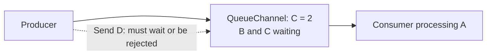

# Channel Capacity — Limiting MessageChannel Capacity

In the **SPRING_INTEGRATION_CORE** module, capacity is an important design decision when using a channel to buffer messages between endpoints. A queue decouples producer and consumer timing, yet unfinished work still consumes resources somewhere.

This lesson belongs to the **Message channel** chapter and focuses on channel capacity, behavior when a queue is full, and coordinating this limit with gateways, pollers, Java DSL, and error handling. The examples use Spring Integration 6.x style APIs, Java 17, and JUnit Jupiter; the configuration requires `spring-integration-core` in the application.

After this lesson, you will be able to:

- Choose an appropriately buffered channel and identify precisely which part of the flow capacity bounds.
- Configure bounded queues, send wait times, and intake policies under overload.
- Estimate capacity from burst traffic, memory budgets, and allowable wait times.
- Verify full-queue, send-timeout, and slot-release scenarios.

## 1. What Does Capacity Limit?

**Channel capacity** is the maximum number of messages that can sit waiting in the buffer of a bounded channel. With an in-memory `QueueChannel`, the unit of capacity is **messages**, not bytes, threads, or requests per second.

Let:

- `C`: configured capacity.
- `Q`: number of messages currently sitting in the queue.
- `I`: number of messages that have left the queue and are currently being processed on the consumer side.

When using a standard bounded queue:

```text
0 <= Q <= C
Available slots = C - Q
Total unfinished work can exceed C because of I
```

For example, a channel with `C = 2`:



At this instant, the queue holds two messages while the system has three unfinished messages. When the consumer pulls B out, a free slot opens immediately; processing B may still continue for some time.

Capacity also applies per channel instance. If three application instances each create `new QueueChannel(200)`, each instance has its own queue holding up to 200 messages. That is not a shared cluster-wide limit.

Two interpretations must be distinguished:

| Event | Meaning for an In-Memory `QueueChannel` |
|---|---|
| `send(...)` returns `true` | The channel accepted the message into the queue |
| `receive(...)` retrieves a message | The message left the queue; one free slot is returned |
| Handler finishes | One business task finished processing |
| Result persisted durably | Depends on the application's transaction and storage design |

Therefore, a successful send to the queue does not prove that the order was written to the database or that an external API received the request.

## 2. Capacity Differs Across Channel Types

Not every `MessageChannel` has an internal queue where the same capacity property can be set.

| Channel | How Messages Transfer | Where to Examine Capacity |
|---|---|---|
| `QueueChannel` | Stores messages for consumers to pull | Queue capacity |
| `PriorityChannel` | Stores and retrieves by priority | Priority queue capacity |
| `RendezvousChannel` | Direct handoff between sender and receiver | Unbuffered; capacity is 0 |
| `DirectChannel` | Invokes handler on the sending thread | No internal queue |
| `ExecutorChannel` | Hands work off to an executor | Executor's thread pool, task queue, and rejection policy |
| `PublishSubscribeChannel` | Broadcasts to subscribers | Executor if present, plus each branch's buffer |

These mechanisms are described in [Message Channel Implementations](https://docs.spring.io/spring-integration/reference/6.5/channel/implementations.html).

With `QueueChannel`, the no-argument constructor uses capacity `Integer.MAX_VALUE`, which is effectively unbounded in most practical scenarios. That value does not give the application extra RAM. The capacity constructor requires a positive integer; for unbuffered handoff, use `RendezvousChannel`. See [QueueChannel API](https://docs.spring.io/spring-integration/api/org/springframework/integration/channel/QueueChannel.html).

```java
QueueChannel bounded = new QueueChannel(200);
QueueChannel practicallyUnbounded = new QueueChannel();
RendezvousChannel handoff = new RendezvousChannel();
```

Do not use `new QueueChannel(0)` to simulate a rendezvous. In addition, a rendezvous handoff only confirms that the receiver took the message; business work on the receiver side may still be running.

## 3. Full Queue: How Long to Wait and What Is Returned?

With an in-memory `QueueChannel`, the timeout overload determines how the sender waits for space:

| Call | When Queue Has Space | When Queue Is Full |
|---|---|---|
| `send(message)` | Accepts message | Waits indefinitely by default |
| `send(message, -1)` | Accepts message | Waits indefinitely, interruptible |
| `send(message, 0)` | Accepts message | Returns `false` immediately |
| `send(message, 200)` | Accepts message | Waits up to 200 ms for space; returns `false` on timeout |

If the call fails with an error, it may throw an exception. When receiving `false`, the application needs a corresponding handling branch. The send contract and millisecond units are specified in [MessageChannel API](https://docs.spring.io/spring-framework/docs/current/javadoc-api/org/springframework/messaging/MessageChannel.html); queue wait behavior is explained at [QueueChannel](https://docs.spring.io/spring-integration/reference/channel/implementations.html#channel-implementations-queuechannel).

Minimal example, assuming no consumer yet:

```java
import org.springframework.integration.channel.QueueChannel;
import org.springframework.messaging.support.MessageBuilder;

QueueChannel queue = new QueueChannel(2);

boolean first = queue.send(MessageBuilder.withPayload("A").build(), 0);
boolean second = queue.send(MessageBuilder.withPayload("B").build(), 0);
boolean third = queue.send(MessageBuilder.withPayload("C").build(), 0);

System.out.println(first);  // true
System.out.println(second); // true
System.out.println(third);  // false
```

If the third send is replaced with `send(message)` while there is still no consumer, the calling thread may block forever. This is why intentional timeouts should be chosen at intake points with finite time budgets.

The receiving side has a symmetric mechanism: `receive(0)` returns immediately and yields `null` if the queue is empty; `receive(200)` waits up to 200 ms; `receive()` waits until a message arrives or it is interrupted.

**Send timeout only bounds waiting for the channel to accept the message.** It does not establish a deadline for the entire processing lifecycle. In particular, do not use `send(message, 200)` on a `DirectChannel` as a way to forcibly abort a handler after 200 ms.

## 4. Configuring a Bounded-Capacity Flow with Java DSL

The example below models an order-intake flow:

```text
Caller -> orderQueue(capacity = 200)
       -> polling consumer -> process order
                           -> orderErrors if poller encounters an error
```

Declaring channels as separate beans lets producers, consumers, and monitoring code share one instance. In a typical Spring application, the following configuration can be loaded via an application context:

```java
package example.integration.capacity;

import java.time.Duration;

import org.springframework.beans.factory.annotation.Qualifier;
import org.springframework.context.annotation.Bean;
import org.springframework.context.annotation.Configuration;
import org.springframework.integration.channel.PublishSubscribeChannel;
import org.springframework.integration.channel.QueueChannel;
import org.springframework.integration.config.EnableIntegration;
import org.springframework.integration.dsl.IntegrationFlow;
import org.springframework.integration.dsl.Pollers;

@Configuration
@EnableIntegration
public class CapacityFlowConfiguration {

    public record Order(String id, long amountInCents) {
    }

    @Bean
    public QueueChannel orderQueue() {
        return new QueueChannel(200);
    }

    @Bean
    public PublishSubscribeChannel orderErrors() {
        return new PublishSubscribeChannel();
    }

    @Bean
    public IntegrationFlow orderFlow(
            @Qualifier("orderQueue") QueueChannel orderQueue) {

        return IntegrationFlow.from(orderQueue)
                .handle(Order.class, (order, headers) -> {
                    System.out.println("Processed order " + order.id());
                    return null;
                }, endpoint -> endpoint.poller(
                        Pollers.fixedDelay(Duration.ofMillis(100))
                                .maxMessagesPerPoll(10)
                                .receiveTimeout(0)
                                .errorChannel("orderErrors")))
                .get();
    }

    @Bean
    public IntegrationFlow orderErrorFlow() {
        return IntegrationFlow.from("orderErrors")
                .handle(message -> {
                    Throwable failure = (Throwable) message.getPayload();
                    System.err.println("Order flow failed: " + failure);
                })
                .get();
    }
}
```

The handler returns `null` because the example is a one-way flow. In real usage, replace the log printouts with business logic and proper error recording.

The settings serve distinct roles:

| Setting | Effect |
|---|---|
| `new QueueChannel(200)` | Buffers at most 200 waiting messages |
| `fixedDelay(100 ms)` | Pause between when the previous poll completes and the next poll starts |
| `maxMessagesPerPoll(10)` | Each poll processes at most 10 messages |
| `receiveTimeout(0)` | When the queue is empty, receive returns immediately |
| `errorChannel("orderErrors")` | Selects the channel receiving errors raised from the polling task |

Java DSL provides poller configuration through `Pollers` and `PollerSpec`. See [Pollers](https://docs.spring.io/spring-integration/reference/dsl/java-pollers.html) and [PollerSpec API](https://docs.spring.io/spring-integration/api/org/springframework/integration/dsl/PollerSpec.html).

`QueueChannel` requires a consumer to perform receives. Declaring the channel alone does not create a thread to read messages. When an endpoint takes input from a `PollableChannel`, a polling consumer is responsible for calling receive on schedule. See [Message Endpoints](https://docs.spring.io/spring-integration/reference/6.5/endpoint.html).

### Declaring a Channel with the DSL Factory

You can replace **only the `orderQueue()` method** above with the following; do not register both beans with the same name:

```java
import org.springframework.context.annotation.Bean;
import org.springframework.integration.dsl.MessageChannels;
import org.springframework.integration.dsl.QueueChannelSpec;

@Bean
public QueueChannelSpec orderQueue() {
    return MessageChannels.queue(200);
}
```

`QueueChannelSpec` is a specification for Spring to create the channel. In a `@Bean` method like this, return the spec for the container to manage. When reusing a channel across multiple flows, reference the declared bean rather than creating new channels with duplicate names. See [Java DSL: Message Channels](https://docs.spring.io/spring-integration/reference/6.5/dsl/java-channels.html) and [MessageChannels API](https://docs.spring.io/spring-integration/api/org/springframework/integration/dsl/MessageChannels.html).

## 5. Producers and Gateways Must Have an Explicit Intake Policy

### Sending Directly and Checking the Result

Code inside a producer method can reuse the `Order` record declared earlier:

```java
var order = new CapacityFlowConfiguration.Order("ORD-101", 125_000L);
var message = org.springframework.messaging.support.MessageBuilder
        .withPayload(order)
        .build();

boolean accepted = orderQueue.send(message, 200);

if (!accepted) {
    throw new IllegalStateException(
            "Order not accepted: queue had no space within 200 ms");
}
```

This example reports intake failure; an application can translate it into a business response, a retry schedule, or durable persistence. Only return a successful intake result when the processing branch has truly assumed responsibility for the message.

Do not rely on `getRemainingCapacity() > 0` as a guarantee for the next send. Between reading free capacity and calling send, another producer can take the slot. The return value of `send(...)` itself determines whether that send succeeded.

### Setting Timeouts on a Messaging Gateway

A gateway lets callers invoke an interface instead of interacting directly with the messaging API:

```java
package example.integration.capacity;

import org.springframework.integration.annotation.MessagingGateway;

@MessagingGateway(
        defaultRequestChannel = "orderQueue",
        defaultRequestTimeout = "200")
public interface OrderGateway {

    void submit(CapacityFlowConfiguration.Order order);
}
```

In the Spring configuration, add `@IntegrationComponentScan` with `import org.springframework.integration.annotation.IntegrationComponentScan` to discover the gateway interface, or use the application's equivalent gateway registration mechanism.

On this gateway, `defaultRequestTimeout` limits waiting to send to `orderQueue` when full. Returning `void` expresses a one-way send. Unsuccessful sends are turned into errors by the gateway infrastructure according to configuration, so callers must handle exceptions appropriately.

For gateways returning a result, distinguish:

- **Request timeout**: wait time to send the request into a potentially blocking channel.
- **Reply timeout**: wait time for a reply message after the send phase.
- **I/O timeout**: bounds on HTTP, JDBC, or other service calls inside the handler.

Reply timeout does not automatically pull an already-accepted message out of the queue. A caller that timed out may still have its request actively processing. If the caller retries, an appropriate business key or idempotency mechanism is needed. See [Messaging Gateways — Gateway Timeouts](https://docs.spring.io/spring-integration/reference/6.5/gateway.html#gateway-timeouts).

## 6. Choosing Behavior When Full

Capacity protects resources only if the send point responds appropriately upon hitting the limit.

| Strategy | How It Is Applied | Points to Consider |
|---|---|---|
| Indefinite wait | Use the send overload without a timeout | Threads can be held long; must ensure consumers keep running |
| Bounded wait | `send(message, timeoutMs)` with a positive value | Pick a timeout within the caller's time budget |
| Immediate rejection | `send(message, 0)` and handle `false` | Caller must know the request was not accepted |
| Retry with backoff | Retry bounded by attempt count and total time | Retries add load; avoid synchronized retries from many producers |
| Offload to durable store | Write to a suitable store and process later | Requires separate write confirmation, quotas, and recovery design |
| Intentional drop | Record counts and drop rules | Use only when business logic permits losing that message type |

For instance, continuously updated sensor status data may tolerate dropping some older messages. Payment commands require a stricter intake and recovery contract. The decision rests on the business meaning of the message.

A bounded queue propagates pressure back to the producer when full, commonly called **back pressure**. This mechanism relies on blocking or rejection at the send point. It neither creates a message-demand protocol like Reactive Streams nor slows down an external HTTP client on its own.

If a producer receives `false` and immediately retries in an unbounded `while` loop, CPU usage can spike while consumer throughput stays unchanged.

## 7. Estimating Capacity Using Three Constraints

No single default capacity fits all flows. You need a range that simultaneously satisfies burst traffic, memory limits, and latency.

The formulas below are **estimation models**, assuming arrival and drain rates are roughly constant over the interval considered. They are not real-time framework guarantees.

### 7.1. Absorbing Extra Work During a Burst

Let `lambda` be the arrival rate and `mu` be the sustained drain rate, both in messages/second. Over an interval of `T` seconds when `lambda > mu`:

```text
Additional backlog ≈ (lambda - mu) × T
Required capacity  ≈ Q_initial + additional backlog + headroom
```

Suppose an order flow has test measurements:

```text
Burst arrival rate:              900 messages/s
Sustained drain rate:            600 messages/s
Burst duration:                  2 s
Queue at start of burst:         100 messages
```

After two seconds, the estimated backlog is:

```text
Q ≈ 100 + (900 - 600) × 2 = 700 messages
```

Adding a 20% headroom buffer on top of 700 yields a design target around 840 messages. This percentage is illustrative only; choose headroom from real traffic data and variance.

If `lambda > mu` persists, every finite capacity eventually fills. Increasing capacity only postpones when blocking or rejection begins. Before hitting the ceiling:

```text
Time until full ≈ (C - Q_current) / (lambda - mu)
```

With `C = 850` and `Q = 100`, the estimated time is `(850 - 100) / 300 = 2.5 seconds`. Sustaining that load long-term requires reducing arrival rate or increasing real processing capacity.

### 7.2. Staying Within the Memory Budget

An initial estimate:

```text
Memory held by queue ≈ C × average retained size per message
C_memory ≈ memory budget for queue / retained size per message
```

Retained size includes payload, headers, and referenced objects; it can differ significantly from serialized JSON length over the wire. Highly variable payload sizes make message-count limits less accurate for bounding memory.

Suppose the dedicated queue memory budget is 32 MiB and each message retains 32 KiB on average:

```text
C_memory ≈ 32 MiB / 32 KiB = 1024 messages
850 × 32 KiB ≈ 26.6 MiB
```

You must reserve memory for the rest of the application, in-flight messages, and other buffers. Validate averages against the payload size distribution, especially the tail of large messages.

### 7.3. Keeping Wait Time Within Budget

For a FIFO queue, a steady consumer, and no new stalls, the wait time of a message at the back of a queue can be estimated as:

```text
Wait time ≈ messages ahead / drain rate
```

If the wait budget is 1.5 seconds and `mu = 600 messages/s`, the corresponding backlog is roughly 900 messages. With capacity 850, the near-full wait time is around `850 / 600 = 1.42 seconds`.

This estimate does not yet add the processing time of that message itself, polling schedule delay, retries, or downstream stalls. With `PriorityChannel`, low-priority messages can wait very differently from the FIFO estimate.

In steady state, Little's Law can serve as a sanity check across average metrics of the same scope:

```text
Average waiting messages ≈ accepted message rate × average wait time
```

Do not apply this steady-state average relationship to guarantee maximum latency during a short burst or p99 latency.

### 7.4. Combining the Limits

Across all assumptions in the example:

| Constraint | Illustrative Result |
|---|---|
| Absorb burst plus headroom | Roughly 840 messages needed |
| Queue memory | Up to roughly 1024 messages under assumed average |
| Wait budget | Roughly 900 messages, excluding other delays |
| Candidate value for load testing | 850 messages |

850 is a candidate to validate via load testing. If the required backlog exceeds either the memory ceiling or the latency ceiling, change the design: throttle input, optimize consumers, partition load, or use a different storage and processing model. You cannot resolve a conflict simply by picking a larger capacity number.

## 8. Capacity and Poller Must Be Sized Together

`maxMessagesPerPoll(10)` does not create 10 workers. In Section 4's configuration, there is no separate executor for parallel execution; one poll invokes the handler sequentially for the messages it retrieves.

Assuming the queue always has data, a single polling consumer, a synchronous handler, per-message processing time `s`, and fixed delay `d`, ideal throughput can be estimated as:

```text
Throughput ≈ B / (B × s + d)
B = messages processed in one poll
```

For example, `B = 10`, `s = 20 ms`, `d = 100 ms`:

```text
Throughput ≈ 10 / (10 × 0.020 + 0.100) ≈ 33.3 messages/s
```

Do not infer a rate of 100 messages/s from `10 / 0.1`, because handler time also sits inside the poll cycle. Once an executor, asynchronous downstream calls, or schedule changes are introduced, this model no longer describes the full behavior; re-measure throughput and concurrency limits.

Adding workers only helps if downstream resources can handle it. A connection pool of 10 connections does not become 100 connections when increasing consumers to 100. The result may simply be more waiting threads.

A notable bottleneck occurs when producers occupy an entire bounded executor waiting to send into a full queue while consumers need that same executor to run. Execution scheduling must ensure consumers have a chance to drain the queue.

## 9. Check Buffers Downstream of the Channel

Consider the flow:

```text
Producer -> QueueChannel(200) -> Poller
         -> ExecutorChannel -> HTTP handler
```

If the poller hands off very quickly to an executor with a large task queue, the input `QueueChannel` may appear nearly empty while thousands of HTTP tasks wait downstream. Looking only at `getQueueSize()` on the first channel will underestimate the backlog.

`ExecutorChannel` delegates execution to an executor; the executor's bounds must be configured and monitored separately. See [ExecutorChannel API](https://docs.spring.io/spring-integration/api/org/springframework/integration/channel/ExecutorChannel.html).

When auditing total work in the system, include:

- Messages in each buffered channel.
- Queued and active tasks in executors.
- Requests holding connections or waiting on connection pools.
- Messages held in aggregators, retry schedules, or stateful components.

Set capacity according to each buffer's position and business purpose. For example, a splitter can turn one request into hundreds of messages; a router can fill one branch while other branches sit idle. An aggregator holds message groups by its own completion rules and needs dedicated timeouts and group-reaping policies. Message stores are also used by message-holding components such as aggregators, per [Message Store](https://docs.spring.io/spring-integration/reference/6.5/message-store.html).

## 10. Distinguishing Send Overload from Processing Errors

Two situations are frequently confused:

| Situation | What Happened | Where to React |
|---|---|---|
| Queue full, `send(..., 200)` returns `false` | This send was not accepted by the channel | Producer checks the return value or gateway handles send failure |
| Send succeeds, handler fails afterward | Message was accepted and then processing failed | Polling endpoint error mechanism and recovery flow |

When calling `QueueChannel.send` directly, a `false` return due to being full does not automatically turn into an `ErrorMessage` on the global `errorChannel`. Do not rely on the error channel as a substitute for checking the send result.

With a handler running on a polling thread, processing errors are typically routed through the poller's error handler mechanism. An error channel can be configured as in the `orderErrors` example. A `try/catch` around the original enqueue call does not directly catch exceptions thrown later on another thread. See [Error Handling](https://docs.spring.io/spring-integration/reference/6.5/error-handling.html).

With a standard in-memory queue, the message has already been removed from the queue when the handler starts. Throwing an exception from the handler does not put the message back into its prior spot. Retries, recovery branches, dead-letter queues, and persisting failure details must all be explicitly configured.

The error branch must also have enough capacity to operate when the main flow fails. If a bounded queue is used for errors without an appropriate consumer, error reporting itself can create another bottleneck.

## 11. Capacity and Durability Are Two Separate Properties

`new QueueChannel(200)` creates an in-memory storage limit; it provides no message recovery after an unexpected process shutdown.

Spring Integration supports channels backed by a persistent message store. However, when configuring XML `<queue message-store="..."/>`, the `capacity` attribute is not used at the same time. Do not transfer in-memory queue capacity assumptions verbatim to store-backed queues. Inspect the corresponding implementation, storage limits, and intake mechanism.

With a transactional store and a poller configured with appropriate transactions, rollback can protect pulling a message from the store. A transaction annotation on business logic does not automatically make an in-memory queue durable. See [Persistent QueueChannel Configuration](https://docs.spring.io/spring-integration/reference/6.5/channel/configuration.html#channel-configuration-queuechannel).

If the requirement is to keep accepting load even when multiple processing instances stop, evaluate a persistent store or broker against the business contract. Beyond capacity, review intake acknowledgements, recovery, retries, and duplicate handling.

## 12. Example Capacity Behavior Tests

The following tests use an in-memory `QueueChannel` and JUnit Jupiter. They focus on observable behavior; no Spring application context is required.

```java
package example.integration.capacity;

import java.util.concurrent.CountDownLatch;
import java.util.concurrent.ExecutorService;
import java.util.concurrent.Executors;
import java.util.concurrent.Future;
import java.util.concurrent.TimeUnit;

import org.junit.jupiter.api.Test;
import org.springframework.integration.channel.QueueChannel;
import org.springframework.messaging.Message;
import org.springframework.messaging.support.MessageBuilder;

import static org.junit.jupiter.api.Assertions.*;

class ChannelCapacityTest {

    private static Message<String> message(String value) {
        return MessageBuilder.withPayload(value).build();
    }

    @Test
    void rejectsImmediatelyWhenCapacityIsReached() {
        QueueChannel queue = new QueueChannel(2);

        assertTrue(queue.send(message("A"), 0));
        assertTrue(queue.send(message("B"), 0));
        assertFalse(queue.send(message("C"), 0));
        assertEquals(2, queue.getQueueSize());
    }

    @Test
    void finiteTimeoutDoesNotAddMessageWhenQueueStaysFull() {
        QueueChannel queue = new QueueChannel(1);
        Message<String> first = message("A");
        assertTrue(queue.send(first, 0));

        assertFalse(queue.send(message("B"), 50));

        assertEquals(first, queue.receive(0));
        assertNull(queue.receive(0));
    }

    @Test
    void slotIsReleasedBeforeConsumerFinishesProcessing() throws Exception {
        QueueChannel queue = new QueueChannel(1);
        Message<String> first = message("A");
        assertTrue(queue.send(first, 0));

        CountDownLatch received = new CountDownLatch(1);
        CountDownLatch allowCompletion = new CountDownLatch(1);
        ExecutorService worker = Executors.newSingleThreadExecutor();

        try {
            Future<Message<?>> processing = worker.submit(() -> {
                Message<?> taken = queue.receive(1000);
                assertNotNull(taken);
                received.countDown();
                assertTrue(allowCompletion.await(5, TimeUnit.SECONDS));
                return taken;
            });

            assertTrue(received.await(5, TimeUnit.SECONDS));
            assertFalse(processing.isDone());
            assertEquals(0, queue.getQueueSize());

            assertTrue(queue.send(message("B"), 0));
            assertEquals(1, queue.getQueueSize());

            allowCompletion.countDown();
            assertEquals(first, processing.get(5, TimeUnit.SECONDS));
        }
        finally {
            allowCompletion.countDown();
            worker.shutdownNow();
        }
    }
}
```

The second test verifies rejection after a finite timeout; it does not require execution time to equal exactly 50 ms, since thread scheduling can make total elapsed time longer. The third test uses latches to separate message retrieval from processing completion, demonstrating that capacity only bounds messages currently sitting in the queue.

When testing with a real application context, add scenarios for stopped consumers, concurrent producers, and slow handlers. Verify intake outcomes, processed message counts, and whether callers stay within their time budgets.

## 13. Observability and Diagnostics

Queue message count is one signal that should be read alongside arrival/drain rates and latency.

| Signal | Question to Answer |
|---|---|
| Queue size and remaining capacity | Is current backlog approaching the limit? |
| Successful enqueue rate | How many messages per second is the system actually accepting? |
| Rejected or timed-out send count | How much work is not being accepted? |
| Send wait duration | How long are producer threads being held? |
| Queue wait duration | How long does a message wait before a consumer starts processing it? |
| Processing duration and failure rate | Are consumers slowing down or failing en masse? |
| Executor queue, active threads, connection pool | Has backlog shifted to another resource? |
| Heap, payload sizes, GC | Is a message-count limit sufficient to protect memory? |

`QueueChannel` provides the inspection methods `getQueueSize()` and `getRemainingCapacity()`; they return snapshots at the instant of the call. Do not treat two consecutive reads as an atomic snapshot under concurrent access. See [QueueChannel API](https://docs.spring.io/spring-integration/api/org/springframework/integration/channel/QueueChannel.html).

If you want to measure time spent inside a specific queue, attach an application-managed enqueue timestamp header and record it upon dequeue. Use a consistent clock convention, and avoid confusing message creation timestamps with entry into a queue located after multiple transform or route steps.

Selected symptoms and investigation directions:

| Symptom | Direction to Check |
|---|---|
| Queue grows steadily | Compare arrival rate against drain capacity; inspect consumers and downstream |
| Queue full while CPU is low | Check I/O waits, connection pools, or unstarted consumers |
| Queue nearly empty while latency is high | Look for downstream task queues and in-flight work |
| Raising capacity only delays errors | Check whether arrival rate persistently exceeds processing rate |
| Requests wait long when queue is full | Check send overloads, request timeouts, and held threads |
| Business work runs twice after timeout | Check retry logic and duplicate-prevention mechanisms |

Alerts should be based on sustained fill levels, upward trends, and business latency. An 80% threshold can serve as an initial trial point, adjusted to traffic cadence and system response time.

## 14. Practice Exercise: Protecting an Order-Intake Flow

Perform the following in a standalone test program:

1. Create `QueueChannel(3)` with no running consumer. Send three messages with timeout 0 and verify all three are accepted.
2. Send a fourth message with timeout 0. Verify the result is `false` and the queue still holds three messages.
3. Receive one message with `receive(0)` and resend the fourth message. Verify this send succeeds.
4. Add a slow-processing polling consumer, send load faster than processing speed, and sustain load for a finite window. Record backlog depth and rejected sends.
5. Repeat with a larger capacity. Compare when the ceiling is reached, wait times, memory usage, and completion throughput.
6. Keep capacity fixed, improve consumer speed or reduce input load. Compare how long it takes to drain the backlog after the burst.

The outcome you should be able to explain is: larger capacity provides more waiting room and changes burst tolerance, while completion throughput still depends on consumers and downstream resources. Choosing capacity is only complete once full-queue behavior, time budgets, and failure-recovery handling are all defined.
