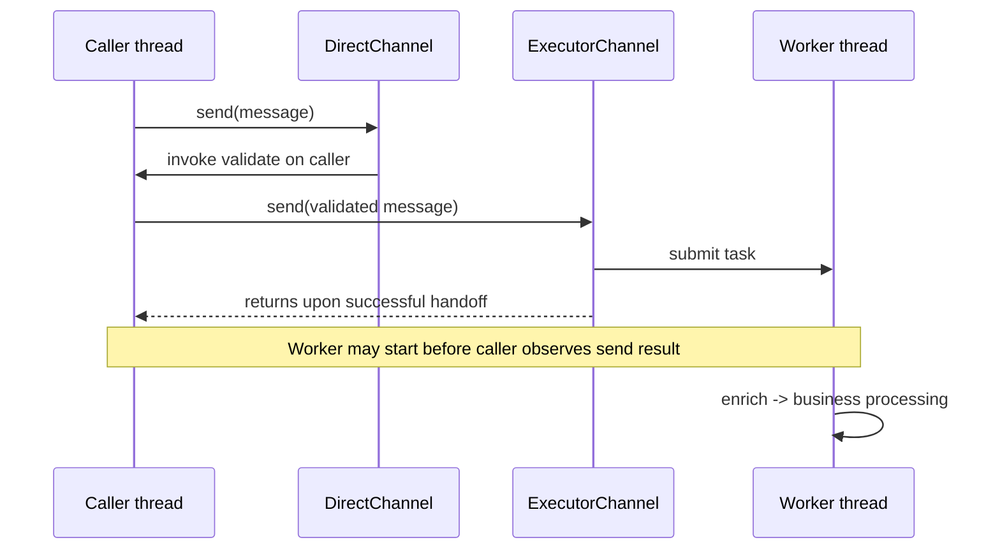

# Channels and Thread Boundaries

In the **Message channel** chapter of the **SPRING_INTEGRATION_CORE** module, choosing a channel is a decision about how a message flow executes. Given the exact same chain of validation, transformation, routing, and business-processing endpoints, swapping a channel in the middle can change which thread runs a handler, how errors are reported, and the transaction scope.

This lesson helps you read an integration flow and answer: **which segment runs on which thread, what is the sender waiting on, and who is responsible when processing fails?**

## 1. What Is a Thread Boundary?

A **thread boundary** occurs when work is handed off from the current thread to another thread.

Suppose the thread receiving an HTTP request sends a `Message<Order>` into the flow:

```text
http-thread
  -> validate order
  -> normalize data
  -> send notification
```

Three endpoints do not mean three threads. If the intermediate channels are all `DirectChannel`, these synchronous handlers run on the same call stack of the sending thread.

When inserting a channel backed by a thread pool:

```text
http-thread:  validate -> normalize -> hand off work -> continue
                                           |
                                           v
worker-thread:                       send notification -> record result
```

A channel is one place that can create a thread boundary. A handler itself may also offload work to an executor, call `@Async`, or join a reactive pipeline. Therefore, examine both the channel and how the handler executes.

Three concepts should be distinguished:

| Concept | Question to Answer |
| --- | --- |
| Flow structure | Which endpoints does the message pass through? |
| Execution model | Which thread invokes each handler? |
| Completion contract | When the call returns, has the system accepted the work or finished processing it? |

For example, an API returning an intake ID after putting work onto a queue requires a different contract from an API that must return the final billing result.

## 2. Which Channels Create a Thread Boundary?

| Channel and Configuration | Thread Running the Handler | What Does the Sender Wait For? |
| --- | --- | --- |
| `DirectChannel` | Thread calling `send()` | Dispatched synchronous handler and its synchronous downstream to finish or throw an error |
| `ExecutorChannel` with thread pool | Worker chosen by the executor | Task handoff; timing and outcome depend on the executor |
| `QueueChannel` with polling consumer | Thread running the poll, or executor configured on the poller | Putting the message into the queue; may block if the queue is full |
| `PublishSubscribeChannel` without executor | Sending thread, invoking subscribers sequentially | Synchronous subscriber calls per dispatch configuration |
| `PublishSubscribeChannel` with async executor | Thread chosen by the executor | Task handoff; does not wait for all subscribers to finish business work |

`PublishSubscribeChannel` determines broadcasting to multiple subscribers; an executor determines how those subscribers run. These two properties are independent. Without an executor, this channel invokes handlers on the sending thread. [PublishSubscribeChannel API](https://docs.spring.io/spring-integration/api/org/springframework/integration/channel/PublishSubscribeChannel.html).

### Do Not Infer Threading Solely from Interface Names

`SubscribableChannel` allows handler registration; it does not mean always synchronous. Both `DirectChannel` and `ExecutorChannel` belong to this group.

`PollableChannel` provides `receive()`; it does not create threads on its own. With `QueueChannel`, if one method calls `send()` and then `receive()` on the same thread, both operations still run on that thread. A thread boundary typically appears when a separate consumer reads from the queue.

Point-to-point, publish-subscribe, and buffering models describe how messages are transferred; they must be read alongside execution configuration. [Message Channel Implementations](https://docs.spring.io/spring-integration/reference/channel/implementations.html).

## 3. DirectChannel: Follows the Sending Thread

A `DirectChannel` invokes subscribers on the sending thread. With synchronous subscribers, the call flow looks like:

```text
caller
  -> input.send(message)
      -> handler A
          -> next.send(message)
              -> handler B
  <- send returns
```

The key property is the **current sending thread**, not necessarily the thread that initiated the entire process. If a worker just received work through an `ExecutorChannel`, subsequent `DirectChannel` instances will run handlers on that worker thread.

`DirectChannel` has point-to-point semantics: multiple subscribers do not turn it into a broadcast mechanism. The dispatcher selects a subscriber and supports failover configuration; do not use multiple subscribers to express sequential business steps. [DirectChannel API](https://docs.spring.io/spring-integration/api/org/springframework/integration/channel/DirectChannel.html).

Pricing example:

```text
request thread
  -> validateChannel: DirectChannel
  -> validate
  -> pricingChannel: DirectChannel
  -> calculatePrice
  -> return result
```

This organization fits when the pricing result must be returned immediately to the caller. Handler latency contributes directly to request processing time, so set timeouts for I/O operations called inside handlers.

**Synchronous does not mean only one request is processed at a time.** Multiple threads can call `send()` on the same channel concurrently. A shared handler must still protect mutable state.

## 4. ExecutorChannel: Handing Off to an Executor

`ExecutorChannel` delegates dispatching to an `Executor`. With a thread pool, workers execute the downstream portion:



The relative order between the log after `send()` on the caller and the first log on the worker is not fixed. The worker can start very early, even finishing before the caller logs.

### Inspect Executor Configuration

An `Executor` can run tasks synchronously. For instance, `SyncTaskExecutor` uses the calling thread. Therefore, merely seeing `ExecutorChannel` in code is not enough to assert a thread switch always happens. [ExecutorChannel API](https://docs.spring.io/spring-integration/api/org/springframework/integration/channel/ExecutorChannel.html).

With `ThreadPoolTaskExecutor`, examine:

- Worker count and task queue capacity.
- Policy when no more tasks can be accepted.
- Shutdown behavior and wait time for running work.

`CallerRunsPolicy` can run the task directly on the sending thread when the pool is saturated. `AbortPolicy` rejects the task so the sender sees overload. Choosing a policy means choosing how the system behaves when processing capacity is exhausted. [Task Execution and Scheduling](https://docs.spring.io/spring-framework/reference/integration/scheduling.html).

Do not rely on occasionally running on the caller as a basis for transaction design. Behavior must be correct both when the system is idle and when it is overloaded.

## 5. Java DSL Example: Observing Before and After the Boundary

The example receives a string, validates on the caller, then hands off to a worker to transform and place the result into a queue:

```text
input: DirectChannel
  -> validate
  -> workerChannel: ExecutorChannel
  -> uppercase
  -> results: QueueChannel
```

Prerequisites:

- The project already has `org.springframework.integration:spring-integration-core` and compatible Spring dependencies.
- Dependency versions and Java version are managed per the project's configuration.
- Save the class below as `ThreadBoundaryDemo.java` in an appropriate package when practicing.

Java DSL registers flows via `IntegrationFlow` beans; the example uses `@EnableIntegration` to initialize Integration infrastructure in a standard Java application context. [Java DSL](https://docs.spring.io/spring-integration/reference/dsl.html).

```java
import java.util.Locale;
import java.util.concurrent.ThreadPoolExecutor;

import org.springframework.beans.factory.annotation.Qualifier;
import org.springframework.context.annotation.AnnotationConfigApplicationContext;
import org.springframework.context.annotation.Bean;
import org.springframework.context.annotation.Configuration;
import org.springframework.integration.channel.DirectChannel;
import org.springframework.integration.channel.ExecutorChannel;
import org.springframework.integration.channel.QueueChannel;
import org.springframework.integration.config.EnableIntegration;
import org.springframework.integration.dsl.IntegrationFlow;
import org.springframework.messaging.Message;
import org.springframework.messaging.support.ErrorMessage;
import org.springframework.messaging.support.MessageBuilder;
import org.springframework.scheduling.concurrent.ThreadPoolTaskExecutor;

@Configuration
@EnableIntegration
public class ThreadBoundaryDemo {

    @Bean
    public DirectChannel input() {
        return new DirectChannel();
    }

    @Bean
    public ThreadPoolTaskExecutor workerExecutor() {
        ThreadPoolTaskExecutor executor = new ThreadPoolTaskExecutor();
        executor.setCorePoolSize(2);
        executor.setMaxPoolSize(2);
        executor.setQueueCapacity(50);
        executor.setThreadNamePrefix("si-worker-");
        executor.setRejectedExecutionHandler(
                new ThreadPoolExecutor.AbortPolicy());
        executor.setWaitForTasksToCompleteOnShutdown(true);
        executor.setAwaitTerminationSeconds(5);
        return executor;
    }

    @Bean
    public ExecutorChannel workerChannel(
            @Qualifier("workerExecutor")
            ThreadPoolTaskExecutor executor) {
        return new ExecutorChannel(executor);
    }

    @Bean
    public QueueChannel results() {
        return new QueueChannel(10);
    }

    @Bean
    public QueueChannel workerErrors() {
        return new QueueChannel(10);
    }

    @Bean
    public IntegrationFlow boundaryFlow(
            @Qualifier("input") DirectChannel input,
            @Qualifier("workerChannel") ExecutorChannel workerChannel,
            @Qualifier("results") QueueChannel results) {

        return IntegrationFlow.from(input)
                .handle(String.class, (payload, headers) -> {
                    trace("validate", payload);
                    String value = payload.trim();
                    if (value.isEmpty()) {
                        throw new IllegalArgumentException("Empty content");
                    }
                    return value;
                })
                .channel(workerChannel)
                .handle(String.class, (payload, headers) -> {
                    trace("uppercase", payload);
                    if ("FAIL".equals(payload)) {
                        throw new IllegalStateException("Illustrative worker error");
                    }
                    return payload.toUpperCase(Locale.ROOT);
                })
                .channel(results)
                .get();
    }

    private static void trace(String stage, Object value) {
        System.out.printf("[%s] %s: %s%n",
                Thread.currentThread().getName(), stage, value);
    }

    public static void main(String[] args) {
        try (AnnotationConfigApplicationContext context =
                     new AnnotationConfigApplicationContext(
                             ThreadBoundaryDemo.class)) {

            DirectChannel input = context.getBean(
                    "input", DirectChannel.class);
            QueueChannel results = context.getBean(
                    "results", QueueChannel.class);
            QueueChannel errors = context.getBean(
                    "workerErrors", QueueChannel.class);

            trace("before-send", "spring");
            boolean accepted = input.send(
                    MessageBuilder.withPayload(" spring ")
                            .setHeader("correlationId", "demo-001")
                            .setErrorChannelName("workerErrors")
                            .build());

            trace("after-send", accepted);
            if (!accepted) {
                throw new IllegalStateException("Message not accepted");
            }

            Message<?> result = results.receive(2_000);
            if (result == null) {
                throw new IllegalStateException("Timed out waiting for result");
            }
            trace("result", result.getPayload());

            input.send(MessageBuilder.withPayload("FAIL")
                    .setErrorChannelName("workerErrors")
                    .build());

            Message<?> failure = errors.receive(2_000);
            if (!(failure instanceof ErrorMessage)) {
                throw new IllegalStateException(
                        "Did not receive ErrorMessage within timeout");
            }
            trace("worker-error", failure.getPayload());
        }
    }
}
```

One observable log order:

```text
[main] before-send: spring
[main] validate:  spring
[main] after-send: true
[si-worker-1] uppercase: spring
[main] result: SPRING
[main] validate: FAIL
[si-worker-2] uppercase: FAIL
[main] worker-error: ...MessageHandlingException...
```

Worker names and the position of the `after-send` log relative to `uppercase` may vary. What to verify is:

1. `validate` runs on the thread calling `input.send()`.
2. `uppercase` runs on a worker in this thread pool configuration.
3. `results.receive(2_000)` is where the caller actively waits for the result.
4. The `FAIL` error is observed via `workerErrors`, separate from the return value of `send()`.

This is a finite demo, and the result and error queues have small capacities. A long-running application needs consumers for both queues; if left unread, they can fill up and cause blocking on the writing side.

## 6. QueueChannel: Separating Send Time and Receive Time

`QueueChannel` holds messages for consumers to receive later. It does not invoke handlers on its own, create workers on its own, or replace a poller. Its API lets you specify capacity and inspect the number of queued messages. [QueueChannel API](https://docs.spring.io/spring-integration/api/org/springframework/integration/channel/QueueChannel.html).

In the example above, `main` itself is the consumer of `results`. If a queue serves as input to a business endpoint, a polling consumer must be configured.

The standalone configuration snippet below illustrates a queue with a polling endpoint. Place the beans in a `@Configuration` class with `@EnableIntegration`; use matching imports as in the earlier example for the remaining types:

```java
import java.time.Duration;

import org.springframework.integration.dsl.Pollers;

@Bean
public QueueChannel jobs() {
    return new QueueChannel(100);
}

@Bean
public IntegrationFlow queuedJobs(
        @Qualifier("jobs") QueueChannel jobs) {

    return IntegrationFlow.from(jobs)
            .handle(String.class,
                    (payload, headers) -> {
                        System.out.printf("[%s] job=%s%n",
                                Thread.currentThread().getName(), payload);
                        return null; // Endpoint ends the flow here.
                    },
                    endpoint -> endpoint.poller(
                            Pollers.fixedDelay(Duration.ofMillis(200))
                                    .maxMessagesPerPoll(5)))
            .get();
}
```

Here, the handler runs inside the polling task, not directly invoked by the sending thread. If an additional task executor is configured for the poller, follow that executor as well to determine the thread.

`maxMessagesPerPoll(5)` limits the number of messages processed in one poll; it does not mean five parallel workers. The polling cycle must also account for processing time and how the scheduler/executor is configured.

### Bounding Send Wait Time

With a finite-capacity `QueueChannel`:

```java
QueueChannel buffer = new QueueChannel(1);
buffer.send(MessageBuilder.withPayload("A").build(), 0);

boolean accepted = buffer.send(
        MessageBuilder.withPayload("B").build(), 100);

System.out.println(accepted); // false if no consumer takes A out.
```

The `100` timeout here bounds waiting for space in the queue. It does not bound business processing duration after a consumer pulls the message. Default in-memory queues also provide no durability across restarts. [Channel Queue and Timeout Characteristics](https://docs.spring.io/spring-integration/reference/channel/implementations.html).

## 7. How Do Thread Boundaries Affect Transactions?

This section considers standard imperative Spring transactions, where context is bound to a thread.

### Same Thread: Can Participate in an Existing Transaction

Suppose a Spring bean is invoked through a transactional proxy:

```text
@Transactional method, thread T1
  -> insert order
  -> DirectChannel
  -> update inventory
  -> method completes
```

Operations can participate in the same transaction when using compatible resources, the right transaction manager, and appropriate propagation. `DirectChannel` does not start a transaction on its own, and being on the same thread does not automatically make every resource transactional.

### Across to a Worker: Does Not Inherit the Caller's Transaction

```text
T1, transaction A:
  insert order -> ExecutorChannel -> continue -> commit or rollback A
                         |
                         v
T2:
  handler -> opens transaction B if configured separately
```

The worker does not automatically join transaction A. Starting transaction B on the worker does not combine the two transactions into a single atomic unit either.

**Calling `send()` does not automatically commit the enclosing method's transaction.** Transaction A still finishes according to its configured scope; handing off to another thread merely places downstream work outside that transaction context. [Transaction Support and Transaction Boundaries](https://docs.spring.io/spring-integration/reference/transactions.html).

Two design bugs follow from this model:

- The worker reads a record too early before the creating transaction has committed.
- The caller rolls back, yet the already-handed-off work proceeds and produces external side effects.

For example, an email might be sent even though the order-saving transaction rolled back. If you only need to avoid reading before commit, trigger the handoff after commit. If committed data must always have corresponding work even when the process crashes, evaluate durable mechanisms such as a transactional outbox or transactional messaging resources.

A transaction on a poller creates a scope on the consumer side; it does not automatically restore a message already pulled from an in-memory queue when business logic rolls back. Recovery capability depends on the actual storage resource and transaction configuration.

## 8. Which Side of the Boundary Does an Error Live On?

Distinguish **handoff errors** from **post-handoff processing errors**.

| Situation in Demo | Where to Observe |
| --- | --- |
| Empty input string, validate handler throws error | Caller of `input.send()` |
| Thread pool rejects task because full | Caller at the handoff operation; may receive exception |
| `uppercase` handler throws error on worker | `ErrorMessage` at `workerErrors` |
| `results.receive()` times out | Caller observes result has not arrived within deadline |

When an asynchronous Integration task raises an error, the error-handling mechanism can wrap the exception in an `ErrorMessage`. With the corresponding default error handler, the `errorChannel` header takes precedence; if absent, the global channel named `errorChannel` is used. In the demo, the executor channel is a Spring-managed bean and the message specifies `workerErrors`. [Error Handling](https://docs.spring.io/spring-integration/reference/error-handling.html).

Do not assume that merely adding an `errorChannel` header turns every exception anywhere into an error message. Errors on a `DirectChannel` segment still propagate along the call stack if no other component catches and handles them.

A `try/catch` around `send()` catches synchronous errors and handoff errors occurring during that call. It cannot catch exceptions thrown later on a worker via normal Java exception propagation.

Timing out while waiting for a result does not prove the work has stopped either. If the caller retries after a timeout, two executions may coexist. For effects like payment, define an idempotency key and completion-state recording.

### Gateways Can Still Block the Caller Waiting

A request-reply gateway can send across an asynchronous segment and then wait for a reply on the caller. Thus, having a thread boundary does not mean a gateway call returns immediately.

Inspect the return type, timeout settings, reply channel, and error handling of the gateway to understand the call's contract. [Messaging Gateways](https://docs.spring.io/spring-integration/reference/gateway.html).

## 9. Data and Context When Crossing Threads

### Carry Necessary Data in the Message

Information such as request ID and order ID should live in the payload or headers so processing steps use them explicitly:

```java
Message<String> request = MessageBuilder.withPayload("order-123")
        .setHeader("correlationId", "req-789")
        .setHeader("tenantId", "tenant-a")
        .build();
```

Setting a header does not automatically set MDC or security context on the worker. An explicit mechanism is needed at the thread transition.

### Handle ThreadLocals Around the Task Lifecycle

A thread pool reuses threads. If diagnostic context must be propagated, use a `TaskDecorator` or propagation mechanism supported by the relevant library:

```text
On handoff: capture needed context from sender.
On task run: save worker's old context, apply captured context.
On completion: restore or clear context in finally.
```

`TaskDecorator` wraps task execution to set execution context or support tracing. Do not use context-copying techniques to move transactional resources or JDBC connections across threads. [TaskDecorator API](https://docs.spring.io/spring-framework/docs/current/javadoc-api/org/springframework/core/task/TaskDecorator.html).

### Messages Do Not Guarantee Deeply Immutable Payloads

For handoff within the same JVM, do not assume the payload has been copied. If sender and worker both hold a mutable `List`, the sender modifying the list after `send()` can cause a race condition.

In demos and real applications alike, prefer immutable values or snapshots at send time. Avoid letting a handler depend on an object that another thread continues to mutate.

## 10. Parallelism, Ordering, and Capacity

### Parallelism Does Not Guarantee Completion Order

Suppose two messages for the same order ID are sent in sequence:

```text
M1: update address         -> worker 1 takes 400 ms
M2: finalize shipment      -> worker 2 takes  20 ms
```

Without coordination, M2 can finish before M1. Input queue FIFO order is not enough to preserve completion order when consumers process in parallel.

When business logic requires per-order ordering, design key-based serialization, state coordination, or a partitioning mechanism suited to your version. Turning the entire system into a single worker is an option with a throughput cost that must be measured.

### Queues Only Absorb Temporary Load Mismatches

Suppose each message requires one worker for an average of 200 ms, with two workers:

```text
Approximate processing capacity = 2 / 0.2 = 10 messages/second
Arrival rate                    = 30 messages/second
Approximate backlog growth      = 20 messages/second
```

With an initially empty 50-slot queue and sustained load, the buffer can fill in about `50 / 20 = 2.5` seconds. This is an estimate from steady-state assumptions, excluding traffic bursts, I/O variance, and scheduling overhead.

Increasing queue size lets the system hold more waiting work; it does not speed up business completion. Define how to respond when full: bounded wait, reject so callers retry per policy, or route to durable storage.

Distinguish the two queues:

| Waiting Place | Unit Stored in Typical Configuration |
| --- | --- |
| `QueueChannel` | Messages waiting for a consumer to receive |
| Executor queue | Tasks waiting for a worker to execute |

If a flow uses both, latency can accumulate in both places. Therefore, track time from intake to completion, queued work counts, rejected tasks, and business failures.

## 11. Observing and Testing Thread Boundaries

### Log on Both Sides

Place logs at:

1. Before sending.
2. Inside handlers before the boundary.
3. Inside handlers after the boundary.
4. When the caller receives the result or the system records completion.

Each log should include thread name, `correlationId`, and step name. Measure `send()` duration and business completion duration separately so you understand what each metric reflects.

`ChannelInterceptor.preSend()` observes the sending side. It does not prove which thread runs a downstream handler. With queues, receive callbacks observe the receiving side; the relative order between send and receive callbacks depends on execution timing. [Channel Interceptors](https://docs.spring.io/spring-integration/reference/channel/interceptors.html).

### Use Bounded Synchronization in Tests

Thread tests need to wait for a specific event. `CountDownLatch` provides a way for one thread to wait until another thread signals it has reached the expected point. [CountDownLatch API](https://docs.oracle.com/en/java/javase/21/docs/api/java.base/java/util/concurrent/CountDownLatch.html).

The standalone JUnit 5 example below verifies that the handler runs on a worker with a single-thread executor:

```java
import java.util.concurrent.CountDownLatch;
import java.util.concurrent.ExecutorService;
import java.util.concurrent.Executors;
import java.util.concurrent.TimeUnit;
import java.util.concurrent.atomic.AtomicReference;

import org.junit.jupiter.api.Test;
import org.springframework.integration.channel.ExecutorChannel;
import org.springframework.messaging.support.MessageBuilder;

import static org.junit.jupiter.api.Assertions.assertNotSame;
import static org.junit.jupiter.api.Assertions.assertTrue;

class ChannelThreadTest {

    @Test
    void handlerRunsOnWorkerThread() throws Exception {
        ExecutorService executor = Executors.newSingleThreadExecutor();
        CountDownLatch handled = new CountDownLatch(1);
        AtomicReference<Thread> observed = new AtomicReference<>();
        Thread sender = Thread.currentThread();

        try {
            ExecutorChannel channel = new ExecutorChannel(executor);
            channel.afterPropertiesSet();
            channel.subscribe(message -> {
                observed.set(Thread.currentThread());
                handled.countDown();
            });

            assertTrue(channel.send(
                    MessageBuilder.withPayload("hello").build()));
            assertTrue(handled.await(2, TimeUnit.SECONDS));
            assertNotSame(sender, observed.get());
        } finally {
            executor.shutdownNow();
            assertTrue(executor.awaitTermination(2, TimeUnit.SECONDS));
        }
    }
}
```

This test verifies thread identity; it does not prove the caller always returns before the worker starts. To verify the caller can continue while business work is unfinished, add a latch holding the worker at a controlled point and always release that latch in `finally`.

For a `DirectChannel` test, you can capture the thread inside the handler and assert `assertSame(sender, observed.get())` right after `send()`; no latch is needed because the handler already ran on that call stack.

Scenarios to verify when applying to a real flow:

| Scenario | Expected Signal |
| --- | --- |
| Fully synchronous configuration | Verified handler runs on sending thread |
| Insert thread-pool executor | Downstream handler runs on worker thread |
| Worker throws error | Error consumer receives the failure and related context |
| Full queue, no consumer | Timed send ends within bound and reports non-acceptance |
| Timed out waiting for result | Caller distinguishes timeout from confirmed business failure |
| Multiple workers process same business key | Ordering or idempotency rules still hold |

The test snippets above are guides to run in a project with appropriate dependencies, not evidence that the demos were executed in the learner's environment.

## 12. Applying to an Order-Processing Flow

Suppose the order-intake API must validate data immediately while report generation can run later:

```text
Intake gateway
  -> DirectChannel
  -> validate data
  -> persist state under business transaction
  -> work handoff mechanism matching durability needs

Report-processing consumer
  -> worker
  -> build report
  -> update completion or failure status
```

Channel choices must align with the API contract:

- If the caller needs the report immediately, provide a reply and suitable wait limits.
- If the caller only needs intake confirmation, return a job ID and provide a status-lookup endpoint.
- If work must survive process restarts, choose work storage with matching durability.
- If reports are generated in parallel, define how to avoid duplicates and record errors by job ID.

When reading a flow, annotate the thread at every step from entry point to completion. At each handoff, explicitly note acceptance conditions, transaction scope, error path, and how results are confirmed. These decisions ensure that adding transformers, routers, filters, or aggregators later preserves a clear execution contract.
