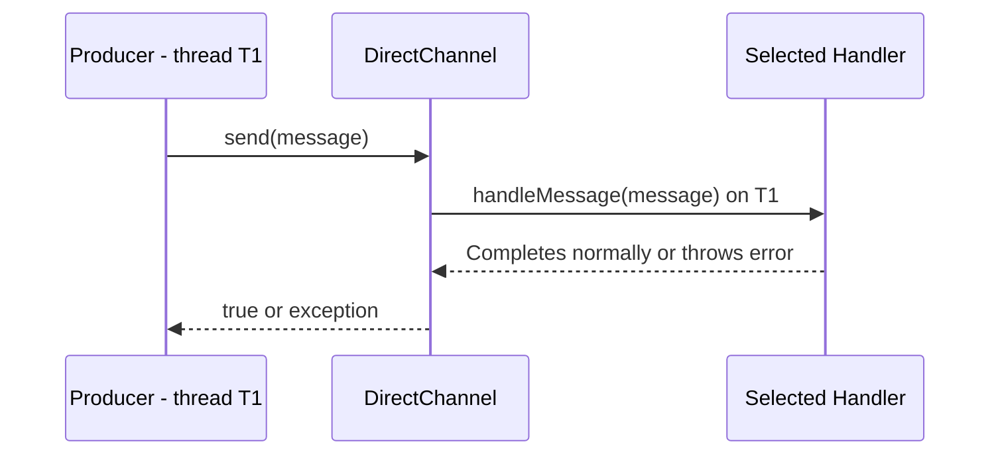
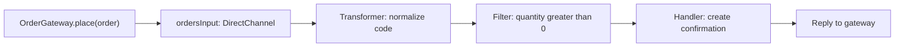

# DirectChannel

In the **Channel Types** chapter of Spring Integration Core, `DirectChannel` connects endpoints into a synchronous processing flow. A producer sends a `Message` into the channel; a selected handler processes it immediately on the sending thread. This structure fits steps such as normalizing a request, validating conditions, and invoking business logic before returning a result to the caller.

This lesson focuses on the message-sending contract, subscriber selection, failover, transactions, and testing. Transformers and filters appear in the examples to illustrate how a channel connects endpoints in Java DSL.

## 1. Objectives and Prerequisites

After this lesson, you will be able to:

- Explain why `DirectChannel` has point-to-point semantics while still supporting multiple subscribers.
- Predict the execution thread and the moment `send()` returns.
- Configure round-robin load balancing, handler trial order, and failover.
- Design a gateway–transformer–filter–handler flow using Java DSL.
- Distinguish synchronous errors, send results, and business results.
- Write tests for key characteristics without waiting on background threads.

The examples use Java 17 syntax and Spring Integration 6.x or later APIs. The project requires `org.springframework.integration:spring-integration-core`; the tests use JUnit Jupiter. Library versions should follow your project's dependency management configuration. Do not add a separate Java DSL artifact for these versions.

The plain Java and JUnit sections interact directly with the channel. The Java DSL section runs inside a Spring application context so the framework can create and start endpoints.

## 2. The DirectChannel Contract

`DirectChannel` is a `SubscribableChannel`: handlers register to receive messages via `subscribe(MessageHandler)`. It is not a `PollableChannel` and has no `receive()` operation for a consumer to actively pull messages. Delivery begins when the producer calls `send()`. [AbstractSubscribableChannel API](https://docs.spring.io/spring-integration/api/org/springframework/integration/channel/AbstractSubscribableChannel.html)

Three characteristics to keep in mind:

| Characteristic | Meaning when designing a flow |
|---|---|
| Point-to-point | One handler succeeds per dispatch; the channel does not broadcast to every subscriber |
| Synchronous on the sending thread | The caller only proceeds after direct processing in the call stack finishes or throws an error |
| No internal queue | The channel does not hold messages for a consumer to receive at another time |

The synchronous handoff mechanism is described in the [message channel implementations documentation](https://docs.spring.io/spring-integration/reference/channel/implementations.html).

You should distinguish a **subscriber** from a business method. In a Spring Integration application, a subscriber is typically a `MessageHandler` created by the framework for an endpoint. That handler can call a service method, perform a transformation, or drive the next step.

For example, the producer only knows about the `ordersInput` channel. The transformer behind the channel can change while the producer keeps sending the same request type. The channel creates a boundary for configuration and responsibility, even though the steps share the same call stack.

### 2.1. How Does a Message Pass Through?



The diagram assumes no interceptor blocks the send and the handler does not spawn asynchronous work on its own. Failover branches are covered in a later section.

If a handler forwards the message across multiple `DirectChannel` instances, synchronous processing can travel deep through several endpoints before the initial `send()` call returns. If a step delegates work to an executor, puts the message into a queue, or explicitly schedules later processing, the caller's waiting boundary changes at that step.

### 2.2. The Return Value Is Not the Reply Payload

The `MessageChannel.send()` contract returns a `boolean` about the send operation; some failures are represented as exceptions. Therefore, do not write code assuming "every failure causes `send()` to return `false`". [MessageChannel API](https://docs.spring.io/spring-framework/docs/current/javadoc-api/org/springframework/messaging/MessageChannel.html)

For a typical `DirectChannel`:

- Handler completes normally: `send()` returns `true`.
- No subscribers: sending fails with an exception.
- Handler throws an error and no successful fallback path exists: the exception propagates to the caller.
- An interceptor can prevent sending before the dispatcher is invoked, producing a different outcome from the normal case.

`true` does not mean "the order has been committed", "all background tasks have finished", or "the caller received a result object". Those conclusions depend on business logic, transactions, and how endpoints reply.

## 3. Plain Java Example: Observing Thread and Execution Order

The following example is a standalone class runnable with Spring Integration on the classpath:

```java
import org.springframework.integration.channel.DirectChannel;
import org.springframework.messaging.support.GenericMessage;

public class DirectChannelDemo {

    public static void main(String[] args) {
        DirectChannel channel = new DirectChannel();

        channel.subscribe(message -> {
            System.out.println("handler.thread="
                    + Thread.currentThread().getName());
            System.out.println("payload=" + message.getPayload());
        });

        System.out.println("before.thread="
                + Thread.currentThread().getName());

        boolean sent = channel.send(new GenericMessage<>("order-42"));

        System.out.println("after.sent=" + sent);
    }
}
```

When run from a standard `main` method, the output looks like:

```text
before.thread=main
handler.thread=main
payload=order-42
after.sent=true
```

Two observations can be verified immediately:

1. `handler.thread` matches `before.thread`.
2. The `after.sent` line appears after the handler has printed the payload.

There is no poller in this example. Because the handler has subscribed to receive messages, it is invoked directly during the send call.

In a real application, an endpoint manages subscribing and unsubscribing according to its lifecycle. Merely creating a channel bean without creating or starting a consumer does not establish a complete processing flow. `getSubscriberCount()` helps inspect the number of currently registered handlers, though it does not replace verifying endpoints and business behavior.

## 4. Java DSL: Receiving Orders via a Gateway

Let's build an order-intake flow with the following steps:



This is an illustrative example of in-memory request processing; the confirmation string does not yet represent a persisted order transaction.

Place the four Java files below in the same package `example.direct`. These are sample files for learners to create in a practice project.

### 4.1. Business Payload

```java
package example.direct;

public record Order(String id, int quantity) {
}
```

### 4.2. Gateway for Callers

```java
package example.direct;

import org.springframework.integration.annotation.MessagingGateway;

@MessagingGateway(defaultRequestChannel = "ordersInput")
public interface OrderGateway {

    String place(Order order);
}
```

The gateway provides a method API for callers and sends requests into `ordersInput`. For this request–reply call, the gateway sets up reply channel information so the final endpoint can route the result back. [Messaging Gateways](https://docs.spring.io/spring-integration/reference/gateway.html)

### 4.3. Channel and Flow Configuration

```java
package example.direct;

import java.util.Locale;

import org.springframework.beans.factory.annotation.Qualifier;
import org.springframework.context.annotation.Bean;
import org.springframework.context.annotation.Configuration;
import org.springframework.integration.channel.DirectChannel;
import org.springframework.integration.config.EnableIntegration;
import org.springframework.integration.annotation.IntegrationComponentScan;
import org.springframework.integration.dsl.IntegrationFlow;

@Configuration
@EnableIntegration
@IntegrationComponentScan(basePackageClasses = OrderGateway.class)
public class OrdersConfig {

    @Bean
    public DirectChannel ordersInput() {
        return new DirectChannel();
    }

    @Bean
    public IntegrationFlow ordersFlow(
            @Qualifier("ordersInput") DirectChannel input) {

        return IntegrationFlow.from(input)
                .transform(Order.class, order -> new Order(
                        order.id().trim().toUpperCase(Locale.ROOT),
                        order.quantity()))
                .filter(Order.class,
                        order -> order.quantity() > 0,
                        filter -> filter.throwExceptionOnRejection(true))
                .handle(Order.class, (order, headers) ->
                        "ACCEPTED:" + order.id() + ":" + order.quantity())
                .get();
    }
}
```

`@EnableIntegration` activates the infrastructure; `@IntegrationComponentScan` scans for gateway interfaces in the specified package. That is the dedicated role of integration component scanning. [Annotation Support](https://docs.spring.io/spring-integration/reference/configuration/annotations.html)

`IntegrationFlow` is declared as a bean so the framework registers the channels and endpoints. Implicit connections between endpoints in a flow normally use `DirectChannel` when no other channel type is configured. Consequently, the flow above does not spawn a worker thread at every dot in the DSL. [Java DSL](https://docs.spring.io/spring-integration/reference/dsl.html)

The filter sets `throwExceptionOnRejection(true)` so invalid requests fail explicitly. When a gateway is waiting for a reply, silently discarding a message without producing a reply or an error can cause it to wait until timeout.

### 4.4. Invoking the Flow

```java
package example.direct;

import org.springframework.context.annotation.AnnotationConfigApplicationContext;

public class OrdersApp {

    public static void main(String[] args) {
        try (var context =
                new AnnotationConfigApplicationContext(OrdersConfig.class)) {

            OrderGateway gateway = context.getBean(OrderGateway.class);

            String result = gateway.place(new Order(" ord-42 ", 2));

            System.out.println(result);
        }
    }
}
```

Output:

```text
ACCEPTED:ORD-42:2
```

You can replace the input with `new Order(" ord-42 ", 0)` to observe the filter rejection case.

In this example, `ordersInput` has the transformer's handler as its first subscriber. The filter and the confirmation-building handler belong to subsequent steps of the pipeline. They are not three competing subscribers on the same `ordersInput` channel.

If you send directly using `ordersInput.send(message)`, the return value is still a `boolean`. To receive the confirmation string via a method API as shown above, the caller invokes the gateway.

## 5. Multiple Subscribers: Distributing Work Without Adding Threads

`DirectChannel` allows multiple handlers to subscribe. When instantiated with `new DirectChannel()`, the default strategy is round-robin and failover is enabled. [DirectChannel API](https://docs.spring.io/spring-integration/api/org/springframework/integration/channel/DirectChannel.html)

### 5.1. Observing Round-Robin

The following snippet can be placed inside a `main` method:

```java
import java.util.ArrayList;
import java.util.List;

import org.springframework.integration.channel.DirectChannel;
import org.springframework.messaging.support.GenericMessage;

// In main():
DirectChannel channel = new DirectChannel();
List<String> deliveries = new ArrayList<>();

channel.subscribe(message ->
        deliveries.add("A:" + message.getPayload()));
channel.subscribe(message ->
        deliveries.add("B:" + message.getPayload()));

for (int i = 1; i <= 4; i++) {
    channel.send(new GenericMessage<>(i));
}

System.out.println(deliveries);
```

With a fresh channel, two stable subscribers, and no errors, messages are distributed alternately to A and B. Each handler receives two messages. When observing a specific order, keep the same subscriber set and sending pattern as in the example.

`ArrayList` is used here to illustrate sequential sending on a single thread. If multiple threads send concurrently, shared data inside handlers must be designed appropriately.

Adding subscribers to a channel does not create a thread pool. Four `send()` calls from the same loop still execute sequentially. When multiple application threads send concurrently, handlers can run concurrently on those sending threads themselves.

### 5.2. Pipeline vs. Competing Consumers

These two configurations have different meanings:

```text
Pipeline:
input -> transformer -> normalized -> service

Competing consumers:
                    -> service A
input DirectChannel
                    -> service B
```

In a pipeline, one message passes through multiple steps. With competing consumers, A and B typically perform the same business role; the dispatcher picks one handler to receive each message.

For example, attaching both an "accounting ledger" handler and an "email sending" handler to the same `DirectChannel` does not ensure that an order goes through both. To run them sequentially, chain them into a pipeline. To broadcast a message to multiple consumers, consider `PublishSubscribeChannel`.

You should also avoid using round-robin to route "domestic orders" and "international orders". Business criteria such as country require a router and dedicated destination channels.

## 6. Failover: Trying Another Subscriber When Processing Fails

`DirectChannel`'s dispatcher is `UnicastingDispatcher`. When failover is enabled, the dispatcher can try the next handler after an exception; once a handler completes normally, the dispatcher stops. Therefore, a single send may have invoked multiple handlers if earlier ones failed. [UnicastingDispatcher API](https://docs.spring.io/spring-integration/api/org/springframework/integration/dispatcher/UnicastingDispatcher.html)

### 6.1. Intentional Configuration

```java
import org.springframework.integration.channel.DirectChannel;

// Round-robin, do not try another subscriber after an error.
DirectChannel failFast = new DirectChannel();
failFast.setFailover(false);

// No load balancing: start according to handler order.
// Default failover remains enabled.
DirectChannel primaryBackup = new DirectChannel(null);

// Allow only one subscriber.
DirectChannel singleConsumer = new DirectChannel();
singleConsumer.setMaxSubscribers(1);
```

Passing `null` to the constructor disables load balancing, not failover. With manual subscriptions and handlers of equal priority, registration order determines trial order. When endpoints configure `order`, that ordering also applies. Configuration options are documented in [Configuring Message Channels](https://docs.spring.io/spring-integration/reference/channel/configuration.html).

Decision table:

| Requirement | Appropriate configuration |
|---|---|
| Distribute requests across equivalent handlers | Round-robin; decide separately whether failover is needed |
| Return immediately to the caller on error | `setFailover(false)` |
| Prefer a primary handler, try backup only after failure | No load balancing; define order and enable failover |
| Detect accidental registration of an extra consumer | `setMaxSubscribers(1)` |
| Every request must perform multiple business steps | Design a pipeline instead of adding competing subscribers |

### 6.2. Side Effects May Already Have Occurred Before the Exception

Consider a hypothetical scenario:

1. Handler A sends a payment capture request to a provider.
2. The provider captures the payment, but the response back to the application is lost.
3. A throws an exception due to a timeout.
4. The dispatcher tries handler B.
5. B sends another payment capture request.

A single `send()` call can lead to two charges if there is no deduplication mechanism. An exception does not prove that side effects in an external system did not occur.

From this scenario, several design decisions follow:

- Backup handlers must share the same contract and understand the same idempotency key.
- Use a stable business request ID to identify duplicate processing attempts.
- Choose fail-fast when trying another subscriber could cause unacceptable side effects.
- Place intentional retries at the step that needs them and specify which error types are retryable.

Channel failover does not provide a retry schedule, backoff intervals, or durable storage for failed requests. Those needs require dedicated mechanisms.

## 7. Transactions and Thread Context

A key architectural benefit is preserving a thread-bound transaction across a synchronous processing segment. However, `DirectChannel` does not start a transaction on its own. [Transaction Support](https://docs.spring.io/spring-integration/reference/transactions.html)

Suppose a method invoked through a Spring proxy has `@Transactional` and executes:

```text
Start DB transaction
  -> write order record
  -> send via DirectChannel
       -> update inventory using the same transaction resource
  -> end method
Commit or rollback based on outcome and transaction rules
```

For both updates to actually participate in the same transaction, verify:

- A transaction is already active before sending, for example via a proxy or `TransactionTemplate`.
- The handler uses a resource managed by the corresponding transaction manager.
- The flow does not switch to another thread before the update step.
- Business propagation settings do not create a separate boundary.
- Exceptions or rollback-only status are handled appropriately.

Merely being on the "same thread" is not enough to conclude "same transaction". A handler using `REQUIRES_NEW` can open its own transaction. An HTTP call inside a handler also does not automatically participate in a local database transaction.

Similarly, `send()` returning `true` can happen before the outer transaction commits. If a subsequent step in the transactional method fails, changes made within that transaction can still be rolled back.

Thread-based context, such as MDC, usually remains present during direct calls as long as no component alters it. When introducing an asynchronous boundary, revisit how context is propagated and re-evaluate transaction assumptions.

## 8. Synchronous Errors and errorChannel

When a caller sends directly to a `DirectChannel` and a handler fails, the exception can propagate back to the caller. Merely setting an `errorChannel` header or declaring a global bean with that name does not automatically turn every synchronous error into an `ErrorMessage`. A component responsible for error handling decides whether to publish an error message. [Error Handling](https://docs.spring.io/spring-integration/reference/error-handling.html)

Example:

```java
import org.springframework.integration.channel.DirectChannel;
import org.springframework.messaging.MessageHandlingException;
import org.springframework.messaging.MessagingException;
import org.springframework.messaging.support.GenericMessage;

// Inside a method:
DirectChannel channel = new DirectChannel();
channel.setFailover(false);

channel.subscribe(message -> {
    throw new MessageHandlingException(
            message, "Unable to process order");
});

try {
    channel.send(new GenericMessage<>("order-42"));
} catch (MessagingException ex) {
    System.out.println("Caller received error: " + ex.getMessage());
}
```

The example uses `MessagingException` so it does not depend on a specific wrapper class. When diagnosing, inspect both the cause and the failed message if the exception provides them.

With a gateway, you can configure an error-handling path on the gateway itself. When an error flow turns an error into a successful reply, the caller might no longer receive an exception. If the caller manages a transaction, explicitly determine whether that allows the transaction to keep committing.

Failover also affects error observability: if one handler fails but a backup handler succeeds, the caller may see `send()` succeed. The system still needs to record the failure to monitor the health of the primary handler.

## 9. Blocking, Timeouts, and Concurrency Capacity

### 9.1. Slow Handlers Slow Down the Caller

For a fully synchronous flow, you can estimate:

```text
Time caller is held
  ≈ dispatch overhead
  + time of synchronously invoked endpoints
  + I/O wait time of those endpoints
```

This is a mental model for design, not a framework performance benchmark formula.

Suppose an external service call normally takes 300 ms. Even though the channel handoff itself is very fast, the sending thread must wait for that step. For a web request, this duration adds to response latency and the time the request-handling thread remains occupied.

Because the channel has no internal queue, it provides no buffer to absorb traffic spikes. To limit concurrency, design controls at the intake point or on an appropriate execution resource. Do not treat caller blocking as Reactive Streams backpressure.

### 9.2. send(message, timeout) Does Not Set a Deadline on the Handler

Do not infer that:

```java
channel.send(message, 100);
```

will interrupt the handler after 100 ms. The channel's timeout contract relates to waiting to send or hand off according to each implementation; it is not a mechanism to cancel a running Java method. With `DirectChannel`, the handler is invoked directly on the sending thread.

If a handler waits on HTTP or a database, timeouts must be configured on the client or resource performing that operation. For request–reply through a gateway, a reply timeout also does not automatically stop a synchronous handler that holds the call stack before the caller even reaches the reply-waiting phase.

### 9.3. Synchronous Does Not Mean Globally Serialized One Message at a Time

If threads T1 and T2 send to the same channel concurrently, the two calls can run handlers concurrently. Therefore:

- Handlers must not rely on a "single thread access only" assumption.
- Round-robin does not guarantee global completion order.
- Shared state must be protected or replaced with a stateless design.
- A message should not be reused to share a mutable payload across concurrent operations.

If business logic requires ordered processing per customer, design a serialization or key-partitioning mechanism; choosing `DirectChannel` alone does not create that guarantee.

## 10. Observing the Channel with Interceptors

`ChannelInterceptor` lets you observe or adjust send operations. Returning `null` from `preSend()` blocks the send. `afterSendCompletion()` is invoked for interceptors that completed `preSend()` successfully and returned a message, even if sending subsequently throws an error. [ChannelInterceptor API](https://docs.spring.io/spring-framework/docs/current/javadoc-api/org/springframework/messaging/support/ChannelInterceptor.html)

You can attach the following interceptor to an existing channel:

```java
import org.springframework.messaging.Message;
import org.springframework.messaging.MessageChannel;
import org.springframework.messaging.support.ChannelInterceptor;

// channel is a configured DirectChannel.
channel.addInterceptor(new ChannelInterceptor() {

    @Override
    public Message<?> preSend(
            Message<?> message, MessageChannel target) {

        System.out.println("sending.orderId="
                + message.getHeaders().get("orderId"));

        return message;
    }

    @Override
    public void afterSendCompletion(
            Message<?> message,
            MessageChannel target,
            boolean sent,
            Exception ex) {

        System.out.println("sent=" + sent
                + ", failed=" + (ex != null));
    }
});
```

For the log above to be meaningful, the producer must put `orderId` into the message headers. This is a minimal observation example; in an application, use a logger and tracking fields appropriate to your business domain.

Because `DirectChannel` has no `receive()`, the `preReceive()` and `postReceive()` callbacks are not used to observe handlers receiving from this channel. [Channel Interceptors](https://docs.spring.io/spring-integration/reference/channel/interceptors.html)

A timing measurement wrapping `send()` can include downstream synchronous processing time. When a flow turns asynchronous, the meaning of that measurement changes. Name metrics according to the scope they actually measure.

## 11. Testing Channel Behavior

The following class uses JUnit Jupiter and requires no Spring context. The tests focus on the dispatch contract rather than framework internals.

```java
import java.util.ArrayList;
import java.util.List;
import java.util.concurrent.atomic.AtomicInteger;
import java.util.concurrent.atomic.AtomicReference;

import org.junit.jupiter.api.Test;
import org.springframework.integration.channel.DirectChannel;
import org.springframework.messaging.MessageHandlingException;
import org.springframework.messaging.MessagingException;
import org.springframework.messaging.support.GenericMessage;

import static org.junit.jupiter.api.Assertions.assertEquals;
import static org.junit.jupiter.api.Assertions.assertSame;
import static org.junit.jupiter.api.Assertions.assertThrows;
import static org.junit.jupiter.api.Assertions.assertTrue;

class DirectChannelTest {

    @Test
    void completesHandlerOnSendingThreadBeforeReturning() {
        DirectChannel channel = new DirectChannel();
        Thread sender = Thread.currentThread();

        AtomicReference<Thread> observedThread = new AtomicReference<>();
        AtomicReference<Object> observedPayload = new AtomicReference<>();

        channel.subscribe(message -> {
            observedThread.set(Thread.currentThread());
            observedPayload.set(message.getPayload());
        });

        boolean sent = channel.send(new GenericMessage<>("order-42"));

        assertTrue(sent);
        assertSame(sender, observedThread.get());
        assertEquals("order-42", observedPayload.get());
    }

    @Test
    void distributesMessagesAcrossEquivalentSubscribers() {
        DirectChannel channel = new DirectChannel();
        AtomicInteger handledByA = new AtomicInteger();
        AtomicInteger handledByB = new AtomicInteger();

        channel.subscribe(message -> handledByA.incrementAndGet());
        channel.subscribe(message -> handledByB.incrementAndGet());

        for (int i = 0; i < 4; i++) {
            assertTrue(channel.send(new GenericMessage<>(i)));
        }

        assertEquals(2, handledByA.get());
        assertEquals(2, handledByB.get());
        assertEquals(4, handledByA.get() + handledByB.get());
    }

    @Test
    void failoverCanFollowAnAlreadyPerformedSideEffect() {
        DirectChannel channel = new DirectChannel(null);
        List<String> effects = new ArrayList<>();

        channel.subscribe(message -> {
            effects.add("primary-side-effect");
            throw new MessageHandlingException(
                    message, "Primary failed after its side effect");
        });

        channel.subscribe(message -> effects.add("backup-side-effect"));

        assertTrue(channel.send(new GenericMessage<>("order-42")));

        assertEquals(
                List.of("primary-side-effect", "backup-side-effect"),
                effects);
    }

    @Test
    void disablingFailoverPreventsCallingBackup() {
        DirectChannel channel = new DirectChannel(null);
        channel.setFailover(false);
        AtomicInteger backupCalls = new AtomicInteger();

        channel.subscribe(message -> {
            throw new MessageHandlingException(message, "Primary failed");
        });

        channel.subscribe(message -> backupCalls.incrementAndGet());

        assertThrows(MessagingException.class,
                () -> channel.send(new GenericMessage<>("order-42")));

        assertEquals(0, backupCalls.get());
    }

    @Test
    void failsWhenNoSubscriberExists() {
        DirectChannel channel = new DirectChannel();

        assertThrows(MessagingException.class,
                () -> channel.send(new GenericMessage<>("order-42")));
    }
}
```

The first test asserts the result immediately after `send()`; no `Thread.sleep()` or polling is needed because the handler runs synchronously. The distribution test uses invocation counts to avoid tying assertions to whichever handler is selected first.

The two failover tests reflect a design choice: enabling failover lets a backup handler run after an earlier handler's side effect; disabling failover preserves the error so the caller can decide.

When testing the Java DSL example, add an application context test to verify that the gateway is created, endpoints are subscribed, and the rejected-quantity case behaves as expected. If verifying rollback, use a real transactional resource or test configuration capable of observing commits and rollbacks; an in-memory list cannot model that behavior.

## 12. Choosing a Channel by Need

| Need | Initial choice | Points to evaluate |
|---|---|---|
| Chain fast processing steps on the same call flow | `DirectChannel` | Downstream latency is added to the caller's wait time |
| Split work across equivalent handlers in the same process | `DirectChannel` with multiple subscribers | No built-in thread pool; configure failover intentionally |
| Hand off work via an executor | `ExecutorChannel` | Thread boundaries, transactions, executor capacity, and error handling |
| Buffer messages until a consumer receives them | `QueueChannel` | Poller, capacity, and durability requirements |
| Broadcast one message to multiple subscribers | `PublishSubscribeChannel` | Subscriber execution model and per-branch error handling |
| Transfer messages across processes with durability | Appropriate broker and adapter | Acknowledgments, retries, deduplication, and broker operations |

The fundamental differences among channels are covered in [Message Channel Implementations](https://docs.spring.io/spring-integration/reference/channel/implementations.html).

Do not pick `DirectChannel` solely because its name includes "direct" and assume every flow will be fast. Clarify what the caller needs to wait for, whether messages must be retained, and which side effects must be managed.

## 13. Diagnosing Common Situations

| Symptom | Hypothesis to check | Action to take |
|---|---|---|
| "no subscribers" error on send | No consumer yet, endpoint not started, or wrong channel reference | Check beans, endpoint lifecycle, and `getSubscriberCount()` |
| Two business handlers receive messages alternately | Both are competing subscribers on the same channel | Design a pipeline or broadcast according to requirements |
| Increasing subscribers does not raise throughput | Only one thread sends sequentially, or contention on a shared resource | Measure bottlenecks and identify where concurrency is needed |
| Caller does not see primary handler errors | Failover succeeded or gateway converted the error into a reply | Inspect dispatch configuration and error flow |
| Send with a small timeout still waits a long time | Handler is blocked on a synchronous operation | Configure timeouts on I/O operations and review waiting requirements |
| Data still rolls back after `send()` returns `true` | Outer transaction had not finished when the send succeeded | Trace transaction boundaries and errors in remaining steps |
| Side effects appear multiple times | Failover, retry, or upstream resend | Track request IDs and design idempotency |

In the order-intake example, start with a simple pipeline: the gateway calls `ordersInput`, the transformer normalizes data, the filter validates input, and the service processes the order. Only add competing consumers, failover, or asynchronous boundaries after clarifying the purpose and testing failure scenarios.
