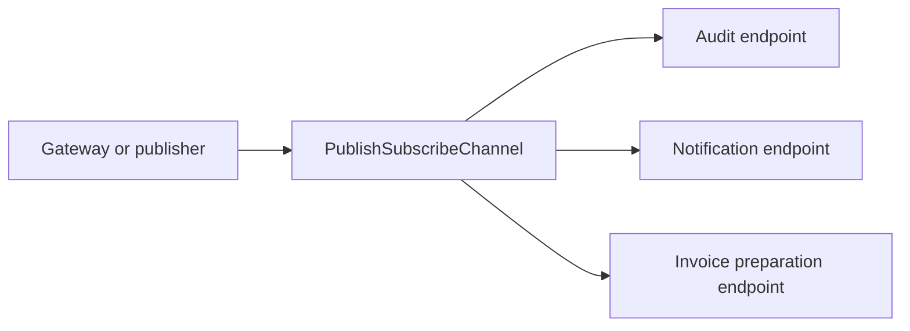
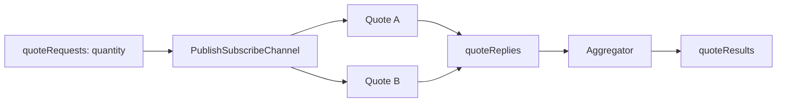

# PublishSubscribeChannel

In the Spring Integration Core (`SPRING_INTEGRATION_CORE`) module, `PublishSubscribeChannel` broadcasts a single message to multiple processing branches. This lesson belongs to the **Channel Types** chapter and focuses on how `Message`, channels, endpoints, gateways, and Java DSL work together when multiple features care about the same event.

The running example is an order-placed event: the system needs to write an audit log, notify on high-value orders, and prepare billing data. Each feature processes the event according to its own requirements.

The configuration examples use Java 17 or later and Spring Integration 6.x APIs, aligned with the 6.5 documentation branch. `spring-integration-core` is required; tests use JUnit Jupiter. If your application uses Spring Boot, you can bring in the integration support via `spring-boot-starter-integration` and let your application's dependency management choose compatible versions. The Java classes in this lesson are illustrative examples to add to a practice project.

## 1. The Publish–Subscribe Model

A publisher produces a message; the channel delivers it to registered subscribers. A direct subscriber of the channel is a `MessageHandler`; in a typical application, Spring-managed endpoints handle registering those handlers.



When there are three subscribers, a single send routes the message to all three. The subscribers process the same event; transformations performed in one branch do not automatically become the input of another branch.

`PublishSubscribeChannel` implements the `SubscribableChannel` model. Unlike a `PollableChannel`, it does not expose `receive()`, so no poller is needed just to consume directly from this channel. See [Message Channel Implementations](https://docs.spring.io/spring-integration/reference/6.5/channel/implementations.html).

You can choose a channel based on two separate decisions: **who receives the message** and **which thread executes the work**.

| Channel | Delivery of one message | Common execution model |
|---|---|---|
| `DirectChannel` | One subscriber handles the message point-to-point | On the sending thread |
| `ExecutorChannel` | Point-to-point | Delegated to an executor |
| `QueueChannel` | One consumer pulls one message from the queue | Consumer calls `receive()` or endpoint uses a poller |
| `PublishSubscribeChannel` | Broadcasts to subscribers | On the sending thread, or delegated to an executor if configured |

When an order needs to be processed by **one worker**, consider point-to-point. When both auditing and billing must know that an order was placed, publish–subscribe fits better. Channel API details are documented in the [PublishSubscribeChannel Javadoc](https://docs.spring.io/spring-integration/docs/6.3.9/api/org/springframework/integration/channel/PublishSubscribeChannel.html); the APIs used in this lesson are also present in the 6.5 branch.

## 2. Minimal Example: One Send, Two Handlers

The following example creates a channel and subscribes handlers directly to observe the delivery mechanism:

```java
import java.util.ArrayList;
import java.util.List;

import org.springframework.integration.channel.PublishSubscribeChannel;
import org.springframework.messaging.Message;
import org.springframework.messaging.support.MessageBuilder;

public class PubSubDemo {

    public static void main(String[] args) {
        List<String> traces = new ArrayList<>();
        PublishSubscribeChannel events = new PublishSubscribeChannel(true);

        events.subscribe(message ->
                traces.add("audit:" + message.getPayload()));

        events.subscribe(message ->
                traces.add("billing:" + message.getPayload()));

        Message<String> message = MessageBuilder
                .withPayload("ORD-1001")
                .setHeader("eventType", "OrderPlaced")
                .build();

        boolean accepted = events.send(message);

        System.out.println(accepted);
        System.out.println(traces);
    }
}
```

With the two handlers registered in the order shown, the output is:

```text
true
[audit:ORD-1001, billing:ORD-1001]
```

The constructor `new PublishSubscribeChannel(true)` requires at least one subscriber to be present. It still executes synchronously because no executor is provided. When `send()` returns normally, both handlers in the example have already finished running.

This is a plain Java example to make `subscribe()` and `send()` clear. When integrating into an application, declare channels and endpoints as Spring beans so the framework manages their lifecycle.

## 3. Synchronous, Asynchronous, and Ordering

### 3.1. Default Execution on the Sending Thread

Without an executor, the channel invokes each handler on the same call stack as the publisher:

```text
Publisher thread:
send(message)
  -> audit.handleMessage(message)
  -> notification.handleMessage(message)
  -> billing.handleMessage(message)
  -> return
```

A slow handler delays when `send()` finishes. If the three handlers take roughly 10 ms, 80 ms, and 20 ms respectively, the total wait time is near 110 ms plus dispatching overhead, assuming all steps are synchronous and error-free.

Invocation order depends on the handler order managed by the dispatcher. When explicit ordering is needed, configure endpoint order; among handlers with the same priority, registration order matters. However, if business logic requires "create the invoice before sending the invoice email", express that as a chain of endpoints:

```text
order -> createInvoice -> sendInvoiceEmail
```

If one branch spawns background work on its own, that branch's handler returning does not mean the background work is complete.

### 3.2. With an Executor, Behavior Depends on the Executor

When an executor is provided, the channel hands off processing tasks to the executor. A thread pool can allow branches to run concurrently; actual concurrency depends on worker count, queue capacity, and load.

| Aspect to understand | Without executor | Using an async thread pool |
|---|---|---|
| Thread running handlers | Sending thread | Executor worker under normal execution conditions |
| When `send()` returns | After synchronous processing or on error | After task submission, possibly before handlers finish |
| Completion order | Follows synchronous call sequence if branches are synchronous | May differ from submission order |
| Business error in handler | Can propagate back to the publisher | Requires background task error handling |
| Thread-bound context | Can continue on the same thread | Requires propagating context across thread boundaries |

An `Executor` does not necessarily create a new thread: `SyncTaskExecutor` executes immediately on the calling thread. A `CallerRunsPolicy` can also cause the caller to run the task when the pool is full. Therefore, inspect the executor configuration before assuming a flow always executes asynchronously. See [Task Execution and Scheduling](https://docs.spring.io/spring-framework/reference/integration/scheduling.html).

The channel itself does not guarantee completion order across branches or global ordering across multiple messages sent concurrently. If per-order sequential processing is required, design partitioning and serialization by business key.

## 4. Order-Placed Event Flow in Java DSL

### 4.1. Immutable Payload and Gateway

Define the payload in `OrderPlaced.java`:

```java
package example.integration;

import java.math.BigDecimal;

public record OrderPlaced(
        String eventId,
        String orderId,
        BigDecimal amount) {
}
```

Define the gateway in `OrderEventGateway.java`:

```java
package example.integration;

import org.springframework.integration.annotation.MessagingGateway;

@MessagingGateway(defaultRequestChannel = "orderEvents")
public interface OrderEventGateway {

    void publish(OrderPlaced event);
}
```

The gateway lets business code call `publish(event)` without manually constructing a `Message`. A `void` method represents a call that does not wait for a reply value; processing time still depends on downstream channels.

The gateway interface must be registered via Spring Integration's gateway scanning mechanism. `@IntegrationComponentScan` serves that purpose. See [Messaging Gateways](https://docs.spring.io/spring-integration/reference/6.5/gateway.html).

### 4.2. Configuring Three Subscribers

Define `OrderEventConfig.java` in the same package:

```java
package example.integration;

import java.math.BigDecimal;

import org.springframework.context.annotation.Bean;
import org.springframework.context.annotation.Configuration;
import org.springframework.integration.annotation.IntegrationComponentScan;
import org.springframework.integration.channel.DirectChannel;
import org.springframework.integration.config.EnableIntegration;
import org.springframework.integration.dsl.IntegrationFlow;

@Configuration
@EnableIntegration
@IntegrationComponentScan(basePackageClasses = OrderEventGateway.class)
public class OrderEventConfig {

    @Bean
    public DirectChannel orderEvents() {
        return new DirectChannel();
    }

    @Bean
    public IntegrationFlow orderEventFlow() {
        return IntegrationFlow.from("orderEvents")
                .publishSubscribeChannel(pubsub -> pubsub
                        .id("orderEventFanOut")
                        .minSubscribers(3)

                        .subscribe(audit -> audit
                                .handle(OrderPlaced.class, (event, headers) -> {
                                    System.out.println(
                                            "AUDIT " + event.eventId());
                                    return null;
                                }))

                        .subscribe(notification -> notification
                                .<OrderPlaced>filter(event ->
                                        event.amount().compareTo(
                                                new BigDecimal("1000000")) >= 0)
                                .handle(OrderPlaced.class, (event, headers) -> {
                                    System.out.println(
                                            "NOTIFY " + event.orderId());
                                    return null;
                                }))

                        .subscribe(billing -> billing
                                .<OrderPlaced, String>transform(event ->
                                        "INVOICE:" + event.orderId())
                                .handle(String.class, (invoice, headers) -> {
                                    System.out.println(invoice);
                                    return null;
                                })))
                .get();
    }
}
```

There are two channels with different roles:

- `orderEvents` is a `DirectChannel` that receives from the gateway and feeds messages into the flow.
- `orderEventFanOut` is the `PublishSubscribeChannel` created by the DSL at `.publishSubscribeChannel(...)`.

The three `.subscribe(...)` calls define three subflows. Since there is no executor in this example, the subscribers execute on the sending thread. The terminal handlers return `null` to end each branch without producing a reply.

The filter only decides whether the notification branch continues processing. Orders under one million still pass through audit and billing. `minSubscribers(3)` counts subscribers at the fan-out point; it does not verify how many emails were sent or how many terminal handlers actually executed.

Business code can invoke the Spring-injected gateway:

```java
gateway.publish(new OrderPlaced(
        java.util.UUID.randomUUID().toString(),
        "ORD-1001",
        new java.math.BigDecimal("1500000")));
```

The example uses `System.out` for observation; in an application, replace the handler bodies with the appropriate services.

### 4.3. Steps Written After publishSubscribeChannel Form a Continuation Branch

In the DSL, whatever follows `.publishSubscribeChannel(...)` receives messages from the fan-out point as an additional subscriber. It does not wait for the results of all subflows:

```java
@Bean
public IntegrationFlow observationFlow() {
    return IntegrationFlow.from("observationInput")
            .publishSubscribeChannel(pubsub -> pubsub
                    .subscribe(branch -> branch
                            .handle(message ->
                                    System.out.println("AUDIT: "
                                            + message.getPayload()))))
            .handle(message ->
                    System.out.println("MAIN: " + message.getPayload()))
            .get();
}
```

In this example, there is an audit branch and a continuation branch that logs `MAIN`. If audit transforms the payload inside its subflow, that transformation does not become the payload of the `MAIN` branch. When you need to wait for multiple results, connect the outputs to an aggregator. How the DSL wires subflows is illustrated in [Sub-flows support](https://docs.spring.io/spring-integration/reference/6.5/dsl/java-subflows.html).

## 5. Adding an Asynchronous Flow

You can add the following beans to the configuration class from the previous section. The names `parallelOrderEvents` and `parallelOrderFlow` create a separate entry point for experimentation; the existing gateway still sends to `orderEvents`.

Additional imports:

```java
import java.util.concurrent.ThreadPoolExecutor;

import org.springframework.beans.factory.annotation.Qualifier;
import org.springframework.scheduling.concurrent.ThreadPoolTaskExecutor;
```

Configuring an executor with a bounded queue:

```java
@Bean
public ThreadPoolTaskExecutor orderEventExecutor() {
    ThreadPoolTaskExecutor executor = new ThreadPoolTaskExecutor();
    executor.setCorePoolSize(4);
    executor.setMaxPoolSize(8);
    executor.setQueueCapacity(128);
    executor.setThreadNamePrefix("order-event-");
    executor.setRejectedExecutionHandler(
            new ThreadPoolExecutor.AbortPolicy());
    return executor;
}

@Bean
public DirectChannel parallelOrderEvents() {
    return new DirectChannel();
}

@Bean
public IntegrationFlow parallelOrderFlow(
        @Qualifier("orderEventExecutor")
        ThreadPoolTaskExecutor executor) {

    return IntegrationFlow.from("parallelOrderEvents")
            .publishSubscribeChannel(executor, pubsub -> pubsub
                    .id("parallelOrderFanOut")
                    .minSubscribers(2)
                    .subscribe(audit -> audit
                            .handle(OrderPlaced.class, (event, headers) -> {
                                System.out.println("ASYNC AUDIT "
                                        + event.eventId());
                                return null;
                            }))
                    .subscribe(notification -> notification
                            .handle(OrderPlaced.class, (event, headers) -> {
                                System.out.println("ASYNC NOTIFY "
                                        + event.orderId());
                                return null;
                            })))
            .get();
}
```

Spring manages initialization and destruction of the executor bean. In this case, you do not need to call `initialize()` manually inside the `@Bean` method. The DSL overload accepting an `Executor` is documented in [BaseIntegrationFlowDefinition](https://docs.spring.io/spring-integration/docs/6.5.0/api/org/springframework/integration/dsl/BaseIntegrationFlowDefinition.html).

One event creates work for each subscriber. Thus, with two subscribers, a rate of 100 events/second can generate roughly 200 tasks/second at the fan-out point. This is a load-estimation rule of thumb and does not count retries or tasks spawned internally by branches.

Limitations to account for:

- A shared pool makes branches compete for resources. A branch calling a slow service can tie up workers.
- The executor queue holds pending tasks in memory; it does not provide durability like a broker.
- When both the pool and queue are full, `AbortPolicy` can cause the publisher to receive a task submission failure.
- If submitting one task is rejected, previously submitted tasks may still run. Fan-out has no automatic rollback across all branches.

If a branch needs independent load limits, route that branch through its own channel and executor. Monitor queue depth, rejected tasks, processing latency, and errors per branch.

## 6. Subscribers, Return Values, and Processing Guarantees

The following options address different concerns:

| Option | Default | Meaning |
|---|---|---|
| No executor passed | Direct execution | Handlers run on the sending thread |
| `requireSubscribers` | `false` | Enable to fail when there are no subscribers |
| `minSubscribers` | `0` | Threshold used when evaluating send outcome |
| `ignoreFailures` | `false` | Handler errors can interrupt synchronous dispatch |
| `applySequence` | `false` | Enable to attach correlation and sequence headers for branches |

Setters and constructors are documented in the [PublishSubscribeChannel API](https://docs.spring.io/spring-integration/api/org/springframework/integration/channel/PublishSubscribeChannel.html); the DSL provides matching options in [PublishSubscribeChannelSpec](https://docs.spring.io/spring-integration/docs/6.5.0/api/org/springframework/integration/dsl/PublishSubscribeChannelSpec.html).

### 6.1. No Subscribers Can Still Return true

With default configuration, a channel with no subscribers can still treat a send as successful because `minSubscribers = 0`:

```java
PublishSubscribeChannel optionalEvents = new PublishSubscribeChannel();
boolean accepted = optionalEvents.send(
        MessageBuilder.withPayload("event").build());
// accepted is true even without subscribers.
```

In flows where a consumer is mandatory, you can declare:

```java
@Bean
public PublishSubscribeChannel requiredEvents() {
    return new PublishSubscribeChannel(true);
}
```

When there are no subscribers, this configuration raises a delivery failure. `minSubscribers` does not buffer messages to wait for enough consumers, nor does it wait for a subscriber to appear. If the threshold is set higher than the current number of subscribers, existing handlers may still be invoked before the send outcome is evaluated.

### 6.2. Separating Send Outcome from Business Outcome

With an asynchronous executor, the return value of `send()` reflects dispatch/task submission and subscriber requirements. It does not wait for all tasks to finish to check business outcomes.

For example, `send()` may return `true`, yet the email branch can fail later due to a timeout. If the caller needs an answer to "both audit and billing succeeded", each branch must emit a response message along with a mechanism to correlate and combine results.

`minSubscribers(2)` also does not verify that those two subscribers correspond to the exact two capabilities required by the business. Proper endpoint registration must be verified through configuration and tests.

## 7. Error Handling

### 7.1. Errors on the Sending Thread

In synchronous mode with `ignoreFailures = false`, a handler throwing an exception can prevent subsequent handlers from receiving the message. Branches that already performed side effects are not automatically undone.

```text
audit succeeds
  -> notification throws exception
  -> billing has not been called yet
  -> publisher receives exception
```

You can enable `setIgnoreFailures(true)` so the dispatcher attempts to continue with remaining handlers when a handler fails. This option ignores failures at the dispatch layer; it does not provide retries, recover failed operations, or prove every branch succeeded. Proper observability is required if you choose this approach. Fail-fast and best-effort behaviors are implemented in [BroadcastingDispatcher](https://raw.githubusercontent.com/spring-projects/spring-integration/6.5.x/spring-integration-core/src/main/java/org/springframework/integration/dispatcher/BroadcastingDispatcher.java).

When the channel has no executor, an `ErrorHandler` attached directly to `PublishSubscribeChannel` does not replace exception propagation back to the caller. Gateways can have their own error handling configuration; distinguish the gateway layer from the channel layer.

### 7.2. Errors in Asynchronous Tasks

For a Spring-managed channel using an executor, the default mechanism wraps task-execution exceptions into an `ErrorMessage`. The destination is chosen from the `errorChannel` header, or the global `errorChannel` bean when that header is absent.

An example error path can be added to the configuration class:

```java
// Additional import:
// import org.springframework.messaging.MessagingException;

@Bean
public DirectChannel orderEventErrors() {
    return new DirectChannel();
}

@Bean
public IntegrationFlow orderEventErrorFlow() {
    return IntegrationFlow.from("orderEventErrors")
            .handle(message -> {
                Throwable failure = (Throwable) message.getPayload();

                System.err.println("ORDER EVENT FAILED: "
                        + failure.getMessage());

                if (failure instanceof
                        org.springframework.messaging.MessagingException ex
                        && ex.getFailedMessage() != null) {

                    System.err.println("FAILED PAYLOAD: "
                            + ex.getFailedMessage().getPayload());
                }
            })
            .get();
}
```

To test sending from a running `ApplicationContext`, use the input channel of the asynchronous flow:

```java
OrderPlaced event = new OrderPlaced(
        java.util.UUID.randomUUID().toString(),
        "ORD-1002",
        new java.math.BigDecimal("2000000"));

org.springframework.messaging.Message<OrderPlaced> message =
        org.springframework.messaging.support.MessageBuilder
                .withPayload(event)
                .setErrorChannelName("orderEventErrors")
                .build();

context.getBean(
        "parallelOrderEvents",
        org.springframework.messaging.MessageChannel.class
).send(message);
```

The header is preserved across the fan-out point in the example. If an asynchronous handler throws an exception, the error flow can receive the `ErrorMessage`. Both sample handlers only print data; to observe the error path in practice, replace one handler's body with throwing an `IllegalStateException`.

The error flow must decide how to log, alert, or route to a reprocessing mechanism. Sending an error to an error channel does not mean the business operation has been recovered. See [Error Handling](https://docs.spring.io/spring-integration/reference/6.5/error-handling.html).

Task-submission rejections can occur immediately on the sending thread; handle them at the publisher boundary rather than assuming all error types reach the error channel.

### 7.3. Retries and Duplicate Side Effects

Suppose audit has already saved its record, but notification fails. If the entire event is retried from the start of the flow, audit may run again.

Assign a stable `eventId` to each event and design critical operations to be idempotent. When retrying individual branches, you can use a key such as `eventId + featureName` to detect whether an operation already ran. This is one design approach for the order example; how keys are stored and the transaction scope must be chosen for the specific system.

## 8. Shared Messages and No Automatic Deep Copy of Payloads

In normal usage, when `applySequence` is disabled, subscribers may receive the exact same `Message` instance. When `applySequence` is enabled, the channel creates messages with different headers per branch while still sharing the same payload reference.

As a result, message immutability does not make an `ArrayList` or mutable entity inside the payload immutable. The following example risks exposing mutated data to other branches:

```java
events.subscribe(message -> {
    @SuppressWarnings("unchecked")
    java.util.List<String> items =
            (java.util.List<String>) message.getPayload();

    items.clear();
});
```

With multiple workers, shared mutation can also create a data race.

The `OrderPlaced` payload in the example uses a `record` containing `String` and `BigDecimal`, which is suitable for sharing. If a record contains mutable collections, make defensive copies such as `List.copyOf(items)` in the constructor. A transformer in one branch should produce a new output value instead of mutating data in use by other branches.

Rules regarding `applySequence` and sharing payload references are stated in [PublishSubscribeChannel configuration](https://docs.spring.io/spring-integration/reference/6.5/channel/configuration.html).

## 9. Fan-Out Followed by Gathering Results with an Aggregator

Publish–subscribe does not gather results on its own. To query two quote providers and combine their responses, connect both branch outputs to an aggregator:



Enable `applySequence(true)` so messages entering the branches carry these headers:

| Constant | Role |
|---|---|
| `IntegrationMessageHeaderAccessor.CORRELATION_ID` | Identifies the same result group from a single fan-out |
| `IntegrationMessageHeaderAccessor.SEQUENCE_NUMBER` | Position of a branch within the sequence |
| `IntegrationMessageHeaderAccessor.SEQUENCE_SIZE` | Number of subscribers at the broadcast point |

The following configuration can be added to the configuration class; add import `org.springframework.integration.channel.QueueChannel`:

```java
@Bean
public DirectChannel quoteRequests() {
    return new DirectChannel();
}

@Bean
public DirectChannel quoteReplies() {
    return new DirectChannel();
}

@Bean
public org.springframework.integration.channel.QueueChannel quoteResults() {
    return new org.springframework.integration.channel.QueueChannel(10);
}

@Bean
public IntegrationFlow quoteFanOutFlow() {
    return IntegrationFlow.from("quoteRequests")
            .publishSubscribeChannel(pubsub -> pubsub
                    .applySequence(true)
                    .subscribe(providerA -> providerA
                            .<Integer, String>transform(quantity ->
                                    "A:" + quantity * 100)
                            .channel("quoteReplies"))
                    .subscribe(providerB -> providerB
                            .<Integer, String>transform(quantity ->
                                    "B:" + quantity * 120)
                            .channel("quoteReplies")))
            .get();
}

@Bean
public IntegrationFlow quoteAggregationFlow() {
    return IntegrationFlow.from("quoteReplies")
            .aggregate()
            .channel("quoteResults")
            .get();
}
```

Send an `Integer` payload of `2` to `quoteRequests`, then receive a message from `quoteResults`; the aggregated payload contains `A:200` and `B:240`. You can observe it with:

```java
context.getBean(
        "quoteRequests",
        org.springframework.messaging.MessageChannel.class
).send(org.springframework.messaging.support.MessageBuilder
        .withPayload(2)
        .build());

org.springframework.messaging.Message<?> result =
        context.getBean(
                "quoteResults",
                org.springframework.integration.channel.QueueChannel.class
        ).receive(1000);

System.out.println(result == null ? "TIMEOUT" : result.getPayload());
```

Standard transformers preserve the necessary headers. By default, the aggregator uses correlation headers to group messages and sequence size to determine when a group is complete. Do not assume a specific result order when moving this example to multiple workers. See [Aggregator](https://docs.spring.io/spring-integration/reference/6.5/aggregator.html).

This example assumes each subscriber produces exactly one result. If a branch is dropped by a filter, throws an error, or sends no reply, the group can remain incomplete and keep waiting. In production implementations, specify timeouts, partial-group handling, state cleanup, and an appropriate message store. If the number of replies does not match the subscriber count, define correlation and release strategies fitting the business logic.

`quoteResults` is an in-memory queue with capacity 10 for observing output; consume results to avoid filling the queue across repeated sends.

## 10. Transaction Boundaries and Durability

If the publisher is inside a thread-bound transaction, synchronous handlers can continue participating in that transaction depending on propagation settings and the resources involved. When switching to a worker thread, the publisher's transaction does not follow automatically.

This does not create a single shared transaction across database, email, and HTTP:

- Database operations can roll back if they belong to the corresponding transaction.
- An email already sent cannot be recalled merely by rolling back the database.
- An HTTP request that already succeeded on an external system is not automatically reversed.
- A transaction started inside one worker does not automatically span other workers.

See [Transaction Boundaries](https://docs.spring.io/spring-integration/reference/6.5/transactions.html) to understand the impact of thread boundaries.

`PublishSubscribeChannel` is an in-process distribution component. Declaring the same bean name on two application instances does not create a shared topic between them. A subscriber that registers after a message was already broadcast does not receive historical messages replayed by the channel.

If the requirement is "every committed event must still be processable after a process restart", additional persistence and recovery mechanisms are needed. For the order example, consider persisting the event within the same data transaction and having a process relay it onward, paired with an appropriate messaging system. Delivery guarantees depend on the entire storage, publishing, acknowledgment, and deduplication design; `send() = true` alone is not enough to infer that guarantee.

## 11. Testing Dispatch Behavior

You do not need to boot the entire application to verify the channel's core rules. The following tests check observable behavior: fan-out, missing subscribers, fail-fast execution, and asynchronous completion.

```java
import java.util.ArrayList;
import java.util.List;
import java.util.Set;
import java.util.concurrent.ConcurrentLinkedQueue;
import java.util.concurrent.CountDownLatch;
import java.util.concurrent.ExecutorService;
import java.util.concurrent.Executors;
import java.util.concurrent.TimeUnit;
import java.util.concurrent.atomic.AtomicReference;

import org.junit.jupiter.api.Test;
import org.springframework.beans.factory.support.DefaultListableBeanFactory;
import org.springframework.integration.channel.PublishSubscribeChannel;
import org.springframework.messaging.MessagingException;
import org.springframework.messaging.support.MessageBuilder;

import static org.junit.jupiter.api.Assertions.*;

class PublishSubscribeChannelTest {

    @Test
    void broadcastsToBothSubscribers() {
        PublishSubscribeChannel channel = new PublishSubscribeChannel(true);
        List<String> received = new ArrayList<>();

        channel.subscribe(message ->
                received.add("audit:" + message.getPayload()));
        channel.subscribe(message ->
                received.add("billing:" + message.getPayload()));

        assertTrue(channel.send(
                MessageBuilder.withPayload("ORD-1").build()));

        assertEquals(
                List.of("audit:ORD-1", "billing:ORD-1"),
                received);
    }

    @Test
    void distinguishesOptionalAndRequiredSubscribers() {
        var message = MessageBuilder.withPayload("ORD-1").build();

        PublishSubscribeChannel optional = new PublishSubscribeChannel();
        assertTrue(optional.send(message));

        PublishSubscribeChannel required = new PublishSubscribeChannel(true);
        assertThrows(MessagingException.class, () -> required.send(message));
    }

    @Test
    void synchronousFailurePreventsLaterHandlerFromRunning() {
        PublishSubscribeChannel channel = new PublishSubscribeChannel(true);
        List<String> calls = new ArrayList<>();

        channel.subscribe(message -> calls.add("audit"));

        channel.subscribe(message -> {
            calls.add("notification");
            throw new IllegalStateException("notification unavailable");
        });

        channel.subscribe(message -> calls.add("billing"));

        assertThrows(MessagingException.class, () ->
                channel.send(MessageBuilder.withPayload("ORD-1").build()));

        assertEquals(List.of("audit", "notification"), calls);
    }

    @Test
    void awaitsBothAsynchronousResults() throws Exception {
        ExecutorService executor = Executors.newFixedThreadPool(2);

        try {
            PublishSubscribeChannel channel =
                    new PublishSubscribeChannel(executor, true);

            AtomicReference<Throwable> failure = new AtomicReference<>();
            channel.setErrorHandler(failure::set);
            channel.setBeanFactory(new DefaultListableBeanFactory());

            // Initialize before subscribing on a channel that uses an executor.
            channel.afterPropertiesSet();

            CountDownLatch completed = new CountDownLatch(2);
            ConcurrentLinkedQueue<String> results =
                    new ConcurrentLinkedQueue<>();

            ConcurrentLinkedQueue<Thread> handlerThreads =
                    new ConcurrentLinkedQueue<>();
            Thread publisherThread = Thread.currentThread();

            channel.subscribe(message -> {
                handlerThreads.add(Thread.currentThread());
                results.add("audit:" + message.getPayload());
                completed.countDown();
            });

            channel.subscribe(message -> {
                handlerThreads.add(Thread.currentThread());
                results.add("billing:" + message.getPayload());
                completed.countDown();
            });

            assertTrue(channel.send(
                    MessageBuilder.withPayload("ORD-1").build()));

            assertTrue(completed.await(2, TimeUnit.SECONDS));
            assertNull(failure.get());
            assertEquals(
                    Set.of("audit:ORD-1", "billing:ORD-1"),
                    Set.copyOf(results));
            assertTrue(handlerThreads.stream()
                    .allMatch(thread -> thread != publisherThread));
        }
        finally {
            executor.shutdownNow();
        }
    }
}
```

The synchronous tests register handlers in order at equal priority. The asynchronous test compares the set of results because completion order is not what needs to be asserted.

`CountDownLatch` waits for a meaningful condition and the timeout bounds test duration. This avoids assuming that a fixed `Thread.sleep()` is sufficient across all machines.

In the asynchronous test, the channel is initialized before subscribing handlers so lifecycle setup can configure the dispatcher and error handling. In an application, Spring performs this lifecycle initialization. The initialization requirement is shown in the [PublishSubscribeChannel source code](https://raw.githubusercontent.com/spring-projects/spring-integration/6.5.x/spring-integration-core/src/main/java/org/springframework/integration/channel/PublishSubscribeChannel.java).

When testing the complete flow, add scenarios tied to the ordering business domain:

| Scenario | Expected observation |
|---|---|
| Order below notification threshold | Audit and billing run; notification branch is filtered out |
| Notification branch fails asynchronously | Error flow receives the failure along with related message details |
| Both providers return quotes | Aggregator emits a single combined result |
| One provider fails to respond | Timeout/incomplete-group policy executes |
| Replaying an already-audited event | No unexpected duplicate side effects occur |
| Executor overloaded | Publisher or throttling mechanism detects task-submission failure |

## 12. Choosing a Design by Requirement

| Requirement | Implementation approach |
|---|---|
| Multiple features receive the same event in-process | `PublishSubscribeChannel` |
| One task handed to a single worker | Point-to-point channel |
| Publisher waits for immediate processing and gets synchronous errors | Keep processing on the same thread |
| Branches need concurrent execution | Use an executor, error handling, and load limits |
| Caller needs results from multiple branches | Fan-out, correlation, and aggregator |
| Each branch needs independent resources | Add appropriate channel/executor boundaries per branch |
| Share events across processes or recover after restart | Add suitable messaging infrastructure and durability |

When reading a flow with `PublishSubscribeChannel`, trace the actual subscribers, the executor, the error paths, and where results terminate. Those details determine publisher wait time, concurrency behavior, and how the application learns whether each branch succeeded.
