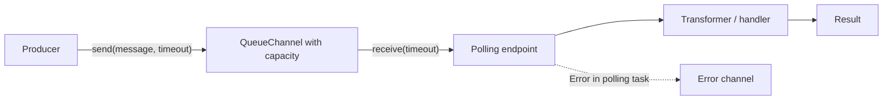

# QueueChannel

## 1. Objectives and Use Cases

In the `SPRING_INTEGRATION_CORE` module, the **Channel Types** chapter helps you choose how a `Message` moves between endpoints. This lesson focuses on `QueueChannel`: a channel backed by a queue where the sender puts messages in first and the receiver takes them out later.

After this lesson, you will be able to:

- Explain the relationship between `MessageChannel`, `PollableChannel`, `QueueChannel`, and a polling endpoint.
- Choose capacity, timeouts, and poller configuration suitable for the processing load.
- Build a Java DSL flow with a queue, a transformer, and an error branch.
- Distinguish enqueuing, successful processing, durability, and message redelivery capability.
- Test FIFO ordering, rejection when full, asynchronous processing, and consumer errors.

Suppose a system receives order-normalization requests. Traffic can spike for a few seconds, while downstream processing runs at the pace of a backend system. A local queue absorbs short-term mismatches. When the queue fills up, the intake layer needs an explicit waiting or rejection policy.

The business examples in this lesson are illustrative. Capacity and time intervals are chosen for easy observation and should be measured before applying to a production application.

## 2. How It Works

`QueueChannel` implements `PollableChannel`, so it supports both `send(...)` and `receive(...)`. With standard instantiation, messages are held in an in-memory queue within the process. The channel has **point-to-point** semantics: one successful receive delivers one message to one consumer, even when multiple consumers read concurrently. See [Message Channel Implementations](https://docs.spring.io/spring-integration/reference/channel/implementations.html).



Sequence of operations to distinguish:

1. Producer creates a `Message` with payload and business headers.
2. `send(...)` places the message in the queue if space is available.
3. A receiver actively calls `receive(...)`.
4. The message is removed from the queue and passed to a handler.
5. The handler executes processing and may produce an output message or throw an error.

By default, the queue retrieves messages in FIFO order. However, FIFO at the channel only describes removal order; if processing runs in parallel, a message dequeued earlier can still finish later.

For example, two workers read requests `A` and `B`: the first worker takes `A` and takes 800 ms; the second worker takes `B` and finishes in 50 ms. An observer of the results may see `B` before `A`.

### The Channel Does Not Run Business Logic on Its Own

Creating `new QueueChannel(100)` does not spawn workers or start handlers automatically. The channel only provides the message exchange mechanism.

In a Spring Integration application, the endpoint connecting a handler to a `PollableChannel` is typically a `PollingConsumer`. The poller supplies the schedule for performing receive operations. When a handler consumes directly from a subscribable channel, the corresponding endpoint uses an event-driven mechanism instead. See [Polling Consumer](https://docs.spring.io/spring-integration/reference/polling-consumer.html).

You can call `send()` and `receive()` sequentially on the same thread to try the API. In a flow with a poller, the producer and the polling task usually run on different threads.

## 3. Instantiation and Choosing the Reference Type

```java
import org.springframework.integration.channel.QueueChannel;
import org.springframework.messaging.MessageChannel;
import org.springframework.messaging.PollableChannel;

QueueChannel concreteChannel = new QueueChannel(100);

MessageChannel producerView = concreteChannel;
PollableChannel consumerView = concreteChannel;
```

All three variables point to the same channel, representing three distinct needs:

| Reference type | Purpose |
| --- | --- |
| `MessageChannel` | Send messages without depending on receive capabilities |
| `PollableChannel` | Send and actively receive messages |
| `QueueChannel` | Use channel-specific APIs such as inspecting pending count |

Common constructors:

```java
QueueChannel bounded = new QueueChannel(100);
QueueChannel veryLargeDefault = new QueueChannel();
```

The no-argument constructor has a very large effective bound corresponding to `Integer.MAX_VALUE`; it does not pre-allocate that many slots, yet it allows a backlog to grow enough to pressure the heap. With the capacity constructor, the value must be greater than `0`. If you need direct handoff without buffering, explore `RendezvousChannel`. See [QueueChannel Javadoc](https://docs.spring.io/spring-integration/api/org/springframework/integration/channel/QueueChannel.html).

In addition, `QueueChannel` has a constructor accepting a `Queue<Message<?>>`. When supplying a custom queue, check its ordering, bounds, and concurrency-safety characteristics; do not assume all properties of the default queue hold for every implementation.

## 4. Semantics of send, receive, and Timeouts

### 4.1. Sender Side

```java
boolean accepted = channel.send(message, 200);
```

The timeout parameter of this API is in **milliseconds**. It bounds how long to wait to place the message into the channel if the operation blocks. A result of `true` indicates the send succeeded; `false` indicates it could not be sent, such as when waiting for space timed out. The API may also throw an exception for other errors. See [MessageChannel Javadoc](https://docs.spring.io/spring-framework/docs/current/javadoc-api/org/springframework/messaging/MessageChannel.html).

In the basic case without custom interceptors:

| Call | When queue has space | When queue is full |
| --- | --- | --- |
| `send(message, 0)` | Enqueues and returns `true` | Returns `false` immediately |
| `send(message, 200)` | Enqueues and returns `true` | Waits up to 200 ms for space |
| `send(message)` or negative timeout | Enqueues | May wait indefinitely |

For `QueueChannel`, **successfully enqueuing a message does not prove business processing is complete**. After the producer receives `true`, a consumer might not have pulled the message yet, might still be processing it, or might fail later.

Do not ignore the return value:

```java
if (!channel.send(message, 200)) {
    throw new IllegalStateException("Queue is full, request not accepted");
}
```

At the application's intake layer, you can map this outcome to a busy response, push back to a retry-capable caller, or use durable buffering aligned with your business contract.

### 4.2. Receiver Side

```java
Message<?> received = channel.receive(500);
if (received != null) {
    // Process received.getPayload().
}
```

`receive(long)` returns the next message, or `null` if the wait times out or the receive operation is interrupted. Calling `receive()` without arguments may block indefinitely. See [PollableChannel Javadoc](https://docs.spring.io/spring-framework/docs/current/javadoc-api/org/springframework/messaging/PollableChannel.html).

| Call | When queue has a message | When queue is empty |
| --- | --- | --- |
| `receive(0)` | Retrieves one message | Returns `null` immediately |
| `receive(500)` | Retrieves one message | Waits up to 500 ms |
| `receive()` or negative timeout | Retrieves one message | May wait indefinitely |

A received message is removed from the queue. In a standard in-memory queue, there is no application `ack` step that defers removal until processing succeeds.

### 4.3. Timeouts to Keep Separate

- **Send timeout**: time spent waiting to put a message into the channel.
- **Receive timeout**: time spent waiting to pull a message from the channel.
- **Poll interval**: schedule that triggers the polling task.
- **Processing timeout**: time limit for a business operation or external call.

For instance, `send(message, 200)` does not mean the consumer must finish processing within 200 ms. Likewise, `receive(500)` does not bound an HTTP call made after the message has already been received.

## 5. Observing FIFO and Capacity with a Small Example

The following example runs in a `main` method when `spring-integration-core` and required dependencies are on the classpath:

```java
import org.springframework.integration.channel.QueueChannel;
import org.springframework.messaging.Message;
import org.springframework.messaging.support.MessageBuilder;

public class QueueBasicsDemo {

    public static void main(String[] args) {
        QueueChannel channel = new QueueChannel(2);

        Message<String> first = MessageBuilder.withPayload("ORDER-1").build();
        Message<String> second = MessageBuilder.withPayload("ORDER-2").build();
        Message<String> third = MessageBuilder.withPayload("ORDER-3").build();

        System.out.println(channel.send(first, 0));
        System.out.println(channel.send(second, 0));
        System.out.println(channel.send(third, 0));

        printPayload(channel.receive(0));
        System.out.println(channel.send(third, 0));

        printPayload(channel.receive(0));
        printPayload(channel.receive(0));
        printPayload(channel.receive(0));
    }

    private static void printPayload(Message<?> message) {
        System.out.println(message == null ? "<empty>" : message.getPayload());
    }
}
```

Expected output:

```text
true
true
false
ORDER-1
true
ORDER-2
ORDER-3
<empty>
```

The third request does not automatically evict the first request to make room. Its first send fails because the queue is full; after one receive, the application explicitly retries the send and succeeds.

Avoid the following pattern on the same thread:

```java
QueueChannel channel = new QueueChannel(1);
channel.send(first);

// Can block indefinitely because no consumer has taken first yet.
channel.send(second);

// This line is unreachable while second is still waiting.
channel.receive();
```

In this situation, the call that needs to free space sits after the call waiting for space. Use a finite timeout or an independent consumer to avoid this deadlock structure.

## 6. Connecting QueueChannel to Endpoints and Pollers

When a transformer, filter, router, or service activator reads directly from a `QueueChannel`, the endpoint needs its own poller configuration or a default poller in the application context. Missing both can prevent endpoint configuration from initializing.

A poller belongs to **the endpoint reading the channel**, not as a built-in business task inside the channel. See [Message Endpoints](https://docs.spring.io/spring-integration/reference/endpoint.html).

Example of configuring polling parameters in Java DSL:

```java
Pollers.fixedDelay(Duration.ofMillis(100))
        .maxMessagesPerPoll(10)
        .receiveTimeout(0)
        .errorChannel("orderErrors");
```

Meaning of each setting:

| Configuration | Meaning |
| --- | --- |
| `fixedDelay(100 ms)` | For a directly executed polling task, wait 100 ms after the previous run finishes |
| `maxMessagesPerPoll(10)` | Receive and process at most 10 messages per poll cycle |
| `receiveTimeout(0)` | Each receive returns immediately when the queue is empty |
| `errorChannel("orderErrors")` | Specify the default destination channel for errors in the polling task |

`maxMessagesPerPoll` is not a worker count. Ten messages in a single poll can be processed sequentially on the same thread. Options such as `taskExecutor`, `transactional`, and `receiveTimeout` belong to the poller configuration. See [PollerSpec Javadoc](https://docs.spring.io/spring-integration/api/org/springframework/integration/dsl/PollerSpec.html).

`fixedDelay` and `fixedRate` are also not synonymous. Fixed rate schedules based on start timestamps; fixed delay measures from when the scheduled task finishes. When delegating work to an executor, the completion time of the scheduled task may differ from when all business work finishes. See [Pollers Javadoc](https://docs.spring.io/spring-integration/api/org/springframework/integration/dsl/Pollers.html).

A default poller is a shared option when multiple endpoints genuinely share the same policy:

```java
import java.time.Duration;

import org.springframework.context.annotation.Bean;
import org.springframework.integration.dsl.PollerSpec;
import org.springframework.integration.dsl.Pollers;
import org.springframework.integration.scheduling.PollerMetadata;

@Bean(name = PollerMetadata.DEFAULT_POLLER)
public PollerSpec defaultPoller() {
    return Pollers.fixedDelay(Duration.ofMillis(100))
            .maxMessagesPerPoll(10)
            .receiveTimeout(0);
}
```

Place this method in a Spring configuration class. `PollerSpec` is a `FactoryBean`; return it directly from the `@Bean` method without manually calling `getObject()`. See [Java DSL Pollers](https://docs.spring.io/spring-integration/reference/dsl/java-pollers.html).

## 7. Java DSL Flow: Order Normalization and Error Handling

### 7.1. Environment Setup

The example uses Java `record` and the `transformWith` API available since Spring Integration 6.2. Choose a JDK compatible with the Spring/Spring Boot line your application uses. If using Spring Boot, let Boot's dependency management manage related versions.

In a Maven project with a Spring Boot parent or BOM, add the following dependencies under `dependencies`:

```xml
<dependency>
    <groupId>org.springframework.boot</groupId>
    <artifactId>spring-boot-starter-integration</artifactId>
</dependency>

<dependency>
    <groupId>org.springframework.boot</groupId>
    <artifactId>spring-boot-starter-test</artifactId>
    <scope>test</scope>
</dependency>
```

The configuration below uses a regular Spring application context, so it does not depend on booting a full Boot application. Java DSL creates the channels and endpoints registered in the context through the `IntegrationFlow` bean. See [Java DSL](https://docs.spring.io/spring-integration/reference/dsl.html).

### 7.2. Complete Configuration

```java
import java.math.BigDecimal;
import java.time.Duration;
import java.util.Locale;

import org.springframework.context.annotation.Bean;
import org.springframework.context.annotation.Configuration;
import org.springframework.integration.channel.QueueChannel;
import org.springframework.integration.config.EnableIntegration;
import org.springframework.integration.dsl.IntegrationFlow;
import org.springframework.integration.dsl.Pollers;

@Configuration
@EnableIntegration
public class OrderQueueConfiguration {

    public record OrderRequest(String orderId, BigDecimal amount) {
    }

    public record OrderResult(
            String orderId,
            BigDecimal amount,
            String status) {
    }

    @Bean
    public QueueChannel orderRequests() {
        return new QueueChannel(100);
    }

    @Bean
    public QueueChannel processedOrders() {
        return new QueueChannel(100);
    }

    @Bean
    public QueueChannel orderErrors() {
        return new QueueChannel(20);
    }

    @Bean
    public IntegrationFlow normalizeOrders() {
        return IntegrationFlow.from("orderRequests")
                .transformWith(transformer -> transformer
                        .transformer((OrderRequest request) -> normalize(request))
                        .expectedType(OrderRequest.class)
                        .poller(Pollers.fixedDelay(Duration.ofMillis(100))
                                .maxMessagesPerPoll(10)
                                .receiveTimeout(0)
                                .errorChannel("orderErrors"))
                        .sendTimeout(250))
                .channel("processedOrders")
                .get();
    }

    private static OrderResult normalize(OrderRequest request) {
        if (request.orderId() == null || request.orderId().isBlank()) {
            throw new IllegalArgumentException("orderId must have a value");
        }

        if (request.amount() == null || request.amount().signum() <= 0) {
            throw new IllegalArgumentException("amount must be greater than 0");
        }

        return new OrderResult(
                request.orderId().trim().toUpperCase(Locale.ROOT),
                request.amount(),
                "VALIDATED");
    }
}
```

`TransformerEndpointSpec` allows configuring the transformation function, expected payload type, and endpoint settings inside `transformWith(...)`. See [TransformerEndpointSpec Javadoc](https://docs.spring.io/spring-integration/api/org/springframework/integration/dsl/TransformerEndpointSpec.html).

In this configuration:

1. The producer sends `OrderRequest` to `orderRequests`.
2. The polling endpoint receives the message and invokes the transformer.
3. Valid data is converted into `OrderResult`.
4. The result is sent to `processedOrders`.
5. Errors thrown in the polling task are routed to `orderErrors`, unless the message carries a header specifying a different error channel.

The endpoint's `sendTimeout(250)` bounds the time spent waiting to send the **result** to `processedOrders`. It is independent of the timeout the producer uses when sending to `orderRequests`. Output send timeout belongs to the handler producing the output message. See [ConsumerEndpointSpec Javadoc](https://docs.spring.io/spring-integration/api/org/springframework/integration/dsl/ConsumerEndpointSpec.html).

The two queues `processedOrders` and `orderErrors` let the learning program actively inspect outputs. A long-running application needs consumers for both; if left to fill up, results can fail to send and error publishing can also block. Do not use these two queues as indefinite storage.

### 7.3. Sending and Observing Results

Place the following snippet in a `main` method or test method; the domain types are nested records inside the configuration class above:

```java
import java.math.BigDecimal;

import org.springframework.context.annotation.AnnotationConfigApplicationContext;
import org.springframework.integration.channel.QueueChannel;
import org.springframework.messaging.Message;
import org.springframework.messaging.support.MessageBuilder;

// Inside a method:
try (var context =
        new AnnotationConfigApplicationContext(OrderQueueConfiguration.class)) {

    QueueChannel input = context.getBean("orderRequests", QueueChannel.class);
    QueueChannel output = context.getBean("processedOrders", QueueChannel.class);

    Message<?> request = MessageBuilder
            .withPayload(new OrderQueueConfiguration.OrderRequest(
                    " ord-101 ", new BigDecimal("120000")))
            .setHeader("orderId", "ORD-101")
            .build();

    boolean accepted = input.send(request, 200);
    if (!accepted) {
        throw new IllegalStateException("Could not enqueue the request");
    }

    Message<?> result = output.receive(2000);
    if (result == null) {
        throw new IllegalStateException("No result received within the wait timeout");
    }

    System.out.println(result.getPayload());
}
```

The expected result payload has `orderId = ORD-101`, `amount = 120000`, and `status = VALIDATED`.

The 2-second wait is an observation limit in the example, not a system latency SLA. If the waiter times out, work already enqueued can still proceed.

## 8. Choosing Capacity and Handling Backpressure

Capacity limits the number of messages currently sitting in the queue. It does not bound all in-flight work, executor queues, or temporary objects created by handlers.

An initial estimation formula for a short traffic burst:

```text
Additional queued messages ≈ max(0, ingress rate - egress rate) × burst duration
```

This is a simplified mental model for design estimation, assuming rates stay relatively steady during the interval considered.

Example:

- Ingress rate: 600 messages/second.
- Egress rate: 400 messages/second.
- Burst duration: 3 seconds.
- Already queued: 200 messages.

The backlog grows by about `200 × 3 = 600` messages. After 3 seconds, the queue can reach `200 + 600 = 800` messages. If capacity is 800, plan how the system responds if the burst lasts longer.

If each message retains roughly 8 KiB of live heap data on average, 800 messages correspond to around 6.25 MiB of data. Actual memory also includes headers, wrapper objects, queue structures, and referenced objects. Measure heap usage rather than treating this multiplication as an exact limit.

Policies when full should be expressed as an explicit contract:

| Policy | How to apply | Consequences to plan for |
| --- | --- | --- |
| Wait briefly then reject | `send(message, finiteTimeout)` | Producers may slow down up to the chosen bound |
| Reject immediately | `send(message, 0)` and check return value | Callers must handle the unaccepted request |
| Persist to durable storage for later processing | Use an appropriate store or broker | Adds storage, recovery, and deduplication overhead |

Do not retry infinitely in an immediate tight loop. When consumers are overloaded, doing so increases CPU and contention without adding processing capacity.

Increasing capacity only extends how long a burst can be absorbed. If the ingress rate continuously exceeds the processing rate, adjust incoming load or increase processing capacity.

## 9. Multiple Consumers and Ordering Requirements

Multiple polling endpoints can pull from the same `QueueChannel`. They compete for messages; this pattern fits when requests can be processed independently.

Distinguish three levels of ordering:

| Observation level | What to understand |
| --- | --- |
| Enqueueing | With multiple concurrent producers, call order across threads does not alone determine enqueue order |
| Dequeueing | The default FIFO queue returns messages in enqueue order |
| Business completion | May differ from dequeue order if consumers process concurrently |

If an order requires steps `CREATED → PAID → SHIPPED` in strict sequence, a shared queue with multiple workers does not by itself guarantee per-order ordering.

Design options include a single sequential consumer, partitioning work by business key and processing each partition sequentially, or checking state versions when updating data. These are flow and data-model decisions; `QueueChannel` has no built-in awareness of order keys.

Increasing worker count also requires checking downstream resource limits. Adding workers for a service whose connection pool is exhausted does not guarantee higher throughput.

## 10. Error Handling Across the Queue Boundary

### 10.1. Send Errors vs. Processing Errors

Wrapping `input.send(...)` in `try/catch` handles errors occurring immediately during sending. It cannot catch exceptions thrown later on the poller thread using standard Java call-stack unwinding.

In framework-managed asynchronous flows, errors can be wrapped into an `ErrorMessage` and sent to an error channel. If the message has an `errorChannel` header, the default mechanism prefers that destination; otherwise it uses the configured default error channel or the global `errorChannel` bean. See [Error Handling](https://docs.spring.io/spring-integration/reference/error-handling.html).

The example in Section 7 configures `orderErrors` as the default destination for the poller. `MessagePublishingErrorHandler` is the component that publishes error messages in this mechanism. See [MessagePublishingErrorHandler Javadoc](https://docs.spring.io/spring-integration/api/org/springframework/integration/channel/MessagePublishingErrorHandler.html).

### 10.2. Reading Contextual Error Information

The payload of an `ErrorMessage` is a `Throwable`, often a `MessagingException` carrying a `failedMessage`. Do not assume every error includes the original message or wraps exceptions in the same number of layers. See [ErrorMessage Javadoc](https://docs.spring.io/spring-framework/docs/current/javadoc-api/org/springframework/messaging/support/ErrorMessage.html).

```java
import org.springframework.messaging.Message;
import org.springframework.messaging.MessagingException;
import org.springframework.messaging.support.ErrorMessage;

// errors is the orderErrors QueueChannel retrieved from the application context.
Message<?> candidate = errors.receive(2000);

if (candidate instanceof ErrorMessage errorMessage) {
    Throwable failure = errorMessage.getPayload();

    System.err.println("Error: " + failure);

    if (failure instanceof MessagingException messagingException) {
        Message<?> failed = messagingException.getFailedMessage();

        if (failed != null) {
            System.err.println("orderId: " + failed.getHeaders().get("orderId"));
        }
    }
}
```

Diagnostic fields worth recording include business key, processing step, timestamp, error type, and attempt count. Log only the payload fields actually needed for troubleshooting.

### 10.3. Dequeuing Followed by Failure Does Not Automatically Re-enqueue

Consider an in-memory queue with the following sequence:

```text
send succeeds
    → receive removes message from queue
    → handler invokes service
    → handler throws exception
```

After the error, the message does not automatically return to the queue just because the handler failed. Sending an `ErrorMessage` reports that an error occurred; it is not equivalent to a retry, queue rollback, or dead-letter queue.

If you write a custom consumer using `receive(...)` and invoke a Java function, you must handle exceptions from that function yourself. Do not assume the framework will automatically publish errors from arbitrary Java code to `errorChannel`.

### 10.4. Designing Retries and Recovery

You can attach `RequestHandlerRetryAdvice` to a handler that needs retries and configure a recovery action once attempts are exhausted. Handler-level retries and redelivery from an external source are two different operational mechanisms. See [Retry Advice](https://docs.spring.io/spring-integration/reference/handler-advice/classes.html).

An illustrative policy for an order validation service:

| Failure type | Appropriate action for the example |
| --- | --- |
| Invalid amount | Record the invalid request and stop, because resending will not fix the data |
| Transient timeout calling a service | Retry with bounded attempts and backoff |
| Attempts exhausted | Persist sufficient information for controlled reprocessing |

If an operation produces side effects, such as charging payment, use a stable idempotency key tied to the business request. Retrying after a timeout can hit cases where the external system completed the work even though the application never received the response.

Do not use the `MessageHeaders.ID` newly generated on each message creation as the unique key for the same business request resent from scratch.

## 11. Persistence and Transactions

### 11.1. Limitations of the Default Queue

An in-memory `QueueChannel` is suitable for internal buffering where messages may be lost if the process stops. Each application instance typically has its own queue, so scaling out replicas does not automatically form a shared queue.

Scenarios to evaluate:

- The process stops while messages remain in the queue.
- A consumer has dequeued a message but has not finished processing it.
- A side effect has already occurred, yet completion status has not been saved.
- The producer reported acceptance before durable persistence occurred.

If your intake contract requires recovery after a crash, add appropriate persistence and coordination mechanisms.

### 11.2. QueueChannel Backed by a Message Store

Spring Integration supports durable backing stores for queues. The XML configuration snippet below only illustrates connecting a channel to an already-declared store:

```xml
<int:channel id="durableOrders">
    <int:queue message-store="channelStore"/>
</int:channel>
```

The `int` prefix requires the Spring Integration namespace; `channelStore` requires a compatible store bean. When using the XML `message-store` attribute, do not simultaneously declare `capacity` on the queue element in this configuration style. See [Persistent QueueChannel Configuration](https://docs.spring.io/spring-integration/reference/channel/configuration.html).

For JDBC, `JdbcChannelMessageStore` is optimized for message channels. You must prepare the schema, database-specific query provider, payload/header serialization, and retention policy. Simply adding a store bean reference does not produce a complete working JDBC setup. See [JDBC Message Store](https://docs.spring.io/spring-integration/reference/jdbc/message-store.html).

### 11.3. Transaction Boundaries Must Be Designed

A transaction bound to the current thread does not automatically propagate from the producer to the poller thread. You can start a transaction on the poller to encompass receiving from a transaction-capable resource and downstream synchronous processing. See [Transaction Support](https://docs.spring.io/spring-integration/reference/transactions.html).

Check specifically:

- Does the store participate in the transaction and restore the receive operation on rollback?
- Does the business update step use the same resource or an appropriate coordination mechanism?
- Does the flow switch threads again before finishing processing?
- Can calls to external systems be executed multiple times?

Attaching a transaction to a poller does not turn a standard in-memory queue into a rollback-capable resource. Nor does a durable message store by itself guarantee "exactly once" for external side effects.

## 12. Comparison with Related Channel Options

| Channel | Primary consumption mechanism | Typical use case |
| --- | --- | --- |
| `DirectChannel` | Invokes handler via subscribe, usually on the sending thread | Sequential processing on the same call stack |
| `QueueChannel` | Active `receive`, typically via a poller | Internal buffering and controlling poll schedule |
| `ExecutorChannel` | Dispatches to handlers via an executor | Handing off work to an executor |
| `PublishSubscribeChannel` | Broadcasts to subscribers | Delivering an event to multiple branches |
| `RendezvousChannel` | Handoff when the receiver is ready | Synchronizing send and receive without buffering |

Refer to channel characteristics in [Message Channel Implementations](https://docs.spring.io/spring-integration/reference/channel/implementations.html) and [ExecutorChannel Javadoc](https://docs.spring.io/spring-integration/api/org/springframework/integration/channel/ExecutorChannel.html).

An executor's internal queue can hold pending tasks. That still differs from exposing the `PollableChannel.receive(...)` API to an integration flow.

When cross-process exchange is needed, a broker via adapters sits at a different architectural scope. Base the decision on durability, redelivery, scaling, and operational needs.

### QueueChannel Behind a Gateway

A gateway returning a value can still wait for a response even if the request traverses a `QueueChannel`. Request timeout limits waiting to send; reply timeout limits waiting for the reply. A caller timing out does not automatically cancel work already placed into the queue. See [Messaging Gateways](https://docs.spring.io/spring-integration/reference/gateway.html).

The flow in Section 7 sends results to `processedOrders` for the program to actively read. If switching to a request/reply gateway, design the corresponding reply path, typically using the `replyChannel` header supplied by the gateway. Do not merely add a gateway method with a return type and assume the existing output queue will automatically route results back to the right caller.

## 13. Testing Queue and Flow Behavior

The example uses JUnit Jupiter along with the records and configuration class from Section 7. Place the test class in the same package as the configuration class or add the appropriate imports.

Two groups should be verified separately:

- Direct channel behavior: capacity, FIFO ordering, empty queue.
- Behavior inside the context: endpoint actually polls, transformer produces results, and errors reach the right destination.

```java
import java.math.BigDecimal;

import org.junit.jupiter.api.Test;
import org.springframework.context.annotation.AnnotationConfigApplicationContext;
import org.springframework.integration.channel.QueueChannel;
import org.springframework.messaging.Message;
import org.springframework.messaging.MessagingException;
import org.springframework.messaging.support.ErrorMessage;
import org.springframework.messaging.support.MessageBuilder;

import static org.junit.jupiter.api.Assertions.*;

class QueueChannelTest {

    @Test
    void shouldRespectCapacityAndFifo() {
        QueueChannel channel = new QueueChannel(2);

        assertTrue(channel.send(
                MessageBuilder.withPayload("A").build(), 0));
        assertTrue(channel.send(
                MessageBuilder.withPayload("B").build(), 0));
        assertFalse(channel.send(
                MessageBuilder.withPayload("C").build(), 0));

        Message<?> first = channel.receive(0);
        Message<?> second = channel.receive(0);

        assertNotNull(first);
        assertNotNull(second);
        assertEquals("A", first.getPayload());
        assertEquals("B", second.getPayload());
        assertNull(channel.receive(0));

        assertTrue(channel.send(
                MessageBuilder.withPayload("C").build(), 0));
    }

    @Test
    void eachReceiveShouldRemoveOneMessage() {
        QueueChannel channel = new QueueChannel(1);
        assertTrue(channel.send(
                MessageBuilder.withPayload("ONLY-ONE").build(), 0));

        Message<?> consumerOne = channel.receive(0);
        Message<?> consumerTwo = channel.receive(0);

        assertNotNull(consumerOne);
        assertNull(consumerTwo);
    }

    @Test
    void shouldNormalizeAnOrderThroughPollingEndpoint() {
        try (var context =
                new AnnotationConfigApplicationContext(
                        OrderQueueConfiguration.class)) {

            QueueChannel input =
                    context.getBean("orderRequests", QueueChannel.class);
            QueueChannel output =
                    context.getBean("processedOrders", QueueChannel.class);

            assertTrue(input.send(MessageBuilder
                    .withPayload(new OrderQueueConfiguration.OrderRequest(
                            " ord-101 ", new BigDecimal("120000")))
                    .setHeader("orderId", "ORD-101")
                    .build(), 200));

            Message<?> reply = output.receive(2000);
            assertNotNull(reply);

            var result = assertInstanceOf(
                    OrderQueueConfiguration.OrderResult.class,
                    reply.getPayload());

            assertEquals("ORD-101", result.orderId());
            assertEquals(new BigDecimal("120000"), result.amount());
            assertEquals("VALIDATED", result.status());
        }
    }

    @Test
    void acceptedOrderCanStillFailLater() {
        try (var context =
                new AnnotationConfigApplicationContext(
                        OrderQueueConfiguration.class)) {

            QueueChannel input =
                    context.getBean("orderRequests", QueueChannel.class);
            QueueChannel output =
                    context.getBean("processedOrders", QueueChannel.class);
            QueueChannel errors =
                    context.getBean("orderErrors", QueueChannel.class);

            assertTrue(input.send(MessageBuilder
                    .withPayload(new OrderQueueConfiguration.OrderRequest(
                            "BAD-1", new BigDecimal("-1")))
                    .setHeader("orderId", "BAD-1")
                    .build(), 200));

            ErrorMessage error = assertInstanceOf(
                    ErrorMessage.class, errors.receive(2000));

            MessagingException failure = assertInstanceOf(
                    MessagingException.class, error.getPayload());

            Message<?> failedMessage = failure.getFailedMessage();
            assertNotNull(failedMessage);
            assertEquals(
                    "BAD-1", failedMessage.getHeaders().get("orderId"));
            assertNull(output.receive(0));
        }
    }
}
```

The second test demonstrates that two sequential receives cannot both obtain the same message. It is not a load test or proof of fairness across concurrent workers.

Tests involving a poller use `receive(timeout)` for a bounded wait rather than guessing a `Thread.sleep(...)` duration. On slower environments, pick an appropriate timeout; do not turn a test wait timeout into a business latency SLA unless such a contract exists.

The tests above do not prove crash recovery, JDBC transaction correctness, or side-effect deduplication. Those requirements need integration scenarios against the actual resources used.

## 14. Observation and Diagnostics

You can observe the pending message count and remaining capacity:

```java
int pending = channel.getQueueSize();
int remaining = channel.getRemainingCapacity();
```

These are point-in-time snapshots. Do not treat "check remaining space then send" as an atomic operation:

```java
// The observed result may become stale before send is called.
if (channel.getRemainingCapacity() > 0) {
    channel.send(message, 0);
}
```

Even in this case, still check the return value of `send`. Another producer may claim the free slot first.

Application metrics to monitor together:

- Number of queued messages and whether it trends up or down.
- Count of send failures due to a full queue or timeout.
- Intake rate, completion rate, and business error rate.
- Time spent waiting in the queue and processing time after dequeue.
- Consumer health on both the result branch and the error branch.

A shrinking queue does not always mean healthy business processing: consumers might be pulling fast and failing fast. A queue size of 0 also does not include work currently in progress or waiting in another queue.

You can use `ChannelInterceptor` to observe send/receive operations. Receive callbacks are only meaningful for a `PollableChannel`; `postSend` indicates the send outcome, not business completion status. See [Channel Interceptors](https://docs.spring.io/spring-integration/reference/channel/interceptors.html).

| Symptom | What to check first |
| --- | --- |
| Queue grows while handler does not run | Has the endpoint started, and is an appropriate poller configured? |
| Producer blocks for a long time | Is the queue full and using a call without a finite timeout? |
| `send` returns `true` but no output appears | Is the handler still running, output full, or did errors route to another branch? |
| Results arrive out of order | Are there multiple consumers, an executor, or parallel processing steps? |
| Raising `maxMessagesPerPoll` does not add workers | That setting limits messages per poll cycle; it does not create threads |
| Error occurs but caller cannot catch it | Did the error happen after switching to the poller thread? |
| Messages vanish when the application stops | Is the queue in-memory without durable persistence? |
| Whole flow is slow even though input queue is not full | Inspect output channels, error channel, and downstream resources |

When choosing `QueueChannel`, define three contracts clearly: what counts as accepted, how to behave when space runs out, and how to recover if processing is interrupted mid-flight. Then configure the poller, output path, error path, and tests to match those contracts.
