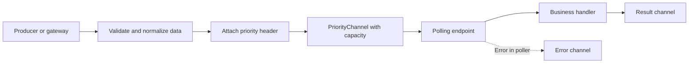

# PriorityChannel

## 1. Objectives and Use Cases

In the **Channel Types** chapter of the **SPRING_INTEGRATION_CORE** module, this lesson explains how to use `PriorityChannel` to select which message should be processed first. The content connects `Message`, `MessageChannel`, endpoints, gateways, and Java DSL into a flow with an explicit priority policy.

Suppose a system receives order-processing requests in two groups:

- Standard orders can wait in the queue.
- Express orders need to be picked up earlier when workers have a backlog.

If all requests pass through a FIFO queue, an express order must wait behind every request that entered earlier. `PriorityChannel` lets you change dequeue order based on priority.

After this lesson, you will be able to configure a bounded-capacity channel, attach priority before enqueuing, connect a poller in Java DSL, write a custom comparator, and test the channel's actual guarantees.

The examples use Java 17 and target Spring Integration 6.5 APIs. Spring Boot projects can use `spring-boot-starter-integration` with Boot-managed versions; plain Spring projects require `spring-integration-core`. The test examples use JUnit Jupiter and AssertJ. No message broker is needed to run the in-memory examples.

## 2. Where Does PriorityChannel Fit in a Message Flow?

`PriorityChannel` extends `QueueChannel` and is a `PollableChannel`. Producers put `Message<?>` instances into the queue; consumers actively pull them via `receive()` or through a polling endpoint. When multiple consumers exist, each message is taken by one consumer. This channel fits the work-queue pattern.

Spring lets you use the default comparator based on the `priority` header, or pass a custom `Comparator<Message<?>>` when creating the channel. See [PriorityChannel API](https://docs.spring.io/spring-integration/docs/6.5.0/api/org/springframework/integration/channel/PriorityChannel.html).



Separate three moments in the diagram:

1. **Send succeeded:** the channel accepted the message.
2. **Dequeued:** a consumer received a message.
3. **Business completed:** the handler and related steps finished.

Priority affects the second moment. A producer's successful send does not prove the order has finished processing.

## 3. Default Priority Rules

### 3.1. Higher Priority Is Dequeued First

With the default comparator, priority values are compared in descending order. In the 6.5 in-memory implementation:

- A missing priority header is treated as level `0`.
- Negative priorities still participate in comparison; for example, `0` comes before `-1`.
- When comparisons tie, the channel uses an internal sequence number to break ties.

This tie-breaker preserves sequential send order among equal-priority messages; you do not need to add a timestamp to the comparator to achieve that. With concurrent producers, do not treat method-call start order as business order. See [PriorityChannel 6.5.0 source code](https://github.com/spring-projects/spring-integration/blob/v6.5.0/spring-integration-core/src/main/java/org/springframework/integration/channel/PriorityChannel.java).

Suppose a producer sends sequentially while no consumer is pulling yet:

| Send order | Payload | Priority header |
| --- | --- | --- |
| 1 | `STANDARD-A` | `1` |
| 2 | `EXPRESS-A` | `9` |
| 3 | `STANDARD-B` | `1` |
| 4 | `EXPRESS-B` | `9` |
| 5 | `UNCLASSIFIED` | None |

Expected receive order:

```text
EXPRESS-A → EXPRESS-B → STANDARD-A → STANDARD-B → UNCLASSIFIED
```

Values `1` and `9` are example policy numbers. Applications should define named constants or a business mapping table instead of scattering these numbers throughout the codebase.

### 3.2. Setting the Right Header and Data Type

The standard constant name is `IntegrationMessageHeaderAccessor.PRIORITY`, whose value is `"priority"`.

```java
import org.springframework.integration.IntegrationMessageHeaderAccessor;
import org.springframework.messaging.Message;
import org.springframework.messaging.support.MessageBuilder;

Message<String> urgent = MessageBuilder
        .withPayload("ORDER-208")
        .setHeader(IntegrationMessageHeaderAccessor.PRIORITY, 9)
        .build();
```

The example uses `MessageBuilder` from `org.springframework.messaging.support` and sets the header directly. Spring Integration also has a builder in its own package; check imports when copying examples.

Normalize priority to `Integer`. Spring Integration's accessor reads the header as a `Number` and takes `intValue()`; a string like `"9"` is not automatically converted here. Avoid floating-point numbers or `Long` values outside the `int` range. See [StaticMessageHeaderAccessor.getPriority](https://github.com/spring-projects/spring-integration/blob/v6.5.0/spring-integration-core/src/main/java/org/springframework/integration/StaticMessageHeaderAccessor.java).

For HTTP inputs, JSON, or partner payloads, translate service tiers like `EXPRESS` into an internal priority value. That applies a consistent policy before messages enter the channel.

## 4. Minimal Example: Observing Receive Order

The following program uses only an in-memory channel with no Spring context initialization. It sends all messages first and then receives them so the outcome does not depend on poller timing.

```java
import java.util.Objects;

import org.springframework.integration.IntegrationMessageHeaderAccessor;
import org.springframework.integration.channel.PriorityChannel;
import org.springframework.messaging.Message;
import org.springframework.messaging.support.MessageBuilder;

public class PriorityChannelDemo {

    public static void main(String[] args) {
        PriorityChannel channel = new PriorityChannel(10);

        enqueue(channel, message("STANDARD-A", 1));
        enqueue(channel, message("EXPRESS-A", 9));
        enqueue(channel, message("STANDARD-B", 1));
        enqueue(channel, message("EXPRESS-B", 9));

        enqueue(channel, MessageBuilder
                .withPayload("UNCLASSIFIED")
                .build());

        for (int i = 0; i < 5; i++) {
            Message<?> received = Objects.requireNonNull(channel.receive(0));
            System.out.println(received.getPayload());
        }

        System.out.println("empty = " + (channel.receive(0) == null));
    }

    private static Message<String> message(String id, int priority) {
        return MessageBuilder.withPayload(id)
                .setHeader(IntegrationMessageHeaderAccessor.PRIORITY, priority)
                .build();
    }

    private static void enqueue(PriorityChannel channel, Message<?> message) {
        if (!channel.send(message, 0)) {
            throw new IllegalStateException("No space left in channel");
        }
    }
}
```

Output:

```text
EXPRESS-A
EXPRESS-B
STANDARD-A
STANDARD-B
UNCLASSIFIED
empty = true
```

`receive(0)` works well for this example because the data is already enqueued. In an application, receiving with timeout `0` can return `null` even when a producer is about to send a message.

## 5. Capacity and Timeouts: Dequeue Priority Differs from Admission Priority

### 5.1. Bounded Instantiation

```java
PriorityChannel bounded = new PriorityChannel(100);
PriorityChannel unbounded = new PriorityChannel();
```

The no-argument constructor creates a queue with no configured capacity bound. With the capacity constructor, pass a positive number to set a bound; non-positive capacity corresponds to an unbounded configuration. See [PriorityChannel constructors](https://docs.spring.io/spring-integration/docs/6.5.0/api/org/springframework/integration/channel/PriorityChannel.html).

Choose capacity based on acceptable backlog and available memory. One hundred messages containing only an order ID differ vastly from one hundred payloads holding large files.

### 5.2. Semantics of Send and Receive Methods

| Call on in-memory channel | Behavior to handle |
| --- | --- |
| `send(message, 0)` | Try sending immediately; return `false` if no space |
| `send(message, 200)` | Wait up to roughly 200 ms for space |
| `send(message)` | May wait indefinitely when channel is full |
| `receive(0)` | Take immediately if present; return `null` when empty |
| `receive(200)` | Wait up to roughly 200 ms for a message |
| `receive()` | Wait until a message is received, unless interrupted |

Timeouts bound waiting on the channel operation; they are not deadlines for business completion. Unrecoverable errors can still throw exceptions. See the [MessageChannel](https://docs.spring.io/spring-framework/docs/current/javadoc-api/org/springframework/messaging/MessageChannel.html) and [PollableChannel](https://docs.spring.io/spring-framework/docs/current/javadoc-api/org/springframework/messaging/PollableChannel.html) contracts.

If calling `send` directly, always inspect the boolean result:

```java
boolean accepted = channel.send(urgent, 200);

if (!accepted) {
    // Depending on policy: report overload, store request for retry,
    // or route to another intake queue.
}
```

### 5.3. A Full Channel Does Not Evict Entries for Urgent Messages

Consider capacity `2`:

```text
In queue: [STANDARD-A, STANDARD-B]
New message: EXPRESS-A, priority=9
```

`EXPRESS-A` still has to wait for space or be rejected when the timeout expires. It does not automatically evict `STANDARD-A` or `STANDARD-B`.

This is a design consequence to account for when setting SLAs: priority only selects among messages already admitted into the queue. If you must reserve intake space for urgent orders, separate the queues and assign distinct capacity budgets per group.

Free capacity increases when a message is removed from the queue. Messages currently running inside workers are no longer counted in queue depth, so capacity does not cap total in-flight work either.

## 6. Integrating with Java DSL

### 6.1. Complete Configuration in a Spring Context

The following example receives orders, filters out invalid inputs, normalizes order IDs, attaches priority, and puts them into the channel. A polling endpoint processes orders and sends results to another queue.

```java
import org.springframework.context.annotation.Bean;
import org.springframework.context.annotation.Configuration;
import org.springframework.integration.IntegrationMessageHeaderAccessor;
import org.springframework.integration.channel.PriorityChannel;
import org.springframework.integration.channel.QueueChannel;
import org.springframework.integration.config.EnableIntegration;
import org.springframework.integration.dsl.IntegrationFlow;
import org.springframework.integration.dsl.Pollers;

@Configuration
@EnableIntegration
public class PriorityOrderConfiguration {

    public record Order(String id, boolean express) {
    }

    public record OrderResult(String orderId, String status) {
    }

    @Bean
    public PriorityChannel orderPriorityChannel() {
        return new PriorityChannel(100);
    }

    @Bean
    public QueueChannel completedOrders() {
        return new QueueChannel(100);
    }

    @Bean
    public QueueChannel orderErrors() {
        return new QueueChannel(100);
    }

    @Bean
    public IntegrationFlow orderIngress(PriorityChannel orderPriorityChannel) {
        return IntegrationFlow.from("orderInput")
                .filter(Order.class,
                        order -> order.id() != null && !order.id().isBlank(),
                        filter -> filter.throwExceptionOnRejection(true))
                .transform(Order.class,
                        order -> new Order(order.id().trim(), order.express()))
                .enrichHeaders(headers -> headers.headerFunction(
                        IntegrationMessageHeaderAccessor.PRIORITY,
                        message -> ((Order) message.getPayload()).express() ? 9 : 1))
                .channel(orderPriorityChannel)
                .get();
    }

    @Bean
    public IntegrationFlow orderWorker(
            PriorityChannel orderPriorityChannel,
            QueueChannel completedOrders,
            QueueChannel orderErrors) {

        return IntegrationFlow.from(orderPriorityChannel)
                .handle(Order.class,
                        (order, headers) -> new OrderResult(order.id(), "DONE"),
                        endpoint -> endpoint.poller(
                                Pollers.fixedDelay(100)
                                        .maxMessagesPerPoll(1)
                                        .receiveTimeout(0)
                                        .errorChannel(orderErrors)))
                .channel(completedOrders)
                .get();
    }
}
```

`IntegrationFlow.from("orderInput")` creates a named input channel, defaulting to a `DirectChannel` when no matching channel bean exists. The filter, transformer, and header enricher run before the enqueue point. The handler after `orderPriorityChannel` is triggered by the poller.

The result and error queues are retained for easy observation in the example. In real deployments, both must have consumers. If an output queue fills up while downstream sends have no wait timeout, workers can stall at the output step.

### 6.2. Running the Configuration

Place the following class in the same package as `PriorityOrderConfiguration`:

```java
import java.util.Objects;

import org.springframework.context.annotation.AnnotationConfigApplicationContext;
import org.springframework.messaging.Message;
import org.springframework.messaging.MessageChannel;
import org.springframework.messaging.PollableChannel;
import org.springframework.messaging.support.MessageBuilder;

public class PriorityOrderApplication {

    public static void main(String[] args) {
        try (var context = new AnnotationConfigApplicationContext(
                PriorityOrderConfiguration.class)) {

            MessageChannel input =
                    context.getBean("orderInput", MessageChannel.class);

            PollableChannel results =
                    context.getBean("completedOrders", PollableChannel.class);

            send(input, new PriorityOrderConfiguration.Order(" STANDARD-1 ", false));
            send(input, new PriorityOrderConfiguration.Order(" EXPRESS-1 ", true));

            for (int i = 0; i < 2; i++) {
                Message<?> result = Objects.requireNonNull(
                        results.receive(2_000),
                        "No result within the observation timeout");
                System.out.println(result.getPayload());
            }
        }
    }

    private static void send(
            MessageChannel input,
            PriorityOrderConfiguration.Order order) {

        boolean accepted = input.send(MessageBuilder.withPayload(order).build(), 0);

        if (!accepted) {
            throw new IllegalStateException("Unable to send order");
        }
    }
}
```

The poller is already running once the context starts, so this program observes flow execution and output payloads. It does not guarantee `EXPRESS-1` appears first: the poller may pick up `STANDARD-1` before the express order is sent.

Also, the timeout passed to `send` on `orderInput` does not automatically become the timeout for every downstream send. In this configuration, the input is a `DirectChannel`, while the enqueue happens at the subsequent endpoint. To bound waiting at that boundary, configure the endpoint's send timeout or use a gateway that sends straight to the queue as shown later.

### 6.3. Declaring a Priority Channel Directly in the DSL

An alternative for declaring the channel is:

```java
.channel(channels -> channels
        .priority("orderPriorityChannel")
        .capacity(100))
```

This is a replacement snippet inside a flow, not configuration to add alongside the `orderPriorityChannel` bean above. Keep one declaration per channel to avoid duplicate bean names. Related factories are in the [MessageChannels API](https://docs.spring.io/spring-integration/docs/6.5.0/api/org/springframework/integration/dsl/MessageChannels.html).

## 7. The Poller Decides When Work Is Pulled

The example configuration uses:

```java
Pollers.fixedDelay(100)
        .maxMessagesPerPoll(1)
        .receiveTimeout(0)
        .errorChannel(orderErrors)
```

Meaning:

- `fixedDelay(100)`: sets the pause after one polling execution finishes before the next begins.
- `maxMessagesPerPoll(1)`: pulls at most one message per poll cycle.
- `receiveTimeout(0)`: ends the receive immediately if the queue is empty.
- `errorChannel(orderErrors)`: sets the default error destination for this poller.

Options are provided via [PollerSpec](https://docs.spring.io/spring-integration/docs/6.5.0/api/org/springframework/integration/dsl/PollerSpec.html).

With one sequential worker and a handler taking 20 ms on average, adding a 100 ms delay yields roughly a 120 ms cycle per message. An illustrative estimate is around `1 / 0.12 ≈ 8.3` messages/second, excluding other overhead. This is why a priority queue can still process slowly if the poller is scheduled too infrequently.

Increasing `maxMessagesPerPoll` can reduce wait gaps between messages. It does not create atomic batch processing: the channel still selects one message on each `receive` call. A high-priority message arriving between two receives can be selected on the next call.

If adding an executor or multiple consumers to increase parallelism, re-evaluate limits on pending tasks and result ordering.

## 8. Gateways: Request-Sending Contracts Must Match the Flow

A gateway lets business code invoke a Java interface instead of building messages manually. With the `orderIngress` flow from the previous section, you can place a gateway in front of `orderInput` to reuse validation, normalization, and classification. See [Messaging Gateways](https://docs.spring.io/spring-integration/reference/gateway.html).

If you want to clearly demonstrate timeout behavior directly at the priority queue, use a variant sending straight to `orderPriorityChannel`:

```java
import org.springframework.integration.IntegrationMessageHeaderAccessor;
import org.springframework.integration.annotation.Gateway;
import org.springframework.integration.annotation.MessagingGateway;
import org.springframework.messaging.handler.annotation.Header;

@MessagingGateway(defaultRequestChannel = "orderPriorityChannel")
public interface PriorityOrderGateway {

    @Gateway(requestTimeout = "200")
    void submit(
            PriorityOrderConfiguration.Order order,
            @Header(IntegrationMessageHeaderAccessor.PRIORITY) int priority);
}
```

Register the interface via `@IntegrationComponentScan` on the package containing the gateway, or via your application's corresponding gateway registration mechanism.

In this variant:

- `requestTimeout` bounds how long to wait to enqueue into the queue.
- A `void` method does not wait for a business result.
- When sending fails, callers must handle the send error according to the gateway contract; this interface does not return a boolean to indicate a full queue.

This direct-send variant bypasses `orderIngress`. Therefore, the caller must validate and normalize `Order`, and map priority from a trusted policy before calling. In real systems, pick a single intake boundary so these rules are not bypassed.

If synchronous result return is needed, design request/reply explicitly: return type, reply channel, reply timeout, and how late results are handled. Merely changing the interface from `void` to a return type is not enough while the flow still routes results statically to `completedOrders`.

## 9. Custom Comparator: Choosing Requests with the Nearest Deadline

Numeric priority works well when the business has fixed tiers. For deadline-driven work, you can pick the message with the earliest processing deadline.

The comparator contract is: a negative result means the first argument comes first. The channel's default comparator reverses the comparison so larger priority numbers come first; a custom comparator must express the exact business direction needed.

Example using a `Long` header `dueAtEpochMillis` and pushing messages without a deadline to the back:

```java
import java.util.Comparator;

import org.springframework.integration.channel.PriorityChannel;
import org.springframework.messaging.Message;

public final class DeadlineChannels {

    private DeadlineChannels() {
    }

    public static PriorityChannel create() {
        Comparator<Message<?>> nearestDeadlineFirst =
                Comparator.comparingLong(DeadlineChannels::deadline);

        return new PriorityChannel(100, nearestDeadlineFirst);
    }

    private static long deadline(Message<?> message) {
        Long value = message.getHeaders().get("dueAtEpochMillis", Long.class);
        return value == null ? Long.MAX_VALUE : value;
    }
}
```

Creating messages:

```java
long now = System.currentTimeMillis();

Message<String> dueSoon = MessageBuilder
        .withPayload("TASK-SOON")
        .setHeader("dueAtEpochMillis", now + 60_000L)
        .build();

Message<String> dueLater = MessageBuilder
        .withPayload("TASK-LATER")
        .setHeader("dueAtEpochMillis", now + 600_000L)
        .build();
```

When both are in the channel, `TASK-SOON` is dequeued first. A custom comparator replaces the default priority criterion. To compare priority first and deadline second, express both inside the same comparator.

A comparator should:

- Rely on immutable data on the message.
- Return consistent, transitive results.
- Avoid I/O, database queries, or remote service calls.
- Use `Integer.compare`, `Long.compare`, or `Comparator.comparing...` to avoid subtraction overflow.

Keep the deadline constant in the header; do not mutate it while the message sits in the queue. When comparison keys change without removing and reinserting the element, the queue has no basis to re-sort itself properly.

The deadline in the comparator only determines ordering. It does not hold a message until a scheduled time, expire it automatically, or discard overdue messages. Scheduling or expiring requests requires separate processing steps.

## 10. Limits of Priority Ordering

### 10.1. Priority Only Applies to Waiting Items

Consider this timeline:

```text
t0: STANDARD-A enters queue
t1: Worker takes STANDARD-A and starts processing
t2: EXPRESS-A enters queue
t3: STANDARD-A finishes
t4: Worker takes EXPRESS-A
```

The channel does not preempt work already handed to a worker. Therefore, an urgent order may still wait behind a long-running standard task already in progress.

If standard tasks can take minutes, consider splitting work into smaller units or dedicating workers to the urgent tier. Simply raising priority does not shorten the execution time of an already-started task.

### 10.2. Dequeue Order Differs from Completion Order

Suppose two workers pick up tasks:

| Message | Priority | Illustrative processing time |
| --- | --- | --- |
| `EXPRESS-A` | `9` | 2 seconds |
| `STANDARD-A` | `1` | 20 ms |

Even though the first worker picks up `EXPRESS-A` first, the second worker can finish `STANDARD-A` sooner.

An executor layer with its own queue can also absorb many standard tasks before an express order arrives. Once submitted to the executor, the upstream priority queue loses the ability to reorder them. Inspect the entire chain of queues when analyzing latency.

### 10.3. Multiple Instances Do Not Automatically Share One Queue

Each instance creating `new PriorityChannel(100)` owns its own in-memory queue. One instance may be processing standard orders while another instance still has a backlog of express orders.

To prioritize across a shared workload, use shared storage or a broker and understand its consumer competition rules. HTTP load balancing in front of the application does not create global priority ordering.

## 11. Starvation and Fairness

When urgent orders arrive continuously faster than processing capacity, standard orders can wait indefinitely. This is starvation: one class of work is delayed by the scheduling policy.

For example, capacity is 600 orders per minute, but 650 urgent orders and 100 standard orders arrive each minute. Increasing queue capacity only holds a larger backlog; it adds no capacity to serve standard orders.

Some design options:

| Policy | How to implement | Trade-off |
| --- | --- | --- |
| Reserve capacity per tier | Separate queues and workers per tier | Reserved capacity may sit idle |
| Weighted/ratio service | Dispatcher selects at most N urgent orders then one standard order | Requires implementing custom scheduling policy |
| Boost long-waiting work | Coordinator dequeues and re-enqueues periodically | Must manage state transitions and deduplication |
| Rate-limit intake | Apply quotas per customer or service tier | Some requests are rejected or deferred |

`PriorityChannel` does not include built-in quotas or weighted scheduling. Those policies are architectural additions.

Do not implement aging using a comparator whose output changes arbitrarily with wall-clock time while items sit untouched in the queue. When relative order can change, use an explicit re-evaluation and re-insertion mechanism.

## 12. Error Handling Across the Asynchronous Boundary

### 12.1. Intake Errors and Processing Errors Take Different Paths

With the configuration in Section 6:

| Stage | Example error | Where to observe |
| --- | --- | --- |
| Before enqueue | Blank order ID rejected by filter | Caller running through `orderInput` |
| Enqueue into queue | No space left after wait timeout | `send` return value or endpoint/gateway failure |
| Poller runs handler | Business service throws exception | Poller's error handling flow |
| Sending result | Downstream error inside the same polling task | Poller's error handling flow |

Errors occurring on the polling thread cannot be thrown back into a producer call that has already returned. Spring Integration represents asynchronous errors as an `ErrorMessage`. With the standard error handler, the message's `errorChannel` header can select the error destination; if absent, the configured default or global `errorChannel` is used. See [Error Handling](https://docs.spring.io/spring-integration/reference/error-handling.html).

When custom code calls `receive()` and executes business logic manually, that code must manage exceptions itself. Using `PriorityChannel` alone does not turn every exception into an error message.

### 12.2. Observing the Error Queue in the Example

After intentionally triggering an error in the handler, you can read the error channel:

```java
Message<?> error = orderErrors.receive(2_000);

if (error instanceof org.springframework.messaging.support.ErrorMessage errorMessage) {
    Throwable cause = errorMessage.getPayload();
    System.err.println("Processing failed: " + cause.getMessage());
}
```

This snippet assumes `orderErrors` is the `QueueChannel` bean from the configuration. In an application, have a dedicated flow consume the error channel and record the order ID, cause, attempt count, and next action.

### 12.3. Retries Must Be Bounded

With an in-memory queue, a dequeued message does not automatically return just because the handler failed. Retries can be implemented via handler advice or a dedicated recovery flow.

Your policy should specify:

- Which errors are transient and retryable vs. fatal and stopped immediately.
- Maximum retry attempts and backoff intervals.
- Priority level when re-enqueuing.
- Destination for items that can no longer be processed.
- How to prevent duplicate side effects by order ID.

Infinitely re-enqueuing a failing message at high priority can starve other orders continuously. Retrying inline on a sequential worker also keeps that worker occupied until attempts finish; include that time in capacity planning.

## 13. Durable Storage and Message Stores

An in-memory queue loses data when the process stops. If an acknowledged order must survive restarts, choose an appropriate storage mechanism.

Spring Integration supports priority channels backed by `PriorityCapableChannelMessageStore`. When configuring via XML with a message store, do not combine the in-memory queue's `capacity` and `comparator` attributes; the store determines priority capabilities. See [PriorityChannel Configuration](https://docs.spring.io/spring-integration/reference/channel/configuration.html).

For JDBC, `JdbcChannelMessageStore` is the implementation tailored for message channels. You must prepare the schema, database-specific query provider, enable priority mode, and verify appropriate indexes. Documentation covers the setup in [JDBC Message Store](https://docs.spring.io/spring-integration/reference/jdbc/message-store.html).

When selecting a store, verify concrete business scenarios: enqueue then restart, two consumers competing on the same queue, failure after dequeue, and transaction rollback. Durable message persistence alone does not guarantee external side effects happen only once.

Do not generalize the in-memory version's internal FIFO tie-breaking into blanket guarantees for a distributed store. Ordering and recovery must be evaluated per store implementation, transaction model, and consumer behavior.

## 14. Testing Key Guarantees

### 14.1. Direct Channel Tests

When testing ordering, enqueue the full test dataset before dequeuing. That keeps outcomes independent of when a poller happens to pull work.

```java
import org.junit.jupiter.api.Test;

import org.springframework.integration.IntegrationMessageHeaderAccessor;
import org.springframework.integration.channel.PriorityChannel;
import org.springframework.messaging.Message;
import org.springframework.messaging.support.MessageBuilder;

import static org.assertj.core.api.Assertions.assertThat;

class PriorityChannelBehaviorTest {

    @Test
    void receivesHigherPriorityBeforeLowerPriority() {
        PriorityChannel channel = new PriorityChannel(10);

        assertThat(channel.send(message("standard", 1), 0)).isTrue();
        assertThat(channel.send(message("express", 9), 0)).isTrue();
        assertThat(channel.send(message("background", -1), 0)).isTrue();

        assertThat(channel.receive(0))
                .isNotNull()
                .extracting(Message::getPayload)
                .isEqualTo("express");

        assertThat(channel.receive(0))
                .isNotNull()
                .extracting(Message::getPayload)
                .isEqualTo("standard");

        assertThat(channel.receive(0))
                .isNotNull()
                .extracting(Message::getPayload)
                .isEqualTo("background");

        assertThat(channel.receive(0)).isNull();
    }

    @Test
    void preservesSequentialArrivalWhenPriorityIsEqual() {
        PriorityChannel channel = new PriorityChannel(10);

        assertThat(channel.send(message("first", 5), 0)).isTrue();
        assertThat(channel.send(message("second", 5), 0)).isTrue();

        assertThat(channel.receive(0))
                .isNotNull()
                .extracting(Message::getPayload)
                .isEqualTo("first");

        assertThat(channel.receive(0))
                .isNotNull()
                .extracting(Message::getPayload)
                .isEqualTo("second");
    }

    @Test
    void treatsMissingPriorityAsZero() {
        PriorityChannel channel = new PriorityChannel(10);

        assertThat(channel.send(message("negative", -1), 0)).isTrue();
        assertThat(channel.send(MessageBuilder.withPayload("missing").build(), 0))
                .isTrue();
        assertThat(channel.send(message("explicit-zero", 0), 0)).isTrue();

        assertThat(channel.receive(0))
                .isNotNull()
                .extracting(Message::getPayload)
                .isEqualTo("missing");

        assertThat(channel.receive(0))
                .isNotNull()
                .extracting(Message::getPayload)
                .isEqualTo("explicit-zero");

        assertThat(channel.receive(0))
                .isNotNull()
                .extracting(Message::getPayload)
                .isEqualTo("negative");
    }

    @Test
    void rejectsUrgentMessageWhenQueueIsFullAndTimeoutIsZero() {
        PriorityChannel channel = new PriorityChannel(1);

        assertThat(channel.send(message("standard", 1), 0)).isTrue();
        assertThat(channel.send(message("express", 9), 0)).isFalse();

        assertThat(channel.receive(0))
                .isNotNull()
                .extracting(Message::getPayload)
                .isEqualTo("standard");

        assertThat(channel.send(message("express", 9), 0)).isTrue();
    }

    private static Message<String> message(String payload, int priority) {
        return MessageBuilder.withPayload(payload)
                .setHeader(IntegrationMessageHeaderAccessor.PRIORITY, priority)
                .build();
    }
}
```

These tests verify the observable contract: priority, equal levels, missing header, and admission when full. The official test suite also has test cases for comparators, capacity, and equal-level ordering in [PriorityChannelTests](https://github.com/spring-projects/spring-integration/blob/v6.5.0/spring-integration-core/src/test/java/org/springframework/integration/channel/PriorityChannelTests.java).

### 14.2. Testing a Flow with a Poller

To test ordering at the integration level:

1. Configure the polling endpoint not to start automatically, such as setting `.autoStartup(false)` and `.id("orderWorkerEndpoint")` in the endpoint spec.
2. Send standard and express orders through `orderInput`.
3. Start the endpoint with that ID.
4. Receive all results from `completedOrders` with a finite timeout.
5. Compare the order against expectations when there is only one sequential worker.

You can add a separate error scenario: the handler throws an exception, then verify `orderErrors` receives an `ErrorMessage` containing failure details.

Avoid using `Thread.sleep` to guess when processing finishes. A bounded timeout on the result channel lets the test wait for the exact event being observed. Do not conflate dequeue-order tests with completion-order tests under parallel processing.

## 15. Combining with Transformer, Filter, Router, and Aggregator

Other endpoints must keep clear responsibilities in the flow:

| Component | Role related to priority |
| --- | --- |
| Transformer | Normalizes data before classification |
| Header enricher | Attaches priority according to business policy |
| Filter | Drops or rejects invalid requests before they occupy the queue |
| Router | Selects destination queue, e.g., separating urgent and standard tiers |
| Aggregator | Combines related messages into a single result |

A router chooses where to send; `PriorityChannel` chooses the next message at a single receiving point. If you split into multiple queues, cross-queue priority policy belongs to a dispatcher or worker allocation strategy.

In a splitter–aggregator chain, the processing order of parts can change due to priority. Preserve correlation and sequence metadata for aggregation, and determine the priority of the aggregated result if it proceeds into another priority queue.

## 16. Operational Monitoring and Detecting Misconfigurations

Queue depth is a useful signal, yet insufficient on its own to assess service quality. A queue with only a few standard orders waiting too long can still be violating processing targets.

Observe:

| Metric | Question answered |
| --- | --- |
| Queued message count | Is the backlog growing or shrinking? |
| Max age per priority tier | Which group is waiting too long? |
| Time from intake to processing start | Is the scheduling policy meeting targets? |
| Processing time and active tasks | Are workers blocked by slow tasks? |
| Failed or timed-out sends | Is the intake boundary overloaded? |
| Errors and retries per order ID | Are retries looping on the same item? |

Attach an explicit intake timestamp if you need to measure waiting time across multiple steps; the message's timestamp may not match when it entered the priority queue.

Symptoms to check:

- **Priority attached but order unchanged:** header added after the queue, consumer drained work before urgent order arrived, or the flow routes through a different channel.
- **Urgent orders rejected:** queue is full; high priority does not reserve capacity.
- **Results come out in scrambled order:** check consumer count and executor downstream of the queue.
- **Standard orders never processed:** check urgent traffic volume and starvation risk.
- **Caller cannot catch handler error:** error happened past an asynchronous boundary; check the error flow.
- **Orders lost on restart:** using an in-memory queue or acknowledgment boundary is not tied to durable storage.

## 17. Hands-On Exercise

Build a customer-care request intake flow:

```text
Input
  → validate request ID
  → normalize service tier
  → attach priority
  → PriorityChannel(capacity=3)
  → polling handler
  → result channel or error channel
```

Use your own policy: enterprise customer `9`, standard customer `1`, background task `-1`.

Perform step by step:

1. With the worker stopped, send one background request, one standard request, and one enterprise request; verify receive order.
2. Send two requests with the same priority and verify sequential send order is preserved.
3. Fill the queue, then try adding an enterprise request with timeout `0`; handle the unaccepted case.
4. Make the handler for one request throw an error and observe the error channel.
5. Add an intake timestamp to measure wait time separately for each tier.
6. Try the deadline comparator variant and verify earlier-deadline requests are dequeued first.
7. Propose a policy ensuring standard requests still get served when enterprise requests arrive continuously.

When explaining results, clearly distinguish enqueue order, dequeue order, and business completion order. These are the three milestones for accurately evaluating what the priority policy achieved.
