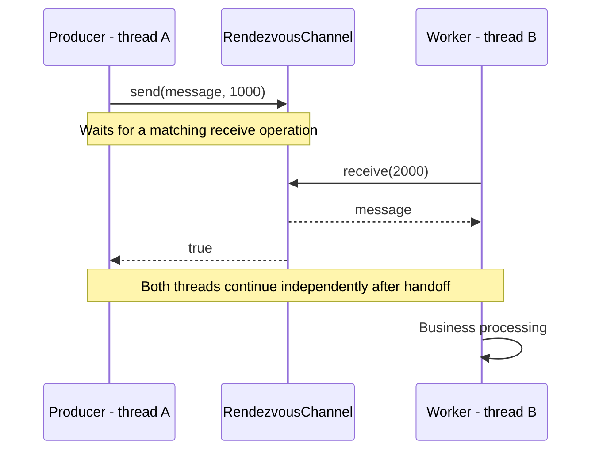

# RendezvousChannel

## 1. Objectives and Use Cases

In the **Channel Types** chapter of the **SPRING_INTEGRATION_CORE** module, this lesson focuses on handing off a `Message` between two threads using `RendezvousChannel`. After this lesson, you will be able to choose this channel, configure a receiving endpoint in Java DSL, distinguish handoff timeouts from reply timeouts, and test waiting behavior without relying on `Thread.sleep()`.

Suppose an application receives order-verification requests. The intake layer only wants to report "handed off" when a worker has actually received the request. If no worker is available, the application may wait briefly and then reject the submission. Placing the request into a buffer and returning immediately does not satisfy that condition.

`RendezvousChannel` fits this handoff point: the sender and receiver must meet to transfer the message. However, "a worker received it" and "the order has finished verification" remain two separate milestones. Business logic that needs the final result must add a reply path or a status-tracking mechanism.

## 2. How It Works

### 2.1. A Zero-Capacity Channel

`RendezvousChannel` extends `QueueChannel`, implements the `PollableChannel` contract, and uses a `SynchronousQueue` internally. The channel has no buffer to hold messages waiting for a receiver. This structural characteristic is described in the [RendezvousChannel Javadoc](https://docs.spring.io/spring-integration/api/org/springframework/integration/channel/RendezvousChannel.html).

The key operations are:

```java
boolean send(Message<?> message);
boolean send(Message<?> message, long timeout);
Message<?> receive();
Message<?> receive(long timeout);
```

Each handoff pairs one send operation with one receive operation. If multiple consumers are receiving concurrently, one message is handed to only one consumer; the channel does not broadcast copies to all consumers.

Do not create this channel with `new QueueChannel(0)`: `QueueChannel`'s capacity constructor requires a positive number. Use `new RendezvousChannel()`. The [QueueChannel source code](https://raw.githubusercontent.com/spring-projects/spring-integration/main/spring-integration-core/src/main/java/org/springframework/integration/channel/QueueChannel.java) enforces this condition.

### 2.2. Both Arrival Orders Are Valid

When the sender arrives first, `send()` waits until another thread receives. When the receiver arrives first, `receive()` waits until another thread sends. The later party completes the rendezvous as long as the earlier party's wait timeout has not expired.



The diagram illustrates the handoff relationship; the actual execution order of the two threads after the rendezvous depends on the scheduler. Do not infer that the statement immediately following `receive()` always runs before the statement immediately following `send()`.

### 2.3. Synchronizing Handoff vs. Executing Business Logic

In this design, two threads coordinate at the moment the message is transferred. The channel does not spawn workers, invoke business functions on its own, or wait for the worker to finish processing.

You can name the milestones in the order example as follows:

| Milestone | Evidence in the application | Meaning to the business |
| --- | --- | --- |
| Send request | Producer starts calling `send()` | Attempting handoff |
| Handoff | `send()` returns `true`, consumer receives message | A receiver is present |
| Processing complete | Worker saves result or creates reply | Business result is available |
| Durable completion | Necessary transaction has committed | Result is persisted per design |

This is an analysis of application responsibilities based on the handoff mechanism, not four states managed by the channel itself. For example, a worker may receive a request and then fail while writing to the database; the earlier handoff still took place.

## 3. Timeouts and Return Values

### 3.1. Direct Call Contract

Timeouts in the methods below are in **milliseconds**.

| Call | When no counterpart operation is present | Typical result |
| --- | --- | --- |
| `send(message)` | Waits indefinitely | `true` once handed off |
| `send(message, 1000)` | Waits up to roughly 1,000 ms for handoff | `true` if succeeded, `false` if expired |
| `send(message, 0)` | Tries immediately, does not wait | `false` if not paired with a receiver |
| `receive()` | Waits indefinitely | Handed-off message |
| `receive(1000)` | Waits up to roughly 1,000 ms for a message | Message, or `null` if expired |
| `receive(0)` | Tries immediately, does not wait | Message if paired with a sender, otherwise `null` |

Negative values mean wait indefinitely in this execution mechanism. Do not use a negative timeout to mean "do not wait". Channel waiting behavior is documented in [Message Channel Implementations](https://docs.spring.io/spring-integration/reference/channel/implementations.html).

The results above assume no interceptor alters send/receive behavior and no other infrastructure errors occur. `false` or `null` can also result from thread interruption, not only timeouts. The [MessageChannel and PollableChannel contracts](https://docs.spring.io/spring-integration/reference/channel/interfaces.html) explain both cases.

At the queue layer of `RendezvousChannel`, when a wait is interrupted, the implementation restores the interrupt flag and returns `false` for send or `null` for receive. Therefore, worker loops must check `Thread.currentThread().isInterrupted()` and stop appropriately; never retry sending infinitely whenever `false` is observed.

### 3.2. Three Deadlines to Keep Separate

In a request–reply flow, there are at least three distinct questions:

1. **Send timeout:** how long is the producer willing to wait for a worker to receive the request?
2. **Reply timeout:** how long is the caller willing to wait for a response?
3. **Business operation timeout:** how long is the worker allowed to make HTTP calls, query databases, or perform other work?

For instance, a producer might allocate 500 ms for handoff and 2,000 ms to receive a reply. These two waits happen sequentially; they do not automatically form a combined 2,000 ms total deadline. A worker's HTTP call is also not canceled just because the caller stopped waiting for the reply.

If the application has an overall deadline, pass the expiration timestamp in a business header, compute remaining time before each step, and configure timeouts accordingly. That is an application design choice; the channel does not enforce an end-to-end deadline on its own.

## 4. Java Example: Handoff Between Two Threads

The standalone example below requires `spring-integration-core` on the classpath. When using Spring Boot, include `spring-boot-starter-integration` and let your project's BOM manage versions. The examples use Java 17 or later syntax; your actual Spring Integration version must remain compatible with your project's JDK.

```java
import java.util.concurrent.ExecutorService;
import java.util.concurrent.Executors;
import java.util.concurrent.Future;
import java.util.concurrent.TimeUnit;

import org.springframework.integration.channel.RendezvousChannel;
import org.springframework.messaging.Message;
import org.springframework.messaging.support.MessageBuilder;

public class RendezvousHandoffDemo {

    public static void main(String[] args) throws Exception {
        RendezvousChannel channel = new RendezvousChannel();
        ExecutorService workers = Executors.newSingleThreadExecutor();

        try {
            Future<Message<?>> received = workers.submit(
                    () -> channel.receive(2000));

            Message<String> request = MessageBuilder
                    .withPayload("Check order ORD-42")
                    .setHeader("orderId", "ORD-42")
                    .build();

            boolean handedOff = channel.send(request, 1000);
            if (!handedOff) {
                throw new IllegalStateException("Unable to hand off request");
            }

            Message<?> actual = received.get(3, TimeUnit.SECONDS);
            if (actual == null) {
                throw new IllegalStateException("Worker did not receive request");
            }

            System.out.println(actual.getPayload());
            System.out.println(actual.getHeaders().get("orderId"));
        }
        finally {
            workers.shutdownNow();
        }
    }
}
```

The main thread is the producer; the executor thread calls `receive()`. If the worker has not started receiving when the producer sends, the producer waits within its configured bound. If the worker receives first, the worker waits for the producer. The example does not need to guess which thread runs first.

`Future.get()` here lets the sample program collect the worker task's result. It is not a processing-wait feature provided by `send()`. When replacing the receive task with an actual order-processing function, explicitly decide whether the caller waits for that function's result or only for the handoff.

## 5. Comparison with Common Channels

| Channel | Buffer inside channel | Consumption mechanism | Typical meaning of a successful send |
| --- | --- | --- | --- |
| `DirectChannel` | No | Direct dispatch to one subscriber on the sending thread | Handler was invoked on the producer's call stack and returned normally |
| `QueueChannel` | Yes, per capacity | Consumer calls `receive()` | Message was placed into the queue |
| `RendezvousChannel` | No | Consumer calls `receive()` to pair with send | Message was handed off to a receiver |
| `ExecutorChannel` | No dedicated message buffer like `QueueChannel`; executor may have a task queue | Dispatched through an executor | Usually the task was accepted by the executor; also depends on executor policy |

Even when `DirectChannel` calls a handler on the sending thread, do not infer that any asynchronous tasks spawned by that handler have finished. The comparison table only describes the handoff point of each mechanism. Implementations are introduced in the [MessageChannel implementations documentation](https://docs.spring.io/spring-integration/reference/7.0/channel/implementations.html).

One way to choose for the order problem:

- Use `DirectChannel` when processing steps should continue on the calling thread and no thread-to-thread rendezvous is needed.
- Use a queue with appropriate capacity when you want to absorb a short traffic burst.
- Use `RendezvousChannel` when acceptance requires a consumer receiving the request within the allowed timeout.
- Use a broker and durable storage when requests must survive process restarts or be distributed across multiple services.

These choices depend on the specific requirements of the example. A system may combine them at different segments of the same integration flow.

## 6. Java DSL Configuration with a Polling Endpoint

### 6.1. Channel and Endpoint Are Separate Components

Declaring a `RendezvousChannel` bean does not create a consumer. In Spring Integration, an endpoint consuming a `PollableChannel` requires a poller, or the application must run its own thread calling `receive()`.

The following configuration receives strings from `workRequests`, processes them with a handler, and puts results into `workResults` for the sample program to read. It only requires Spring Integration Core and standard Spring Java configuration.

```java
import java.time.Duration;

import org.springframework.context.annotation.Bean;
import org.springframework.context.annotation.Configuration;
import org.springframework.integration.channel.QueueChannel;
import org.springframework.integration.channel.RendezvousChannel;
import org.springframework.integration.config.EnableIntegration;
import org.springframework.integration.dsl.IntegrationFlow;
import org.springframework.integration.dsl.Pollers;

@Configuration
@EnableIntegration
public class RendezvousFlowConfig {

    @Bean
    public RendezvousChannel workRequests() {
        return new RendezvousChannel();
    }

    @Bean
    public QueueChannel workResults() {
        return new QueueChannel(10);
    }

    @Bean
    public IntegrationFlow workFlow(
            RendezvousChannel workRequests,
            QueueChannel workResults) {

        return IntegrationFlow.from(workRequests)
                .handle(String.class,
                        (payload, headers) -> "Checked: " + payload,
                        endpoint -> endpoint.poller(
                                Pollers.fixedDelay(Duration.ofMillis(50))
                                        .receiveTimeout(200)
                                        .maxMessagesPerPoll(1)))
                .channel(workResults)
                .get();
    }
}
```

Once the application context starts, you can invoke it as shown below. This snippet goes inside a method with both channels injected:

```java
Message<String> message = MessageBuilder
        .withPayload("ORD-42")
        .build();

if (!workRequests.send(message, 1000)) {
    throw new IllegalStateException("No worker has received the request");
}

Message<?> result = workResults.receive(2000);
if (result == null) {
    throw new IllegalStateException("No result within the deadline");
}
System.out.println(result.getPayload());
```

The calling snippet needs the `Message` and `MessageBuilder` imports as in the earlier example. The result queue is solely for observation in a single-call example; something must drain results to prevent filling the queue. When multiple callers run concurrently, a shared result queue and an arbitrary `receive()` are not enough to ensure each caller receives its own result. In that case, use correlation or a gateway with a per-call reply channel.

### 6.2. Meaning of the Poller Configuration

`fixedDelay(50 ms)` sets the pause after one poll finishes before the next starts. `receiveTimeout(200)` allows the receive call to wait 200 ms for a message; this figure does not limit handler execution time. `maxMessagesPerPoll(1)` caps each poll cycle to at most one message.

The actual interval between two handoff opportunities is also affected by handler execution time and scheduler load. Do not treat a 50 ms delay as a guarantee that requests are always picked up within 50 ms. Configuration APIs are described in [Pollers](https://docs.spring.io/spring-integration/reference/dsl/java-pollers.html) and [PollerSpec Javadoc](https://docs.spring.io/spring-integration/api/org/springframework/integration/dsl/PollerSpec.html).

If all scheduler threads are busy waiting or executing long tasks, the endpoint cannot pull in time. For designs requiring continuous intake, allocate dedicated execution resources and bound task counts rather than merely raising timeouts.

### 6.3. Java DSL Builders

Java DSL also provides `MessageChannels.rendezvous()` and `MessageChannels.rendezvous("handoff")`. You can use the builder inside `.channel(...)` of a flow; the endpoint following that channel still needs a poller if it consumes messages from this channel. See [MessageChannels Javadoc](https://docs.spring.io/spring-integration/api/org/springframework/integration/dsl/MessageChannels.html).

```java
// A snippet inserted into IntegrationFlowBuilder, not standalone configuration.
.channel(MessageChannels.rendezvous("handoff"))
.handle(String.class,
        (payload, headers) -> payload.trim(),
        endpoint -> endpoint.poller(
                Pollers.fixedDelay(Duration.ofMillis(50))
                        .receiveTimeout(200)
                        .maxMessagesPerPoll(1)))
```

This snippet requires importing `org.springframework.integration.dsl.MessageChannels`. Do not declare another bean named `handoff` when letting the flow register the channel via that builder.

## 7. Request–Reply with a Temporary Reply Channel

An application can create a dedicated `RendezvousChannel` per request, place it in the `replyChannel` header, send the request, and wait for the response. The official documentation presents this as an application of rendezvous channels in the [RendezvousChannel section](https://www.springframework.org/spring-integration/reference/6.3/channel/implementations.html#rendezvouschannel).

The example below shows both the caller and the worker. Because the request channel is also a rendezvous channel, the worker must run on a separate thread.

```java
import java.util.concurrent.ExecutorService;
import java.util.concurrent.Executors;
import java.util.concurrent.Future;
import java.util.concurrent.TimeUnit;

import org.springframework.integration.channel.RendezvousChannel;
import org.springframework.messaging.Message;
import org.springframework.messaging.MessageChannel;
import org.springframework.messaging.support.MessageBuilder;

public class RendezvousRequestReplyDemo {

    public static void main(String[] args) throws Exception {
        RendezvousChannel requests = new RendezvousChannel();
        RendezvousChannel replies = new RendezvousChannel();
        ExecutorService workers = Executors.newSingleThreadExecutor();

        try {
            Future<?> worker = workers.submit(() -> {
                Message<?> request = requests.receive(3000);
                if (request == null) {
                    throw new IllegalStateException("Did not receive request");
                }

                Object target = request.getHeaders().getReplyChannel();
                if (!(target instanceof MessageChannel replyChannel)) {
                    throw new IllegalArgumentException("Missing replyChannel");
                }

                Message<String> reply = MessageBuilder
                        .withPayload("ACCEPTED: " + request.getPayload())
                        .setHeader("orderId", request.getHeaders().get("orderId"))
                        .build();

                if (!replyChannel.send(reply, 2000)) {
                    throw new IllegalStateException("Unable to hand off reply");
                }
            });

            Message<String> request = MessageBuilder
                    .withPayload("ORD-42")
                    .setHeader("orderId", "ORD-42")
                    .setReplyChannel(replies)
                    .build();

            if (!requests.send(request, 1000)) {
                throw new IllegalStateException("Unable to hand off request");
            }

            Message<?> reply = replies.receive(2000);
            if (reply == null) {
                throw new IllegalStateException("Timed out waiting for reply");
            }

            System.out.println(reply.getPayload());
            worker.get(3, TimeUnit.SECONDS);
        }
        finally {
            workers.shutdownNow();
        }
    }
}
```

In this example, the header holds an in-JVM reference to the channel. It is not a network address or a configuration that automatically carries across processes. Each concurrent call needs its own reply channel or an equivalent correlation strategy.

If the caller times out waiting for the reply, the worker may still continue processing. The reply send also needs a timeout so the worker does not wait forever for a caller that has already left. The application must decide how to record late results and how to prevent duplicate execution when the caller retries.

### Using a Gateway in an Application

`@MessagingGateway` or `MessagingTemplate` encapsulates the send-and-receive protocol, reducing manual reply-channel management. Gateways typically create temporary reply channels when no fixed reply channel is configured; do not equate that internal implementation with a `RendezvousChannel` bean in every case. See [Messaging Gateways](https://docs.spring.io/spring-integration/reference/gateway.html).

When adapting the flow in Section 6 to return results to a gateway, remove `.channel(workResults)` so the handler can reply via the `replyChannel` header, and configure gateway scanning and appropriate timeouts. If you keep routing output into the `workResults` queue, a caller waiting on a temporary reply channel can time out even though the handler produced a result.

## 8. Backpressure, Resources, and Limits

### 8.1. No Buffer Does Not Mean Zero Memory Cost

A producer cannot send past the rendezvous point when no receiver is available. That creates a form of backpressure: the producer must wait or handle the failed handoff.

However, each waiting producer still holds its message, call stack, connection, or request-scoped data. If the HTTP layer allows thousands of requests to wait concurrently, having an unbuffered channel does not solve resource exhaustion.

In the order example, you can combine a short handoff timeout with a bound on concurrent in-flight requests. When handoff fails, the intake layer returns a busy response per the application's protocol. Do not spawn unbounded threads just to avoid waiting.

### 8.2. No FIFO Guarantee Across Multiple Producers

`SynchronousQueue` by default does not enforce fairness ordering across waiting threads. `RendezvousChannel` uses that default constructor, per the [RendezvousChannel source code](https://raw.githubusercontent.com/spring-projects/spring-integration/main/spring-integration-core/src/main/java/org/springframework/integration/channel/RendezvousChannel.java). There is no promise that the earliest arriving producer is always served first.

Capacity, fairness rules, and observation of `SynchronousQueue` are described in the [Java SE Javadoc](https://docs.oracle.com/en/java/javase/21/docs/api/java.base/java/util/concurrent/SynchronousQueue.html). If business logic requires strict ordering per customer or per order, design that ordering explicitly.

### 8.3. Queue Metrics Alone Do Not Reflect Load

`SynchronousQueue` does not accumulate elements like a standard queue; seeing a size of 0 does not tell you how many producers are waiting. For this pattern, monitor application-level signals:

- Wait duration and handoff success rate of `send()`.
- Number of calls currently waiting for handoff and executor/scheduler utilization.
- Count of reply timeouts.
- Worker processing time and business error counts.

These measurements distinguish "no load", "no consumers", and "consumers too slow", even though all three conditions show a queue size of 0.

## 9. Deadlocks and Thread Starvation

### 9.1. Sending and Receiving on the Same Thread

The snippet below cannot complete a rendezvous if no other consumer exists:

```java
RendezvousChannel channel = new RendezvousChannel();

channel.send(MessageBuilder.withPayload("ORD-42").build());
Message<?> next = channel.receive();
```

The thread blocks on `send()` and never reaches `receive()`. Adding a timeout only turns an infinite wait into a failed send; it does not supply the missing consumer. You need an independent receiving thread or a different flow structure.

### 9.2. Producer and Consumer Sharing a Single-Thread Executor

Suppose an executor has only one thread and runs the producer task first. The producer calls `send()` and waits. The consumer task sits in the same executor's queue and cannot run. Both tasks need a resource held or awaited by the other.

The fix depends on your architecture: dedicate threads for consumers, separate producer and consumer execution pools, or bound work so consumers always get scheduled. Increasing thread count may reduce the chance of stalling, yet does not replace analyzing wait dependencies.

### 9.3. Rendezvous Replies Inside a Synchronous Call Stack

A subtler case occurs when sending a request over a `DirectChannel`, where the handler runs immediately on the caller's thread and calls `replyChannel.send(reply)` on a rendezvous channel. The caller intends to call `replyChannel.receive()` after sending the request, but the request send cannot return because the handler is waiting for the caller itself to receive the reply.

Consequently, you cannot arbitrarily swap a synchronous flow's reply channel with a `RendezvousChannel`. The request–reply example in Section 7 avoids this cycle by having the worker receive the request and send the reply on a separate thread. When using gateways, rely on the gateway's reply mechanism and trace the entire execution path before customizing.

## 10. Error Handling and Transaction Boundaries

### 10.1. Classifying Errors by Location

| Situation | What the producer typically observes | Responsibility to design |
| --- | --- | --- |
| No worker receives in time | `send(message, timeout)` returns `false` | Reject, bounded retry, or reroute |
| Worker receives and fails during processing | Send may already have returned `true` | Report error via a separate mechanism, persist status, or handle at endpoint |
| Caller does not get reply in time | `receive(timeout)` returns `null` | Handle uncertain state, late results, and safe retries |
| Interceptor or infrastructure failure on send | Exception may occur immediately on calling thread | Catch and classify according to the API in use |

In Spring Integration–managed endpoints, poller task errors can be wrapped into an `ErrorMessage` and sent to an error channel according to configured error handling. Conversely, threads created manually via `ExecutorService` in standalone examples do not have that automatically: your code must catch exceptions, inspect `Future`, or explicitly publish error notifications. The [Error Handling documentation](https://docs.spring.io/spring-integration/reference/error-handling.html) explains the difference between errors on the sender's call stack and errors on another thread.

Do not assume `send()` returning `false` automatically emits an `ErrorMessage`. That return value is for the caller to inspect. Likewise, a `try/catch` around the send call cannot catch a business exception occurring later on another worker thread.

### 10.2. Handoff Does Not Propagate Transactions Across Threads

A Spring transaction bound to the producer thread does not automatically follow the message to the consumer thread. The blocking nature of a rendezvous does not alter that boundary. If the worker needs a transaction to persist orders, configure the transaction on the worker's processing step. See [Transaction Boundaries](https://docs.spring.io/spring-integration/reference/transactions.html#transaction-boundaries).

`RendezvousChannel` also provides no durable persistence, post-commit acknowledgments, or automatic redelivery if a worker fails. In the order example, if the process stops after handoff but before saving results, the channel holds no backup record to recover the work.

Therefore, if accepted work must never be lost, design durable storage, idempotency, and appropriate commit boundaries. Do not infer an "exactly once" guarantee from `send()` returning `true`.

## 11. Testing Behavior

### 11.1. What to Prove

For this channel, tests are most useful when verifying three contracts: messages are not buffered if handoff fails, messages can be handed off between two threads, and the producer does not wait for all business processing to finish.

The JUnit Jupiter examples below test the real channel directly without starting a Spring context. When testing endpoints, routing, or larger flows, you can add utilities described in [Spring Integration Testing Support](https://docs.spring.io/spring-integration/reference/testing.html).

```java
import java.util.concurrent.CountDownLatch;
import java.util.concurrent.ExecutorService;
import java.util.concurrent.Executors;
import java.util.concurrent.Future;
import java.util.concurrent.TimeUnit;
import java.util.concurrent.atomic.AtomicBoolean;

import org.junit.jupiter.api.Test;
import org.springframework.integration.channel.RendezvousChannel;
import org.springframework.messaging.Message;
import org.springframework.messaging.support.MessageBuilder;

import static org.junit.jupiter.api.Assertions.assertEquals;
import static org.junit.jupiter.api.Assertions.assertFalse;
import static org.junit.jupiter.api.Assertions.assertNotNull;
import static org.junit.jupiter.api.Assertions.assertNull;
import static org.junit.jupiter.api.Assertions.assertTrue;

class RendezvousChannelTest {

    @Test
    void failedImmediateSendDoesNotLeaveMessageBehind() {
        RendezvousChannel channel = new RendezvousChannel();
        Message<String> message = MessageBuilder.withPayload("ORD-42").build();

        assertFalse(channel.send(message, 0));
        assertNull(channel.receive(0));
    }

    @Test
    void handsMessageToAnotherThread() throws Exception {
        RendezvousChannel channel = new RendezvousChannel();
        ExecutorService workers = Executors.newSingleThreadExecutor();

        try {
            Future<Message<?>> incoming = workers.submit(
                    () -> channel.receive(5000));

            assertTrue(channel.send(
                    MessageBuilder.withPayload("ORD-42").build(), 5000));

            Message<?> received = incoming.get(2, TimeUnit.SECONDS);
            assertNotNull(received);
            assertEquals("ORD-42", received.getPayload());
        }
        finally {
            workers.shutdownNow();
        }
    }

    @Test
    void successfulSendDoesNotRequireBusinessCompletion() throws Exception {
        RendezvousChannel channel = new RendezvousChannel();
        ExecutorService workers = Executors.newSingleThreadExecutor();
        CountDownLatch received = new CountDownLatch(1);
        CountDownLatch allowCompletion = new CountDownLatch(1);
        AtomicBoolean businessCompleted = new AtomicBoolean(false);

        try {
            Future<?> worker = workers.submit(() -> {
                Message<?> message = channel.receive(5000);
                if (message == null) {
                    throw new IllegalStateException("Did not receive message");
                }
                received.countDown();

                try {
                    if (!allowCompletion.await(5, TimeUnit.SECONDS)) {
                        throw new IllegalStateException("Processing latch was not released");
                    }
                    businessCompleted.set(true);
                }
                catch (InterruptedException ex) {
                    Thread.currentThread().interrupt();
                    throw new IllegalStateException("Worker was interrupted", ex);
                }
            });

            assertTrue(channel.send(
                    MessageBuilder.withPayload("ORD-42").build(), 5000));
            assertTrue(received.await(2, TimeUnit.SECONDS));
            assertFalse(businessCompleted.get());

            allowCompletion.countDown();
            worker.get(2, TimeUnit.SECONDS);
            assertTrue(businessCompleted.get());
        }
        finally {
            allowCompletion.countDown();
            workers.shutdownNow();
        }
    }
}
```

Latches establish explicit coordination: the worker has received the message but is held before marking completion. Assertions therefore verify the actual distinction between handoff and completion, rather than assuming "sleeping briefly means the worker is still unfinished".

The multi-second timeouts protect the test from hanging forever; they are not performance targets. When adding timeout tests, avoid asserting elapsed milliseconds precisely since timing depends on the OS scheduler. Always release latches and shut down executors in `finally` in case an assertion fails.

### 11.2. Extending Tests for Real Flows

For the flow in Section 6, meaningful additional scenarios include: when the endpoint has not started, a bounded send fails; when the endpoint is active, it produces the expected result; when the handler errors, the error flow receives the right error; when the worker runs slowly, the next producer waits or times out as designed.

If you add filters, routers, or aggregators past the handoff point, test the outcomes of those components too. A message may be received successfully yet later dropped by a filter, routed to another branch, or held inside an aggregator waiting for a complete group. `send() == true` at the rendezvous does not confirm downstream conditions were satisfied.

## 12. Hands-On Exercise with Order-Verification Requests

Extend the Java DSL example into a flow that accepts requests with an `orderId`, validates data, and returns a result. Treat handoff timeout, result-wait timeout, and worker error policy as three separate design decisions.

1. Initialize a rendezvous channel at the input and an endpoint with a poller whose receive wait is bounded.
2. Add an input validation step; if a filter rejects the request, decide how the caller learns it was rejected.
3. Have two producers send concurrently, then observe handoffs when only one worker processes sequentially.
4. Make the worker throw an error after receiving; verify the producer's send succeeded while the system still records the business error.
5. Let the caller time out before the result arrives; specify how late results are recorded and how `orderId` prevents duplicate execution on retry.

Completion criteria: be able to explain the state of each request at all three moments—before handoff, after handoff, and after processing. Whenever no result is returned, distinguish whether no worker received it or a worker received it but has not finished the work.

## 13. Key Takeaways

- `RendezvousChannel` is a zero-capacity send–receive meeting point backed by `SynchronousQueue`.
- An endpoint or application thread must actually call `receive()`; declaring the channel does not create a consumer.
- A successful send indicates handoff; replies, business results, and commits are separate responsibilities.
- Handoff timeout, reply timeout, and business processing timeout must be designed independently.
- Wait dependencies and execution resources determine deadlock risk, even without a buffer.
- Durability, retries, error handling, and deduplication require additional mechanisms suited to system requirements.
