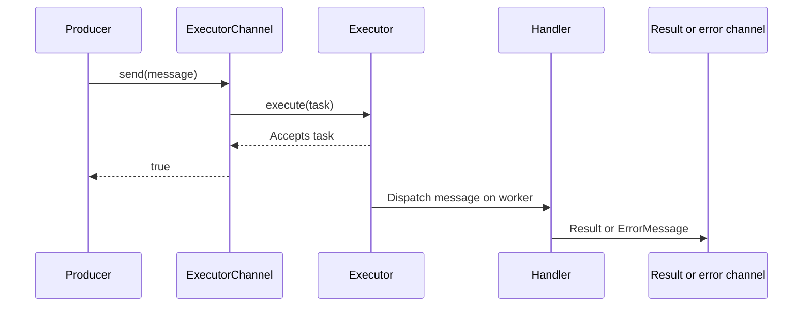

# ExecutorChannel

In the **Channel Types** chapter of the `SPRING_INTEGRATION_CORE` module, `ExecutorChannel` places an execution boundary between the message sender and the processing endpoint. This lesson connects `Message`, `MessageChannel`, endpoints, and Java DSL through a report-generation flow, using it to explain error handling, resource limits, transactions, and testing.

## 1. Objectives and Use Cases

After this lesson, you will be able to:

- Explain how `ExecutorChannel` hands off work to an `Executor` and what the return value of `send()` means.
- Distinguish subscriber count from concurrent worker thread count.
- Configure a bounded thread pool and choose overload behavior.
- Receive worker failures as `ErrorMessage` instances rather than only catching exceptions around the send call.
- Identify ordering, transaction, and durability requirements that require additional mechanisms.

Suppose an API receives report-generation requests. Validating the request ID is very fast, whereas querying data and rendering the report takes time. We want to validate input on the calling thread, then hand off rendering to a pool of workers. Each request only needs one worker to succeed.

That is a good fit for `ExecutorChannel`. However, submitting work into process memory is not enough to claim the report will survive an abrupt application shutdown. The API contract must accurately express the system's guarantees.

## 2. The Nature of ExecutorChannel

`org.springframework.integration.channel.ExecutorChannel` is a **point-to-point** channel implementing `SubscribableChannel`. Endpoints register a `MessageHandler`; the channel uses a dispatcher to select a handler and delegates dispatching to a `java.util.concurrent.Executor`. The constructor requires passing an executor. See [ExecutorChannel API](https://docs.spring.io/spring-integration/api/org/springframework/integration/channel/ExecutorChannel.html).

Two direct consequences follow:

- Consumers receive messages by registering a handler; `ExecutorChannel` has no `receive()` method.
- No poller is needed to consume directly from this channel. Execution threads are supplied by the executor.

`receive` callbacks apply only to `PollableChannel` implementations such as `QueueChannel`. That differs from an executor having an internal work queue for pending `Runnable` tasks. See [Channel Interceptors](https://docs.spring.io/spring-integration/reference/channel/interceptors.html).

Separate two decisions:

| Decision | Responsible component | Question answered |
| --- | --- | --- |
| Choosing a subscriber | Channel's dispatcher | Which handler will attempt to process the message? |
| Choosing where to execute | Executor | On which thread and when does the work run? |

Having eight threads in the executor does not mean the channel has eight subscribers. A single endpoint can still be invoked concurrently by multiple workers for different messages. Therefore, services invoked by the endpoint must support concurrent access.

The class name also matters: this lesson covers Spring Integration's `ExecutorChannel`. When an IDE auto-imports a similarly named class, verify its package rather than guessing semantics from the name.

## 3. Execution Flow and the Meaning of send()

A send typically proceeds as follows:

1. Producer creates a `Message` and calls `send()`.
2. Send-side interceptors run.
3. The channel submits a task to the executor.
4. If the task is accepted, the send call can return.
5. The executor runs the task; the dispatcher chooses a subscriber and invokes the handler.
6. The handler produces a result or throws an error.

The diagram illustrates the case where the worker processes after the producer has already observed the send result:



This is one possible sequence. The worker may also start—or even finish—before the producer observes `send()` returning. Designs must rely on explicit completion signals rather than log ordering between two threads.

### 3.1. Successful Send Differs from Successful Processing

The `MessageChannel` API allows returning `true`, returning `false` on non-fatal send failures, or throwing a runtime exception. Exact semantics depend on the implementation. For the asynchronous execution path here, the send result is not the worker's business outcome. See [MessageChannel API](https://docs.spring.io/spring-framework/docs/current/javadoc-api/org/springframework/messaging/MessageChannel.html).

For example, `send()` may already have returned, yet the rendering service later finds the data store unreachable. The producer must observe a result channel, error channel, or job status to know the outcome.

A rejection policy can silently discard tasks. In that case `execute()` throws no error, making the send result even less valid as proof that the work will definitely run.

### 3.2. Having an Executor Does Not Always Mean Running on Another Thread

`Executor` is an abstraction; an implementation can run work immediately on the calling thread. For instance, `SyncTaskExecutor` executes synchronously. If ordinary synchronous semantics are desired, use `DirectChannel` to state that intent clearly. See [Task Execution and Scheduling](https://docs.spring.io/spring-framework/reference/integration/scheduling.html) and [ExecutorChannel API](https://docs.spring.io/spring-integration/api/org/springframework/integration/channel/ExecutorChannel.html).

Even a thread pool can run work on the sending thread when saturated under `CallerRunsPolicy`. Never build business logic assuming every send always causes a thread switch.

## 4. Comparison with Common Channels

| Channel | How consumers receive | Dispatch scope | Common execution model |
| --- | --- | --- | --- |
| `DirectChannel` | Register handler | One handler succeeds | On the sending thread |
| `ExecutorChannel` | Register handler | One handler succeeds | Via an executor |
| `QueueChannel` | Call `receive()` | One consumer takes each message | Determined by consumer or poller |
| `PublishSubscribeChannel` | Register handler | Broadcast to subscribers | Synchronous or via executor depending on configuration |

`QueueChannel` buffers messages with a receive API; `PublishSubscribeChannel` expresses broadcasting needs. A thread pool behind `ExecutorChannel` schedules task execution. These options answer different needs. See [Message Channel Implementations](https://docs.spring.io/spring-integration/reference/channel/implementations.html).

An example of selecting by requirement:

- Compute a total and return the result within the same call: consider `DirectChannel`.
- Render reports with an in-process worker pool: consider `ExecutorChannel`.
- Buffer requests so consumers actively pull at their own pace: consider `QueueChannel`.
- Send completion events to both notification and analytics: consider `PublishSubscribeChannel`.

Background execution and broadcasting are independent requirements. You can combine them at different points within a single flow.

## 5. Complete Example with Java Configuration and Java DSL

### 5.1. Scope of the Example

The example uses Java 17 or later with Spring Integration 6.x APIs. `spring-integration-core` and compatible Spring dependencies are required; let your project's BOM manage versions. The test code below uses JUnit Jupiter.

The flow consists of:

```text
reportRequests [DirectChannel]
  -> filter validating requestId
  -> set errorChannel header
  -> reportWorkers [ExecutorChannel]
  -> transformer simulating rendering
  -> reportResults [QueueChannel]

Errors occurring during worker processing
  -> reportFailures [QueueChannel]
```

The final two `QueueChannel` beans collect outputs for observation in the practice exercise. The example does not write real CSV files, access a database, or expose an HTTP API.

### 5.2. Configuration

Place the following class in package `example.integration`:

```java
package example.integration;

import java.util.concurrent.ThreadPoolExecutor;

import org.springframework.beans.factory.annotation.Qualifier;
import org.springframework.context.annotation.Bean;
import org.springframework.context.annotation.Configuration;
import org.springframework.integration.channel.DirectChannel;
import org.springframework.integration.channel.ExecutorChannel;
import org.springframework.integration.channel.QueueChannel;
import org.springframework.integration.config.EnableIntegration;
import org.springframework.integration.dsl.IntegrationFlow;
import org.springframework.messaging.MessageHeaders;
import org.springframework.scheduling.concurrent.ThreadPoolTaskExecutor;

@Configuration(proxyBeanMethods = false)
@EnableIntegration
public class ReportFlowConfig {

    public record ReportRequest(String requestId, String customerId) {
    }

    public record ReportReady(
            String requestId,
            String outputPath,
            String workerThread) {
    }

    @Bean
    public DirectChannel reportRequests() {
        return new DirectChannel();
    }

    @Bean
    public ThreadPoolTaskExecutor reportExecutor() {
        ThreadPoolTaskExecutor executor = new ThreadPoolTaskExecutor();
        executor.setCorePoolSize(4);
        executor.setMaxPoolSize(8);
        executor.setQueueCapacity(100);
        executor.setThreadNamePrefix("report-worker-");
        executor.setRejectedExecutionHandler(
                new ThreadPoolExecutor.AbortPolicy());
        executor.setWaitForTasksToCompleteOnShutdown(true);
        executor.setAwaitTerminationSeconds(15);
        return executor;
    }

    @Bean
    public ExecutorChannel reportWorkers(
            @Qualifier("reportExecutor")
            ThreadPoolTaskExecutor executor) {

        ExecutorChannel channel = new ExecutorChannel(executor);
        channel.setFailover(false);
        return channel;
    }

    @Bean
    public QueueChannel reportResults() {
        return new QueueChannel();
    }

    @Bean
    public QueueChannel reportFailures() {
        return new QueueChannel();
    }

    @Bean
    public IntegrationFlow reportIngressFlow() {
        return IntegrationFlow.from("reportRequests")
                .filter(
                        ReportRequest.class,
                        request -> request.requestId() != null
                                && !request.requestId().isBlank(),
                        filter -> filter.throwExceptionOnRejection(true))
                .enrichHeaders(headers -> headers.header(
                        MessageHeaders.ERROR_CHANNEL,
                        "reportFailures"))
                .channel("reportWorkers")
                .get();
    }

    @Bean
    public IntegrationFlow reportWorkerFlow() {
        return IntegrationFlow.from("reportWorkers")
                .transform(ReportRequest.class, request -> {
                    if ("FAIL".equals(request.requestId())) {
                        throw new IllegalStateException(
                                "Unable to render report");
                    }

                    return new ReportReady(
                            request.requestId(),
                            "reports/" + request.requestId() + ".csv",
                            Thread.currentThread().getName());
                })
                .channel("reportResults")
                .get();
    }
}
```

Spring manages the executor bean lifecycle and initializes it. You do not need to call `initialize()` manually in this `@Bean` method. Properties such as `corePoolSize`, `maxPoolSize`, `queueCapacity`, thread name prefix, and active count are key configuration and monitoring points of `ThreadPoolTaskExecutor`. See [ThreadPoolTaskExecutor API](https://docs.spring.io/spring-framework/docs/current/javadoc-api/org/springframework/scheduling/concurrent/ThreadPoolTaskExecutor.html).

Channels are declared as beans so they can be shared by name across flows. Java DSL connects endpoints to channels and defaults to `DirectChannel` wherever ordinary links are created. Therefore, the filter and header enricher before `reportWorkers` still execute on the sending thread. See [Java DSL: Message Channels](https://docs.spring.io/spring-integration/reference/dsl/java-channels.html).

Both output-collection queues use the default constructor for convenience with a small amount of practice data. If turning them into long-lived operational buffers, configure capacity, consumers, timeouts, and full-queue policies; failing to drain queues keeps messages in memory.

### 5.3. Running a Request and Waiting for the Result

Place the following class in the same package as the configuration:

```java
package example.integration;

import example.integration.ReportFlowConfig.ReportRequest;

import org.springframework.context.annotation.AnnotationConfigApplicationContext;
import org.springframework.integration.channel.QueueChannel;
import org.springframework.messaging.Message;
import org.springframework.messaging.MessageChannel;
import org.springframework.messaging.support.MessageBuilder;

public class ReportDemo {

    public static void main(String[] args) {
        try (var context =
                new AnnotationConfigApplicationContext(
                        ReportFlowConfig.class)) {

            MessageChannel requests = context.getBean(
                    "reportRequests", MessageChannel.class);
            QueueChannel results = context.getBean(
                    "reportResults", QueueChannel.class);

            boolean sent = requests.send(
                    MessageBuilder.withPayload(
                            new ReportRequest("R-1001", "C-42"))
                            .build());

            System.out.println("Sent: " + sent);
            System.out.println("Calling thread: "
                    + Thread.currentThread().getName());

            Message<?> result = results.receive(3000);
            if (result == null) {
                throw new IllegalStateException(
                        "No result received within 3 seconds");
            }

            System.out.println(result.getPayload());
        }
    }
}
```

The `workerThread` field in the output starts with `report-worker-`. This demonstrates where the transformer executed in the example. The timeout in `results.receive(3000)` only bounds the demo's wait time; it does not cancel running work.

Change the request ID to `FAIL` to observe the error branch. In that case, read from `reportFailures`, because the example does not emit a `ReportReady` for failed requests.

### 5.4. Declaring the Channel Directly in the DSL

In a standalone flow, you can use a builder instead of a separate channel bean:

```java
// Illustrative replacement snippet, requires importing
// org.springframework.integration.dsl.MessageChannels
return IntegrationFlow.from("standaloneReportRequests")
        .channel(MessageChannels.executor(
                "standaloneReportWorkers", executor)
                .failover(false))
        .handle(message -> {
            System.out.println(
                    Thread.currentThread().getName()
                            + ": " + message.getPayload());
        })
        .get();
```

Here `executor` is the executor bean parameter injected into the flow-creation method. `MessageChannels.executor(...)` returns an `ExecutorChannelSpec`, which supports configuring failover behavior. See [MessageChannels API](https://docs.spring.io/spring-integration/api/org/springframework/integration/dsl/MessageChannels.html) and [ExecutorChannelSpec API](https://docs.spring.io/spring-integration/api/org/springframework/integration/dsl/ExecutorChannelSpec.html).

If multiple flows need the same channel, declaring a separate bean as in the main example clearly identifies the shared instance. Do not create independent channels with the same name expecting them to merge automatically.

## 6. Thread Pool, Work Queue, and Overload

### 6.1. Under What Conditions Does the Pool Add Threads?

For `ThreadPoolExecutor`, the typical model is:

1. When worker count is below `corePoolSize`, create a worker to take the task.
2. Once core workers are full, prefer placing the task into the work queue.
3. When the queue cannot accept more and `maxPoolSize` has not been reached, create an additional worker.
4. When both the queue and worker limit are exhausted, apply the rejection policy.

Consequently, raising `maxPoolSize` does not immediately increase pool concurrency while the queue still has space. See [ThreadPoolExecutor API](https://docs.oracle.com/en/java/javase/17/docs/api/java.base/java/util/concurrent/ThreadPoolExecutor.html).

With `core=4, max=8, queue=100`, assuming every task stays busy and none finish yet:

| Submitted task range | Expected outcome |
| --- | --- |
| 1–4 | Run by the four core workers |
| 5–104 | Wait in the work queue |
| 105–108 | Create additional workers, up to eight total |
| 109 | Rejected under `AbortPolicy` |

This follows from the configuration under the assumptions above. When workers finish concurrently with submissions, the task index that gets rejected will shift.

### 6.2. Rejection Policy Is Part of the Delivery Contract

| Policy | Behavior when task cannot be accepted | Design consequence |
| --- | --- | --- |
| `AbortPolicy` | Throws `RejectedExecutionException` | Sender must handle intake failure |
| `CallerRunsPolicy` | Runs task on calling thread if executor is not shut down | Sender may block for long processing |
| `DiscardPolicy` | Silently drops the new task | Work may be lost without sender seeing an error |
| `DiscardOldestPolicy` | Drops the oldest queued task and retries submit if not shut down | Older work may be lost |

These behaviors are documented in the JDK API for [AbortPolicy](https://docs.oracle.com/en/java/javase/17/docs/api/java.base/java/util/concurrent/ThreadPoolExecutor.AbortPolicy.html), [CallerRunsPolicy](https://docs.oracle.com/en/java/javase/17/docs/api/java.base/java/util/concurrent/ThreadPoolExecutor.CallerRunsPolicy.html), [DiscardPolicy](https://docs.oracle.com/en/java/javase/17/docs/api/java.base/java/util/concurrent/ThreadPoolExecutor.DiscardPolicy.html), and [DiscardOldestPolicy](https://docs.oracle.com/en/java/javase/17/docs/api/java.base/java/util/concurrent/ThreadPoolExecutor.DiscardOldestPolicy.html).

`CallerRunsPolicy` can throttle submission rates, yet once the executor is shut down this policy discards tasks. It is not a lossless delivery guarantee. Moreover, having handlers occasionally run on the calling thread does not provide a consistent transactional model.

In the report example, `AbortPolicy` turns inability to accept more work into an explicit error signal. Surrounding code can reject intake, record a retry need, or fall back to durable storage. The exact choice depends on the business contract.

### 6.3. Send Timeout Is Not Processing Timeout

`send(message, 1000)` does not impose a one-second deadline on the transformer. Whether task acceptance waits depends on the channel and executor; do not assume `QueueChannel`'s timed enqueue semantics apply to `ExecutorChannel`.

Similarly, timing out while waiting for a result does not mean the task was canceled. If the job calls an external service, configure timeouts on the client; if cancellation is required, implement cooperative cancellation and handle post-cancellation state.

### 6.4. Estimating Configuration from Real Demand

Suppose each task occupies one worker for 200 ms on average. Four workers have an ideal capacity of roughly:

```text
4 / 0.2 seconds = 20 tasks/second
```

This is an idealized model estimate, excluding resource contention and latency distributions. If ingress stays at 50 tasks/second, a queue only absorbs a temporary burst; it does not raise processing capacity to 50.

When sizing configuration, also factor in database connection counts, external service limits, payload sizes, and acceptable wait times. Scaling workers past downstream resource limits can make tasks slower.

## 7. Error Handling via ErrorMessage

### 7.1. Did the Error Occur Before or After the Executor Boundary?

In the main example, two distinct cases exist:

| Scenario | Where it occurs | How it is observed |
| --- | --- | --- |
| Blank `requestId` | Filter before `reportWorkers` | Exception on sending thread |
| `requestId = "FAIL"` | Transformer running on a worker | `ErrorMessage` in `reportFailures` |

For asynchronous processing executed by Spring Integration tasks, exceptions are wrapped as the payload of an `ErrorMessage`. The error handler prefers the failed message's `errorChannel` header; if absent, it uses the channel bean named `errorChannel`. By default, the global channel is a `PublishSubscribeChannel` with a logging subscriber. See [Error Handling](https://docs.spring.io/spring-integration/reference/error-handling.html).

In the example, the header naming the `reportFailures` bean is set before handing off to the worker. This mechanism relies on a Spring-managed and initialized channel. The `ExecutorChannel` source code shows how initialization wraps the executor with error handling when needed. See [ExecutorChannel source code](https://raw.githubusercontent.com/spring-projects/spring-integration/main/spring-integration-core/src/main/java/org/springframework/integration/channel/ExecutorChannel.java).

Do not generalize that conclusion into "every exception in every task in the application automatically goes to `errorChannel`". Tasks submitted directly to an executor elsewhere may bypass this mechanism.

### 7.2. Reading Errors and Finding the Failed Message

The following snippet runs inside the context from the main example:

```java
QueueChannel failures = context.getBean(
        "reportFailures", QueueChannel.class);

requests.send(MessageBuilder.withPayload(
        new ReportFlowConfig.ReportRequest("FAIL", "C-42"))
        .build());

Message<?> received = failures.receive(3000);
if (received == null) {
    throw new IllegalStateException("No error message received");
}

if (received instanceof org.springframework.messaging.support.ErrorMessage error) {
    Throwable failure = error.getPayload();

    if (failure instanceof org.springframework.messaging.MessagingException ex
            && ex.getFailedMessage() != null) {
        System.out.println("Failed message: "
                + ex.getFailedMessage().getPayload());
    }

    Throwable root = failure;
    while (root.getCause() != null) {
        root = root.getCause();
    }

    System.out.println("Root cause: " + root.getMessage());
}
```

An error flow should lead failures to a trackable outcome: failed status, storage for reprocessing, or an appropriate compensation flow. Logging alone only satisfies observability.

Task-submission rejections at submit time must be handled on the send call path; do not assume they surface the same way as exceptions thrown by a transformer running on a worker.

## 8. Multiple Subscribers, Load Balancing, and Failover

By default, `ExecutorChannel` uses round-robin to select handler order and enables failover. You can disable failover via `setFailover(false)`. See [Configuring Message Channels](https://docs.spring.io/spring-integration/reference/channel/configuration.html).

Suppose two endpoints A and B both subscribe to the channel:

```text
                    +-> Handler A
ExecutorChannel ----|
                    +-> Handler B
```

The dispatcher tries handlers according to the selected strategy. Once a handler succeeds, it does not dispatch the message to remaining handlers. If a handler throws an exception and failover is enabled, the dispatcher can try the next handler. Having no subscribers or having all handlers fail causes a dispatch error. See [UnicastingDispatcher API](https://docs.spring.io/spring-integration/api/org/springframework/integration/dispatcher/UnicastingDispatcher.html).

Business note: A may already have persisted partial data before throwing an exception, and then B processes the same message. Thus, point-to-point does not guarantee "every effect happens only once".

In the report-generation example, there is only one worker endpoint and failover is disabled to express configuration intent clearly. When multiple endpoints exist, use load balancing only if they are interchangeable for the same kind of work. If A sends emails while B records metrics, model them as separate branches or a broadcast.

Failover selects another handler within a single dispatch attempt. Retry re-attempts an operation according to policies such as max attempts, backoff interval, and exception types. They do not replace one another and both must be evaluated alongside business idempotency.

## 9. Message Ordering and Data Safety

### 9.1. Send Order Does Not Determine Completion Order

Suppose messages are sent sequentially:

```text
M1: generate large report
M2: generate small report

worker-1: M1 ----------------------> completes
worker-2: M2 ------> completes
```

Result M2 can arrive before M1. Even a FIFO work queue, if used, is not enough to guarantee completion order when multiple workers run concurrently.

If per-customer ordering is required, partition traffic by key so each key flows through a sequential path. `PartitionedChannel` is an option available since Spring Integration 6.1: it dispatches by partition key to a thread dedicated per partition. See [PartitionedChannel API](https://docs.spring.io/spring-integration/api/org/springframework/integration/channel/PartitionedChannel.html).

Clarify what "ordering" means: ordering of intake at which point, for which key, and whether it includes asynchronous effects spawned internally by handlers. No single generic pool flag satisfies all of those requirements.

### 9.2. Message Does Not Automatically Make Payloads Immutable

A message is a container holding payload and headers. The container lacking a payload setter does not turn a mutable object inside into an independent copy. See [Message](https://docs.spring.io/spring-integration/reference/message.html).

Example prone to a race condition:

```java
var rows = new java.util.ArrayList<String>();
rows.add("initial row");

requests.send(MessageBuilder.withPayload(rows).build());
rows.add("row added after send");
```

This snippet only illustrates shared-reference bugs and is not sent into the `ReportRequest` flow above. A consumer may read the same list while the producer mutates it.

One fix at message creation time:

```java
var snapshot = java.util.List.copyOf(rows);
requests.send(MessageBuilder.withPayload(snapshot).build());
```

If elements themselves are mutable, snapshot each element as well. In the main example, the record holds only `String` values, keeping the data contract simpler.

Worker services should also avoid storing per-message temporary state in fields of singleton beans. Use local variables or proper concurrent data structures for genuinely shared state.

## 10. Transactions and Context Across Thread Switches

### 10.1. Producer Transactions Do Not Automatically Follow the Task

With imperative transactions using `PlatformTransactionManager`, context is typically thread-bound. A new thread does not automatically join the calling thread's active transaction. See [Declarative Transaction Implementation](https://docs.spring.io/spring-framework/reference/data-access/transaction/declarative/tx-decl-explained.html).

Consider this producer scenario:

1. Write the report request inside the active transaction.
2. Send the message to `ExecutorChannel`.
3. An error occurs and rolls back.

Without additional coordination, the worker may already have started before the rollback occurs. Conversely, the producer committing successfully does not guarantee the worker will render successfully.

If worker processing needs a transaction, call a service bean through a transactional proxy to open a transaction there. The worker's transaction has its own scope. Do not pass an `EntityManager`, JDBC connection, or lazy-loading entities across threads as a way to carry a producer transaction to a worker.

If the requirement is that business data is persisted and work must be reliably dispatched, design mechanisms such as a transactional outbox or appropriate messaging infrastructure. That is an architectural addition, not a built-in feature of `ExecutorChannel`.

### 10.2. MDC, Security, and Per-Request Data

MDC, security context, and `ThreadLocal` variables should not be assumed to appear automatically on worker threads. Carry required business metadata in headers or payloads, with validation rules at the point of use.

`TaskDecorator` provides a hook wrapping each task to set up execution context or observe tasks. When used for thread-local context, save and restore prior state in a `finally` block so one task's data does not leak to the next task in the pool. See [TaskDecorator API](https://docs.spring.io/spring-framework/docs/current/javadoc-api/org/springframework/core/task/TaskDecorator.html).

A decorator is not a mechanism for copying an active transaction. For security data, choose a propagation strategy compatible with your application's security configuration.

## 11. Relationship with Gateway, Router, and Aggregator

### 11.1. A Request-Reply Gateway Can Still Wait

A gateway with a normal return method, such as `ReportReady create(ReportRequest request)`, can still wait for a reply even if the flow hands off work to an `ExecutorChannel`. Execution thread and how the caller waits for results are two separate concerns.

If the caller should receive an asynchronous handle, the gateway can use a `CompletableFuture<ReportReady>` contract with an appropriate executor configuration. Design reply timeouts and error paths per the gateway contract. See [Messaging Gateways](https://docs.spring.io/spring-integration/reference/gateway.html).

The main example intentionally routes results to `reportResults`. Do not wire that flow unchanged to a request-reply gateway expecting the result queue to reply to the gateway automatically. A request-reply flow must route results back along the reply path and handle errors so the caller receives an appropriate outcome.

### 11.2. Channel Placement in Integration Patterns

A router decides destination based on data; an executor decides where work runs past the channel boundary. For instance, a router can split normal reports and heavy reports into two `ExecutorChannel` instances backed by separate pools.

In a splitter–worker–aggregator flow, parts may complete out of send order. Preserve appropriate correlation and sequence headers, and define how a group completes if one part fails. If a failing part is merely logged, the group may wait until timeout instead of producing a complete result.

These examples are design suggestions for composing components in the module; they do not alter `ExecutorChannel` delivery semantics.

## 12. Testing Asynchronous Behavior

The code below is a JUnit Jupiter exercise for the configuration in Section 5. Each test creates its own context, preventing results and errors from mixing across tests.

```java
package example.integration;

import example.integration.ReportFlowConfig.ReportReady;
import example.integration.ReportFlowConfig.ReportRequest;

import org.junit.jupiter.api.Test;
import org.springframework.context.annotation.AnnotationConfigApplicationContext;
import org.springframework.integration.channel.QueueChannel;
import org.springframework.messaging.Message;
import org.springframework.messaging.MessageChannel;
import org.springframework.messaging.MessagingException;
import org.springframework.messaging.support.ErrorMessage;
import org.springframework.messaging.support.MessageBuilder;

import static org.junit.jupiter.api.Assertions.*;

class ReportFlowTest {

    @Test
    void producesResultOnWorkerThread() {
        try (var context =
                new AnnotationConfigApplicationContext(
                        ReportFlowConfig.class)) {

            MessageChannel requests = context.getBean(
                    "reportRequests", MessageChannel.class);
            QueueChannel results = context.getBean(
                    "reportResults", QueueChannel.class);
            String callerThread = Thread.currentThread().getName();

            assertTrue(requests.send(
                    MessageBuilder.withPayload(
                            new ReportRequest("R-1001", "C-42"))
                            .build()));

            Message<?> reply = results.receive(3000);
            assertNotNull(reply, "Must receive a result");

            ReportReady ready = assertInstanceOf(
                    ReportReady.class, reply.getPayload());

            assertEquals("R-1001", ready.requestId());
            assertEquals(
                    "reports/R-1001.csv", ready.outputPath());
            assertTrue(
                    ready.workerThread().startsWith("report-worker-"));
            assertNotEquals(
                    callerThread, ready.workerThread());
        }
    }

    @Test
    void publishesWorkerFailureToConfiguredErrorChannel() {
        try (var context =
                new AnnotationConfigApplicationContext(
                        ReportFlowConfig.class)) {

            MessageChannel requests = context.getBean(
                    "reportRequests", MessageChannel.class);
            QueueChannel failures = context.getBean(
                    "reportFailures", QueueChannel.class);

            assertTrue(requests.send(
                    MessageBuilder.withPayload(
                            new ReportRequest("FAIL", "C-42"))
                            .build()));

            Message<?> received = failures.receive(3000);
            assertNotNull(received, "Must receive an error");

            ErrorMessage error = assertInstanceOf(
                    ErrorMessage.class, received);
            MessagingException failure = assertInstanceOf(
                    MessagingException.class, error.getPayload());

            Message<?> failedMessage = failure.getFailedMessage();
            assertNotNull(failedMessage);

            ReportRequest failedRequest = assertInstanceOf(
                    ReportRequest.class, failedMessage.getPayload());
            assertEquals("FAIL", failedRequest.requestId());

            Throwable root = failure;
            while (root.getCause() != null) {
                root = root.getCause();
            }
            assertInstanceOf(IllegalStateException.class, root);
        }
    }
}
```

The first test verifies the output and worker thread. It does not prove `send()` always returns before the handler finishes. The second test verifies worker failures route to the configured channel; do not catch exceptions around `send()` to infer worker success.

When deterministic overload testing is needed, use this scenario:

1. Create a test configuration with one worker, queue capacity of one, and `AbortPolicy`.
2. Have the first handler signal start with a latch, then wait on a release latch.
3. After the start signal, send a second message to occupy the queue.
4. Send a third message and verify the send path reports rejection.
5. Release the latch in `finally` and close the context.

This scenario controls saturation deterministically without depending on guessed `Thread.sleep()` delays. Likewise, use timeouts when awaiting results so tests fail in bounded time if the flow stalls.

## 13. Observation and Operations

Separate three timing segments when monitoring the report flow:

| Metric | Meaning |
| --- | --- |
| Send time | Cost to traverse the send path and submit the task |
| Executor queue wait time | Time the task waits before the handler starts |
| Processing time | Handler executing business work |
| End-to-end time | From request intake to final business outcome |

`ChannelInterceptor.preSend/postSend/afterSendCompletion` observes send operations. To observe on the handler execution thread, use `ExecutorChannelInterceptor.beforeHandle/afterMessageHandled`. Handler callbacks run inside the task submitted to the executor. See [ExecutorChannelInterceptor API](https://docs.spring.io/spring-framework/docs/current/javadoc-api/org/springframework/messaging/support/ExecutorChannelInterceptor.html).

A useful observability setup for the example carries `requestId` from intake through result or failure, while tracking active workers, queue depth, rejected tasks, and completed reports. Logs should reflect business status; a "sent" line does not substitute for "completed".

Also note these points:

- If the downstream result consumer is slow and the output channel blocks, workers remain occupied on the output send step.
- If multiple flows share one executor, slow tasks in one flow can delay another flow.
- Waiting for tasks on shutdown helps orderly termination within the configured timeout; it does not protect against all forms of process termination.
- In-memory messages and tasks need additional durable storage if business requirements forbid losing them.

## 14. Misconceptions to Avoid

| Claim | Accurate understanding |
| --- | --- |
| "The pool has eight threads, so there are eight subscribers." | The pool manages execution; subscribers are handlers registered on the channel. |
| "Multiple subscribers will all receive the same message." | The unicasting dispatcher stops after one handler succeeds; failover may try another on error. |
| "`send() == true` means the report was created." | Observe the result or business status separately. |
| "`try/catch` around send catches worker errors." | Worker processing errors follow the flow's asynchronous error mechanism. |
| "The `errorChannel` header also catches filter errors before the executor." | Synchronous errors before the boundary can still propagate to the caller. |
| "A larger queue capacity makes the system process faster." | Queues increase waiting capacity; throughput still depends on workers and downstream systems. |
| "Raising max pool size creates threads immediately." | Under the pool model described, the queue fills first once core workers are busy. |
| "Send timeout automatically cancels the task." | Distinguish submission time, reply wait time, and execution cancellation. |
| "Transactions follow the message to the worker." | Thread-bound imperative transactions do not propagate automatically with tasks. |
| "An in-memory channel equals a durable queue." | Design durable storage and delivery if the business requires it. |

## 15. Extended Practice Exercise

Continue with the report flow using three independent changes:

1. Add an alternate endpoint for the same kind of work and observe load balancing. Then force the first endpoint to throw an exception to compare failover enabled vs. disabled.
2. Use a single-worker pool and a small queue; block the worker with a latch to force overload deterministically. Record send outcomes, intake rejections, and actual results per `requestId`.
3. Send two requests with different processing durations in a fixed order and receive both results. Use `requestId` to correlate outputs instead of relying on queue position.

When finished, be able to explain for each message: who received it, which thread processed it, where it waited, who observed failures, and what signal confirmed business completion.
