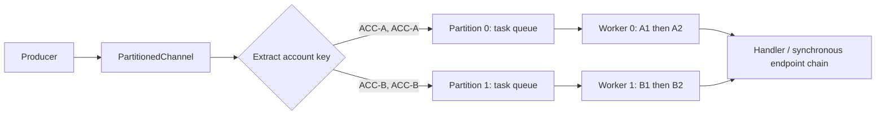

# PartitionedChannel

In the **SPRING_INTEGRATION_CORE** module, under the **Channel Types** chapter, this lesson explains how to use `PartitionedChannel` to process groups of messages concurrently while preserving order within each group. The content connects `Message`, `MessageChannel`, endpoints, gateways, and Java DSL to a concrete integration scenario: processing a sequence of events per account.

After this lesson, you will be able to choose a partition key, configure the channel, understand the scope of ordering guarantees, design error routing, and write tests for asynchronous flows.

## 1. The Problem: Sequential per Account, Concurrent Across Accounts

Suppose a system receives the following events in send order:

| Send position | Account | Business sequence number | Value change |
| --- | --- | --- | --- |
| 1 | ACC-A | 1 | +100 |
| 2 | ACC-B | 1 | +50 |
| 3 | ACC-A | 2 | -20 |
| 4 | ACC-B | 2 | +30 |

Requirements of the example:

- Event `ACC-A/1` must finish processing before `ACC-A/2`.
- Event `ACC-B/1` must finish processing before `ACC-B/2`.
- The two accounts can be processed concurrently when they belong to different partitions.
- One slow account should only impact its own partition's scope.

Putting every event onto a single thread makes ordering easy, yet fails to exploit independence across accounts. Dispatching freely to a multi-worker pool lets two events for the same account run concurrently and overlap.

`PartitionedChannel` combines key-based worker selection with sequential execution on each partition's worker. This component has been available since **Spring Integration 6.1**. The examples below use APIs aligned with **Spring Integration 6.5.0** on **Java 17 or later**; the virtual threads section requires Java 21 or later. This is a reference baseline for the lesson, not a requirement to upgrade your project to a specific version. See [PartitionedChannel 6.5.0 Javadoc](https://docs.spring.io/spring-integration/docs/6.5.0/api/org/springframework/integration/channel/PartitionedChannel.html).

## 2. How It Works

`PartitionedChannel` is a `SubscribableChannel` extending `AbstractExecutorChannel`. Endpoints register a `MessageHandler` on the channel; the application sends via `send(...)`. The channel has point-to-point semantics: each dispatch picks one subscriber to handle the message rather than broadcasting copies to all subscribers.

The channel does not require passing an external `TaskExecutor`. You configure the partition count and key-extraction function; each partition uses an executor with a single worker. You can supply a `ThreadFactory` to control thread creation. See [Channel Implementations documentation](https://docs.spring.io/spring-integration/reference/6.5/channel/implementations.html#channel-implementations-partitionedchannel).

You can trace a message's path in four steps:

1. Extract the key from headers or payload.
2. Map the key to one of the configured partitions.
3. Submit the processing task to that partition's executor.
4. The worker invokes the handler; subsequent synchronous steps continue on this worker.

The diagram below illustrates two keys mapped to two different partitions. It does not prescribe the exact partition indices of `ACC-A` and `ACC-B`.



One partition can hold **multiple keys**. Two distinct keys may map to the same partition and wait behind each other. The partition count bounds concurrency at the channel boundary; the number of keys does not determine the number of threads.

In the referenced 6.5.0 release, the dispatcher uses the key's `hashCode()` to choose a partition. Therefore, the key must be non-null and have a stable hash computation. Mapping specifics are an implementation detail; applications should rely on "same key goes to same partition" rather than treating partition indices as business identifiers. See [PartitionedDispatcher 6.5.0 source code](https://raw.githubusercontent.com/spring-projects/spring-integration/v6.5.0/spring-integration-core/src/main/java/org/springframework/integration/dispatcher/PartitionedDispatcher.java).

## 3. Understanding Ordering Guarantees Accurately

Under normal worker operation, messages with the same key execute on the same partition's worker. If a single producer sends sequentially and each processing step completes synchronously before returning, that order is maintained through this flow segment. See [PartitionedChannel documentation](https://docs.spring.io/spring-integration/docs/6.1.x/reference/html/channel.html#channel-implementations-partitionedchannel).

Distinguish three kinds of ordering:

| Order type | Meaning in the example |
| --- | --- |
| Business order | `sequence=1` must precede `sequence=2` per the source system's rules |
| Task submission order | Order in which tasks actually enter a partition's executor |
| Side-effect completion order | When data updates or external calls finish |

A design only meets requirements when the necessary orderings align. From the single-worker-per-partition model, the following boundaries follow:

| Scenario | Design conclusion |
| --- | --- |
| One producer sends `A1`, then `A2`; handler finishes work before returning | `A1 → A2` can be preserved across that processing segment |
| Two producers concurrently send for A | Order must be defined at the source or via versioning; `send` call start times do not create global order |
| Message arrives with `sequence=2` before `sequence=1` | The channel does not reorder by a `sequence` field on its own |
| Handler launches a `CompletableFuture` and returns immediately | The next task may start before the previous task's side effects finish |
| A and B belong to different partitions | They may run concurrently; result order between A and B is not fixed |
| Two application instances both receive events for A | Each instance has its own dispatcher; consistent key routing must happen externally |
| A1 fails and routes to an error path | A separate policy is needed if A2 must wait for A1 to succeed |

If events arrive out of order and already carry sequence metadata, consider a **resequencer**. That component releases messages according to `SEQUENCE_NUMBER`; `PartitionedChannel` handles key-based work distribution. See [Resequencer documentation](https://docs.spring.io/spring-integration/reference/6.5/resequencer.html).

## 4. Choosing a Partition Key

### 4.1. Default Key Is correlationId

The single-argument constructor uses the `IntegrationMessageHeaderAccessor.CORRELATION_ID` header as the key:

```java
import org.springframework.context.annotation.Bean;
import org.springframework.integration.channel.PartitionedChannel;

@Bean
PartitionedChannel correlatedEvents() {
    return new PartitionedChannel(4);
}
```

The producer must provide an appropriate correlation ID before sending:

```java
import org.springframework.integration.IntegrationMessageHeaderAccessor;
import org.springframework.messaging.Message;
import org.springframework.messaging.support.MessageBuilder;

Message<String> message = MessageBuilder.withPayload("event-A-1")
        .setHeader(IntegrationMessageHeaderAccessor.CORRELATION_ID, "ACC-A")
        .build();
```

Correlation ID is not automatically derived from `MessageHeaders.ID` merely because a message has an ID. If the key function returns `null`, the 6.5.0 dispatcher has no key on which to call `hashCode()`. Default configuration and key extraction are shown in the [PartitionedChannel source code](https://raw.githubusercontent.com/spring-projects/spring-integration/v6.5.0/spring-integration-core/src/main/java/org/springframework/integration/channel/PartitionedChannel.java) and [PartitionedDispatcher](https://raw.githubusercontent.com/spring-projects/spring-integration/v6.5.0/spring-integration-core/src/main/java/org/springframework/integration/dispatcher/PartitionedDispatcher.java).

### 4.2. The Key Must Represent the Unit Requiring Ordering

For account state-change streams, `accountId` usually expresses intent more clearly than a correlation ID serving another purpose.

| Suggested key | Serialized scope | Points to weigh |
| --- | --- | --- |
| `accountId` | Events for one account | Fits the running example in this lesson |
| `orderId` | Changes for one order | Different orders can proceed independently |
| `tenantId` | All messages of one tenant | Large tenants can become bottlenecks |
| `tenantId + accountId` as an explicit composite key | Account within each tenant | Prevents account ID collisions across tenants |
| Fresh UUID per message | Essentially each individual message | Fails to group related events |
| Constant value | Entire flow | Concentrates all work onto one partition |

These are design options for the illustrative scenario. Start from the state that multiple messages might mutate concurrently: that state usually reveals the unit needing serialization.

Keys should be immutable, have consistent `equals/hashCode`, and not depend on data modified during processing. When a composite key is needed, a `record` containing `tenantId` and `accountId` avoids ambiguity from string concatenation.

If the flow includes a splitter or aggregator, separate "group for aggregation" from "unit requiring sequential processing". By default, an aggregator groups by correlation ID and also requires a release strategy; using the same correlation ID as the partition key is only suitable when both scopes truly coincide. See [Aggregator documentation](https://docs.spring.io/spring-integration/reference/6.5/aggregator.html).

### 4.3. Validating the Key Before Dispatch

In the example below, the key resides in the `accountId` header. The key-extraction function verifies:

- The header is a non-blank string.
- The payload matches the event type accepted by the flow.
- The header matches the account ID in the payload.

That final check prevents events for A from being serialized under B's key because a producer set the wrong header. In production systems, you can also extract the key directly from a normalized payload to reduce the places that must stay in sync.

## 5. Complete Example: Account Events via Java DSL

### 5.1. Environment Setup

The example uses plain Spring with the `spring-integration-core` dependency. If using Spring Boot, use `spring-boot-starter-integration` and let Boot's dependency management choose compatible versions.

Illustrative dependency for a standalone Maven project:

```xml
<dependency>
    <groupId>org.springframework.integration</groupId>
    <artifactId>spring-integration-core</artifactId>
    <version>6.5.0</version>
</dependency>
```

Set the Java compilation level to 17 or higher. The code requires no broker, database, or poller. Both output `QueueChannel` beans are read directly using `receive(timeout)`.

### 5.2. Configuration and Demo Program

The following class holds the input types, channel configuration, transformer endpoint, and a `main` method sending four events. The `delta` field only illustrates message content; the program produces confirmation results without persisting account balances yet.

```java
package demo;

import java.util.List;

import org.springframework.context.annotation.Bean;
import org.springframework.context.annotation.Configuration;
import org.springframework.context.annotation.AnnotationConfigApplicationContext;
import org.springframework.integration.channel.PartitionedChannel;
import org.springframework.integration.channel.QueueChannel;
import org.springframework.integration.config.EnableIntegration;
import org.springframework.integration.dsl.IntegrationFlow;
import org.springframework.messaging.Message;
import org.springframework.messaging.support.MessageBuilder;
import org.springframework.scheduling.concurrent.CustomizableThreadFactory;

@Configuration
@EnableIntegration
public class PartitionedFlowConfig {

    public record AccountEvent(
            String accountId, int sequence, long delta) {
    }

    public record AppliedEvent(
            String accountId, int sequence, long delta,
            String workerName) {
    }

    public static Object accountKey(Message<?> message) {
        String key = message.getHeaders().get("accountId", String.class);
        if (key == null || key.isBlank()) {
            throw new IllegalArgumentException("accountId header is required");
        }
        if (!(message.getPayload() instanceof AccountEvent event)) {
            throw new IllegalArgumentException("AccountEvent payload is required");
        }
        if (!key.equals(event.accountId())) {
            throw new IllegalArgumentException("Header and payload accountId differ");
        }
        return key;
    }

    @Bean
    public PartitionedChannel accountEvents() {
        PartitionedChannel channel =
                new PartitionedChannel(4, PartitionedFlowConfig::accountKey);
        channel.setThreadFactory(new CustomizableThreadFactory("account-worker-"));
        channel.setFailover(false);
        return channel;
    }

    @Bean
    public QueueChannel appliedEvents() {
        return new QueueChannel(100);
    }

    @Bean
    public QueueChannel accountErrors() {
        return new QueueChannel(100);
    }

    @Bean
    public IntegrationFlow accountFlow() {
        return IntegrationFlow.from("accountEvents")
                .<AccountEvent, AppliedEvent>transform(event -> {
                    if (event.sequence() <= 0) {
                        throw new IllegalArgumentException("sequence must be positive");
                    }
                    return new AppliedEvent(
                            event.accountId(),
                            event.sequence(),
                            event.delta(),
                            Thread.currentThread().getName());
                })
                .channel("appliedEvents")
                .get();
    }

    public static void main(String[] args) {
        try (AnnotationConfigApplicationContext context =
                     new AnnotationConfigApplicationContext(PartitionedFlowConfig.class)) {
            PartitionedChannel input =
                    context.getBean("accountEvents", PartitionedChannel.class);
            QueueChannel output =
                    context.getBean("appliedEvents", QueueChannel.class);
            QueueChannel errors =
                    context.getBean("accountErrors", QueueChannel.class);

            List<AccountEvent> events = List.of(
                    new AccountEvent("ACC-A", 1, 100),
                    new AccountEvent("ACC-B", 1, 50),
                    new AccountEvent("ACC-A", 2, -20),
                    new AccountEvent("ACC-B", 2, 30));

            for (AccountEvent event : events) {
                boolean accepted = input.send(
                        MessageBuilder.withPayload(event)
                                .setHeader("accountId", event.accountId())
                                .setErrorChannelName("accountErrors")
                                .build());
                if (!accepted) {
                    throw new IllegalStateException("Message was not accepted");
                }
            }

            for (int i = 0; i < events.size(); i++) {
                Message<?> result = output.receive(5_000);
                if (result == null) {
                    throw new IllegalStateException("Timed out waiting for a result");
                }
                System.out.println(result.getPayload());
            }

            System.out.println("Error observed: " + errors.receive(0));
        }
    }
}
```

The `transform(...)` and `channel(...)` steps build the endpoint chain in Java DSL. The transformer returns `AppliedEvent`, and the result is then sent to `appliedEvents`. Transformer signatures are documented in [BaseIntegrationFlowDefinition Javadoc](https://docs.spring.io/spring-integration/docs/6.5.0/api/org/springframework/integration/dsl/BaseIntegrationFlowDefinition.html).

### 5.3. How to Read the Output

On a given run, you may see an output order like:

```text
ACC-A/1 on account-worker-1
ACC-B/1 on account-worker-2
ACC-B/2 on account-worker-2
ACC-A/2 on account-worker-1
```

This is a shorthand view for reading the output; actual `record.toString()` output prints the record name and remaining fields. Worker names and interleaving between the two accounts may vary.

What to verify is that A's sequence is `1, 2`, B's sequence is `1, 2`, and events for the same account share the same worker during that normal run. Do not treat A/B interleaving order as a pass/fail criterion.

In this configuration:

- The input channel is the transition boundary from the sending thread to a worker.
- There is one subscriber—the transformer endpoint—yet multiple partitions can invoke that endpoint concurrently with different messages.
- The lambda holds no shared state, making it safe for concurrent execution.
- Two queues of capacity 100 serve to observe results and errors for a small dataset.
- Closing the application context triggers the channel's destroy lifecycle and shuts down its executors. See [PartitionedChannel lifecycle](https://raw.githubusercontent.com/spring-projects/spring-integration/v6.5.0/spring-integration-core/src/main/java/org/springframework/integration/channel/PartitionedChannel.java).

When replacing the transformer with a state-updating service activator, the service must be safe under concurrent calls from multiple partitions. Key-based serialization does not make a shared `HashMap` safe against concurrent writes for different keys.

## 6. Declaring via Channel DSL

If you prefer using the DSL channel builder, you can replace the `accountEvents()` bean in the example with:

```java
import org.springframework.context.annotation.Bean;
import org.springframework.integration.dsl.MessageChannels;
import org.springframework.integration.dsl.PartitionedChannelSpec;
import org.springframework.scheduling.concurrent.CustomizableThreadFactory;

@Bean
public PartitionedChannelSpec accountEvents() {
    return MessageChannels.partitioned(4)
            .partitionKey(PartitionedFlowConfig::accountKey)
            .threadFactory(new CustomizableThreadFactory("account-worker-"))
            .failover(false);
}
```

Keep only one `accountEvents` bean definition. `MessageChannels.partitioned(...)` creates a `PartitionedChannelSpec`; `partitionKey(...)` and `threadFactory(...)` supply channel configuration. In this DSL bean, Spring manages the spec and the channel object it produces. See [MessageChannels Javadoc](https://docs.spring.io/spring-integration/docs/6.5.0/api/org/springframework/integration/dsl/MessageChannels.html) and [PartitionedChannelSpec source code](https://raw.githubusercontent.com/spring-projects/spring-integration/v6.5.0/spring-integration-core/src/main/java/org/springframework/integration/dsl/PartitionedChannelSpec.java).

Do not confuse `.get()` terminating an `IntegrationFlow` in the previous example with manually unwrapping a channel spec inside a bean declaration.

## 7. Successful send, Gateways, and Transactions

### 7.1. Distinguishing Task Acceptance from Business Completion

For an asynchronous processing segment, the return value of `send(...)` reflects sending/task submission at the channel boundary. To know whether business processing finished, the example uses messages on `appliedEvents`.

A worker may start very quickly—even before the producer observes `send` returning; that still does not imply "successful send means business logic succeeded".

Likewise, the `send(message, timeout)` parameter should not be interpreted as an end-to-end business completion deadline. If you need to bound an external service call, place a timeout on that operation itself and design how expiration is handled.

### 7.2. Gateways Hide Message-Sending APIs, While You Choose the Reply Contract

A messaging gateway can expose a `void submit(AccountEvent event)` method to the business layer. Either the flow behind the gateway must create the key header, or the channel must extract the key directly from the payload.

With a one-way contract and an asynchronous channel, the method returning does not confirm that a worker has successfully applied the event. If the caller needs a result, design request-reply, preserve the reply path, and pick an appropriate reply timeout. The example in Section 5 intentionally sends results to a queue, so it is not yet a request-reply flow to a gateway. See [Messaging Gateways](https://docs.spring.io/spring-integration/reference/6.5/gateway.html).

### 7.3. Thread Boundaries Are Transaction Boundaries to Examine

Imperative Spring transactions are typically bound to the executing thread. A producer's transaction does not automatically follow the message to a `PartitionedChannel` worker. The worker must start an appropriate transaction at the service or endpoint performing data changes. See [Transactions in Message Flows](https://docs.spring.io/spring-integration/reference/6.5/transactions.html#transaction-boundaries).

From this boundary, inspect two scenarios in production designs:

- Producer writes data and sends a message before committing its transaction: the worker may read before data is visible.
- Producer sends a message successfully and then the producer's transaction rolls back: submission to the executor is not automatically undone.

If data and events must recover consistently after a crash, design durable persistence and reliable event publishing—such as an outbox with a relay. In-memory serialization solves only one part of that problem.

Similarly, data placed in producer MDC or `ThreadLocal` needs an explicit propagation and cleanup strategy. Workers are reused across many messages; ensure context from a previous execution is cleared.

## 8. Error Handling and Key-Scoped Retries

### 8.1. Errors Before Task Submission vs. Errors on the Worker

There are two error locations to observe separately:

| Location | Example in lesson | How to observe |
| --- | --- | --- |
| On the send path, before worker runs | Missing `accountId` header; header and payload mismatch | Producer handles exception on `send` call path |
| Inside endpoint running on worker | `sequence <= 0` causes transformer to throw exception | Receive `ErrorMessage` via error handling path |

Spring Integration routes errors from asynchronous tasks to the channel specified by the `errorChannel` header; if absent, it uses the global bean named `errorChannel`. In the example, `setErrorChannelName("accountErrors")` selects a dedicated error queue. The payload of `ErrorMessage` is the exception; for handler errors wrapped in `MessagingException`, you can inspect `failedMessage` to identify the offending event. See [Error Handling](https://docs.spring.io/spring-integration/reference/error-handling.html).

Do not use `try/catch` around `send` expecting to catch exceptions thrown later on the worker. The tests in Section 10 verify this error path separately.

The `accountErrors` queue in this lesson is read directly. In continuous operation, a component must consume it, persist needed details, and decide recovery; an in-memory error queue does not automatically become durable storage.

### 8.2. One Failure Does Not Automatically Freeze Subsequent Messages

Suppose `A1` fails and error reporting completes. The worker can move on to run `A2`. If business rules require `A1` to succeed before `A2`, add an account-level policy.

Consider the following policies for your application:

| Policy | Desired effect | Trade-off to accept |
| --- | --- | --- |
| Retry inline inside handler call | Keeps current task ahead of queued ones | Occupies worker throughout retries |
| Mark account in error state and hold subsequent events | Prevents state updates from skipping past failures | Requires state storage, holding queue, and release mechanism |
| Route error to a separate handler, let main flow continue | Preserves throughput when business allows skipping | Requires compensation and reconciliation rules |
| Persist failure and replay into channel later | Enables deferred reprocessing | Replayed messages may trail newer arrivals |

`RequestHandlerRetryAdvice` supports handler-level retries. With stateless retries using backoff directly on the worker, wait time stays inside the current task; other keys sharing the same partition must also wait. See [Retry Advice documentation](https://docs.spring.io/spring-integration/reference/6.5/handler-advice/classes.html#retry-advice).

Use a stable event identifier to prevent duplicate application during retries or replays. For example, if `A1` already wrote data successfully but failed while sending an acknowledgment, reprocessing must not apply `delta` a second time. This is a design requirement of the example, not something automatically provided by sharing a partition key.

### 8.3. Subscriber Failover Differs from Business Recovery

The channel supports subscriber selection and failover when a subscriber fails. Setting `setFailover(false)` in the example keeps the demo contract clear when only one endpoint receives events. When registering multiple subscribers, define the selection strategy and conditions for falling back to the next subscriber. See [Failover options Javadoc](https://docs.spring.io/spring-integration/docs/6.5.0/api/org/springframework/integration/channel/PartitionedChannel.html).

Falling back to another handler does not automatically undo side effects performed by the first handler. If multiple handlers maintain separate in-memory state, "same partition" is also not enough to guarantee every update for an account hits the same state object.

## 9. Partition Count, Skewed Load, and Queue Capacity

### 9.1. Choosing Partition Count from Real Bottlenecks

In this illustrative example, assume each event takes 20 ms on average and completes synchronously. The theoretical capacity of one worker is roughly:

```text
1 / 0.020 = 50 events/second
4 partitions: around 200 events/second if load is evenly distributed
```

This is a back-of-the-envelope estimate, not a benchmark measurement. Real throughput is also shaped by wait times, connection pools, external service limits, and key distribution.

If a single account generates 80 events/second while a worker takes 20 ms per event, that account's backlog can grow even if you add more partitions for other keys. Before splitting a single account finer, prove that the sub-tasks are truly independent while preserving business invariants.

### 9.2. Queues in the Reference Version

In 6.5.0, the dispatcher creates executors via `Executors.newSingleThreadExecutor(...)`. The JDK documents that this executor uses an unbounded queue when configured that way. Sustained ingress above processing capacity can increase memory usage. See [Dispatcher source code](https://raw.githubusercontent.com/spring-projects/spring-integration/v6.5.0/spring-integration-core/src/main/java/org/springframework/integration/dispatcher/PartitionedDispatcher.java) and [Java 17 Executors Javadoc](https://docs.oracle.com/en/java/javase/17/docs/api/java.base/java/util/concurrent/Executors.html#newSingleThreadExecutor(java.util.concurrent.ThreadFactory)).

Replacing `ThreadFactory` only changes how threads are created; it does not alter queue capacity policy. When reading examples from other Spring Integration versions, check the exact version's API before relying on queue-configuration options.

For this example, useful metrics include:

- Accepted, completed, and failed event counts.
- Time from intake to processing start.
- Business execution time on the worker.
- Pending task volume and its growth rate.
- Load share of hot-key groups.
- Retry counts and accounts paused due to errors.

A full output queue can also stall workers when sending results. Both capacity-100 queues in the lesson must be drained if message volume increases or the program runs continuously.

### 9.3. Shutdown and Running Multiple Instances

When stopping the system, stop ingress sources first, wait for essential in-flight work to finish, and then close output resources. Requesting executor shutdown does not replace a business completion verification procedure.

When scaling across multiple instances, route events so the same key reaches the owning instance for as long as ordering must hold. Adding a separate `PartitionedChannel` in each instance does not create cross-JVM coordination. Broker partitioning, key-ownership routing, or optimistic version checks at the data store must be designed per system requirements.

## 10. Testing Ordering and Error Paths

Asynchronous tests should wait on a bounded condition rather than sleeping a fixed duration and guessing work is done. With the configuration in Section 5, `QueueChannel.receive(timeout)` provides an appropriate observation point.

The JUnit Jupiter class below uses `PartitionedFlowConfig` directly; the project needs JUnit Jupiter in test scope. Each test creates its own application context to isolate queues.

```java
package demo;

import java.util.ArrayList;
import java.util.HashMap;
import java.util.HashSet;
import java.util.List;
import java.util.Map;
import java.util.Set;
import java.util.stream.IntStream;

import org.junit.jupiter.api.Test;
import org.springframework.context.annotation.AnnotationConfigApplicationContext;
import org.springframework.integration.channel.PartitionedChannel;
import org.springframework.integration.channel.QueueChannel;
import org.springframework.messaging.Message;
import org.springframework.messaging.MessagingException;
import org.springframework.messaging.support.ErrorMessage;
import org.springframework.messaging.support.MessageBuilder;

import demo.PartitionedFlowConfig.AccountEvent;
import demo.PartitionedFlowConfig.AppliedEvent;

import static org.junit.jupiter.api.Assertions.*;

class PartitionedFlowTest {

    @Test
    void preservesOrderForEachAccount() {
        try (AnnotationConfigApplicationContext context =
                     new AnnotationConfigApplicationContext(PartitionedFlowConfig.class)) {
            PartitionedChannel input =
                    context.getBean("accountEvents", PartitionedChannel.class);
            QueueChannel output =
                    context.getBean("appliedEvents", QueueChannel.class);
            QueueChannel errors =
                    context.getBean("accountErrors", QueueChannel.class);

            String caller = Thread.currentThread().getName();
            for (int sequence = 1; sequence <= 20; sequence++) {
                send(input, new AccountEvent("ACC-A", sequence, 1));
                send(input, new AccountEvent("ACC-B", sequence, 1));
            }

            Map<String, List<Integer>> sequences = new HashMap<>();
            Map<String, Set<String>> workers = new HashMap<>();

            for (int i = 0; i < 40; i++) {
                Message<?> message = output.receive(5_000);
                assertNotNull(message, "Missing result " + i);
                AppliedEvent event =
                        assertInstanceOf(AppliedEvent.class, message.getPayload());

                sequences.computeIfAbsent(
                        event.accountId(), key -> new ArrayList<>())
                        .add(event.sequence());
                workers.computeIfAbsent(
                        event.accountId(), key -> new HashSet<>())
                        .add(event.workerName());

                assertNotEquals(caller, event.workerName());
            }

            List<Integer> expected =
                    IntStream.rangeClosed(1, 20).boxed().toList();
            assertEquals(expected, sequences.get("ACC-A"));
            assertEquals(expected, sequences.get("ACC-B"));
            assertEquals(1, workers.get("ACC-A").size());
            assertEquals(1, workers.get("ACC-B").size());
            assertNull(errors.receive(0));
        }
    }

    @Test
    void sendsWorkerFailureToTheRequestedErrorChannel() {
        try (AnnotationConfigApplicationContext context =
                     new AnnotationConfigApplicationContext(PartitionedFlowConfig.class)) {
            PartitionedChannel input =
                    context.getBean("accountEvents", PartitionedChannel.class);
            QueueChannel output =
                    context.getBean("appliedEvents", QueueChannel.class);
            QueueChannel errors =
                    context.getBean("accountErrors", QueueChannel.class);

            send(input, new AccountEvent("ACC-A", 0, 100));

            Message<?> message = errors.receive(5_000);
            assertNotNull(message);
            ErrorMessage error = assertInstanceOf(ErrorMessage.class, message);
            MessagingException failure =
                    assertInstanceOf(MessagingException.class, error.getPayload());

            Message<?> failedMessage = failure.getFailedMessage();
            assertNotNull(failedMessage);
            AccountEvent failedEvent =
                    assertInstanceOf(AccountEvent.class, failedMessage.getPayload());

            assertEquals("ACC-A", failedEvent.accountId());
            assertEquals(0, failedEvent.sequence());
            assertNull(output.receive(0));
        }
    }

    private static void send(
            PartitionedChannel input, AccountEvent event) {
        boolean accepted = input.send(
                MessageBuilder.withPayload(event)
                        .setHeader("accountId", event.accountId())
                        .setErrorChannelName("accountErrors")
                        .build());
        assertTrue(accepted);
    }
}
```

The first test verifies result ordering **within each account**, worker execution off the caller thread, and worker stability for the same key during the run. It does not assume any two arbitrary keys always land on different workers.

The second test supplies a valid key with `sequence=0` to trigger an exception inside the transformer. That tests worker-side errors separately from missing-key errors on the send path.

When you need to prove two partitions truly make progress independently, add a test using two keys known to map to different partitions in the current version. Use a `CountDownLatch` to hold the first key's handler while awaiting the second key's result, with an explicit timeout and latch release in `finally`. That verifies concurrent progress without relying on log order.

Additional scenarios to verify when applying to a stateful system: mismatched keys, skewed traffic, errors on an earlier event, duplicate-causing retries, and application shutdown with work remaining.

## 11. Virtual Threads

On Java 21 or later, you can replace the thread factory on the channel bean with:

```java
channel.setThreadFactory(
        Thread.ofVirtual().name("account-partition-", 0).factory());
```

This changes the kind of thread created for workers. You still have the declared partition count and each partition still processes sequentially; it does not turn the model into spawning a new virtual thread per message. See [PartitionedChannel and ThreadFactory documentation](https://docs.spring.io/spring-integration/docs/6.1.x/reference/html/channel.html#channel-implementations-partitionedchannel).

Virtual threads fit many I/O-bound workloads. They do not add CPU capacity or remove limits on external services, connection pools, or a single hot key under heavy load. See [Java 21 Thread Javadoc](https://docs.oracle.com/en/java/javase/21/docs/api/java.base/java/lang/Thread.html).

## 12. Combining with Other Endpoints

Place the partition boundary immediately before the segment requiring serialization. For an account-processing flow, one design might look like:

```text
Gateway / inbound adapter
    → normalize payload and resolve accountId
    → validate input data
    → PartitionedChannel by accountId
    → service applies event inside worker transaction
    → emit result or next event

Error on worker → errorChannel → retry policy / store error / hold key
```

A transformer before the channel should finish building the data used for key selection. A filter can discard invalid inputs before they occupy workers. If correctness requires never silently losing events, define an explicit discard path and reconciliation process.

A router after the channel can direct messages to business branches. Re-check ordering guarantees wherever a branch creates a new thread or uses an asynchronous channel; sharing a key at the input does not automatically ensure branches finish in the same order.

An aggregator still requires its own correlation strategy, message store, and release strategy. Partitioning picks where the handler runs; deciding "enough messages have arrived to aggregate" belongs to the aggregator. See [Aggregator documentation](https://docs.spring.io/spring-integration/reference/6.5/aggregator.html).

## 13. Comparison with Related Options

| Component | Consumption model | Good fit when |
| --- | --- | --- |
| `DirectChannel` | Invokes one subscriber on the sending thread | You want synchronous flows, easy error propagation to caller, and shared transactions |
| `ExecutorChannel` | Hands processing to a provided executor | You want custom pool, queue, and executor policy configuration |
| `PartitionedChannel` | Selects partition by key, one worker per partition | You want concurrency across groups and sequential order within each group |
| `QueueChannel` | Stores messages for consumers to receive or poll | You want to decouple send time from receive time and control queuing |
| `PublishSubscribeChannel` | Sends to subscribers | You want multiple branches to receive the same message |

This table describes baseline semantics. With `ExecutorChannel`, ordering also depends on the executor; a single-worker configuration can serialize the whole flow yet provides no built-in key partitioning. With `QueueChannel`, dequeue order and completion order across multiple consumers are two separate concerns. See [MessageChannel Implementations documentation](https://docs.spring.io/spring-integration/reference/6.5/channel/implementations.html).

## 14. Diagnosing Common Failures

| Symptom | Causes to inspect | Action to take |
| --- | --- | --- |
| Sending fails immediately | Missing key, wrong header or payload type, key mismatches data | Check input validation and key-extraction function |
| Events for the same account overlap | Key changed, asynchronous step downstream, or multiple instances processing | Trace actual key values and the entire execution path |
| Multiple accounts appear on one worker | Keys hashed to the same partition | This can be normal behavior; inspect distribution and load |
| Only part of the flow is slow | Hot key, slow handler, retries, or blocked output | Measure wait times and tasks occupying the worker |
| `send` succeeds but result is missing | Handler failed or result is stuck at output | Inspect both result path and error path |
| Memory grows under high load | Work arrives faster than completion rate | Control intake rate, capacity, and downstream bottlenecks |
| A2 runs even though A1 failed | No per-key pause or recovery mechanism | Add an error policy matching business rules |
| Application stops with work remaining | Ingress not stopped and tasks not drained cleanly | Design an orderly shutdown sequence with checkpoints |
| "Succeeded" metric rises prematurely | Counting send events instead of business completion | Record metrics at completion endpoint or confirmed result |

To observe handler lifecycle on worker threads, use `ExecutorChannelInterceptor`. Hooks like `postSend` on `ChannelInterceptor` reflect the send lifecycle and do not substitute for measuring asynchronous business processing duration. See [Channel Interceptors documentation](https://docs.spring.io/spring-integration/reference/6.5/channel/interceptors.html).

## 15. Design Decisions for the Example

For the account event stream in this lesson, the starting design uses `accountId` as the key, four partitions, a stateless processing endpoint, and a dedicated error path. When replacing the demo logic with real data updates, add worker-side transactions, duplicate-application prevention, and a policy for subsequent events when an account is in an error state.

The criteria for evaluating the design are observable per-account ordering, independent progress across unrelated groups, and recovery for a failed stream. Thread counts or DSL syntax choices only matter insofar as they serve those requirements.
