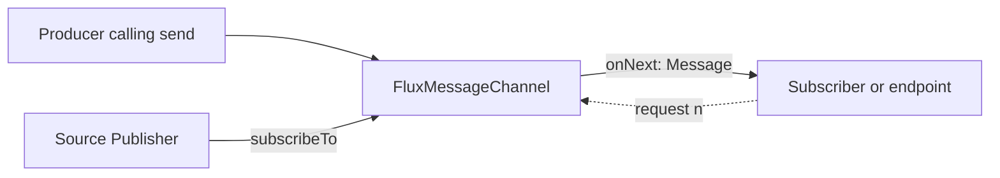
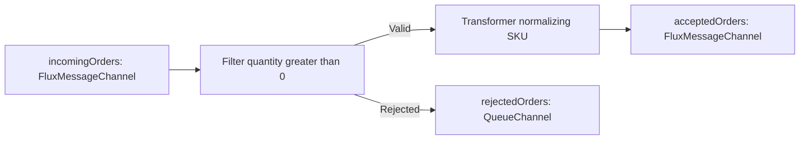

# FluxMessageChannel

## 1. Position in Spring Integration Core

In the **Channel Types** chapter of the **SPRING_INTEGRATION_CORE** module, `FluxMessageChannel` bridges Spring Integration's messaging model with Reactive Streams. A producer can send a `Message<?>` into the channel; consumers observe the channel as a `Publisher<Message<?>>` and request data according to their capacity to process it.

This lesson uses an order-processing flow to practice channels, endpoints, filters, transformers, and Java DSL. The testing section distinguishes send success from business outcomes, while observing headers, a discard branch, and an error branch. Later sections connect gateways, routers, and aggregators to situate the channel within an overall integration design.

After this lesson, you should be able to explain:

- How `subscribe()` and `subscribeTo()` differ in terms of data flow direction.
- How demand, buffering, and `send()` timeouts relate to one another.
- Why a reactive channel alone does not prove an entire application is non-blocking.
- How to register a consumer before sending and clean up subscriptions after tests.
- When another channel type or a durable storage component is needed.

The examples use Java 17 or later and Spring Integration 6.5.x APIs. Implementation-specific details were verified against the **6.5.4** source code; this serves as the lesson's reference baseline, not a claim about the latest release. When changing versions, re-verify send behavior and lifecycle details.

## 2. The Channel Contract

### 2.1. Two Sides of a Junction

`FluxMessageChannel` belongs to the `org.springframework.integration.channel` package. Its core contracts include `MessageChannel`, `Publisher<Message<?>>`, `ReactiveStreamsSubscribableChannel`, and `Lifecycle`.

| API | Interaction direction | Role |
| --- | --- | --- |
| `send(message)` | Producer → channel | Push a message in through the imperative API |
| `subscribe(subscriber)` | Channel → consumer | Register a receiver via Reactive Streams |
| `subscribeTo(publisher)` | Source publisher → channel | Attach a message source to the channel |
| `start()` / `stop()` | Lifecycle management | Control activity and source subscriptions |

`subscribe()` registers a **receiver of the channel**, whereas `subscribeTo()` attaches a **feeder source to the channel**. Signatures and contracts are documented in the [FluxMessageChannel Javadoc](https://docs.spring.io/spring-integration/api/org/springframework/integration/channel/FluxMessageChannel.html).



The diagram shows both ways of supplying data. A single message does not need to pass through both an imperative producer and a source publisher.

### 2.2. A Message Containing a Stream vs. a Stream of Messages

```java
Message<Flux<String>> messageWithStreamPayload;
Flux<Message<String>> streamOfMessages;
```

The first structure is a single envelope whose payload is a stream. The second structure consists of multiple envelopes, each with its own payload and headers. Three orders requiring three order IDs and three independent processing outcomes are usually represented more clearly as three separate messages.

Do not assume every `send()` call with a `Flux` payload automatically splits into multiple messages. Spring Integration has a separate mechanism for handling **reactive replies returned by endpoints** when the output channel supports Reactive Streams. Distinguish that capability from directly sending an envelope carrying a `Flux`. See [Reactive Reply Payload](https://docs.spring.io/spring-integration/reference/6.5/reactive-streams.html#reactive-reply-payload).

## 3. Demand, Backpressure, and Timeouts

### 3.1. Consumers Request Data

A subscriber receives a `Subscription` upon subscribing. It calls `request(n)` to ask for more items and `cancel()` to cancel. Demand is cumulative; `request(2)` does not mean two tasks run in parallel or two messages per second. The [Subscription contract](https://www.reactive-streams.org/reactive-streams-1.0.4-javadoc/org/reactivestreams/Subscription.html) defines this request-and-cancel protocol.

Self-constructed example: a consumer with capacity for two jobs can request two messages. When it finishes one job, it requests one more message.

```text
Consumer: request(2)
Channel : onNext(order-A)
Channel : onNext(order-B)
Consumer: completes one job, request(1)
Channel : onNext(order-C)
```

This describes the protocol on a single subscription. In an application, identify which endpoint represents the final consumer and how much data intermediate operators prefetch. Do not treat a single subscriber's demand as proof that the entire system only has that many jobs in flight.

### 3.2. The Imperative Send Path Can Wait

In the 6.5.4 implementation, the channel requires being active and having subscribers. When the sink cannot accept an element due to saturation or emission contention, `send()` can retry up to the timeout:

- `send(message, 0)`: does not wait to retry when the sink cannot accept immediately.
- `send(message, timeoutMillis)` with a positive timeout: bounds how long to retry admitting into the sink.
- `send(message)`: uses a negative timeout and may wait for an extended duration.

Having no subscriber is an error, not a mechanism that waits for a future subscriber. See [FluxMessageChannel 6.5.4 source code](https://raw.githubusercontent.com/spring-projects/spring-integration/v6.5.4/spring-integration-core/src/main/java/org/springframework/integration/channel/FluxMessageChannel.java).

The superclass also executes interceptors and wraps ordinary send failures in `MessageDeliveryException`. A `false` return value can also result from an interceptor rejecting the send, not just a timeout. See [AbstractMessageChannel 6.5.4](https://raw.githubusercontent.com/spring-projects/spring-integration/v6.5.4/spring-integration-core/src/main/java/org/springframework/integration/channel/AbstractMessageChannel.java).

```java
// Place inside a method that already has appropriate channel and message variables.
try {
    boolean accepted = channel.send(message, 200);
    if (!accepted) {
        // Apply the application's rejection or retry policy.
    }
}
catch (org.springframework.messaging.MessagingException ex) {
    // Record the send error and root cause.
}
```

Sink admission timeout does not automatically interrupt a slow downstream callback running directly on the sending thread. For an order-intake API, define intake deadlines and result-delivery deadlines separately.

### 3.3. Multicast and Slow Subscribers

The reference channel uses a buffering multicast sink. Multiple active subscribers can receive the same message; this is not a mechanism that routes each message to exactly one worker. A slow subscriber can exert backpressure on the shared emission path. [Reactor Sinks documentation](https://projectreactor.io/docs/core/release/reference/coreFeatures/sinks.html) explains multicast, unicast, and replay models.

Implication for the order problem: if you attach an extra subscriber for logging, that subscriber also participates in the emission path. Evaluate its speed and lifecycle. Observing via an active consumer can impact the very flow being observed.

Do not use the buffer as an order store for crash recovery. When work must resume after a process stops, choose a component with an appropriate persistence and replay contract.

## 4. Comparison with Other Channel Types

`FluxMessageChannel` does not implement `PollableChannel` or the ordinary `SubscribableChannel` interface. Consumers use Reactive Streams rather than calling `receive()` like a queue or registering handlers via the `SubscribableChannel` contract. See [MessageChannel Implementations](https://docs.spring.io/spring-integration/reference/6.5/channel/implementations.html#flux-message-channel).

| Channel | Consumption model | Dispatch characteristics | Example choice |
| --- | --- | --- | --- |
| `DirectChannel` | Invokes handler on sending thread | Picks one handler per message | Short, synchronous processing chain |
| `ExecutorChannel` | Dispatcher using an executor | Dispatches to one handler | Offloading processing to an executor |
| `QueueChannel` | Polling consumer | Each message pulled by one consumer | Pending work list |
| `PublishSubscribeChannel` | Invokes subscribed handlers | Broadcasts to subscribers | Notifying multiple components |
| `FluxMessageChannel` | Reactive Streams subscriber | Demand-driven stream | Connecting reactive sources and consumers |

Before choosing declaration syntax, decide whether an order should be handled by a single worker or broadcast to multiple parties. Then identify requirements around slow consumers, durability, and replay. Those requirements determine which channel model to use.

## 5. Java DSL: Filtering and Normalizing Orders

### 5.1. Dependencies and Assumptions

In a Spring Boot application whose versions are managed by a parent or BOM compatible with Spring Integration 6.5.x, add:

```xml
<dependency>
    <groupId>org.springframework.boot</groupId>
    <artifactId>spring-boot-starter-integration</artifactId>
</dependency>
<dependency>
    <groupId>org.springframework.boot</groupId>
    <artifactId>spring-boot-starter-test</artifactId>
    <scope>test</scope>
</dependency>
<dependency>
    <groupId>io.projectreactor</groupId>
    <artifactId>reactor-test</artifactId>
    <scope>test</scope>
</dependency>
```

These are the added dependencies, not a complete `pom.xml`. Non-Boot projects must manage compatible versions of Spring Integration, Spring Framework, Reactor, and JUnit themselves. `reactor-test` must match the application's Reactor Core version.

### 5.2. Path of an Order

Each order consists of `id`, `sku`, and `quantity`. Illustrative rules:

1. Orders with `quantity <= 0` go to the rejection branch.
2. Valid orders have leading and trailing whitespace stripped from the SKU and are uppercased.



The rejection branch holds business data needing review, not infrastructure exceptions. `discardChannel` is the filter mechanism used to route rejected messages to a specific branch. See [Filter](https://docs.spring.io/spring-integration/reference/6.5/filter.html).

### 5.3. Complete Configuration

```java
package example.integration;

import java.util.Locale;

import org.springframework.beans.factory.annotation.Qualifier;
import org.springframework.context.annotation.Bean;
import org.springframework.context.annotation.Configuration;
import org.springframework.integration.channel.FluxMessageChannel;
import org.springframework.integration.channel.QueueChannel;
import org.springframework.integration.config.EnableIntegration;
import org.springframework.integration.dsl.IntegrationFlow;

@Configuration
@EnableIntegration
public class OrderFlowConfig {

    public record Order(String id, String sku, int quantity) {
    }

    @Bean
    public FluxMessageChannel incomingOrders() {
        return new FluxMessageChannel();
    }

    @Bean
    public FluxMessageChannel acceptedOrders() {
        return new FluxMessageChannel();
    }

    @Bean
    public QueueChannel rejectedOrders() {
        return new QueueChannel(10);
    }

    @Bean
    public IntegrationFlow orderFlow(
            @Qualifier("incomingOrders") FluxMessageChannel input,
            @Qualifier("acceptedOrders") FluxMessageChannel output,
            @Qualifier("rejectedOrders") QueueChannel rejected) {

        return IntegrationFlow.from(input)
                .filter(Order.class,
                        order -> order.quantity() > 0,
                        endpoint -> endpoint.discardChannel(rejected))
                .transform(Order.class, order -> new Order(
                        order.id(),
                        order.sku().strip().toUpperCase(Locale.ROOT),
                        order.quantity()))
                .channel(output)
                .get();
    }
}
```

`@Qualifier` distinguishes multiple beans of the same type. `Locale.ROOT` keeps the SKU rule independent of the host machine's default locale.

This is a hybrid flow: both ends are reactive channels, whereas the default link between the filter and the transformer uses a DSL-created channel. The configuration does not claim every internal boundary is reactive. When you need control over every boundary, declare each channel explicitly and evaluate both sources and handlers.

`acceptedOrders` needs a subscriber before valid orders are sent. In the tests, `StepVerifier` takes that role. In an application, wire up the next endpoint.

`rejectedOrders` has capacity 10 so the example is easy to observe. If no consumer drains it and the queue fills up, that branch can create a blocking point. Real designs need a dedicated handling policy and send timeout for the discard branch.

## 6. Testing Data and Processing Outcomes

### 6.1. Payloads, Headers, Rejections, and Errors

The class below creates a separate `AnnotationConfigApplicationContext` per test. There is no need to boot an entire Boot application; isolated contexts also prevent leftover data and subscriptions across scenarios.

```java
package example.integration;

import java.time.Duration;

import org.junit.jupiter.api.Test;
import org.springframework.context.annotation.AnnotationConfigApplicationContext;
import org.springframework.integration.channel.FluxMessageChannel;
import org.springframework.integration.channel.QueueChannel;
import org.springframework.messaging.Message;
import org.springframework.messaging.MessageHeaders;
import org.springframework.messaging.MessagingException;
import org.springframework.messaging.support.ErrorMessage;
import org.springframework.messaging.support.MessageBuilder;

import reactor.core.publisher.Flux;
import reactor.test.StepVerifier;

import example.integration.OrderFlowConfig.Order;

import static org.junit.jupiter.api.Assertions.*;

class OrderFlowTest {

    @Test
    void normalizesSkuAndPreservesBusinessHeader() {
        try (var context =
                new AnnotationConfigApplicationContext(OrderFlowConfig.class)) {
            var input = context.getBean(
                    "incomingOrders", FluxMessageChannel.class);
            var output = context.getBean(
                    "acceptedOrders", FluxMessageChannel.class);

            Message<Order> request = MessageBuilder
                    .withPayload(new Order("O-101", "  sku-a  ", 2))
                    .setHeader("traceId", "trace-101")
                    .build();

            StepVerifier.create(Flux.from(output))
                    .then(() -> assertTrue(input.send(request, 1_000)))
                    .assertNext(message -> {
                        Order order = assertInstanceOf(
                                Order.class, message.getPayload());
                        assertEquals("O-101", order.id());
                        assertEquals("SKU-A", order.sku());
                        assertEquals(2, order.quantity());
                        assertEquals("trace-101",
                                message.getHeaders().get("traceId"));
                    })
                    .thenCancel()
                    .verify(Duration.ofSeconds(3));
        }
    }

    @Test
    void routesInvalidQuantityToDiscardChannel() {
        try (var context =
                new AnnotationConfigApplicationContext(OrderFlowConfig.class)) {
            var input = context.getBean(
                    "incomingOrders", FluxMessageChannel.class);
            var rejected = context.getBean(
                    "rejectedOrders", QueueChannel.class);

            Message<Order> request = MessageBuilder
                    .withPayload(new Order("O-102", "sku-b", 0))
                    .setHeader("traceId", "trace-102")
                    .build();

            assertTrue(input.send(request, 1_000));

            Message<?> discarded = rejected.receive(1_000);
            assertNotNull(discarded);
            assertEquals(request.getPayload(), discarded.getPayload());
            assertEquals("trace-102",
                    discarded.getHeaders().get("traceId"));
        }
    }

    @Test
    void sendsTransformationFailureToRequestedErrorChannel() {
        try (var context =
                new AnnotationConfigApplicationContext(OrderFlowConfig.class)) {
            var input = context.getBean(
                    "incomingOrders", FluxMessageChannel.class);
            var errors = new QueueChannel(10);

            // Valid quantity, but null sku causes transformer to fail.
            Message<Order> request = MessageBuilder
                    .withPayload(new Order("O-103", null, 1))
                    .setHeader(MessageHeaders.ERROR_CHANNEL, errors)
                    .build();

            assertTrue(input.send(request, 1_000));

            ErrorMessage error = assertInstanceOf(
                    ErrorMessage.class, errors.receive(1_000));
            MessagingException failure = assertInstanceOf(
                    MessagingException.class, error.getPayload());
            assertNotNull(failure.getFailedMessage());
            assertEquals(request.getPayload(),
                    failure.getFailedMessage().getPayload());
        }
    }
}
```

`StepVerifier` subscribes to the output when `verify()` runs, then executes the action in `then(...)`. Hence the output consumer is present before the producer sends. `thenCancel()` fits a channel that remains open for further messages; one order completing does not mean the entire channel completes. `verify(Duration)` sets a timeout on the scenario. See [Reactor Testing](https://projectreactor.io/docs/core/release/reference/testing.html).

The rejection test shows `send()` succeeding even though business logic did not accept the order. The error test observes failures along the error path. If callers need to know whether an order completed, design a reply or result event keyed by `orderId` rather than treating `send()`'s boolean as the business outcome.

The test code is illustrative for running in a project with compatible dependencies; seeing code in documentation does not imply the tests were executed here.

### 6.2. Testing Demand on a Standalone Channel

This scenario starts with zero demand and then requests items one by one. It verifies the subscriber side rather than measuring internal buffer capacity or overall system parallelism.

```java
package example.integration;

import java.time.Duration;

import org.junit.jupiter.api.Test;
import org.springframework.integration.channel.FluxMessageChannel;
import org.springframework.messaging.support.GenericMessage;

import reactor.core.publisher.Flux;
import reactor.test.StepVerifier;

import static org.junit.jupiter.api.Assertions.assertTrue;

class FluxChannelDemandTest {

    @Test
    void deliversMessagesAfterDemandIsRequested() {
        var channel = new FluxMessageChannel();
        try {
            StepVerifier.create(
                            Flux.from(channel).map(message -> message.getPayload()),
                            0)
                    .thenRequest(1)
                    .then(() -> assertTrue(channel.send(
                            new GenericMessage<>("order-A"), 0)))
                    .expectNext("order-A")
                    .thenRequest(1)
                    .then(() -> assertTrue(channel.send(
                            new GenericMessage<>("order-B"), 0)))
                    .expectNext("order-B")
                    .thenCancel()
                    .verify(Duration.ofSeconds(3));
        }
        finally {
            channel.destroy();
        }
    }
}
```

Avoid sending thousands of messages with unbounded-wait `send()` inside `then(...)` before calling `thenRequest(...)`. If the send path fills up before the test advances to requesting items, the test can block its own thread and never reach the demand-releasing step.

## 7. Attaching a Source Publisher with subscribeTo

When the source is already a `Publisher<Message<?>>`, you can hand the source to the channel instead of subscribing manually and sending element by element. The standalone test below uses two source messages:

```java
package example.integration;

import java.time.Duration;

import org.junit.jupiter.api.Test;
import org.springframework.integration.channel.FluxMessageChannel;
import org.springframework.messaging.Message;
import org.springframework.messaging.support.GenericMessage;

import reactor.core.publisher.Flux;
import reactor.test.StepVerifier;

class FluxChannelSourceTest {

    @Test
    void consumesMessagesFromAnAttachedPublisher() {
        var channel = new FluxMessageChannel();
        Flux<Message<?>> source = Flux.<Message<?>>just(
                new GenericMessage<>("source-A"),
                new GenericMessage<>("source-B"));

        try {
            StepVerifier.create(
                            Flux.from(channel).map(message -> message.getPayload()))
                    .then(() -> channel.subscribeTo(source))
                    .expectNext("source-A", "source-B")
                    .thenCancel()
                    .verify(Duration.ofSeconds(5));
        }
        finally {
            channel.destroy();
        }
    }
}
```

Spring Integration supports attaching sources and waiting for downstream readiness before consuming the source. You can start the DSL with `IntegrationFlow.from(publisher)` to let the framework wire the connection. See [Reactive Streams Support](https://docs.spring.io/spring-integration/reference/6.5/reactive-streams.html#fluxmessagechannel-and-reactivestreamsconsumer).

For an order source, clarify who owns the subscription and from what point data can be re-read. A cold source can re-run work upon resubscription; a hot source may have already emitted events before the consumer is ready. Both types need corresponding startup and recovery policies.

Let Spring manage channels declared as beans. Manually created channels in tests must be cleaned up by the test. In the reference implementation, `stop()` cancels source subscriptions, `start()` can re-subscribe still-managed sources, and `destroy()` terminates the sink. A single source completing does not automatically close a shared channel.

## 8. Reactive Endpoints and Execution Threads

### 8.1. Channels and Endpoints Have Distinct Roles

The channel transports messages; `ReactiveStreamsConsumer` consumes input via Reactive Streams and passes messages to a handler. Java DSL manages that wiring so filters and transformers can still express business logic as ordinary functions.

The `reactive()` endpoint option lets you create a reactive consumer from another input channel type and customize the input `Flux`. Here is a standalone configuration illustrating moving string processing onto a scheduler:

```java
package example.integration;

import org.springframework.context.annotation.Bean;
import org.springframework.context.annotation.Configuration;
import org.springframework.integration.config.EnableIntegration;
import org.springframework.integration.dsl.IntegrationFlow;

import reactor.core.scheduler.Schedulers;

@Configuration
@EnableIntegration
public class TextFlowConfig {

    @Bean
    public IntegrationFlow textFlow() {
        return IntegrationFlow.from("textInput")
                .transform(String.class,
                        text -> text.strip(),
                        endpoint -> endpoint.reactive(
                                flux -> flux.publishOn(Schedulers.parallel())))
                .channel("textOutput")
                .get();
    }
}
```

Attach a consumer to `textOutput` before using this configuration. The customizer applies to the endpoint's input publisher, not to every endpoint in the application. See [The reactive() Endpoint](https://docs.spring.io/spring-integration/reference/6.5/dsl/java-reactive.html).

### 8.2. Reactive Does Not Automatically Create Dedicated Threads

Reactor does not require every `Flux` to run on its own thread. `publishOn()` shifts downstream steps onto the selected scheduler; `subscribeOn()` affects subscription setup and the upstream source. See [Threading and Schedulers](https://projectreactor.io/docs/core/release/reference/coreFeatures/schedulers.html).

If you need to isolate a blocking API, you can wrap the call as follows:

```java
import java.util.concurrent.Callable;

import reactor.core.publisher.Mono;
import reactor.core.scheduler.Schedulers;

static <T> Mono<T> isolateBlockingCall(Callable<T> task) {
    return Mono.fromCallable(task)
            .subscribeOn(Schedulers.boundedElastic());
}
```

This is a helper pattern to place inside an appropriate class. It isolates where the call runs; a blocking driver still occupies a thread while waiting. For a downstream order-processing service, also configure concurrency caps and connection pool bounds.

Design reasoning: if the requirement is "acknowledge only after writing to the database", the result must follow completion of that write. Pushing work onto a scheduler and immediately acknowledging at the producer violates that intent. Transactions and per-order ordering must also be designed and tested at the actual processing step; switching channel types alone does not establish those properties.

## 9. Message Errors and Stream-Terminating Errors

### 9.1. Spring Integration Error Paths

`ErrorMessage` carries the exception as its payload. The error-publishing mechanism can prefer the channel in the `errorChannel` header and fall back to a shared error channel when appropriate. A component must be responsible for catching and publishing errors; not every Java exception automatically becomes an error message. See [Error Handling](https://docs.spring.io/spring-integration/reference/6.5/error-handling.html).

In the order tests, `ReactiveStreamsConsumer` uses an error handler and catches exceptions while delivering messages to the handler. Therefore the test observes `ErrorMessage` on the queue specified in the header. Do not generalize this behavior to arbitrary custom subscribers. See [ReactiveStreamsConsumer 6.5.4](https://raw.githubusercontent.com/spring-projects/spring-integration/v6.5.4/spring-integration-core/src/main/java/org/springframework/integration/endpoint/ReactiveStreamsConsumer.java).

Operationally, error records should include the order ID or trace ID, root cause, and next action. If sending succeeded yet the transformer failed, logging a generic "send failed" misleads operators toward the wrong failure point.

### 9.2. Recovery Scope in Reactor

`onError` is a terminal signal for a Reactor sequence. `onErrorResume` switches to a fallback publisher; it does not resume the terminated upstream source intact. Operator placement therefore determines recovery scope. See [Reactor Error Handling](https://projectreactor.io/docs/core/release/reference/coreFeatures/error-handling.html).

The self-contained pattern below handles failures within each order and produces an explicit outcome:

```java
import java.util.function.Function;

import org.springframework.messaging.Message;
import org.springframework.messaging.support.MessageBuilder;

import reactor.core.publisher.Flux;
import reactor.core.publisher.Mono;

// Place record and method inside an appropriate class.
record OrderResult(String orderId, boolean successful) {
}

static Flux<Message<?>> processEachOrder(
        Flux<Message<?>> requests,
        Function<OrderFlowConfig.Order, Mono<OrderResult>> operation) {

    return requests.concatMap(request -> {
        var order = (OrderFlowConfig.Order) request.getPayload();
        return Mono.defer(() -> operation.apply(order))
                .onErrorResume(error -> Mono.just(
                        new OrderResult(order.id(), false)))
                .map(result -> (Message<?>) MessageBuilder
                        .withPayload(result)
                        .copyHeaders(request.getHeaders())
                        .build());
    });
}
```

The illustrated policy returns a failure result and continues with the next order. Applications may also need to record the cause. If the error originates in the source before `concatMap`, per-order operators cannot recover that upstream source failure.

When adding retries, identify which operation is repeated. If the target system already wrote the order but the response was lost, retrying can create a duplicate record. Use a business key or idempotency check per order ID, along with bounded attempts and appropriate backoff.

## 10. Relationship to Gateways, Routers, and Aggregators

A gateway returning `Mono<T>` lets callers use a reactive API for request–reply. Spring Integration defers triggering the flow until the `Mono` is subscribed. That neither forces the request channel to be a `FluxMessageChannel` nor turns blocking handlers into non-blocking ones. See [Messaging Gateways: Reactor Mono](https://docs.spring.io/spring-integration/reference/6.5/gateway.html#reactor-mono).

If extending the example to use a gateway, connect replies per the gateway contract. A test subscriber on `acceptedOrders` does not automatically act as the reply path for all requests. Rejected orders also need an appropriate outcome so callers do not wait for a reply that is never produced.

| Component | Design question for orders |
| --- | --- |
| Transformer | What is the canonical data shape after intake? |
| Filter | Which orders are accepted, and where do rejected orders go? |
| Router | Which downstream processing system receives each order? |
| Aggregator | When have enough component results arrived for one order? |
| Gateway | Under what contract do callers receive results and failures? |

With an aggregator, define correlation, release conditions, and handling for incomplete groups. Channel backpressure does not replace those group-completion rules. The questions in the table help separate business responsibilities from message transport mechanics.

## 11. Operations and Diagnostics

The troubleshooting checks below follow from the example and contracts presented. Verify each hypothesis against your running configuration.

| Symptom | Hypothesis to check | Data to observe |
| --- | --- | --- |
| No subscribers | Endpoint not started, stopped, or subscription canceled | Endpoint state, subscription timing |
| Producer waits a long time | Slow consumer, full emission path, or blocking callback | Send duration, thread stacks, processing latency |
| Send succeeds but results are missing | Filter rejected or downstream step failed | Discard path, error channel, and order ID |
| Order processed multiple times | Multiple subscribers or retries | Consumer list, retry count, business keys |
| Pending work lost after restart | Data only in memory or source does not replay | Storage contract, replay capability |
| Publisher present but nothing processed | No subscription at execution boundary | Subscription owner and lifecycle |

For the order flow, you can start with these chosen metrics:

1. Counts of incoming, accepted, and rejected orders.
2. Counts of successful results, failures, and retries.
3. Duration from order intake to final outcome.
4. Target service resource usage and waiting points.

`send()` duration does not represent end-to-end business duration if database persistence happens later. Order IDs are suitable for looking up logs or per-event traces; avoid using arbitrary order IDs as high-cardinality metric labels.

## 12. Extended Practice Exercise

Run on a project with aligned dependencies:

1. Execute the three tests in `OrderFlowTest` and explain the outcome for each order.
2. Add a `sourceSystem` header and verify it on both the output and the discard branch.
3. Add a consumer for `rejectedOrders`; explain behavior when that consumer stops and the queue fills.
4. Replace the two-message source with a resubscribable test source; record the number of subscriptions.
5. Add a service returning `Mono<OrderResult>`; define ordering, concurrency bounds, and error-recovery scope before wiring the flow.
6. Design a rejection outcome for a request–reply gateway.

Completion criteria: trace every valid, rejected, and failed order end to end. For each case, identify where the consumer lives, who owns the subscription, and what data proves the final business outcome.
