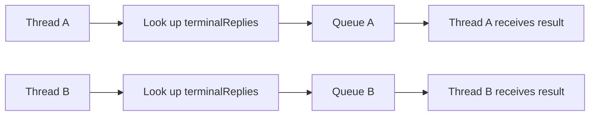
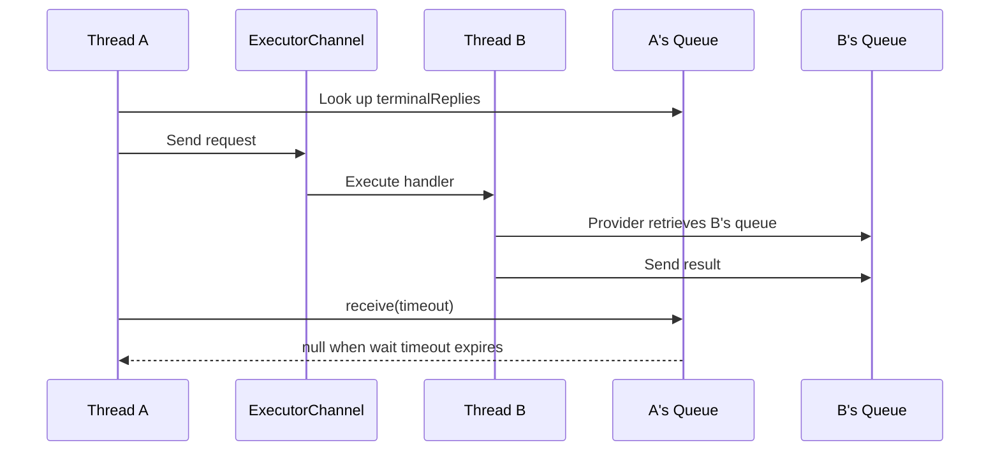

# Scoped Channel

## 1. The Problem: Which Channel Belongs to Which Execution?

In Spring Integration Core, a `MessageChannel` connects the endpoints of a message flow. When an application handles multiple concurrent executions, beyond deciding how messages are transported, you must also decide whether those executions share one channel or each context gets its own instance.

For example, a data-normalization task runs entirely on the calling thread. Intermediate results are placed into a terminal channel at the end of the flow for that same task to collect. If all tasks read from one shared queue without a mechanism pairing results to requests, task A could pull task B's result.

**A scoped channel is a channel bean managed under a Spring bean scope.** The scope decides which instance is returned on bean lookup. The channel type still decides how messages are sent and received. Spring Integration supports scoping channels; the `ThreadLocalChannel` from version 1.0 was removed in 2.0, so do not use that legacy class in new examples. See [Scoped Channel documentation](https://docs.spring.io/spring-integration/reference/channel/implementations.html#scoped-channel).

After this lesson, you will be able to:

- Distinguish channel scope from the message-transport mechanism.
- Register the `thread` scope and declare channels using Java or XML.
- Use channels in the right context when configuring endpoints with Java DSL.
- Analyze the impact of thread pools, pollers, gateways, and errors on the design.
- Design a test example proving isolation between instances.

## 2. Two Independent Decisions: Channel Type and Scope

You can describe a design using the pair `(channel type, scope)`:

| Configuration | How messages move | How instances are chosen |
| --- | --- | --- |
| `DirectChannel`, singleton | Invokes subscriber on sending thread in typical config | One shared bean in the container |
| `QueueChannel`, singleton | Buffers messages for receiver to call `receive()` | One shared queue |
| `QueueChannel`, thread | Still uses `send()` and `receive()` | Each thread looking up the bean gets its matching queue |
| `QueueChannel`, request | Still a queue | Each HTTP request has an instance per active scope |

Spring defines `singleton`, `prototype`, and web scopes such as `request` and `session`. The `thread` scope has a built-in implementation but is not registered by default. See [Bean Scopes](https://docs.spring.io/spring-framework/reference/core/beans/factory-scopes.html).

From separating these two decisions, three design implications follow:

1. Putting `scope="thread"` on a `QueueChannel` does not create a consumer or processing thread.
2. Putting a scope on a `DirectChannel` does not automatically register subscribers on each new instance.
3. A `correlationId` in headers does not select a bean by scope; selecting by business key requires its own design.

`prototype` must also be understood accurately: each time the container creates or supplies the bean, it can be a new instance. If a producer and consumer independently look up two prototype queues, they may operate on two different queues. When a queue acts as an exchange point, clarify how both sides obtain the same instance.

## 3. Model of a Thread-Scoped Channel

Suppose a bean named `terminalReplies` is declared with `thread` scope:



Think of a scope as looking up instances by context. The `Scope.get(name, objectFactory)` contract returns an existing bean in the context, or creates one via the factory if none exists yet. `Scope` also provides operations to remove beans, register destruction callbacks, and access contextual info. See [Scope Javadoc](https://docs.spring.io/spring-framework/docs/current/javadoc-api/org/springframework/beans/factory/config/Scope.html).

In the example above, with the same bean name, two threads look up two distinct objects. The same thread looking it up multiple times gets back the existing object until it is removed from the scope.

This isolation applies when **looking up through the container or a scoped proxy**. If you grab A's actual queue and pass that reference directly to B, B can still call methods on that queue. Thus, a scoped channel is not a Java object access-control mechanism.

With a thread pool, note this relationship:

```text
task A ─┐
        ├─ run sequentially on worker-1 ─> same thread scope if not cleaned up
 task B ┘
```

From this, you can see thread scope is not synonymous with task scope. A long-lived thread can serve many unrelated business tasks.

## 4. Registering the Scope and Declaring the Channel in Java

The following example uses Spring Context and `spring-integration-core`, with versions aligned via the project's BOM. Java DSL is included in core; do not add the legacy Java DSL library. If using Spring Boot, use the corresponding Spring Integration starter.

```java
import org.springframework.beans.factory.config.CustomScopeConfigurer;
import org.springframework.context.annotation.Bean;
import org.springframework.context.annotation.Configuration;
import org.springframework.context.annotation.Scope;
import org.springframework.context.support.SimpleThreadScope;
import org.springframework.integration.channel.DirectChannel;
import org.springframework.integration.channel.QueueChannel;
import org.springframework.integration.config.EnableIntegration;

@Configuration(proxyBeanMethods = false)
@EnableIntegration
public class ScopedChannelConfig {

    @Bean
    public static CustomScopeConfigurer threadScopeConfigurer() {
        CustomScopeConfigurer configurer = new CustomScopeConfigurer();
        configurer.addScope("thread", new SimpleThreadScope());
        return configurer;
    }

    @Bean
    @Scope("thread")
    public QueueChannel terminalReplies() {
        return new QueueChannel(16);
    }

    @Bean
    public DirectChannel normalizeRequests() {
        return new DirectChannel();
    }
}
```

`CustomScopeConfigurer` registers the `thread` scope name before regular beans are used. The factory method is declared `static` because this bean participates early in container configuration processing. `SimpleThreadScope` requires explicit registration, either through a configurer or `registerScope`. See [SimpleThreadScope Javadoc](https://docs.spring.io/spring-framework/docs/current/javadoc-api/org/springframework/context/support/SimpleThreadScope.html).

The configuration choices are intentional:

- `normalizeRequests` is a singleton so endpoints have one shared entry point.
- `terminalReplies` is a queue bounded to 16 messages per thread holding an instance.
- `@Scope("thread")` alone does not create a scoped proxy; the next section uses a provider.
- `proxyBeanMethods = false` means we do not rely on direct inter-`@Bean` method calls to obtain managed beans.

Capacity 16 is an illustrative parameter. If 40 workers each hold a full queue, buffered messages alone can reach `40 × 16 = 640`. Payload size and worker lifetime determine actual memory usage.

## 5. Getting the Right Instance When the Endpoint Is a Singleton

### 5.1. Why Direct Injection Can Defeat the Intent

Consider this configuration when `terminalReplies` has no proxy:

```java
@Bean
public SomeService someService(QueueChannel terminalReplies) {
    return new SomeService(terminalReplies);
}
```

The container resolves the parameter when creating `SomeService`. If the service is a singleton and stores that reference, subsequent calls keep using the originally injected queue. Changing which thread calls the service does not automatically change that reference.

Another common pitfall is calling `provider.getObject()` while building the `IntegrationFlow` and capturing the result in a lambda. Even with a provider, the lookup happens too early.

### 5.2. Using `ObjectProvider` at Processing Time

`ObjectProvider` resolves the target object each time `getObject()` is called. The bean's scope decides which instance that lookup returns; the provider does not automatically create a new bean. See [ObjectProvider Javadoc](https://docs.spring.io/spring-framework/docs/current/javadoc-api/org/springframework/beans/factory/ObjectProvider.html).

Add the following imports and method to `ScopedChannelConfig`:

```java
import java.util.Locale;

import org.springframework.beans.factory.ObjectProvider;
import org.springframework.beans.factory.annotation.Qualifier;
import org.springframework.integration.dsl.IntegrationFlow;
import org.springframework.messaging.MessageDeliveryException;
import org.springframework.messaging.MessageHandler;

@Bean
public IntegrationFlow normalizeFlow(
        @Qualifier("terminalReplies")
        ObjectProvider<QueueChannel> terminalReplies) {

    MessageHandler collectReply = message -> {
        QueueChannel current = terminalReplies.getObject();
        if (!current.send(message, 0)) {
            throw new MessageDeliveryException(
                    message, "terminalReplies is full on the current thread");
        }
    };

    return IntegrationFlow.from("normalizeRequests")
            .<String, String>transform(
                    text -> text.trim().toUpperCase(Locale.ROOT))
            .handle(collectReply)
            .get();
}
```

In the DSL, `transform` builds a transforming endpoint, and `handle` builds a message-handling endpoint. Endpoints are connected by default direct channels when no other channel boundary is declared. See [DSL Basics](https://docs.spring.io/spring-integration/reference/7.0/dsl/java-basics.html).

The crucial point in the example is that the lambda calls `getObject()` **when the message arrives at the endpoint**, on the thread processing the message. `@Qualifier` names the exact bean to retrieve, avoiding dependence on how many other queues exist in the context.

The terminal handler sends the transformed message itself into the queue rather than rebuilding a payload and accidentally dropping application headers. This handler has a one-way contract: it places the result into the selected queue without generating an additional reply for a gateway.

Do not replace the handler step with `.channel(terminalReplies.getObject())` at configuration time. That binds a single concrete instance into the flow too early. If you want to connect by channel name, use an appropriate scoped proxy as shown in Section 7.

### 5.3. Sending Requests, Collecting Results, and Cleaning Up the Instance

The calling example below assumes the task exclusively owns `terminalReplies` on the current thread and does not nest another task using the same bean in between:

```java
import org.springframework.context.annotation.AnnotationConfigApplicationContext;
import org.springframework.integration.channel.QueueChannel;
import org.springframework.messaging.Message;
import org.springframework.messaging.MessageChannel;
import org.springframework.messaging.MessageDeliveryException;
import org.springframework.messaging.support.MessageBuilder;

public class ScopedChannelDemo {

    public static String execute(
            AnnotationConfigApplicationContext context, String text) {

        MessageChannel input = context.getBean(
                "normalizeRequests", MessageChannel.class);

        try {
            QueueChannel replies = context.getBean(
                    "terminalReplies", QueueChannel.class);

            Message<String> request = MessageBuilder.withPayload(text)
                    .setHeader("operationId", "normalize-demo")
                    .build();

            if (!input.send(request, 1000)) {
                throw new MessageDeliveryException(
                        request, "Unable to send normalization request");
            }

            Message<?> reply = replies.receive(0);
            if (reply == null) {
                throw new IllegalStateException("Flow did not produce a result");
            }
            return (String) reply.getPayload();
        }
        finally {
            context.getBeanFactory().destroyScopedBean("terminalReplies");
        }
    }

    public static void main(String[] args) {
        try (AnnotationConfigApplicationContext context =
                     new AnnotationConfigApplicationContext(
                             ScopedChannelConfig.class)) {
            System.out.println(execute(context, "  spring integration  "));
            System.out.println(execute(context, "  message channel  "));
        }
    }
}
```

Expected output:

```text
SPRING INTEGRATION
MESSAGE CHANNEL
```

Trace of a single call:

1. Caller looks up the current thread's queue.
2. Caller sends to `normalizeRequests`.
3. Transformer runs and the terminal handler looks up the same queue again.
4. Handler sends the result to the queue before `input.send()` returns.
5. Caller immediately reads the result, then destroys the scoped bean in `finally`.

Here, `receive(0)` fits because the entire chain up to the terminal handler runs synchronously. If the design changes so results arrive later, redesign the waiting contract and collection point.

The timeout argument on `send(request, 1000)` does not enforce a one-second deadline across all business logic running over a `DirectChannel`. To bound external service calls, configure timeouts on the component making those calls.

For the queue, `send(message, 0)` does not wait for space and `receive(0)` does not wait for a message; check `false` and `null` respectively. Finite capacity and timeouts prevent the example from blocking indefinitely. See [QueueChannel Javadoc](https://docs.spring.io/spring-integration/api/org/springframework/integration/channel/QueueChannel.html).

## 6. Lifecycle and Cleanup on Thread Pools

`SimpleThreadScope` does not automatically clean up objects bound to it and does not provide a full destruction lifecycle like request scope. Thus, exiting a business method does not automatically close the `thread` scope. See [SimpleThreadScope and cleanup](https://docs.spring.io/spring-framework/docs/current/javadoc-api/org/springframework/context/support/SimpleThreadScope.html).

In the example, the layer owning the execution calls `destroyScopedBean("terminalReplies")` on the exact thread that used the bean. This API removes and destroys the scoped bean in the current context. See [ConfigurableBeanFactory Javadoc](https://docs.spring.io/spring-framework/docs/current/javadoc-api/org/springframework/beans/factory/config/ConfigurableBeanFactory.html#destroyScopedBean(java.lang.String)).

From this model, the operational requirements are:

- Clean up in `finally`, even if a transformer or endpoint throws an exception.
- Clean up on the worker owning the queue; cleaning from a coordinator thread does not touch another worker's queue.
- Drain results you need before cleaning up. Do not treat cleanup as storage for unprocessed messages.
- Do not retain a reference to a destroyed queue for future calls.
- If multiple beans share the same scope, manage each bean's lifecycle explicitly; destroying one bean does not clear the entire thread scope.

Calling `clear()` on a queue only handles buffered messages; it does not remove the bean from the scope. Conversely, calling `Scope.remove()` directly returns the removed bean without executing destruction callbacks; the caller must handle destruction when needed. See [Scope.remove contract](https://docs.spring.io/spring-framework/docs/current/javadoc-api/org/springframework/beans/factory/config/Scope.html#remove(java.lang.String)).

With nested tasks on the same thread, a child task's `finally` could destroy the queue used by the parent task. When such nesting is needed, pass an explicit local instance or design a scope that distinguishes nested executions.

## 7. Scoped Proxies and XML Configuration

### 7.1. Choosing a Scoped Proxy Instead of a Provider

Another option is to let a singleton hold a stable proxy; the proxy looks up the target bean from the scope on each method invocation:

```java
import org.springframework.context.annotation.ScopedProxyMode;
import org.springframework.messaging.PollableChannel;

@Bean
@Scope(value = "thread", proxyMode = ScopedProxyMode.INTERFACES)
public PollableChannel terminalReplies() {
    return new QueueChannel(16);
}
```

This **replaces** the earlier `terminalReplies()` method rather than registering a second bean with the same name. When using an interface proxy, inject as `PollableChannel` or `MessageChannel` depending on the operations needed; do not require the proxy to be the concrete `QueueChannel` class. Scoped proxies are one way Spring supports injecting a shorter-lived dependency into a longer-lived bean. See [Scoped Beans as Dependencies](https://docs.spring.io/spring-framework/reference/core/beans/factory-scopes.html#beans-factory-scopes-other-injection).

With this proxy, you can terminate the flow using:

```java
return IntegrationFlow.from("normalizeRequests")
        .<String, String>transform(String::trim)
        .channel("terminalReplies")
        .get();
```

Update the caller to look up `PollableChannel`. If cleaning up manually via the bean factory, Spring's scoped proxy target is named `scopedTarget.terminalReplies` by convention; do not pass the bare proxy name as in the non-proxy example in Section 5. Pick one lookup approach and keep declaration, injection type, and cleanup consistent.

A proxy only changes how the target object is resolved. It does not carry Thread A's context across a message to Thread B.

### 7.2. Conceptual XML Equivalent

```xml
<?xml version="1.0" encoding="UTF-8"?>
<beans xmlns="http://www.springframework.org/schema/beans"
       xmlns:xsi="http://www.w3.org/2001/XMLSchema-instance"
       xmlns:int="http://www.springframework.org/schema/integration"
       xsi:schemaLocation="
           http://www.springframework.org/schema/beans
           https://www.springframework.org/schema/beans/spring-beans.xsd
           http://www.springframework.org/schema/integration
           https://www.springframework.org/schema/integration/spring-integration.xsd">

    <bean class="org.springframework.beans.factory.config.CustomScopeConfigurer">
        <property name="scopes">
            <map>
                <entry key="thread">
                    <bean class="org.springframework.context.support.SimpleThreadScope"/>
                </entry>
            </map>
        </property>
    </bean>

    <int:channel id="normalizeRequests"/>

    <int:channel id="terminalReplies" scope="thread">
        <int:queue capacity="16"/>
    </int:channel>

    <int:transformer input-channel="normalizeRequests"
                     output-channel="terminalReplies"
                     expression="payload.trim()"/>
</beans>
```

In Spring Integration's XML parser, a channel with a custom scope is registered through an interface-based scoped proxy. Therefore, `<int:channel scope="thread">` is not completely identical to a `@Bean` method annotated only with `@Scope("thread")` without proxy configuration. This detail was verified directly in `AbstractChannelParser.registerBeanDefinition`. See [AbstractChannelParser source code](https://raw.githubusercontent.com/spring-projects/spring-integration/main/spring-integration-core/src/main/java/org/springframework/integration/config/xml/AbstractChannelParser.java).

When retrieving the XML channel to receive results, use `PollableChannel`. This XML also merely declares thread-scoped resolution; the application must still manage lifecycle when running on a thread pool.

## 8. What Happens When Threads Switch?

Suppose the flow is modified to run part of the work through an executor:



This is the consequence of two rules: an executor can switch work to another thread, while thread scope selects beans by the thread performing the lookup. With a poller, the thread running the polling task is also not necessarily the thread that sent the message into the queue.

A singleton consumer holding a scoped proxy may poll the scheduler thread's queue while a producer sends into the request thread's queue. In that case, a successful producer send does not prove the consumer is watching the right queue.

| Boundary in the flow | What to check |
| --- | --- |
| `DirectChannel` chain | Does any endpoint spawn asynchronous work internally? |
| `ExecutorChannel` | Does the actual execution thread differ from the caller? Do not rely on accidental same-thread execution |
| `QueueChannel` with poller | Which instance is the poller looking up or holding? |
| Aggregator with timeout | Which scheduler thread runs group release? |
| Reactive pipeline | Is there any scheduler or thread-switching operator in the chain? |

To deliver results from a worker back to the right caller, choose a different design:

- Use a request/reply gateway and keep the reply route in the message.
- Use a shared channel with a correlation key and a result-matching component.
- Create a dedicated result receiver per call and pass its reference intentionally within the process.

If messages cross a broker or process boundary, a Java object reference is not a directly usable reply address. Design reply addresses and correlation compatible with the transport.

## 9. Relationship to Gateways, Routers, Filters, and Aggregators

### Gateway

A gateway typically creates a temporary reply channel and puts it in the `replyChannel` header. Thus, the one-request-one-reply problem usually already has the gateway's built-in mechanism; there is no need to add a thread-scoped queue just to hold replies. See [Messaging Gateways](https://docs.spring.io/spring-integration/reference/gateway.html#gateway-default-reply-channel).

The flow in Section 5 intentionally ends with a handler sending into a queue. If you place a reply-expecting gateway in front of that flow, the gateway will not automatically read `terminalReplies`; either update the flow to return replies per the gateway contract or configure an explicit reply bridge.

### Transformer and Router

A transformer alters content, whereas a router chooses branches. From the scope model, routing by the name `terminalReplies` still requires checking whether the resolved object is a proxy or a previously captured target. A router does not turn thread scope into order-ID scope.

### Filter

If you add a filter that can drop messages before the end of the flow, the caller may receive no result. Define the contract clearly: is dropping normal, sent to a discard channel, or turned into an error? In the synchronous example, `receive(0)` exposes missing results immediately rather than hanging indefinitely.

### Aggregator

An aggregator groups related messages, stores group state, and uses a release condition to decide when to aggregate. Correlation and release belong to the aggregator. See [Aggregator](https://docs.spring.io/spring-integration/reference/aggregator.html).

Having a separate queue per thread does not replace that logic. If the same thread handles multiple orders, they can still pass through the same queue. If multiple workers produce parts for the same order, thread scope splits them across different queues. To group by `orderId`, design correlation by `orderId` and message-group lifecycle.

## 10. Error Handling and Active Contexts

In a synchronous chain using `DirectChannel`, exceptions can propagate back to the caller. When processing runs in an asynchronous task managed by Spring Integration, errors can be sent as `ErrorMessage` instances based on the `errorChannel` header or a shared error channel per configuration. See [Error Handling](https://docs.spring.io/spring-integration/reference/error-handling.html).

Implications for the scoped channel example:

- Transformer throws an error: caller stops reading results; `finally` must still clean up the queue.
- Queue is full: the sample handler turns `false` into `MessageDeliveryException` so the failure is not ignored.
- Worker sends an error to a thread-scoped channel: the channel is resolved on the worker thread, not returned to the caller automatically.
- Request scope expires: a later call through a proxy or provider may fail because the context is no longer active.

Scope errors and message-delivery errors should be diagnosed separately:

| Symptom | Causes to inspect |
| --- | --- |
| `thread` scope not registered | Missing or unapplied `CustomScopeConfigurer` |
| Scope inactive | Accessing request/session scope outside a valid context |
| Send succeeds but nothing received | Producer and consumer resolved two different instances |
| Receiving messages from a previous task | Thread reused without draining or cleaning up |
| Error casting proxy to `QueueChannel` | Interface proxy in use while looking up by concrete class |
| New direct channel has no subscribers | Scope created a fresh instance but endpoints did not subscribe to it |

When logging, include `operationId`, thread name, and channel name. If using a proxy, the proxy's object identity does not prove the underlying target is the same queue; inspect the resolved target or actual send/receive behavior. Avoid logging sensitive payload data just to identify executions.

## 11. Practice: Verifying Isolation Between Two Threads

The JUnit 5 example below uses `ScopedChannelConfig` from Section 4 and the flow method from Section 5. It intentionally keeps a message in the test thread's queue before the worker looks up the same bean name. The test does not rely on `Thread.sleep()`.

```java
import java.util.concurrent.ExecutorService;
import java.util.concurrent.Executors;
import java.util.concurrent.Future;
import java.util.concurrent.TimeUnit;

import org.junit.jupiter.api.Test;
import org.springframework.context.annotation.AnnotationConfigApplicationContext;
import org.springframework.integration.channel.QueueChannel;
import org.springframework.messaging.Message;
import org.springframework.messaging.support.GenericMessage;

import static org.junit.jupiter.api.Assertions.*;

class ScopedChannelTest {

    @Test
    void eachThreadResolvesItsOwnQueue() throws Exception {
        try (AnnotationConfigApplicationContext context =
                     new AnnotationConfigApplicationContext(
                             ScopedChannelConfig.class)) {

            QueueChannel mainQueue = context.getBean(
                    "terminalReplies", QueueChannel.class);
            assertTrue(mainQueue.send(new GenericMessage<>("main"), 0));

            ExecutorService worker = Executors.newSingleThreadExecutor();
            try {
                Future<QueueChannel> result = worker.submit(() -> {
                    QueueChannel workerQueue = context.getBean(
                            "terminalReplies", QueueChannel.class);
                    try {
                        assertSame(workerQueue, context.getBean(
                                "terminalReplies", QueueChannel.class));
                        assertNull(workerQueue.receive(0));
                        assertTrue(workerQueue.send(
                                new GenericMessage<>("worker"), 0));
                        Message<?> message = workerQueue.receive(0);
                        assertNotNull(message);
                        assertEquals("worker", message.getPayload());
                        return workerQueue;
                    }
                    finally {
                        context.getBeanFactory()
                                .destroyScopedBean("terminalReplies");
                    }
                });

                assertNotSame(mainQueue, result.get(5, TimeUnit.SECONDS));
                Message<?> message = mainQueue.receive(0);
                assertNotNull(message);
                assertEquals("main", message.getPayload());
                assertNull(mainQueue.receive(0));
            }
            finally {
                worker.shutdownNow();
                assertTrue(worker.awaitTermination(5, TimeUnit.SECONDS));
                context.getBeanFactory()
                        .destroyScopedBean("terminalReplies");
            }
        }
    }
}
```

The test verifies both identity and data: two lookups on the worker return the same instance; the worker does not see the message sent on the test thread; both queues yield their own results. The returned worker queue reference is used solely to compare identity after cleanup, not to send or receive again.

Additional scenarios to practice when extending the example:

| Scenario | What to observe |
| --- | --- |
| Run `execute()` twice sequentially on the same worker | Each call gets its own result; cleanup establishes the usage boundary |
| Skip cleanup and leave a message on a fixed worker | The next task sees leftover data, proving thread scope is not task scope |
| Transformer throws an exception | Exception reaches the caller and the next call starts with a fresh queue |
| Send a 17th message to a full queue | `send(message, 0)` returns `false` |
| Move the terminal handler to an executor | Queue is resolved per worker; reply routing must be redesigned |
| Add a filter or router branch producing no output | Caller handles missing reply per the defined contract |

This is practice code for learners. When integrating into a project, use your project's dependency management and test runner to execute the corresponding scenarios.

## 12. Choosing a Scope Based on Real Requirements

A scoped channel is useful when you need a channel instance bound to a context with a well-defined lifecycle. Before applying it, identify the context key, where the target is resolved, thread boundaries, and which component owns cleanup.

| Need | Design direction |
| --- | --- |
| Synchronous pipeline, one caller collects results on the same thread | Thread-scoped terminal queue if local buffering is needed |
| One call needing one response | Request/reply gateway |
| Multiple workers handling the same business work | Shared channel, correlation, and result-combining mechanism |
| Data per HTTP request | Request scope in a suitable web context with clear lifecycle |
| Results must survive after the task or process ends | Durable message store or transport matching persistence requirements |
| One business context spanning multiple threads | Explicit context propagation and lifecycle design; consider custom scope |

If building a custom scope, design context identification, concurrent instance sharing, cleanup, and out-of-lifecycle access handling together. Merely naming a scope after `tenantId` or `operationId` does not solve those requirements.

For the current exercise, the usage conditions are very specific: caller and terminal endpoint run on the same thread; the endpoint resolves the queue at processing time; the caller collects results before cleanup; each execution owns the queue during that window. Whenever one of those conditions changes, revisit the reply path design and channel lifecycle.