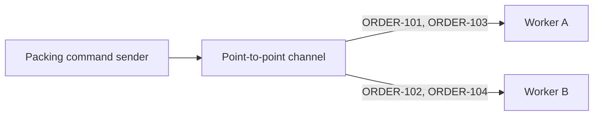
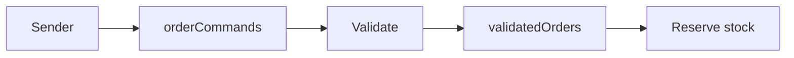

# Point-to-Point Semantics

In the **SPRING_INTEGRATION_CORE** module, under the **Channel Types** chapter, point-to-point semantics describe how a channel delivers each message to a single consumer. Understanding this contract helps wire `Message`, `MessageChannel`, endpoints, and gateways properly, while avoiding configurations where a message flow skips steps or duplicates business actions.

This lesson focuses on delivery semantics, implementations via `DirectChannel`, `QueueChannel`, and `ExecutorChannel`, connecting endpoints in Java DSL, and constraints to consider when handling errors.

## 1. Learning Objectives

After this lesson, you will be able to:

- Explain why a point-to-point channel can still have multiple consumers.
- Distinguish consumer count from execution threads, buffering, and data durability.
- Configure workers consuming the same channel without confusing that with a processing pipeline.
- Analyze load balancing, failover, `send()` outcomes, and transaction effects.
- Design tests that verify delivery without depending on accidental execution order.

The examples use Java 17 or later and Spring Integration 6.5.x APIs. The project requires the `org.springframework.integration:spring-integration-core` dependency; the configuration classes use Spring Context. The tests use JUnit Jupiter 5. Manage all Spring dependencies under a consistent, compatible bill of materials.

## 2. What Does Point-to-Point Mean?

A point-to-point channel transfers one message to one consumer within that channel's group of consumers. Multiple consumers can wait for work together; the channel coordinates so work is divided across the group. This pattern fits when each command only needs one worker to execute it. The pattern definition is in [Enterprise Integration Patterns: Point-to-Point Channel](https://www.enterpriseintegrationpatterns.com/patterns/messaging/PointToPointChannel.html).

Example: each order-packing request is handed to one worker. Both workers know how to pack orders, yet they do not both need to pack the same order.



The labels in the diagram illustrate one possible distribution. They do not imply that every point-to-point channel uses round-robin.

Separate three ideas:

1. **A channel can have multiple consumers.** The term "point-to-point" does not restrict a channel to a single subscriber.
2. **A normal dispatch selects one consumer.** Other consumers do not automatically receive a copy of that message.
3. **The delivery contract does not mean business logic completes exactly once.** A consumer can fail, the sender can retry, and failover can trigger extra handler calls.

With a failover-enabled dispatcher, one message can be tried across multiple handlers in sequence until one succeeds without throwing an error. Therefore, stating "every message invokes at most one handler in all situations" is too strong. Stopping once a handler accepts the message is documented in the [UnicastingDispatcher Javadoc](https://docs.spring.io/spring-integration/api/org/springframework/integration/dispatcher/UnicastingDispatcher.html).

### Who Is the Consumer Being Discussed?

In a Spring Integration flow, the consumer at a channel boundary is typically an endpoint receiving messages from the channel, such as a service activator, transformer, or router. That endpoint may forward the message onward to another channel.

Consequently, a message can pass through many endpoints across the full flow, while still being handed to only one consuming branch at each point-to-point boundary.

## 3. Four Independent Questions When Choosing a Channel

You cannot deduce a channel's full behavior solely from the "point-to-point" label.

| Question | Meaning | Examples |
| --- | --- | --- |
| Who receives the message? | Delivered to one consumer or broadcast to many subscribers? | Point-to-point vs. publish-subscribe |
| Where does the handler run? | On the sender's thread or another execution thread? | `DirectChannel` vs. `ExecutorChannel` |
| Where do messages wait? | Direct invocation, waiting in a queue, or waiting to be pulled? | `DirectChannel`, `QueueChannel`, `RendezvousChannel` |
| What happens on failure or shutdown? | Is there durability, rollback, retry, or recovery? | In-memory queue vs. persistent-store queue |

Common implementations:

| Channel | Delivery | How received | Execution characteristics |
| --- | --- | --- | --- |
| `DirectChannel` | Point-to-point | Pushed to subscriber | Handler runs on the sending thread |
| `ExecutorChannel` | Point-to-point | Pushed to subscriber via executor | Depends on executor; usually offloads from sending thread |
| `QueueChannel` | Point-to-point | Consumer calls `receive()` | Channel holds a queue; consumer decides when to pull and execute |
| `PublishSubscribeChannel` | Broadcast to subscribers | Pushed to subscribers | Defaults to sending thread; can configure an executor |

The table shows that point-to-point neither requires a queue nor requires asynchronous execution. These mechanisms are presented in [Message Channel Implementations](https://docs.spring.io/spring-integration/reference/6.5/channel/implementations.html).

### Subscribable vs. Pollable

`SubscribableChannel` exposes `subscribe(MessageHandler)` and `unsubscribe(MessageHandler)`. Consumers register so the channel invokes their handler when a message arrives.

`PollableChannel` exposes `receive()` and `receive(long timeout)`. Consumers actively pull messages out of the channel.

This distinction concerns the receiving interface. `SubscribableChannel` does not mean publish-subscribe: `DirectChannel` also implements this interface while having point-to-point semantics. See [MessageChannel Interfaces](https://docs.spring.io/spring-integration/reference/channel/interfaces.html).

## 4. DirectChannel: Splitting Work on the Sender's Thread

When a sender calls `DirectChannel.send(message)`:

1. The channel passes the message to its dispatcher.
2. The dispatcher selects one handler among subscribers.
3. The handler is invoked directly on the thread calling `send()`.
4. If dispatch succeeds, `send()` returns after the handler call completes.

The default constructor uses round-robin. You can pass `null` to the constructor to disable load balancing, and call `setFailover(false)` to disable falling back to another handler on error. These two options are independent. See [DirectChannel Javadoc](https://docs.spring.io/spring-integration/api/org/springframework/integration/channel/DirectChannel.html).

### Load Balancing Does Not Automatically Create Parallelism

Suppose a single thread sends six messages sequentially into a channel with two subscribers:

```text
send(M1) -> selected worker finishes -> return
send(M2) -> selected worker finishes -> return
send(M3) -> ...
```

Having two workers does not make those calls run in parallel. If each job takes 100 ms, a single sequential sending thread still completes roughly 10 jobs per second, ignoring other overhead.

Conversely, if multiple threads call `send()` concurrently, handlers can be invoked concurrently. Point-to-point does not lock the entire channel to a single thread. Shared business objects must satisfy thread-safety requirements.

Round-robin rotates dispatch turns across current subscribers. It does not measure worker busyness, guarantee equal processing times, or distribute across separate JVMs.

### No Subscribers

`DirectChannel` has no queue to hold messages while waiting for an endpoint to appear. Sending when no subscriber is registered raises a dispatch error. In practice, check endpoint lifecycle, channel names, and application configuration when encountering errors like `Dispatcher has no subscribers`.

Do not apply this rule to `QueueChannel`: a queue with available capacity can accept messages before any consumer exists.

## 5. Java DSL Example: Two Workers Receiving Packing Commands

This is a standalone runnable example using Spring Context. Each worker performs the same task and records results in an in-memory collector to observe distribution.

```java
import java.util.List;
import java.util.concurrent.CopyOnWriteArrayList;

import org.springframework.beans.factory.annotation.Qualifier;
import org.springframework.context.annotation.AnnotationConfigApplicationContext;
import org.springframework.context.annotation.Bean;
import org.springframework.context.annotation.Configuration;
import org.springframework.integration.channel.DirectChannel;
import org.springframework.integration.config.EnableIntegration;
import org.springframework.integration.dsl.IntegrationFlow;
import org.springframework.messaging.support.GenericMessage;

@Configuration
@EnableIntegration
public class PointToPointConfig {

    @Bean
    public DirectChannel orderCommands() {
        DirectChannel channel = new DirectChannel();
        channel.setFailover(false);
        return channel;
    }

    @Bean
    public HandledOrders handledOrders() {
        return new HandledOrders();
    }

    @Bean
    public IntegrationFlow workerA(
            @Qualifier("orderCommands") DirectChannel input,
            HandledOrders results) {

        return IntegrationFlow.from(input)
                .handle(String.class, (orderId, headers) -> {
                    results.record("A", orderId);
                    return null;
                })
                .get();
    }

    @Bean
    public IntegrationFlow workerB(
            @Qualifier("orderCommands") DirectChannel input,
            HandledOrders results) {

        return IntegrationFlow.from(input)
                .handle(String.class, (orderId, headers) -> {
                    results.record("B", orderId);
                    return null;
                })
                .get();
    }

    public static final class HandledOrders {
        private final List<String> entries = new CopyOnWriteArrayList<>();

        public void record(String worker, String orderId) {
            entries.add(worker + ":" + orderId);
        }

        public List<String> snapshot() {
            return List.copyOf(entries);
        }
    }

    public static void main(String[] args) {
        try (AnnotationConfigApplicationContext context =
                     new AnnotationConfigApplicationContext(
                             PointToPointConfig.class)) {

            DirectChannel input =
                    context.getBean("orderCommands", DirectChannel.class);

            for (int i = 1; i <= 6; i++) {
                boolean sent =
                        input.send(new GenericMessage<>("ORDER-" + i));
                if (!sent) {
                    throw new IllegalStateException("Unable to send command");
                }
            }

            System.out.println(
                    context.getBean(HandledOrders.class).snapshot());
        }
    }
}
```

Save the class as `PointToPointConfig.java` in a project with the listed dependencies. When the context starts, both flows subscribe endpoints to the same `orderCommands` bean. Java DSL creates and registers these components in the application context; see [Spring Integration Java DSL](https://docs.spring.io/spring-integration/reference/6.5/dsl.html).

Under the conditions of the example:

- There are six recorded results for the six successfully sent messages.
- With two fixed subscribers and default round-robin, each worker receives three messages.
- Both workers execute on the sending thread in `main`.
- No poller is needed because the input is a `DirectChannel`.
- `return null` ends the processing branch without producing a reply. It does not mean the worker rejected the message.
- `setFailover(false)` is set explicitly so if one worker fails, the error returns to the sender rather than trying the remaining worker.

Do not rely on whichever worker receives the first message as a business contract. Endpoint registration order and dispatcher configuration can change as application configuration evolves.

### Two Subscribers Are Not Two Sequential Steps

If you replace the two workers with:

```text
validateOrder receives from orderCommands
reserveStock receives from orderCommands
```

then each message is delivered to only one of the two endpoints. An order might be validated without reserving stock, or reserve stock without being validated.

If both steps are mandatory, chain them into a pipeline:



A single DSL flow can express a pipeline using `.transform(...)` followed by `.handle(...)`. A transformer must produce output for the next step; a handler ending with `null` does not automatically continue the chain.

This follows directly from the topology: endpoints sharing a single point-to-point input are alternative consumers; mandatory steps must have an output path leading to the next step.

## 6. QueueChannel: Competing for Work from a Queue

`QueueChannel` holds messages in a queue. A consumer pulling an item via `receive()` removes that item from the queue; other consumers cannot pull that same item in that normal receive cycle.

Place the following snippet inside a method; the classes used are `org.springframework.integration.channel.QueueChannel`, `org.springframework.messaging.Message`, and `org.springframework.messaging.support.GenericMessage`:

```java
QueueChannel jobs = new QueueChannel(2);

boolean accepted = jobs.send(new GenericMessage<>("ORDER-101"), 0);

Message<?> receivedByA = jobs.receive(0);
Message<?> receivedByB = jobs.receive(0);

System.out.println(accepted);                     // true
System.out.println(receivedByA.getPayload());     // ORDER-101
System.out.println(receivedByB);                  // null
```

Here there are no other producers or consumers. Worker A pulls first and receives the message; worker B gets `null` because the queue is now empty. In a system with multiple concurrent consumers, which worker pulls first depends on execution scheduling.

### Timeouts and Capacity

For an in-memory `QueueChannel`:

- `send(message, 0)` tries to enqueue immediately; returns `false` if full.
- `send(message, 500)` can wait up to 500 ms for space.
- `receive(0)` tries to pull immediately; returns `null` if empty.
- Variants without a timeout parameter can wait indefinitely when the queue is full or empty respectively.

The `new QueueChannel(100)` constructor sets the queue's capacity. The no-argument constructor has an effective limit of `Integer.MAX_VALUE`, making it unsuitable as a memory safeguard against continuously growing message volume. Constructors and timeouts are documented in the [QueueChannel Javadoc](https://docs.spring.io/spring-integration/api/org/springframework/integration/channel/QueueChannel.html).

The timeout of `send()` is how long to wait for the channel to accept the message per that channel's mechanism. In particular, `direct.send(message, 500)` does not set a 500 ms limit on all business work inside a synchronous handler.

### Polling Endpoint in Java DSL

When using a Spring Integration endpoint to consume a `QueueChannel`, the endpoint needs an explicit poller or a context-wide default poller. The two bean methods below go inside a class annotated with `@Configuration` and `@EnableIntegration`:

```java
import java.time.Duration;

import org.springframework.context.annotation.Bean;
import org.springframework.integration.channel.QueueChannel;
import org.springframework.integration.dsl.IntegrationFlow;
import org.springframework.integration.dsl.Pollers;

@Bean
public QueueChannel bufferedOrders() {
    return new QueueChannel(100);
}

@Bean
public IntegrationFlow bufferedWorker(QueueChannel bufferedOrders) {
    return IntegrationFlow.from(bufferedOrders)
            .handle(String.class, (orderId, headers) -> {
                System.out.println("Packing: " + orderId);
                return null;
            }, endpoint -> endpoint.poller(
                    Pollers.fixedDelay(Duration.ofMillis(100))
                            .receiveTimeout(0)
                            .maxMessagesPerPoll(10)))
            .get();
}
```

These are bean declarations, not a standalone Java compilation unit. `receiveTimeout(0)` avoids blocking each poll cycle when the queue is empty. `maxMessagesPerPoll(10)` limits how many messages are pulled per poll; it does not create ten workers.

You can define additional endpoints consuming the same `bufferedOrders` bean. However, concurrent processing requires configuring a scheduler or executor capable of running tasks concurrently. Having multiple polling endpoints does not by itself guarantee multiple execution threads. Turning a pollable input into a `PollingConsumer` and the poller's role are covered in [Message Endpoints](https://docs.spring.io/spring-integration/reference/endpoint.html).

Unlike `DirectChannel`, work distribution from a queue comes from consumers competing to pull items. There is no built-in round-robin across polling consumers guaranteeing each worker gets an exact half.

### Dequeueing Is Not Business Completion

With a default in-memory queue:

```text
receive() removes message from queue
    -> handler starts processing
    -> handler throws error
```

The channel does not automatically return the message to the queue just because the handler failed. You must design retries, a recovery branch, or an appropriate delivery mechanism.

If durability is required, use a persistent message store or an external messaging system through appropriate adapters. With a transaction-capable store and a properly configured transactional poller, pulling from the store can roll back when processing fails. That is a capability of the specific store and transaction setup, not an automatic property of every point-to-point channel. See [Persistent QueueChannel Configuration](https://docs.spring.io/spring-integration/reference/channel/configuration.html#channel-configuration-queuechannel).

## 7. ExecutorChannel: Decoupling Execution While Still Picking One Consumer

`ExecutorChannel` takes an executor and uses a point-to-point dispatcher. Adding threads does not turn it into a channel that broadcasts messages to every subscriber.

Example configuration expression once an appropriate `TaskExecutor` is available:

```java
ExecutorChannel channel = new ExecutorChannel(taskExecutor);
```

The channel class resides in `org.springframework.integration.channel`. The executor must be configured and lifecycle-managed separately in the application.

The key distinction to evaluate is when `send()` returns: with a genuinely asynchronous executor, the task may merely have been accepted for execution while the handler has not finished yet. An executor's task queue is also not a durable message queue. See [ExecutorChannel Javadoc](https://docs.spring.io/spring-integration/api/org/springframework/integration/channel/ExecutorChannel.html).

Thread-switching behavior depends on the executor. A synchronous executor can run directly on the calling thread; a policy such as `CallerRunsPolicy` can also push execution back onto the sending thread under overload. Therefore, do not rely on `ExecutorChannel` to preserve a transaction bound to the sending thread.

When choosing an executor, specify thread count, task queue capacity, and rejection behavior. Adding subscribers without increasing execution capacity is unlikely to raise throughput.

## 8. Load Balancing and Failover Solve Two Different Problems

**Load balancing** decides the order in which handlers are selected for messages.

**Failover** decides whether to try the next handler if the current handler throws an error.

With `DirectChannel`, the default configuration enables round-robin and failover. To prefer a primary handler and only use backup handlers in a fixed order after failures, use `new DirectChannel(null)` with failover enabled. To stop immediately on the first error, call `setFailover(false)`. Refer to [DirectChannel Configuration](https://docs.spring.io/spring-integration/reference/channel/configuration.html#channel-configuration-directchannel).

Example inside a method using Spring's `DirectChannel`, `MessageHandlingException`, and `GenericMessage`:

```java
DirectChannel primaryBackup = new DirectChannel(null);

primaryBackup.subscribe(message -> {
    throw new MessageHandlingException(
            message, "Primary worker could not process");
});

primaryBackup.subscribe(message ->
        System.out.println("Backup worker received: " + message.getPayload()));

primaryBackup.send(new GenericMessage<>("ORDER-101"));
```

Neither handler sets an explicit priority; registration order in the example puts the primary handler before the backup handler. The first handler errors, so the dispatcher tries the next handler. Once the backup handler returns normally, the dispatcher stops calling any remaining handlers.

### Business Side Effects Can Be Repeated

Consider a handler that executes:

```text
A: creates shipment successfully at external service
A: internal logging fails, throws exception
dispatcher: fails over to B
B: creates shipment again
```

A throwing an exception does not prove A did nothing. Both calls can produce side effects, even though only B completes normally.

Errors can also occur downstream in branch A after A already updated data. Across a synchronous chain, that error can bubble back to the initial dispatcher and trigger failover for the entire branch.

Consequently, when workers perform non-idempotent operations, the design must:

- Classify which errors are safe for retry or failover.
- Use a stable business key, such as `requestId`, to recognize already-executed commands.
- Enforce deduplication rules at the side-effect boundary rather than merely counting message deliveries.
- Coordinate deduplication state persistence with transactions where resources permit.

Spring Integration provides `IdempotentReceiverInterceptor` to help mark or filter duplicate messages, yet business-level idempotency still requires intentional application design. See [Idempotent Receiver](https://docs.spring.io/spring-integration/reference/6.5/handler-advice/idempotent-receiver.html).

Disabling failover eliminates one source of retries inside the dispatcher; callers or upstream infrastructure can still resend commands.

### Filter Rejection Does Not Automatically Route to Another Worker

If a filter drops a message without throwing an error, the dispatcher can treat the endpoint call as completed. The message is not automatically passed to the next subscriber to "find someone willing to accept it".

Similarly, a handler returning `null` normally indicates no reply was produced, not a signal asking the dispatcher to pick another consumer. When routing based on content is required, use a router or configure an explicit discard channel. Filter rejection behavior is described in [Filter](https://docs.spring.io/spring-integration/reference/6.5/filter.html).

## 9. send(), Error Handling, and Transactions

### Interpret send() Results According to the Channel

| Scenario | What is observed | What is NOT proven |
| --- | --- | --- |
| `DirectChannel.send()` returns `true` | The selected handler invocation returned normally | Business changes committed or all handler-spawned tasks finished |
| `QueueChannel.send()` returns `true` | Message was placed in the queue | A consumer pulled it or processed it successfully |
| `QueueChannel.send(message, 0)` returns `false` when full | This send attempt did not enqueue the message | A subsequent retry will also fail |
| `ExecutorChannel.send()` returns `true` with an async executor | Dispatch task was accepted per executor rules | Handler finished running or its transaction committed |

A handler may catch an error and return normally; a filter may drop a message; a handler may spawn separate tasks. Therefore, use replies or persisted business state whenever callers need to know the actual outcome.

Beyond `true` and `false`, `send()` can throw exceptions. Calling code must handle error paths matching the channel and endpoints in use.

### Synchronous Errors vs. Asynchronous Errors

With `DirectChannel`, errors not recovered via failover propagate up the call stack to the caller. Merely setting an `errorChannel` header does not convert a direct synchronous call into asynchronous error publishing.

For Spring Integration–managed tasks on executors or pollers, error handling can wrap failures into an `ErrorMessage` and send them to the error channel determined by configuration, headers, or the global error channel. Code that calls `QueueChannel.receive()` manually and invokes a handler itself must manage exceptions directly.

A messaging gateway can configure its own error handling. That does not alter the point-to-point nature of the request channel. These differences are explained in [Error Handling](https://docs.spring.io/spring-integration/reference/error-handling.html).

### Transactions Follow Execution and Resource Boundaries

`DirectChannel` runs on the sending thread, so downstream steps can join an existing transaction if propagation and resources are configured appropriately. The channel does not start a transaction merely because it is synchronous.

Once crossing a queue or an executor that actually switches threads, do not assume a transaction bound to the sending thread carries over to the worker. Workers may need their own transactions.

Likewise, do not assume a database rollback recalls a sent email or an HTTP call that already created a shipment. Atomicity must be evaluated per resource and per business boundary. Refer to [Transaction Support](https://docs.spring.io/spring-integration/reference/6.5/transactions.html).

## 10. Combining with Core Endpoints

Point-to-point governs message delivery at a channel. Business roles belong to endpoints and flow topology.

| Component | Appropriate combination |
| --- | --- |
| Transformer | Normalizes payload and sends output to the next step's channel |
| Router | Selects destination channel by data, e.g., domestic vs. international orders |
| Filter | Decides whether to proceed or drop, optionally routing to a discard channel |
| Service activator | Invokes business service on the chosen worker |
| Gateway | Exposes a Java interface to send requests; the request channel still determines delivery |
| Aggregator | Combines related messages after they are processed or split |

Two workers handling two different order types should not simply subscribe to one `DirectChannel` expecting round-robin to pick the right specialty. Use a router to select the right group; each group can use its own point-to-point channel to distribute work among equivalent workers.

With an aggregator, results passing through a point-to-point channel do not automatically ensure they assemble into the right group. You need an appropriate correlation key, release strategy, and state management. Splitting results across multiple aggregators with independent state stores can leave each seeing only part of a group. Refer to [Aggregator](https://docs.spring.io/spring-integration/reference/6.5/aggregator.html).

If two systems must both receive the same event—such as notification and analytics after an order is packed—use an explicit broadcast step via appropriate topology. Each downstream branch can still use point-to-point to distribute work internally.

## 11. Ordering, Throughput, and Deployment Scope

### Dequeue Order Does Not Mean Completion Order

Suppose a queue receives `M1` before `M2`. Worker A dequeues `M1` and takes two seconds; worker B dequeues `M2` and finishes in 100 ms. `M2`'s result appears first, even though the queue delivered messages in FIFO order.

If business rules require sequential processing per `orderId`, design key-based serialization or partitioning while also controlling retries. Round-robin across multiple handlers does not satisfy that requirement.

### Queues Only Absorb Rate Mismatches Temporarily

Illustrative estimation ignoring warm-up and burst variance:

- Source sends 100 messages per second.
- Two workers actually run concurrently, each processing 40 messages per second.
- Backlog grows by roughly 20 messages per second.
- A queue with 200 remaining slots fills up in about 10 seconds if rates stay constant.

Increasing queue capacity extends how long overload can be buffered; it does not raise total processing capacity from 80 to 100 messages per second.

In operations, monitor queue depth, age of queued messages, processing latency, retry counts, send failures, and completed business commands. Looking only at successful `send()` counts can hide growing backlogs or downstream errors.

### A Local Channel Is Not a Shared Queue Across Instances

Two application instances both declaring a bean named `orderCommands` do not form one shared channel. Each instance has its own channel object.

If instances must compete over one shared workload, use an external sharing or distribution mechanism such as a broker connected via adapters. Evaluate acknowledgments, redelivery, and durability of that infrastructure separately; the name "point-to-point" alone is insufficient to infer those guarantees.

## 12. Testing Delivery Behavior

The following tests demonstrate characteristics verifiable independently of business logic. They instantiate channels directly without starting a Spring context. Save the test class in a project with JUnit Jupiter configured.

```java
import java.util.concurrent.Callable;
import java.util.concurrent.CountDownLatch;
import java.util.concurrent.ExecutorService;
import java.util.concurrent.Executors;
import java.util.concurrent.Future;
import java.util.concurrent.TimeUnit;
import java.util.concurrent.atomic.AtomicInteger;
import java.util.concurrent.atomic.AtomicReference;

import org.junit.jupiter.api.Test;
import org.springframework.integration.channel.DirectChannel;
import org.springframework.integration.channel.QueueChannel;
import org.springframework.messaging.Message;
import org.springframework.messaging.MessageHandlingException;
import org.springframework.messaging.MessagingException;
import org.springframework.messaging.support.GenericMessage;

import static org.junit.jupiter.api.Assertions.*;

class PointToPointSemanticsTest {

    @Test
    void roundRobinSplitsMessagesWithoutBroadcasting() {
        DirectChannel channel = new DirectChannel();
        channel.setFailover(false);

        AtomicInteger a = new AtomicInteger();
        AtomicInteger b = new AtomicInteger();

        channel.subscribe(message -> a.incrementAndGet());
        channel.subscribe(message -> b.incrementAndGet());

        for (int i = 0; i < 4; i++) {
            assertTrue(channel.send(new GenericMessage<>("M" + i)));
        }

        assertEquals(4, a.get() + b.get());
        assertEquals(2, a.get());
        assertEquals(2, b.get());
    }

    @Test
    void directHandlerRunsOnTheSendingThread() {
        DirectChannel channel = new DirectChannel();
        AtomicReference<Thread> handlerThread = new AtomicReference<>();

        channel.subscribe(message ->
                handlerThread.set(Thread.currentThread()));

        assertTrue(channel.send(new GenericMessage<>("M1")));
        assertSame(Thread.currentThread(), handlerThread.get());
    }

    @Test
    void failoverCanRepeatASideEffect() {
        DirectChannel channel = new DirectChannel(null);
        AtomicInteger effects = new AtomicInteger();

        channel.subscribe(message -> {
            effects.incrementAndGet();
            throw new MessageHandlingException(
                    message, "Failed after performing side effect");
        });

        channel.subscribe(message -> effects.incrementAndGet());

        assertTrue(channel.send(new GenericMessage<>("M1")));
        assertEquals(2, effects.get());
    }

    @Test
    void disablingFailoverDoesNotInvokeTheBackup() {
        DirectChannel channel = new DirectChannel(null);
        channel.setFailover(false);
        AtomicInteger backupCalls = new AtomicInteger();

        channel.subscribe(message -> {
            throw new MessageHandlingException(message, "Worker failed");
        });
        channel.subscribe(message -> backupCalls.incrementAndGet());

        assertThrows(MessagingException.class,
                () -> channel.send(new GenericMessage<>("M1")));
        assertEquals(0, backupCalls.get());
    }

    @Test
    void onlyOneCompetingReceiverGetsTheQueuedMessage() throws Exception {
        QueueChannel channel = new QueueChannel(1);
        assertTrue(channel.send(new GenericMessage<>("M1"), 0));

        ExecutorService consumers = Executors.newFixedThreadPool(2);
        CountDownLatch start = new CountDownLatch(1);

        Callable<Message<?>> receive = () -> {
            start.await();
            return channel.receive(300);
        };

        try {
            Future<Message<?>> first = consumers.submit(receive);
            Future<Message<?>> second = consumers.submit(receive);
            start.countDown();

            Message<?> receivedA = first.get(5, TimeUnit.SECONDS);
            Message<?> receivedB = second.get(5, TimeUnit.SECONDS);

            int receiverCount = (receivedA == null ? 0 : 1)
                    + (receivedB == null ? 0 : 1);

            assertEquals(1, receiverCount);

            Message<?> winner =
                    receivedA != null ? receivedA : receivedB;
            assertNotNull(winner);
            assertEquals("M1", winner.getPayload());
            assertNull(channel.receive(0));
        } finally {
            consumers.shutdownNow();
        }
    }

    @Test
    void aFullBoundedQueueRejectsAnImmediateSend() {
        QueueChannel channel = new QueueChannel(1);

        assertTrue(channel.send(new GenericMessage<>("M1"), 0));
        assertFalse(channel.send(new GenericMessage<>("M2"), 0));

        Message<?> first = channel.receive(0);
        assertNotNull(first);
        assertEquals("M1", first.getPayload());

        assertTrue(channel.send(new GenericMessage<>("M2"), 0));
    }
}
```

How to interpret the results:

- The round-robin test verifies total handler invocations equal the message count and even splitting under fixed conditions; it does not assume which worker receives first.
- The same-thread test confirms the handler ran before `send()` returned.
- The two failover tests distinguish successful completions from performed side effects.
- The queue test only requires that exactly one receiver gets the message; it does not require A to beat B.
- The full-queue test verifies immediate return behavior with timeout 0.

In asynchronous tests, use `Future`, latches, or bounded waits to synchronize on the observable condition. An arbitrary `Thread.sleep()` does not confirm the handler actually finished.

These tests do not prove business-level exactly-once execution. To test deduplication, add scenarios that resend the same business key and inspect state in the system performing the side effect.

## 13. Common Design Mistakes

| Symptom | Possible cause | Remediation |
| --- | --- | --- |
| Each order runs only one of two mandatory steps | Both endpoints share one point-to-point input | Chain steps into a pipeline |
| Adding subscribers leaves a single sender slow | `DirectChannel` still invokes handlers synchronously | Evaluate execution boundaries and parallelism needs |
| Some messages go to the wrong specialized worker | Using load balancing instead of data-based routing | Use a router to select the group before splitting work |
| Send succeeds yet orders are not processed | Succeeded only at enqueue or task submission | Observe replies or business status |
| Duplicate shipments or charges on error | Side effect occurred before retry or failover | Design idempotency at the side-effect boundary |
| Queued messages lost after process restart | Default queue is in-memory only | Choose suitable durable storage and recovery |
| Caller never sees errors after offloading threads | Failure occurred inside an asynchronous task | Configure and consume the error flow |
| An aggregator group waits forever | Results split across independent state stores | Design consistent correlation and state storage |

When designing a point-to-point boundary, explicitly define which consumers are interchangeable, when the sender considers work done, where messages wait, and how recovery works when a worker fails. Those decisions turn channel selection into a testable message-flow contract.
