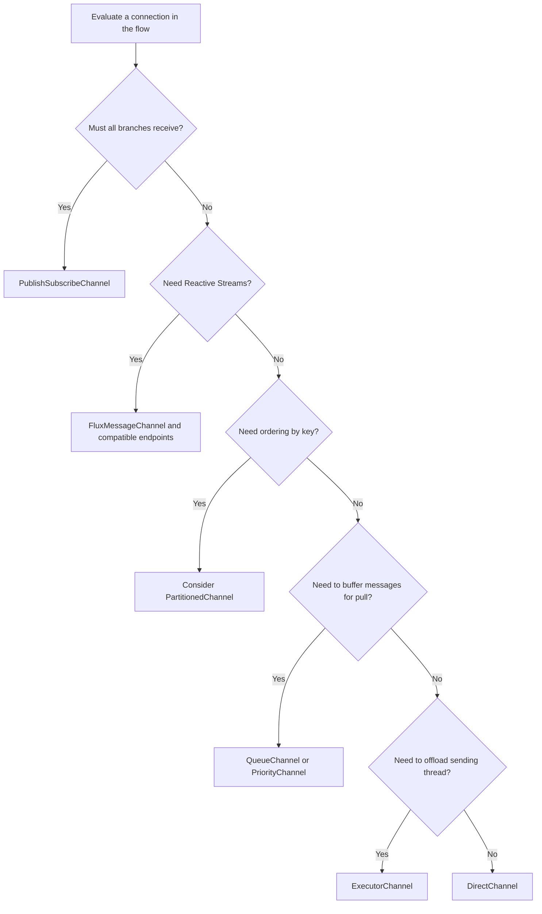
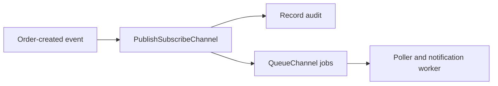

# Choosing a Channel for a Message Flow

In Spring Integration Core, choosing a channel determines how one step in a flow hands off a message to the next step: delivering to one destination or many, invoking immediately on the current thread or handing off to another thread, buffering messages until processed, or requiring the receiver to be present right away. The same transformer or service activator can exhibit very different operational characteristics when its input channel changes.

This lesson belongs to the **Channel Types** chapter of the **SPRING_INTEGRATION_CORE** module and focuses on choosing a channel from message-flow requirements. After this lesson, you will be able to justify your choice in terms of topology, threads, buffering, ordering, timeouts, and error paths, and express that choice in Java DSL configuration.

## 1. Read Flow Requirements Before Choosing a Channel Class

Consider an order-processing flow:

```text
Intake → normalize → validate → persist order → notify
```

Each arrow may carry a different requirement:

- Data normalization must be fast, and the caller needs to see validation errors immediately.
- Report exporting can wait, yet the amount of accepted work must be bounded.
- Once an order is created, both auditing and notifications must receive the event.
- Changes to the same order must be processed in sequence.
- Accepted work must have a crash-recovery mechanism if the business requires it.

Therefore, you do not need to pick one channel type for the entire system. Document the contract of each connection:

| Design question | Example answers |
| --- | --- |
| Who must receive the message? | Any single worker or all branches |
| What must the sender wait for? | Handoff, receiving a result, or full business completion |
| Where does pending work wait? | Inside a channel, inside an executor, or in a storage system |
| What happens when intake capacity is full? | Bounded wait, reject, or route to durable storage |
| What ordering is required? | Global, per order ID, or none |
| Who observes and handles failures? | Synchronous caller or an error-receiving flow |
| Which failures must messages survive? | Only the JVM lifetime or across restarts |

These are design questions for the lesson's example, not an automatic algorithm mapping every business case to a single Java class.

## 2. Three Concepts to Keep Separate

### 2.1. Message, Channel, and Endpoint

`Message<?>` carries payload and headers. A channel transports messages. An endpoint connects a channel to functionality such as a transformer, filter, router, or service activator.

Switching `DirectChannel` to `QueueChannel` does not turn the processing logic into a different business function. However, an endpoint reading from a queue must have a way to pull messages, and execution timing changes. When designing in Java DSL, inspect both the channel and the endpoint immediately following it.

### 2.2. Receiving Mechanism Is Not Receiver Count

`MessageChannel` provides `send(...)`. Two common sub-contracts are:

- `SubscribableChannel`: register a `MessageHandler`; the channel pushes to handlers.
- `PollableChannel`: the receiver calls `receive(...)` to pull messages.

Both `DirectChannel` and `PublishSubscribeChannel` have subscribers, yet their dispatch semantics differ. Having multiple subscribers does not automatically mean every subscriber receives every message. See [The MessageChannel Interface](https://docs.spring.io/spring-integration/reference/channel/interfaces.html).

### 2.3. Send Success Is Not Business Success

When reading `send(...)`, always identify which boundary it completed up to:

| Boundary | What can be confirmed |
| --- | --- |
| Synchronous handler invocation | The handler invoked on that call stack returned normally |
| Enqueued into a queue | The message was accepted by the queue |
| Submitted to an async executor | The dispatch task was accepted by the executor |
| Gateway reply received | A result returned under the request–reply contract |
| Business data committed | The corresponding transaction committed |

For instance, a handler returning normally does not prove an outer transaction has committed. Similarly, a gateway returning a reply does not prove every downstream notification triggered later has already been sent.

## 3. Channel Selection Map

| Channel | Delivery and primary mechanism | Scenarios to consider |
| --- | --- | --- |
| `DirectChannel` | Point-to-point; invokes handler on sending thread | Fast steps needing immediate results or errors |
| `ExecutorChannel` | Point-to-point; delegates dispatch to an executor | Decoupling processing from the intake thread |
| `QueueChannel` | Point-to-point; buffers messages for receivers to pull | Absorbing traffic spikes, controlling polling |
| `PublishSubscribeChannel` | Broadcasts to subscribers | One event must reach multiple branches |
| `PriorityChannel` | Pollable; selects messages by priority | Work with differing urgency tiers |
| `RendezvousChannel` | Pollable; direct handoff with zero buffer | Caller must wait for a receiver to accept the message |
| `PartitionedChannel` | Point-to-point; partitions by key | Preserving per-entity order within the channel's scope |
| `FluxMessageChannel` | Connects Reactive Streams `Publisher`/`Subscriber` | Flows with reactive components needing demand management |

Implementation characteristics are documented in [Message Channel Implementations](https://docs.spring.io/spring-integration/reference/channel/implementations.html). `PartitionedChannel` was introduced in Spring Integration 6.1; verify your project's version before adopting it.

A quick way to read requirements:



This diagram is a design guide. A broadcast branch can still feed into its own queue; a reactive flow still has to isolate blocking calls; durability requirements demand an additional architectural decision.

## 4. DirectChannel for Synchronous Processing Segments

Suppose a caller submits a product code and expects a normalized string back. This segment has no reason yet to introduce a queue or thread pool.

The example uses `spring-integration-core` on the classpath and registers this configuration in a Spring ApplicationContext:

```java
import java.util.Locale;

import org.springframework.context.annotation.Bean;
import org.springframework.context.annotation.Configuration;
import org.springframework.integration.channel.DirectChannel;
import org.springframework.integration.config.EnableIntegration;
import org.springframework.integration.dsl.IntegrationFlow;

@Configuration
@EnableIntegration
public class ProductFlowConfig {

    @Bean
    public DirectChannel productRequests() {
        return new DirectChannel();
    }

    @Bean
    public IntegrationFlow productFlow() {
        return IntegrationFlow.from(productRequests())
                .<String, String>transform(
                        value -> value.trim().toUpperCase(Locale.ROOT))
                .<String, String>transform(value -> "PRODUCT:" + value)
                .get();
    }
}
```

Both transformers build the output string; the final reply travels via the `replyChannel` provided by the request–reply mechanism. With the `productRequests` bean obtained from the context, callers can use:

```java
import org.springframework.integration.core.MessagingTemplate;
import org.springframework.messaging.Message;
import org.springframework.messaging.support.GenericMessage;

// productRequests is the DirectChannel bean in the ApplicationContext.
MessagingTemplate template = new MessagingTemplate();
template.setReceiveTimeout(2_000);

Message<?> reply = template.sendAndReceive(
        productRequests,
        new GenericMessage<>(" sku-42 "));

if (reply == null) {
    throw new IllegalStateException("No result received");
}

System.out.println(reply.getPayload()); // PRODUCT:SKU-42
```

`DirectChannel` invokes a selected handler on the sender's thread. Thus, a synchronous chain can join an active thread-bound transaction if transaction configuration and resources are compatible. The channel does not open a transaction on its own. See [DirectChannel API](https://docs.spring.io/spring-integration/api/org/springframework/integration/channel/DirectChannel.html).

Two practical limits apply:

- A handler calling an external service for three seconds holds the sending thread for that duration.
- Two concurrent senders can still invoke the same handler concurrently. Synchronous per-call execution does not create a single global worker for the whole application.

If you register multiple handlers on a `DirectChannel`, they should normally be interchangeable alternatives. The dispatcher can load balance and fail over; do not use this mechanism to implement a "validate, then persist, then notify" sequence. With side effects, weigh the risk that an earlier handler already performed partial work before failover. Options are covered in [Configuring Message Channels](https://docs.spring.io/spring-integration/reference/channel/configuration.html).

## 5. QueueChannel When Buffering and Pull Control Are Needed

A report-exporting feature can often accept jobs first and process them later. Initial design:

```text
Sender → jobs, up to 100 messages → poller → handler
                                          └→ jobErrors on failure
```

The configuration below illustrates a terminal worker: finishing processing produces no reply. `System.out` and `System.err` simply make message flow visible during the exercise.

```java
import org.springframework.context.annotation.Bean;
import org.springframework.context.annotation.Configuration;
import org.springframework.integration.channel.DirectChannel;
import org.springframework.integration.channel.QueueChannel;
import org.springframework.integration.config.EnableIntegration;
import org.springframework.integration.dsl.IntegrationFlow;
import org.springframework.integration.dsl.Pollers;

@Configuration
@EnableIntegration
public class JobFlowConfig {

    @Bean
    public QueueChannel jobs() {
        return new QueueChannel(100);
    }

    @Bean
    public DirectChannel jobErrors() {
        return new DirectChannel();
    }

    @Bean
    public IntegrationFlow jobWorker() {
        return IntegrationFlow.from(jobs())
                .handle(String.class, (payload, headers) -> {
                    if (payload.isBlank()) {
                        throw new IllegalArgumentException(
                                "Job name must not be blank");
                    }
                    System.out.println("Processing: " + payload);
                    return null;
                }, endpoint -> endpoint.poller(
                        Pollers.fixedDelay(100)
                                .maxMessagesPerPoll(10)
                                .receiveTimeout(0)
                                .errorChannel("jobErrors")))
                .get();
    }

    @Bean
    public IntegrationFlow jobErrorFlow() {
        return IntegrationFlow.from(jobErrors())
                .handle(message -> {
                    Throwable failure = (Throwable) message.getPayload();
                    System.err.println(
                            "Job failed: " + failure.getMessage());
                })
                .get();
    }
}
```

The `jobs` bean is a shared channel. If another flow uses the same queue, reference that bean; avoid creating two distinct queues with the same name. Java DSL has guidance on sharing channels in [Message Channels](https://docs.spring.io/spring-integration/reference/dsl/java-channels.html).

A bounded-wait send:

```java
import org.springframework.messaging.support.GenericMessage;

// jobs is the QueueChannel bean in the ApplicationContext.
boolean accepted = jobs.send(
        new GenericMessage<>("export:orders:2026-11"),
        50);

if (!accepted) {
    throw new IllegalStateException(
            "Queue did not accept the job within timeout");
}
```

Here `50` is how long to wait for queue space to send, in milliseconds. It does not bound how long report exporting takes.

When the queue is full, `send(message, 0)` tries immediately; a positive timeout permits a bounded wait. `receive(timeout)` can return `null` if no message is pulled within the deadline. Handle both `false` send outcomes and any exceptions thrown on the send path.

`QueueChannel` holds messages; it does not spawn workers. The polling endpoint is responsible for pulling messages and invoking the handler. In the configuration above:

- `fixedDelay(100)` controls the poller schedule.
- `maxMessagesPerPoll(10)` caps messages per poll cycle; it does not create ten workers.
- `receiveTimeout(0)` ends the poll immediately when the queue is empty.
- `errorChannel("jobErrors")` configures the error destination for the poller.

These APIs are documented in [Pollers](https://docs.spring.io/spring-integration/reference/dsl/java-pollers.html) and [PollerSpec API](https://docs.spring.io/spring-integration/api/org/springframework/integration/dsl/PollerSpec.html).

Capacity counts messages waiting inside the queue, excluding work already pulled and running. `new QueueChannel()` defaults to a huge effective capacity; set an explicit bound rather than treating memory as infinite. See [QueueChannel API](https://docs.spring.io/spring-integration/api/org/springframework/integration/channel/QueueChannel.html).

## 6. ExecutorChannel When Offloading Work to a Thread Pool

If the primary goal is freeing the intake thread to handle other work, use `ExecutorChannel`.

The following beans go in a Spring configuration with `@EnableIntegration` enabled; this is an alternative to the queue-and-poller approach in the previous section:

```java
import org.springframework.beans.factory.annotation.Qualifier;
import org.springframework.context.annotation.Bean;
import org.springframework.integration.channel.ExecutorChannel;
import org.springframework.scheduling.concurrent.ThreadPoolTaskExecutor;

@Bean
public ThreadPoolTaskExecutor enrichmentExecutor() {
    ThreadPoolTaskExecutor executor = new ThreadPoolTaskExecutor();
    executor.setCorePoolSize(4);
    executor.setMaxPoolSize(4);
    executor.setQueueCapacity(64);
    executor.setThreadNamePrefix("enrichment-");
    return executor;
}

@Bean
public ExecutorChannel enrichmentTasks(
        @Qualifier("enrichmentExecutor")
        ThreadPoolTaskExecutor executor) {
    return new ExecutorChannel(executor);
}
```

Spring manages initialization and destruction of the executor bean. Endpoints behind `enrichmentTasks` are subscribers; no poller is needed to pull work from this channel.

An important distinction: `64` is the capacity of **the executor's task queue**. You do not call `enrichmentTasks.receive()` to pull waiting messages. With `QueueChannel`, the queue is part of the message-receiving contract and receivers actively poll it.

`ExecutorChannel` still dispatches point-to-point. Switching threads usually drops any transaction scope bound to the sender's thread; workers need their own transaction boundaries if required. See [ExecutorChannel API](https://docs.spring.io/spring-integration/api/org/springframework/integration/channel/ExecutorChannel.html).

An executor design must also answer:

- When both the pool and task queue are full, which rejection policy applies?
- Are task-submission rejections surfaced clearly to the sender?
- If a worker fails after the sender has returned, which flow receives the error?
- During shutdown, how are in-flight and queued tasks handled?

Do not claim `ExecutorChannel` always runs on another thread or always returns immediately. A synchronous executor or a policy like `CallerRunsPolicy` can execute tasks on the calling thread. Treat the thread pool as part of your design contract, not merely a tuning parameter.

## 7. PublishSubscribeChannel When One Event Needs Multiple Branches

Suppose an order-creation event must reach both auditing and notifications:



Wiring two handlers to a `DirectChannel` creates competing consumers. Broadcasting requires `PublishSubscribeChannel`.

The Java DSL snippet below can be added to `JobFlowConfig`. The `orderEvents` input is created by name by the DSL; `publishSubscribeChannel` sets up a broadcast point to two subflows. In this illustration, the event payload is a string and the `jobs` worker simply prints it.

```java
import org.springframework.messaging.MessageDeliveryException;

@Bean
public IntegrationFlow orderEventFlow() {
    return IntegrationFlow.from("orderEvents")
            .publishSubscribeChannel(broadcast -> broadcast
                    .subscribe(branch -> branch.handle(message -> {
                        System.out.println(
                                "Audit: " + message.getPayload());
                    }))
                    .subscribe(branch -> branch.handle(message -> {
                        if (!jobs().send(message, 50)) {
                            throw new MessageDeliveryException(
                                    message,
                                    "Notification queue has no space left");
                        }
                    })))
            .get();
}
```

Without an executor, broadcast handlers run on the sending thread. "Publish–subscribe" specifies how many recipients receive the message, not parallel execution. When adding an executor, design error paths and load limits explicitly. See [PublishSubscribeChannel API](https://docs.spring.io/spring-integration/api/org/springframework/integration/channel/PublishSubscribeChannel.html).

In the example, one branch sends the message into a queue with a finite timeout. That decouples notification processing timing from event broadcasting, though the enqueue operation itself can wait up to the specified timeout.

A broadcast event is also not automatically a shared transaction across all branches. If audit succeeded and then notification failed, retrying the whole event can duplicate the audit side effect. Design idempotency and retry policies aligned with business boundaries.

Treat payloads as immutable across branches. Creating multiple `Message` wrappers does not deep-copy objects inside the payload; one branch mutating a shared object can affect other branches.

## 8. Special Requirements: Priority, Handoff, Ordering, and Reactive

### 8.1. PriorityChannel: Prioritizing Work Dequeued

When urgent work must jump ahead of waiting standard work, consider `PriorityChannel`. Default priority relies on the `priority` header; a custom comparator can also be supplied.

This changes selection order inside the queue without preempting already-running tasks. If high-priority work arrives continuously, weigh the risk of starving standard tasks.

### 8.2. RendezvousChannel: Waiting for Receiver Acceptance

`RendezvousChannel` holds no backlog. Sender and receiver must meet to hand off the message. When handoff succeeds, it confirms a receiver accepted the message, not that business work finished.

If the same thread calls `send()` intending to call `receive()` afterward, handoff cannot happen while that thread is blocked in `send()`. Provide an independent receiver and finite timeouts.

Properties of both channels are documented in [Message Channel Implementations](https://docs.spring.io/spring-integration/reference/channel/implementations.html).

### 8.3. FIFO Alone Does Not Guarantee Completion Order

Suppose a queue yields A and then B:

```text
Worker 1 takes A → takes 500 ms
Worker 2 takes B → takes  20 ms
```

B can finish before A even though the queue delivered in FIFO order. If completion order matters, bound concurrency or partition work by business key.

With Spring Integration 6.1 or later, you can declare a bean:

```java
import java.util.Objects;

import org.springframework.integration.channel.PartitionedChannel;

@Bean
public PartitionedChannel orderUpdates() {
    return new PartitionedChannel(
            4,
            message -> Objects.requireNonNull(
                    message.getHeaders().get("orderId"),
                    "Missing orderId header"));
}
```

The `orderId` key routes updates for the same order to the same partition with its own sequential worker thread. Different keys can still collide into the same partition. This ordering holds within the channel's dispatch scope; if handlers spawn further async tasks, re-verify completion order. See [PartitionedChannel API](https://docs.spring.io/spring-integration/api/org/springframework/integration/channel/PartitionedChannel.html).

When running multiple application instances, each instance having a `PartitionedChannel` does not create global ordering across instances. Design external key-affinity routing or coordination as needed.

### 8.4. FluxMessageChannel: Inspect the Entire Reactive Chain

`FluxMessageChannel` is designed for Reactive Streams interaction. It does not offer `QueueChannel`'s polling API and does not register `MessageHandler` instances via the ordinary `SubscribableChannel` contract.

This choice makes sense when sources, endpoints, and receivers coordinate via demand. Swapping in a single reactive channel does not make blocking JDBC or HTTP calls non-blocking; inspect the communication libraries and execution boundaries across the entire chain. See [Reactive Streams Support](https://docs.spring.io/spring-integration/reference/reactive-streams.html).

## 9. Asynchronous Boundaries Change Error Paths and Request–Reply

In a synchronous chain, exceptions can propagate back to the calling thread. With workers past a queue or executor, the sender may have already finished before an error occurs. Spring Integration can emit an `ErrorMessage` for framework-managed tasks; the destination is typically resolved from the `errorChannel` header or the default error channel. Pollers can configure an error channel as in the `jobErrors` example. See [Error Handling](https://docs.spring.io/spring-integration/reference/error-handling.html).

Distinguish these cases:

| Situation | Where to check |
| --- | --- |
| Queue full and send timeout expires | Return value of `send(...)` on the sender side |
| Executor rejects task upon submission | Exception or error contract at the send point |
| Handler in synchronous chain throws error | Caller or gateway configuration |
| Asynchronous handler throws error | Error handler and flow receiving `ErrorMessage` |
| Flow accepted request but produced no reply | Gateway contract and reply timeout |

Attaching an `errorChannel` header does not automatically turn every exception from a synchronous call into an error message. Likewise, using an arbitrary custom executor outside Spring Integration management does not automatically wire up framework error handling.

A messaging gateway lets business code call a Java interface instead of working with messages directly. If the interface returns a synchronous result, callers may still wait for a reply even when the flow behind it uses a queue or executor. See [Messaging Gateways](https://docs.spring.io/spring-integration/reference/gateway.html).

Set three timeouts at their respective boundaries:

1. **Send timeout**: how long to wait to hand off the request.
2. **Poller receive timeout**: how long each poll waits for a message.
3. **Reply timeout**: how long a request–reply caller waits for a response.

None of these replace network call or database query timeouts. In particular, a reply timeout does not interrupt a synchronous handler holding the call stack and does not cancel worker-side business work.

If a gateway awaits a result from a flow containing a dropping filter or a terminal service activator returning `null`, define the outcome when no reply is produced. Do not swap channels while leaving a reply contract the flow can no longer satisfy.

## 10. Combining Channels with Transformers, Routers, Filters, and Aggregators

Channels solve delivery; endpoints handle transformation and decision-making:

| Component | Role in flow design |
| --- | --- |
| Transformer | Normalizes payload before handing off to workers or branching |
| Filter | Allows or drops messages by condition; define discard target or rejection outcome |
| Router | Selects destination based on content or headers |
| Service activator | Executes business logic, optionally producing a reply or ending the branch |
| Aggregator | Collects related messages and emits a result per release condition |

Example design for order intake:

```text
DirectChannel
    → normalizing transformer
    → validation filter
    → router by order type
        → QueueChannel for batch processing
        → DirectChannel for lookup needing immediate reply
```

A router chooses the path; placing two subscribers on a point-to-point channel does not replace content-based routing. In the flow above, also specify the reply contract separately for the batch-processing branch.

When branching and then gathering results with an aggregator, you need a correlation key and completion criteria. If using sequence headers generated by `PublishSubscribeChannel`, enable `applySequence`; it is disabled by default for broadcasts. Guidance is in [PublishSubscribeChannel Configuration](https://docs.spring.io/spring-integration/reference/channel/configuration.html#channel-configuration-publishsubscribechannel).

Before finalizing a design, check what happens if one branch is dropped by a filter, throws an error, or returns no result. If the aggregator still waits for the initial expected count, the group may never release; make timeouts and partial outcomes consistent with business rules.

## 11. Sizing Load Limits from Rates and Deadlines

Suppose a traffic burst lasts five seconds:

- Ingress: 300 messages/second.
- Effective processing capacity: 200 messages/second.
- Queue starts empty.

Estimate added backlog:

```text
Backlog ≈ (300 − 200) × 5 = 500 messages
```

Choosing capacity 600 can hold the burst under those assumptions. However, a message sitting behind 500 queued items waits roughly:

```text
Wait time ≈ 500 / 200 = 2.5 seconds
```

If callers only tolerate two seconds, raising capacity does not meet the latency requirement. You may need to shed intake load, increase processing capacity, or change the contract to returning a job ID and polling status.

If payloads average 8 KiB, 600 payloads alone take roughly 4.69 MiB. Real memory also includes headers, Java objects, queues, intermediate data, and in-flight tasks.

This is an illustrative estimation model, not a performance guarantee. Measure under realistic load and latency distributions. Key metrics to track include:

- Queue depth and age of queued messages.
- Intake rate compared to completion rate.
- Wait latency and processing latency, especially upper percentiles.
- Timed-out sends, rejections, and business error counts.
- For executors: active threads, task queue depth, and rejection counts.

If a poller drains very fast and pushes everything into a slow executor, the queue channel can look nearly empty while the backlog builds inside the executor. Observe where work is actually waiting.

## 12. In-Memory Buffering and Durable Persistence Are Two Separate Decisions

The default queue in these examples lives in JVM memory. A successful send into that queue is not enough to confirm work will survive an abrupt process shutdown.

Spring Integration supports message stores for buffering components, including queues and aggregators. With durable persistence, consider payload and header serialization, transaction boundaries, and recovery mechanics. See [Message Store](https://docs.spring.io/spring-integration/reference/message-store.html).

A "never lose accepted work" design must clarify at least:

1. Whether acceptance acknowledgment occurs before or after durable persistence.
2. How work is redelivered if a worker crashes mid-flight.
3. How side effects are protected against duplicate execution via idempotency keys or transactions.
4. Which identifier is used to look up job results and status.

With a persistent queue and a properly transacted poller, message retrieval and rollback can coordinate with the store. Merely attaching a store without proper transaction boundaries is insufficient to protect the whole business operation. See [Persistent QueueChannel Configuration](https://docs.spring.io/spring-integration/reference/channel/configuration.html#channel-configuration-queuechannel).

When crossing multiple processes or retaining jobs long-term, consider a broker or dedicated job persistence mechanism. In-process channels remain useful for steps within each application.

## 13. Testing Channel Choices Through Observable Behavior

Do not merely check whether a bean has the right class. Test the properties your design depends on: calling thread, buffering capacity, recipient count, error paths, and timeouts.

The JUnit Jupiter tests below illustrate three channel-level contracts without starting a full ApplicationContext.

```java
import java.util.concurrent.atomic.AtomicInteger;
import java.util.concurrent.atomic.AtomicReference;

import org.junit.jupiter.api.Test;
import org.springframework.integration.channel.DirectChannel;
import org.springframework.integration.channel.PublishSubscribeChannel;
import org.springframework.integration.channel.QueueChannel;
import org.springframework.messaging.Message;
import org.springframework.messaging.support.GenericMessage;

import static org.junit.jupiter.api.Assertions.*;

class ChannelContractTest {

    @Test
    void directChannelInvokesHandlerInSenderThread() {
        DirectChannel channel = new DirectChannel();
        AtomicReference<Thread> handlerThread = new AtomicReference<>();
        AtomicReference<String> handled = new AtomicReference<>();

        channel.subscribe(message -> {
            handlerThread.set(Thread.currentThread());
            handled.set((String) message.getPayload());
        });

        Thread senderThread = Thread.currentThread();

        assertTrue(channel.send(new GenericMessage<>("order-42")));
        assertSame(senderThread, handlerThread.get());
        assertEquals("order-42", handled.get());
    }

    @Test
    void queueBuffersBeforeAnyConsumerReceives() {
        QueueChannel channel = new QueueChannel(1);

        assertTrue(channel.send(new GenericMessage<>("first"), 0));
        assertFalse(channel.send(new GenericMessage<>("second"), 0));

        Message<?> received = channel.receive(0);
        assertNotNull(received);
        assertEquals("first", received.getPayload());
        assertNull(channel.receive(0));

        assertTrue(channel.send(new GenericMessage<>("second"), 0));
    }

    @Test
    void publishSubscribeDeliversToBothSubscribers() {
        PublishSubscribeChannel channel = new PublishSubscribeChannel();
        AtomicInteger first = new AtomicInteger();
        AtomicInteger second = new AtomicInteger();

        channel.subscribe(message -> first.incrementAndGet());
        channel.subscribe(message -> second.incrementAndGet());

        assertTrue(channel.send(new GenericMessage<>("order-created")));
        assertEquals(1, first.get());
        assertEquals(1, second.get());
    }
}
```

When testing full asynchronous flows, use latches or condition-waiting utilities with finite timeouts. Calling `Thread.sleep(...)` and assuming a worker finished often produces flaky tests.

For `JobFlowConfig`, good follow-up integration tests include sending a blank payload to observe `ErrorMessage`, stopping the consumer to verify full-queue behavior, and confirming the worker actually finished before declaring success. Spring Integration provides test utilities in [Testing Support](https://docs.spring.io/spring-integration/reference/testing.html).

## 14. Applying to a Concrete Design Decision

Suppose we need a flow that accepts order-creation requests, processes updates sequentially by order ID, and broadcasts notifications:

| Connection | Initial choice | Rationale and conditions to verify |
| --- | --- | --- |
| Gateway → data normalization | `DirectChannel` | Fast processing; caller must see input validation errors |
| Normalization → routing | `DirectChannel` | No buffering or thread switch needed yet |
| Updates for same order → processing | `PartitionedChannel` | Sequential per `orderId` within design scope |
| Order-created event → branches | `PublishSubscribeChannel` | Both auditing and notifications need the event |
| Notification branch → worker | Bounded `QueueChannel` | Allows deferred processing; needs full-queue policy |
| Independent external call → processing | `ExecutorChannel` with bounded pool | Offloads thread; needs network timeouts and dedicated error path |

This table is a starting proposal for the stated requirements. Before implementing, pinpoint where the gateway gets its reply, where durable work persistence is confirmed, and where messages only travel in memory. Channel selection is complete when every connection has an explainable, testable contract.
